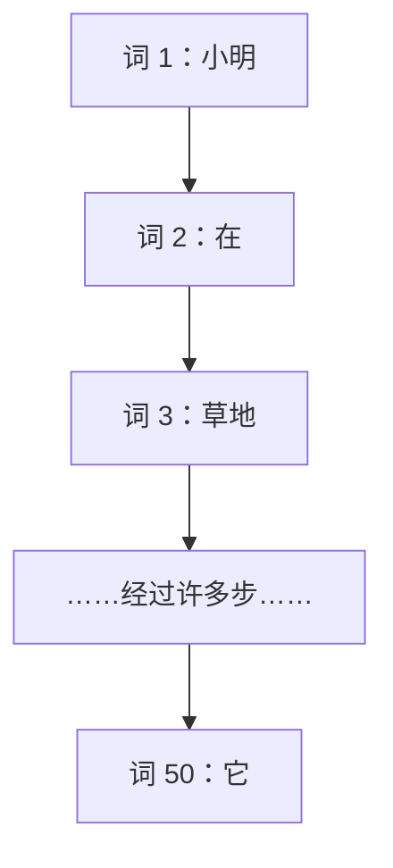
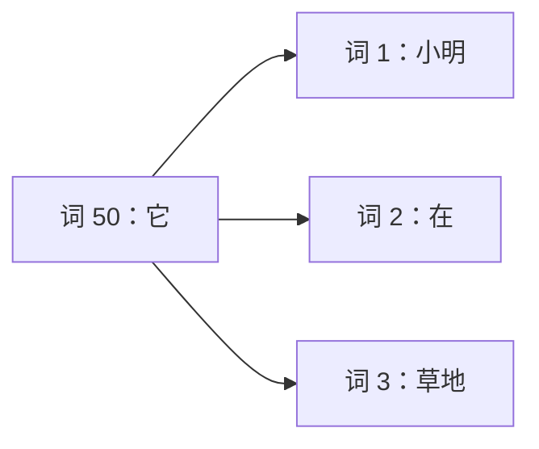

# 第2章：注意力机制的直觉——为什么我们需要“注意力”？

读到“苹果”时，你想到的是水果，还是手机品牌？这个问题没有脱离上下文的唯一答案。

前两章已经把文本变成了 token ID，再查表得到向量。现在还缺一件事：**让每个位置的表示，能利用这一次输入里的相关信息。** 本章先不急着背 Q、K、V 的公式，而是回答三个问题：为什么要看上下文，信息怎样传到需要它的位置，以及注意力图能告诉我们什么、不能告诉我们什么。

为方便观察，本章的图有时把一个词或短语画成一个方块。真实模型处理的是 tokenizer 输出的 token，一个汉语词不保证恰好对应一个 token。

## 2.1 同一个“苹果”，为什么不能只查一次字典？

请看两句话：

1. “秋天到了，红富士**苹果**又脆又甜。”
2. “发布会上推出了新款**苹果**手机。”

第一句里的“苹果”是一种水果；第二句里的“苹果”指向品牌。帮助我们区分它们的，不是“苹果”两个字突然换了写法，而是“红富士、脆、甜”和“发布会、手机”等上下文线索。

如果暂时把“苹果”视为一个 token，在同一组模型参数下，它每次从 embedding 表里取出的都是同一行数字。**查表只回答“你是谁”，还没有回答“你在这句话里是什么意思”。**

```
                   同一行输入 embedding
                         [苹果]
                        /      \
              看“脆、甜”        看“手机、发布会”
                  ↓                   ↓
           水果语境下的表示      品牌语境下的表示
```

这里有两个容易混淆的地方：

- **“静态”不等于参数永远不能更新。** embedding 表可以在训练时更新；这里说的是在参数固定时，相同 ID 的查表结果不随本次上下文变化。
- **“表示改变”不等于改写词表。** 模型会计算这一位置的新表示，原来的 embedding 表仍在那里。下一句话中的“苹果”再从同一行出发，走出另一个上下文相关的结果。

真实向量的各维也不天然叫“甜度”“科技感”。这些名称可以帮助想象，却不是读出了模型内部的字典。

更重要的是，语境不只解决一词多义。“小狗追着球跑，**它**停在树边”中的“它”，还涉及指代；“这部手机虽然贵，**但**很好用”中的转折，也需要组合多个位置的信息。**注意力要解决的是按当前需要读取信息，不只是给某个词挑一个词义。**

## 2.2 RNN 的传话游戏：难点在信息路径

注意力不是第一个利用上下文的办法。循环神经网络 **RNN（Recurrent Neural Network）** 就能逐步读取序列，把前面读到的信息放进“记忆箱”，也就是隐藏状态。

把第 $t$ 个输入向量叫作 $x_t$，记忆箱叫作 $h_t$，它的基本关系是：

$$h_t=f(h_{t-1},x_t)$$

不用先弄懂函数 $f$ 的内部。只要注意：**新记忆依赖旧记忆和当前输入**。

```
   小明          在          草地上        ……          它
    ↓            ↓             ↓                       ↓
  记忆箱1 ──→ 记忆箱2 ──→ 记忆箱3 ──→ …… ──→ 后面的记忆箱
```

它像接力传话：后面的人不是直接听到最初那个人的话，而是接到上一位整理过的版本。这种设计确实能表达上下文关系，并不是“RNN 不懂语境”。它的两个限制需要分开看。

### 2.2.1 远处的信息，要走过很多次状态更新

假设句首的人名在第 50 个位置才派上用场。普通 RNN 的信息必须沿隐藏状态一路传过去；反向传播时，学习信号也要穿过这些更新。经过多次变换后，重要信息可能难以保留，梯度也可能变得过小或过大，这就是常说的**梯度消失与梯度爆炸**。它们是训练困难，不是“读到第 50 个词就一定忘记”的定律。原始分析可见 [Pascanu 等人的 RNN 训练研究](https://arxiv.org/abs/1211.5063)。

LSTM 等门控循环结构通过控制信息的保留和更新来缓解困难。因此，比较时应说“长距离依赖可能更难学”，而不是把 RNN/LSTM 描述成必然失忆。

还有一个相关但不同的问题：如果整个输入最终只留下一份固定宽度的摘要，后面的任务就只能从这份摘要取信息。早期神经机器翻译的注意力方法允许解码器按需要读取不同位置的编码结果，而不只依赖单一摘要；它仍然可以和 RNN 一起使用。参见 [Bahdanau 等人的原始论文](https://arxiv.org/abs/1409.0473)。所以，**“有注意力”和“没有循环结构”不是同一回事。**

### 2.2.2 同一条序列里的状态，不能任意同时计算

算 $h_5$ 要先知道 $h_4$，算 $h_4$ 又要先知道 $h_3$。这条时间依赖使普通 RNN 难以把同一层、同一条序列的所有位置一次性展开计算。

这也不等于 RNN 完全不能使用 GPU。不同样本可以组成 batch，单步内部的矩阵运算也可以并行。真正受限的是**沿序列方向的隐藏状态依赖**，不是所有计算都只能一件件做。

下面两张图只比较信息连接的路径，不表示某个模型已经正确理解了代词。





第一张把状态传递画在词语之间；第二张从当前位置指向它要查询的位置，实际被读取的信息再汇入当前位置。**“可以直接连接”描述的是计算路径，不保证这条连接的权重高，更不保证最后回答正确。**

### 表 2-1：把比较条件说完整

下表中的 $T$ 是序列长度，比较普通循环层与标准稠密自注意力层，不包括后面才会介绍的稀疏等变体。

| 比较项 | 普通 RNN / LSTM | 标准稠密自注意力 |
| --- | --- | --- |
| 同一层的位置依赖 | 当前隐藏状态依赖前一个状态 | 各位置从上一层的表示读取信息，可组织成批量矩阵运算 |
| 远距离连接路径 | 跨越许多次状态更新，最远路径随 $T$ 增长 | 对允许连接的位置，可通过一次注意力聚合直接读到 |
| 长距离学习 | 可能更困难，门控结构能缓解 | 路径更短，但仍需要合适的数据、训练与表示 |
| 并行的边界 | 样本之间、单步内部可并行；时间依赖仍在 | 已知输入的位置可并行；层与层仍依次计算 |
| 不能忽略的成本 | 顺序状态更新需要时间 | 两两打分有 $T\times T$ 个位置关系，长序列成本增长快 |

Transformer 原论文第 4 节用路径长度、可并行操作和计算复杂度讨论这些差别。这里的“一步直达”**不是总运行时间为常数**，也不是“任何长度都比 RNN 快”。[来源：Attention Is All You Need，§4](https://arxiv.org/html/1706.03762v7#S4)

## 2.3 注意力：带着问题去取信息

想象你正在整理一张人物卡片。写“这个人是谁”时会翻姓名栏，写“他在哪里”时会翻地点栏。资料没有换，但这一次要找的东西不同，读取重点也随之改变。

注意力的基本思路类似：**当前位置提出查询，对可读取的位置打分，再按权重汇总它们提供的内容。**

1. **提出查询。** 当前表示决定这次需要什么信息，不是人手写一句搜索词。
2. **比较匹配程度。** 用学到的计算规则，比较查询与各位置的检索信息。
3. **形成权重。** 标准 Softmax 注意力把分数转换成非负、总和为 1 的权重。
4. **汇总内容。** 用这些权重对各位置提供的向量做加权求和，得到当前位置的新信息。

“匹配”不必等于词典里的语义相似。例如，代词可能需要读取一个人名，动词可能需要读取主语；它们并不是同义词。权重也通常不是只留一个最大值，其余全部扔掉，而是一种连续的混合。

当查询和被查询的内容都来自**同一个序列的表示**时，就叫 **自注意力（Self-Attention）**。“自”指同一序列内部交互，不是每个词只看自己。

```
          当前层之前已有的各位置表示
          [我]   [爱]   [学]   [大模型]
            \     |      |      /
              查询、打分、加权读取
                       ↓
              [学] 在当前语境中的新信息
```

这里只画了“学”的一次读取。其他位置也各有自己的查询和权重。若输入有 $T$ 个位置、每个向量宽度是 $D$，可以先把输入想成一张 $T\times D$ 的表；自注意力为这些位置计算各自的上下文信息。**同一层读取的是这层开始时已有的表示，不必等旁边位置先算出本层的新表示**，这就是它适合矩阵并行计算的关键。

2017 年的 [Attention Is All You Need](https://arxiv.org/abs/1706.03762) 提出了以注意力为核心、去掉循环和卷积的 Transformer 架构。这个标题并不是说“只剩一张注意力表就能成为语言模型”：原模型还有位置编码、前馈网络、残差连接等部件，本书会逐个补上。

## 2.4 纸笔实验：先画候选，再分配玩具权重

本节不需要 GPU，也不运行训练模型。请拿纸画两张小图，比较下面两句完整的话：

- A：“动物没有穿过马路，因为它太累了。”
- B：“动物没有穿过马路，因为它太宽了。”

我们读完后，通常更倾向于把 A 的“它”理解为动物，把 B 的“它”理解为马路。但这个判断同时利用了句子结构和常识，不是“距离最近的名词必胜”。

### 第一步：画出候选依赖，不急着宣布答案

在纸上写出“动物”“马路”“它”，从“它”分别向两个候选画一条虚线。然后把最后的线索也写在旁边：

```
A：它 ──?──→ 动物       线索：太累了
      └─?──→ 马路

B：它 ──?──→ 动物       线索：太宽了
      └─?──→ 马路
```

先保留两个候选，再把你认为更合理的那条线加粗，并写下一句理由。这张图记录的是**人的语言判断**，还不是神经网络内部的连接测量。

接着用手遮住“太累了 / 太宽了”，只看“动物没有穿过马路，因为它”。你还知道该加粗哪条线吗？至少，刚才用于区分 A、B 的那个线索已经不存在了。这一步会在因果掩码一章再次派上用场。

### 第二步：给同一组位置分配 100 份读取权重

为了方便手算，把每句话暂时分成七个语义单元。这是纸笔实验的分组，**不是某个真实 tokenizer 的输出**。你可以先自己分配，再和下面的示例比较。

### 表 2-2：读完整句后，人为设定的玩具权重

| 被读取的单元 | A：太累了 | B：太宽了 |
| --- | ---: | ---: |
| 动物 | 60% | 10% |
| 没有 | 5% | 5% |
| 穿过 | 5% | 5% |
| 马路 | 10% | 60% |
| 因为 | 5% | 5% |
| 它 | 5% | 5% |
| 太累了 / 太宽了 | 10% | 10% |
| **合计** | **100%** | **100%** |

这张表的作用仅仅是把“读取重点可以随上下文变化”画出来。**它没有经过训练，不是真实模型的注意力，也不是代词指向某个对象的概率。** 你分出 55% 而不是 60%，并不意味着做错了；我们尚未定义任何会算出唯一权重的规则。

### 第三步：看看加权读取究竟算出了什么

给“动物”一张内容卡片 $v_{\text{动物}}=(1,0)$，给“马路”一张 $v_{\text{马路}}=(0,1)$，其余五张暂时都设为 $(0,0)$。这些也是人为指定的玩具向量，只为把运算压缩到两维。

根据表 2-2：

$$c_A=0.60(1,0)+0.10(0,1)=(0.60,0.10)$$

$$c_B=0.10(1,0)+0.60(0,1)=(0.10,0.60)$$

其余权重仍在，只是乘以零向量后没有贡献。于是，相同的内容卡片经过不同权重的混合，得到不同的结果。这就是加权读取的最小直觉。

别把两维卡片当成真实模型设计：实际内容向量不会这么整齐地分成“动物轴”和“马路轴”。这里也没有训练出指代能力，更没有证明模型会生成正确答案。

### 第四步：检查自己有没有偷看未来

> [!IMPORTANT]
> **完整句子的解释，不等于生成过程中当前位置已经知道的信息。**
> 表 2-2 是人在看完整句后手工画的示意。如果把它理解为能够读取整句的双向模型，还必须记得：它只是教学假设，不是某层某头的实际数值。
>
> 对因果语言模型，“它”位置只能读到当前位置及之前的 token。A、B 若在这里具有完全相同的 token 前缀，在相同参数、确定性前向计算下，“它”位置的表示就不能因为尚未看见的“太累了 / 太宽了”而不同。后面的词被读入后，后面位置的表示才可能利用这条新线索。

训练时即使整段目标文本已经放在内存里，也必须用掩码禁止较早位置偷看较晚位置。**一次并行计算整段，不代表每个位置都能读取整段。** 下一章会把这个约束变成可以运行的测试。

## 2.5 注意力权重大，不等于“模型因为它才这么回答”

把注意力画成热力图很有帮助：我们可以观察某一层、某一个头、某个查询位置把多大的读取系数分给哪些位置。但从这个观察直接跳到“这就是模型做决定的原因”，中间缺了证据。

先看一个只含三个数的反例。内容分别为 $v_1=0$、$v_2=1$、$v_3=2$，两组权重都非负且总和为 1：

$$0.2\times0+0.6\times1+0.2\times2=1$$

$$0.4\times0+0.2\times1+0.4\times2=1$$

第二个位置的权重从 0.6 降到了 0.2，加权结果却完全一样。这个手算反例只说明：**注意力分布和聚合结果不一定一一对应。** 它没有声称任意真实模型都能随便改权重，更没有声称注意力毫无作用。

在完整 Transformer 里，还要考虑几件事：

- **被混合的内容向量是什么。** 大权重乘以某个向量，最终作用不能只看那个系数；向量的大小、方向以及不同项之间的抵消也有关。
- **一个位置可能已包含别处的信息。** 深层的“马路”表示不再只是最初那行“马路”embedding，它可能已经混入其他位置的内容。
- **输出还会经过其他计算路径。** 其他注意力头、残差连接、前馈网络和后续层都会影响最终预测。某一张热力图并没有展示整个模型。

因此，“这个头在这里给了‘动物’较高权重”是一个局部计算事实；“模型有 60% 的概率认为‘它’是动物”，或“动物这个词对最终答案负有 60% 的因果责任”，都不是从该权重自动得到的结论。

相关研究也并非只有一句口号。[Jain 与 Wallace 的实验](https://aclanthology.org/N19-1357/)展示了所研究模型中，注意力分布与其他重要性指标不一致、不同分布却产生相近预测等现象；[Wiegreffe 与 Pinter 的后续讨论](https://aclanthology.org/D19-1002/)指出，能否把注意力当作解释，还取决于解释的定义、模型整体和检验方式。它们不应被简化成“所有注意力图都能解释模型”或“所有注意力图都没有价值”。

如果想研究一个具体预测为什么改变，需要先明确要解释的输出，再设计对照或干预，例如修改输入、控制某个内部量，并观察结果如何变化。删掉一个词也会改变句子和其他表示，所以一次删除实验本身仍不是完整的因果证明。**本章的要求更简单：可以把权重图当作线索，但不要把线索直接当成结论。**

## 2.6 聚光灯类比的四条边界

现在可以把注意力想成可移动的聚光灯，但要在旁边贴上四张提示纸。

**第一，能照到哪里由可见范围决定。** 双向自注意力可以读取整段允许的输入；因果自注意力不能读取未来；其他设计还可能只允许局部窗口。不能笼统地说“每个词永远和所有词握手”。

**第二，照得多不等于理解得对。** 匹配规则来自学习，可能学到有用依赖，也可能学到偏差。注意力给模型提供了一种组合信息的方式，不保证事实正确、推理正确或具有人类的心理注意过程。

**第三，路径短不等于费用低。** 标准稠密注意力需要处理两两关系。长度从 100 增加到 200，位置对数量就从 10,000 增加到 40,000。这里数的是关系数量，不是实测耗时；真实内存、速度还取决于向量宽度、硬件与实现。

**第四，训练可并行不等于生成整句可并行。** 训练时正确的输入 token 已知，可以在掩码约束下并行计算多个位置；普通自回归生成时，下一个 token 要先产生，才能成为再下一个位置的输入。已经给定的提示词可以整段处理，但尚未生成的回答不能当作已知输入。这两种场景不要混在一起。

## 2.7 自测：能不能把边界也讲清楚？

先自己回答，再看下面的参考答案。

1. 同一 token 在两个句子里查到了同一个 embedding，是否意味着后续表示一定相同？
2. “RNN 完全不能并行”和“自注意力的整段生成完全并行”，分别错在哪里？
3. 在纸笔实验里遮住“太累了 / 太宽了”，为什么不能继续把两列玩具权重当作因果模型在“它”位置的计算结果？
4. 表 2-2 中“动物”的 60% 是什么？它能直接当成指代概率或最终答案的贡献率吗？
5. 如果把表中的权重换一套，聚合结果必然改变吗？请用本章的三个数验证。

### 参考答案

1. 不一定。查表阶段还没利用上下文，后续层可以根据各自可见的信息计算不同的表示；如果可见 token 前缀完全相同，因果模型也不能凭空知道不同的未来。
2. 普通 RNN 受序列状态依赖限制，但 batch 和单步运算可以并行；自注意力能并行处理已知输入的位置，但普通自回归生成仍逐步产生新 token。
3. 区分两句的线索在“它”之后，因果约束不允许这个位置使用它。两列数是读完整句后的人为示意，不是合法因果前向的测量。
4. 它是教学表中分给该位置的读取权重。它既不是模型实测值，也不能直接解释成指代概率或因果贡献率。
5. 不必然。对内容 $0,1,2$，权重 $(0.2,0.6,0.2)$ 与 $(0.4,0.2,0.4)$ 都得到 1；但这不表示任意改动都保持结果不变。

## 2.8 本章小结与下一步

- **上下文表示**让同一个 token 在不同可见语境中拥有不同的表示；注意力是实现信息交互的一种方法，不是唯一方法。
- **RNN 的主要限制**是沿序列的状态依赖和较长的信息路径，不是绝对失忆或完全无法并行。
- **自注意力**让各位置带着查询读取同一序列中的内容，在可见性约束内缩短信息路径，并把已知位置的计算组织成矩阵运算。
- **玩具权重、真实注意力和因果解释**是三件不同的事。手算帮助理解运算，模型测量需要具体层和头，因果结论还需要额外检验。

接下来，电脑到底怎样打分？权重怎样变成总和为 1？又怎样把未来位置挡在外面？

下一章会把这里的“查询、匹配、内容”分别写成 **Q（Query）、K（Key）、V（Value）**，从小矩阵一步步算到 Softmax 和因果掩码。

### 原始资料与阅读提示

- [Vaswani 等，Attention Is All You Need，2017](https://arxiv.org/abs/1706.03762)：§3.2 看注意力与掩码，§4 看计算成本、并行和信息路径的比较。无需现在就看懂全文。
- [Bahdanau 等，Neural Machine Translation by Jointly Learning to Align and Translate](https://arxiv.org/abs/1409.0473)：理解“注意力早于 Transformer，也可以与循环网络共同使用”。
- [Pascanu 等，On the difficulty of training Recurrent Neural Networks](https://arxiv.org/abs/1211.5063)：选读，区分梯度消失、梯度爆炸与简单的“记不住”类比。
- [Jain 与 Wallace，Attention is not Explanation，2019](https://aclanthology.org/N19-1357/)；[Wiegreffe 与 Pinter，Attention is not not Explanation，2019](https://aclanthology.org/D19-1002/)：配对阅读，理解为什么解释性需要说明模型、定义和检验条件，而不能只看标题。
