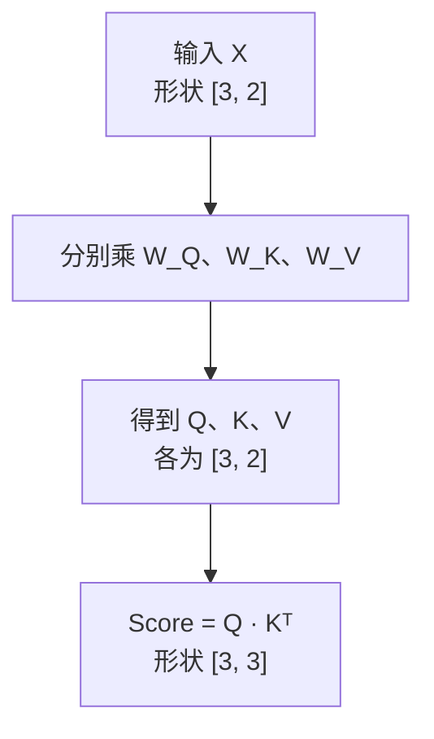
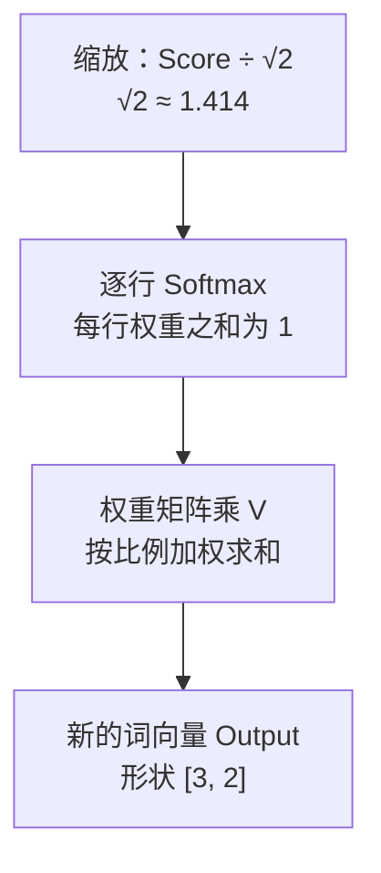

# 第3章：拆解注意力三剑客——Q、K、V 与安全的掩码

上一章说“按当前问题收集上下文”，这一章把它变成可以逐项核对的计算。目标不是背公式，而是回答：分数从哪里来？在哪一维归一化？未来位置为什么恰好拿不到权重？没有任何可见位置时怎么办？

## 3.1 图书馆里的查询、标签和内容

去图书馆找“力学入门”，搜索词是 Query，书的索引标签是 Key，真正借回的内容是 Value。标签负责匹配，内容负责被带走：它们承担不同工作，不必用同一种表示。

在模型里，每个位置的向量都会通过三组可训练线性变换。用行向量约定：

$$Q=XW_Q,\qquad K=XW_K,\qquad V=XW_V.$$

本章暂取 $X\in\mathbb{R}^{T\times D}$，$W_Q,W_K\in\mathbb{R}^{D\times d_k}$，$W_V\in\mathbb{R}^{D\times d_v}$。例如三个 token、每个两维，可以得到三行 Q、K、V。不是把一个词复制三份就学会了检索，而是训练调整三个矩阵，使预测损失下降。示例脚本中的手工矩阵没有经过训练。

**点积分数不是百分比。** $q_i\cdot k_j$ 可以是负数，也可以大于 1；Softmax 之后才是一组非负、和为 1 的权重。有限分数下，普通 Softmax 通常不会把低分项直接删掉。

如果令 $Q=K=X$，原始分数矩阵 $XX^\top$ 对称，但逐行 Softmax 的分母一般不同，最终权重未必对称。比如对称分数表 $[[1,0],[0,2]]$ 中，第一行第二列约为 0.2689，第二行第一列约为 0.1192。因此，独立 Q/K 投影增加表达自由度，不能以“否则注意力权重必然对称”作为理由。

## 3.2 从分数表到新表示


把计算链分成两张图。这里先画无掩码、每行都有可见位置的情况；后面会补空行约定。




对第 $i$ 个查询，沿着所有候选键 $j$ 计算：

$$s_{ij}=\frac{q_i\cdot k_j}{\sqrt{d_k}},\qquad
a_{ij}=\frac{\exp(s_{ij})}{\sum_{r=1}^{T}\exp(s_{ir})},\qquad
o_i=\sum_{j=1}^{T}a_{ij}v_j.$$

整批写成 $O=\operatorname{softmax}(QK^\top/\sqrt{d_k})V$。Softmax 沿**键所在的最后一维**做，而不是把整张表变成一组概率。输出有 T 行、每行 $d_v$ 个数。

手算一行：设 $q=[1,0]$，两把键分别为 $[1,0]$ 和 $[0,1]$，两份内容分别为 $[2,0]$ 和 $[0,4]$。$d_k=2$，缩放分数是 $[1/\sqrt2,0]$，权重约为 $[0.6698,0.3302]$，输出约为 $[1.3395,1.3210]$。检查输出的每个维度都是对 V 对应维度做加权和；不是从两份内容里只挑一份。

**为什么除以根号维度？** 若 Q/K 各分量相互独立、均值为 0、方差为 1，则点积之和的方差是 $d_k$；除以 $\sqrt{d_k}$ 后方差为 1。这是理解尺度的简化假设，不是训练中始终满足的定律。缩放缓解分数随维度增大造成的饱和倾向，但不保证权重均匀，也不保证每个词获得“合理关注”。数值稳定和模型学得好是两个问题。

### 3.2.1 跟着“我 / 爱 / 学”完整手算一遍

上面的两份内容例子只演示一行加权。现在沿用 [code/02_manual_attention.py](../code/02_manual_attention.py)，把三个位置从输入一路算到输出。运行脚本后，可以把每张表与下面逐格核对；这些向量和矩阵都是教学设定，不是训练得到的语义特征。

输入三行是“我” $[1.0,0.5]$、“爱” $[0.8,1.2]$、“学” $[0.2,1.5]$。脚本把单个向量看作列向量，使用下面三张矩阵：

```python
W_Q = [[0.5, 0.2], [0.1, 0.8]]
W_K = [[0.4, 0.3], [0.2, 0.7]]
W_V = [[1.0, 0.1], [0.0, 0.9]]
Q = [matmul_vec(W_Q, vec) for vec in x]
K = [matmul_vec(W_K, vec) for vec in x]
V = [matmul_vec(W_V, vec) for vec in x]
```

`matmul_vec` 用矩阵的每一行与输入做点积。以“我”为例，草稿纸上写出：

$$Q_{我,0}=0.5\times1.0+0.2\times0.5=0.6,$$
$$Q_{我,1}=0.1\times1.0+0.8\times0.5=0.5.$$

同理算 K、V。列向量代码用 $W x$；若按前文把输入堆成行，必须用**该代码矩阵的转置**写成 $XW^\top$，才是同一次计算。不要一边换行列约定，一边直接照抄矩阵而不转置。

| 位置 | Q | K | V |
|---|---|---|---|
| 我 | [0.600, 0.500] | [0.550, 0.550] | [1.050, 0.450] |
| 爱 | [0.640, 1.040] | [0.680, 1.000] | [0.920, 1.080] |
| 学 | [0.400, 1.220] | [0.530, 1.090] | [0.350, 1.350] |

接下来，行代表“谁来问”，列代表“向谁取内容”。每格先点积，再除以 $\sqrt2$。例如“我”对“爱”：

$$(0.600\times0.680+0.500\times1.000)/\sqrt2
=0.908/\sqrt2\approx0.6421.$$

| 缩放分数 | 键：我 | 键：爱 | 键：学 |
|---|---:|---:|---:|
| 查询：我 | 0.4278 | 0.6421 | 0.6102 |
| 查询：爱 | 0.6534 | 1.0431 | 1.0414 |
| 查询：学 | 0.6300 | 1.0550 | 1.0902 |

脚本对每一行调用 `softmax(row)`，不是对整张表调用一次标量归一化。“我”这一行除以自己的指数总和，“爱”“学”也各算各的：

| 注意力权重 | 我 | 爱 | 学 |
|---|---:|---:|---:|
| 我 | 29.08% | 36.03% | 34.90% |
| 爱 | 25.31% | 37.38% | 37.31% |
| 学 | 24.31% | 37.18% | 38.51% |

这是对 V 的**读取权重**，不是指代概率或因果贡献率。未舍入的每行和在浮点容差内为 1；表中保留两位百分数，“我”一行显示为 100.01%，只是四舍五入，不要把表格显示值反过来当精确输入。

最后用“我”这一行的未舍入权重，分别乘三份 V，再相加：

$$o_{我}\approx
0.290776[1.05,0.45]+0.360253[0.92,1.08]+0.348971[0.35,1.35]
\approx[0.7589,0.9910].$$

脚本先创建 `new_vec = [0.0] * len(V[0])`，再依次执行“将某个 V 乘权重”和“累加到 new_vec”。这里写出的六位小数权重仍是便于手算的近似；代码用全精度权重，输出另外两行约为“爱” $[0.7402,1.0213]$、“学” $[0.7321,1.0308]$。新表示不再只来自原位置，但也不意味着这个没训练的玩具已经理解了句子。

本节**没有因果掩码**，所以“我”会读到后面的“爱”和“学”。它用于理解计算步骤；若用于下一词预测，还必须按 §3.4 加上可见性约束。

### 3.2.2 缩放究竟改变了什么？看一个可重跑的例子

[code/03_scaled_dot_product.py](../code/03_scaled_dot_product.py) 的第一个实验设置 `random.seed(42)`、$d_k=64$，用标准库高斯采样生成一个 Q 和三把 K。下面是该脚本实际输出，不是手工挑选的分数：

| 阶段 | 键 1 | 键 2 | 键 3 |
|---|---:|---:|---:|
| 原始点积（显示到两位） | -8.57 | -13.00 | -4.31 |
| 不缩放的 Softmax 权重 | 1.39% | 0.02% | 98.59% |
| 除以 $\sqrt{64}=8$ 后的分数（显示到两位） | -1.07 | -1.63 | -0.54 |
| 缩放后的 Softmax 权重 | 30.50% | 17.54% | 51.96% |

四步代码分别对应：`sum(q*k for ...)` 算原始点积，`stable_softmax(raw_scores)` 算不缩放的分布，`[s / scale for s in raw_scores]` 改变尺度，再调用一次稳定 Softmax。计算用未舍入值，因此只用表格的两位分数重算时，最后百分数会略有差别。

第三把键的原始分数虽然也是负数，却比另外两项大；指数比较的是差距，不是“正分才有权重”。缩放后分差变小，本例的分布没那么集中。它和下一节的“减去最大值”不同：**除以 8 一般改变权重，减去同一行最大值理论上不改变权重。** 这次观察支持理解尺度，不保证任意输入都获得更好的语义结果。

## 3.3 稳定 Softmax：先整体平移，再取指数

直接算 $e^{1000}$ 会超过常见浮点数的范围。对同一行减去最大值 $m$ 不改变比例：

$$\frac{e^{s_j-m}}{\sum_r e^{s_r-m}}
=\frac{e^{s_j}/e^m}{\sum_r e^{s_r}/e^m}
=\frac{e^{s_j}}{\sum_r e^{s_r}}.$$

例如 $[1000,1001,1002]$ 变成 $[-2,-1,0]$，结果约为 $[0.0900,0.2447,0.6652]$。最大指数是 1，避免了这里的指数上溢。很小项仍可能下溢为 0，这是有限精度现象，不能宣称“所有计算都精确”。

配套纯 Python 脚本的核心就是：

```python
m = max(scores)
exps = [math.exp(s - m) for s in scores]
weights = [e / sum(exps) for e in exps]
```

`code/02_manual_attention.py` 逐步打印投影、点积、权重与输出；入口先要求列表非空且每项有限，拒绝 NaN/正负无穷。这个简化函数处理普通分数，不把负无穷掩码混入它。测试在小分数上与朴素公式对照，在大分数上验证不溢出，并检查整体平移不改结果。

### 3.3a 前沿补充：减了最大值，梯度仍可能“塌掉” {#p04-softmax-collapse}

> [!NOTE]
> 减最大值解决了上溢，但没有解决另一种精度问题。这一框只讲现象和修法，依据是 [A Fix for Softmax and Cross-Entropy](https://arxiv.org/abs/2610.31642) 的 §1–§2。

**现象。** 设正确类为 $t$，论文定义 logit 间隔（Eq. 2）：

$$m = z_t - \log\sum_{j\ne t} e^{z_j}.$$

交叉熵对目标 logit 的梯度是 $1/(1+e^{-m})-1$（Eq. 3）。$m$ 很大时，$1+e^{-m}$ 会被舍入成恰好 1。于是目标梯度变成 0，其他类的梯度却仍为正。全部梯度之和本应为 0，现在大于 0（Eq. 4）。论文把这叫 Softmax Collapse。

**悬崖在哪。** 论文给出的阈值是：bf16 约 5.5，fp32 约 16.6，fp64 约 36.7（§1）。本书脚本逐格搜索 $1+e^{-m}=1$ 的最小 $m$，实测如下：

| 精度 | 论文值 | 本书实测 |
| --- | --- | --- |
| bf16 | 5.5 | 5.55 |
| fp32 | 16.6 | 16.64 |
| fp64 | 36.7 | 36.74 |

设 $p$ 为含隐含位的有效位数：bf16、fp32、fp64 分别为 8、24、53。$p\ln 2$ 约为 5.545、16.636、36.737。它们与实测值在 0.01 网格内一致。若不计隐含位（7、23、52），会得到 4.85、15.94、36.04，对不上。这个对应关系是本书的推断，论文未这样表述（未验证）。

**修法。** 不把目标项放进求和，直接写成 $\text{CE}=\operatorname{softplus}(-m)$（Eq. 6）。目标梯度变成 $-e^{-m}/(1+e^{-m})$，不会被 1 吞掉（Eq. 3）。log-softmax 同理：最大项置为精确 0，再减 softplus（Eq. 5）。

**跑一下。** `code/03b_softmax_collapse.py` 按论文 §2 的算法（Eq. 5–6）用 PyTorch 重新实现，并注明出处。输入取论文的例子 $z=[9,-9,-9]$、$t=0$、fp32：

| 实现 | loss | 目标梯度 | 梯度和 |
| --- | --- | --- | --- |
| `torch.log_softmax` | 0 | 0 | 3.046e-8 |
| 论文修正版 | 3.046e-8 | -3.046e-8 | 0 |

这组数与论文 §2 代码示例列出的值一致。换成 bf16 时，$z=[4,-4,-4]$（$m\approx7.31$）就已塌掉；同一输入在 fp32 下正常。`tests/test_softmax_fix.py` 固定输入断言这些结果。

**边界。** 这里只演示单行梯度，不训练模型。论文 §4 只在 grokking 实验里讨论它：记住训练集之后，Slingshot 损失尖峰由它引起。见 P09.3 的说明。论文 §8 也指出，这么大的间隔在标准大规模训练中并不常见。本书没有复现训练实验。

## 3.4 两类掩码：不能看未来，不要看补位

把多句话放入同一批时，短句常用 padding 补到相同长度。这些补位不是正文，不能成为有信息的键。自回归语言模型还要遵守 causal mask：第 i 行只能看 $j\le i$ 的位置。

以长度 4、实际只有前两个 token 的句子为例，本书把 query 补位也禁用：

| 查询行 / 键列 | 0 | 1 | 2（补位） | 3（补位） |
|---|---:|---:|---:|---:|
| 0 | 可见 | 禁止 | 禁止 | 禁止 |
| 1 | 可见 | 可见 | 禁止 | 禁止 |
| 2（补位） | 禁止 | 禁止 | 禁止 | 禁止 |
| 3（补位） | 禁止 | 禁止 | 禁止 | 禁止 |

行是“谁来问”，列是“向谁取内容”。表中的“可见”要同时满足因果约束和 padding 约束（两个布尔条件取与）。仅屏蔽 padding 键不会自动清零 padding 查询的输出；训练时还必须排除补位目标的损失，不能用注意力 mask 代替 loss mask。

我们的辅助函数在 `code/attention_core.py`，约定 **True=允许，False=禁止**：

```python
allowed = valid[:, None, :, None] & valid[:, None, None, :]
allowed = allowed & torch.ones(T, T, dtype=torch.bool).tril()
```

`valid` 是 [B,T]，两个切片分别变成 [B,1,T,1] 与 [B,1,1,T]，广播后得到 [B,1,T,T]，可供多个头共享。若单头分数是 [B,T,T]，使用 `allowed[:, 0]`；不要误把 [B,T] 直接广播成分数矩阵。代码中创建下三角时还指定与输入相同的 device。

注意不同 API 的约定不同：PyTorch 2.14 的 functional SDPA 布尔 mask 中 True 表示参与，`nn.MultiheadAttention` 的布尔禁止掩码使用相反语义。不要把同一个布尔张量不经核对就换接口。

## 3.5 全部禁止的一行：明确约定，避免 NaN

把禁止位置设成 $-\infty$，对至少有一个可见项的行做 Softmax，可使禁止项权重为 0。但若整行都是 $-\infty$，减最大值会出现 $-\infty-(-\infty)$，结果不是一个有效概率分布。

也不能简单改成 `-1e9`：它不是所有 dtype 都可表示的数，而且一整行同样的有限负数仍会得到均匀权重，反而让禁止项“复活”。

本书选一个明确的教学策略：**全禁用行返回全零权重，其加权输出为零**，不是和为 1 的概率分布。核心步骤如下：

```python
any_allowed = allowed.any(dim=-1, keepdim=True)
masked = scores.masked_fill(~allowed, -torch.inf)
safe = torch.where(any_allowed, masked, torch.zeros_like(masked))
weights = torch.softmax(safe, dim=-1).masked_fill(~allowed, 0.0)
```

先让空行的 Softmax 输入安全，再在结果中清零，避免先产生 NaN 再尝试补救。辅助函数要求原始分数有限，并检查布尔类型和广播形状。测试还对空行反向传播，检查梯度有限。这是本书实现的契约，不表示所有框架、内核和版本都采用相同处理方式。

## 3.6 训练可并行，为什么生成还要一步步来？

训练数据已经给出整条正确文本。假设序列为“我 爱 学 习”，输入位置 0 的“我”预测“爱”，位置 1 的“爱”预测“学”。一次算出所有查询行，同时用下三角阻断未来，所有已知输入位置可以并行计算；**并行不等于允许偷看标签**。

生成时，下一个 token 尚未选出来。先用现有前缀预测一个 token，将它接到前缀，再继续。这里的步骤依赖无法凭“矩阵并行”消失。后续 KV cache 会减少重复计算，却不会让未知的未来 token 提前成为已知输入。本章不提前实现缓存。

因果性可以用一个反事实小实验验证：保持前几个输入不变，任意修改最后一个 token，早于它的输出应保持不变。相反，双向无掩码注意力通常会变化。测试同时验证“全序列带因果 mask”与“逐个前缀重算最后位置”一致，避免只看上三角权重为零就认为端到端一定正确。这里没有 dropout，模型参数固定，以浮点容差比较。

## 3.7 运行、观察和自测

在 CPU 环境安装仓库锁定的 PyTorch 后运行：

```bash
python3 code/02_manual_attention.py
python3 code/03_scaled_dot_product.py
python3 -m unittest discover -s tests -v
```

脚本 03 有缩放对照、掩码、官方 SDPA 对照及 padding/因果扰动实验。固定随机种子只是让例子可重现，不构成效果评测；官方实现的输出按容差检查，不要求跨平台逐位相等。不需要 GPU、模型权重或网络推理服务。

自测：

1. 如果交换 Q 与 K，是否总能得到相同权重？不能。在本章等长自注意力中，交换后分数由 $S$ 变成 $S^\top$，逐行 Softmax 一般得到不同权重；若 $S$ 本身对称，交换前后分数完全相同，权重也相同。但该权重矩阵自身仍未必对称。这是“交换前后相等”和“矩阵关于对角线对称”两个不同问题。
2. 对一行所有有限分数加 100，权重应怎样变化？理论不变，实际受有限精度限制。
3. 对全部禁止的一行，为什么不要求权重和为 1？没有可取内容，本实现特意定义和为 0。
4. 只 mask 键，是否已忽略补位位置的训练损失？没有，还需单独处理目标。
5. 未来扰动测试失败，先看哪里？检查 mask 方向、广播轴、是否在归一化前遮挡，以及模型是否含其他跨位置泄漏路径。

下一章保持这条计算链不变，同时开多个头，逐笔记录每一步的张量形状。

## 来源与版本

- [Attention Is All You Need，v7，§3.2 与 §3.1](https://arxiv.org/html/1706.03762v7)：缩放点积、多头与解码因果约束。上面的数值小例子与边界策略为本书构造。
- [PyTorch 2.14：scaled_dot_product_attention](https://docs.pytorch.org/docs/2.14/generated/torch.nn.functional.scaled_dot_product_attention.html)：官方接口及布尔 mask 约定。
- [PyTorch 2.14：MultiheadAttention](https://docs.pytorch.org/docs/2.14/generated/torch.nn.MultiheadAttention.html)：对照不同接口的 mask 语义。动态文档核验日期：2026-10-19。
- [A Fix for Softmax and Cross-Entropy，arXiv:2610.31642，§1–§2，Eq. 2–7](https://arxiv.org/abs/2610.31642)（[项目页](https://jonbarron.info/softmaxfix/)）：Softmax Collapse 与修正版代码。核验日期：2026-10-26。
