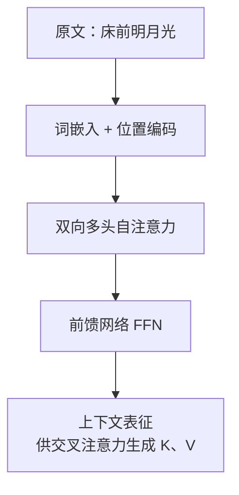
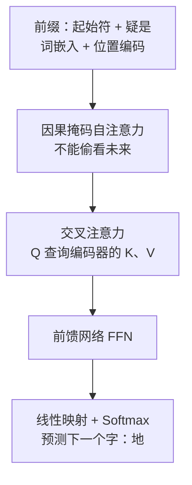
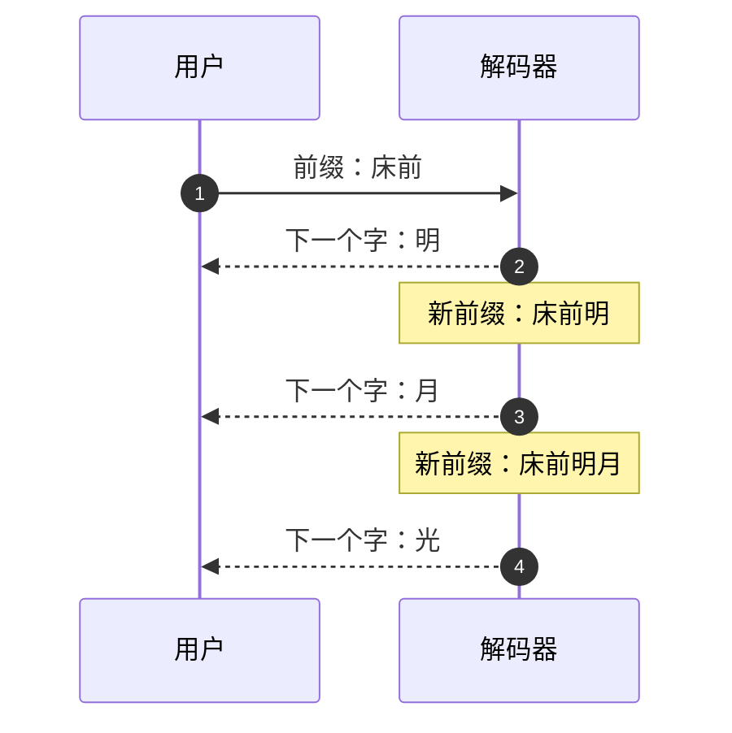

# 第7章：编码器与解码器——从文本理解到自回归生成

前面已经有了词向量、位置编码、注意力和完整积木。现在把它们接成系统：哪些位置可以互相读信息？一张预测分数表，怎样变成逐步写出的句子？

本章的数值演示来自 [code/10_generation_loop.py](../code/10_generation_loop.py)，只依赖 Python 标准库。它用**事先写好的 logits**讲解循环和停止，不是假装已经训练出语言模型。下一章的 Baby-GPT 才把预测器换成真正的小网络。

## 7.1 不是“读者”和“作家”二选一，而是三种常见结构

经典 Transformer 论文采用 encoder-decoder：编码器先整理原文，解码器一边看已写的译文，一边查询原文表示。把编码器想成“整理资料的人”，解码器想成“拿着资料逐步写作的人”，有助于理解信息流，但模块没有人类的理解意图，也不保证内容正确。

### 表 7-1：三种结构分别能看哪里？

| 结构 | 自注意力可见范围（典型设置） | 跨序列查询 | 常见用途与边界 |
|---|---|---|---|
| encoder-only | 同一输入中允许的前后位置；仍需屏蔽 padding | 通常没有生成端 cross-attention | BERT 类表征、分类或掩码填空；不能据此断言任何编码器都只能分类 |
| decoder-only | 当前及过去的 token，禁止未来 | 通常没有独立编码器供查询 | GPT 类下一词建模；生成时每次补一个 token，训练时已知输入可并行 |
| encoder-decoder | 编码端通常双向，解码端因果 | 解码端 Q 查询编码端 K/V | 原始 Transformer 翻译；输入和输出长度可以不同 |

“decoder-only”不是把双塔中的编码器删除，却保留一条不知道该读谁的 cross-attention。常见实现也去掉这条跨塔子层。反过来，编码器没有 causal mask 不等于没有任何 mask，padding 和其他任务约束依然可能存在。

编码器可读取的完整源句子，与解码器不可偷看的未来**目标词**，是两条不同序列。翻译时源句子已经给定，读取它不是泄漏未来译文。原始结构参见 Transformer 论文 §3.1、§3.2.3；BERT 的 encoder-only 设置见其论文 §3。

## 7.2 沿着图读一遍双塔系统


下图只描述经典 encoder-decoder，不是所有聊天模型共有的完整结构。归一化与残差在简图中省略，不表示它们消失了。




原文编码结果在本轮生成过程中可重复使用。译文前缀则每次增长。前缀中的字只是易读标签，实际序列由 tokenizer 的 token ID 组成，不保证每个字恰好一个 token。

## 7.3 闭卷考试：保留四词掩码的三步手算

假设当前位置的任务是预测**下一个**词。如果它能读取那个正确目标词的输入表示，训练就可能依赖生成时根本没有的答案。因果 mask 阻断这种路径；它不能单独解决数据泄漏、重复训练样本等其他问题，也不保证学到好模型。


下面完整保留原来的分数表与手算链。原始分数是人为设定；脚本的 `mask_walkthrough()` 用这些数生成三张表并验证结果，不声称它们是某个模型的测量值。本例每行至少能看见自己，没有全禁用行；全禁用行的处理约定见第3章。

### 表 7-2：4 词序列的掩码矩阵数值演变推导表

假设输入序列为四个字：“我”、“爱”、“学”、“习”。

#### 1. 原始点积分数矩阵 (Q · K^T / √d_k)：
| 查询 (Query) \ 键 (Key) | 词1(我) | 词2(爱) | 词3(学) | 词4(习) |
| :--- | :---: | :---: | :---: | :---: |
| **词1(我)** | 2.15 | **1.80 (未来!)** | **0.95 (未来!)** | **0.40 (未来!)** |
| **词2(爱)** | 1.30 | 3.20 | **2.10 (未来!)** | **1.05 (未来!)** |
| **词3(学)** | 0.85 | 1.95 | 2.80 | **1.70 (未来!)** |
| **词4(习)** | 0.40 | 1.10 | 2.30 | 3.10 |

#### 2. 施加因果掩码后（未来位置实际填入负无穷）：
| 查询 (Query) \ 键 (Key) | 词1(我) | 词2(爱) | 词3(学) | 词4(习) |
| :--- | :---: | :---: | :---: | :---: |
| **词1(我)** | 2.15 | $-\infty$ | $-\infty$ | $-\infty$ |
| **词2(爱)** | 1.30 | 3.20 | $-\infty$ | $-\infty$ |
| **词3(学)** | 0.85 | 1.95 | 2.80 | $-\infty$ |
| **词4(习)** | 0.40 | 1.10 | 2.30 | 3.10 |

#### 3. 最终 Softmax 注意力权重矩阵（百分比）：
| 查询 (Query) \ 键 (Key) | 词1(我) | 词2(爱) | 词3(学) | 词4(习) | 每行总和 |
| :--- | :---: | :---: | :---: | :---: | :---: |
| **词1(我)** | **100.0%** | **0.0%** | **0.0%** | **0.0%** | 100.0% |
| **词2(爱)** | **13.01%** | **86.99%** | **0.0%** | **0.0%** | 100.0% |
| **词3(学)** | **9.06%** | **27.23%** | **63.71%** | **0.0%** | 100.0% |
| **词4(习)** | **4.07%** | **8.19%** | **27.20%** | **60.54%** | 100.0% |

> [!NOTE]
> **用第 2 行把手算走一遍**：
> 允许看见的分数是 1.30 和 3.20。
> $e^{1.30} \approx 3.67$，$e^{3.20} \approx 24.53$，加起来约 28.20。
> 权重分别是 $3.67/28.20 \approx 13.01\%$ 和 $86.99\%$。
> 被写成 $-\infty$ 的格子贡献 $e^{-\infty} = 0$，所以未来的字不会分到百分比。
> 第 3、4 行用的是同一套算法。上面的原始分数是为了演示而写的，不是某个训练好的模型量出来的。

对应的计算顺序不能颠倒：先确定第 i 行可见的 $j\le i$，再只对这些分数归一化，最后给未来位置补精确的 0。脚本把可见前缀送入稳定 Softmax；表中的禁止分数实际写成负无穷，不使用 `-1e9` 冒充。打印到两位的百分数可能有舍入误差，测试用未舍入值检查行和。

## 7.4 Cross-attention：查询来自目标，资料来自源句

图书馆类比里，写作者提出问题，原文资料提供标签和内容。在经典 cross-attention 中：

- Q 由解码器当前层的目标侧表示投影得到；
- K/V 由编码器输出投影得到；
- 权重沿源序列位置归一化，而不是沿译文词表归一化。

例如 batch=1，译文当前有2个位置、原文有3个位置，每头宽度4。省略头轴后，Q=[1,2,4]，K=[1,3,4]，V=[1,3,4]；分数为 [1,2,3]，聚合结果为 [1,2,4]。输入输出长度不必相同，也不需要把它们硬凑成方阵。另取一个 $d_v=2$ 的手算例子：给第一行三份资料权重 [0.2,0.3,0.5]，三份 V 分别为 [1,0]、[0,1]、[1,1]，读到的内容便是 [0.7,0.8]，不是机械复制某一个词。

有源端 padding 时也要屏蔽对应 K/V 位置。这个“跨序列”的连接方式，不应和后续 P17 的 Causal Encoder-Decoder（CED）名称混为一谈；本章没有实现 CED，只学习传统翻译双塔与生成循环。

## 7.5 Teacher forcing：谁向右移，预测谁？

训练时可以把正确的前缀交给模型，这叫 teacher forcing；它不是在当前输出位置直接喂入当前标签。以一个完整训练序列为例：

```text
完整序列：<BOS>  我  爱  学  习  <EOS>
模型输入：<BOS>  我  爱  学  习
监督标签： 我     爱  学  习  <EOS>
```

| 计算位置 | 当前输入 token | 该位置应预测的标签 | 因果 mask 下可见的输入 |
|---|---|---|---|
| 0 | `<BOS>` | 我 | `<BOS>` |
| 1 | 我 | 爱 | `<BOS>`，我 |
| 2 | 爱 | 学 | `<BOS>`，我，爱 |
| 3 | 学 | 习 | `<BOS>`，我，爱，学 |
| 4 | 习 | `<EOS>` | `<BOS>`，我，爱，学，习 |

常说的“把目标右移一位作为 decoder 输入”，是指在目标“我 爱 学 习 EOS”前放 BOS，去掉最后的 EOS，得到输入。若从完整序列切片，代码则是：

```python
return list(tokens[:-1]), list(tokens[1:])
```

第一项是输入，第二项是向后错一位的 next-token 标签。不要把“输入右移”误写成“把标签与输入对齐不动”。BOS/EOS 是否显式存在取决于 tokenizer 与任务，这里用可读字符串代替它们的 ID。

全部输入已知，所以五个查询行可以并行计算各自的下一词损失；每行仍只能看允许的前缀。若有 padding，目标端还需 loss mask。训练时走正确前缀，推理时走自己生成的前缀，两者可能不同；一个早期错误会影响后续条件，teacher forcing 不自动保证推理质量。

## 7.6 Prefill 与 decode：不是每一轮都重新读完一切

收到提示“床前”时，可以一次处理已知提示的所有位置，这个阶段常称 **prefill**。最后一个位置的输出 logits 已可用来选出第一个新 token“明”，不需要先等一个不存在的“明”的输出。

之后把新 token 接入序列，继续预测，这通常称 **decode** 阶段。有 KV cache 的实现复用历史 K/V，只计算新增 token 所需部分；本章为了可读性，每次把完整前缀交给一个简化预测函数，**没有实现缓存，也不能用它评估推理性能**。P11 再实现缓存并做等价性检验。

“打字机特效”是界面如何流式展示文本，不能用来判断底层每步是不是一个汉字、是否有缓冲或其他生成优化。我们先学普通自回归的逻辑依赖：


## 7.7 Greedy 与 temperature：同一组 logits，如何选 token？

Logits 是词表上未归一化的分数，不是已经生成的 token。设三名候选 A/B/C 的 logits=[2,1,0]：

$$p_i(T)=\frac{\exp(z_i/T)}{\sum_j\exp(z_j/T)},\qquad T>0.$$

脚本的 `probabilities` 先减最大值再除以温度，避免对大正数直接取指数。以下百分数由脚本计算：

| 方式 | A | B | C | 选择规则 |
|---|---:|---:|---:|---|
| greedy | 不需要算概率 | 不需要算概率 | 不需要算概率 | 直接选最大 logit，所以是 A |
| temperature=0.5 | 86.68% | 11.73% | 1.59% | 按这组分布随机抽样 |
| temperature=1.0 | 66.52% | 24.47% | 9.00% | 同上 |
| temperature=2.0 | 50.65% | 30.72% | 18.63% | 同上 |

低温使本例更集中，高温更平坦；随机抽样仍可能选择非最大项，不是“有51%就必选它”。若仍用 argmax 而不抽样，任意正温度都不会改变最大项的顺序。

数学公式不能直接除以0。教学函数的 `temperature=0` **另走greedy分支**，同分时选词表中第一个最大项。只有最大项唯一时，$T\to0^+$ 的分布才趋向该项；并列最大项的极限仍共享权重，不等于我们的“选第一个”约定。

## 7.8 表 7-3：从真实脚本输出逐步追踪停止

为了让每个数都可核对，原先的示意概率换成脚本的固定四词输出词表：[明，月，光，`<EOS>`]。提示中的“床前”由示例直接给定。预测器按前缀长度选用写好的 logits 行，**没有学习诗歌**；固定行不需要随机种子，下面使用 greedy。显示的概率统一是温度1的参考分布，并非greedy必须先算的东西。

| 步数 | 本轮前缀 | logits（按四词顺序） | 温度1概率（同序，%） | greedy新增 | 累计新增数 / 是否停止 |
|---|---|---|---|---|---|
| 1 | 床前 | [4,1,0,-2] | [93.41,4.65,1.71,0.23] | 明 | 1 / 继续 |
| 2 | 床前明 | [0,4,1,-2] | [1.71,93.41,4.65,0.23] | 月 | 2 / 继续 |
| 3 | 床前明月 | [0,1,4,-2] | [1.71,4.65,93.41,0.23] | 光 | 3 / 继续 |
| 4 | 床前明月光 | [0,0,0,4] | [1.74,1.74,1.74,94.79] | `<EOS>` | 4 / EOS停止 |

两种上限分别运行，不要混在一条追踪里：
- `max_new_tokens=8`：第4步生成 EOS，立即停止，不用等到8步。返回列表保留 EOS，界面可另行隐藏特殊符号。
- `max_new_tokens=2`：第2步后就达到新增上限，返回“床前明月”，没有生成 EOS，停止原因是长度预算。
- `max_new_tokens=0`：不调用预测函数、无新增 token。若前缀本来已以 EOS 结尾，本教学函数立即按 EOS 停止。

这里的上限计**新增token**，不把2个提示token算进去；实际框架里的 `max_length` 与 `max_new_tokens` 含义可能不同，调用时需查版本文档。长度停止可能截断一句话；模型预测 EOS 也不代表内容必然完整或正确。

把循环逐行拆开看：

```python
logits = list(logits_fn(list(tokens)))
chosen = vocab[choose_token(logits, temperature, rng)]
tokens.append(chosen)
if chosen == eos:
    return tokens, trace, "eos"
```

外层 `for step in range(max_new_tokens)` 保证有限次数；每轮取得词表分数、选择一个token、追加前缀，再检查EOS。源码在追加前记录 `trace`，以便显示本轮旧前缀。EOS检查不能等到下一轮才做，否则会多调用一次模型。输出格式检查保证每个词表项恰好一个logit。若启用抽样，固定seed便于复查本例，但不承诺跨框架和版本逐位一致。

## 7.9 自测、运行与下一步

```bash
python3 code/10_generation_loop.py
python3 -m unittest discover -s tests -v
```

本章无 PyTorch/GPU 依赖。回归覆盖三步mask数值、标签错位、温度数表、低温唯一最大项、EOS、最大新增数、零预算、固定seed及非法输入。

1. 原文3个位置、目标2个位置，cross-attention分数该为几行几列？2×3；两行目标query，各查询三份源资料。若三份二维V及权重如§7.4，输出是[0.7,0.8]。
2. 输入“BOS 我 爱”，标签是“BOS 我 爱”吗？不是。若完整样本是“BOS 我 爱 EOS”，输入是“BOS 我 爱”，标签是“我 爱 EOS”，最后一个位置预测停止符。
3. logits=[2,1,0]，温度0.5一定选A吗？抽样不一定，A约86.68%；greedy才确定选A。T趋0的结论还要检查是否唯一最大。
4. 表7-3在新增上限2时何时停止？第2步，得到4个总token（2提示+2新增），不是等EOS出现才停。
5. encoder-only没有因果mask，所以可以不处理padding吗？不可以；允许前后文不代表补位是有用内容。
6. 第一次生成“明”之前有没有decode输出“明”的表示？不需要。prefill的最后位置logits已可选出“明”；再将“明”作为下一次条件输入。我们的示例是全前缀重算，不是KV缓存实现。

下一章保留现有 Baby-GPT 训练实践。扩展大纲的训练闭环与评估章节将另批完成，本章不把固定logits演示当成它们已经落地。

## 原始来源与版本

- [Attention Is All You Need，v7，§3.1、§3.2.3、§3.4](https://arxiv.org/html/1706.03762v7)：双塔结构、因果约束、目标右移和输出层。
- [BERT 原始论文，§3](https://arxiv.org/abs/1810.04805)：双向编码器预训练；“双向”不是任何任务都可看未来答案。
- [Transformers 4.57.1 生成参数文档](https://huggingface.co/docs/transformers/v4.57.1/en/main_classes/text_generation)：temperature、EOS及长度参数的接口语义；本章不用这个库执行实验。
- [Transformers 4.57.1 缓存说明](https://huggingface.co/docs/transformers/v4.57.1/en/cache_explanation)：理解历史K/V复用的概念路标。文档核验日期：2026-10-19。
