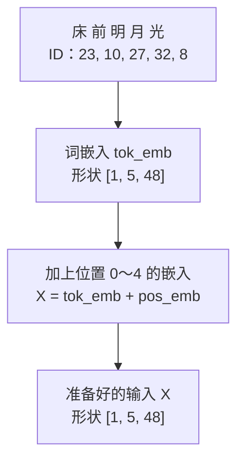
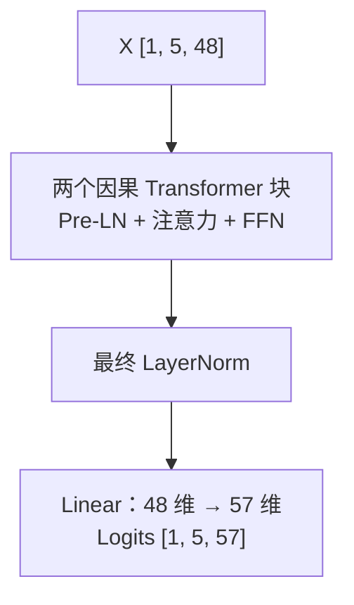
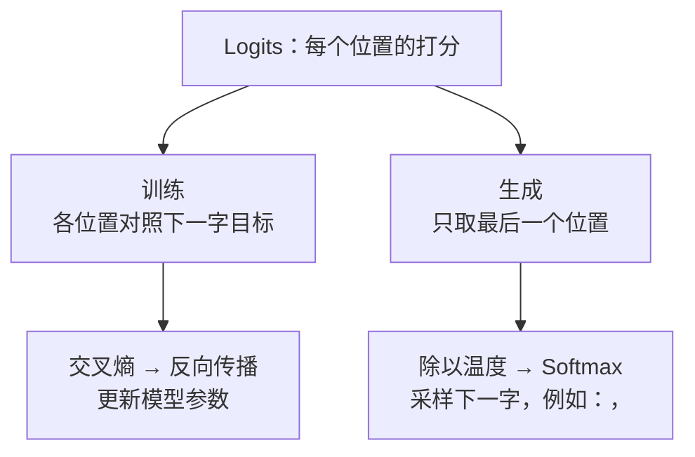

# 第8章：实战——手搭一个微型大语言模型（Baby-GPT）

上一单元 P09 把“数据 → 预测 → 损失 → 梯度 → 更新”走了一遍。现在不再换一套神秘组件，而是把已经学过的嵌入、注意力和 Block 接起来，留下一份后续改进都能比较的 **S0 基线**。

本章的目标是训练一个能背三首诗的微型自回归模型，不是训练通用聊天助手。先确认它算对，再看它记住了什么，最后保存与重新载入同一套参数。下一单元 P11 只改变生成的计算方法，加 KV cache；不会偷偷换模型再宣称提速。

## 8.1 任务、边界与运行

配套 [code/07_baby_gpt.py](../code/07_baby_gpt.py) 保留三首完整诗：《静夜思》《登鹳雀楼》《春晓》。每首 24 个字符（含标点），共 72 个字符；字符词表 57 项。

```bash
OMP_NUM_THREADS=1 python3 code/07_baby_gpt.py
python3 -m unittest discover -s tests -p 'test_baby_gpt.py' -v
```

需要 `requirements.txt` 中的 CPU PyTorch；本文数值来自 Python 3.12、PyTorch 2.14.1+cpu、种子 42、单线程环境。线程数、版本、设备会影响运行时间及浮点结果，不能仅凭相同 seed 承诺跨平台逐位相同。

本章把三首诗全用于训练，观察的是**训练集记忆**。P09 的整首留出实验才有训练与验证之分，而且数据仍小到不足以评价通用语言能力。本章的生成例子也不是盲测集。不要将每首诗的重叠窗口随机分组后叫作独立泛化评估。

## 8.2 先读配置与参数账

### 表 8-1：S0 的固定配置

| 字段 | 数值 | 在模型中的作用 |
| --- | --- | --- |
| `vocab_size` | 57 | 每个位置输出 57 个 logits |
| `d_model` | 48 | 残差主干的宽度 |
| `num_heads` | 4 | 每头宽度 48 / 4 = 12，不是 4 个独立语言模型 |
| `num_layers` | 2 | 两个 Pre-LN 因果 Block |
| `max_seq_len` | 128 | 可学习位置表和因果 mask 的容量 |
| FFN 中间宽度 | 192 | 4 × 48，激活使用 GELU |
| 学习率 / 更新次数 | 0.01 / 80 | 本章记忆实验，不是通用推荐参数 |
| 参数总数 | 67872 | 不包含不训练的 mask 缓冲区 |

可以自己逐项加总，而不是只相信打印结果：

| 部件 | 算式 | 参数 |
| --- | --- | --- |
| 词嵌入 | 57 × 48 | 2736 |
| 可学习位置表 | 128 × 48 | 6144 |
| 每个 Block 的 Q/K/V/O（无偏置） | 4 × 48² | 9216 |
| 每个 Block 的 FFN（有偏置） | 48 × 192 + 192 + 192 × 48 + 48 | 18672 |
| 每个 Block 的两个 LayerNorm | 2 × (48 + 48) | 192 |
| 两个 Block | 2 × (9216 + 18672 + 192) | 56160 |
| 最终 LayerNorm | 48 + 48 | 96 |
| 输出头（无偏置） | 48 × 57 | 2736 |
| 总计 | 2736 + 6144 + 56160 + 96 + 2736 | 67872 |

输出头与词嵌入是两份参数，并没有权重绑定。第 6 章用 `nn.MultiheadAttention` 的带偏置示例，所以不能照搬它的 MHA 公式。GELU 不含可训练参数；它与 ReLU 都提供非线性，但函数不同。[来源 1]

`GPTConfig` 记录架构配置，`model.config` 可以拿回来核对。更改宽度、层数、词表或位置容量会改变参数形状，不能把不兼容 checkpoint 硬塞进去。

## 8.3 一个短句的完整数据流







三张图沿用同一配置。最后一张的温度采样是温度大于 0 的路径；`temperature=0` 走 argmax，不做除零。

### 表 8-2：真实字符编号

| 汉字 | 数字 ID | 汉字 | 数字 ID | 汉字 | 数字 ID |
| :---: | :---: | :---: | :---: | :---: | :---: |
| **。** | 0 | **一** | 1 | **上** | 2 |
| **不** | 3 | **光** | 8 | **前** | 10 |
| **地** | 13 | **床** | 23 | **明** | 27 |
| **月** | 32 | **霜** | 52 | **，** | 56 |

编号来自 `sorted(set(text_corpus))` 的 Unicode 顺序，没有语义大小关系。“床前明月光”编码为 `[23,10,27,32,8]`；输入张量形状 `[1,5]`，不是 `[5,57]`。

```text
ids [B,T]          → tok_emb [B,T,48]
positions [T]      → pos_emb [T,48]，广播到 batch 后相加
每层 Q/K/V         → [B,4,T,12]
注意力分数/权重     → [B,4,T,T]
拼接、投影、FFN     → [B,T,48]
最终 LN 与输出头    → logits [B,T,57]
```

本模型用的是**可学习绝对位置表**，不是第 5 章的 sin/cos，也不是 RoPE。每次完整前向从位置 0 开始。它没有 cross-attention、外部文档输入或对话角色处理。

## 8.4 按模块读源码，不把组件跳过去

完整实现只在源码维护，下面摘出关键语句；标记 `# ...` 的位置表示省略，不是可独立运行的完整类。

### 词表与样本边界

```python
text_corpus = "".join(poems)
# ...
unique_chars = sorted(list(set(text_corpus)))
vocab_size = len(unique_chars)
char2idx = {ch: i for i, ch in enumerate(unique_chars)}
idx2char = {i: ch for i, ch in enumerate(unique_chars)}
```

合并 `text_corpus` **只用于建词表**；训练仍逐首取样。否则一首诗末尾会被错误地要求预测下一首开头。`encode` 没有未知字符回退，也没有 BPE，输入词表外字符会报错；`decode` 则将 ID 反查字符。两者的顺序也是 checkpoint 的一部分。

### 因果自注意力

```python
Q = self.W_q(x).view(B, T, self.num_heads, self.head_dim).transpose(1, 2)
K = self.W_k(x).view(B, T, self.num_heads, self.head_dim).transpose(1, 2)
V = self.W_v(x).view(B, T, self.num_heads, self.head_dim).transpose(1, 2)
# ...
scores = torch.matmul(Q, K.transpose(-2, -1)) / math.sqrt(self.head_dim)
```

每个 query 只能看自己和更早的 key。未来位置先在 scores 中遮挡，再做 Softmax；不能先归一化再删掉未来权重。当前 S0 没有 padding，合法非空输入每行至少能看见自己。S0 测试会改变后缀字符，检查前缀**所有 logits** 不变，而不只看最后选出来的字碰巧一样。

### Pre-LN、GELU 与最终输出

```python
x = x + self.attn(self.ln1(x))
x = x + self.mlp(self.ln2(x))
```

`BabyBlock` 先用 LN 求增量，再把增量加回主干，与第 6 章默认 Pre-LN 顺序相同。MLP 是 `Linear(48,192) → GELU → Linear(192,48)`。GELU 可写成 x 乘标准正态分布的累计概率，负半轴并非一刀切为零；不必在这里背积分，知道它不是线性层即可。[来源 1]

两个 Block 后还要经过 `ln_f` 和 `head`。`head` 输出的是实数 logits，不是已经归一化的概率。训练时直接把 logits 交给交叉熵；生成时再根据策略选择下一字。不要在交叉熵前重复 Softmax。

## 8.5 从一次 loss 到 80 次更新

每首诗取前 23 个字符作为输入，后 23 个字符作为标签。每个位置预测紧挨着的下一字；一首诗有 23 个监督目标，三首共 69 个。训练循环做：

```python
optimizer.zero_grad()
losses = []
for data in encoded_poems:
    _, loss = model(data[:-1].unsqueeze(0), data[1:].unsqueeze(0))
    losses.append(loss)
loss = torch.stack(losses).mean()
loss.backward()
optimizer.step()
```

内部交叉熵是该首所有 token 的平均，外部再对三首取平均。三首长度相等，这等于 69 个 token 的平均；如果长度不同，“每首等权”不再等于“每个 token 等权”。P09 的 reduction 例子专门区分这两种目标。

`zero_grad` 清掉上一轮的梯度，`backward` 算出本轮梯度，`step` 更新参数。当前脚本使用 AdamW，包含自适应状态，不是手算小节里的裸 SGD；学习率相同也不能预期更新完全一样。`train()` 不会替你反向传播，`eval()` 也不会替你关闭梯度。本模型没有 dropout，因此两种模式对当前层的数值本身没有随机开关；生成仍显式使用 eval 和 no_grad，以建立正确习惯。

### 表 8-3：种子 42 的 S0 训练日志

| 更新序号 | 更新前训练 loss | 解释 |
| --- | --- | --- |
| 1 | 4.1271 | 与均匀猜测 ln(57) ≈ 4.0431 同量级，但不是完全均匀分布 |
| 20 | 0.0196 | 正在记住同一批目标 |
| 40 | 0.0021 | 继续提高训练字符的概率 |
| 60 | 0.0011 | 仍是训练集结果 |
| 80 | 0.0009 | 不能据此推出验证集正确 |

表内是本次循环算完前向、尚未 `step()` 时的值；“第 80 行”不代表更新 80 次后的另一次评估。参数有 67872 个，而语料只有 72 个字符，记忆这个微型训练集不是惊人的泛化证据。固定版本的回归核对这份四位小数日志快照；其他张量比较使用声明的数值容差，不把训练墙钟时间当成通过门槛。

## 8.6 保留生成对照，也保留失败案例

### 表 8-4：每次新增 15 字，温度 0

| 提示 | 未训练 | 更新 80 次后 |
| --- | --- | --- |
| 床前 | `床前穷河前月眠欲黄头黄一日依疑，床` | `床前明月光，疑是地上霜。举头望明月` |
| 白日 | `白日穷河前月眠欲黄头黄一日依疑，床` | `白日依山尽，黄河入海流。欲穷千里目` |
| 春眠 | `春眠落头黄风白望入落欲一日依疑，床` | `春眠不觉晓，处处闻啼鸟。夜来风雨声` |

再输入不在课文开头的“明月”，这个固定实验输出：

```text
明月不觉晓，处处闻啼鸟。夜来风雨声
```

它没有接回“明月光”，而是转入另一首诗。这个反例说明本次训练不保证任意提示都能接回原文；单个反例也不能证明模型内部完全没有学到任何词关系。不要将“背诵 vs 理解”写成可由一条输出解决的哲学判定。

S0 的停止条件是新增字符数，没有训练 `<EOS>`。句号和 EOS 不是同一回事：生成句号不会自动停。温度 0 是贪心；为兼容旧 API，负温度也走贪心，新的调用建议只用 0 或正数。温度为正时按概率采样，1 是原分布，0.2 放大分数差，2 缩小分数差；都不是正确率旋钮。

S0 超过 128 个输入字符时，在生成循环中取最后 128 字并把位置重新编号为 0–127。这是一个明确的**滑窗重算策略**，不是无限上下文，也不能与沿用旧绝对位置的缓存结果直接比较。P11 的缓存演示到容量上限就报错，不伪装成同一滑窗策略。

## 8.7 保存再加载：基线必须能回来

只有 loss 日志不够。后续要比较 S0/S1，必须复用完全相同的权重、配置和词表。配套 `save_checkpoint(path, model)` 保存配置、参数与字符顺序；`load_checkpoint(path)` 在 CPU 创建对应模型并恢复权重。测试在临时目录保存后加载，对同一批输入比较所有 logits。

```python
# 在已导入本脚本的 Python 会话内；model 是你的 BabyGPT 实例。
save_checkpoint("baby_gpt.pt", model)
restored = load_checkpoint("baby_gpt.pt")
restored.eval()
```

这里只提供**推理基线恢复**，不承诺训练中途精确续跑。续训通常还需 optimizer 状态、随机数状态、数据采样位置与步数；不能将本 checkpoint 的 round-trip 测试当成全部续训条件已经实现。

只加载自己生成或可信来源的文件。实现显式使用 `torch.load(..., weights_only=True)` 并核对格式；这不是允许任意陌生文件的安全保证，不要为载入来历不明文件改成不受限反序列化。[来源 2]

## 8.8 先预测，再看答案

1. `[2,5]` 的字符 ID 输入在默认配置下，logits 是什么形状？
2. 三首 24 字诗各自 shift，监督目标一共多少个？直接拼接后会多出什么？
3. 为什么不能把表 8-3 叫验证 loss？长度不同时，平均每首 loss 等于平均每个 token 吗？
4. 默认模型参数为什么不是把 57×48 只算一次？mask 是训练参数吗？
5. 生成遇到句号会停吗？保存 checkpoint 后是否能精确恢复优化器继续训练？
6. 改掉输入后两个字符，因果模型前面位置的 logits 应该变化吗？只看 argmax 是否足够？

### 参考答案

1. `[2,5,57]`。每个 batch、每个位置都给整个词表打分。
2. 3×23=69。拼成 72 字会有 71 个目标，其中两个跨诗边界是本任务不想训练的连接。
3. 全部诗都参与了参数更新。长度不同时每首等权与 token 等权不同。
4. 输入嵌入和输出头没有绑定，各有 2736 个参数。mask 是固定 buffer，不算可训练参数；总计 67872。
5. 不会，本模型无 EOS，只按新增预算停。checkpoint 恢复配置/权重/词表，不保存全部续训状态。
6. 不应该；要逐位置比较 logits。两个分布变化后仍可能选同一个最大项，argmax 相同不能证明计算等价。

这些结论对应 `tests/test_baby_gpt.py` 的形状/loss、词表与参数、因果性、训练与 checkpoint 检查。P09 负责训练基础的梯度和数据边界；下一单元 P11 负责缓存与完整计算的数值等价，不用一次庞大测试掩盖各自的契约。

## 原始来源与实现版本

核验日：2026-10-19。S0 是本仓库教学实现，不是某个商业模型的精确复刻。

1. [PyTorch 2.14 GELU](https://docs.pytorch.org/docs/2.14/generated/torch.nn.GELU.html)：激活定义。模型结构以 [code/07_baby_gpt.py](../code/07_baby_gpt.py) 为准。
2. [PyTorch 2.14 torch.save](https://docs.pytorch.org/docs/2.14/generated/torch.save.html)、[torch.load](https://docs.pytorch.org/docs/2.14/generated/torch.load.html)：序列化、设备映射与 weights_only 边界。
3. [Transformers 4.57.1 生成参数](https://huggingface.co/docs/transformers/v4.57.1/en/main_classes/text_generation)：用于比较长度/采样接口概念；本章不依赖 Transformers 运行，不声称它的参数语义与旧 Baby-GPT 每处相同。
