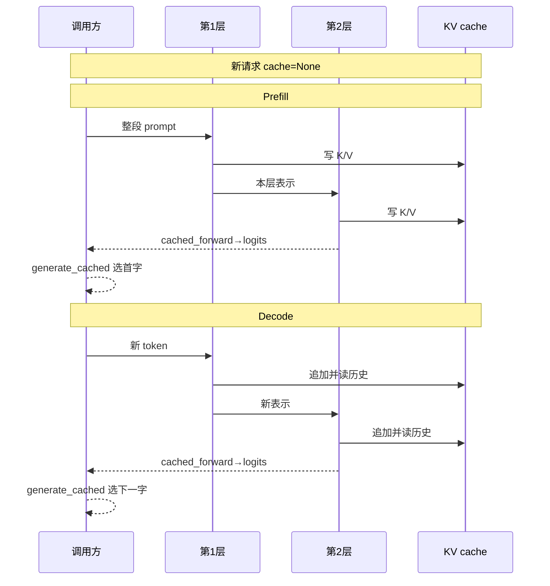
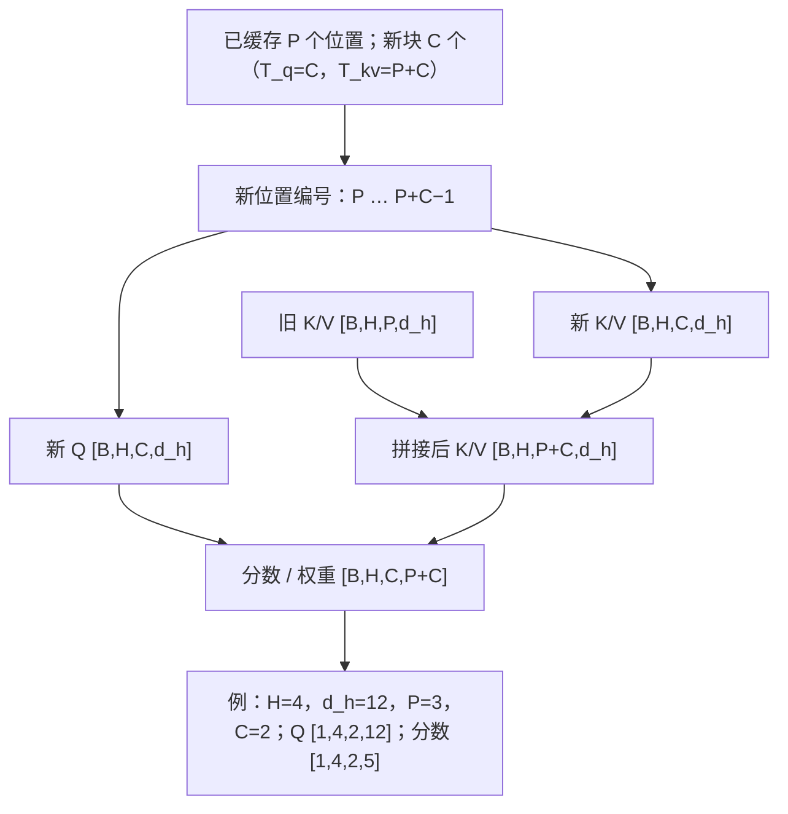
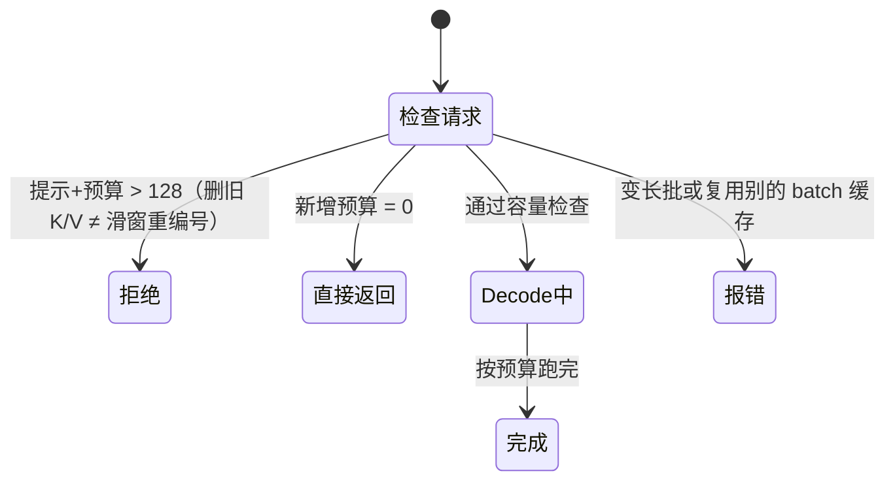

# 生成优化（P11）：KV Cache，不再重复算历史

第 8 章得到一份明确的 S0：相同字符词表、可学习绝对位置、两个 Pre-LN Block。现在实现 S1，**权重一项都不改，只缓存生成中可以复用的中间结果**。先证明 logits 对齐，再问时间和内存，不能把“生成的字看起来一样”当作正确性证明。

配套 [code/12_kv_cache.py](../code/12_kv_cache.py) 直接使用 S0 的模型模块，不另训一份近似模型。实验是 CPU、float32、无 dropout、eval 模式；不下载权重，不用 GPU。

## P11.1 重算发生在哪里

假设提示有“床前”两个字符。S0 先计算这两个位置，再选出“明”；下一轮把“床前明”三个位置全部送进模型，先前“床”“前”的计算又做一次。

在因果模型中，较早位置不能看后来追加的 token。如果权重、位置、历史 token 和确定性的前向计算都不变，较早位置在每层的表示也不会因追加后缀而变化。因此它们的 K 和 V 可以保存，下一步直接读。Q 是本次新位置要发出的查询，不必保存整个历史 Q。

```text
S0：床 前          → 全部位置前向 → 选 明
    床 前 明       → 全部位置前向 → 选 月

S1：床 前          → prefill，存各层 K/V → 选 明
          明       → 新 Q/K/V + 历史 K/V → 选 月
             月    → 新 Q/K/V + 历史 K/V → ...
```

可以把它比作保存已经整理好的借阅索引，下一次只补新条目。类比的边界是：真实缓存不是保存自然语言摘要，也不是模型长期记忆；它保存的是当前请求、当前参数与位置下的浮点张量。缓存本身不会让模型学会新的事实。

## P11.2 Prefill 与 decode，首字到底从哪来

**Prefill** 一次处理提示，建立每一层的 K/V。提示最后一个位置的 logits 已经能选出第一个新 token；不用先把这个尚未选出的 token 输入模型。

**Decode** 通常每次送入刚选出的一个 token。这个新位置产生 Q、K、V；把新 K/V 接在对应层的历史后面，Q 对全部可见 K 打分，然后更新本层缓存。下一层使用的是本层更新后的新 token 表示，而不是直接复用第一层的 K/V。

模型有两层就有两组缓存。每组分别保存 K 和 V，共四个张量。我们的接口：

```python
logits, cache = cached_forward(model, prompt_ids, cache=None)
# logits: [B, prompt_T, vocab_size]
# ... 选出 next_ids: [B,1]
new_logits, cache = cached_forward(model, next_ids, cache)
# new_logits: [B,1,vocab_size]
```

这里的片段是调用顺序，完整可运行示例在源码。`cached_forward` 不选 token，只返回当前新块的 logits；`generate_cached` 才负责选择与循环。它每次调用从空缓存开始，防止第二个请求误接在第一个请求后面。


下图按调用顺序对照：新请求必须 `cache=None`；`cached_forward` 只回 logits，选字由 `generate_cached` 完成。



## P11.3 逐层形状与位置偏移

设已有 P 个位置，本次新输入 C 个位置；头数 $H$，每头宽度 $d_h$，主干宽度 $D=Hd_h$。

$D=Hd_h$ 的意思是：主干的 $D$ 个数平均切给 $H$ 个头，每头分到 $d_h$ 个（这要求各头等宽、且所有头拼起来正好是 $D$，本书的 S0 正是如此）；各头算完再拼回去，宽度仍是 $D$，所以缓存按头存和按主干宽度存，数出来的元素一样多。

其中：$P$ 是缓存里已有的位置数，$C$ 是本次新块的长度（两者都是本章的局部记号）；$B$ 是批大小；$H$ 是注意力头数；$d_h$ 是每个头的宽度；$D$ 是模型宽度。

| 张量 | 形状 | 本次是否新算 |
| --- | --- | --- |
| 输入 ID | [B,C] | 本次输入 |
| 新 Q/K/V | [B,H,C,d_h] | 是 |
| 历史 K/V | [B,H,P,d_h] | 否 |
| 拼接后的 K/V | [B,H,P+C,d_h] | 保存历史和新块 |
| 注意力 scores / weights | [B,H,C,P+C] | 是，通常不是方阵 |
| 当前块输出 | [B,C,D] | 是 |
| 当前块 logits | [B,C,57] | 是 |

默认模型 $H=4$、$d_h=12$。当 B=1、P=3、C=2 时，新 Q 是 `[1,4,2,12]`，K/V 总长为 5，scores 是 `[1,4,2,5]`。

新块位置必须是 **P,P+1,…,P+C−1**。不是每次 decode 都从 0 开始，否则每一个新字都会拿到错误的可学习位置向量。源码的关键语句：

```python
pos = torch.arange(offset, offset + T, device=idx.device)
x = model.tok_emb(idx) + model.pos_emb(pos)
```

这里 T 是本次新块长度，`offset` 是缓存长度。旧位置向量已经进入旧 K/V 的计算，不应给旧缓存再加一次位置向量。参数表最大 128 行，索引只能是 0–127。


下图标出新块从偏移 P 起编号后，Q 与拼好的 K/V 如何凑成矩形分数表。



## P11.4 矩形 mask：最容易写错的两行

把提示分块计算，或者一次追加两个 token，同样必须阻止本块早位置看到本块未来。P=3、C=2 时，新 query 的绝对位置是 3、4，key 的位置是 0–4。可见规则仍是 **key_position ≤ query_position**。

### 表 P11-1：三格历史加两格新输入

| 新 query 位置 | key 0 | key 1 | key 2 | key 3 | key 4 |
| --- | --- | --- | --- | --- | --- |
| 3 | True | True | True | True | False |
| 4 | True | True | True | True | True |

直接 `tril(ones(2,5))` 会得到第一行只看 key0、第二行只看 key0/1，错误地屏蔽了大部分历史。反过来完全不加 mask，又会让位置 3 偷看位置 4。C=1 时本行可以看全部历史加自己，但这个特殊情况不能代替通用实现。

```python
query_positions = torch.arange(offset, offset + T, device=x.device)[:, None]
key_positions = torch.arange(offset + T, device=x.device)[None, :]
allowed = key_positions <= query_positions
scores = q @ k.transpose(-2, -1) / math.sqrt(attn.head_dim)
weights = scores.masked_fill(~allowed, float("-inf")).softmax(dim=-1)
```

这是源码片段，`True` 表示允许；先填负无穷，再 Softmax。本实现不接受空块，也不提供 padding，因此每行至少有自己可见，不会产生全 mask 行。带 padding/变长批次是另一层接口契约，不能把这个限制忘掉后套到任意批次。

### 表 P11-2：把可见性变成可手算的输出

暂时只看一个头，让两行 scores 都是 `[ln1,ln2,ln3,ln4,ln5]`，五个标量 V 是 `[10,20,30,40,50]`。这些是独立手算输入，不是随机模型碰巧得到的分数。

| query | 允许项 exp(score) | 分母 | weights | 加权 V |
| --- | --- | --- | --- | --- |
| 位置 3 | [1,2,3,4,0] | 10 | [0.1,0.2,0.3,0.4,0] | 30.000000 |
| 位置 4 | [1,2,3,4,5] | 15 | [1/15,2/15,3/15,4/15,5/15] | 36.666667 |

第一行分子是 10+40+90+160=300，除以 10 得 30；第二行再加 250，550/15≈36.666667。错误的小矩形下三角会分别得到 10 和 50/3≈16.666667。

这张表就是“Softmax 加权平均”的手算版：scores 故意取 ln1…ln5，取指数后正好变回 1…5；被 mask 的位置是 $e^{-\infty}=0$，既不进分子也不进分母。于是每行输出就是“可见的 V 按 1:2:3:… 的比例求平均”。

其中：exp(score) 是 Softmax 的分子；分母是同一行所有允许项之和；weights 是二者之比，每行加起来为 1；V 在这里是一维标量值，加权 V 是 weights 与 V 逐项相乘再相加。

## P11.5 证明 S0 与 S1 等价，要比较什么

对同一个 eval 模型与同一串 ID，先完整前向取得 `[B,T,57]` 的参考 logits，再分块调用缓存路径，将新块 logits 沿时间拼起来。比较的是每个位置的每个词表项，而不是仅比较选出的 token。

检查覆盖：

- 一次完整 prefill、逐 token 输入、7-token chunked prefill，最后一块不足 7 也要正确。
- T=1 和 B>1；每层 K/V 长度应随新块增加。
- 同一请求分支：保留旧 cache，从它分别追加不同后缀，不应偷偷原地修改旧 cache。
- 两次独立请求：重新传 `None`，第二次结果不能包含第一次历史。
- 错误边界：train 模式、空输入、超过位置上限、错误 batch/层数/头维、不同模型或更新权重后的旧缓存。

float32 的运算顺序可能因为矩阵大小不同而有微小舍入差；测试使用明确的 `atol/rtol`，不是要求逐位相同，也不是放宽到“都能生成一句诗”。脚本打印最大绝对误差，超出容差时必须排查位置、mask、拼接维度或参数是否相同。

`KVCache` 的容器不可重赋字段，但其中的张量仍可被调用者修改。因此约定缓存张量只读，不承诺 Python 的 frozen dataclass 能深度冻结 Tensor。它不是持久化 checkpoint，也不要跨模型、跨参数更新复用。

## P11.6 用空间换计算：先算真实 K/V 负担

MHA 有 $L$ 层，batch 为 $B$，缓存 $T$ 个 token，$H$ 个头，每头 $d_h$ 个数，每个元素 $b_{\mathrm{elem}}$ 字节，则：

$$\mathrm{Mem}_{KV}=2LBH_{kv}Td_hb_{\mathrm{elem}}=2LBTDb_{\mathrm{elem}}\qquad(\text{MHA：}H_{kv}=H\text{；本章各头等宽、总宽为 }D\text{，故 }Hd_h=D)$$

前面的 2 是 K 和 V 两份，不是两个 Block。默认 $L=2$、$B=1$、$H=4$、$d_h=12$、float32 的 $b_{\mathrm{elem}}=4$。

这条式子就是“数格子再乘格子大小”：每层、每条序列、每个缓存位置、每个头都要存一个 $d_h$ 维的 K 和一个 $d_h$ 维的 V，元素个数连乘起来，再乘每个元素占的字节。MHA 里每个 query 头都有自己的 KV 头，$H_{kv}=H$；本章各头等宽、拼起来正好是 $D$，所以 $Hd_h=D$，后半个等号只是把头数和每头宽度合并成主干宽度。

其中：$\mathrm{Mem}_{KV}$ 是全部层 K/V 缓存的逻辑字节数；$L$ 是层数；$B$ 是批大小；$T$ 是已缓存的 token 数；$H_{kv}$ 是 KV 头数（MHA 里等于 query 头数 $H$）；$d_h$ 是每头宽度；$D$ 是模型宽度（只因本章各头等宽、拼起来正好是 $D$，才有 $D=Hd_h$）；$b_{\mathrm{elem}}$ 是每个元素的字节数（float32 为 4）。

| 缓存长度 T | 计算 | K/V 逻辑字节数 |
| --- | --- | --- |
| 5 | 2×2×1×4×5×12×4 | 3840 |
| 48 | 2×2×1×4×48×12×4 | 36864 |
| 128 | 2×2×1×4×128×12×4 | 98304 |

脚本用 `numel() * element_size()` 把每层 K/V 实际相加，再与公式比较；float64 会将这些数字翻倍。此处的“内存”仅指逻辑张量载荷，不包括 Python 对象、模型权重、临时 scores、分配器保留空间和拼接复制的峰值。

S1 用 `torch.cat` 动态增长，旧新张量可能在某一瞬间同时存在。因此公式不是进程 RSS 或显存峰值。每步注意力仍需读全部历史 K/V；缓存不把任意长注意力变成与历史长度无关的常数成本。

GQA/MQA 会改变 KV 头数，量化会改变元素存储，分页会改变分配策略；都不在 S1 实现。这里用 MHA 的 H 直接计算，只把后续主题留作路线，不能用本章数字声称完成了 PagedAttention。[来源 2]

## P11.7 长度、重置与批处理的诚实边界

S0 的旧 `generate` 超长后保留最后 128 字、重置位置编号。S1 **拒绝超过容量**：只删掉最老 K/V 并不能重现这种重编号，因为保留下来的 K/V 已含旧位置与旧上下文影响。需要新的窗口语义和重算策略才能比较，不能静默丢缓存就声称等价。

`generate_cached` 采用保守规则：提示长度+请求新增预算 ≤128。最后一个选出的 token 不一定还需送回模型，但预算规则仍把它计算在内，方便调用者预先知道边界。零新增返回原输入，不做模型前向。它和 S0 一样没有 EOS，按预算停止。

批量实验只支持同长、无 padding 的 B 个请求，位置从 0 开始对齐。若要把长短不一的用户请求动态加入/退出，需要分别记录有效长度、注意力可见性与缓存所有权，本教学实现没有做到。对不同 batch 直接复用旧 cache 会报错，不会替你猜如何重排请求。


下图按 `generate_cached` 的真实顺序：先做容量检查，再处理零预算；变长批或跨批复用缓存也在检查请求时拦下。



## P11.8 计时：首 token 与后续 token 分开记

```bash
OMP_NUM_THREADS=1 python3 code/12_kv_cache.py
python3 -m unittest discover -s tests -p 'test_kv_cache.py' -v
```

基准使用同一个默认 S0 的随机权重，固定 48 个输入 ID，前 16 个作提示，后 32 个逐个回放。随机权重足以检查数值等价和计算路径，不用于评价文本质量。

- 首 token 指标：提示前向产生可选择首字的 logits 的耗时；不含分词、采样、网络或排队，不是端到端服务 TTFT。
- 后续 token 指标：同一次运行中 32 次后续前向的平均耗时，再跨重复运行取统计量；不是逐 token 尾延迟分位数。
- 先预热 2 轮，再计 7 轮；交替 S0/S1 测量顺序，输出各指标 min/median/max。
- CPU 单线程用 `perf_counter`；没有异步 GPU 工作，因此本实验不涉及 CUDA 同步。将方法搬到 GPU 时需要另外处理同步。

本机测量值每次运行都会重新打印，不将抖动的毫秒数写成单元测试常数。小矩阵下 Python 验证、`cat` 和分配可能抵消省下的计算，缓存不保证在这个微型 CPU 例子里更快。正确的优化报告应同时列出两条路径和计时范围，而不是只挑最漂亮的一次。

## P11.9 先预测，再看答案

1. P=3、C=2 时 scores 的最后两维是什么？第二个新 query 能看几个 key？
2. 已缓存 5 个 token，下一块 2 个 token 的位置编号是什么？可以重新从 0 开始吗？
3. 默认模型 float32、B=1、T=5 时，K/V 逻辑载荷多少字节？等于进程总内存吗？
4. 提示 prefill 结束后，第一个新 token 是否还要先输入模型才能被选出？
5. 两次独立请求使用同一个模型，第二次如何开始？能在更新权重后继续旧 cache 吗？
6. 缓存与完整前向生成相同贪心 token 就算验证通过吗？删最老缓存能重现 S0 的超长滑窗吗？

### 参考答案

1. `[2,5]`；第二行能看 5 个。矩形可见性由绝对位置比较得到。
2. 5、6。重新从 0 开始会查错位置嵌入。
3. 3840 字节。不是总内存，也不是 `cat` 时的峰值。
4. 不需要；提示最后位置的 logits 已可选首字。选出后才将它作为后续 decode 输入。
5. 传 `cache=None`；`generate_cached` 自动为每次调用创建空缓存。参数更新或替换后，旧缓存会被拒绝。
6. 不算，需比较每个位置完整 logits；也不能，因为旧 K/V 的位置与上下文没有重新计算。

运行本章测试文件，末尾应显示 `OK`；测试分类、计数与错误版本清单见 `docs/testing.md`。

后续 RoPE、GQA 或缓存布局的改动，都要继续通过这种同参数对齐，而不是跳过 S0 直接看速度。

## P11.10 延伸阅读：直接改 KV（cache engineering） {#p11.10-cache-engineering}

[Cache Engineering for Agents，arXiv:2610.28577](https://arxiv.org/abs/2610.28577)（代码 [thu-nics/AKV](https://github.com/thu-nics/AKV)）不改文本，直接在 KV 缓存里丢掉旧的工具结果，再用 RoPE 旋转把保留的 key 挪到新位置。要注意，保留 token 的 K/V 当初看过被删内容，所以这样做与只用保留文本重新 prefill 并不相同。

## 原始来源与版本

来源核验日期见附录 H。本章 S1 是教学实现，既不是 HF Cache API 的完整实现，也不是 vLLM 服务实现。

1. [Transformers 4.57.1 Caching](https://huggingface.co/docs/transformers/v4.57.1/en/cache_explanation)：逐层 K/V、增量计算、cache position 与组合注意力 mask；只在推理使用缓存的边界。
2. Kwon 等，[Efficient Memory Management for Large Language Model Serving with PagedAttention](https://arxiv.org/abs/2309.06180)，§2–3：KV cache 与服务内存管理动机。分页和连续批处理留给后续，不将本地 `cat` 称为 PagedAttention。
3. [code/07_baby_gpt.py](../code/07_baby_gpt.py) 与 [code/12_kv_cache.py](../code/12_kv_cache.py)：本章形状、容量策略、计时范围及可运行数值的直接依据。
4. [vLLM Paged Attention 设计文档](https://docs.vllm.ai/en/latest/design/paged_attention/)（动态文档，访问核验日见附录 H）仅作后续服务实现导航。本章不依赖 vLLM、没有运行其内核，也未实现分页缓存；本地 S1 的行为以配套脚本为准。

下一单元 [P12](#p12-rope) 将绝对位置表换成 Q/K 旋转，并继续用同参数全量/增量 logits 对照检查缓存。
