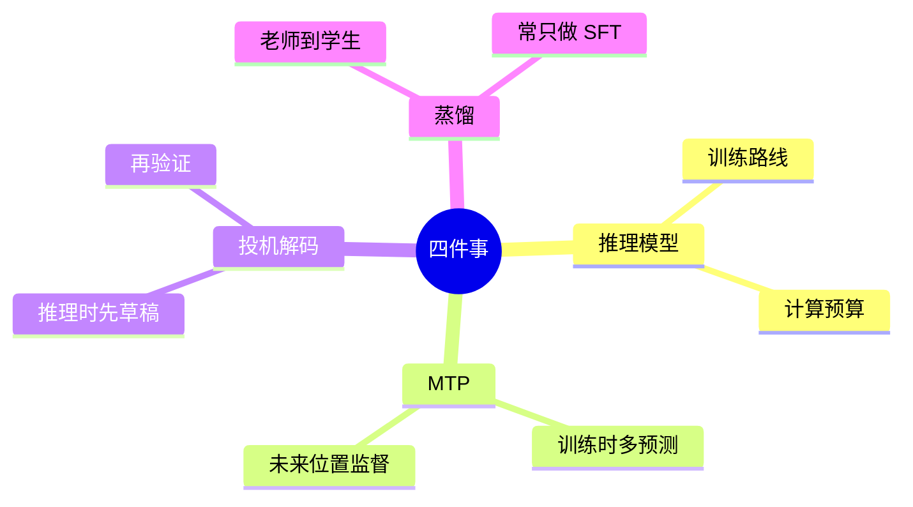
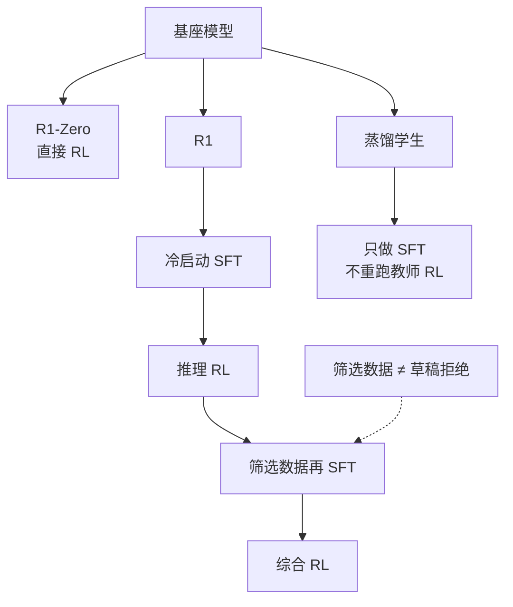
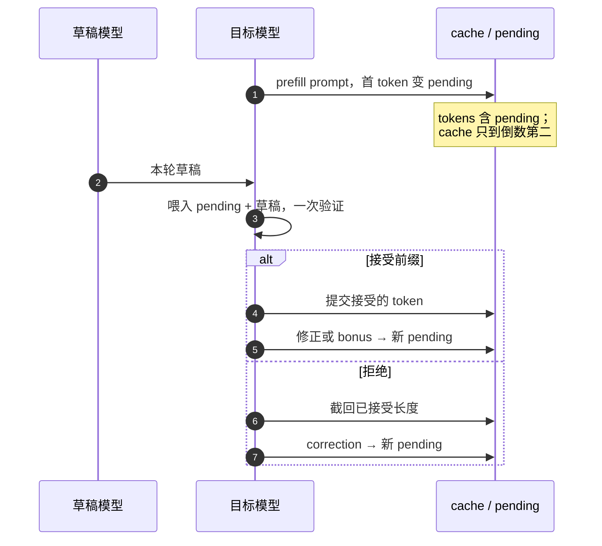
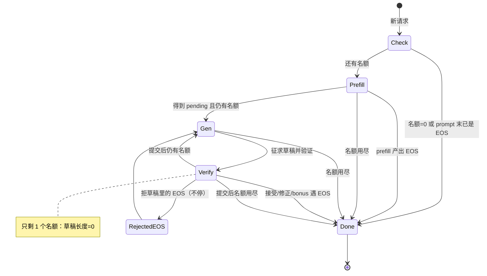
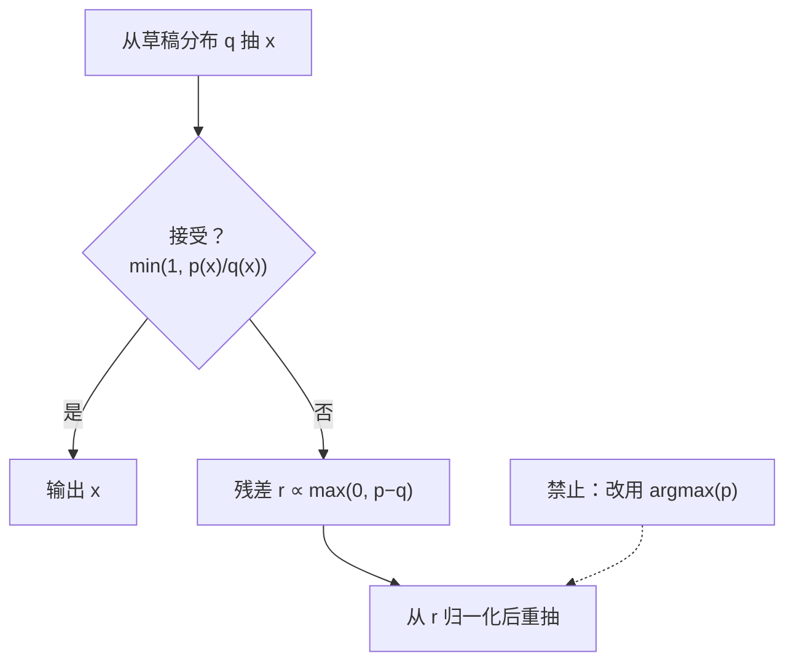

# 训练与应用（P23）：推理模型、MTP 与投机解码 {#p23-mtp}

做一道算术题，可以把草稿写得更长，可以换一种解题方法，也可以让同桌先写几个候选步骤、再由你检查。这三件事听起来都像“多想一点”，其实改变的是不同东西。

本章先把它们拆开，再接上 [S5 的教学 MoE](#p18-moe)：**训练时怎样给未来 token 增加监督，生成时怎样验证草稿，评估时怎样把计算预算与正确率分开记录。** 我们不训练一个 R1，不下载大模型，也不把会输出很长文字的小模型称为“推理模型”。

配套 [code/24_reasoning_mtp.py](../code/24_reasoning_mtp.py)，测试为 `tests/test_reasoning_mtp.py`。CPU 主线包含可核验算术、可关闭的 S6 教学 MTP 旁路、贪心 draft/verify。**随机投机采样没有实现，不声称其分布保持。**

## P23.1 四个问题，别挤进同一个名词

| 问题 | 改变什么 | 本章对应内容 |
| --- | --- | --- |
| 怎样让模型学会更有效地解题？ | 数据、奖励、优化目标与训练流程 | R1 式后训练路线 |
| 同一个隐藏位置还能接受哪些监督？ | 训练标签与预测模块 | MTP 辅助目标 |
| 已经训练好的目标模型，能否少做几次串行调用？ | 生成算法与执行安排 | 投机解码 |
| 测试时多给计算，答案是否更好？ | 单题计算预算与评估方式 | 预算—正确率曲线 |

四个问题挤在一个名词里最容易混；下面脑图拆开常被混称的几件事，不必与上表逐行一一对应：




MTP 是 **Multi-Token Prediction，多 token 预测**；speculative decoding 是**投机解码**。前者可以为后者提供草稿，但不是同义词。没有 MTP 的小模型也能做 drafter；有 MTP 辅助损失的模型也可以只用普通自回归生成。

同桌类比也有限：计算机的“检查”不是凭感觉觉得通顺，而是执行明确的接受规则。我们要保持的是**目标模型原来的生成规则**，不是“只要答案差不多就行”。目标模型本身可能算错题，投机解码不会自动纠正它的知识或算术能力。


## P23.2 R1 式训练：不是给答案加一个“思考”标题

先回忆前两章：SFT 用示例告诉模型哪些输出应提高概率；偏好或强化学习使用另一个评价信号调整策略。它们可以组成多阶段流程，不能仅凭最终文本的样式识别训练方法。

这里固定讨论 **DeepSeek-R1 技术报告 v1**，不把后续所有同名更新混在一起：

- **R1-Zero** 从基础模型直接进行 RL，不先做冷启动 SFT。这是一条特定实验路线，不等于“模型从零知识学会推理”。
- **R1** 先用少量较可读的长解答做冷启动 SFT，再做面向推理任务的 RL。
- 随后从训练后的模型收集候选解答、筛选数据，并混入非推理数据做新一轮 SFT；再进行覆盖更多场景的 RL。
- 报告中的小模型蒸馏使用教师生成并筛选的数据进行 SFT，不应写成“小模型完整重跑了教师的 RL 流程”。[DeepSeek-R1 v1，§2.2–2.4](https://arxiv.org/html/2501.12948v1)

三条路线分叉画清楚，数据筛选和草稿拒绝就不再挤在一处：




这里的 **cold start（冷启动）** 是给后续 RL 提供一个起点；**rejection sampling（拒绝采样筛选）** 在该训练阶段用于保留合格的数据样本。它不是下文为了保持目标生成规则而进行的“草稿接受／拒绝”，两者的目的、输出和正确性要求不同。

把训练路线翻译成读者可以检查的问题：

1. 起点是什么模型，已经会什么？
2. 监督数据来自哪里，筛选是否可信，验证集有没有混进去？
3. 奖励衡量答案正确、格式合规，还是人的偏好？这些不能相互替代。
4. 最后评估的是未见题目的正确率，还是只看输出变长、训练奖励变高？

给每道题奖励“写得长”，可能学到重复；给格式奖励，可能学到包装错误答案。即便正确率提高，也需要固定题集、预算和采样方式后才能比较。**“R1 式”是一条需要证据的训练路线，不是“多说几句话”的产品开关。**

## P23.3 先用可验证算术理解计算预算

为了让“多花了多少计算”不被语言风格干扰，本章暂时不用语言模型，改用一个故意可中断的竖式加法器。它每处理一个十进制数位，消耗一个预算单位。没算到的高位先留为零；只有全部输入位处理完，才把最后的进位写入答案。

这不是拟人化的思维过程，也不是 R1 复现。它是一台我们能逐步检查的算法，用来建立**输入相同、预算可控、检查器独立**的实验习惯。

### 手算 48 + 37

| 步骤 | 当前列 | 输入进位 | 当前合计 | 写下 | 传给下一列 |
| --- | --- | --- | --- | --- | --- |
| 1 | 个位：8 + 7 | 0 | 15 | 5 | 1 |
| 2 | 十位：4 + 3 | 1 | 8 | 8 | 0 |

预算 1 时只算出低位，临时答案是 5；预算 2 时答案是 85。不能把两步中的进位忘掉，也不能在预算 1 时偷偷读取真实答案补上十位。

代码中 `column_add` 只执行逐列计算；外层 `arithmetic_curve` 用 Python 整数加法 `a + b` 判断最终答案。求解器没有拿检查器的答案来选择输出。比如 999+1，预算 2 的临时答案仍是 0；预算 3 完成三列后，把最后进位加上，得到 1000。

固定六道题：2+3、12+23、48+37、105+207、999+1、1234+8765。每个预算都跑完全相同的题，结果如下：

| 每题允许的最多列数 | 正确题数 | 正确率 | 每题实际平均处理列数 |
| --- | --- | --- | --- |
| 0 | 0/6 | 0% | 0 |
| 1 | 1/6 | 16.7% | 1 |
| 2 | 3/6 | 50.0% | 11/6，约 1.833 |
| 3 | 5/6 | 83.3% | 14/6，约 2.333 |
| 4 | 6/6 | 100% | 15/6，即 2.5 |

“允许 4 列”不等于每题真的用了 4 列：2+3 只需一列。脚本同时打印预算与实际使用量。这个人为选择的六题数据集和正确的竖式算法自然形成阶梯，**不能据此推出真实语言模型的正确率会随 token 预算单调上升**。

把方法迁移到模型评估，还要固定模型版本、题集、提示、采样参数和检查器，并分别报告：

- 单个答案的质量与实际生成 token 数；超时、截断答案也计入分母。
- 同题多次采样的总成本。一次答对与十次中选出一次答对不是同一个指标。
- 是否有选择器或可验证检查器，以及选择本身的计算成本。
- 若修改预算后答案更啰嗦但没更正确，明确记录“没有测到质量收益”。

本节只运行确定性算法，没有训练／验证泄漏的模型实验，也没有未披露的教师模型调用。

## P23.4 MTP：在同一位置多问几个未来问题

普通 next-token prediction 在位置 $t$ 的隐藏向量 $h_t$ 上，预测下一个 token $x_{t+1}$。S6 的教学旁路另外增加独立线性 head，用**同一个 $h_t$** 预测 $x_{t+2}$、$x_{t+3}$……。

设有 $n_{\mathrm{mtp}}$ 个额外 head，总共 $n_{\mathrm{mtp}}+1$ 个预测距离，记为 horizon $j$：

$$
z_t^{(1)}=h_tW_1^\top,\qquad
z_t^{(j)}=h_tW_j^\top\quad(j=2,\ldots,n_{\mathrm{mtp}}+1).
$$

**大白话：**同一个位置的隐藏状态，同时交给几位“考官”：主 head 问下一个词，旁路 head 分别问再往后第 2、3……个词。各 head 只是换一张输出矩阵，读的是同一份表示。

其中：$h_t$ 是主干最后一层、再经最终 $\mathrm{ln\_f}$（RMSNorm）之后、在位置 $t$ 的那一行隐藏向量，长 $D$ 的行向量（本章局部记号；它**不是**附录 A.5 的 $X^{(l)}$——那里 $X^{(l)}$ 是第 $l$ 层的输入；$x_{t+1}$、$x_{t+j}$ 指该位置的真实 token，和 $h_t$ 别混）；$W_j\in\mathbb R^{\lvert\mathcal V\rvert\times D}$ 是第 $j$ 个 horizon 的输出矩阵，和代码里 `nn.Linear` 的权重一样按 $[\lvert\mathcal V\rvert,D]$（输出×输入）存，所以乘的时候写转置 $h_tW_j^\top$；$z_t^{(j)}$ 是预测位置 $t+j$ 的 logits，长 $\lvert\mathcal V\rvert$；$j$ 是预测距离；$n_{\mathrm{mtp}}$ 是额外 head 数，代码里叫 `depth`。

主 head 是 S5 原来的 head，不是再复制一个。$h_t$ 只能看见当前位置及之前的 token；为了预测更远处，我们没有把真实未来 token 偷塞进 $h_t$。

### 五个 token，把标签写出来

输入为 `[1,2,3,4,5]`，$n_{\mathrm{mtp}}=2$。这里的整数是 token ID，不是它们的数值大小。

| 隐藏位置的输入 token | 1 | 2 | 3 | 4 | 5 |
| --- | --- | --- | --- | --- | --- |
| 主 head：j=1 | 2 | 3 | 4 | 5 | 忽略 |
| 旁路下标 0 的 head：j=2 | 3 | 4 | 5 | 忽略 | 忽略 |
| 旁路下标 1 的 head：j=3 | 4 | 5 | 忽略 | 忽略 | 忽略 |

最后几格不是“答案是 0”，而是窗口里已经没有对应标签。实现使用 `-100` 表示**不计损失**。不要 `roll` 后忘记遮住尾部，否则最后一个位置会被要求预测窗口开头，制造不存在的循环文本。

张量账本如下：

| 项目 | 形状 |
| --- | --- |
| token ID、每个 horizon 的 labels | [B,T] |
| 归一化后的隐藏状态 | $[B,T,D]$ |
| 每个 head 的权重（`nn.Linear` 存储形状） | $[\lvert\mathcal V\rvert,D]$ |
| 每个 horizon 的 logits | $[B,T,\lvert\mathcal V\rvert]$ |
| 每个 horizon 的 CE | 标量 |

这里 $n_{\mathrm{mtp}}$ 表示“额外预测 head 数”，$D$ 表示隐藏宽度，$\lvert\mathcal V\rvert$ 表示词表大小。代码同样用 `depth` 与 `config.d_model` 区分这两个数，不要把它们混写成同一个字母。

### 这是教学并行旁路，不是完整 V3 MTP

DeepSeek-V3 的版本化报告描述的是**串行** MTP 模块：结合前一深度的表示和对应 token embedding，经过额外 Transformer，并共享 embedding／输出 head。训练辅助目标与推理时如何利用它是两个层面。[DeepSeek-V3 v2，§2.2](https://arxiv.org/html/2412.19437v2)

S6 没有实现那条串行结构，也没有复现其权重共享、训练规模或生产性能。我们选独立线性 head，是为了用最小改动看清标签对齐和梯度。多个 head 从同一前缀预测未来边际结果，也不等于它们已经正确建模了“先生成第一个草稿，再条件于它生成第二个”的联合链条。

## P23.5 损失：先算哪些格，再决定怎么平均

对 horizon $j$ 的有效位置集合 $\Omega_j$，本章定义：

$$
\mathcal L_j=-\frac{1}{|\Omega_j|}\sum_{(b,t)\in \Omega_j}
\log\operatorname{softmax}(z_{b,t}^{(j)})[x_{b,t+j}].
$$

**大白话：**第 $j$ 位考官只在“还有答案可对”的格子上考试：看它给真正的第 $t+j$ 个 token 多少概率，取负对数当扣分，再按这些格子的个数求平均。

其中：$\Omega_j$ 是 horizon $j$ 下标签不是 -100 的位置 $(b,t)$ 集合，$|\Omega_j|$ 是它的元素个数；$b$ 是第几条样本，$t$ 是位置；$z_{b,t}^{(j)}$ 是该位置第 $j$ 个 head 的 logits；$[x_{b,t+j}]$ 表示取出真实 token $x_{b,t+j}$ 那一项的概率；$\mathcal L_j$ 是该 horizon 的平均交叉熵。

若 $\Omega_j$ 为空，令 $\mathcal L_j=0$，并保留可反向传播的零值。否则“对空集合取均值”可能得到 NaN。因为不同 horizon 的有效标签数不同，分母不能固定写成 B×T。

S6 的明确约定是先对每个 horizon 的有效标签取均值，再对 $n_{\mathrm{mtp}}$ 个额外 head 的损失取平均：

$$
\mathcal L=\mathcal L_1+\frac{w_{\mathrm{mtp}}}{n_{\mathrm{mtp}}}\sum_{j=2}^{n_{\mathrm{mtp}}+1}\mathcal L_j+\mathcal L_{\mathrm{MoE}}\quad(n_{\mathrm{mtp}}>0).
$$

**大白话：**主任务的分数照记；几位旁路考官的分数先取平均，再乘一个小权重 $w_{\mathrm{mtp}}$ 当“附加题”；MoE 的负载均衡罚款原样加上。

其中：$\mathcal L$ 是总训练损失；$\mathcal L_1$ 是主 head（下一个 token）的损失，$\mathcal L_j$ 见上式；$w_{\mathrm{mtp}}$ 是 MTP 辅助损失的权重（代码里的 `weight`）；$\mathcal L_{\mathrm{MoE}}$ 是 S5 已乘过系数的负载辅助项。

$n_{\mathrm{mtp}}=0$ 时省略中间项；$\mathcal L_{\mathrm{MoE}}$ 是 S5 已有且已乘系数的负载辅助项，不要重复乘或悄悄删除。一个 horizon 没有标签时，其 CE 为零，但**整项训练损失未必为零**，因为 MoE 辅助项可能仍存在。把所有 horizon 的有效位置放一起再平均也是另一种可定义的目标，但不是本章这一个。

### 两个有效位置，手算交叉熵与梯度

假设三分类概率在第一个有效位置为 `[1/6,2/6,3/6]`，标签是下标 2 的类别；另一个有效位置为 `[3/6,2/6,1/6]`，标签是下标 1 的类别。两者中间有一个忽略位置：

$$
\mathcal L=\frac{-\log(3/6)-\log(2/6)}{2}
=\frac{\log 2+\log 3}{2}.
$$

其中：3/6、2/6 是两个有效位置上正确类别的概率，分母 2 是有效位置数；$\log$ 为自然对数。

对第一个位置的 logits，梯度是 $(p-\mathrm{onehot})/2$，即 `[1/12,1/6,-1/4]`（$p$ 是该位置的 softmax 概率，$\mathrm{onehot}$ 是标签的独热向量，除以 2 是因为对两个有效位置取平均）。第二个有效位置为 `[1/4,-1/3,1/12]`；忽略位置的三个梯度全为 0。

### 三种 mask 不要混用

`future_labels` 接受三个可选输入，形状都是 [B,T]：

- `valid`：这个 token 是否真实存在，而不是 padding。跨度 t 到 t+j 中的**每个位置**都必须有效。
- `segments`：文档段编号。跨度中所有位置必须属于同一段，不能跨边界预测；即使编号后来又重复，也不能跳过中间另一段。
- `supervise`：哪些目标位置应计入损失，例如只监督 assistant token。检查的是 t+j，**不是 t**。最后一个 prompt token 预测第一个 assistant token 正是合法监督。

重要边界：这些是**标签 mask，不是 attention mask**。S5 的主干仍是普通因果注意力；给两篇文档编号不会自动禁止后一篇读取前一篇。需要隔离上下文时，本示例用不同样本行，不声称实现了 packed block-diagonal attention。教学 MoE 的负载辅助项也没有改成只统计有效标签，所以应使用无 padding 的等长小样本，或单独定义并验证完整的 padding 处理。

## P23.6 S6 怎样接在 S5 旁边

`MTPGPT` 继承 S5，只注册额外 head，不修改 `code/19_moe.py`。有三条清楚分开的调用路径：

1. `model(tokens, targets)`：完全沿用 S5 的普通 forward，targets 仍按 S5 的约定由调用者对齐；不会执行旁路 head。
2. `model.forward_mtp(tokens, ..., weight=0.2)`：接收**尚未右移的完整序列**，自己为每个 horizon 创建 labels，并返回 `MTPResult`。
3. `s5.cached_forward(model, chunk, cache)`：沿用 S5/S4 的 compact GQA cache，只走主模型；生成时不反向传播。

不要把第二种调用与第一种目标格式混用。`forward_mtp` 返回每个 horizon 的 logits、labels、CE，以及合计 loss 和单列的 MoE 辅助项，方便看清训练信号从哪里来。

沿源码阅读 `mtp_logits`：

- `tok_emb(idx)` 把 $[B,T]$ 转成 $[B,T,D]$。
- 依次经过 S5 原来的 blocks，继续保留因果注意力和 MoE。
- `ln_f(hidden)` 得到各个 head 共用的表示。
- 原 head 生成 horizon 1 的 logits，额外线性层分别生成 horizon 2、3……。

所有额外 head 都连接主干，没有 `detach`。因此辅助损失也会训练 embedding 和 Transformer；它不是冻结教师的蒸馏。若想研究“冻结主干”的另一种训练法，必须另开消融，不能只改解释文字。

`depth=0` 不添加参数、不额外消耗随机初始化数；同种子下，S5 与 S6 的 state_dict、参数数量、普通 logits、普通 loss 和缓存数值完全相同。不同模型实例的 cache 仍有不同 owner，不能互换。`depth=2` 时增加的参数正好是 $2\lvert\mathcal V\rvert D$，不是完整模型参数翻倍。

`weight=0` 只是关闭辅助损失的系数，**不删除已经创建的 head，也不省掉显式 `forward_mtp` 里的 head 计算**。若要结构上关闭旁路，构造 `depth=0`；若只做普通推理，调用普通 forward／cache 路径即可。重新训练后的主干权重变了，不能再要求它与训练前的 S5 输出相同。

本章验证 CPU float32 演示与 float64 数值对照；没有验证 autocast、混合精度、大批量 ragged 请求、GPU kernel 或多机缓存。不要将本例的数值容差直接搬去低精度服务。

## P23.7 贪心 draft/verify：只信目标模型的那一票

**贪心生成**每步选择目标 logits 最大的 token；本实现用 PyTorch `argmax`，平局时选编号最小者。草稿可以不完美，但已提交的结果必须遵守这个规则。

设已有前缀为 P，草稿提出 `[B,X,Y]`。目标模型在一个带因果 mask 的块里计算出：

- P 后应该是 B：接受 B。
- P+B 后应该是 C，而不是 X：拒绝 X，提交 C。
- 丢弃 X 之后的全部草稿，以及以错误 X 为条件计算的后续结果。

本轮实际输出 `[B,C]`。不是把 X 单独改为 C 后继续相信 Y，因为 Y 的验证前缀已经错了。

如果草稿 `[B,C,D]` 全部与目标贪心选择一致，目标在 P+B+C+D 后还给出了下一个位置的 logits。可再提交一个**额外 token（bonus token）**。本轮最多得到“草稿长度 + 1”个 token，而不是最后一个草稿输出两遍。

为什么这保持贪心序列？用归纳法即可：假设当前已提交前缀与基线相同；接受的每个 token 都等于目标在这个正确前缀上的 argmax。第一次不匹配时，改用同一位置的目标 argmax 并停止本轮。全接受时的 bonus 也在正确前缀上计算。因此下一轮仍从相同的已提交前缀开始。

这是数学算法的不变量。实际浮点矩阵运算的分块顺序可能产生微小误差；近乎并列的 logits 可能因此改变 argmax。

## P23.8 KV cache 最容易错的地方：最后一个 token 还没喂进去

生成一个 token 和把它送进模型，是两件事。为避免每轮为了 correction／bonus 额外调用一次目标模型，本实现维护如下不变量：

- `tokens`：已经提交给用户的 prompt 与生成序列。
- `cache`：缓存 `tokens[:, :-1]`，即还没包含最后一个已生成 token。
- `pending`：`tokens[:, -1:]`，下轮才喂入目标模型。

tokens、cache、pending 三者相差一位，用时序图对齐：




先对完整 prompt 做一次 prefill，取末行 logits 的 argmax，输出第一个 token。此时 cache 恰好装着 prompt，第一个新 token 成为 pending。

### 带具体位置的拒绝例子

使用一个便于手算的目标规则：“下一个 ID 等于当前 ID 加 1”。prompt 是 `[1,2]`，prefill 先生成 3：

| 状态 | 内容 |
| --- | --- |
| tokens | `[1,2,3]` |
| cache | `[1,2]` |
| pending | `[3]` |
| 本轮草稿 | `[4,9,8]` |

目标调用一次，新增输入是 **`[3,4,9,8]`**，而不是重复输入 prompt。以位置编号从 0 开始：

- `verify[0]` 是“看到 3 后”的 logits，预测 4，用来验证草稿下标 0 的项。
- `verify[1]` 是“看到 4 后”的 logits，预测 5，用来验证草稿下标 1 的项；9 错了。
- 后面的行使用了错误草稿前缀，不能继续提交。

接受 4，修正为 5 后，tokens 成为 `[1,2,3,4,5]`。cache 应裁成 `[1,2,3,4]`，pending 是 `[5]`。不能留下 9 的 K/V，也不能提前把 5 当作已经存在的 cache 位置。

源码里旧 cache 长度是 `old_length`，本轮实际写入的新 token 序列是 `emitted`，则裁切后的新 cache 长度为 `old_length + len(emitted)`（也就是 $T_{\mathrm{old}}+T_{\mathrm{emit}}$）。因为本次调用喂入了旧 pending，但留下新 pending 未喂入。`trim_cache` 对每层 K/V 的时间维度取前缀并复制，保留 owner 与权重版本，不修改原 cache。

其中：`old_length` / $T_{\mathrm{old}}$ 是裁切前已缓存的 token 数；`emitted` 是本轮最终提交进 cache 的新 token 列表，$T_{\mathrm{emit}}=\lvert\texttt{emitted}\rvert$；二者之和是下一轮开始时的缓存长度。

### EOS 与预算必须一起守住

- prompt 最后已经是 EOS，或者 `max_new_tokens=0`：返回原序列，不做 target 调用、不创建 cache。
- prefill 生成 EOS：立即结束，EOS 留作最后的 pending。
- 接受的草稿中出现 EOS：在它那里结束，不提交后缀或 bonus。
- 草稿出现 EOS 但目标不同意：它只是一个被拒绝的提案，不能让请求提前结束。
- correction 或 bonus 是 EOS：提交它，然后结束。
- 每轮最多提议 `min(draft_tokens, remaining-1)` 个 token，预留一个 correction／bonus 位置。只剩一个输出名额时，不征求草稿，普通前向一步。

停机条件互相嵌套，状态图比文字清单更清楚：




因此最后一轮不会越过 `max_new_tokens`。本例保守要求 `prompt 长度 + 生成预算 <= max_seq_len`，不实现滑动截断；若模型权重或影响缓存的设置改变，必须重新开始请求。

每轮验证还必须至少提交一个 token。若拒绝分支因程序错误忘了提交 correction，代码立即抛出 `RuntimeError`，而不是在同一前缀上无限循环。**空草稿本身是合法的**：它仍从目标 logits 提交一个 token，所以不能仅因草稿长度为 0 就报“没有进展”。

## P23.9 为什么不能把贪心验收拿去冒充随机采样

贪心只需要知道最大项是谁；随机采样必须保持**整个概率分布**。若目标为 p、草稿为 q，在同一条件前缀和同一采样变换下，经典投机采样对从 q 抽出的 token x 使用：

$$
\alpha(x)=\min(1,p(x)/q(x)).
$$

**大白话：**草稿抽到 $x$ 后，目标模型觉得它“至少和草稿一样可能”就照单全收；否则按两者概率之比打折接受。

其中：$p$ 是目标模型的概率分布，$q$ 是草稿模型的概率分布，$x$ 是从 $q$ 抽出的 token；$\alpha(x)$ 是接受概率（局部符号）。

拒绝时不能随意重抽，也不能直接选目标最大项，而应从归一化的正差分布抽取：

$$
r(x)=\frac{\max(0,p(x)-q(x))}
{\sum_y\max(0,p(y)-q(y))}.
$$

**大白话：**被拒绝后，只从“目标比草稿更想要”的那些 token 里补抽，补抽比例正好填平草稿少给的概率，所以最终分布仍与目标 $p$ 一致。

其中：$r(x)$ 是拒绝后重新抽样用的残差分布（局部符号）；$y$ 遍历整个词表；$\max(0,\cdot)$ 只保留正差。

这套接受与校正规则的依据见 [Fast Inference from Transformers via Speculative Decoding v2，§2.3 与附录 A](https://arxiv.org/html/2211.17192v2)。若 q(x)=0，正常从 q 采样不会得到该 x；p=q 时拒绝概率为零，不应去归一化一个全零残差。涉及 temperature 或截断采样时，要使用相应处理后的分布，不能混用原始 logits 和修改后的概率。

拒绝之后必须从残差分布重抽，流程如下：




手算一个两词表例子：p=[0.6,0.4]，q=[0.2,0.8]。A 的接受概率是 1，B 的接受概率是 0.5；被直接接受的质量分别是 0.2、0.4，尚有 0.4 的拒绝质量。正差 $p-q$ 只在 A 上为正，所以这 0.4 全补给 A，最后恰好得到 [0.6,0.4]。

**本章只对这个概率恒等式做精确分数验算，没有随机投机采样器。** 代码中的 `greedy_decode` 不接受 temperature、top-p 或随机 generator，也没有概率校正实现。不要删除这条边界，再把“贪心序列相同”写成“随机采样分布保持”。

## P23.10 运行结果：少几次 target 调用，不等于真的快了

在仓库根目录运行：

```bash
OMP_NUM_THREADS=1 python code/24_reasoning_mtp.py
OMP_NUM_THREADS=1 python -m unittest discover -s tests -p test_reasoning_mtp.py -v
```

已验证环境为 CPU、附录 H 所列 PyTorch、单线程、种子 230。脚本不下载数据／权重。缺少 PyTorch 时，CLI 给出安装 `requirements.txt` 的提示并以状态 2 退出。

固定 demo 使用词表 11、隐藏宽度 16、1 层教学 MoE、2 个额外 head、长度为 2 的 prompt，生成 10 个 token。模型只随机初始化并做一次反向检查，没有训练质量结论。本次输出包括：

```text
greedy tokens equal: True
generated IDs: [[5, 6, 3, 1, 9, 2, 5, 6, 3, 1]]
target calls: ordinary=10, draft/verify=6
target input tokens: ordinary=11, draft/verify=18
drafter full-prefix calls=4; input tokens=24
accepted/proposed=4/11; rejected rounds=4; bonuses=0
```

计数在实际 `forward` 调用处累加，包含 prefill，不是用“输出长度÷草稿长度”推算。`target_tokens` 也计入后来丢弃的草稿输入。`draft_requests` 是请求草稿的次数，不能假定它等于任意草稿器内部的 forward 次数；本例 `MTPDraft` 自己另外记录了真实完整前缀 forward 和输入量。

看起来 10 次 target 调用变成 6 次，但 target 处理的位置由 11 增至 18，drafter 又完整计算了 24 个前缀 token。这里的 MTPDraft 为了易读，每次都重算完整前缀，也复用了目标主干，**不是低成本的生产草稿器，不应宣布加速**。本章没有测墙钟延迟、TTFT、TPOT 或 GPU 吞吐。

定义本章的草稿接受比例为 `accepted / proposed`：分母包括因前面出错而被整体丢弃的后续提案。这是清楚可复算的保留比例，不是所有论文相同名称的统计口径。还应看每轮提交多少 token、草稿耗时、目标 chunk 成本以及缓存搬运；只报一个高接受率不够。

## P23.11 蒸馏与跨版本比较：到这里划边界

**蒸馏**可以把大模型生成的优质示例用于训练小模型；也有使用教师概率的其他方案。必须说明具体知识如何传递，不能只凭“小模型效果像大模型”推断训练方法。数据蒸馏、冻结主干的草稿模块训练、MTP 共享主干辅助学习，是三种不同设置。

本章只解释这个区别，没有实现蒸馏流水线、教师服务、数据筛选系统或新扩展项目。S6 的辅助梯度进入主干，不能将其命名为 R1 蒸馏复现。

本章只依据官方版本化报告作如下跨版本提醒（核对截止日期见附录 H）：**DeepSeek-V4.1-Flash 的 DSpark 不能直接贴上 V3 MTP 的标签。** 官方报告 §2.4.3 描述了半自回归草稿和基于置信度安排验证的方案；它在预训练后专门训练，起初冻结 backbone，后训练中其目标也不向 backbone 反传。不要从“都是投机解码”推断两者采用同一训练目标或参数共享设计。[DeepSeek-V4.1-Flash v1](https://arxiv.org/html/2609.19969v1)

我们没有运行 DSpark、R1 或 V3 官方权重，没有复现其质量或速度。读到新版本时应重新核对明确对象与版本，而不是沿用旧名词填满组件表。

## P23.12 自测：每个问题都有一个可运行的检查

先独立作答，再对照以下结果；对应测试名可以在 `tests/test_reasoning_mtp.py` 中搜索。

1. 输入 `[1,2,3,4,5]`，horizon=3 的标签是什么？是 `[4,5,-100,-100,-100]`，不能把 1、2 循环补到尾部。检查 `test_hand_labels_and_no_circular_roll`。
2. 源位置属于 prompt、目标位置属于 assistant，应不应该监督？应检查目标位置；若跨度穿过 padding 或文档边界则仍应忽略。检查 `test_label_masks_match_scalar_oracle_including_intermediate_boundaries`。
3. 有效概率为 1/2 与 1/3，中间一个位置忽略，CE 分母是什么？是 2，loss 为 `(log 2 + log 3)/2`；忽略位置梯度为零。检查 `test_masked_ce_scalar_and_analytic_gradients`。
4. `depth=0` 与 `weight=0` 是否都删除了旁路参数？只有前者从构造上不创建额外参数；普通 forward 即使存在旁路也不调用它。检查 `test_disabled_is_exact_s5_parameters_rng_logits_losses_and_cache` 与 `test_enabled_sideheads_do_not_change_ordinary_s5_path`。
5. 草稿第二项错误，能不能保留第三项，只替换第二项？不能；错误前缀之后的验证结果要丢弃。检查 `test_every_rejection_position_and_subsequent_cache_positions`。
6. `[1,2,3]` 中 3 为 pending，接受 4 后修正为 5，cache 是什么？是 `[1,2,3,4]`，5 仍未喂入。检查同一拒绝测试及 `test_real_s5_full_context_oracle_and_cache_logits`。
7. 只剩一个输出名额，能否再提交三个草稿与一个 bonus？不能；草稿长度降为 0，只生成一个 token。EOS 也不能越过。检查 `test_short_empty_drafts_and_budget_boundaries` 与 `test_eos_prompt_first_accepted_corrected_rejected_and_bonus`。
8. 预算 2 的 999+1 是什么临时答案？是 0；预算 3 完成后才得到 1000。预算曲线为什么不是语言模型能力曲线？它来自已写好的竖式算法与固定六题。检查 `test_arithmetic_curve_and_carry_by_independent_integer_oracle`。
9. p=[0.6,0.4]、q=[0.2,0.8] 时，拒绝的概率质量如何补回？0.4 全补到 A；这是数学例子，不是随机采样实现。检查 `test_hand_sampling_correction_is_math_only_not_a_sampler_claim`。
10. 草稿第一个位置应该用哪个 head？是主 head，后面才是旁路下标 0、1 的 head。固定种子下前缀 `[1,2,5]` 的三个提案为 `[6,0,9]`，limit=1、2、3 分别取前一、二、三项；不能跳过主 head。检查 `test_fixed_seed_draft_head_to_position_scalar_oracle`，并用 `test_cli_pins_documented_outputs_and_actual_cost_counters` 固定正文演示的输出与成本计数。

运行本章测试文件，末尾应显示 `OK`；测试分类、计数与错误版本清单见 `docs/testing.md`。

## P23.13 延伸阅读：更便宜的草稿

P23.7 的验收规则不关心草稿从哪来：只要每轮都由目标模型贪心验收，输出就等于普通贪心。所以草稿可以换成更便宜或更准的方法，例如一次并行写出整块草稿的 [DFlash，arXiv:2602.06036](https://arxiv.org/abs/2602.06036)、按逐位置置信度截断草稿的 [DSpark，arXiv:2607.05147](https://arxiv.org/abs/2607.05147)，以及沿预测距离递归、复用主干最后一层的 [ECHO，arXiv:2610.24766](https://arxiv.org/abs/2610.24766)。

## P23.14 延伸阅读：推理强度预算与 LK loss {#p23.14-budget-lk}

[Kimi K3 技术报告，arXiv:2607.24653](https://arxiv.org/abs/2607.24653)在 RL 中给每道题估一个 token 预算，轨迹超出预算的若干倍就把任务奖励改成 −1，以此训练出不同推理强度的档位。[LK Losses，arXiv:2602.23881](https://arxiv.org/abs/2602.23881) 则让草稿直接优化接受率 `Σ_x min(p(x), q(x))` 的负对数，而不是 KL。

## P23.15 延伸阅读：batch 变大时的投机解码 {#p23.15-eagle4}

batch 小时解码受内存带宽限制，多验证几个草稿位置几乎不增加耗时；batch 变大后矩阵乘吃满算力，验证就要付真实的算力账。EAGLE-4（[论文 PDF](https://github.com/eagle-hq/EAGLE-4/blob/3b96ef6e1c0b2ef0c698fab74c8e383d8bf8053d/EAGLE4_Paper.pdf)）按实测的起草和验证代价，每轮决定起草多少、用树还是用链。

## P23.16 延伸阅读：FlashMap {#p23.16-flashmap}

[FlashMap，arXiv:2610.24365](https://arxiv.org/abs/2610.24365) 用 flow map 从噪声一步跳到整块草稿，在单次前向里保留块内各位置的依赖，再交给目标模型并行验证。

## 资料版本与复现边界

核验日期见附录 H。以下固定论文版本用于机制与训练路线；链接不是本书已运行相应大模型的证明。

- [DeepSeek-R1，arXiv:2501.12948v1](https://arxiv.org/html/2501.12948v1)：§2.2–2.4，Zero／冷启动／RL／数据筛选／SFT／蒸馏的区别。
- [DeepSeek-V3 Technical Report，arXiv:2412.19437v2](https://arxiv.org/html/2412.19437v2)：§2.2，串行 MTP 模块、训练辅助目标与推理用途。本章独立线性 head 不是该模块的复刻。
- [Fast Inference from Transformers via Speculative Decoding，arXiv:2211.17192v2](https://arxiv.org/html/2211.17192v2)：§2 与附录 A，草稿验证和随机采样校正的原始依据。本章实现仅为贪心。
- [DeepSeek-V4.1-Flash，arXiv:2609.19969v1](https://arxiv.org/html/2609.19969v1)：§2.4.3，仅用于核对 DSpark 与 V3 MTP 的差异；不把不同版本的训练方案拼接成一个实现。

## 本章小结

读完本章，应能清楚说出：**推理能力要靠任务评估，MTP 是训练监督，投机解码是保留目标生成规则的执行方法，测试时计算是需要付账的预算。** 把它们分别定义、分别验证，比把所有改进都叫“多想一步”更重要。
