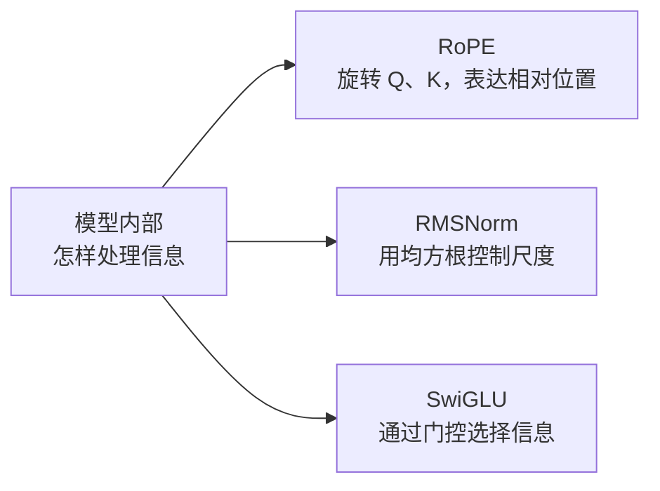
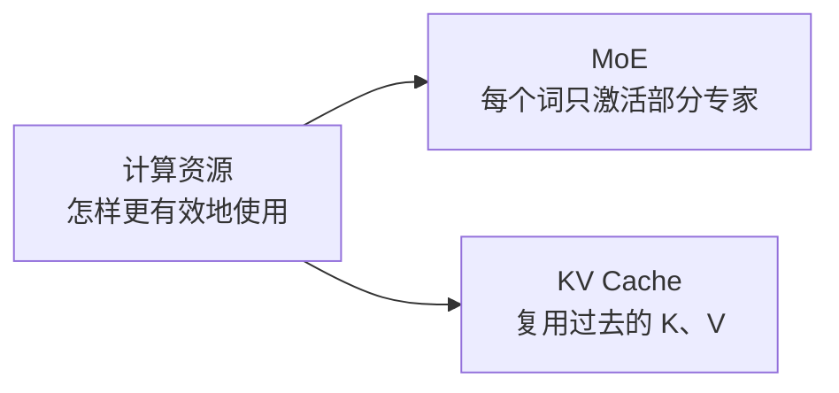

# 第9章：走向现代大模型——经典 Transformer 的后续发展

> “科学不是一座静止的神庙，而是一条永不停息奔涌向前的大河。”

本章按截至 2026 年 10 月可核对的公开资料，挑选几条重要设计路线，不做最新模型排行榜。闭源模型未公开的结构不作推测。

---

## 9.1 架构选择：为什么开放式生成常用 Decoder-Only？

在 2017 到 2020 年间，深度学习界曾有过激烈的“流派之争”：
- **Encoder-Only 派**：以 Google 的 **BERT** 为代表，专精于理解和分类；
- **Encoder-Decoder 派**：以 Google 的 **T5** 为代表，专精于机器翻译和摘要；
- **Decoder-Only 派**：以 OpenAI 的 **GPT 系列** 为代表，坚持纯自回归生成。

到了近几年的开放式聊天模型中，GPT、LLaMA、DeepSeek 等许多代表性系统采用 **Decoder-Only（仅解码器）**。这是适合“读完前文，继续预测下一个词”的工程选择，并不表示 Encoder-Only 或 Encoder-Decoder 已经没有用途。

### 三种架构各自擅长什么？

### 表 9-1：三大 Transformer 派系历史战役复盘表

| 架构流派 | 典型代表 | 训练任务 | 适合什么任务？ |
| :--- | :--- | :--- | :--- |
| **Encoder-Only** | BERT、RoBERTa | 掩码填空、表示学习 | 很适合分类、检索和抽取；它不是为逐字生成而设计的，但经过改造也可以参与生成任务。 |
| **Encoder-Decoder** | T5、BART | 输入一段文本，再生成另一段文本 | 很适合翻译、摘要等“输入到输出”的转换任务，代价是需要维护两座互相配合的模块。 |
| **Decoder-Only** | GPT、LLaMA、DeepSeek | **预测下一个词 (Next-Token)** | 训练目标和开放式续写天然一致，结构简单，适合把同一个模型扩展到聊天、代码和长文本生成。 |

---

## 9.2 现代大模型的五种关键改进：原理与直觉

从 Baby-GPT 到更大规模的语言模型，可以先认识以下五个常见构件；它们不是每个模型必须同时采用的固定配方。

下面按用途把五种改进分成两张图。图中只概括它们的作用，实际收益还取决于模型、训练数据和硬件。





例如，Mixtral 8×7B 在 8 个专家中选择 2 个；DeepSeek-V3 在 256 个路由专家中选择 8 个，并另有共享专家。RoPE 并不自动保证任意长度的外推，KV Cache 的加速倍数也不是固定常数。

---

### 杀手锏 1：旋转位置编码（RoPE）——复数平面上的几何旋转

在第 5 章中，我们学习了绝对正弦位置编码。模型需要处理更长上下文时，仅仅能算出新位置的编码，并不保证模型能可靠理解它；上下文通常按 token 而不是汉字数计量。

研究者苏剑林等人在 2021 年的论文 RoFormer 里提出了 **RoPE（Rotary Position Embedding，旋转位置编码）**。后来的 LLaMA、DeepSeek 都广泛使用它。

> [!NOTE]
> **用旋转矩阵，而不是和差化积**：
> 把二维向量 $(x, y)$ 旋转角度 $\theta$，就是乘下面这个矩阵：
> $$\begin{pmatrix} x' \\ y' \end{pmatrix} = \begin{pmatrix} \cos\theta & -\sin\theta \\ \sin\theta & \cos\theta \end{pmatrix} \begin{pmatrix} x \\ y \end{pmatrix}$$
> 
> **RoPE 在做什么**：
> - 第 $m$ 个座位上的 Query，旋转 $m\theta$；
> - 第 $n$ 个座位上的 Key，旋转 $n\theta$；
> - 做点积时，其中一个旋转可以先转回去。净效果只剩下相对角度 $(n-m)\theta$。
> 
> 位置引入的旋转项只依赖相对距离；分数仍依赖 Q、K 的内容。实际 RoPE 把多维向量两两成对，每对使用不同频率。扩展窗口还常需要频率调整和长上下文训练，不能只改最大长度。

---

### 杀手锏 2：RMSNorm——先不管平均数，只控制振幅

在第 6 章中，经典的 LayerNorm 需要先算平均数 $\mu$，再算方差 $\sigma^2$。

RMSNorm 的研究表明，在所测任务中，不做中心化也能有效训练；这不表示减均值在所有模型中都无用。它重点控制**向量的整体振幅大小**。
于是，**RMSNorm（均方根归一化）** 应运而生：
$$\text{RMS}(x) = \sqrt{\frac{1}{d} \sum_{i=1}^d x_i^2}$$
$$\text{RMSNorm}(x) = \frac{x}{\sqrt{\frac{1}{d}\sum_{i=1}^d x_i^2+\epsilon}} \odot \gamma$$

这里 $\epsilon>0$ 防止零分母，$\gamma$ 是逐维可学习的缩放。它省去减均值步骤，被 LLaMA、DeepSeek 等采用；实际提速取决于实现和硬件，不能把某次实验的百分比当成普遍保证。

---

### 杀手锏 3：SwiGLU 激活函数——带有开关的神经元

原版 Transformer 使用 ReLU，GPT-2 使用 GELU；LLaMA、DeepSeek-V3 等采用 **SwiGLU** 门控前馈网络。
它的直觉就像在电路中加了一个**“可调节亮度的电位器开关”**：
$$\text{FFN}_{\text{SwiGLU}}(x) = \big(\text{Swish}(x W_{\text{门}}) \odot (x W_{\text{上}})\big) W_{\text{下}}$$
这里的 $\odot$ 是两个向量**对应位置相乘**，不是点积，最后再乘输出矩阵。其中 $\text{Swish}(z)=z\,\sigma(z)$（这里取参数 1，也叫 SiLU），$\sigma(z)=1/(1+e^{-z})$。一条路准备内容，另一条路作门控；门值不是限定在 0～1 的概率。三组矩阵的隐藏宽度需配套选择，不能简单沿用两层 FFN 的 4 倍宽度而说参数量不变。

---

### 杀手锏 4：混合专家架构（MoE）——每次只调用一部分专家

如果一个模型拥有 6710 亿总参数（例如 [DeepSeek-V3 技术报告](https://arxiv.org/abs/2412.19437)中的模型），每次回答一个字都让全部参数跑一遍，电费和硬件成本会非常高。MoE 的想法是：每个词只路由到少数专家。

DeepSeek 和 Mixtral 采用的 **MoE（Mixture of Experts，混合专家模型）** 改变了游戏规则：

```
                    输入当前词
                        │
                        ▼
               [ 路由器 Router ]
                        │
         ┌──────────────┴──────────────┐
         ▼ 本次参加                       ▼ 本次休眠
   DeepSeek-V3：叫醒 8 个路由专家     其余约 248 个路由专家不参加
   另外还有 1 个共享专家，每次都参加
         │
         ▼
   整个模型约 6710 亿参数
   每个词激活的大约是 370 亿参数
```

两套常见数字不要混在一起：
- **Mixtral**：一共 8 个专家，每个词叫醒其中 2 个。
- **DeepSeek-V3（技术报告中的版本）**：各 MoE 层有 256 个路由专家（前 3 层 FFN 仍为稠密层），每个词选择其中 8 个，并配合共享专家；报告给出的总参数约 6710 亿、每个词激活约 370 亿。模型版本会更新，数字应以对应技术报告为准。

MoE 主要替换 FFN。少激活参数能减少计算，但全部权重仍需存储，并有路由、负载均衡和跨设备通信成本，不能把激活比例直接当成总成本比例。

专家不是出厂就贴着“数学”“历史”的标签。路由器学的是“这个词更适合交给哪几个专家”，分工是训练出来的。

---

### 杀手锏 5：KV Cache 机制——消除重复运算的打字机

在自回归生成时，如果没有 KV Cache，生成每个新词都可能重新计算整段前缀的 $Q,K,V$ 和注意力。对长度为 $t$ 的这一步，注意力本身大约要处理 $t^2$ 个位置对；把每一步累加到长度 $N$，朴素实现的总工作量会接近 $O(N^3)$。

**KV Cache 的秘密**：
过去已经生成的词，在固定的上下文和模型参数下，它们的 **Key 和 Value 不需要重复计算**。模型把之前算好的 K 和 V 存在缓存里。首次处理提示词称为 prefill；之后每步计算新位置的 Q、K、V，把新 K、V 追加到缓存，再让新 Q 查询包括当前位置在内的 K、V；长度为 $t$ 的单步工作量约为 $O(t)$，生成到长度 $N$ 的总注意力工作量约为 $O(N^2)$。这里固定层数和特征维度，只比较注意力部分。KV Cache 消除重复计算，但缓存通常仍随上下文增长，第 8 章的小脚本尚未实现它。

---

### 再往前一步：GQA、MLA 与混合线性注意力

- **GQA（分组查询注意力）**：让一组 Q 头共享一套 K、V 头，减少 KV 缓存。例如 8 个 Q 头配 2 个 KV 头，而不是各存 8 套；它仍是对历史位置做 Softmax 注意力，不是线性注意力。
- **MLA（多头潜在注意力）**：DeepSeek-V2/V3 用低维潜在向量压缩 K、V；缓存还保留位置相关的分量。它不是简单减少头数，也不是把全注意力变成常数时间。
- **混合线性注意力**：部分层用固定大小的递归状态汇总历史，另一些层保留完整注意力。例如 Qwen3-Next 每三层 Gated DeltaNet 后接一层门控注意力。线性层能降低长序列成本，但保留的完整注意力层仍有随上下文增长的缓存和计算，不能说整个混合模型都变成线性。

记住区别就够了：GQA 共享，MLA 压缩，混合方案让不同层分工。

---

## 9.3 公开架构实例对照表

下表保留经典实例，年份表示该版本，不意味着它们是 2026 年最新模型。上下文以 token 计，训练长度、扩展长度与服务限制也应分开看。

### 表 9-2：从经典 Transformer 到 DeepSeek 的参数与架构进化演变

| 特性 / 模型 | 经典 Transformer (2017) | GPT-2 (2019) | LLaMA 3 (2024) | DeepSeek-V3 (2024) |
| :--- | :---: | :---: | :---: | :---: |
| **基础架构** | Encoder-Decoder | Decoder-Only | Decoder-Only | **Decoder-Only (MoE)** |
| **归一化位置 / 类型** | Post-LN / LayerNorm | Pre-LN / LayerNorm | Pre-LN / RMSNorm | Pre-LN / RMSNorm |
| **位置编码** | 绝对正弦余弦 | 可学习绝对位置 | **RoPE (旋转位置)** | 解耦 RoPE + YaRN 扩展 |
| **激活函数** | ReLU | GELU | **SwiGLU** | **SwiGLU** |
| **注意力机制** | 标准 MHA | 标准 MHA | **GQA (分组查询注意力)** | **MLA (多头潜在注意力)** |
| **专家机制** | 单体 Dense | 单体 Dense | 单体 Dense | **MoE (256 专家激活 8 个)** |
| **上下文说明** | 架构无统一的 512 上限 | 1024 | 8,192；后续 3.1 为 128K | **128K（报告值）** |

---

## 9.4 尺度定律（Scaling Law）与神奇的“涌现现象”

最后，让我们回答一个终极哲学问题：
> “大模型到底为什么会产生像人类一样的推理、翻译和解题能力？”

2020 年，OpenAI 发现了震惊学术界的 **尺度定律（Scaling Law）**：
在不少受控实验中，随着**模型参数量（Model Size）**、**训练数据量（Dataset Size）** 和 **计算算力（Compute）** 一起增加，预测误差（Loss）会近似沿幂律下降；真实训练还会受到数据质量、优化方法和评测方式影响。

有人把某些能力在变大之后才明显表现出来，叫做**涌现**。这个说法要小心用：不同任务的转折点不一样；有的“突然变好”是因为评分只有对和错，中间的进步被尺子藏住了。更稳妥的观察是：参数、数据和算力一起变大时，预测下一个词的损失沿一条比较平滑的曲线下降。下面的图只表示“规模变大以后，有些困难任务开始做得动”，不是说跨过某一天就会自动会解物理竞赛。

```
预测下一个词的损失 ▲ 越高越差
         │ \
         │  \   小模型：损失高，困难任务经常做不动
         │   \
         │    \________  规模、数据、算力一起变大，损失大体平滑下降
         └────────────────────────────────► 规模
```

有些能力随规模增加才更容易观察到；现代系统的表现还受数据质量、指令微调、强化学习和推理时计算等因素影响，不能全部归因于参数变大。这也不是模型自动获得了与人类相同的心智。第 8 章那个只背三首诗的小模型，就是尺度还很小的时候。

---

## 9.5 本章小结

- **Decoder-Only** 因为训练目标和开放式续写很贴合，成为近年聊天与代码模型中的主流选择；
- **RoPE、RMSNorm、SwiGLU、MoE 与 KV Cache** 解决不同问题；GQA、MLA 和混合线性注意力进一步探索计算与缓存的取舍；
- **尺度定律**是受实验条件限制的经验规律；能力还需要合适的数据、训练和评测，不能据此断言已经实现通用人工智能。


### 本章参考资料（原始论文与官方模型卡）

- [RoFormer / RoPE](https://arxiv.org/abs/2104.09864)、[RMSNorm](https://arxiv.org/abs/1910.07467)、[SwiGLU](https://arxiv.org/abs/2002.05202)。
- [GQA](https://arxiv.org/abs/2305.13245)、[DeepSeek-V3 技术报告](https://arxiv.org/abs/2412.19437)、[Llama 3 报告](https://arxiv.org/abs/2407.21783)。
- [Qwen3-Next 官方模型卡](https://huggingface.co/Qwen/Qwen3-Next-80B-A3B-Instruct)：混合结构是已有实例，不是对所有未来模型的预测。
