% 写给初学者的 Transformer：从零开始的大模型极简数学与代码之旅
% Zero2Transformer 教程
% 2026-10-26

# 前言与阅读指南：先看懂一小步，再搭起一个模型

你在聊天窗口输入一句话，模型便接着写出一句话。屏幕上发生的事很简单，背后却同时牵涉文本编码、矩阵计算、训练目标和推理程序。本书不要求你一次吃透这些内容，而是把它们拆成能画出来、算出来、运行出来的小步骤。

读完基础部分，你应该能够回答：文本怎样变成数字？注意力怎样混合信息？模型怎样学习预测下一个 token？为什么训练时可以并行处理序列，生成时却通常要一步一步进行？之后，我们再从同一个小模型出发，逐步认识缓存、现代网络组件和推理系统。

> [!NOTE]
> **本书的承诺与边界**：我们解释可公开核实的机制，并用小实验检验它们。我们不承诺通过几百行代码复现商业模型的能力，也不根据某个产品的名字猜测它的内部架构。三首诗上的低训练损失，只能说明小模型学会了这个训练任务，不能证明它会可靠地回答任意问题。

## 0.1 四层地图：不要把不同问题搅在一起

把学习大模型比作学习做面包。先知道原料怎样混合，再亲手烤一小块，然后才研究工厂生产线。下面四层分别回答不同的问题：

| 层次 | 要回答的问题 | 本书怎样检验 |
| --- | --- | --- |
| 基础机制 | token、向量、注意力是什么？ | 手算小例子，核对数字与形状 |
| 模型实现 | 组件怎样连成可训练的模型？ | CPU 小模型、单元测试、训练日志 |
| 系统工程 | 为什么相同模型的速度和显存不同？ | 固定设备与负载，分开测正确性和性能 |
| 前沿案例 | 新模型究竟改了哪里？ | 对照官方论文、配置和版本，不只看名称 |


生活类比是一张路标，不是证明。例如，“图书馆检索”帮助理解 Q、K、V 的分工，但模型并没有真的翻阅书架；“专家”帮助理解 MoE 路由，但每个专家并不天然对应一个人类职业。每到关键处，我们都会回到公式、代码或可验证的输出。

## 0.2 需要准备什么？

先会读 Python 的变量、列表、循环和函数即可。向量是“一列数字”，矩阵可以先看成“多行数字排成的表”。张量则是有更多轴的数组：一批句子里的每个 token 都有一个向量，就需要“句子编号、位置编号、向量分量”三条轴。

例如，两句话，每句三个 token，每个向量四个数，形状可以记成 `(2, 3, 4)`。这不是 24 维空间里的一个神秘对象，而是 2×3 个长度为 4 的向量。在后面看到 `B、T、D` 时，分别对照“批大小、序列长度、向量宽度”，先把每条轴写清楚。

数学也分步补齐：词向量章使用加减、点积和平方根；注意力章引入矩阵乘法与 Softmax；位置编码章使用三角函数；训练章再讲损失和梯度。你可以先按数字算一遍，再理解一般公式。不需要先修完一套高等数学，但理解训练和优化仍需要逐步建立导数与概率的基本概念。

## 0.3 两条实验路线：没有 GPU 也能开始

**必修：CPU 与小数据。** 本批次的向量和字节级 BPE 实验只用 Python 标准库，不下载模型、不访问外部 API。后面的基础 PyTorch 实验也以小模型为主。

从仓库根目录运行：

```bash
python3 --version
python3 code/01_vector_similarity.py
python3 code/08_byte_bpe.py
python3 -m unittest discover -s tests -v
```

第一条确认你使用的是哪个 Python；接下来两条运行例子；最后一条运行回归测试。本批在 Python 3.12 上验证。找不到文件时先确认终端当前目录是仓库根目录，而不是 `chapters/`。

> [!TIP]
> **选修：Hugging Face 对照实验。** 只想理解算法，可以跳过。想比较真实分词库时，新建虚拟环境，再安装 `requirements-tokenizer.txt` 中固定的 `tokenizers==0.21.4`，运行 `code/09_hf_tokenizer.py`。它仍只用 CPU 和本地合成语料，不下载语言模型。安装依赖需要网络，安装完成后的实验不需要网络。

```bash
python3 -m venv .venv
.venv/bin/python -m pip install -r requirements-tokenizer.txt
.venv/bin/python code/09_hf_tokenizer.py
```

以上是 macOS/Linux 写法；Windows 可用 `.venv\Scripts\python.exe` 替代 `.venv/bin/python`。后续需要 PyTorch 时，再按 README 安装主依赖，不必为前两项实验提前安装全部工具。

> [!NOTE]
> **GPU / 多卡选修边界**：后续的 kernel 性能、框架服务和分布式训练实验会单独说明硬件与版本条件。没有相应设备可以读数据流图、运行 CPU 参考实现；跳过 GPU 实验不等于已经验证其性能。本书不会要求初学者购买硬件或下载数百 GB 权重才能读懂机制。

## 0.4 怎样记录一次可信的实验

“我跑过了”和“别人可以复现”之间，还差一份记录。用下面这个最小模板即可：

| 字段 | 例子或写法 |
| --- | --- |
| 代码版本 | 本次 Git commit；若有未提交修改，写明 |
| 环境 | Python 版本、依赖版本、操作系统、CPU/GPU |
| 输入 | 文本全文或数据集版本；训练集与验证集分开 |
| 随机性 | 种子；若算法没有随机步骤则写“确定性” |
| 命令 | 从哪个目录运行、完整参数 |
| 结果 | 实际输出、测试通过或失败、错误信息 |
| 结论边界 | 证明了什么，以及没有证明什么 |

本批 BPE 的合并规则由语料、合并次数和并列时的排序决定，不含随机步骤。后面的神经网络会有初始化与采样随机性；固定种子能减少变化，却不保证所有硬件、版本都逐位相同。测试数值结果时还要说明容差。

性能要另外记：同一模型、相同输入输出长度、相同 batch 和设备，才适合比较；首 token 延迟和后续 token 速度也不能混成一个数字。本书后续会专章展开，此时先记住：**结果正确，不代表速度快；速度快，也不代表结果正确。**

## 0.5 当前阅读顺序与实现边界

本书按审核通过的扩展大纲组织。P00–P28 正文与配套 CPU 实验已实现；这里的“已实现”描述内容覆盖，不代替各批次的审核与发布记录。当前阅读材料包括阅读基础、注意力、训练闭环、Baby-GPT 与 KV cache / RoPE / 现代 Block / GQA，以及独立的注意力系统、稀疏/线性机制与 CED 数据流，新增教学 MoE、预训练数据与恢复训练、框架与 SFT/LoRA/偏好优化对照及可选教学 MTP，量化与推理路线、Qwen3 和 DeepSeek 的固定版本案例；这些 P 编号是扩展计划的编号，不会立即替换旧版全部章号。

原大纲 29 个单元的内容已实现。为了保留已有链接，Tokenizer 放在“第 1A 章”，紧跟第 1 章；旧文件名与兼容锚点保留，HTML/EPUB 按整书阅读顺序包含新单元。内容实现不等于已审核或生产验证，审核和发布以 PR / Release 为准；#28/#29 前沿更新是后续范围，不混入本轮交付。


读词嵌入时，我们先假设“每个词已有编号”；紧接着 Tokenizer 章会打开这个假设，解释为什么一个词不一定是一个 token。后续实现路线是 Baby-GPT 基线 → KV cache → RoPE → RMSNorm / SwiGLU → GQA → MoE → 教学 MTP。当前主线已实现到可选教学 MTP，并补充预训练数据、框架、SFT/LoRA 和偏好优化、量化与模型案例；P27 综合体检与 P28 术语/数学/证据更新附录串起整条路线；YaRN 与 MLA 的教学边界见对应章节，不能把路线图当作完整工业模型的功能清单。

## 0.6 开始前的三个自测

1. 一个数组形状是 `(2, 3, 4)`，共有多少个数？为什么不能直接说它代表 24 个 token？
2. 某实验在三首诗上训练损失很低，能否说明模型理解任何中文？
3. 同一个脚本在两台电脑上速度不同，首先需要记录哪些条件？

参考答案：共有 24 个数，但 token 数通常是前两轴相乘得到的 6；训练集表现不能代替未见数据评估；至少记录设备、依赖版本、输入规模和测量方法。带着这些边界意识，下一步从一个最简单的问题开始：**编号不是意义，向量又能帮我们做什么？**

资料说明：Transformer 基础来源为 [Attention Is All You Need](https://arxiv.org/abs/1706.03762v7)。软件接口以本批固定版本和实际实验为准，核验日期为 2026-10-18。


---

# 第1章：从编号到空间向量——词嵌入与几何直觉

假设你要给水果做一个小型检索器：输入“苹果”，希望它找到口感相近的水果。计算机能比较数字，却不能直接拿两个汉字相减。我们需要一种数字表示，但“有数字”不等于“有意义”。

本章目标是区分三件事：**token ID 是编号，one-hot 是编号的另一种写法，embedding 是查表得到的可训练向量**。我们先暂时把“苹果”当成一个 token；下一章再解释真实分词器为什么可能把一个词拆成多个 token。

## 1.1 编号像书架号，不是相似度

给“苹果、梨子、飞机”分别分配 ID 0、1、2，本身没有错。错误是直接把编号当成语义坐标：ID 2 不代表“飞机比苹果大两倍”，编号差 1 也不代表它们比别的词更亲近。给词表重新排个顺序，编号就会改变。

可以把 ID 想成图书馆书架上的索引。它告诉程序去哪里取资料，不告诉程序两本书内容有多像。现代模型仍然使用整数 ID，只是不会直接把 ID 的大小当成词义。

另一种表示是 one-hot：词表有三个条目，就用长度为三的向量表示：

| token | ID | one-hot |
| --- | --- | --- |
| 苹果 | 0 | `[1, 0, 0]` |
| 梨子 | 1 | `[0, 1, 0]` |
| 飞机 | 2 | `[0, 0, 1]` |

不同 one-hot 的点积为 0，同一个 one-hot 与自身的点积为 1。这很好地表达了“是不是同一个编号”，却还没有表达“苹果与梨子更像”。问题不在于 one-hot 永远没用，而在于**它单独提供的是身份，不是学到的相似性**。

## 1.2 Embedding：把编号换成一行数字

准备一张表 $E$，有 $V$ 行、$D$ 列。$V$ 是词表大小，$D$ 是向量宽度。第 $i$ 个 token 的向量就是第 $i$ 行：

$$\mathrm{embedding}(i)=E_i$$

一个教学例子：

```python
embedding_table = [[0.2, -0.1], [0.3, 0.4], [-0.5, 0.8]]
token_ids = [0, 2, 0]
vectors = [embedding_table[i] for i in token_ids]
# [[0.2, -0.1], [-0.5, 0.8], [0.2, -0.1]]
```

第一行定义三行两列的表。第二行是三个位置的编号。第三行逐个编号查表，所以相同编号 0 在两个位置会取到同一行。这里还没有利用上下文，“苹果水果”和“苹果电脑”的差别不会因为查了一次表就自动出现；后面的注意力层才会让表示随上下文变化。


用 one-hot 行向量乘 $E$，也会选中同一行。实际程序通常直接按 ID 查表，避免创建一个很长、几乎全为 0 的数组。稠密 embedding 的存储也不是“免费”的：整张表依然有 $V\times D$ 个数。

**这张表是谁写的？** 在神经网络里，它通常和其他权重一样初始化，然后通过训练损失的梯度更新。当前预测错了，训练过程就调整相关参数；反复见到数据后，向量可能编码有用的语言规律。维度并不天然叫“甜度”“性别”或“情绪”，也不能保证某一维单独对应一个人类概念。

## 1.3 用水果坐标建立直觉，但不把类比当模型

为了看懂几何，我们暂时手工指定三个维度：甜度、脆度、价格。这不是训练得到的 embedding，只是一张便于计算的玩具表。


| 水果 | 甜度 | 脆度 | 价格 | 与苹果的欧氏距离 | 与苹果的余弦相似度 |
| --- | ---: | ---: | ---: | ---: | ---: |
| 苹果 | 8.0 | 9.0 | 5.0 | 0.0000 | 1.0000 |
| 梨子 | 7.8 | 8.5 | 4.8 | 0.5745 | 0.9999 |
| 西瓜 | 9.0 | 3.0 | 1.5 | 7.0178 | 0.8504 |
| 黄瓜 | 1.0 | 8.0 | 2.0 | 7.6811 | 0.8310 |
| 香蕉 | 8.5 | 1.0 | 3.5 | 8.1548 | 0.7838 |

这些数说明：在我们选定的特征和尺度下，苹果与梨子的方向很接近。它们不是“模型认为梨子有 99.99% 概率是苹果”，也不是水果之间真实语义关系的测量。

> [!WARNING]
> **坐标选择会改变结果。** 价格单位从“元”改成“分”，第三维就放大 100 倍，距离和夹角都可能变化。真实 embedding 的几何性质也受模型、数据和训练目标影响。生活类比用来理解计算，不能反过来替模型解释每个坐标。

## 1.4 点积、长度、距离和余弦到底差在哪里？

对于 $a=(3,4)$、$b=(6,8)$：

- 点积：$a\cdot b=3\times6+4\times8=50$。
- 长度：$\|a\|=\sqrt{3^2+4^2}=5$，$\|b\|=10$。
- 欧氏距离：$\|a-b\|=\sqrt{(-3)^2+(-4)^2}=5$。
- 余弦相似度：$\cos\theta=(a\cdot b)/(\|a\|\|b\|)=50/(5\times10)=1$。

它们方向完全相同，但长度不同，所以距离不是 0。点积是 50，也没有被限制在 -1 到 1 之间。**只有把两个向量都归一化成单位长度后，点积才等于余弦相似度。**

一般地：

$$a\cdot b=\sum_{j=1}^{D}a_j b_j,\qquad
\|a\|=\sqrt{\sum_{j=1}^{D}a_j^2},\qquad
\cos\theta=\frac{a\cdot b}{\|a\|\|b\|}$$

余弦为 1、0、-1，分别对应同向、正交、反向。这是几何事实，不是“同义词、无关词、反义词”的万能判定规则。反义词可能出现在相似上下文里，因此也可能具有较高的相似度。

零向量没有方向，分母也为 0，所以它与另一个向量的余弦在数学上未定义。本书代码选择抛出异常，而不是悄悄返回 0，避免把“无法计算”误读成“正交”。后面注意力通常用缩放点积打分，也不意味着它直接计算词语之间的余弦。

## 1.5 逐行实现：把几何写成 Python

完整实验位于 [code/01_vector_similarity.py](../code/01_vector_similarity.py)。核心代码如下：

```python
import math

def dot_product(vec_a, vec_b):
    if len(vec_a) != len(vec_b):
        raise ValueError("两个向量的维度必须完全相同！")
    total = 0.0
    for i in range(len(vec_a)):
        total += vec_a[i] * vec_b[i]
    return total

def vector_magnitude(vec):
    return math.sqrt(sum(value ** 2 for value in vec))

def cosine_similarity(vec_a, vec_b):
    dot = dot_product(vec_a, vec_b)
    mag_a = vector_magnitude(vec_a)
    mag_b = vector_magnitude(vec_b)
    if mag_a == 0 or mag_b == 0:
        raise ValueError("零向量的余弦相似度未定义")
    return dot / (mag_a * mag_b)
```

`len` 检查两条向量能否逐项配对；`total` 从 0 开始，循环累加各分量的乘积；模长函数先平方求和，再开方；余弦函数最后才除以两个长度的乘积。完整脚本把模长和距离的累加也展开成循环，方便初学者逐步打印观察。

从仓库根目录运行：

```bash
python3 code/01_vector_similarity.py
python3 -m unittest discover -s tests -v
```

脚本会打印上面的水果数值，并按余弦排序给出结论。测试同时覆盖 `[3,4]` 与 `[6,8]` 的尺度例子、零向量和维度不一致。如果你把一个向量放大两倍，余弦应保持不变，但点积不会保持不变。

## 1.6 向量加减能做什么，不能做什么？

“国王 − 男人 + 女人 ≈ 女王”是经常用来解释词向量的例子。为了手算，我们可以专门配一组数：

$$[9,8,7]-[1,8,5]+[1,-8,5]=[9,-8,7]$$

再把右侧定义成“女王”的向量，当然会精确相等。脚本保留这个演示，并明确说明数值是人工构造的。真实训练所得的向量有时会出现近似的关系方向，但效果依赖数据、模型和评估方法，不保证任何类比都成立。这里人为设置的“性别轴”也不是对人或社会属性的客观量化。

向量相加减是确定的数学运算，却不因此变成通用逻辑推理器。不要由一个漂亮的平行四边形跳到“语言的一切推理都能靠加减实现”。

## 1.7 自测：把三个层次分清楚

1. 把词表所有 ID 重新编号，同时以同样方式重排 embedding 表，会必然改变每个 token 取得的向量吗？
2. `[3,4]` 和 `[6,8]` 的余弦为 1，它们的点积和欧氏距离各是多少？
3. 零向量与任何向量的余弦都应该设成 0 吗？
4. 遇到词表中没有的整词，能靠 embedding 在空间里“插值”自动生成正确向量吗？

参考答案：不会，只要映射一致，仍能查到原来那行；点积 50、距离 5；不能，数学上没有定义，本书抛出 `ValueError`；不能这样保证。现实系统通常由 tokenizer 把未知整词拆成已知子词或字节等单位，然后查它们的向量。**这就是下一章要补上的环节：文本怎样变成那些 ID？**

本章核验日期：2026-10-18。查表接口可参阅 [PyTorch 2.14 的 Embedding 文档](https://docs.pytorch.org/docs/2.14/generated/torch.nn.Embedding.html)；本章必修代码不依赖 PyTorch。关于向量关系的原始研究，可读 [Distributed Representations of Words and Phrases and their Compositionality](https://arxiv.org/abs/1310.4546)。


---

# 第1A章：Tokenizer——从字符、字节到 BPE

上一章把“苹果”当成一个编号，再从 embedding 表中取出一行。现在我们打开这个暂时封住的盒子：谁决定“苹果”是一个 token，还是“苹”“果”两个 token？一串 emoji 又该怎样处理？

**Tokenizer（分词器）的工作是把文本变成 token ID 序列，并提供对应的解码方式。** Token 不一定是词，也不一定是字。它可能是子词、一个标点、带空格的片段，甚至一个字符的部分字节。训练语言模型之前，我们需要先知道预测的单位是什么。

本章属于扩展计划 P02，暂以“1A”插在词嵌入与旧第 2 章之间，保留旧章节链接。本章的两个实验都使用 CPU 和小型合成语料，不下载任何语言模型。

## 1A.1 三种切法：整词、字符与字节

想象要用积木拼一句话。整词积木大，拼起来步数少，但新词可能不在盒子里；字符积木小，组合灵活，但词表仍要考虑哪些字符；字节积木更基础，UTF-8 文本可以拆成 0～255 的字节值，不过同一句话通常需要更多块。

| 单位 | 直观好处 | 需要留意 |
| --- | --- | --- |
| 整词 | 常见词可用一个 ID 表示 | 新词、拼写变化和中文边界；词表可能很大 |
| Unicode 字符 | 实现简单，便于教学 | “字符”不等于视觉上的一个字形；未收录字符仍要处理 |
| UTF-8 字节 | 256 个基础字节覆盖合法 UTF-8 文本 | 一个汉字、emoji 可能跨多个字节，序列更长 |
| 子词 / 字节 BPE | 把频繁小片段合成较大单位 | 结果依赖训练语料、预处理、词表与合并规则 |

先用标准 Python 观察：

```python
text = "你🙂"
print(len(text))                # 2 个 Unicode 码点
print(list(text.encode("utf-8")))
# [228, 189, 160, 240, 159, 153, 130]
```

这段文本有两个码点，却有七个 UTF-8 字节。`len(text)` 也不总等于你肉眼数出的字形数：`e` 加组合重音可以显示成一个字形，却是两个码点。后面测试会特意保留这种情况。

> [!NOTE]
> **“覆盖文本”不等于“理解文本”。** 字节词表能表示没见过的文字，并不意味着模型学会了这门语言。Tokenizer 解决的是编码问题，语言能力仍取决于数据、模型和训练。

### 对照旧第 8 章：保留 Baby-GPT 的字符基线

旧第 8 章和配套的 `code/07_baby_gpt.py` 刻意采用更简单的字符级分词器：

```python
unique_chars = sorted(set(text_corpus))
vocab_size = len(unique_chars)
char2idx = {ch: i for i, ch in enumerate(unique_chars)}
idx2char = {i: ch for i, ch in enumerate(unique_chars)}
encode = lambda text: [char2idx[ch] for ch in text]
decode = lambda ids: "".join(idx2char[i] for i in ids)
```

这里的 `text_corpus` 是源码中的三首训练诗句拼接，词表恰好有 **57 个不同字符**，包括汉字和标点；57 不是汉语字符总数，也不是模型的固定常数。换训练语料，词表和编号就可能改变。每个已收录字符对应一个 token，例如“床前”编码为两个 ID，解码还原为“床前”。

它没有未知字符 token，也没有字节回退：训练诗句没有“你”，所以 `encode("你")` 会在字典查找时抛出 `KeyError`，不能编码任意中文或 emoji。相比之下，本章字节 BPE 从全部 256 个字节开始，能编码任意合法 UTF-8 文本；之后才按训练语料中学到的规则把常见字节片段合并成较长 token。能编码未见字符，不等于语言模型理解它。

**本书保留 Baby-GPT 的字符分词器作为基线，不在本章偷偷替换其训练输入。** 字符基线让初学者直接观察“一字接一字”；字节 BPE 展示开放字符覆盖与序列长度的取舍。若未来替换 tokenizer，就要同时重建词表、embedding 和输出层，并重新训练，不能让新 ID 直接查旧模型的表。

## 1A.2 BPE：把常一起出现的两块积木粘起来

BPE 是 Byte Pair Encoding 的缩写。用于文本时，其核心思想是反复找出常见的相邻符号对，为合并结果分配一个新符号。最初的符号可以是字符，也可以是字节；本章选择字节，便于让未见过的中文和 emoji 仍能往返。

先用 ASCII 字符 `banana` 看直觉，ASCII 字母的字节值正好容易读：

1. 从 `b a n a n a` 开始，统计所有相邻对。
2. `a n` 出现两次，`n a` 也出现两次。出现并列时必须规定规则，本书按 ID 对排序，所以先选 `a n`。
3. 把不重叠的 `a n` 合并成新 token，得到 `b an an a`。
4. 再统计当前序列，继续选择并合并，直到达到指定次数或没有相邻对。

单个字符串上不同并列规则可能产生不同路线，算法不是在寻找唯一正确的“英语词根”。我们的完整实验同时训练三篇短文，前四条规则实际为：

| 顺序 | 相邻 ID 对 | 新 ID | 对应字节片段 |
| --- | --- | ---: | --- |
| 1 | `(97, 110)` | 256 | `an` |
| 2 | `(98, 256)` | 257 | `ban` |
| 3 | `(256, 97)` | 258 | `ana` |
| 4 | `(257, 258)` | 259 | `banana` |


语料中的空格也有字节值。本章没有按空格预切分，所以某个 token 可以包含空格，甚至覆盖一整句训练文本。这是为了看清最小机制而做的简化，不代表所有生产分词器都这样处理边界。每篇训练文档则独立统计，绝不把前一篇的结尾和后一篇的开头粘起来。

## 1A.3 先分清 train、encode、decode

- `train`：从语料得到词表与合并规则。此后不要为了每个新问题都重新训练。
- `encode`：把新文本转成初始字节 ID，再按已学到的优先顺序合并。
- `decode`：查出各个 ID 对应的 bytes，拼接完整字节串，然后进行 UTF-8 解码。

为什么不能逐 token 解码成字符再拼接？因为一个 token 可能只有汉字的第一个字节，单独看不是合法 UTF-8。先拼 bytes，才能恢复完整字符。

同一个模型必须配套使用它训练时的 tokenizer。换了词表顺序却不调整 embedding 和输出层，就像把图书馆的索引卡全部换位：程序仍会取到一行数字，但取的不是原来的那行。增加特殊 token、改模板或改归一化规则也可能影响模型输入，不能把所有 tokenizer 当成可随意互换的插件。

## 1A.4 逐行代码：最小字节 BPE

完整实现是 [code/08_byte_bpe.py](../code/08_byte_bpe.py)，只有标准库依赖。先看基础字典：

```python
self.vocab = {i: bytes([i]) for i in range(256)}
self.merges = {}
```

`vocab[97]` 是字节 `b'a'`，不是某个语言模型里通用的“a 的 ID”。编号规则只属于这个教学实现。新合并 token 从 ID 256 开始追加；`merges` 按插入顺序记录优先级。

训练的关键几行是：

```python
counts = Counter()
for ids in sequences:
    counts.update(zip(ids, ids[1:]))
pair = min(counts, key=lambda item: (-counts[item], item))
new_id = len(self.vocab)
self.merges[pair] = new_id
self.vocab[new_id] = self.vocab[pair[0]] + self.vocab[pair[1]]
sequences = [merge_pair(ids, pair, new_id) for ids in sequences]
```

`zip(ids, ids[1:])` 把每个位置和紧跟它的位置配对；`Counter` 累加出现次数；`min` 的排序键先比较负频数，所以频数最高的优先，再用 ID 对解决并列。随后给合并结果分配 ID、拼接其 bytes，并更新每篇文档。完整代码在 `counts` 为空时停止，避免对空集合求最小值。

`merge_pair` 必须处理重叠。例如把 `aaa` 里的 `aa` 合并，结果应是 `[aa, a]`，不能同时把中间的 `a` 用两次：

```python
while i < len(ids):
    if i + 1 < len(ids) and (ids[i], ids[i + 1]) == pair:
        result.append(new_id)
        i += 2
    else:
        result.append(ids[i])
        i += 1
```

匹配成功时向前走两格，否则只走一格。频数统计可以数到重叠候选，真正替换时只合并不重叠对。

编码阶段不重新找“新文本里最常见的一对”，而是按训练好的规则顺序应用合并。解码的核心则是：

```python
raw = b''.join(self.vocab[token_id] for token_id in ids)
text = raw.decode('utf-8')
```

完整脚本会先检查 ID 是否存在。对 `decode(encode(text))`，合法 UTF-8 文本可以原样恢复；任意乱写的 ID 序列则不一定构成合法 UTF-8，例如单个字节 255。代码保留解码异常，不用替换字符掩盖错误。

## 1A.5 跑一次：短序列不等于好语言模型

在仓库根目录执行：

```bash
python3 code/08_byte_bpe.py
python3 -m unittest discover -s tests -v
```

训练语料是 `banana banana`、`banana bandana` 和 `你好，你好！`。请求最多 20 次合并，但语料提前没有相邻对可合并，因此实际词表大小为 275，即 256 个基础字节加 19 个新 token。实测输出中的计数如下：

| 文本 | Python 字符数 | UTF-8 字节数 | 教学 BPE token 数 | 往返 |
| --- | ---: | ---: | ---: | --- |
| `banana banana` | 13 | 13 | 1 | 原样恢复 |
| `你好，你好！` | 6 | 18 | 1 | 原样恢复 |
| `新词🙂 café` | 8 | 16 | 16 | 原样恢复 |
| 空字符串 | 0 | 0 | 0 | 原样恢复 |
| `e` 加组合重音 | 2 | 3 | 3 | 原样恢复 |

把整句训练文本合成一个 token，可以让训练集看起来非常短，却没有证明它对新文本也有效。第三行从未出现在训练语料中，仍然可编码和恢复，但几乎没有合并收益。这正好提醒我们：**能编码、token 少、模型理解得好，是三个不同的问题。**

测试不只检查几个好看的输出，还检查空字符串、换行空格、带修饰符的 emoji、组合字符、非法 ID、确定性并列规则、重叠合并，以及文档边界。实现优先让你能读懂，反复扫描语料会很慢，不能拿它直接训练大规模词表。

## 1A.6 对照真实库：Hugging Face Tokenizers

可选实验 [code/09_hf_tokenizer.py](../code/09_hf_tokenizer.py) 固定使用 `tokenizers==0.21.4`。核验和运行日期为 2026-10-18，官方接口来源锁定到 [v0.21.4 代码与文档目录](https://github.com/huggingface/tokenizers/tree/v0.21.4)。这不是要求你使用最新版本，而是把本章实验条件固定下来。

```bash
python3 -m venv .venv
.venv/bin/python -m pip install -r requirements-tokenizer.txt
.venv/bin/python code/09_hf_tokenizer.py
```

关键配置如下：

```python
tokenizer = Tokenizer(models.BPE())
tokenizer.pre_tokenizer = pre_tokenizers.ByteLevel(
    add_prefix_space=False, use_regex=False
)
tokenizer.decoder = decoders.ByteLevel()
trainer = trainers.BpeTrainer(
    vocab_size=276,
    initial_alphabet=pre_tokenizers.ByteLevel.alphabet(),
    show_progress=False,
)
```

`ByteLevel` 提供字节层面的表示；完整的初始字节字母表让未见过的 UTF-8 文本仍有表示；不自动补前缀空格，是为了保留原输入；禁用正则预切分，是为了更接近上面的教学设置。我们没有设置会改变大小写或 Unicode 的 normalizer，也没有添加特殊 token。

随后用同样三篇短文训练，用相同样例检验 round-trip。比较的是“是否原样恢复”和“词表与序列长度”，**不要求 token ID 相同**：真实库对字节的内部表示、初始 ID 和并列合并规则可能不同。这个实验也不是某个现成聊天模型的 tokenizer。

## 1A.7 生产环境还多了哪些步骤？

真实流水线常包含归一化、预切分、子词编码、特殊 token 插入、padding / truncation 和解码。逐项检查，比只问“用了 BPE 吗”更有用。

- **归一化**可能把大写变小写或统一 Unicode 表示。这有时有帮助，却可能让解码无法恢复原文；本章刻意不做。
- **特殊 token**可表示序列结束、角色边界或填充。它们是明确约定，不是看到字符串 `<eos>` 就一定自动成为控制符。本章教学实现把这样的字符串当普通文字。
- **Chat template**把角色与消息内容组织成模型期望的输入。通常应使用模型配套模板，不要自行把“用户：”等字样当成所有模型通用的格式。
- **截断**会丢掉内容；**填充**需要配合 mask；这两件事不等于改变原文本的 token 含义。

Token 数会影响上下文容量、部分 API 的计费和计算开销；但不能用“一个中文字就是一个 token”来估算所有模型。序列长度变化会影响后面的 attention 和 KV cache 成本，词表变大又会增加 embedding / 输出层的规模，选择词表是折中而不是越大越好。

## 1A.8 自测与下一站

1. 一个 emoji 是一个 token 吗？
2. `train` 和 `encode` 为什么不能混成一步？
3. 把一段训练文本合成一个 token，是否证明 tokenizer 在任何新文本上都更好？
4. 为什么解码时先拼 bytes，再转成字符串？
5. 只用语料里出现过的字符建立词表，与从 256 个字节起步有什么区别？

参考答案：取决于具体 tokenizer；训练生成规则，编码使用已有规则；不能，需要在代表性的未见数据上评估；单个 token 可能不是完整 UTF-8 字符；字符词表可能遇到未收录字符，而完整字节表可表示合法 UTF-8，但并不赋予模型理解能力。

现在可以把前两章连起来：**文本 → tokenizer → token ID → embedding → 后续网络**。查表得到的初始向量还不知道当前“苹果”指水果还是电脑，接下来回到注意力章节，看模型如何结合周围内容。

原始资料：[Neural Machine Translation of Rare Words with Subword Units（v5）](https://arxiv.org/abs/1508.07909v5) 解释子词 BPE 的语言建模背景；本章字节实现是教学变体，不是该论文实验的复现。库接口依据上述 Hugging Face 固定标签；本文没有以可变的 `main` 文档作为未锁定的版本承诺。


---

# 第2章：注意力机制的直觉——为什么我们需要“注意力”？

读到“苹果”时，你想到的是水果，还是手机品牌？这个问题没有脱离上下文的唯一答案。

前两章已经把文本变成了 token ID，再查表得到向量。现在还缺一件事：**让每个位置的表示，能利用这一次输入里的相关信息。** 本章先不急着背 Q、K、V 的公式，而是回答三个问题：为什么要看上下文，信息怎样传到需要它的位置，以及注意力图能告诉我们什么、不能告诉我们什么。

为方便观察，本章的图有时把一个词或短语画成一个方块。真实模型处理的是 tokenizer 输出的 token，一个汉语词不保证恰好对应一个 token。

## 2.1 同一个“苹果”，为什么不能只查一次字典？

请看两句话：

1. “秋天到了，红富士**苹果**又脆又甜。”
2. “发布会上推出了新款**苹果**手机。”

第一句里的“苹果”是一种水果；第二句里的“苹果”指向品牌。帮助我们区分它们的，不是“苹果”两个字突然换了写法，而是“红富士、脆、甜”和“发布会、手机”等上下文线索。

如果暂时把“苹果”视为一个 token，在同一组模型参数下，它每次从 embedding 表里取出的都是同一行数字。**查表只回答“你是谁”，还没有回答“你在这句话里是什么意思”。**

```
                   同一行输入 embedding
                         [苹果]
                        /      \
              看“脆、甜”        看“手机、发布会”
                  ↓                   ↓
           水果语境下的表示      品牌语境下的表示
```

这里有两个容易混淆的地方：

- **“静态”不等于参数永远不能更新。** embedding 表可以在训练时更新；这里说的是在参数固定时，相同 ID 的查表结果不随本次上下文变化。
- **“表示改变”不等于改写词表。** 模型会计算这一位置的新表示，原来的 embedding 表仍在那里。下一句话中的“苹果”再从同一行出发，走出另一个上下文相关的结果。

真实向量的各维也不天然叫“甜度”“科技感”。这些名称可以帮助想象，却不是读出了模型内部的字典。

更重要的是，语境不只解决一词多义。“小狗追着球跑，**它**停在树边”中的“它”，还涉及指代；“这部手机虽然贵，**但**很好用”中的转折，也需要组合多个位置的信息。**注意力要解决的是按当前需要读取信息，不只是给某个词挑一个词义。**

## 2.2 RNN 的传话游戏：难点在信息路径

注意力不是第一个利用上下文的办法。循环神经网络 **RNN（Recurrent Neural Network）** 就能逐步读取序列，把前面读到的信息放进“记忆箱”，也就是隐藏状态。

把第 $t$ 个输入向量叫作 $x_t$，记忆箱叫作 $h_t$，它的基本关系是：

$$h_t=f(h_{t-1},x_t)$$

不用先弄懂函数 $f$ 的内部。只要注意：**新记忆依赖旧记忆和当前输入**。

```
   小明          在          草地上        ……          它
    ↓            ↓             ↓                       ↓
  记忆箱1 ──→ 记忆箱2 ──→ 记忆箱3 ──→ …… ──→ 后面的记忆箱
```

它像接力传话：后面的人不是直接听到最初那个人的话，而是接到上一位整理过的版本。这种设计确实能表达上下文关系，并不是“RNN 不懂语境”。它的两个限制需要分开看。

### 2.2.1 远处的信息，要走过很多次状态更新

假设句首的人名在第 50 个位置才派上用场。普通 RNN 的信息必须沿隐藏状态一路传过去；反向传播时，学习信号也要穿过这些更新。经过多次变换后，重要信息可能难以保留，梯度也可能变得过小或过大，这就是常说的**梯度消失与梯度爆炸**。它们是训练困难，不是“读到第 50 个词就一定忘记”的定律。原始分析可见 [Pascanu 等人的 RNN 训练研究](https://arxiv.org/abs/1211.5063)。

LSTM 等门控循环结构通过控制信息的保留和更新来缓解困难。因此，比较时应说“长距离依赖可能更难学”，而不是把 RNN/LSTM 描述成必然失忆。

还有一个相关但不同的问题：如果整个输入最终只留下一份固定宽度的摘要，后面的任务就只能从这份摘要取信息。早期神经机器翻译的注意力方法允许解码器按需要读取不同位置的编码结果，而不只依赖单一摘要；它仍然可以和 RNN 一起使用。参见 [Bahdanau 等人的原始论文](https://arxiv.org/abs/1409.0473)。所以，**“有注意力”和“没有循环结构”不是同一回事。**

### 2.2.2 同一条序列里的状态，不能任意同时计算

算 $h_5$ 要先知道 $h_4$，算 $h_4$ 又要先知道 $h_3$。这条时间依赖使普通 RNN 难以把同一层、同一条序列的所有位置一次性展开计算。

这也不等于 RNN 完全不能使用 GPU。不同样本可以组成 batch，单步内部的矩阵运算也可以并行。真正受限的是**沿序列方向的隐藏状态依赖**，不是所有计算都只能一件件做。

下面两张图只比较信息连接的路径，不表示某个模型已经正确理解了代词。

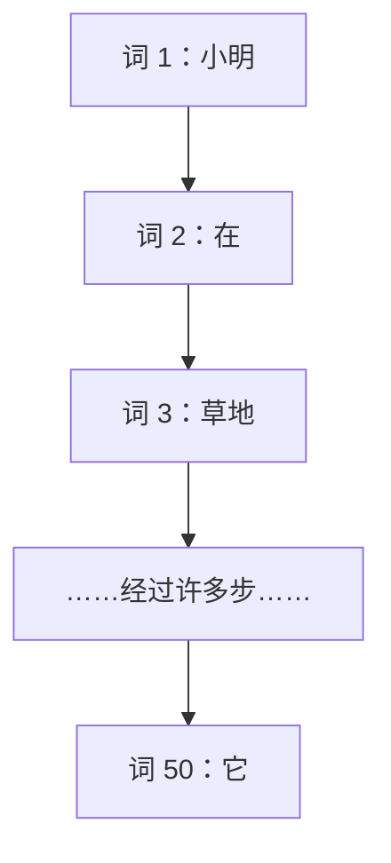

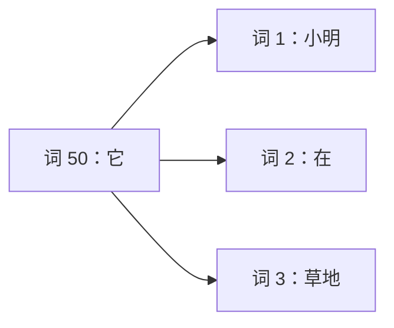

第一张把状态传递画在词语之间；第二张从当前位置指向它要查询的位置，实际被读取的信息再汇入当前位置。**“可以直接连接”描述的是计算路径，不保证这条连接的权重高，更不保证最后回答正确。**

### 表 2-1：把比较条件说完整

下表中的 $T$ 是序列长度，比较普通循环层与标准稠密自注意力层，不包括后面才会介绍的稀疏等变体。

| 比较项 | 普通 RNN / LSTM | 标准稠密自注意力 |
| --- | --- | --- |
| 同一层的位置依赖 | 当前隐藏状态依赖前一个状态 | 各位置从上一层的表示读取信息，可组织成批量矩阵运算 |
| 远距离连接路径 | 跨越许多次状态更新，最远路径随 $T$ 增长 | 对允许连接的位置，可通过一次注意力聚合直接读到 |
| 长距离学习 | 可能更困难，门控结构能缓解 | 路径更短，但仍需要合适的数据、训练与表示 |
| 并行的边界 | 样本之间、单步内部可并行；时间依赖仍在 | 已知输入的位置可并行；层与层仍依次计算 |
| 不能忽略的成本 | 顺序状态更新需要时间 | 两两打分有 $T\times T$ 个位置关系，长序列成本增长快 |

Transformer 原论文第 4 节用路径长度、可并行操作和计算复杂度讨论这些差别。这里的“一步直达”**不是总运行时间为常数**，也不是“任何长度都比 RNN 快”。[来源：Attention Is All You Need，§4](https://arxiv.org/html/1706.03762v7#S4)

## 2.3 注意力：带着问题去取信息

想象你正在整理一张人物卡片。写“这个人是谁”时会翻姓名栏，写“他在哪里”时会翻地点栏。资料没有换，但这一次要找的东西不同，读取重点也随之改变。

注意力的基本思路类似：**当前位置提出查询，对可读取的位置打分，再按权重汇总它们提供的内容。**

1. **提出查询。** 当前表示决定这次需要什么信息，不是人手写一句搜索词。
2. **比较匹配程度。** 用学到的计算规则，比较查询与各位置的检索信息。
3. **形成权重。** 标准 Softmax 注意力把分数转换成非负、总和为 1 的权重。
4. **汇总内容。** 用这些权重对各位置提供的向量做加权求和，得到当前位置的新信息。

“匹配”不必等于词典里的语义相似。例如，代词可能需要读取一个人名，动词可能需要读取主语；它们并不是同义词。权重也通常不是只留一个最大值，其余全部扔掉，而是一种连续的混合。

当查询和被查询的内容都来自**同一个序列的表示**时，就叫 **自注意力（Self-Attention）**。“自”指同一序列内部交互，不是每个词只看自己。

```
          当前层之前已有的各位置表示
          [我]   [爱]   [学]   [大模型]
            \     |      |      /
              查询、打分、加权读取
                       ↓
              [学] 在当前语境中的新信息
```

这里只画了“学”的一次读取。其他位置也各有自己的查询和权重。若输入有 $T$ 个位置、每个向量宽度是 $D$，可以先把输入想成一张 $T\times D$ 的表；自注意力为这些位置计算各自的上下文信息。**同一层读取的是这层开始时已有的表示，不必等旁边位置先算出本层的新表示**，这就是它适合矩阵并行计算的关键。

2017 年的 [Attention Is All You Need](https://arxiv.org/abs/1706.03762) 提出了以注意力为核心、去掉循环和卷积的 Transformer 架构。这个标题并不是说“只剩一张注意力表就能成为语言模型”：原模型还有位置编码、前馈网络、残差连接等部件，本书会逐个补上。

## 2.4 纸笔实验：先画候选，再分配玩具权重

本节不需要 GPU，也不运行训练模型。请拿纸画两张小图，比较下面两句完整的话：

- A：“动物没有穿过马路，因为它太累了。”
- B：“动物没有穿过马路，因为它太宽了。”

我们读完后，通常更倾向于把 A 的“它”理解为动物，把 B 的“它”理解为马路。但这个判断同时利用了句子结构和常识，不是“距离最近的名词必胜”。

### 第一步：画出候选依赖，不急着宣布答案

在纸上写出“动物”“马路”“它”，从“它”分别向两个候选画一条虚线。然后把最后的线索也写在旁边：

```
A：它 ──?──→ 动物       线索：太累了
      └─?──→ 马路

B：它 ──?──→ 动物       线索：太宽了
      └─?──→ 马路
```

先保留两个候选，再把你认为更合理的那条线加粗，并写下一句理由。这张图记录的是**人的语言判断**，还不是神经网络内部的连接测量。

接着用手遮住“太累了 / 太宽了”，只看“动物没有穿过马路，因为它”。你还知道该加粗哪条线吗？至少，刚才用于区分 A、B 的那个线索已经不存在了。这一步会在因果掩码一章再次派上用场。

### 第二步：给同一组位置分配 100 份读取权重

为了方便手算，把每句话暂时分成七个语义单元。这是纸笔实验的分组，**不是某个真实 tokenizer 的输出**。你可以先自己分配，再和下面的示例比较。

### 表 2-2：读完整句后，人为设定的玩具权重

| 被读取的单元 | A：太累了 | B：太宽了 |
| --- | ---: | ---: |
| 动物 | 60% | 10% |
| 没有 | 5% | 5% |
| 穿过 | 5% | 5% |
| 马路 | 10% | 60% |
| 因为 | 5% | 5% |
| 它 | 5% | 5% |
| 太累了 / 太宽了 | 10% | 10% |
| **合计** | **100%** | **100%** |

这张表的作用仅仅是把“读取重点可以随上下文变化”画出来。**它没有经过训练，不是真实模型的注意力，也不是代词指向某个对象的概率。** 你分出 55% 而不是 60%，并不意味着做错了；我们尚未定义任何会算出唯一权重的规则。

### 第三步：看看加权读取究竟算出了什么

给“动物”一张内容卡片 $v_{\text{动物}}=(1,0)$，给“马路”一张 $v_{\text{马路}}=(0,1)$，其余五张暂时都设为 $(0,0)$。这些也是人为指定的玩具向量，只为把运算压缩到两维。

根据表 2-2：

$$c_A=0.60(1,0)+0.10(0,1)=(0.60,0.10)$$

$$c_B=0.10(1,0)+0.60(0,1)=(0.10,0.60)$$

其余权重仍在，只是乘以零向量后没有贡献。于是，相同的内容卡片经过不同权重的混合，得到不同的结果。这就是加权读取的最小直觉。

别把两维卡片当成真实模型设计：实际内容向量不会这么整齐地分成“动物轴”和“马路轴”。这里也没有训练出指代能力，更没有证明模型会生成正确答案。

### 第四步：检查自己有没有偷看未来

> [!IMPORTANT]
> **完整句子的解释，不等于生成过程中当前位置已经知道的信息。**
> 表 2-2 是人在看完整句后手工画的示意。如果把它理解为能够读取整句的双向模型，还必须记得：它只是教学假设，不是某层某头的实际数值。
>
> 对因果语言模型，“它”位置只能读到当前位置及之前的 token。A、B 若在这里具有完全相同的 token 前缀，在相同参数、确定性前向计算下，“它”位置的表示就不能因为尚未看见的“太累了 / 太宽了”而不同。后面的词被读入后，后面位置的表示才可能利用这条新线索。

训练时即使整段目标文本已经放在内存里，也必须用掩码禁止较早位置偷看较晚位置。**一次并行计算整段，不代表每个位置都能读取整段。** 下一章会把这个约束变成可以运行的测试。

## 2.5 注意力权重大，不等于“模型因为它才这么回答”

把注意力画成热力图很有帮助：我们可以观察某一层、某一个头、某个查询位置把多大的读取系数分给哪些位置。但从这个观察直接跳到“这就是模型做决定的原因”，中间缺了证据。

先看一个只含三个数的反例。内容分别为 $v_1=0$、$v_2=1$、$v_3=2$，两组权重都非负且总和为 1：

$$0.2\times0+0.6\times1+0.2\times2=1$$

$$0.4\times0+0.2\times1+0.4\times2=1$$

第二个位置的权重从 0.6 降到了 0.2，加权结果却完全一样。这个手算反例只说明：**注意力分布和聚合结果不一定一一对应。** 它没有声称任意真实模型都能随便改权重，更没有声称注意力毫无作用。

在完整 Transformer 里，还要考虑几件事：

- **被混合的内容向量是什么。** 大权重乘以某个向量，最终作用不能只看那个系数；向量的大小、方向以及不同项之间的抵消也有关。
- **一个位置可能已包含别处的信息。** 深层的“马路”表示不再只是最初那行“马路”embedding，它可能已经混入其他位置的内容。
- **输出还会经过其他计算路径。** 其他注意力头、残差连接、前馈网络和后续层都会影响最终预测。某一张热力图并没有展示整个模型。

因此，“这个头在这里给了‘动物’较高权重”是一个局部计算事实；“模型有 60% 的概率认为‘它’是动物”，或“动物这个词对最终答案负有 60% 的因果责任”，都不是从该权重自动得到的结论。

相关研究也并非只有一句口号。[Jain 与 Wallace 的实验](https://aclanthology.org/N19-1357/)展示了所研究模型中，注意力分布与其他重要性指标不一致、不同分布却产生相近预测等现象；[Wiegreffe 与 Pinter 的后续讨论](https://aclanthology.org/D19-1002/)指出，能否把注意力当作解释，还取决于解释的定义、模型整体和检验方式。它们不应被简化成“所有注意力图都能解释模型”或“所有注意力图都没有价值”。

如果想研究一个具体预测为什么改变，需要先明确要解释的输出，再设计对照或干预，例如修改输入、控制某个内部量，并观察结果如何变化。删掉一个词也会改变句子和其他表示，所以一次删除实验本身仍不是完整的因果证明。**本章的要求更简单：可以把权重图当作线索，但不要把线索直接当成结论。**

## 2.6 聚光灯类比的四条边界

现在可以把注意力想成可移动的聚光灯，但要在旁边贴上四张提示纸。

**第一，能照到哪里由可见范围决定。** 双向自注意力可以读取整段允许的输入；因果自注意力不能读取未来；其他设计还可能只允许局部窗口。不能笼统地说“每个词永远和所有词握手”。

**第二，照得多不等于理解得对。** 匹配规则来自学习，可能学到有用依赖，也可能学到偏差。注意力给模型提供了一种组合信息的方式，不保证事实正确、推理正确或具有人类的心理注意过程。

**第三，路径短不等于费用低。** 标准稠密注意力需要处理两两关系。长度从 100 增加到 200，位置对数量就从 10,000 增加到 40,000。这里数的是关系数量，不是实测耗时；真实内存、速度还取决于向量宽度、硬件与实现。

**第四，训练可并行不等于生成整句可并行。** 训练时正确的输入 token 已知，可以在掩码约束下并行计算多个位置；普通自回归生成时，下一个 token 要先产生，才能成为再下一个位置的输入。已经给定的提示词可以整段处理，但尚未生成的回答不能当作已知输入。这两种场景不要混在一起。

## 2.7 自测：能不能把边界也讲清楚？

先自己回答，再看下面的参考答案。

1. 同一 token 在两个句子里查到了同一个 embedding，是否意味着后续表示一定相同？
2. “RNN 完全不能并行”和“自注意力的整段生成完全并行”，分别错在哪里？
3. 在纸笔实验里遮住“太累了 / 太宽了”，为什么不能继续把两列玩具权重当作因果模型在“它”位置的计算结果？
4. 表 2-2 中“动物”的 60% 是什么？它能直接当成指代概率或最终答案的贡献率吗？
5. 如果把表中的权重换一套，聚合结果必然改变吗？请用本章的三个数验证。

### 参考答案

1. 不一定。查表阶段还没利用上下文，后续层可以根据各自可见的信息计算不同的表示；如果可见 token 前缀完全相同，因果模型也不能凭空知道不同的未来。
2. 普通 RNN 受序列状态依赖限制，但 batch 和单步运算可以并行；自注意力能并行处理已知输入的位置，但普通自回归生成仍逐步产生新 token。
3. 区分两句的线索在“它”之后，因果约束不允许这个位置使用它。两列数是读完整句后的人为示意，不是合法因果前向的测量。
4. 它是教学表中分给该位置的读取权重。它既不是模型实测值，也不能直接解释成指代概率或因果贡献率。
5. 不必然。对内容 $0,1,2$，权重 $(0.2,0.6,0.2)$ 与 $(0.4,0.2,0.4)$ 都得到 1；但这不表示任意改动都保持结果不变。

## 2.8 本章小结与下一步

- **上下文表示**让同一个 token 在不同可见语境中拥有不同的表示；注意力是实现信息交互的一种方法，不是唯一方法。
- **RNN 的主要限制**是沿序列的状态依赖和较长的信息路径，不是绝对失忆或完全无法并行。
- **自注意力**让各位置带着查询读取同一序列中的内容，在可见性约束内缩短信息路径，并把已知位置的计算组织成矩阵运算。
- **玩具权重、真实注意力和因果解释**是三件不同的事。手算帮助理解运算，模型测量需要具体层和头，因果结论还需要额外检验。

接下来，电脑到底怎样打分？权重怎样变成总和为 1？又怎样把未来位置挡在外面？

下一章会把这里的“查询、匹配、内容”分别写成 **Q（Query）、K（Key）、V（Value）**，从小矩阵一步步算到 Softmax 和因果掩码。

### 原始资料与阅读提示

- [Vaswani 等，Attention Is All You Need，2017](https://arxiv.org/abs/1706.03762)：§3.2 看注意力与掩码，§4 看计算成本、并行和信息路径的比较。无需现在就看懂全文。
- [Bahdanau 等，Neural Machine Translation by Jointly Learning to Align and Translate](https://arxiv.org/abs/1409.0473)：理解“注意力早于 Transformer，也可以与循环网络共同使用”。
- [Pascanu 等，On the difficulty of training Recurrent Neural Networks](https://arxiv.org/abs/1211.5063)：选读，区分梯度消失、梯度爆炸与简单的“记不住”类比。
- [Jain 与 Wallace，Attention is not Explanation，2019](https://aclanthology.org/N19-1357/)；[Wiegreffe 与 Pinter，Attention is not not Explanation，2019](https://aclanthology.org/D19-1002/)：配对阅读，理解为什么解释性需要说明模型、定义和检验条件，而不能只看标题。


---

# 第3章：拆解注意力三剑客——Q、K、V 与安全的掩码

上一章说“按当前问题收集上下文”，这一章把它变成可以逐项核对的计算。目标不是背公式，而是回答：分数从哪里来？在哪一维归一化？未来位置为什么恰好拿不到权重？没有任何可见位置时怎么办？

## 3.1 图书馆里的查询、标签和内容

去图书馆找“力学入门”，搜索词是 Query，书的索引标签是 Key，真正借回的内容是 Value。标签负责匹配，内容负责被带走：它们承担不同工作，不必用同一种表示。

在模型里，每个位置的向量都会通过三组可训练线性变换。用行向量约定：

$$Q=XW_Q,\qquad K=XW_K,\qquad V=XW_V.$$

本章暂取 $X\in\mathbb{R}^{T\times D}$，$W_Q,W_K\in\mathbb{R}^{D\times d_k}$，$W_V\in\mathbb{R}^{D\times d_v}$。例如三个 token、每个两维，可以得到三行 Q、K、V。不是把一个词复制三份就学会了检索，而是训练调整三个矩阵，使预测损失下降。示例脚本中的手工矩阵没有经过训练。

**点积分数不是百分比。** $q_i\cdot k_j$ 可以是负数，也可以大于 1；Softmax 之后才是一组非负、和为 1 的权重。有限分数下，普通 Softmax 通常不会把低分项直接删掉。

如果令 $Q=K=X$，原始分数矩阵 $XX^\top$ 对称，但逐行 Softmax 的分母一般不同，最终权重未必对称。比如对称分数表 $[[1,0],[0,2]]$ 中，第一行第二列约为 0.2689，第二行第一列约为 0.1192。因此，独立 Q/K 投影增加表达自由度，不能以“否则注意力权重必然对称”作为理由。

## 3.2 从分数表到新表示


把计算链分成两张图。这里先画无掩码、每行都有可见位置的情况；后面会补空行约定。

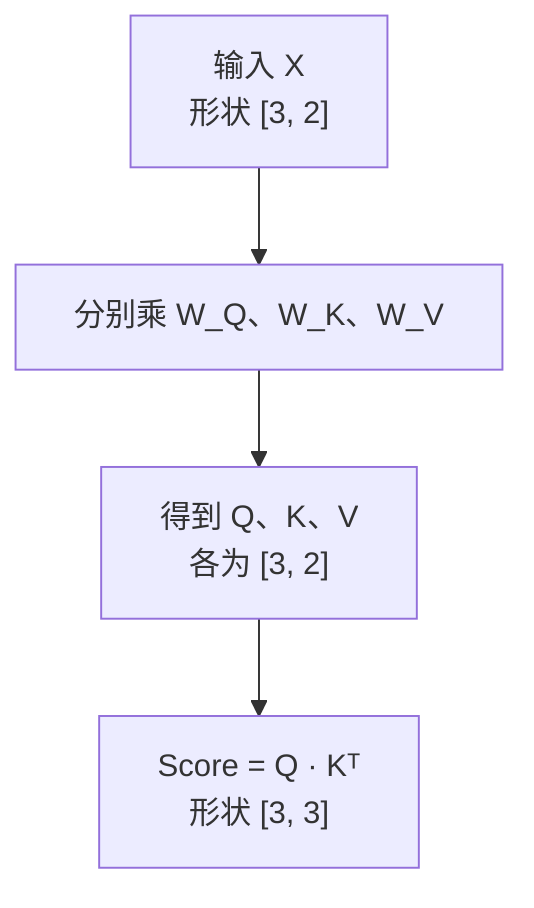

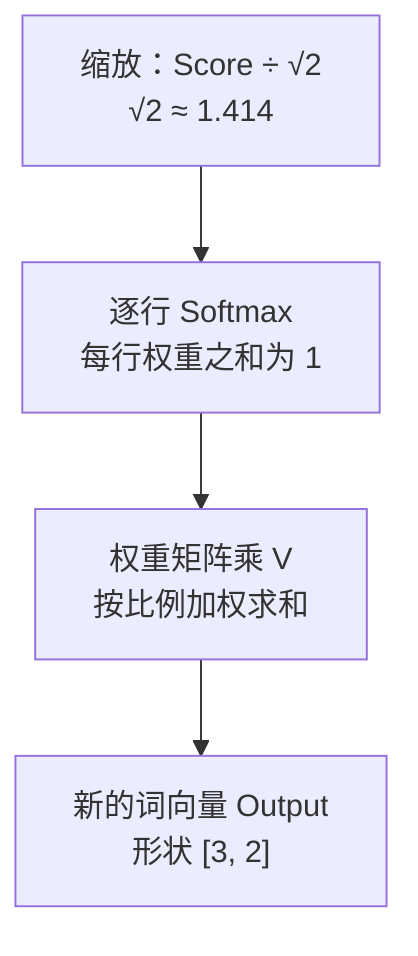
对第 $i$ 个查询，沿着所有候选键 $j$ 计算：

$$s_{ij}=\frac{q_i\cdot k_j}{\sqrt{d_k}},\qquad
a_{ij}=\frac{\exp(s_{ij})}{\sum_{r=1}^{T}\exp(s_{ir})},\qquad
o_i=\sum_{j=1}^{T}a_{ij}v_j.$$

整批写成 $O=\operatorname{softmax}(QK^\top/\sqrt{d_k})V$。Softmax 沿**键所在的最后一维**做，而不是把整张表变成一组概率。输出有 T 行、每行 $d_v$ 个数。

手算一行：设 $q=[1,0]$，两把键分别为 $[1,0]$ 和 $[0,1]$，两份内容分别为 $[2,0]$ 和 $[0,4]$。$d_k=2$，缩放分数是 $[1/\sqrt2,0]$，权重约为 $[0.6698,0.3302]$，输出约为 $[1.3395,1.3210]$。检查输出的每个维度都是对 V 对应维度做加权和；不是从两份内容里只挑一份。

**为什么除以根号维度？** 若 Q/K 各分量相互独立、均值为 0、方差为 1，则点积之和的方差是 $d_k$；除以 $\sqrt{d_k}$ 后方差为 1。这是理解尺度的简化假设，不是训练中始终满足的定律。缩放缓解分数随维度增大造成的饱和倾向，但不保证权重均匀，也不保证每个词获得“合理关注”。数值稳定和模型学得好是两个问题。

### 3.2.1 跟着“我 / 爱 / 学”完整手算一遍

上面的两份内容例子只演示一行加权。现在沿用 [code/02_manual_attention.py](../code/02_manual_attention.py)，把三个位置从输入一路算到输出。运行脚本后，可以把每张表与下面逐格核对；这些向量和矩阵都是教学设定，不是训练得到的语义特征。

输入三行是“我” $[1.0,0.5]$、“爱” $[0.8,1.2]$、“学” $[0.2,1.5]$。脚本把单个向量看作列向量，使用下面三张矩阵：

```python
W_Q = [[0.5, 0.2], [0.1, 0.8]]
W_K = [[0.4, 0.3], [0.2, 0.7]]
W_V = [[1.0, 0.1], [0.0, 0.9]]
Q = [matmul_vec(W_Q, vec) for vec in x]
K = [matmul_vec(W_K, vec) for vec in x]
V = [matmul_vec(W_V, vec) for vec in x]
```

`matmul_vec` 用矩阵的每一行与输入做点积。以“我”为例，草稿纸上写出：

$$Q_{我,0}=0.5\times1.0+0.2\times0.5=0.6,$$
$$Q_{我,1}=0.1\times1.0+0.8\times0.5=0.5.$$

同理算 K、V。列向量代码用 $W x$；若按前文把输入堆成行，必须用**该代码矩阵的转置**写成 $XW^\top$，才是同一次计算。不要一边换行列约定，一边直接照抄矩阵而不转置。

| 位置 | Q | K | V |
|---|---|---|---|
| 我 | [0.600, 0.500] | [0.550, 0.550] | [1.050, 0.450] |
| 爱 | [0.640, 1.040] | [0.680, 1.000] | [0.920, 1.080] |
| 学 | [0.400, 1.220] | [0.530, 1.090] | [0.350, 1.350] |

接下来，行代表“谁来问”，列代表“向谁取内容”。每格先点积，再除以 $\sqrt2$。例如“我”对“爱”：

$$(0.600\times0.680+0.500\times1.000)/\sqrt2
=0.908/\sqrt2\approx0.6421.$$

| 缩放分数 | 键：我 | 键：爱 | 键：学 |
|---|---:|---:|---:|
| 查询：我 | 0.4278 | 0.6421 | 0.6102 |
| 查询：爱 | 0.6534 | 1.0431 | 1.0414 |
| 查询：学 | 0.6300 | 1.0550 | 1.0902 |

脚本对每一行调用 `softmax(row)`，不是对整张表调用一次标量归一化。“我”这一行除以自己的指数总和，“爱”“学”也各算各的：

| 注意力权重 | 我 | 爱 | 学 |
|---|---:|---:|---:|
| 我 | 29.08% | 36.03% | 34.90% |
| 爱 | 25.31% | 37.38% | 37.31% |
| 学 | 24.31% | 37.18% | 38.51% |

这是对 V 的**读取权重**，不是指代概率或因果贡献率。未舍入的每行和在浮点容差内为 1；表中保留两位百分数，“我”一行显示为 100.01%，只是四舍五入，不要把表格显示值反过来当精确输入。

最后用“我”这一行的未舍入权重，分别乘三份 V，再相加：

$$o_{我}\approx
0.290776[1.05,0.45]+0.360253[0.92,1.08]+0.348971[0.35,1.35]
\approx[0.7589,0.9910].$$

脚本先创建 `new_vec = [0.0] * len(V[0])`，再依次执行“将某个 V 乘权重”和“累加到 new_vec”。这里写出的六位小数权重仍是便于手算的近似；代码用全精度权重，输出另外两行约为“爱” $[0.7402,1.0213]$、“学” $[0.7321,1.0308]$。新表示不再只来自原位置，但也不意味着这个没训练的玩具已经理解了句子。

本节**没有因果掩码**，所以“我”会读到后面的“爱”和“学”。它用于理解计算步骤；若用于下一词预测，还必须按 §3.4 加上可见性约束。

### 3.2.2 缩放究竟改变了什么？看一个可重跑的例子

[code/03_scaled_dot_product.py](../code/03_scaled_dot_product.py) 的第一个实验设置 `random.seed(42)`、$d_k=64$，用标准库高斯采样生成一个 Q 和三把 K。下面是该脚本实际输出，不是手工挑选的分数：

| 阶段 | 键 1 | 键 2 | 键 3 |
|---|---:|---:|---:|
| 原始点积（显示到两位） | -8.57 | -13.00 | -4.31 |
| 不缩放的 Softmax 权重 | 1.39% | 0.02% | 98.59% |
| 除以 $\sqrt{64}=8$ 后的分数（显示到两位） | -1.07 | -1.63 | -0.54 |
| 缩放后的 Softmax 权重 | 30.50% | 17.54% | 51.96% |

四步代码分别对应：`sum(q*k for ...)` 算原始点积，`stable_softmax(raw_scores)` 算不缩放的分布，`[s / scale for s in raw_scores]` 改变尺度，再调用一次稳定 Softmax。计算用未舍入值，因此只用表格的两位分数重算时，最后百分数会略有差别。

第三把键的原始分数虽然也是负数，却比另外两项大；指数比较的是差距，不是“正分才有权重”。缩放后分差变小，本例的分布没那么集中。它和下一节的“减去最大值”不同：**除以 8 一般改变权重，减去同一行最大值理论上不改变权重。** 这次观察支持理解尺度，不保证任意输入都获得更好的语义结果。

## 3.3 稳定 Softmax：先整体平移，再取指数

直接算 $e^{1000}$ 会超过常见浮点数的范围。对同一行减去最大值 $m$ 不改变比例：

$$\frac{e^{s_j-m}}{\sum_r e^{s_r-m}}
=\frac{e^{s_j}/e^m}{\sum_r e^{s_r}/e^m}
=\frac{e^{s_j}}{\sum_r e^{s_r}}.$$

例如 $[1000,1001,1002]$ 变成 $[-2,-1,0]$，结果约为 $[0.0900,0.2447,0.6652]$。最大指数是 1，避免了这里的指数上溢。很小项仍可能下溢为 0，这是有限精度现象，不能宣称“所有计算都精确”。

配套纯 Python 脚本的核心就是：

```python
m = max(scores)
exps = [math.exp(s - m) for s in scores]
weights = [e / sum(exps) for e in exps]
```

`code/02_manual_attention.py` 逐步打印投影、点积、权重与输出；入口先要求列表非空且每项有限，拒绝 NaN/正负无穷。这个简化函数处理普通分数，不把负无穷掩码混入它。测试在小分数上与朴素公式对照，在大分数上验证不溢出，并检查整体平移不改结果。

## 3.4 两类掩码：不能看未来，不要看补位

把多句话放入同一批时，短句常用 padding 补到相同长度。这些补位不是正文，不能成为有信息的键。自回归语言模型还要遵守 causal mask：第 i 行只能看 $j\le i$ 的位置。

以长度 4、实际只有前两个 token 的句子为例，本书把 query 补位也禁用：

| 查询行 / 键列 | 0 | 1 | 2（补位） | 3（补位） |
|---|---:|---:|---:|---:|
| 0 | 可见 | 禁止 | 禁止 | 禁止 |
| 1 | 可见 | 可见 | 禁止 | 禁止 |
| 2（补位） | 禁止 | 禁止 | 禁止 | 禁止 |
| 3（补位） | 禁止 | 禁止 | 禁止 | 禁止 |

行是“谁来问”，列是“向谁取内容”。表中的“可见”要同时满足因果约束和 padding 约束（两个布尔条件取与）。仅屏蔽 padding 键不会自动清零 padding 查询的输出；训练时还必须排除补位目标的损失，不能用注意力 mask 代替 loss mask。

我们的辅助函数在 `code/attention_core.py`，约定 **True=允许，False=禁止**：

```python
allowed = valid[:, None, :, None] & valid[:, None, None, :]
allowed = allowed & torch.ones(T, T, dtype=torch.bool).tril()
```

`valid` 是 [B,T]，两个切片分别变成 [B,1,T,1] 与 [B,1,1,T]，广播后得到 [B,1,T,T]，可供多个头共享。若单头分数是 [B,T,T]，使用 `allowed[:, 0]`；不要误把 [B,T] 直接广播成分数矩阵。代码中创建下三角时还指定与输入相同的 device。

注意不同 API 的约定不同：PyTorch 2.14 的 functional SDPA 布尔 mask 中 True 表示参与，`nn.MultiheadAttention` 的布尔禁止掩码使用相反语义。不要把同一个布尔张量不经核对就换接口。

## 3.5 全部禁止的一行：明确约定，避免 NaN

把禁止位置设成 $-\infty$，对至少有一个可见项的行做 Softmax，可使禁止项权重为 0。但若整行都是 $-\infty$，减最大值会出现 $-\infty-(-\infty)$，结果不是一个有效概率分布。

也不能简单改成 `-1e9`：它不是所有 dtype 都可表示的数，而且一整行同样的有限负数仍会得到均匀权重，反而让禁止项“复活”。

本书选一个明确的教学策略：**全禁用行返回全零权重，其加权输出为零**，不是和为 1 的概率分布。核心步骤如下：

```python
any_allowed = allowed.any(dim=-1, keepdim=True)
masked = scores.masked_fill(~allowed, -torch.inf)
safe = torch.where(any_allowed, masked, torch.zeros_like(masked))
weights = torch.softmax(safe, dim=-1).masked_fill(~allowed, 0.0)
```

先让空行的 Softmax 输入安全，再在结果中清零，避免先产生 NaN 再尝试补救。辅助函数要求原始分数有限，并检查布尔类型和广播形状。测试还对空行反向传播，检查梯度有限。这是本书实现的契约，不表示所有框架、内核和版本都采用相同处理方式。

## 3.6 训练可并行，为什么生成还要一步步来？

训练数据已经给出整条正确文本。假设序列为“我 爱 学 习”，输入位置 0 的“我”预测“爱”，位置 1 的“爱”预测“学”。一次算出所有查询行，同时用下三角阻断未来，所有已知输入位置可以并行计算；**并行不等于允许偷看标签**。

生成时，下一个 token 尚未选出来。先用现有前缀预测一个 token，将它接到前缀，再继续。这里的步骤依赖无法凭“矩阵并行”消失。后续 KV cache 会减少重复计算，却不会让未知的未来 token 提前成为已知输入。本章不提前实现缓存。

因果性可以用一个反事实小实验验证：保持前几个输入不变，任意修改最后一个 token，早于它的输出应保持不变。相反，双向无掩码注意力通常会变化。测试同时验证“全序列带因果 mask”与“逐个前缀重算最后位置”一致，避免只看上三角权重为零就认为端到端一定正确。这里没有 dropout，模型参数固定，以浮点容差比较。

## 3.7 运行、观察和自测

在 CPU 环境安装仓库锁定的 PyTorch 后运行：

```bash
python3 code/02_manual_attention.py
python3 code/03_scaled_dot_product.py
python3 -m unittest discover -s tests -v
```

脚本 03 有缩放对照、掩码、官方 SDPA 对照及 padding/因果扰动实验。固定随机种子只是让例子可重现，不构成效果评测；官方实现的输出按容差检查，不要求跨平台逐位相等。不需要 GPU、模型权重或网络推理服务。

自测：

1. 如果交换 Q 与 K，是否总能得到相同权重？不能。在本章等长自注意力中，交换后分数由 $S$ 变成 $S^\top$，逐行 Softmax 一般得到不同权重；若 $S$ 本身对称，交换前后分数完全相同，权重也相同。但该权重矩阵自身仍未必对称。这是“交换前后相等”和“矩阵关于对角线对称”两个不同问题。
2. 对一行所有有限分数加 100，权重应怎样变化？理论不变，实际受有限精度限制。
3. 对全部禁止的一行，为什么不要求权重和为 1？没有可取内容，本实现特意定义和为 0。
4. 只 mask 键，是否已忽略补位位置的训练损失？没有，还需单独处理目标。
5. 未来扰动测试失败，先看哪里？检查 mask 方向、广播轴、是否在归一化前遮挡，以及模型是否含其他跨位置泄漏路径。

下一章保持这条计算链不变，同时开多个头，逐笔记录每一步的张量形状。

## 来源与版本

- [Attention Is All You Need，v7，§3.2 与 §3.1](https://arxiv.org/html/1706.03762v7)：缩放点积、多头与解码因果约束。上面的数值小例子与边界策略为本书构造。
- [PyTorch 2.14：scaled_dot_product_attention](https://docs.pytorch.org/docs/2.14/generated/torch.nn.functional.scaled_dot_product_attention.html)：官方接口及布尔 mask 约定。
- [PyTorch 2.14：MultiheadAttention](https://docs.pytorch.org/docs/2.14/generated/torch.nn.MultiheadAttention.html)：对照不同接口的 mask 语义。动态文档核验日期：2026-10-19。


---

# 第4章：多头注意力（Multi-Head Attention）——给每个维度记一本账

> 多头不是把同一张注意力表复印几份，而是学习多套投影，分别计算权重，再把结果合起来。

上一章我们用 $Q$ 和 $K$ 打分，做 Softmax，再用权重汇总 $V$。本章把这套计算分成几个并行的“头”，重点追踪形状怎样变化、参数和计算成本怎样计数。

配套代码是 [code/04_multi_head_attention.py](../code/04_multi_head_attention.py)。本章只讨论**标准、等宽的多头自注意力**：Q、K、V 来自同一段输入，三者头数相同，每个头的 Q、K、V 宽度也相同。共享 KV 头等变体见已实现的 [P14](#p14-grouped-kv)（大纲 S05：[GQA 原始论文](https://arxiv.org/abs/2305.13245)）。

---

## 4.1 为什么要“多头”：多张权重表，而不是预先分配的专家

假设我们在读一句话：“小林把书递给小周，因为她要准备考试。”理解它可能涉及动作的参与者、物品、指代和上下文等关系。

单头注意力并不是“只能理解语法，不能理解指代”。它也可以让一个位置同时关注多个位置，向量中的不同特征还可以承载不同信息。它的具体结构限制是：**对一个查询位置，这个头只有一组沿 key 位置归一化的权重，同一组权重用于汇总该头的所有 value 特征。**

例如，一个头在三个可见位置上的权重是 `[0.7, 0.2, 0.1]`，那么这个头的每一个输出特征，都按这三个比例对相应的 value 特征加权。多头则允许另一套投影得到另一张权重表，例如 `[0.1, 0.3, 0.6]`，再把两种汇总结果一起保留下来。

```text
同一段输入 X
   ├── 学习得到的投影 1 ── 注意力表 A1 ── 头输出 Z1
   ├── 学习得到的投影 2 ── 注意力表 A2 ── 头输出 Z2
   └── 学习得到的投影 H ── 注意力表 AH ── 头输出 ZH
                                            │
                            按特征拼接，再经过输出投影
```

“分别计算”指每个头有自己的投影和权重；它们仍共享输入、一起训练，不意味着统计上互不相关。可以把多头想成几位读者各记笔记，但程序没有安排“你只看语法，你只看情感”的岗位。训练后各头可能形成不同模式，也可能彼此相似。**类比的边界：允许分工，不保证语义专家，更不保证头越多越好。**

原始 Transformer 论文把多头描述为在不同表示子空间中分别做注意力、再拼接与投影。我们接下来把这件事落实到具体的维度和代码上。[来源：Attention Is All You Need，§3.2.2](https://arxiv.org/html/1706.03762v7#S3.SS2.SSS2)

---

## 4.2 先投影，再分头：不是把原始输入硬切成几块

先统一本章的符号。遇到形状时，先读每根轴的名字，再看轴有多长。

| 符号 | 含义 | 本章小例子 |
| :--- | :--- | :--- |
| $B$ | batch size，一批有多少条序列 | 2 |
| $T$ | sequence length，每条序列有多少个 token 位置 | 3 |
| $D$ | model dimension，每个位置的总特征宽度 | 8 |
| $H$ | head count，注意力头数 | 2 |
| $d_h$ | head dimension，每个头的特征宽度 | 4 |

本章约定：

$$D = H d_h, \qquad d_h = D / H$$

因此 $D$ 必须能被 $H$ 整除，而且二者都应是正整数。`D=8, H=2` 合法，`D=8, H=3` 就不能按本章方式均分。这里 $T$ 数的是 **token 位置**，不等于汉字数或自然语言的词数。

### 两种等价的写法

在数学上，可以为第 $h$ 个头分别写出：

$$Q_h = XW_h^Q, \qquad K_h = XW_h^K, \qquad V_h = XW_h^V$$

其中每个 $W_h^Q, W_h^K, W_h^V$ 的形状都是 $[D, d_h]$。注意左边乘的是**完整的输入 $X$**，所以每个头的投影都能利用输入的全部 $D$ 个特征，而不是只看原始输入中的某一小段。

实现时，把各头投影沿输出特征方向并排拼成一个 $[D,D]$ 矩阵，就不必写 $H$ 个 Python 循环：

$$W_Q = [W_1^Q\; W_2^Q\; \cdots\; W_H^Q]$$

一次 `W_q(x)` 得到 `[B,T,D]` 的全部查询，再把最后的 $D$ 个特征整理为 `[H,d_h]`。K/V 同理。**不同头的可学习差异来自投影参数，reshape 本身不学习任何东西。**

数学里采用行向量右乘矩阵的记法；PyTorch `nn.Linear` 则把权重存为 `[out_features,in_features]`，计算相当于 `x @ weight.T`。不要混淆这两种记法。


**读图提醒：**图中 $D=512$、4 个头，每头宽 128；8 个头则每头宽 64。图省略了投影细节，实际顺序是“完整输入 → 线性投影 → 分头”。图里的“专家”是类比，“可能关注语法”不是保证或预设标签。

---

## 4.3 张量账本：每一步到底换了什么

我们故意选择 $T=3$、$d_h=4$，让“序列长度”和“单头宽度”不相等。这样转错轴时，更容易从形状发现问题。

### 表 4-1：从输入到输出的完整形状账本

| 阶段 | 一般形状 | $B=2,T=3,D=8,H=2$ 时 | 这一步在做什么 |
| :--- | :--- | :--- | :--- |
| 输入 `x` | `[B, T, D]` | `[2, 3, 8]` | 两条序列，每个位置 8 维 |
| 投影后 Q/K/V，各一份 | `[B, T, D]` | `[2, 3, 8]` | 改变特征，不改变位置数 |
| 拆开特征轴 | `[B, T, H, d_h]` | `[2, 3, 2, 4]` | 把每个位置的 8 维分为 2 组 |
| 换轴后 Q/K/V，各一份 | `[B, H, T, d_h]` | `[2, 2, 3, 4]` | 让 batch 和 head 成为前导轴 |
| 仅转置 K 的最后两轴 | `[B, H, d_h, T]` | `[2, 2, 4, 3]` | 为点积对齐特征轴 |
| 分数 `scores` | `[B, H, T, T]` | `[2, 2, 3, 3]` | 行是 query 位置，列是 key 位置 |
| 掩码后的分数 | `[B, H, T, T]` | `[2, 2, 3, 3]` | 禁止某些连接，形状不变 |
| 权重 `attn_weights` | `[B, H, T, T]` | `[2, 2, 3, 3]` | 沿最后的 key 轴归一化 |
| 各头输出 `head_outputs` | `[B, H, T, d_h]` | `[2, 2, 3, 4]` | 每个头对 V 加权求和 |
| 换回位置优先 | `[B, T, H, d_h]` | `[2, 3, 2, 4]` | 把同一位置的各头放在一起 |
| 拼接 `out_concat` | `[B, T, D]` | `[2, 3, 8]` | 合并 H 与单头宽度两根轴 |
| 输出投影 `W_o` | `[B, T, D]` | `[2, 3, 8]` | 混合各头特征，得到最终结果 |

`[B,H,T,T]` 存放**位置之间的权重**，`[B,H,T,d_h]` 存放**各位置的特征**。即使 $T=d_h$，含义也不同。

### 第一步：reshape 是拆轴，transpose 是换轴

假设 `Q_full` 是投影后的 `[B, T, D]` 张量：

```python
Q_split = Q_full.reshape(B, T, H, d_h)
assert Q_split.shape == (B, T, H, d_h)

Q = Q_split.transpose(1, 2)
assert Q.shape == (B, H, T, d_h)
```

`reshape` 把一个长度为 $D$ 的特征轴拆成两个轴，元素总数必须相同；`transpose(1, 2)` 则交换第 1 和第 2 根轴，轴从 0 开始编号。这两种操作**不能互相替代**。

用整数给元素编号最容易看清。以下数字只用于追踪位置，不代表真实词向量：

```python
import torch

z = torch.arange(24).reshape(1, 3, 8)
split = z.reshape(1, 3, 2, 4)
heads = split.transpose(1, 2)

print(heads[0, 0])  # 第 0 条序列，第 0 个头
# tensor([[ 0,  1,  2,  3],
#         [ 8,  9, 10, 11],
#         [16, 17, 18, 19]])

print(heads[0, 1])  # 同一条序列，第 1 个头
# tensor([[ 4,  5,  6,  7],
#         [12, 13, 14, 15],
#         [20, 21, 22, 23]])
```

每个头都保留了三个 token 位置。如果直接做 `z.reshape(1,2,3,4)`，最终形状虽相同，第一个头拿到的却是连续的 0 到 11，混淆了位置与头的归属。**形状正确，不代表元素排布正确。**

### 第二步：为什么把 H 放到前面

对这里使用的高维张量，`torch.matmul` 把最后两根轴当作矩阵轴，其余轴用作批量维度。于是：

```text
Q:                         [B, H, T, d_h]
K.transpose(-2, -1):       [B, H, d_h, T]
                                    ↓ 消去 d_h
scores:                    [B, H, T, T]
```

我们得到每条序列、每个头各自的 $T\times T$ 打分表。不是在不同头之间做点积，也不是在两条序列之间交换信息。

```python
scores = Q @ K.transpose(-2, -1) / math.sqrt(d_h)
assert scores.shape == (B, H, T, T)
```

缩放分母是 $\sqrt{d_h}$，不是 $\sqrt{D}$，因为点积只对 $d_h$ 个特征求和。归一化沿最后的 key 轴做；有掩码时先处理掩码，规则见下一节。

加权汇总又是一次矩阵乘法：

```text
attn_weights:              [B, H, T, T]
V:                         [B, H, T, d_h]
                                    ↓ 对 key 位置加权求和
head_outputs:              [B, H, T, d_h]
```

### 第三步：拼接不是求和，也不是再做一次注意力

要把同一个位置的各头输出放在一起，先换回 `[B,T,H,d_h]`，再把后两根轴合并：

```python
head_outputs = attn_weights @ V
assert head_outputs.shape == (B, H, T, d_h)

by_token = head_outputs.transpose(1, 2)
assert by_token.shape == (B, T, H, d_h)

out_concat = by_token.contiguous().view(B, T, D)
assert out_concat.shape == (B, T, D)

output = W_o(out_concat)
assert output.shape == (B, T, D)
```

如果某个 token 的两个头分别输出 `[a,b,c,d]` 和 `[e,f,g,h]`，拼接就是 `[a,b,c,d,e,f,g,h]`，不是把两份向量相加成 4 维。之后的 $W_O$ 才是可学习的特征混合层，它仍对每个位置单独作用，不再次混合不同 token。

为什么有 `contiguous()`？换轴后的普通张量通常仍共享原存储，但布局可能不再满足 `view` 的要求，需要先整理成连续布局。也可以写 `by_token.reshape(B,T,D)`，必要时由它复制数据。形状变换不一定零开销；`contiguous()` 也不能修好转错轴的逻辑。[来源：PyTorch reshape](https://docs.pytorch.org/docs/2.14/generated/torch.reshape.html)、[transpose](https://docs.pytorch.org/docs/2.14/generated/torch.transpose.html)

---

## 4.4 多了头，掩码规则没有变

多头把分数扩展成 `[B,H,T,T]`，不会自动阻止模型看未来。

**本章配套代码的布尔 mask 统一使用 `True = 允许访问`，`False = 禁止访问`。**例如三个 token 的因果掩码是：

```text
              key 0   key 1   key 2
query 0       True    False   False
query 1       True    True    False
query 2       True    True    True
```

可以这样建立一个供所有 batch、所有头共用的 `[T,T]` 掩码：

```python
allowed = torch.ones(T, T, dtype=torch.bool, device=x.device).tril()
output, weights = mha(x, mask=allowed)
```

广播是在缺省轴上复用规则。不同序列可用 `[B,1,T,T]` 表达各自的规则，再供各头共用。不要把 `[B,T]` 的有效 token 标记直接当成注意力 mask：先明确它控制 key 列、query 行，还是二者。屏蔽 padding key 不自动保证 padding query 输出为零。

### 全被挡住的一行怎么办

对于至少有一个允许位置的行，禁止位置的分数设为负无穷，Softmax 后权重为零，允许位置的权重之和为 1。

但如果某个 query 在某个头中**一个 key 都不能看**，就没有合法的概率分布。把这一整行都设为负无穷后直接 Softmax，会遇到未定义的归一化；把它们都改成 `-1e9` 也不是解决办法，因为相同分数会变成均匀权重，反而读到了被禁止的值。

本章实现采用明确的工程约定：

1. 先找出全被屏蔽的行，让它们以安全的临时分数经过 Softmax，避免出现 `NaN`。
2. 再把这些行的**所有权重置零**，该头的加权输出因此为零。
3. 其余非空行正常归一化。

全屏蔽行的权重和是 0，不是 1。若一个 query 在**所有头**中都被全屏蔽，拼接向量为零；本例 `W_o` 无 bias，最终输出也为零。只屏蔽一个头则未必如此。若输出层有 bias，结果可能等于 bias；更不能据此推断后续带残差的整个模块为零。

最后注意一个容易踩到的 API 陷阱：本书的 allowed mask 与 PyTorch `scaled_dot_product_attention` 的布尔 mask 一样，`True` 表示参与；但 `nn.MultiheadAttention` 的布尔 `attn_mask` 和 `key_padding_mask` 使用 `True` 表示屏蔽。切换接口时要检查语义和形状，不能原样照搬。[来源：PyTorch SDPA](https://docs.pytorch.org/docs/2.14/generated/torch.nn.functional.scaled_dot_product_attention.html)、[MultiheadAttention](https://docs.pytorch.org/docs/2.14/generated/torch.nn.MultiheadAttention.html)

---

## 4.5 算清三本账：参数、运算和中间张量内存

“头数变成 8，开销是否变成 8 倍？”不能只回答“是”或“不是”。先固定比较条件：**总宽度 $D$ 不变，$H$ 个头等宽，$d_h=D/H$，Q/K/V 与输出都投影到 $D$，四个线性层都不带 bias。**单头对照也保留同样的四个投影。

### 参数账：标准无偏置 MHA 是 $4D^2$

Q、K、V 各有一个 $D\times D$ 投影，最后再加一个 $D\times D$ 的输出投影：

$$N_{\mathrm{params}} = D^2+D^2+D^2+D^2 = 4D^2$$

按头拆开数也一样：Q 投影共有 $H\cdot Dd_h=D^2$ 个参数。$D=8$ 时，四个矩阵共 256 个参数；改成 1、2、4 或 8 个头，都不改变这一数量。

这只是**注意力模块**的参数，不含 embedding、FFN、归一化等。若四个投影都加上长度为 $D$ 的 bias，还需加 $4D$。若固定的是每头宽度 $d_h$，增加头数会让 $D=Hd_h$ 一起增大，当然就不能再套用“参数不变”的结论。

### 运算账：投影成本不能漏掉

一次完整自注意力前向的主要矩阵乘法可以分成两类：

- **投影：**共有 $BT$ 个位置，每个位置做 $D$ 到 $D$ 的变换。Q/K/V 和输出投影合计是 $O(BTD^2)$。
- **头内注意力：**每个头的 $QK^\top$ 与权重乘 V，各需 $O(BT^2d_h)$；所有头加起来是 $O(BHT^2d_h)=O(BT^2D)$。

所以在上述条件下，主要计算量为：

$$O(BTD^2 + BT^2D)$$

掩码和 Softmax 还要处理 $BHT^2$ 个元素。在本章 $1\leq H\leq D$ 的等宽设置下，这不改变上述总体大 O 阶数，但会影响实际成本。大 O 隐去了常数、内存访问和执行方式，并不承诺两个实现耗时相同。

原论文在每头宽度随头数缩小的条件下，比较的是与全宽单头相近的计算成本；它不是“加头必然提速”的定理。实际耗时还依赖硬件、数据类型、矩阵尺寸、内存布局和具体计算内核。CPU 教学实现可用于验证数值，不足以证明 GPU 性能。[来源：Attention Is All You Need，§3.2.2](https://arxiv.org/html/1706.03762v7#S3.SS2.SSS2)

### 内存账：分数表仍有 $H$ 份

这里最容易漏算。Q/K/V 每份共有 $BHTd_h=BTD$ 个元素，但**分数表没有 $d_h$ 这一根轴**：它的形状是 `[B,H,T,T]`，所以需要 $BHT^2$ 个元素。

例如 $B=1,H=8,T=1024$，一份 float32 分数张量就占：

$$1\times8\times1024^2\times4\ \text{bytes}=32\ \text{MiB}$$

这里 $1\ \text{MiB}=2^{20}$ 字节。这还不含权重张量、Q/K/V、输出以及训练时保存的中间量。固定 $B,T,D$ 增加头数，显式保存分数或权重表的开销会随 $H$ 增加；把序列长度翻倍，则这部分元素数变成四倍。

这个内存账本针对**本章显式构造分数和权重的实现**。优化内核可能不把完整分数表留在显存中，所以它不是所有实现的峰值内存下界。FlashAttention 一章会展开这个区别。

还有一个以后会用到的区别：标准 MHA 的 K 和 V 总元素数是 $2BHTd_h=2BTD$，并不是 $2BHT^2$。后续 KV Cache 存的是 K/V 特征，不是所有历史注意力分数；现在先把这两类张量分清。

---

## 4.6 动手实验：先验形状，再验数值

在仓库根目录运行：

```bash
python3 code/04_multi_head_attention.py
python3 -m unittest discover -s tests -v
```

示例使用小尺寸输入打印形状和各头的权重。阅读时先把日志对照表 4-1，再看权重：同一个 query 的哪一行、哪一个头、对哪些 key 求和？不要只因为数字看起来合理，就认定实现正确。

演示里的“机器”“学习”“真”“酷”只是位置标签，输入和投影都是随机的。不同百分比不证明语义分工；固定种子便于复查，也不保证跨设备、版本逐位相同。

### 实验一：退化成一个头，必须等于直接的参考公式

将 $H$ 设成 1 后，$d_h=D$。此时分头不应改变计算含义。我们不用重新初始化另一套投影，而是读取**同一个模型的参数**，手动计算单头公式，再和模块输出比较。

下面的代码可以在仓库根目录的 Python 会话中执行：

```python
import math
import runpy
import sys
from pathlib import Path
import torch

sys.path.insert(0, str(Path("code").resolve()))
module = runpy.run_path("code/04_multi_head_attention.py")
SimpleMultiHeadAttention = module["SimpleMultiHeadAttention"]

torch.manual_seed(100)
B, T, D = 2, 3, 8
x = torch.randn(B, T, D)
mha = SimpleMultiHeadAttention(d_model=D, num_heads=1)

with torch.no_grad():
    actual, actual_weights = mha(x)
    q, k, v = mha.W_q(x), mha.W_k(x), mha.W_v(x)
    reference_weights = torch.softmax(
        q @ k.transpose(-2, -1) / math.sqrt(D), dim=-1
    )
    reference = mha.W_o(reference_weights @ v)

assert actual.shape == (B, T, D)
assert actual_weights.shape == (B, 1, T, T)
torch.testing.assert_close(actual, reference)
torch.testing.assert_close(actual_weights[:, 0], reference_weights)
print("单头退化与直接公式一致")
```

为什么还要保留 `W_o`？因为我们比较的是**完整模块**，不是只比较注意力核心。一个有输出投影、另一个没有，即使头数都是 1，也不是同一个计算。

这能发现分头、缩放、拼接等错误，但还需检查多个头、不同 $B,T,D$ 与掩码边界。

### 实验二：全屏蔽行不能偷偷变成均匀分布

继续沿用前面的导入，再创建两个头。把最后一个 query 的所有 key 都挡住：

```python
mha = SimpleMultiHeadAttention(d_model=D, num_heads=2)
allowed = torch.ones(T, T, dtype=torch.bool).tril()
allowed[-1, :] = False

with torch.no_grad():
    output, weights = mha(x, mask=allowed)

assert weights.shape == (B, 2, T, T)
assert torch.isfinite(weights).all()
assert torch.isfinite(output).all()
assert torch.count_nonzero(weights[:, :, -1, :]).item() == 0
assert torch.count_nonzero(output[:, -1, :]).item() == 0

torch.testing.assert_close(
    weights[:, :, :-1, :].sum(dim=-1),
    torch.ones(B, 2, T - 1),
)
print("非空行归一化，全屏蔽行权重与输出为零")
```

这检查的是本章的空行约定，不是说零权重是一种概率分布。真实任务仍要追查空行来源，以及 padding 位置是否应排除在损失之外。

还可以把 `H` 改成 4，检查输出形状仍为 `[B,T,D]`，权重形状则变为 `[B,4,T,T]`；再试 `H=3`，确认不合法的配置会被拒绝。固定 $D=8$ 时，`sum(p.numel() for p in mha.parameters())` 应为 256。这些检查分别针对形状、输入约束和参数账，不要混成一个“能运行就通过”的标准。

---

## 4.7 自测：遮住答案再读一遍账本

1. $B=2,T=5,D=12,H=3$ 时，分头后的 Q、分数表和拼接结果分别是什么形状？
2. 为什么 `reshape(B,H,T,d_h)` 不能直接替代“先拆成 `[B,T,H,d_h]`，再换轴”？
3. 标准 MHA 从 2 个头改成 4 个头，固定 $D$，参数量是否翻倍？显式权重表是否变大？
4. 两个随机初始化的头得到不同的权重表，能否据此宣布一个懂语法、另一个懂情感？
5. 一个 query 只在其中一个头中被全屏蔽，最终输出一定是零吗？

**参考答案：**

1. $d_h=4$；Q 是 `[2,3,5,4]`，分数是 `[2,3,5,5]`，拼接结果是 `[2,5,12]`。
2. reshape 只按元素顺序改变形状；换轴改变的是元素所属的轴位置。最终尺寸相同，元素归属仍可能不同。
3. 四个无偏置投影仍为 $4D^2$；固定 $B,T$ 时，权重表从 $2BT^2$ 增至 $4BT^2$ 个元素。
4. 不能。不同数字没有证明语义分工，更没有证明对模型决策的因果解释。
5. 不一定。其他头仍可能产生非零特征，随后被 $W_o$ 混合。

---

## 4.8 本章小结与下一步

- 多头的核心是**不同的可学习投影、分别归一化的权重、拼接后的输出投影**，不是把一张表复制多遍，也不是预先指定语义专家。
- 记住主路径：`[B,T,D] → [B,T,H,d_h] → [B,H,T,d_h] → [B,H,T,T] → [B,H,T,d_h] → [B,T,D]`。
- reshape 拆轴，transpose 换轴，concat 合并各头特征。写对形状之后，还要检查元素是否去了正确的位置。
- 本章 mask 使用 `True=允许`；非空行权重和为 1，全屏蔽行按明确约定置零。
- 固定 $D$、标准等宽、无偏置设置下，参数是 $4D^2$，主要计算是 $O(BTD^2+BT^2D)$；显式分数存储仍有 $BHT^2$ 个元素。相同计算阶数不意味着相同速度或内存。

多头本身不添加“我在第几个位置”的信息。没有位置编码、也没有依赖位置的掩码时，重排输入 token，输出只会跟着重排。因果掩码限制可见方向，但与为表示加入位置信息不同。下一章继续讨论**位置编码（Positional Encoding）**。

文档核验日：2026-10-19，来源见相关段落。文档版本不等于本书的完整兼容性测试范围；本章实验验证教学计算，不提供未测的速度或显存提升比例。


---

# 第 5 章：位置编码（Positional Encoding）——给词语发“座位号”

> 注意力擅长比较内容；要理解句子，还得知道内容出现在什么位置。

上一章把注意力拆成多个头，本章暂时不增加头数，而是补上输入里的顺序信息。学完后，你应该能手算一个位置编码，追踪它怎样与词向量相加，并分清“能算出更长的编码”和“模型能理解更长的文本”。

配套实验：[code/05_positional_encoding.py](../code/05_positional_encoding.py)。只需 CPU 和项目锁定的 PyTorch；不下载模型，不训练语言模型。先读公式和数值表，再运行代码也可以。

## 5.1 换了座位，为什么注意力还可能认不出来？

把“小猫 / 吃 / 小鱼”看成三个 token。交换首尾后变成“小鱼 / 吃 / 小猫”：内容集合相同，谁吃谁却变了。

先限定实验条件：**双向、没有位置编码或位置偏置、没有 mask、没有随机 dropout，所有位置共用同一组投影矩阵**。只靠这样的自注意力，交换输入的行，输出也只是按同样顺序交换。

这叫**置换等变性（permutation equivariance）**，不是“所有输出完全不变”。用 $P$ 表示重新排列表格行的操作：

$$\operatorname{Attention}(PX)=P\operatorname{Attention}(X).$$

跟着形状走一遍：

1. $X$ 的形状是 $[T,D]$，换序后仍是 $[T,D]$。
2. 共用投影使 $Q,K,V$ 的行也一起换序。
3. $QK^T$ 的查询行、键列同步换序；Softmax 只是在每行内重新排列同一批分数。
4. 加权时，权重列和 $V$ 的行同步换序，因此各 token 收集的内容并没改变；输出只跟着输入换行。

于是“吃”仍然面对同一个邻居集合，它不知道小猫在自己前面还是后面。若最后再对所有行求和或平均，这种不依赖顺序的汇总才是**置换不变**。

### 一次能运行的换词实验

为了不被投影参数干扰，令 $Q=K=V=X$，三行分别表示小猫、吃、小鱼：

```text
X = [[1, 0],
     [0, 1],
     [1, 1]]        形状 [3, 2]
换序 order = [2, 1, 0]
```

脚本的 `permutation_example()` 计算 $\operatorname{softmax}(XX^T/\sqrt{2})X$。“吃”的输出在换序前后都是约 `[0.5989, 0.8022]`。然后给各座位加入本章的正弦编码，只换词、保持座位号不动：

```text
不加位置，换序误差=0.000000
固定座位编码，只换词，换序误差=0.971712
```

这里的误差是“换词后的输出”与“原输出按同样顺序重排”的最大绝对差。第二行说明位置可以改变计算，**并不说明这个没有训练的玩具模型已经懂了语法**。如果连词和座位号一起搬走，那只是重新排列同一组输入，不是本实验要比较的情况。

**边界很重要：因果 mask 本身也携带顺序结构。** 固定下三角 mask 时随意换词，各位置可见的前缀会改变，上面的等式一般不再成立。不能据此说“一切没有位置编码的因果模型都完全不懂顺序”。反过来，加了位置编码也不能代替因果 mask：一个告诉模型位置，一个限制哪些内容可见。

## 5.2 座位号有三种常见表达

### 表 5-1：可学习绝对位置、固定正弦位置与相对位置

| 类型 | 告诉模型什么 | 常见实现 | 必须记住的边界 |
| :--- | :--- | :--- | :--- |
| 可学习绝对位置 | “我坐在第 $pos$ 个座位” | 一张 $[L_{max},D]$ 参数表，按位置查行，再与词向量相加 | 表有固定行数；未训练过的行也不会自动具有有用含义 |
| 固定正弦位置 | 同样是绝对位置，但座位向量由公式给定 | 不同频率的 sin/cos，生成 $[T,D]$ 后相加 | 没有可学习的位置参数；能算新位置不保证长文本效果 |
| 相对位置信息 | “你在我前面或后面几格” | 根据键位置 $j$ 与查询位置 $i$ 的差 $j-i$，影响注意力计算 | 有不同实现；距离可被分桶或截断，不一定给每个位置加一行向量 |

原版 Transformer 对固定正弦与可学习绝对位置都做过实验；论文报告二者在所测翻译设置下效果接近，不能把正弦写成唯一正确答案。[来源 1，§3.5、表 3(E)]

可学习表与词表类似，但索引不同：词向量用 token ID 查表，位置向量用位置索引查表。例如 $L_{max}=8,D=8$ 时，位置表有 $8\times8=64$ 个可训练参数。固定正弦表没有这 64 个可训练参数，但把它预先存成矩阵仍然占内存。

相对位置可以先用一句话理解：“不在乎你坐第 100 排，只在乎你在我右边两格。”例如查询在 $i=2$、键在 $j=5$ 时，按本章约定距离为 $j-i=3$；二者同时右移一格，差仍是 3。Shaw 等人的方法把相对位置表示用于注意力的键项，也可用于值项，并将超过范围的距离截断。[来源 2，§3.1–3.2] 这只是一个具体方案，不是所有相对位置方法的统一公式。

### 为什么不直接写一个整数？

当然可以把位置写成一个标量特征，不是数学上禁止。只是需要处理两个问题：

- 直接用 $pos$ 时，较大位置可能与词向量分量处于不同尺度；还要决定如何把一个数送进 $D$ 维网络。这是尺度与建模设计问题，不是“整数必然让网络爆炸”。
- 若改成 $pos/T$，相邻位置的步长随句长变化：$T=3$ 时是 $1/3$，$T=100$ 时是 $1/100$。同样的“隔一个 token”，数值差却不同。

接下来学习的正弦方案给每个位置一组有界、且不依赖当前句长 $T$ 的数字，便于观察这些取舍。

## 5.3 不同频率：把一根指针变成一组指针

本章位置从 0 开始，$D=d_{model}$。公式中的 $i$ 是**第几对维度**，不是已经乘过 2 的列号：

$$PE_{(pos,2i)}=\sin\left(\frac{pos}{10000^{2i/D}}\right),$$

$$PE_{(pos,2i+1)}=\cos\left(\frac{pos}{10000^{2i/D}}\right).$$

两式来自原版 Transformer 的 §3.5。[来源 1] 这里的角度单位是**弧度**。一个整圆是 $2\pi$ 弧度；$pos=1$、分母为 1 时走了 1 弧度，约 57 度，不是一整圈。

把 $\omega_i=10000^{-2i/D}$ 叫作角频率，就可以写成 $\sin(pos\,\omega_i)$、$\cos(pos\,\omega_i)$。同一对 sin/cos 使用同一个频率；分母越大，每前进一个位置转过的角度越小。每圈所需的位置间隔，也就是周期，为 $2\pi/\omega_i$。

令 $D=8$，逐对代入：

| 维度对 | $i$ | 分母 $10000^{2i/8}$ | 角频率 | 周期，约多少个位置 |
| :--- | :---: | :---: | :---: | :---: |
| d0、d1 | 0 | 1 | 1 | 6.28 |
| d2、d3 | 1 | 10 | 0.1 | 62.83 |
| d4、d5 | 2 | 100 | 0.01 | 628.32 |
| d6、d7 | 3 | 1000 | 0.001 | 6283.19 |

不要机械地把最慢周期写成 $10000\times2\pi$：对这个有限的 8 维例子，最后的分母是 1000。频率取决于**完整宽度 $D$**；8 维编码也不等于 512 维编码的前 8 列。

### 手表类比的用途与边界

快针在几个位置里就来回摆动，慢针在短句里几乎不动。它们合起来提供多种尺度的变化信息。


图 5-1 为了在位置 0 到 24 的同一画布上看清变化，使用 $\sin(pos)$、$\sin(pos/8)$、$\sin(pos/80)$ 三条示意曲线；**不是下方 $D=8$ 表格中的三个实际列**。图中红点表示算出的函数值。

这个类比不保证“无限多个座位都有永不重复、容易识别的指纹”。周期分量会回头，组合也可能很接近；浮点精度有限，模型还需要学习如何利用它。我们能核验的是指定长度内的具体数值与关系，而不是任意长上下文的唯一性或可辨识性。

### 表 5-2：前 8 个位置与全部 8 个维度，$D=8$（保留两位小数）

| 位置序号 $pos$ | d0 ($\sin$) | d1 ($\cos$) | d2 ($\sin$) | d3 ($\cos$) | d4 ($\sin$) | d5 ($\cos$) | d6 ($\sin$) | d7 ($\cos$) |
| :---: | :---: | :---: | :---: | :---: | :---: | :---: | :---: | :---: |
| **位置 0** | 0.00 | 1.00 | 0.00 | 1.00 | 0.00 | 1.00 | 0.00 | 1.00 |
| **位置 1** | 0.84 | 0.54 | 0.10 | 1.00 | 0.01 | 1.00 | 0.00 | 1.00 |
| **位置 2** | 0.91 | -0.42 | 0.20 | 0.98 | 0.02 | 1.00 | 0.00 | 1.00 |
| **位置 3** | 0.14 | -0.99 | 0.30 | 0.96 | 0.03 | 1.00 | 0.00 | 1.00 |
| **位置 4** | -0.76 | -0.65 | 0.39 | 0.92 | 0.04 | 1.00 | 0.00 | 1.00 |
| **位置 5** | -0.96 | 0.28 | 0.48 | 0.88 | 0.05 | 1.00 | 0.00 | 1.00 |
| **位置 6** | -0.28 | 0.96 | 0.56 | 0.83 | 0.06 | 1.00 | 0.01 | 1.00 |
| **位置 7** | 0.66 | 0.75 | 0.64 | 0.76 | 0.07 | 1.00 | 0.01 | 1.00 |

用位置 1 跟算：

- d0：$i=0$，$\sin(1/1)\approx0.84$。
- d2：$i=1$，$\sin(1/10)\approx0.10$。
- d4：$i=2$，$\sin(1/100)\approx0.01$。
- d6：$i=3$，$\sin(1/1000)\approx0.001$，保留两位小数显示为 0.00，**不是真正的零**。

同理，位置 1 的 d3 是 $\cos(0.1)\approx0.995004$，表中显示 1.00。读表时别把舍入后的重复数字当成整行重复。全表由脚本生成，测试会核对全部 64 个显示值，不只是第一行。

## 5.4 余弦相似度会回升，不是距离尺

上一节看单个分量，这一节看两个位置向量整体有多像。对偶数 $D$，每对满足 $\sin^2\theta+\cos^2\theta=1$，所以每行的平方范数为 $D/2$。当 $D=8$，每行范数都是 2。

两行的点积可以按维度对拆开：

$$\sin(p\omega_i)\sin(q\omega_i)+\cos(p\omega_i)\cos(q\omega_i)
=\cos((p-q)\omega_i).$$

因此对完整的 sin/cos 对：

$$\operatorname{cosine}(PE_p,PE_q)
=\frac{1}{D/2}\sum_{i=0}^{D/2-1}\cos((p-q)\omega_i).$$

右边是一组不同频率余弦的平均，**不是必然随距离下降的函数**。分数与距离有关，并不等于它能直接充当距离。

### 表 5-3：位置 0 与后面各位置的余弦相似度（$D=8$）

| 比较对象 | 余弦相似度 | 相似度条形图 | 如何读数 |
| :---: | :---: | :--- | :--- |
| **位置 0 与 位置 0** | **1.000** | `█████████████████████████` | 自己和自己 |
| **位置 0 与 位置 1** | **0.884** | `██████████████████████` | 相邻位置仍很像 |
| **位置 0 与 位置 2** | **0.641** | `████████████████` | 相似度下降 |
| **位置 0 与 位置 3** | **0.491** | `████████████` | 这 8 个位置里的低谷 |
| **位置 0 与 位置 4** | **0.567** | `██████████████` | 快针开始往回转 |
| **位置 0 与 位置 5** | **0.790** | `███████████████████` | 相似度继续回升 |
| **位置 0 与 位置 6** | **0.946** | `███████████████████████` | 快针将近转完一圈 |
| **位置 0 与 位置 7** | **0.879** | `█████████████████████` | 仍较高，但与位置 0 不同 |

表中数值保留三位小数，条形长度由脚本按 $\lfloor25\times\text{相似度}\rfloor$ 生成。位置 3 的相似度约 0.491，距离更远的位置 6 却约 0.946，已经给出一个明确反例。

为什么？最快的一对在 6 附近快转完一圈，较慢的几对又还比较接近起点。相似度很高不等于编码相同：d2 在位置 0 为 0，在位置 6 约为 0.565。更不能由此推出模型一定会更关注位置 6；实际注意力还包含 token 内容、学习到的投影与 mask。

**奇数宽度的边界：** 本章代码也允许 $D=5$，填完整的 d0/d1、d2/d3，再填 d4 的 sine，没有 d5 的 cosine。这个选择保留公式的每个合法列，但最后一列没有配对，所以恒定范数与上面的成对余弦平均公式不能直接套用。本章两个数值表都使用偶数宽度 8。

## 5.5 用和角公式看“相隔几格”

正弦编码按绝对位置生成，却含有便于表达相对偏移的结构。固定一个维度对、一个偏移量 $k$，令 $\alpha=p\omega_i$、$\beta=k\omega_i$：

$$\sin((p+k)\omega_i)=\sin(p\omega_i)\cos(k\omega_i)+\cos(p\omega_i)\sin(k\omega_i),$$

$$\cos((p+k)\omega_i)=\cos(p\omega_i)\cos(k\omega_i)-\sin(p\omega_i)\sin(k\omega_i).$$

当 $k$ 固定时，右边的两个系数 $\sin(k\omega_i)$、$\cos(k\omega_i)$ 不依赖 $p$。所以每一个完整维度对都可以通过**相同的线性变换**，从位置 $p$ 推到位置 $p+k$。例如最快的那一对，从位置 0 的 `[0, 1]` 走一步，得到 `[sin(1), cos(1)]`，约 `[0.841, 0.540]`。

这是“模型有机会利用相对关系”的数学依据，不是“训练一定会学会距离”的证明，也不是“加法位置编码的整个注意力分数只取决于距离”。加入内容并经过不同的 $W_Q,W_K$ 后，还会出现内容与位置的交叉项。

后面的 [P12：RoPE 与 YaRN](#p12-rope) 研究另一条路线：把位置信息用于 Q/K 的旋转，并检查相对关系与缓存位置偏移。这里先认识名字，不提前把正弦相加改写成 RoPE，更不把旋转当成长上下文效果的保证。[来源 3，§3.1–3.2]

## 5.6 为什么相加，而不是拼接？先算一遍

把“词”和“座位号”想成两张宽度相同的表。加法是对应格子相加，拼接是把两张表左右并排放置。

设 $B=1,T=2,D=4$。本例直接给出词向量 $X$，不再额外乘缩放系数：

```text
X[0] = [[ 0.2, -0.1,  0.4, 0.0],
        [ 0.5,  0.3, -0.2, 0.1]]        X: [1, 2, 4]

PE[0] = [0, 1, 0, 1]
PE[1] = [sin(1), cos(1), sin(0.01), cos(0.01)]
                                         PE: [2, 4]
```

先为 PE 加一个 batch 轴，变成 $[1,T,D]$。若 $B>1$，加法广播会把同一张位置表应用到每个样本，本身不新增训练参数。这里假设每个样本的有效序列都从位置 0 开始；左侧 padding 或已有前缀的场景，需要另外检查有效位置编号。

对位置 0，逐项算：

$$[0.2,-0.1,0.4,0.0]+[0,1,0,1]=[0.2,0.9,0.4,1.0].$$

两个位置的结果由 `addition_concat_example()` 打印为：

```text
Add 位置 0: [0.200, 0.900, 0.400, 1.000]
Add 位置 1: [1.341, 0.840, -0.190, 1.100]
Add=(1, 2, 4)；Concat=(1, 2, 8)
```

若拼接，位置 0 会是 `[0.2, -0.1, 0.4, 0.0, 0, 1, 0, 1]`。词向量与位置向量各占自己的 4 格，宽度从 4 变成 8。

| 操作 | 一般形状 | 若后续 Q 投影输出宽度仍为 $D$，且无 bias | $D=4$ 的投影参数量 |
| :--- | :--- | :--- | :---: |
| 相加 $X+PE$ | $[B,T,D]$ | $W_Q:[D,D]$ | 16 |
| 拼接 $[X;PE]$ | $[B,T,2D]$ | $W_Q:[2D,D]$ | 32 |

这里仅比较**同样保持 Q 输出宽度为 $D$ 的一张投影矩阵**，不是宣称整个模型参数、显存、运行时间都翻倍。也可以用较窄的两部分再拼成 $D$，但那已经改变了本例的维度分配。

加法的代价是什么？$[1,0]+[0,1]$ 与 $[0,1]+[1,0]$ 都是 `[1,1]`，因此只给一个和，不能一般性地恢复两个任意输入。不要用“高维向量天生正交”来保证词义与位置能无损拆开；学习到的词向量和固定 PE 并没有这种自动保证。

它仍然是一个可训练的设计选择：加法保持输入宽度，词向量与后续层共同适应这种混合。对一个线性投影，$(X+PE)W=XW+PEW$；拼接则允许使用分别作用于内容和位置的 $W_x,W_p$。二者约束不同，是否更好需要实验。原论文采用相加，并在输入词嵌入处使用 $\sqrt{D}$ 缩放；本例为便于手算，把 $X$ 直接当作待相加的输入。[来源 1，§3.4–3.5]

## 5.7 长度要分三本账

假设训练样本最长为 8 个 token，位置都从 0 开始；现在想测试 12 个 token。

1. **编码能否生成？** 正弦公式可以生成位置 8 到 11；`generate_positional_encoding(12, 8)` 返回 $[12,8]$，且前 8 行与原来的表相同。公式不依赖当前句长。
2. **实现是否允许？** 如果模型只预存了 8 行位置表、8 格 mask 或有限缓存，即使采用正弦，也可能先在实现处越界。可学习表若只有 8 行，直接查第 8 行就超出索引范围；预分配 12 行可以避免越界，却不代表新行已经训练好。
3. **任务质量是否保持？** 训练只见过 8-token 的依赖模式，12-token 输入改变了分布。能跑完前向不等于预测正确；仍需在更长长度上测 loss 或具体任务表现，并检查资源成本。

代码的 `length_example()` 只做前两项的微型检查，打印：

```text
可学习表参数=64；位置 8 越界=True
正弦扩展形状=(12, 8)；前 8 行不变=True
```

这里**没有训练，也没有长上下文质量测评**。扩展编码表、修改长度配置、改善长文本能力是不同的工作。原论文把长度外推作为选用正弦的动机；本章不把这个动机改写成无限外推保证。[来源 1，§3.5]

## 5.8 把公式写成代码

下面是生成器的核心循环；完整文件还检查维度是否合法。`torch.zeros` 创建 $[T,D]$ 的 CPU float32 矩阵，`math.sin/cos` 按弧度计算，逐格填入：

```python
pe = torch.zeros(max_seq_len, d_model, dtype=torch.float32, device='cpu')
for pos in range(max_seq_len):
    # 向上取整，奇数宽度的最后一列也要填；k 是“第几对”。
    for k in range((d_model + 1) // 2):
        div_term = math.pow(10000.0, (2 * k) / d_model)
        pe[pos, 2 * k] = math.sin(pos / div_term)
        if 2 * k + 1 < d_model:
            pe[pos, 2 * k + 1] = math.cos(pos / div_term)
```

逐行核对：

- 外层遍历位置 0 到 $T-1$，内层遍历“第几对”。`2*k` 已经是偶数列索引，不要在指数里再多乘一次 2。
- `(d_model + 1) // 2` 向上取整。$D=5$ 时需要三次循环，最后一次填 d4 的 sine；若写 `d_model // 2`，d4 会被错误地留成零。
- `if` 只决定有没有合法的 cosine 列，不应把最后一个 sine 也跳过。
- 支持空序列 $[0,D]$；拒绝负长度、非正宽度，以及浮点数或布尔值维度。这是教学函数的明确契约。

运行方式，在已安装项目依赖的 Python 环境中执行：

```bash
python code/05_positional_encoding.py
python -m unittest discover -s tests -p 'test_positions.py' -v
```

脚本固定 seed=6，打印设备与 PyTorch 版本、两张完整数值表、字符热力图、换词实验、相加与拼接、长度检查。字符梯度为 ` .:-=+*#%@`，从空格到 `@` 表示从 -1 到 +1；它将连续数值量化成 10 档，细节请看数值表。

例如同为 d6 的小正数，字符图里可能显示为 `=` 或 `+`，不必与四舍五入到两位的小数表一一对应。两种显示方式都不应替代原始数值。

回归测试只有在**已安装且版本为 PyTorch 2.14.x** 时才运行张量实验；未安装或版本不匹配会明确跳过并给出原因。跳过不是实验通过。与版本判断有关的标准库测试仍可执行。本批验证环境为 PyTorch 2.14.1+cpu，CPU；测试不需要 GPU。

## 5.9 自测：先预测，再运行

1. 无 mask、无位置的双向注意力，把三个 token 按 `[2,1,0]` 换序后，输出是完全不变，还是跟着换行？固定因果 mask 后还可以直接套同一结论吗？
2. $D=8,pos=1$ 时，d2 的分母是 10 还是 100？这个分量保留三位小数是多少？
3. 表 5-3 中，哪个更像位置 0：位置 3 还是位置 6？能否由此判断模型更关注谁？
4. 用 §5.6 的输入算位置 0 的加法结果。Add 与 Concat 分别是什么形状？输出宽度都保持为 4 的无 bias Q 投影各有多少个参数？
5. 如果 $D=5,pos=1$，最后的 d4 是什么？为什么不能直接套“每行范数为 $\sqrt{D/2}$”？
6. 8 行的可学习位置表有多少参数（$D=8$）？正弦编码能生成 12 行，是否已经证明模型能处理更长文章？

### 参考答案

1. 输出跟着换行，这是置换等变，不是每个格子不变。固定因果 mask 的可见前缀与顺序有关，不能直接套用。
2. 分母是 $10000^{2/8}=10$；$\sin(0.1)\approx\mathbf{0.100}$。不要把“第二个偶数列”误写成指数里的 $4/8$。
3. 位置 6 更像：约 **0.946 > 0.491**。这是位置向量的相似度，不是经过内容与投影之后的注意力权重。
4. **[0.200, 0.900, 0.400, 1.000]**；形状为 **[1,2,4]** 与 **[1,2,8]**；Q 投影分别有 **16** 与 **32** 个参数。
5. $\sin(1/10000^{4/5})\approx\mathbf{0.000631}$，不是零。最后的 sine 没有 cosine 配对，不能用每对平方和为 1 来计算整行范数。
6. **64** 个可训练参数。生成 12 行只说明公式能延长；实现限制与更长输入的任务质量仍需分别验证。

这些数值答案、两张表、公式的每个元素和相对位移关系，都由 `tests/test_positions.py` 核对。测试也包含“余弦先降后升”的反例，避免把漂亮的波形误读成单调距离。

## 5.10 本章小结

- 没有位置或顺序结构的双向自注意力对换序是**等变**的；因果 mask 的条件不同。
- 可学习绝对位置、固定正弦位置与相对位置信息是不同设计，不是谁把谁简单“淘汰”。
- sin/cos 的不同频率提供多尺度变化；高相似度不等于同一位置，相似度也不随距离单调下降。
- 加法保持宽度，但没有自动无损分离的保证；拼接的形状与后续参数要重新计算。
- 编码可生成、实现可运行、长文本任务有效，是三件需要分别检查的事。

下一章把注意力放入完整 Block：残差怎样提供信息路径，LayerNorm 怎样处理数值尺度，FFN 又增加了什么能力。

## 来源与版本

核验日期：2026-10-19。下列是原作者的一手论文；本章数值表和微型实验是教学计算，不是论文的翻译质量复现。

1. Vaswani et al., [Attention Is All You Need，arXiv:1706.03762v7](https://arxiv.org/html/1706.03762v7)，版本日期 2023-08-02，初稿 2017-06-12。§3.4：输入嵌入缩放；§3.5：正弦公式、相加、相对偏移动机与长度外推动机；§6.2 表 3(E)：可学习位置对照。
2. Shaw, Uszkoreit & Vaswani, [Self-Attention with Relative Position Representations，arXiv:1803.02155v2](https://arxiv.org/html/1803.02155v2)，版本日期 2018-04-12。§3.1：相对关系进入键和值；§3.2：按相对距离查表与截断。仅作类型比较，不在本章实现该模型。
3. Su et al., [RoFormer，arXiv:2104.09864v5](https://arxiv.org/html/2104.09864v5)，版本日期 2023-11-08。§3.1–3.2：用 Q/K 旋转表达位置关系。本章只给路线提示，详细实现见 [P12](#p12-rope)。


---

# 第 6 章：积木组件——残差连接、层归一化与前馈神经网络

> 注意力负责交换信息，但交换之后，还需要保留原有表示、调整数值尺度，并在每个位置上加工特征。

上一章给 token 加上了位置信息。现在，我们把已经学过的多头自注意力，和本章的三个组件装成一个 **Transformer Block**。本章的目标不是记住模型名，而是能回答：“这条支路算了什么？为什么要加回输入？归一化发生在哪一步？参数花在了哪里？”

配套代码：[code/06_transformer_block.py](../code/06_transformer_block.py)。先读数值例子，再运行脚本逐项核对。本章采用普通 LayerNorm、带偏置的两层 ReLU FFN，以及没有 dropout 的多头自注意力；默认 Pre-LN，也提供 Post-LN 对照。它是教学积木，不是某个 GPT、LLaMA 或 DeepSeek checkpoint 的完整复刻。RMSNorm 与 SwiGLU 只在章末留路标，系统推导与实验见 [P13](#p13-modern-block)。

---

## 6.1 残差连接：不是重新抄一份，而是学习“改多少”

### 传话游戏里的原稿与批注

想象一份通知依次交给许多人修改。如果每个人都只能交出自己重写的版本，原稿里已有的内容也要重新表达一次。另一种办法是：保留当前原稿，旁边写上本轮的修改量，再把两者相加。

在网络里，输入向量是 $x$，支路算出的修改量是 $F(x)$：

$$y=x+F(x)$$

这里的“残差”不是考试剩下的误差，而是相对于当前表示的**增量**。如果想得到的映射是 $H(x)$，支路可以学习 $H(x)-x$，加回 $x$ 后就得到 $H(x)$。这也是残差学习论文的基本出发点。[来源：Deep Residual Learning，§3.1–3.2](https://arxiv.org/pdf/1512.03385)

```
              输入 x ─────────────┐ (原始录音笔: 抄近道)
                 │                │
                 ▼                │
          ┌─────────────┐         │
          │ 复杂神经计算 │         │
          │    F(x)     │         │
          └─────────────┘         │
                 │                │
                 ▼                ▼
                 [   相加求和: x + F(x)   ]
```

### 先加四个数字，再谈深层网络

以下是一个位置的四个特征。每列对应同一个特征，做的是**逐元素相加**，不是拼接；相加前后都还是四维。

### 表 6-1：输入加增量

| 量 | 四个特征 |
| --- | --- |
| 输入 x | [1.0000, 2.0000, 3.0000, 4.0000] |
| 增量 F(x) | [0.5000, -0.5000, 0.0000, 1.0000] |
| x + F(x) | [1.5000, 1.5000, 3.0000, 5.0000] |
| F(x)=0 时的输出 | [1.0000, 2.0000, 3.0000, 4.0000] |

第一维从 1 变成 1.5，第二维从 2 变成 1.5，第三维保持 3。它不是只会“增强”输入：增量也可以是负数。最后一行很重要：当支路输出全零时，$y=x$。这种“不做改变”的映射叫**恒等映射**，不要求网络先学会复制每一个数。

在本章的 Block 中，两条支路的输入、输出都保持 `[B,T,D]`，所以可以直接相加。如果支路改变了宽度，就不能直接做这条恒等捷径，必须先解决尺寸对齐问题。形状相同也不等于内容相同。

学过导数的读者可以多看一行。标量情况下，$dy/dx=1+F'(x)$；向量情况下，相应的是单位矩阵 $I$ 加上支路的雅可比矩阵。还没学过也没关系：**输入有一条不用穿过支路内部运算的直接路径**，这就是后面 Pre-LN 布局要保留的结构。

**类比边界：**“录音笔原封不动传过去”只形容那条加法支路，不代表整个输出无损、所有梯度永远不衰减。比如 $F(x)=-x$ 就会把输出抵消为零，变化率也可以抵消。残差有利于优化，不是“加了就绝不会训练失败”。

---

## 6.2 LayerNorm：沿一个 token 的特征做 Z-Score 三步计算

### 成绩标准化的类比，先说清谁和谁比较

同一组数字可能整体偏大，也可能差异特别大。我们想先看各项相对于这组数字平均水平的偏离，再把偏离调到合适尺度。这有点像把一张成绩单换成“比平均水平高或低多少个标准差”。

不过，向量的维度不是语文、数学那样由人命名的科目；LayerNorm 也不是分别为每个维度收集全班成绩。在本章输入 `[B,T,D]` 中，**固定某个样本和某个 token，只沿最后的 D 个特征计算统计量**。换一个 token，就单独重新算。它不把不同句子、不同 token 的数据混到同一个均值里。

下面坚持用同一个向量 $x=[1,2,3,4]$，完整走过三个步骤。

### 第一步：算均值，找到中心

$$\mu=\frac{1}{D}\sum_{i=1}^D x_i
=\frac{1+2+3+4}{4}=2.5$$

从每一项减去 2.5，得到 $[-1.5,-0.5,0.5,1.5]$。这些偏离有正有负，求和为零，所以中心已经移动到零。

### 第二步：算方差，衡量偏离的尺度

直接把偏离相加会正负抵消，所以先逐项平方，再取平均：

$$\sigma^2=\frac{1}{D}\sum_{i=1}^D(x_i-\mu)^2
=\frac{2.25+0.25+0.25+2.25}{4}=1.25$$

这里除以 **D，而不是 D−1**。我们正在描述当前这一个向量，不是在用样本估计一个未知总体的方差。对应代码是 `x.var(dim=-1, keepdim=True, unbiased=False)`；PyTorch LayerNorm 使用相同的方差口径。[来源：PyTorch 2.14 LayerNorm](https://docs.pytorch.org/docs/2.14/generated/torch.nn.LayerNorm.html)

### 第三步：除以标准差，调整尺度

方差是“偏离的平方”的平均，开平方才回到原来的量纲。实际计算再加入 $\epsilon=10^{-5}$：

$$\hat{x}_i=\frac{x_i-\mu}{\sqrt{\sigma^2+\epsilon}},\qquad
\sqrt{1.25+0.00001}\approx1.118038$$

于是第一维为 $-1.5/1.118038\approx-1.341635$，第二维为 $-0.5/1.118038\approx-0.447212$。其余两维按同样的方法算，不需要猜。

### 表 6-2：从原数到标准化后的每一步

| 特征 i | x_i | x_i − μ | (x_i − μ)² | 标准化后 x̂_i |
| --- | --- | --- | --- | --- |
| 1 | 1.0 | -1.5 | 2.25 | -1.341635 |
| 2 | 2.0 | -0.5 | 0.25 | -0.447212 |
| 3 | 3.0 | 0.5 | 0.25 | 0.447212 |
| 4 | 4.0 | 1.5 | 2.25 | 1.341635 |

表中数字由脚本的 `layer_norm_walkthrough()` 以 float64 计算，再舍入显示。**Z-Score 三步的顺序就是：均值 → 方差 → 减均值并除以标准差。**均值、方差本身是从当前输入算出的统计量，不是训练得到的参数。

### epsilon 不只是“防止报错”的小配角

如果四个数全一样，方差就是零。不加 epsilon，会出现 $0/0$；加入正 epsilon 后，分母是正数，标准化结果就是零向量。

但 epsilon 也会改变尺度。忽略浮点舍入，标准化后有：

$$\operatorname{mean}(\hat{x})=0,\qquad
\operatorname{var}(\hat{x})=\frac{\sigma^2}{\sigma^2+\epsilon}$$

因此只有在方差明显大于 epsilon 时，输出方差才接近 1。对刚才的例子，它是 $1.25/1.25001\approx0.999992$，并非严格等于 1。下面只改变 epsilon 或输入的波动大小，保持其他条件相同。

### 表 6-3：epsilon 与小方差的影响（gamma=1，beta=0）

| 输入 | 输入方差 | epsilon | 输出方差 | 标准化后向量 |
| --- | --- | --- | --- | --- |
| [1,2,3,4] | 1.250000 | 1e-05 | 0.999992 | [-1.3416, -0.4472, 0.4472, 1.3416] |
| [1,2,3,4] | 1.250000 | 1 | 0.555556 | [-1.0000, -0.3333, 0.3333, 1.0000] |
| [1,1.002,1.004,1.006] | 0.000005 | 1e-05 | 0.333333 | [-0.7746, -0.2582, 0.2582, 0.7746] |
| [3,3,3,3] | 0.000000 | 1e-05 | 0.000000 | [0.0000, 0.0000, 0.0000, 0.0000] |

第二行故意把 epsilon 放大到 1，只是为了看清机制，不是推荐训练配置。第三行的输入几乎一样，方差只有 $0.000005$，比 epsilon 还小，输出方差就只有约三分之一。第四行说明：**常量向量不会被“变出”单位方差。**

### 三步之后，再加可学习的缩放和平移

完整 LayerNorm 还会计算：

$$y_i=\gamma_i\hat{x}_i+\beta_i$$

$\gamma$ 与 $\beta$ 各有 D 个参数，不是整个向量共用一个标量。本章初始化为每维 $\gamma_i=1$、$\beta_i=0$；训练后它们可以改变各维的尺度与偏移。举例说，若所有维度改成 $\gamma_i=2$、$\beta_i=1$，刚才的输出均值会变成 1，方差约为 $4\times0.999992=3.999968$。不能再把完整输出一律称作“零均值、单位方差”。

```
原始特征分布: 散乱无章 (均值可能=-3.5, 方差可能=42.0)
     │
     ▼  经过 (X - μ) / σ
均值约 0、方差约 1: 形状仍和原来同类
     │
     ▼  经过 γ * x + β
最佳表达形态: 模型自适应微调
```

**读图边界：**中间箭头省略了 epsilon，精确公式以上文为准；“方差约 1”有输入方差远大于 epsilon 的前提。“最佳”表示可以学习调整，不保证找到最优值。标准化也**不会自动把任意一组数变成正态分布**，不能由“中心为零”推出“服从高斯分布”。

### 对照代码：每一行对应刚才哪一步

```python
# 1. 每个位置沿最后的特征轴求均值；不混合 batch 或 token。
mean = x.mean(dim=-1, keepdim=True)
# 2. 除以 D，不是 D-1：这里描述当前向量，不估计总体方差。
variance = x.var(dim=-1, keepdim=True, unbiased=False)
# 3. 先减均值，再除以标准差；epsilon 放在平方根里面。
x_norm = (x - mean) / torch.sqrt(variance + self.eps)
# 学到的 gamma/beta 之后，输出不必继续保持零均值、近单位方差。
return self.gamma * x_norm + self.beta
```

`dim=-1` 指最后的特征轴，`keepdim=True` 把均值与方差保留成 `[B,T,1]`，以便广播回 `[B,T,D]`。这里只广播同一 token 的统计量，不是在 token 之间传播信息。

与 BatchNorm 依靠批次统计的思路不同，LayerNorm 不需要另一个样本来凑均值，batch size 为 1 也能计算。改变 batch 里的另一句话，不会改变当前 token 的 LayerNorm 结果。训练和推理都使用当前输入的统计量。[来源：Layer Normalization，§3、§3.1](https://arxiv.org/pdf/1607.06450)

**数值范围边界：**本章用正常范围的 float64 输入检查公式；这不是对任意半精度、大幅值输入都不溢出的承诺。实际工程还需考虑数据类型和归一化实现的累加精度。

---

## 6.3 Pre-LN 与 Post-LN：同样的零件，换顺序就换了函数

先只看一条支路 $F$，省略 dropout。两种顺序分别是：

$$\text{Pre-LN:}\quad y=x+F(\operatorname{LN}(x))$$

$$\text{Post-LN:}\quad y=\operatorname{LN}(x+F(x))$$

Pre 的意思是“**在 F 之前**”：支路拿到的是归一化后的输入，但捷径传来的仍然是原始 $x$。Post 的意思是“**在相加之后**”：原输入和增量先相加，整个和再经过 LN。不要把 Pre-LN 错写成 $\operatorname{LN}(x)+F(\operatorname{LN}(x))$，那样原始输入也被改掉了。

### 把同一个小函数放进两种顺序

继续使用 $x=[1,2,3,4]$，设 $F(z)=2z$，LayerNorm 仍用 epsilon=$10^{-5}$、gamma=1、beta=0。这个 $F$ 是为了隔离顺序差异而选的小函数，**不是实际注意力层**。

### 表 6-4：逐步并排计算

| 步骤 | Pre-LN | Post-LN |
| --- | --- | --- |
| 进入 F 的向量 | [-1.3416, -0.4472, 0.4472, 1.3416] | [1.0000, 2.0000, 3.0000, 4.0000] |
| F 输出的增量 | [-2.6833, -0.8944, 0.8944, 2.6833] | [2.0000, 4.0000, 6.0000, 8.0000] |
| 与原输入相加 | [-1.6833, 1.1056, 3.8944, 6.6833] | [3.0000, 6.0000, 9.0000, 12.0000] |
| 子层最终输出 | [-1.6833, 1.1056, 3.8944, 6.6833] | [-1.3416, -0.4472, 0.4472, 1.3416] |

例如 Pre-LN 的第一维是 $1+2\times(-1.341635)\approx-1.6833$。Post-LN 则先得到 `[3,6,9,12]`，重新计算这组数的均值 7.5、方差 11.25，再标准化。两边都使用相同的 $F$，结果仍不同。

Post-LN 最后一行四位小数恰好与 $\operatorname{LN}(x)$ 一样，但加入 epsilon 后，两者并不严格相等。不要从显示舍入相同推出计算恒等。

### 零支路是最容易做的结构体检

- Pre-LN：若 $F$ 对所有输入都输出零，$y=x$，直接通过。
- Post-LN：若 $F$ 输出零，$y=\operatorname{LN}(x)$，一般不等于 $x$。

所以“把支路清零，输出应等于输入”的测试有适用对象：**本章没有额外输出归一化的 Pre-LN Block**。它不是所有残差网络都必须满足的完整输出性质。

2017 年原始 Transformer 的残差加法后接 LayerNorm，即 Post-LN。Pre-LN 把归一化移进支路；Xiong 等人在指定初始化和实验设置下分析了两者梯度尺度与 warm-up 的差别。这支持“位置会影响优化”的结论，不支持“Pre-LN 永不需要 warm-up”或“Post-LN 一定训练失败”。[来源：Transformer §3.1](https://arxiv.org/html/1706.03762v7#S3.SS1)、[On Layer Normalization，图 1、表 1、§3](https://arxiv.org/pdf/2002.04745)

---

## 6.4 FFN：每个位置独立加工，但共用一套工具

注意力让不同 token 交换信息，FFN 则把**每个位置当前已有的向量**送进同一个小网络。这就像大家讨论完后各自整理笔记，但使用同一套整理规则。

“独立”指这一步不会读另一个位置的向量，不是说每个 token 都拥有一套不同的权重。它的输入已含注意力汇集的上下文，所以 FFN 也不是“完全不知道上下文”。原始 Transformer 将这种结构称作 position-wise feed-forward network。[来源：Attention Is All You Need，§3.3](https://arxiv.org/html/1706.03762v7#S3.SS3)

### 两层仿射变换，中间必须有非线性

采用行向量记法：

$$h=xW_1+b_1,\qquad a=\operatorname{ReLU}(h),\qquad
\operatorname{FFN}(x)=aW_2+b_2$$

其中 $W_1$ 的数学形状是 `[D,d_ff]`，$W_2$ 是 `[d_ff,D]`。PyTorch 把 `nn.Linear` 权重存成 `[out_features,in_features]`，所以存储形状转置过来，计算相当于 `x @ weight.T + bias`。

ReLU 的规则是 $\max(0,z)$：正数保留，负数变零。它会随着输入改变哪些通道参与后续计算，不是模型真的在做人的逻辑判断。

```
     输入词特征 (维度 d_model, 如 512)
           │
           ▼  Linear 1: 展开联想 (膨胀 4 倍!)
     隐层思考特征 (维度 4 * d_model, 如 2048)
           │
           ▼  Activation: 过滤杂念 (非线性思维跃迁)
     激活后特征 (维度 2048)
           │
           ▼  Linear 2: 降维总结 (浓缩回原状)
     输出新特征 (维度 d_model, 恢复 512)
```

图里的四倍宽是一个常见配置，不是数学定律。本章代码默认 `d_ff=4*d_model`，也允许显式指定；下面为了方便手算，选择 `D=2,d_ff=4`。扩大中间层可以提供更多可学习通道，同时也增加参数、运算和中间激活存储。**类比的边界：**“展开联想”“过滤杂念”帮助记住结构，不代表每个通道都对应可命名的思想，也不保证更宽就更好。

### 一个可以手算到底的 FFN

输入是 `[1,-2]`。第一层四个输出分别规定为：$x_1$、$x_2+1$、$x_1+x_2$、$-x_1+x_2$。因此第一层权重按 PyTorch 存储为：

```text
linear1.weight = [[ 1, 0], [0, 1], [1, 1], [-1, 1]]
linear1.bias   = [0, 1, 0, 0]
linear2.weight = [[ 1, 2, 1, -1], [0, 1, -1, 2]]
linear2.bias   = [0.5, -0.5]
```

第一层得到 `[1,-1,-1,-3]`，ReLU 后只留下 `[1,0,0,0]`。最后第一维是 $1\times1+0\times2+0\times1+0\times(-1)+0.5=1.5$；第二维是 $1\times0+0\times1+0\times(-1)+0\times2-0.5=-0.5$。

### 表 6-5：FFN 逐层追踪

| 步骤 | 结果 |
| --- | --- |
| 输入 x | [1.0, -2.0] |
| 第一层 xW₁+b₁ | [1.0, -1.0, -1.0, -3.0] |
| ReLU 后 | [1.0, 0.0, 0.0, 0.0] |
| 第二层输出 | [1.5, -0.5] |
| 去掉 ReLU 的输出（反例） | [1.5, -6.5] |

如果没有中间激活，把两层展开就得到：

$$(xW_1+b_1)W_2+b_2=x(W_1W_2)+(b_1W_2+b_2)$$

右边仍然是“一次乘矩阵，再加一个偏置”，即一个仿射变换。光堆这样的层不能得到新的非线性表达；增加 ReLU 后，通常不能再把它们合并成一个固定的仿射变换。表中的反例也显示，删掉 ReLU 会改变第二维的结果。

### 参数预算：不要漏掉偏置

本章普通、稠密、带偏置 FFN 的参数量是：

$$N_{\mathrm{FFN}}=D\,d_{ff}+d_{ff}+d_{ff}D+D
=2D\,d_{ff}+d_{ff}+D$$

其中两大项是矩阵里的数，两小项是两个偏置向量。ReLU 自身没有参数。取 `D=16,d_ff=64`，直接枚举代码中的参数：

### 表 6-6：FFN 参数账本

| 参数 | PyTorch 存储形状 | 个数 |
| --- | --- | --- |
| linear1.weight | [64, 16] | 1024 |
| linear1.bias | [64] | 64 |
| linear2.weight | [16, 64] | 1024 |
| linear2.bias | [16] | 16 |
| FFN 合计 | 两个权重和两个偏置 | 2128 |

如果使用 `d_ff=4D`，公式就是 $8D^2+5D$。参数主要按宽度的平方增长；只有两个权重矩阵的近似数才是 $8D^2$，不能把它说成包含偏置的精确总数。

序列从 5 个 token 变成 50 个 token，FFN **参数数目不变**，因为各位置共用权重，但运算次数和中间激活会增加。矩阵乘法的主要乘加次数约为 $2BTD\,d_{ff}$，这是运算量，不是实际耗时；硬件、精度与实现都会影响速度。

---

## 6.5 装成完整 Block：对齐张量，也对齐顺序

默认的 Pre-LN Block 含两条支路。用 $A$ 表示自注意力，用 $F$ 表示 FFN：

$$u=x+A(\operatorname{LN}_1(x)),\qquad
y=u+F(\operatorname{LN}_2(u))$$

注意第二次残差加回的是**注意力之后的 $u$**，不是最初的 $x$。两个 LayerNorm 也有各自的 gamma/beta，不共享参数。

```
                    输入特征 x
                        │
         ┌──────────────┴──────────────┐
         │ (残差抄近道)                  ▼
         │                        [ LayerNorm 1 ]
         │                              ▼
         │                     [ 多头自注意力机制 ]
         │                              │
         ▼                              ▼
      [ 相加求和 + (第一阶段残差) ] ◄─────┘
         │
         ├─────────────────────────────┐
         │ (残差抄近道)                  ▼
         │                        [ LayerNorm 2 ]
         │                              ▼
         │                     [ 前馈神经网络 FFN ]
         │                              │
         ▼                              ▼
      [ 相加求和 + (第二阶段残差) ] ◄─────┘
                        │
                    输出特征 x'
```


**读图提醒：**绿色路径表示加法中的恒等项；图中的“无损直达”“任意堆叠”不是总梯度或训练效果的保证。接口形状相同让多块可以连接，深度、数值范围、训练预算仍有限制。图是一个 Block，不包括完整语言模型的嵌入、位置处理、输出词表投影。Pre-LN 堆栈通常还会在所有 Block 后加最终归一化，本章这个单块没有那一步。

### 沿着形状读代码

- 输入、LayerNorm、注意力输出、第一次相加结果都是 `[B,T,D]`。
- FFN 第一层临时变成 `[B,T,d_ff]`，ReLU 不改形状。
- FFN 第二层缩回 `[B,T,D]`，才可以做第二次残差相加。

```python
# Pre-LN: 残差主干不经过 LN，LN 只在计算增量的支路上。
x = x + self._attention(self.ln1(x), mask)
x = x + self.ffn(self.ln2(x))
```

第一行右边先求值，再把新的结果赋给 `x`；第二行拿到的已经是 $u$。`_attention` 将同一个归一化后的向量作为 Q/K/V 的来源，它内部仍会做可学习投影。FFN 则只沿最后的特征维加工。

切换 `norm_first=False` 后，代码改为：

```python
# Post-LN: 先求增量并加回输入，然后归一化整个和。
x = self.ln1(x + self._attention(x, mask))
x = self.ln2(x + self.ffn(x))
```

这和 §6.3 的单支路公式一致，只是连续做了注意力、FFN 两轮。它不是仅仅把一个模块的名字改成 Post-LN。

### mask 不会因为有了 Block 就自动出现

`TransformerBlock(16,4)` 保持原调用方式，默认仍为 Pre-LN。传入 `[T,T]` 的 `mask` 时，本书约定 `1/True=可见`；在调用 PyTorch `nn.MultiheadAttention` 前转成 `mask==0`，因为该 API 的布尔 mask 使用 `True=禁止`。

不传 mask 就是双向注意力；需要因果约束时，要传入包含对角线的下三角可见矩阵。本章只演示有可见键的普通序列，不把它冒充上一批 `attention_core.py` 的完整 padding/全禁用行契约，也没有实现 encoder-decoder 的 cross-attention。三种架构的差别留到下一章。

### 表 6-7：这个教学 Block 的完整参数量

| 组件（D=16，d_ff=64） | 计数公式 | 个数 |
| --- | --- | --- |
| MHA（含 Q/K/V/O bias） | 4D² + 4D | 1088 |
| 两个 LayerNorm | 4D | 64 |
| FFN（含 b₁、b₂） | 2D·d_ff + d_ff + D | 2128 |
| 本块合计 | 以上相加 | 3280 |

上一章手写 MHA 使用无 bias 的投影，计数是 $4D^2$；这里 PyTorch MHA 启用了偏置，所以多出 $4D$。比较参数量必须先统一这些条件。本块的 3280 个参数不包括 embedding、词表输出层、位置参数或其他 Block，也不是整个语言模型的规模。

---

## 6.6 CPU 实验：不仅看形状，还检查性质

在已安装本书依赖的环境里，从仓库根目录运行：

```bash
python3 code/06_transformer_block.py
python3 -m unittest discover -s tests -p 'test_blocks.py' -v
```

本章核验环境是 CPU、PyTorch 2.14.1+cpu；测试只在安装了兼容的 2.14.x 正式版时执行张量实验，缺失或版本不符会明确跳过，不能把跳过算成数值验收通过。无需 GPU、模型权重、联网训练或付费 API。

脚本会打印本章全部七张数值表，以及以下关键行。手算部分固定输入、使用 float64；随机 Block 冒烟部分固定种子 42。

```text
Z-score: mean=2.500000, variance=1.250000, denominator=1.118038
normalized variance=0.999992
Pre-LN: shape=[2, 5, 16], forward/backward finite=True
Post-LN: shape=[2, 5, 16], forward/backward finite=True
Pre-LN zero-sublayer identity max error=0.000000
```

建议按三个实验读，而不是只看脚本有没有报错：

1. **恒等路径实验。**只把 attention 与 FFN 的参数置零，保留 LayerNorm 的 gamma=1、beta=0。Pre-LN 输出必须等于输入；Post-LN 输出则应等于连续两次归一化，一般不是恒等。这里连支路的 bias 也要清零，否则支路未必输出零。
2. **统计实验。**核对标准化前后的均值、方差，尤其注意 epsilon 主导的小方差例子。再把 gamma/beta 改为 2/1，检查“不再零均值”的结果。测试还与 PyTorch 官方 LayerNorm 对照。
3. **有限性与顺序实验。**对两种顺序各做一次因果前向和反向，检查输出、输入梯度、参数梯度都没有 NaN 或无穷；再用独立参考公式核对整个 Block，而不是仅断言输出形状。

测试也会逐字核对脚本生成的表格是否出现在正文中，防止只改代码或只改数字。有限性冒烟不等于已经训练出模型，更不是深层模型的稳定性评测。

---

## 6.7 自测：先遮住答案，再打开代码

1. 对 $x=[1,2,3,4]$，归一化的均值、方差和分母分别是什么？如果误用 D−1，方差会是多少？
2. epsilon 为正、gamma=1、beta=0 时，`[3,3,3,3]` 的 LayerNorm 输出是什么？为什么不是“方差约 1”？
3. 一个没有额外输出归一化的 Pre-LN Block，attention 和 FFN 都恒为零，输出是什么？相同设置的 Post-LN 呢？
4. `D=16,d_ff=64` 的带偏置 FFN 有多少参数？把 token 数量翻倍，参数会翻倍吗？
5. 删除 FFN 中间的 ReLU 后，两层为何可以合并？本章小例子的输出哪一维发生改变？
6. 本章 Block 不传 mask 时，能否直接当成只能看过去的自回归模型？

### 参考答案

1. 均值 2.5，方差 1.25，分母 $\sqrt{1.25001}\approx1.118038$。误用 D−1 会得到 $5/3\approx1.666667$，与本章 LayerNorm 的定义不符。
2. 零向量；减均值后每项为零，除以 $\sqrt{\epsilon}$ 仍是零。输出方差为零，不会凭空增加差异。
3. Pre-LN 输出原输入；Post-LN 为 $\operatorname{LN}_2(\operatorname{LN}_1(x))$，一般不等于原输入。若堆栈末尾另加一个归一化，不能把整个堆栈也叫恒等。
4. $1024+64+1024+16=2128$。不会翻倍，因为每个位置共用参数；计算量和激活存储会增加。
5. 用矩阵乘法结合律展开后仍是单个仿射变换。小例子的第二维由 −0.5 变成 −6.5；第一维碰巧保持 1.5，不能只看一维就判断激活无效。
6. 不能。不传 mask 默认双向；因果 mask 只是自回归模型所需条件之一，还缺语言模型输入输出层和训练、生成过程。

---

## 6.8 小结与后续路标

- 残差学习增量，让恒等映射有直接实现；它不承诺总输出或梯度永远不变。
- LayerNorm 对每个 token 的特征做“均值 → 方差 → 标准化”，epsilon 影响实际输出方差，随后 gamma/beta 还会改变尺度与中心。
- Pre-LN 与 Post-LN 的区别是计算顺序，不是标签；前者保留未归一化的残差主干，后者对相加结果归一化。
- 普通 FFN 用共享的两层仿射变换和中间非线性逐位置加工；算参数时记得偏置，算成本时区分参数与运算。

已实现的 [P13](#p13-modern-block) 单独讲 RMSNorm 与 SwiGLU，并在相近参数预算下做对比。本章不实现它们，也不预先承诺某个通用加速比例。先把基础 Block 的路径读准，再逐个替换组件。[路标：RMSNorm 原始论文](https://arxiv.org/abs/1910.07467)、[GLU Variants Improve Transformer](https://arxiv.org/abs/2002.05202)

接下来读第 7 章「编码器与解码器」，看相似的积木如何通过可见范围、cross-attention 和训练目标，组成不同的系统。

### 来源与核验范围

以下为论文原文与官方 API 文档；访问核验日期为 **2026-10-19**。本章表格是配套脚本的教学计算，不是原论文 benchmark 的复现。

- He 等，2015：[Deep Residual Learning for Image Recognition](https://arxiv.org/pdf/1512.03385)，§3.1–3.2：残差函数与恒等捷径。
- Ba 等，2016：[Layer Normalization](https://arxiv.org/pdf/1607.06450)，§3、§3.1：单样本统计、每维增益与偏置。
- Vaswani 等，2017：[Attention Is All You Need](https://arxiv.org/html/1706.03762v7)，§3.1、§3.3：Post-LN 与逐位置 ReLU FFN。
- Xiong 等，2020：[On Layer Normalization in the Transformer Architecture](https://arxiv.org/pdf/2002.04745)，图 1、表 1、§3：两种布局及有条件的初始化/优化分析。
- [PyTorch 2.14 LayerNorm](https://docs.pytorch.org/docs/2.14/generated/torch.nn.LayerNorm.html)：epsilon、方差口径、参数形状；[MultiheadAttention](https://docs.pytorch.org/docs/2.14/generated/torch.nn.MultiheadAttention.html)：布尔 mask 语义和参数接口。

## 6.9 延伸：AttnRes，沿深度做注意力的残差 {#p07-attnres}

先看动机。6.1 的残差把每层输出都以权重 1 加进来。层数一多，隐藏状态越加越大。每一层自己的贡献就被冲淡了。[Attention Residuals，arXiv:2603.15031](https://arxiv.org/abs/2603.15031) 把这件事类比成 RNN：序列方向早已用注意力替代了递推，深度方向还没有。

Kimi K3 报告（S29 §2.2）采用了这个做法。第 l 层有一个可学习的 pseudo-query `w_l`。候选来源是 token embedding 和此前各层的输出。权重按 Eq.9 计算：

`α_{i→l} = φ(w_l, k_i) / Σ_j φ(w_l, k_j)`，`φ(q, k) = exp(qᵀ RMSNorm(k))`，`h_l = Σ_i α_{i→l} v_i`。

这里 `k_i = v_i`，就是那一层的输出（Eq.8）。RMSNorm 让输出幅度大的层不能只靠“声音大”抢走权重。

保留每一层输出要 O(Ld) 显存。Block AttnRes 把 L 层分成 N 个 block，block 内求和，只在 block 之间做注意力，开销降到 O(Nd)。S29 说 N≈8 就能拿回大部分收益。K3 用 8 个 12 层的 block，末块不满，加上 embedding 共 9 个来源。

[`../code/14b_attnres_situ.py`](../code/14b_attnres_situ.py) 只验证两条性质：

- 任意 `w`，权重都为正，且和为 1。
- `w = 0` 时权重均等，结果正好是普通残差之和除以来源个数。所以 AttnRes 不是“普通残差加一点”。它是加权平均，幅度不随层数线性增长。

测试还把一个来源放大 100 倍。因为先做 RMSNorm，它的权重几乎不变。本书没有训练 AttnRes，没有复现论文的任何收益数字。


---

# 第 7 章：编码器与解码器——从文本理解到自回归生成

前面已经有了词向量、位置编码、注意力和完整积木。现在把它们接成系统：哪些位置可以互相读信息？一张预测分数表，怎样变成逐步写出的句子？

本章的数值演示来自 [code/10_generation_loop.py](../code/10_generation_loop.py)，只依赖 Python 标准库。它用**事先写好的 logits**讲解循环和停止，不是假装已经训练出语言模型。下一章的 Baby-GPT 才把预测器换成真正的小网络。

## 7.1 不是“读者”和“作家”二选一，而是三种常见结构

经典 Transformer 论文采用 encoder-decoder：编码器先整理原文，解码器一边看已写的译文，一边查询原文表示。把编码器想成“整理资料的人”，解码器想成“拿着资料逐步写作的人”，有助于理解信息流，但模块没有人类的理解意图，也不保证内容正确。

### 表 7-1：三种结构分别能看哪里？

| 结构 | 自注意力可见范围（典型设置） | 跨序列查询 | 常见用途与边界 |
|---|---|---|---|
| encoder-only | 同一输入中允许的前后位置；仍需屏蔽 padding | 通常没有生成端 cross-attention | BERT 类表征、分类或掩码填空；不能据此断言任何编码器都只能分类 |
| decoder-only | 当前及过去的 token，禁止未来 | 通常没有独立编码器供查询 | GPT 类下一词建模；生成时每次补一个 token，训练时已知输入可并行 |
| encoder-decoder | 编码端通常双向，解码端因果 | 解码端 Q 查询编码端 K/V | 原始 Transformer 翻译；输入和输出长度可以不同 |

“decoder-only”不是把双塔中的编码器删除，却保留一条不知道该读谁的 cross-attention。常见实现也去掉这条跨塔子层。反过来，编码器没有 causal mask 不等于没有任何 mask，padding 和其他任务约束依然可能存在。

编码器可读取的完整源句子，与解码器不可偷看的未来**目标词**，是两条不同序列。翻译时源句子已经给定，读取它不是泄漏未来译文。原始结构参见 Transformer 论文 §3.1、§3.2.3；BERT 的 encoder-only 设置见其论文 §3。

## 7.2 沿着图读一遍双塔系统


下图只描述经典 encoder-decoder，不是所有聊天模型共有的完整结构。归一化与残差在简图中省略，不表示它们消失了。

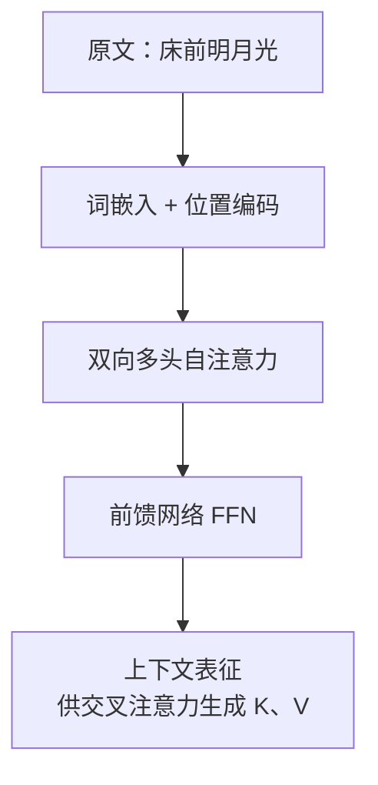

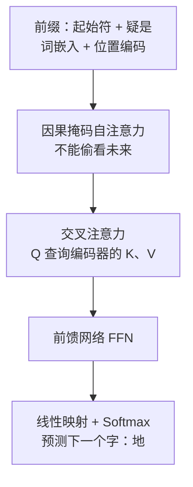
原文编码结果在本轮生成过程中可重复使用。译文前缀则每次增长。前缀中的字只是易读标签，实际序列由 tokenizer 的 token ID 组成，不保证每个字恰好一个 token。

## 7.3 闭卷考试：保留四词掩码的三步手算

假设当前位置的任务是预测**下一个**词。如果它能读取那个正确目标词的输入表示，训练就可能依赖生成时根本没有的答案。因果 mask 阻断这种路径；它不能单独解决数据泄漏、重复训练样本等其他问题，也不保证学到好模型。


下面完整保留原来的分数表与手算链。原始分数是人为设定；脚本的 `mask_walkthrough()` 用这些数生成三张表并验证结果，不声称它们是某个模型的测量值。本例每行至少能看见自己，没有全禁用行；全禁用行的处理约定见第 3 章。

### 表 7-2：4 词序列的掩码矩阵数值演变推导表

假设输入序列为四个字：“我”、“爱”、“学”、“习”。

#### 1. 原始点积分数矩阵 (Q · K^T / √d_k)：
| 查询 (Query) \ 键 (Key) | 词1(我) | 词2(爱) | 词3(学) | 词4(习) |
| :--- | :---: | :---: | :---: | :---: |
| **词1(我)** | 2.15 | **1.80 (未来!)** | **0.95 (未来!)** | **0.40 (未来!)** |
| **词2(爱)** | 1.30 | 3.20 | **2.10 (未来!)** | **1.05 (未来!)** |
| **词3(学)** | 0.85 | 1.95 | 2.80 | **1.70 (未来!)** |
| **词4(习)** | 0.40 | 1.10 | 2.30 | 3.10 |

#### 2. 施加因果掩码后（未来位置实际填入负无穷）：
| 查询 (Query) \ 键 (Key) | 词1(我) | 词2(爱) | 词3(学) | 词4(习) |
| :--- | :---: | :---: | :---: | :---: |
| **词1(我)** | 2.15 | $-\infty$ | $-\infty$ | $-\infty$ |
| **词2(爱)** | 1.30 | 3.20 | $-\infty$ | $-\infty$ |
| **词3(学)** | 0.85 | 1.95 | 2.80 | $-\infty$ |
| **词4(习)** | 0.40 | 1.10 | 2.30 | 3.10 |

#### 3. 最终 Softmax 注意力权重矩阵（百分比）：
| 查询 (Query) \ 键 (Key) | 词1(我) | 词2(爱) | 词3(学) | 词4(习) | 每行总和 |
| :--- | :---: | :---: | :---: | :---: | :---: |
| **词1(我)** | **100.0%** | **0.0%** | **0.0%** | **0.0%** | 100.0% |
| **词2(爱)** | **13.01%** | **86.99%** | **0.0%** | **0.0%** | 100.0% |
| **词3(学)** | **9.06%** | **27.23%** | **63.71%** | **0.0%** | 100.0% |
| **词4(习)** | **4.07%** | **8.19%** | **27.20%** | **60.54%** | 100.0% |

> [!NOTE]
> **用第 2 行把手算走一遍**：
> 允许看见的分数是 1.30 和 3.20。
> $e^{1.30} \approx 3.67$，$e^{3.20} \approx 24.53$，加起来约 28.20。
> 权重分别是 $3.67/28.20 \approx 13.01\%$ 和 $86.99\%$。
> 被写成 $-\infty$ 的格子贡献 $e^{-\infty} = 0$，所以未来的字不会分到百分比。
> 第 3、4 行用的是同一套算法。上面的原始分数是为了演示而写的，不是某个训练好的模型量出来的。

对应的计算顺序不能颠倒：先确定第 i 行可见的 $j\le i$，再只对这些分数归一化，最后给未来位置补精确的 0。脚本把可见前缀送入稳定 Softmax；表中的禁止分数实际写成负无穷，不使用 `-1e9` 冒充。打印到两位的百分数可能有舍入误差，测试用未舍入值检查行和。

## 7.4 Cross-attention：查询来自目标，资料来自源句

图书馆类比里，写作者提出问题，原文资料提供标签和内容。这个类比只帮助区分信息来源：Q/K/V 都是数值向量，不是人写好的问题、书签或原文摘录，也不保证检索到的内容正确。在经典 cross-attention 中：

- Q 由解码器当前层的目标侧表示投影得到；
- K/V 由编码器输出投影得到；
- 权重沿源序列位置归一化，而不是沿译文词表归一化。

例如 batch=1，译文当前有 2 个位置、原文有 3 个位置，每头宽度 4。省略头轴后，Q=[1,2,4]，K=[1,3,4]，V=[1,3,4]；分数为 [1,2,3]，聚合结果为 [1,2,4]。输入输出长度不必相同，也不需要把它们硬凑成方阵。另取一个 $d_v=2$ 的手算例子：给第一行三份资料权重 [0.2,0.3,0.5]，三份 V 分别为 [1,0]、[0,1]、[1,1]，读到的内容便是 [0.7,0.8]，不是机械复制某一个词。

有源端 padding 时也要屏蔽对应 K/V 位置。这个“跨序列”的连接方式，不应和[P17](#p17-ced) 的 Causal Encoder-Decoder（CED）名称混为一谈；本章没有实现 CED，只学习传统翻译双塔与生成循环。

## 7.5 Teacher forcing：谁向右移，预测谁？

训练时可以把正确的前缀交给模型，这叫 teacher forcing；它不是在当前输出位置直接喂入当前标签。以一个完整训练序列为例：

```text
完整序列：<BOS>  我  爱  学  习  <EOS>
模型输入：<BOS>  我  爱  学  习
监督标签： 我     爱  学  习  <EOS>
```

| 计算位置 | 当前输入 token | 该位置应预测的标签 | 因果 mask 下可见的输入 |
|---|---|---|---|
| 0 | `<BOS>` | 我 | `<BOS>` |
| 1 | 我 | 爱 | `<BOS>`，我 |
| 2 | 爱 | 学 | `<BOS>`，我，爱 |
| 3 | 学 | 习 | `<BOS>`，我，爱，学 |
| 4 | 习 | `<EOS>` | `<BOS>`，我，爱，学，习 |

常说的“把目标右移一位作为 decoder 输入”，是指在目标“我 爱 学 习 EOS”前放 BOS，去掉最后的 EOS，得到输入。若从完整序列切片，代码则是：

```python
return list(tokens[:-1]), list(tokens[1:])
```

第一项是输入，第二项是向后错一位的 next-token 标签。不要把“输入右移”误写成“把标签与输入对齐不动”。BOS/EOS 是否显式存在取决于 tokenizer 与任务，这里用可读字符串代替它们的 ID。

全部输入已知，所以五个查询行可以并行计算各自的下一词损失；每行仍只能看允许的前缀。若有 padding，目标端还需 loss mask。训练时走正确前缀，推理时走自己生成的前缀，两者可能不同；一个早期错误会影响后续条件，teacher forcing 不自动保证推理质量。

## 7.6 Prefill 与 decode：不是每一轮都重新读完一切

收到提示“床前”时，可以一次处理已知提示的所有位置，这个阶段常称 **prefill**。最后一个位置的输出 logits 已可用来选出第一个新 token“明”，不需要先等一个不存在的“明”的输出。

之后把新 token 接入序列，继续预测，这通常称 **decode** 阶段。有 KV cache 的实现复用历史 K/V，只计算新增 token 所需部分；本章为了可读性，每次把完整前缀交给一个简化预测函数，**没有实现缓存，也不能用它评估推理性能**。P11 再实现缓存并做等价性检验。

“打字机特效”是界面如何流式展示文本，不能用来判断底层每步是不是一个汉字、是否有缓冲或其他生成优化。我们先学普通自回归的逻辑依赖：

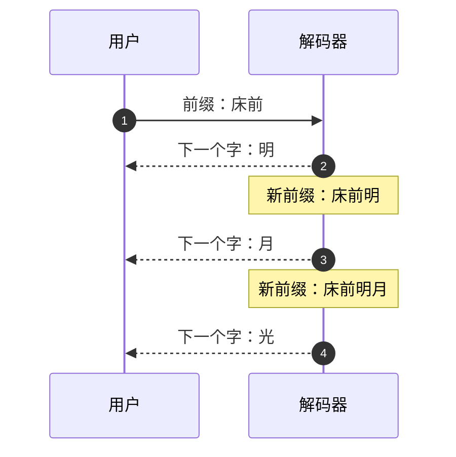
## 7.7 Greedy 与 temperature：同一组 logits，如何选 token？

Logits 是词表上未归一化的分数，不是已经生成的 token。设三名候选 A/B/C 的 logits=[2,1,0]：

$$p_i(T)=\frac{\exp(z_i/T)}{\sum_j\exp(z_j/T)},\qquad T>0.$$

脚本的 `probabilities` 先减最大值再除以温度，避免对大正数直接取指数。以下百分数由脚本计算：

| 方式 | A | B | C | 选择规则 |
|---|---:|---:|---:|---|
| greedy | 不需要算概率 | 不需要算概率 | 不需要算概率 | 直接选最大 logit，所以是 A |
| temperature=0.5 | 86.68% | 11.73% | 1.59% | 按这组分布随机抽样 |
| temperature=1.0 | 66.52% | 24.47% | 9.00% | 同上 |
| temperature=2.0 | 50.65% | 30.72% | 18.63% | 同上 |

低温使本例更集中，高温更平坦；随机抽样仍可能选择非最大项，不是“有 51% 就必选它”。若仍用 argmax 而不抽样，任意正温度都不会改变最大项的顺序。

数学公式不能直接除以 0。教学函数的 `temperature=0` **另走 greedy 分支**，同分时选词表中第一个最大项。只有最大项唯一时，$T\to0^+$ 的分布才趋向该项；并列最大项的极限仍共享权重，不等于我们的“选第一个”约定。

## 7.8 表 7-3：从真实脚本输出逐步追踪停止

为了让每个数都可核对，原先的示意概率换成脚本的固定四词输出词表：[明，月，光，`<EOS>`]。提示中的“床前”由示例直接给定。预测器按前缀长度选用写好的 logits 行，**没有学习诗歌**；固定行不需要随机种子，下面使用 greedy。显示的概率统一是温度 1 的参考分布，并非 greedy 必须先算的东西。

| 步数 | 本轮前缀 | logits（按四词顺序） | 温度1概率（同序，%） | greedy新增 | 累计新增数 / 是否停止 |
|---|---|---|---|---|---|
| 1 | 床前 | [4,1,0,-2] | [93.41,4.65,1.71,0.23] | 明 | 1 / 继续 |
| 2 | 床前明 | [0,4,1,-2] | [1.71,93.41,4.65,0.23] | 月 | 2 / 继续 |
| 3 | 床前明月 | [0,1,4,-2] | [1.71,4.65,93.41,0.23] | 光 | 3 / 继续 |
| 4 | 床前明月光 | [0,0,0,4] | [1.74,1.74,1.74,94.79] | `<EOS>` | 4 / EOS停止 |

两种上限分别运行，不要混在一条追踪里：
- `max_new_tokens=8`：第 4 步生成 EOS，立即停止，不用等到 8 步。返回列表保留 EOS，界面可另行隐藏特殊符号。
- `max_new_tokens=2`：第 2 步后就达到新增上限，返回“床前明月”，没有生成 EOS，停止原因是长度预算。
- `max_new_tokens=0`：不调用预测函数、无新增 token。若前缀本来已以 EOS 结尾，本教学函数立即按 EOS 停止。

这里的上限计**新增 token**，不把 2 个提示 token 算进去；实际框架里的 `max_length` 与 `max_new_tokens` 含义可能不同，调用时需查版本文档。长度停止可能截断一句话；模型预测 EOS 也不代表内容必然完整或正确。

把循环逐行拆开看：

```python
logits = list(logits_fn(list(tokens)))
if len(logits) != len(vocab):
    raise ValueError("one logit per vocabulary token required")
chosen = vocab[choose_token(logits, temperature, rng)]
trace.append({"step": step + 1, "prefix": list(tokens),
              "probs_at_t1": probabilities(logits), "chosen": chosen})
tokens.append(chosen)
if chosen == eos:
    return tokens, trace, "eos"
```

外层 `for step in range(max_new_tokens)` 保证有限次数；每轮取得词表分数、选择一个 token、追加前缀，再检查 EOS。源码在追加前记录 `trace`，以便显示本轮旧前缀。EOS 检查不能等到下一轮才做，否则会多调用一次模型。输出格式检查保证每个词表项恰好一个 logit。若启用抽样，固定 seed 便于复查本例，但不承诺跨框架和版本逐位一致。

## 7.9 自测、运行与下一步

```bash
python3 code/10_generation_loop.py
python3 -m unittest discover -s tests -v
```

本章无 PyTorch/GPU 依赖。回归覆盖三步 mask 数值、标签错位、温度数表、低温唯一最大项、EOS、最大新增数、零预算、固定 seed 及非法输入。

### 先回答六个问题

1. 原文 3 个位置、目标 2 个位置，cross-attention 分数该为几行几列？若三份二维 V 及权重如 §7.4，输出是多少？
2. 输入“BOS 我 爱”，标签是“BOS 我 爱”吗？
3. logits=[2,1,0]，温度 0.5 一定选 A 吗？
4. 表 7-3 在新增上限 2 时何时停止？
5. encoder-only 没有因果 mask，所以可以不处理 padding 吗？
6. 第一次生成“明”之前有没有 decode 输出“明”的表示？

### 参考答案

1. 2×3；两行目标 query，各查询三份源资料。若三份二维 V 及权重如 §7.4，输出是 [0.7,0.8]。
2. 不是。若完整样本是“BOS 我 爱 EOS”，输入是“BOS 我 爱”，标签是“我 爱 EOS”，最后一个位置预测停止符。
3. 抽样不一定，A 约 86.68%；greedy 才确定选 A。T 趋 0 的结论还要检查是否唯一最大。
4. 第 2 步，得到 4 个总 token（2 提示 + 2 新增），不是等 EOS 出现才停。
5. 不可以；允许前后文不代表补位是有用内容。
6. 不需要。prefill 的最后位置 logits 已可选出“明”；再将“明”作为下一次条件输入。我们的示例是全前缀重算，不是 KV 缓存实现。

下一单元 P09（训练基础，07a）把数据切分、交叉熵、梯度更新与评估串成训练闭环，再进入第 8 章 Baby-GPT 实践。本章的固定 logits 演示仍只是生成控制流程，不等于训练模型。

## 原始来源与版本

- [Attention Is All You Need，v7，§3.1、§3.2.3、§3.4](https://arxiv.org/html/1706.03762v7)：双塔结构、因果约束、目标右移和输出层。
- [BERT 原始论文，§3](https://arxiv.org/abs/1810.04805)：双向编码器预训练；“双向”不是任何任务都可看未来答案。
- [Transformers 4.57.1 生成参数文档](https://huggingface.co/docs/transformers/v4.57.1/en/main_classes/text_generation)：temperature、EOS 及长度参数的接口语义；本章不用这个库执行实验。
- [Transformers 4.57.1 缓存说明](https://huggingface.co/docs/transformers/v4.57.1/en/cache_explanation)：理解历史 K/V 复用的概念路标。文档核验日期：2026-10-19。


---

# 训练基础（P09）：让一次猜字变成一次学习

前面我们已经装好了注意力、残差和因果掩码。但“能算出下一个字的分数”不等于“已经学会猜字”。本章先把训练循环慢放，再到下一章《Baby-GPT》拼完整模型。

**读完你应该能回答：这一批题从哪里来，答案对齐哪一格，错多少，谁计算梯度，谁修改参数，以及凭什么说模型变好了。** 先懂 Python 切片与前几章的 `[B,T,C]` 就够了；导数只用“向哪个方向微调”的直觉。

## P09.1 练习册、答题纸与考试卷

训练像练习默写：模型交一份答题纸，损失函数评分，梯度告诉我们怎样微调，优化器实施调整。类比的边界是：模型没有老师式理解；一次更新是数值计算，不保证每道题都改对，也不保证下一次总分必然更好。

```text
原文 -> 按文档分组 -> 训练文档 -> 抽一个 batch
                         |           |
                         |       前向得到 logits
                         |           |
                         |       对齐答案算 loss
                         |           |
                         |       backward 算梯度
                         |           |
                         +------ step 改参数

独立保留文档 -----------------> 只评分，不更新
```

先分文档，再抽窗口。把同一首诗的许多重叠窗口随机分成“训练/验证”，相当于考试卷藏着练习册里几乎相同的题。窗口不相同，也不代表来源独立。

本章把三首诗中的前两首作为训练来源，把整首《春晓》留下。每个窗口只取自一首诗，不把上一首最后一字接到下一首首字。这个划分可演示评估流程，**只有一个保留文档，不是可靠的泛化基准**；共同标点、体裁与小样本噪声都会影响结果。真正做项目，还要按来源去重，留出更多文档；用于选择超参数的是验证集，最终测试集不能反复拿来调参。本章没有声称拥有独立最终测试集。

为复用下一章词表，本实验预先用三首诗的全部字符定义 57 字词表。训练不读取第三首的标签，但词表知道第三首出现哪些字：这是 **transductive（利用了保留数据的词汇信息）设置**，不是严格训练集独立构建的 tokenizer。更严格的方案要预先固定词表，或只在训练文档建词表并明确未知字符策略。即使知道字符 ID，模型也没有学到这些字符在第三首中的顺序。

## P09.2 输入与标签只错开一个位置

假设文本是“床前明月光”，取长度 `T=4`，需要先取 **5 个字符**：

| 时间格 t | 0 | 1 | 2 | 3 |
| --- | --- | --- | --- | --- |
| 输入 x | 床 | 前 | 明 | 月 |
| 目标 y | 前 | 明 | 月 | 光 |
| 这一格能看的输入 | 床 | 床前 | 床前明 | 床前明月 |

Python 切片是 `x = ids[start:start+T]`，`y = ids[start+1:start+T+1]`。右端不包含。`start+T` 必须小于文档长度，否则最后一个输入没有答案。

为什么整行输入包含“明”，预测“前”的时候不会偷看？因为前面学过的因果掩码限制每一格只能看自己和左边。标签是评分依据，不能作为当前格输入的额外通道。训练中一次并行算全部位置，生成时则只有已有前缀。

脚本的 `shifted_pair` 负责切片，`assert_shift` 用原始文档核对，不只比较 x/y 的长度。若误写 `y=x`，形状完全正确，训练目标却从“预测下一个字”变成了“抄当前字”。

### 亲手做一次作弊反例

给定输入 ID `[0,1,2]`，每一格都把当前输入 ID 的分数设成 12，其他三个类别设成 0。这个“模型”没有训练：

- 错误答案 `[0,1,2]`：平均 loss 约 **0.00001843**。
- 正确的下一字答案 `[1,2,3]`：平均 loss 约 **12.00001843**。

一个漂亮的 loss 可以来自一道错误的题。因果掩码不能修好 `y=x`，因为当前格本来就允许看见自己。

## P09.3 损失到底在罚什么：手算交叉熵

模型输出的是任意实数分数 logits，不必为正，也不要求总和为 1。softmax 将分数变成概率；交叉熵取正确答案概率的负自然对数：`loss = -ln(p_correct)`。正确答案概率越小，罚得越重。对数底数为 e，单位可称 nats。

下面只有 A/B 两类、两个待评分位置，二者正确答案都是 A。令 `ln(3)=1.098612289`：

| 位置 | logits (A,B) | softmax (A,B) | 正确答案 | 单位置 loss |
| --- | --- | --- | --- | --- |
| 0 | (ln(3), 0) | (0.75, 0.25) | A | -ln(0.75) = 0.287682072 |
| 1 | (0, ln(3)) | (0.25, 0.75) | A | -ln(0.25) = 1.386294361 |

默认平均损失为 `(0.287682072 + 1.386294361) / 2 = 0.836988217`。不是先把正确答案概率平均成 0.5 再取负对数，后者是不同的量。PyTorch 的 `cross_entropy` 已包含稳定的 log-softmax 计算，**传 logits，不要先 softmax 再传进去**。

一般 batch 有 B 行、每行 T 格、词表 V 个字：

| 对象 | 形状 / 类型 | 含义 |
| --- | --- | --- |
| x、y | `[B,T]`，整数 long | 输入 ID、正确目标 ID |
| logits | `[B,T,V]`，浮点 | 每格每个候选字的分数 |
| 用于 CE 的 logits | `[B*T,V]` | 把格子排成一个题目列表 |
| 用于 CE 的 y | `[B*T]` | 每题一个类别编号 |
| mean loss | 标量 | 本 batch 所有格子的平均损失 |

这里没有 padding、类别权重或忽略标签，每格权重相同。以后有 padding 时，分母应是有效标签数，不能把 padding 算进去。评估多份长度不同的文档时，也要按预测 token 数加权，不是把每份文档的平均 loss 再简单平均。

## P09.4 backward 不更新参数，step 才更新

先把模型缩到最小：只有两个可训练分数 `z=[ln(3),0]`，正确答案 A。此时梯度是“预测概率减真实 one-hot”：

```text
预测概率             [0.75, 0.25]
真实答案             [1.00, 0.00]
loss 对 z 的梯度     [-0.25, 0.25]
学习率 0.1 的 SGD:
新 z = 旧 z - 0.1 * 梯度 = [1.123612289, -0.025]
```

A 分数上升、B 分数下降，新 loss 为 **0.275414489**，小于原来的 0.287682072。脚本用标准库生成这些数值；测试另用微小扰动的有限差分验证梯度，不只检查输出里是否有这串数字。这个例子是直接优化 logits 的单题 SGD，真实模型要把梯度沿计算图反传到 embedding、投影矩阵等参数。

两格取 mean 时，每格梯度还要除以 2，因此上表两个位置的梯度分别是 `[-0.125,0.125]` 和 `[-0.375,0.375]`。换成 sum，梯度也会跟着变；学习率不能脱离 loss reduction 讨论。

下面是[实验源码](../code/11_training_loop.py)的 `train_step` 核心：

```python
model.train()
optimizer.zero_grad(set_to_none=True)  # backward adds; do not mix batches accidentally
logits, loss = model(x, y)
loss.backward()
optimizer.step()
```

逐行拆开：

1. `train()` 设置训练模式，不是“开始训练”的魔法按钮。
2. `zero_grad` 清掉上一轮梯度。这不是把权重清零。
3. 前向调用模型，得到分数和当前损失；autograd 记录需要求导的运算。
4. `backward()` 按链式法则算梯度并写入参数的 `.grad`，还没有修改权重。
5. `step()` 根据梯度更新权重。脚本使用 AdamW，下面的手算则用 SGD；不要把 SGD 的一步公式当成 AdamW 的精确公式。

为什么每轮清零？PyTorch 默认把新梯度加到旧梯度上。对同一个参数、不更新参数地反传同一道题两次，`[-0.25,0.25]` 会变成 `[-0.5,0.5]`。有意积累多个 micro-batch 可以节省显存，但需要设计缩放和更新时机；本实验每 batch 更新一次，不需要跨 batch 积累。

## P09.5 train、eval 与 no_grad 是三件不同的事

`eval()` 影响 Dropout、BatchNorm 等有模式差异的层，**不禁止梯度**；`no_grad()` 不记录求导图，**不自动切成 eval 模式**。评估通常两者一起使用，且不调用 optimizer。下面是独立示意代码，不是源码摘录：

```python
was_training = model.training
model.eval()
with torch.no_grad():
    logits, loss = model(x, y)
model.train(was_training)
```

实验的 `evaluate` 还通过 `try/finally` 保证恢复模式。当前 BabyGPT 没有 Dropout/BatchNorm，因此切换模式可能不改变它的数值输出；测试用一个 `Dropout(p=1)` 小对照说明模式的真实作用，而不虚构 BabyGPT 的随机层。

评估 loss 时，保留诗的前面字符作为已知前缀是允许的，这是条件概率评分；没有用其标签更新参数。不要把“不给梯度”误写为“连保留文档都不能前向读取”。不过，反复根据这个 loss 挑种子、调步数，会让它成为调参验证集，不能再声称是从未碰过的最终测试。

## P09.6 CPU 实验：同一个种子再跑一次

从仓库根目录执行。无需下载模型、无需 GPU，也不写 checkpoint：

```bash
python code/11_training_loop.py --scalar-only
python code/11_training_loop.py --steps 40 --seeds 7 7 11
python -m unittest discover -s tests -p test_training_loop.py -v
```

第一条只用标准库；第二条需要稳定版 PyTorch **2.14.x**。缺失或不兼容版本时它解释原因并退出，不自动安装；测试仍运行标量部分，只跳过张量部分。已配置仓库环境可把 `python` 换成 `.venv/bin/python`。

教学配置是 CPU 单线程、`d_model=16`、4 头、1 层、最大位置 32、B=4、T=8、AdamW 学习率 0.003、40 次更新。每次从两首训练诗随机取 4 个窗口；共消费 40×4×8=1280 个预测位置，**包含重复，不等于 1280 个独立样本**。每次运行重新初始化模型与优化器，同时固定 Python 抽样 RNG 和 PyTorch 种子，并开启确定性算法。

下面是 2026-10-19、PyTorch 2.14.1+cpu 的复核记录，显示到六位小数。seed 11 保留后值采用独立审核环境的 4.397413730…，四舍五入为 4.397414；本地复跑为 4.397413254…，相差一个 float32 ULP。测试对表值使用绝对容差 1e-6，容纳舍入和这一级 CPU 数值差异，而不容许学习率改变造成的偏移。训练/保留 loss 都用整首诗的所有下一字位置评分，和训练时长度 8 的随机窗口口径不同：

| 运行 | 首 batch loss | 训练文档 loss 前→后 | 保留文档 loss 前→后 |
| --- | --- | --- | --- |
| seed 7 | 4.280819 | 4.219313 → 3.175501 | 4.494203 → 4.843005 |
| seed 7 再跑 | 4.280819 | 4.219313 → 3.175501 | 4.494203 → 4.843005 |
| seed 11 | 4.219005 | 4.189975 → 3.263426 | 3.923873 → 4.397414 |

### 先检查标签分布，再解释 loss

这里“训练见过”严格指两首训练诗的**下一字标签集合**，即各自 `encode(doc)[1:]` 的并集，不是全部输入字符，更不是预先定义的全语料词表。留出诗有 23 个目标位置，其中 19 个目标从未作为训练答案出现；共有的 4 个目标只包括“，”和“。”各两次。计数按出现次数，不按不同字符数。

`evaluate_strata` 逐位置计算不归约的交叉熵，再按这个集合分组；训练前后都输出 count、loss_sum 和 mean loss：

| 运行 | 训练标签见过的目标数 | 见过组 loss 前→后 | 未见过的目标数 | 未见组 loss 前→后 |
| --- | --- | --- | --- | --- |
| seed 7（重复相同） | 4 / 23 | 4.266185 → 3.506729 | 19 / 23 | 4.542207 → 5.124327 |
| seed 11 | 4 / 23 | 4.072877 → 3.441714 | 19 / 23 | 3.892503 → 4.598613 |

两组不是各占一半：整体均值应是 `(4 × 见过组 loss + 19 × 未见组 loss) / 23`。测试检查这个重组合等于总体 loss（允许 float32 归约误差）。共有目标的 loss 实际下降；整体上升主要来自那 19 个从未作为训练答案的目标。在训练 softmax 分类时，这些类别没有正目标奖励，但仍出现在分母里，其分数可能被相对压低。**这次留出 loss 上升主要反映标签分布不匹配，本实验不能证明过拟合。看到留出 loss 上升，先检查留出标签是否见过。** 只有 4 个共有标点变好，也不能据此推断词汇或语言泛化变好。

过拟合指模型过度适应训练材料、在可比的新样本上表现变差；训练 loss 下降而验证 loss 上升只是需要诊断的现象，不是自动成立的结论。若要演示它，需要另设词汇覆盖可比、来源独立的留出材料，固定评估口径并跟踪训练过程，例如检查验证 loss 是否先下降后上升。本批只讨论过拟合概念，**没有演示或证实过拟合**，也不将不匹配的两组数据包装成过拟合实验。

同种子同环境重复是复现实验的检查，不是跨硬件/版本逐位相同的承诺；换种子也不是新增独立测试语料。

下一章的 S0 会在三首诗上训练并检查背诵，它是 **同语料记忆/工程基线**。本章两首训练、一首保留是另一种评估演示，不要把两个 loss 混在同一条曲线上。生成检查能发现乱码、循环、提示词接不上等直观问题，但背出训练诗并不证明新诗写作或通用语言能力。只有 loss 和生成片段一起看，再核对数据来源，才不会被“出口成章”迷惑。

## P09.7 自测：先答，再看后面的答案

1. 对 ID `[4,7,1,9,3]`，start=1、T=3，x/y 各是什么？把 y 设为 x，因果掩码能否补救？
2. 表中两道题的 mean loss 是多少？为什么不是 `-ln(0.5)`？
3. 单题 logits `[ln(3),0]`、答案 A，梯度与学习率 0.1 的 SGD 更新后 logits 是什么？若两题取 mean，梯度怎样变化？
4. 不调用 step，连续 backward 同一道题两次会怎样？在哪一行清零？
5. `eval()` 是否关闭 autograd？`no_grad()` 是否关闭 Dropout？当前 BabyGPT 切换模式为什么可能没有数值变化？
6. 把同诗重叠窗口分到训练和验证有什么问题？本实验整首保留后，为什么仍不能据此声称通用语言能力或证明过拟合？

### 参考答案与可执行测试对应

1. x=`[7,1,9]`，y=`[1,9,3]`；不能。当前格合法地能看见自己，错误任务变成复制。对应 `test_shift_and_wrong_shift_mutation` 与 `test_copy_cheat_is_not_next_token_skill`，错误标签会被拒绝，而作弊低 loss 会被实际计算出来。
2. 0.836988217。交叉熵是各题负对数的均值，不是概率均值的负对数。对应 `test_hand_calculated_cross_entropy` 与 `test_reduction_and_autograd_match_handcalc`。
3. 梯度 `[-0.25,0.25]`，更新后 `[1.123612289,-0.025]`；两题取 mean 时每题梯度除以 2。对应 `test_gradient_finite_difference_and_update` 与 `test_reduction_and_autograd_match_handcalc`。
4. 梯度累加成两倍；下一批前调用 `optimizer.zero_grad(set_to_none=True)`。对应 `test_gradient_accumulation_and_clear`；`test_train_step_rejects_zero_grad_omission_numerically` 另跑不清零的错误循环，确认其参数偏离正确参考，避免仅靠搜一行源码“证明正确”。
5. 两者都不会替代另一方；BabyGPT 无 Dropout/BatchNorm。对应 `test_eval_no_grad_and_restore_mode`：用真实 `evaluate` 前向的 pre-hook 确认 `training=False` 与 `is_grad_enabled=False`，另检查权重不变、模式恢复，并用 Dropout 对照。`test_evaluate_unequal_documents_token_weighted` 使用 1 个与 4 个目标的不等长文档，核对 token 加权 3.4，而不是文档均值 2.5。
6. 重叠来源使验证不独立。本实验只有一首保留诗、全语料词表且体裁单一；19/23 个留出目标未在训练标签中出现，4 个共有标点的 loss 反而下降。总体上升主要来自标签分布不匹配，不能证明过拟合，本批未演示过拟合。下一章 S0 更只是同语料记忆。对应 `test_split_and_leakage_mutation`：将训练文档混入保留集合会报错；`test_fixed_seed_repeat_and_heldout_report` 检查重复运行；`test_40_step_snapshots_and_label_strata` 固定种子 7/11 的 40 步结果、实际学习率、19/23 计数、共有组下降方向及两组重组合，不断言“训练必能改善整体保留 loss”。

## P09.8 来源与边界

核验日期：2026-10-19。API 依据锁定为 PyTorch 2.14 文档，运行数值使用 2.14.1+cpu：

- [CrossEntropyLoss](https://docs.pytorch.org/docs/2.14/generated/torch.nn.CrossEntropyLoss.html)：logits 输入、类别标签与 reduction。
- [Optimizer.zero_grad](https://docs.pytorch.org/docs/2.14/generated/torch.optim.Optimizer.zero_grad.html)：梯度清理与 `set_to_none`。
- [Autograd mechanics](https://docs.pytorch.org/docs/2.14/notes/autograd.html)：梯度记录、no-grad 与 eval 的区别。
- 大纲 S14 的 [Transformers 文档入口](https://huggingface.co/docs/transformers/index) 是进一步学习训练框架的导航；本实验不调用 Transformers，也不把动态文档版本冒充已验证依赖。
- 大纲 S18 [Training Compute-Optimal Large Language Models](https://arxiv.org/abs/2203.15556) 研究特定大规模设置下模型规模、数据量和计算预算的关系。它提醒我们同时报告预算和数据，但不能把论文比例套到三首诗、不能由本实验推出 scaling law，也不据此承诺增加步数就能提升泛化。


---

# 第8章：实战——手搭一个微型大语言模型（Baby-GPT）

上一单元 P09 把“数据 → 预测 → 损失 → 梯度 → 更新”走了一遍。现在不再换一套神秘组件，而是把已经学过的嵌入、注意力和 Block 接起来，留下一份后续改进都能比较的 **S0 基线**。

本章的目标是训练一个能背三首诗的微型自回归模型，不是训练通用聊天助手。先确认它算对，再看它记住了什么，最后保存与重新载入同一套参数。下一单元 P11 只改变生成的计算方法，加 KV cache；不会偷偷换模型再宣称提速。

## 8.1 任务、边界与运行

配套 [code/07_baby_gpt.py](../code/07_baby_gpt.py) 保留三首完整诗：《静夜思》《登鹳雀楼》《春晓》。每首 24 个字符（含标点），共 72 个字符；字符词表 57 项。

```bash
OMP_NUM_THREADS=1 python3 code/07_baby_gpt.py
python3 -m unittest discover -s tests -p 'test_baby_gpt.py' -v
```

需要 `requirements.txt` 中的 CPU PyTorch；本文数值来自 Python 3.12、PyTorch 2.14.1+cpu、种子 42、单线程环境。线程数、版本、设备会影响运行时间及浮点结果，不能仅凭相同 seed 承诺跨平台逐位相同。

本章把三首诗全用于训练，观察的是**训练集记忆**。P09 的整首留出实验才有训练与验证之分，而且数据仍小到不足以评价通用语言能力。本章的生成例子也不是盲测集。不要将每首诗的重叠窗口随机分组后叫作独立泛化评估。

## 8.2 先读配置与参数账

### 表 8-1：S0 的固定配置

| 字段 | 数值 | 在模型中的作用 |
| --- | --- | --- |
| `vocab_size` | 57 | 每个位置输出 57 个 logits |
| `d_model` | 48 | 残差主干的宽度 |
| `num_heads` | 4 | 每头宽度 48 / 4 = 12，不是 4 个独立语言模型 |
| `num_layers` | 2 | 两个 Pre-LN 因果 Block |
| `max_seq_len` | 128 | 可学习位置表和因果 mask 的容量 |
| FFN 中间宽度 | 192 | 4 × 48，激活使用 GELU |
| 学习率 / 更新次数 | 0.01 / 80 | 本章记忆实验，不是通用推荐参数 |
| 参数总数 | 67872 | 不包含不训练的 mask 缓冲区 |

可以自己逐项加总，而不是只相信打印结果：

| 部件 | 算式 | 参数 |
| --- | --- | --- |
| 词嵌入 | 57 × 48 | 2736 |
| 可学习位置表 | 128 × 48 | 6144 |
| 每个 Block 的 Q/K/V/O（无偏置） | 4 × 48² | 9216 |
| 每个 Block 的 FFN（有偏置） | 48 × 192 + 192 + 192 × 48 + 48 | 18672 |
| 每个 Block 的两个 LayerNorm | 2 × (48 + 48) | 192 |
| 两个 Block | 2 × (9216 + 18672 + 192) | 56160 |
| 最终 LayerNorm | 48 + 48 | 96 |
| 输出头（无偏置） | 48 × 57 | 2736 |
| 总计 | 2736 + 6144 + 56160 + 96 + 2736 | 67872 |

输出头与词嵌入是两份参数，并没有权重绑定。第 6 章用 `nn.MultiheadAttention` 的带偏置示例，所以不能照搬它的 MHA 公式。GELU 不含可训练参数；它与 ReLU 都提供非线性，但函数不同。[来源 1]

`GPTConfig` 记录架构配置，`model.config` 可以拿回来核对。更改宽度、层数、词表或位置容量会改变参数形状，不能把不兼容 checkpoint 硬塞进去。

## 8.3 一个短句的完整数据流

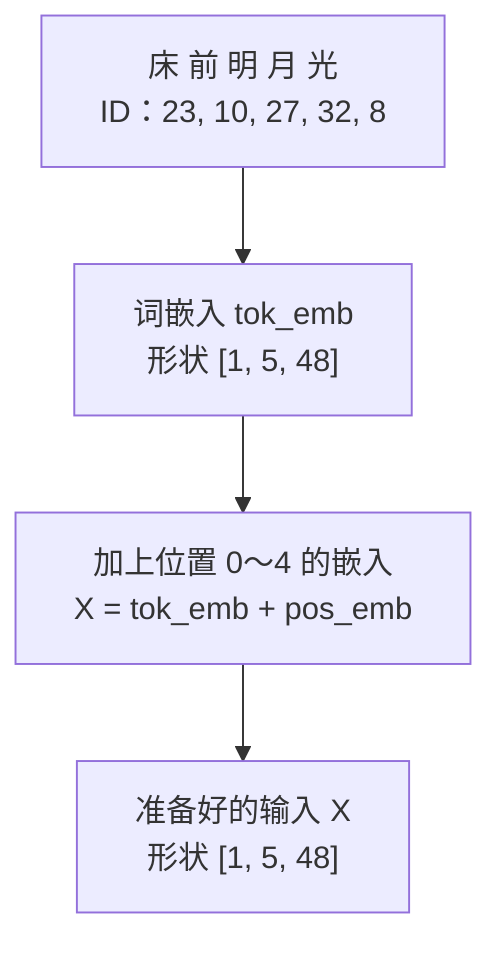

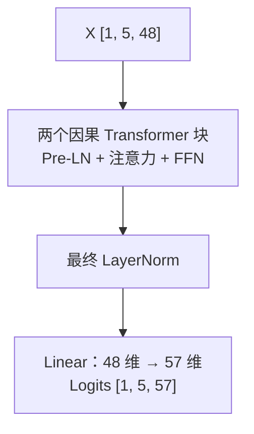

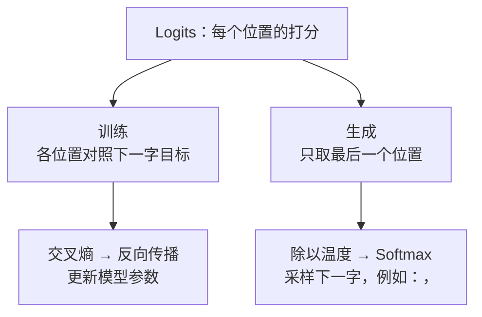

三张图沿用同一配置。最后一张的温度采样是温度大于 0 的路径；`temperature=0` 走 argmax，不做除零。

### 表 8-2：真实字符编号

| 汉字 | 数字 ID | 汉字 | 数字 ID | 汉字 | 数字 ID |
| :---: | :---: | :---: | :---: | :---: | :---: |
| **。** | 0 | **一** | 1 | **上** | 2 |
| **不** | 3 | **光** | 8 | **前** | 10 |
| **地** | 13 | **床** | 23 | **明** | 27 |
| **月** | 32 | **霜** | 52 | **，** | 56 |

编号来自 `sorted(set(text_corpus))` 的 Unicode 顺序，没有语义大小关系。“床前明月光”编码为 `[23,10,27,32,8]`；输入张量形状 `[1,5]`，不是 `[5,57]`。

```text
ids [B,T]          → tok_emb [B,T,48]
positions [T]      → pos_emb [T,48]，广播到 batch 后相加
每层 Q/K/V         → [B,4,T,12]
注意力分数/权重     → [B,4,T,T]
拼接、投影、FFN     → [B,T,48]
最终 LN 与输出头    → logits [B,T,57]
```

本模型用的是**可学习绝对位置表**，不是第 5 章的 sin/cos，也不是 RoPE。每次完整前向从位置 0 开始。它没有 cross-attention、外部文档输入或对话角色处理。

## 8.4 按模块读源码，不把组件跳过去

完整实现只在源码维护，下面摘出关键语句；标记 `# ...` 的位置表示省略，不是可独立运行的完整类。

### 词表与样本边界

```python
text_corpus = "".join(poems)
# ...
unique_chars = sorted(list(set(text_corpus)))
vocab_size = len(unique_chars)
char2idx = {ch: i for i, ch in enumerate(unique_chars)}
idx2char = {i: ch for i, ch in enumerate(unique_chars)}
```

合并 `text_corpus` **只用于建词表**；训练仍逐首取样。否则一首诗末尾会被错误地要求预测下一首开头。`encode` 没有未知字符回退，也没有 BPE，输入词表外字符会报错；`decode` 则将 ID 反查字符。两者的顺序也是 checkpoint 的一部分。

### 因果自注意力

```python
Q = self.W_q(x).view(B, T, self.num_heads, self.head_dim).transpose(1, 2)
K = self.W_k(x).view(B, T, self.num_heads, self.head_dim).transpose(1, 2)
V = self.W_v(x).view(B, T, self.num_heads, self.head_dim).transpose(1, 2)
# ...
scores = torch.matmul(Q, K.transpose(-2, -1)) / math.sqrt(self.head_dim)
```

每个 query 只能看自己和更早的 key。未来位置先在 scores 中遮挡，再做 Softmax；不能先归一化再删掉未来权重。当前 S0 没有 padding，合法非空输入每行至少能看见自己。S0 测试会改变后缀字符，检查前缀**所有 logits** 不变，而不只看最后选出来的字碰巧一样。

### Pre-LN、GELU 与最终输出

```python
x = x + self.attn(self.ln1(x))
x = x + self.mlp(self.ln2(x))
```

`BabyBlock` 先用 LN 求增量，再把增量加回主干，与第 6 章默认 Pre-LN 顺序相同。MLP 是 `Linear(48,192) → GELU → Linear(192,48)`。GELU 可写成 x 乘标准正态分布的累计概率，负半轴并非一刀切为零；不必在这里背积分，知道它不是线性层即可。[来源 1]

两个 Block 后还要经过 `ln_f` 和 `head`。`head` 输出的是实数 logits，不是已经归一化的概率。训练时直接把 logits 交给交叉熵；生成时再根据策略选择下一字。不要在交叉熵前重复 Softmax。

## 8.5 从一次 loss 到 80 次更新

每首诗取前 23 个字符作为输入，后 23 个字符作为标签。每个位置预测紧挨着的下一字；一首诗有 23 个监督目标，三首共 69 个。训练循环做：

```python
optimizer.zero_grad()
losses = []
for data in encoded_poems:
    _, loss = model(data[:-1].unsqueeze(0), data[1:].unsqueeze(0))
    losses.append(loss)
loss = torch.stack(losses).mean()
loss.backward()
optimizer.step()
```

内部交叉熵是该首所有 token 的平均，外部再对三首取平均。三首长度相等，这等于 69 个 token 的平均；如果长度不同，“每首等权”不再等于“每个 token 等权”。P09 的 reduction 例子专门区分这两种目标。

`zero_grad` 清掉上一轮的梯度，`backward` 算出本轮梯度，`step` 更新参数。当前脚本使用 AdamW，包含自适应状态，不是手算小节里的裸 SGD；学习率相同也不能预期更新完全一样。`train()` 不会替你反向传播，`eval()` 也不会替你关闭梯度。本模型没有 dropout，因此两种模式对当前层的数值本身没有随机开关；生成仍显式使用 eval 和 no_grad，以建立正确习惯。

### 表 8-3：种子 42 的 S0 训练日志

| 更新序号 | 更新前训练 loss | 解释 |
| --- | --- | --- |
| 1 | 4.1271 | 与均匀猜测 ln(57) ≈ 4.0431 同量级，但不是完全均匀分布 |
| 20 | 0.0196 | 正在记住同一批目标 |
| 40 | 0.0021 | 继续提高训练字符的概率 |
| 60 | 0.0011 | 仍是训练集结果 |
| 80 | 0.0009 | 不能据此推出验证集正确 |

表内是本次循环算完前向、尚未 `step()` 时的值；“第 80 行”不代表更新 80 次后的另一次评估。参数有 67872 个，而语料只有 72 个字符，记忆这个微型训练集不是惊人的泛化证据。固定版本的回归核对这份四位小数日志快照；其他张量比较使用声明的数值容差，不把训练墙钟时间当成通过门槛。

## 8.6 保留生成对照，也保留失败案例

### 表 8-4：每次新增 15 字，温度 0

| 提示 | 未训练 | 更新 80 次后 |
| --- | --- | --- |
| 床前 | `床前穷河前月眠欲黄头黄一日依疑，床` | `床前明月光，疑是地上霜。举头望明月` |
| 白日 | `白日穷河前月眠欲黄头黄一日依疑，床` | `白日依山尽，黄河入海流。欲穷千里目` |
| 春眠 | `春眠落头黄风白望入落欲一日依疑，床` | `春眠不觉晓，处处闻啼鸟。夜来风雨声` |

再输入不在课文开头的“明月”，这个固定实验输出：

```text
明月不觉晓，处处闻啼鸟。夜来风雨声
```

它没有接回“明月光”，而是转入另一首诗。这个反例说明本次训练不保证任意提示都能接回原文；单个反例也不能证明模型内部完全没有学到任何词关系。不要将“背诵 vs 理解”写成可由一条输出解决的哲学判定。

S0 的停止条件是新增字符数，没有训练 `<EOS>`。句号和 EOS 不是同一回事：生成句号不会自动停。温度 0 是贪心；为兼容旧 API，负温度也走贪心，新的调用建议只用 0 或正数。温度为正时按概率采样，1 是原分布，0.2 放大分数差，2 缩小分数差；都不是正确率旋钮。

S0 超过 128 个输入字符时，在生成循环中取最后 128 字并把位置重新编号为 0–127。这是一个明确的**滑窗重算策略**，不是无限上下文，也不能与沿用旧绝对位置的缓存结果直接比较。P11 的缓存演示到容量上限就报错，不伪装成同一滑窗策略。

## 8.7 保存再加载：基线必须能回来

只有 loss 日志不够。后续要比较 S0/S1，必须复用完全相同的权重、配置和词表。配套 `save_checkpoint(path, model)` 保存配置、参数与字符顺序；`load_checkpoint(path)` 在 CPU 创建对应模型并恢复权重。测试在临时目录保存后加载，对同一批输入比较所有 logits。

```python
# 在已导入本脚本的 Python 会话内；model 是你的 BabyGPT 实例。
save_checkpoint("baby_gpt.pt", model)
restored = load_checkpoint("baby_gpt.pt")
restored.eval()
```

这里只提供**推理基线恢复**，不承诺训练中途精确续跑。续训通常还需 optimizer 状态、随机数状态、数据采样位置与步数；不能将本 checkpoint 的 round-trip 测试当成全部续训条件已经实现。

只加载自己生成或可信来源的文件。实现显式使用 `torch.load(..., weights_only=True)` 并核对格式；这不是允许任意陌生文件的安全保证，不要为载入来历不明文件改成不受限反序列化。[来源 2]

## 8.8 先预测，再看答案

1. `[2,5]` 的字符 ID 输入在默认配置下，logits 是什么形状？
2. 三首 24 字诗各自 shift，监督目标一共多少个？直接拼接后会多出什么？
3. 为什么不能把表 8-3 叫验证 loss？长度不同时，平均每首 loss 等于平均每个 token 吗？
4. 默认模型参数为什么不是把 57×48 只算一次？mask 是训练参数吗？
5. 生成遇到句号会停吗？保存 checkpoint 后是否能精确恢复优化器继续训练？
6. 改掉输入后两个字符，因果模型前面位置的 logits 应该变化吗？只看 argmax 是否足够？

### 参考答案

1. `[2,5,57]`。每个 batch、每个位置都给整个词表打分。
2. 3×23=69。拼成 72 字会有 71 个目标，其中两个跨诗边界是本任务不想训练的连接。
3. 全部诗都参与了参数更新。长度不同时每首等权与 token 等权不同。
4. 输入嵌入和输出头没有绑定，各有 2736 个参数。mask 是固定 buffer，不算可训练参数；总计 67872。
5. 不会，本模型无 EOS，只按新增预算停。checkpoint 恢复配置/权重/词表，不保存全部续训状态。
6. 不应该；要逐位置比较 logits。两个分布变化后仍可能选同一个最大项，argmax 相同不能证明计算等价。

这些结论对应 `tests/test_baby_gpt.py` 的形状/loss、词表与参数、因果性、训练与 checkpoint 检查。P09 负责训练基础的梯度和数据边界；下一单元 P11 负责缓存与完整计算的数值等价，不用一次庞大测试掩盖各自的契约。

## 原始来源与实现版本

核验日：2026-10-19。S0 是本仓库教学实现，不是某个商业模型的精确复刻。

1. [PyTorch 2.14 GELU](https://docs.pytorch.org/docs/2.14/generated/torch.nn.GELU.html)：激活定义。模型结构以 [code/07_baby_gpt.py](../code/07_baby_gpt.py) 为准。
2. [PyTorch 2.14 torch.save](https://docs.pytorch.org/docs/2.14/generated/torch.save.html)、[torch.load](https://docs.pytorch.org/docs/2.14/generated/torch.load.html)：序列化、设备映射与 weights_only 边界。
3. [Transformers 4.57.1 生成参数](https://huggingface.co/docs/transformers/v4.57.1/en/main_classes/text_generation)：用于比较长度/采样接口概念；本章不依赖 Transformers 运行，不声称它的参数语义与旧 Baby-GPT 每处相同。


---

# 生成优化（P11）：KV Cache，不再重复算历史

第 8 章得到一份明确的 S0：相同字符词表、可学习绝对位置、两个 Pre-LN Block。现在实现 S1，**权重一项都不改，只缓存生成中可以复用的中间结果**。先证明 logits 对齐，再问时间和内存，不能把“生成的字看起来一样”当作正确性证明。

配套 [code/12_kv_cache.py](../code/12_kv_cache.py) 直接使用 S0 的模型模块，不另训一份近似模型。实验是 CPU、float32、无 dropout、eval 模式；不下载权重，不用 GPU。

## P11.1 重算发生在哪里

假设提示有“床前”两个字符。S0 先计算这两个位置，再选出“明”；下一轮把“床前明”三个位置全部送进模型，先前“床”“前”的计算又做一次。

在因果模型中，较早位置不能看后来追加的 token。如果权重、位置、历史 token 和确定性的前向计算都不变，较早位置在每层的表示也不会因追加后缀而变化。因此它们的 K 和 V 可以保存，下一步直接读。Q 是本次新位置要发出的查询，不必保存整个历史 Q。

```text
S0：床 前          → 全部位置前向 → 选 明
    床 前 明       → 全部位置前向 → 选 月

S1：床 前          → prefill，存各层 K/V → 选 明
          明       → 新 Q/K/V + 历史 K/V → 选 月
             月    → 新 Q/K/V + 历史 K/V → ...
```

可以把它比作保存已经整理好的借阅索引，下一次只补新条目。类比的边界是：真实缓存不是保存自然语言摘要，也不是模型长期记忆；它保存的是当前请求、当前参数与位置下的浮点张量。缓存本身不会让模型学会新的事实。

## P11.2 Prefill 与 decode，首字到底从哪来

**Prefill** 一次处理提示，建立每一层的 K/V。提示最后一个位置的 logits 已经能选出第一个新 token；不用先把这个尚未选出的 token 输入模型。

**Decode** 通常每次送入刚选出的一个 token。这个新位置产生 Q、K、V；把新 K/V 接在对应层的历史后面，Q 对全部可见 K 打分，然后更新本层缓存。下一层使用的是本层更新后的新 token 表示，而不是直接复用第一层的 K/V。

模型有两层就有两组缓存。每组分别保存 K 和 V，共四个张量。我们的接口：

```python
logits, cache = cached_forward(model, prompt_ids, cache=None)
# logits: [B, prompt_T, vocab_size]
# ... 选出 next_ids: [B,1]
new_logits, cache = cached_forward(model, next_ids, cache)
# new_logits: [B,1,vocab_size]
```

这里的片段是调用顺序，完整可运行示例在源码。`cached_forward` 不选 token，只返回当前新块的 logits；`generate_cached` 才负责选择与循环。它每次调用从空缓存开始，防止第二个请求误接在第一个请求后面。

## P11.3 逐层形状与位置偏移

设已有 P 个位置，本次新输入 C 个位置；头数 H，每头宽度 d，主干宽度 D=H×d。

| 张量 | 形状 | 本次是否新算 |
| --- | --- | --- |
| 输入 ID | [B,C] | 本次输入 |
| 新 Q/K/V | [B,H,C,d] | 是 |
| 历史 K/V | [B,H,P,d] | 否 |
| 拼接后的 K/V | [B,H,P+C,d] | 保存历史和新块 |
| 注意力 scores / weights | [B,H,C,P+C] | 是，通常不是方阵 |
| 当前块输出 | [B,C,D] | 是 |
| 当前块 logits | [B,C,57] | 是 |

默认模型 H=4、d=12。当 B=1、P=3、C=2 时，新 Q 是 `[1,4,2,12]`，K/V 总长为 5，scores 是 `[1,4,2,5]`。

新块位置必须是 **P,P+1,…,P+C−1**。不是每次 decode 都从 0 开始，否则每一个新字都会拿到错误的可学习位置向量。源码的关键语句：

```python
pos = torch.arange(offset, offset + T, device=idx.device)
x = model.tok_emb(idx) + model.pos_emb(pos)
```

这里 T 是本次新块长度，`offset` 是缓存长度。旧位置向量已经进入旧 K/V 的计算，不应给旧缓存再加一次位置向量。参数表最大 128 行，索引只能是 0–127。

## P11.4 矩形 mask：最容易写错的两行

把提示分块计算，或者一次追加两个 token，同样必须阻止本块早位置看到本块未来。P=3、C=2 时，新 query 的绝对位置是 3、4，key 的位置是 0–4。可见规则仍是 **key_position ≤ query_position**。

### 表 P11-1：三格历史加两格新输入

| 新 query 位置 | key 0 | key 1 | key 2 | key 3 | key 4 |
| --- | --- | --- | --- | --- | --- |
| 3 | True | True | True | True | False |
| 4 | True | True | True | True | True |

直接 `tril(ones(2,5))` 会得到第一行只看 key0、第二行只看 key0/1，错误地屏蔽了大部分历史。反过来完全不加 mask，又会让位置 3 偷看位置 4。C=1 时本行可以看全部历史加自己，但这个特殊情况不能代替通用实现。

```python
query_positions = torch.arange(offset, offset + T, device=x.device)[:, None]
key_positions = torch.arange(offset + T, device=x.device)[None, :]
allowed = key_positions <= query_positions
scores = q @ k.transpose(-2, -1) / math.sqrt(attn.head_dim)
weights = scores.masked_fill(~allowed, float("-inf")).softmax(dim=-1)
```

这是源码片段，`True` 表示允许；先填负无穷，再 Softmax。本实现不接受空块，也不提供 padding，因此每行至少有自己可见，不会产生全 mask 行。带 padding/变长批次是另一层接口契约，不能把这个限制忘掉后套到任意批次。

### 表 P11-2：把可见性变成可手算的输出

暂时只看一个头，让两行 scores 都是 `[ln1,ln2,ln3,ln4,ln5]`，五个标量 V 是 `[10,20,30,40,50]`。这些是独立手算输入，不是随机模型碰巧得到的分数。

| query | 允许项 exp(score) | 分母 | weights | 加权 V |
| --- | --- | --- | --- | --- |
| 位置 3 | [1,2,3,4,0] | 10 | [0.1,0.2,0.3,0.4,0] | 30.000000 |
| 位置 4 | [1,2,3,4,5] | 15 | [1/15,2/15,3/15,4/15,5/15] | 36.666667 |

第一行分子是 10+40+90+160=300，除以 10 得 30；第二行再加 250，550/15≈36.666667。错误的小矩形下三角会分别得到 10 和 50/3≈16.666667。这张表由脚本手算函数与测试核对，不用生成句子的表面效果来掩盖错误。

## P11.5 证明 S0 与 S1 等价，要比较什么

对同一个 eval 模型与同一串 ID，先完整前向取得 `[B,T,57]` 的参考 logits，再分块调用缓存路径，将新块 logits 沿时间拼起来。比较的是每个位置的每个词表项，而不是仅比较选出的 token。

检查覆盖：

- 一次完整 prefill、逐 token 输入、7-token chunked prefill，最后一块不足 7 也要正确。
- T=1 和 B>1；每层 K/V 长度应随新块增加。
- 同一请求分支：保留旧 cache，从它分别追加不同后缀，不应偷偷原地修改旧 cache。
- 两次独立请求：重新传 `None`，第二次结果不能包含第一次历史。
- 错误边界：train 模式、空输入、超过位置上限、错误 batch/层数/头维、不同模型或更新权重后的旧缓存。

float32 的运算顺序可能因为矩阵大小不同而有微小舍入差；测试使用明确的 `atol/rtol`，不是要求逐位相同，也不是放宽到“都能生成一句诗”。脚本打印最大绝对误差，超出容差时必须排查位置、mask、拼接维度或参数是否相同。

`KVCache` 的容器不可重赋字段，但其中的张量仍可被调用者修改。因此约定缓存张量只读，不承诺 Python 的 frozen dataclass 能深度冻结 Tensor。它不是持久化 checkpoint，也不要跨模型、跨参数更新复用。

## P11.6 用空间换计算：先算真实 K/V 负担

MHA 有 L 层，batch 为 B，缓存 T 个 token，H 个头，每头 d 个数，每个元素 s 字节，则：

$$M_{KV}=2LBHTds=2LBTDs$$

前面的 2 是 K 和 V 两份，不是两个 Block。默认 L=2、B=1、H=4、d=12、float32 的 s=4。

| 缓存长度 T | 计算 | K/V 逻辑字节数 |
| --- | --- | --- |
| 5 | 2×2×1×4×5×12×4 | 3840 |
| 48 | 2×2×1×4×48×12×4 | 36864 |
| 128 | 2×2×1×4×128×12×4 | 98304 |

脚本用 `numel() * element_size()` 把每层 K/V 实际相加，再与公式比较；float64 会将这些数字翻倍。此处的“内存”仅指逻辑张量载荷，不包括 Python 对象、模型权重、临时 scores、分配器保留空间和拼接复制的峰值。

S1 用 `torch.cat` 动态增长，旧新张量可能在某一瞬间同时存在。因此公式不是进程 RSS 或显存峰值。每步注意力仍需读全部历史 K/V；缓存不把任意长注意力变成与历史长度无关的常数成本。

GQA/MQA 会改变 KV 头数，量化会改变元素存储，分页会改变分配策略；都不在 S1 实现。这里用 MHA 的 H 直接计算，只把后续主题留作路线，不能用本章数字声称完成了 PagedAttention。[来源 2]

## P11.7 长度、重置与批处理的诚实边界

S0 的旧 `generate` 超长后保留最后 128 字、重置位置编号。S1 **拒绝超过容量**：只删掉最老 K/V 并不能重现这种重编号，因为保留下来的 K/V 已含旧位置与旧上下文影响。需要新的窗口语义和重算策略才能比较，不能静默丢缓存就声称等价。

`generate_cached` 采用保守规则：提示长度+请求新增预算 ≤128。最后一个选出的 token 不一定还需送回模型，但预算规则仍把它计算在内，方便调用者预先知道边界。零新增返回原输入，不做模型前向。它和 S0 一样没有 EOS，按预算停止。

批量实验只支持同长、无 padding 的 B 个请求，位置从 0 开始对齐。若要把长短不一的用户请求动态加入/退出，需要分别记录有效长度、注意力可见性与缓存所有权，本教学实现没有做到。对不同 batch 直接复用旧 cache 会报错，不会替你猜如何重排请求。

## P11.8 计时：首 token 与后续 token 分开记

```bash
OMP_NUM_THREADS=1 python3 code/12_kv_cache.py
python3 -m unittest discover -s tests -p 'test_kv_cache.py' -v
```

基准使用同一个默认 S0 的随机权重，固定 48 个输入 ID，前 16 个作提示，后 32 个逐个回放。随机权重足以检查数值等价和计算路径，不用于评价文本质量。

- 首 token 指标：提示前向产生可选择首字的 logits 的耗时；不含分词、采样、网络或排队，不是端到端服务 TTFT。
- 后续 token 指标：同一次运行中 32 次后续前向的平均耗时，再跨重复运行取统计量；不是逐 token 尾延迟分位数。
- 先预热 2 轮，再计 7 轮；交替 S0/S1 测量顺序，输出各指标 min/median/max。
- CPU 单线程用 `perf_counter`；没有异步 GPU 工作，因此本实验不涉及 CUDA 同步。将方法搬到 GPU 时需要另外处理同步。

本机测量值和版本见本批验证记录；每次运行都会重新打印，不将抖动的毫秒数写成单元测试常数。小矩阵下 Python 验证、`cat` 和分配可能抵消省下的计算，缓存不保证在这个微型 CPU 例子里更快。正确的优化报告应同时列出两条路径和计时范围，而不是只挑最漂亮的一次。

## P11.9 先预测，再看答案

1. P=3、C=2 时 scores 的最后两维是什么？第二个新 query 能看几个 key？
2. 已缓存 5 个 token，下一块 2 个 token 的位置编号是什么？可以重新从 0 开始吗？
3. 默认模型 float32、B=1、T=5 时，K/V 逻辑载荷多少字节？等于进程总内存吗？
4. 提示 prefill 结束后，第一个新 token 是否还要先输入模型才能被选出？
5. 两次独立请求使用同一个模型，第二次如何开始？能在更新权重后继续旧 cache 吗？
6. 缓存与完整前向生成相同贪心 token 就算验证通过吗？删最老缓存能重现 S0 的超长滑窗吗？

### 参考答案

1. `[2,5]`；第二行能看 5 个。矩形可见性由绝对位置比较得到。
2. 5、6。重新从 0 开始会查错位置嵌入。
3. 3840 字节。不是总内存，也不是 `cat` 时的峰值。
4. 不需要；提示最后位置的 logits 已可选首字。选出后才将它作为后续 decode 输入。
5. 传 `cache=None`；`generate_cached` 自动为每次调用创建空缓存。参数更新后旧缓存无效。实现核对参数对象身份、版本、dtype 与 device，包含 `assign=True` 替换参数的情况；不支持通过 `.data` 等方式故意绕过 PyTorch 版本跟踪。
6. 不算，需比较每个位置完整 logits；也不能，因为旧 K/V 的位置与上下文没有重新计算。

`tests/test_kv_cache.py` 对应形状/偏移、矩形 mask、全 logits 对齐、内存公式、独立请求和上限契约；还实际构造错误 offset 和错误 mask 的负面对照。后续 RoPE、GQA 或缓存布局的改动，都要继续通过这种同参数对齐，而不是跳过 S0 直接看速度。

## 原始来源与版本

核验日期：2026-10-19。本章 S1 是教学实现，既不是 HF Cache API 的完整实现，也不是 vLLM 服务实现。

1. [Transformers 4.57.1 Caching](https://huggingface.co/docs/transformers/v4.57.1/en/cache_explanation)：逐层 K/V、增量计算、cache position 与组合注意力 mask；只在推理使用缓存的边界。
2. Kwon 等，[Efficient Memory Management for Large Language Model Serving with PagedAttention](https://arxiv.org/abs/2309.06180)，§2–3：KV cache 与服务内存管理动机。分页和连续批处理留给后续，不将本地 `cat` 称为 PagedAttention。
3. [code/07_baby_gpt.py](../code/07_baby_gpt.py) 与 [code/12_kv_cache.py](../code/12_kv_cache.py)：本章形状、容量策略、计时范围及可运行数值的直接依据。
4. 大纲 S15 的 [vLLM Paged Attention 设计文档](https://docs.vllm.ai/en/latest/design/paged_attention/)（动态文档，访问核验日 2026-10-19）仅作后续服务实现导航。本章不依赖 vLLM、没有运行其内核，也未实现分页缓存；本地 S1 的行为以配套脚本为准。

下一单元 [P12](#p12-rope) 将绝对位置表换成 Q/K 旋转，并继续用同参数全量/增量 logits 对照检查缓存。


---

# 旋转位置（P12）：RoPE 与 YaRN，能算更长不等于能读懂 {#p12-rope}

在 S0 / S1 中，我们给每个 token 加一个可学习的“座位号”向量。现在做 S2：删掉绝对位置表，在注意力的 Q、K 上旋转坐标。其余仍是多头注意力、LayerNorm、GELU 和 Pre-LN 残差，不能把下一章的升级一起混进来。

本章先让你用纸笔算一次旋转，再追踪缓存中的位置，最后亲眼看一个“训练长度内答对，长度外答错”的 CPU 小实验。配套 [code/13_rope.py](../code/13_rope.py) 实现的是**普通 RoPE，不是完整 YaRN，也不承诺获得生产级长上下文能力**。

## P12.1 不再给座位贴标签，而是转动方向

想象每个座位有一面小钟。Q 和 K 原本是指针，位置决定转多少角度。同样的两根指针，若一起多转一圈中的同一角度，它们的夹角不变；如果只移动其中一个座位，夹角就会改变。

这个比喻有两条边界。第一，真实 Q、K 不是二维，而是拆成许多二维坐标对，各对转速不同。第二，旋转不增加语义知识，也不使两个 token 越远就必然越不相关；内容投影和整个网络仍参与决定分数。

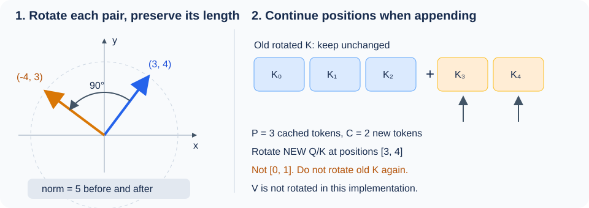

S1 与 S2 的区别可以写成三行：

```text
S1：x = token_embedding + learned_position_embedding → Q/K/V → 注意力
S2：x = token_embedding → Q/K/V → 对 Q/K 做 RoPE → 注意力
                              V 不旋转；不再增加绝对位置表
```

换掉位置机制会改变模型函数，不能声称 S1 与 S2 用同一份权重就有相同输出。本章证明的是 **S2 自己的完整前向与缓存前向使用同一个模型、同一组参数时对齐**。

## P12.2 先把一个二维旋转算完

二维向量 `[a,b]` 逆时针旋转角度 φ 后：

```text
a' = a cosφ − b sinφ
b' = a sinφ + b cosφ
```

这里是弧度：π/2 等于 90°。取 `[a,b]=[3,4]`，原长度是 √(3²+4²)=5。

### 表 P12-1：旋转方向变了，长度没有变

| φ | cosφ | sinφ | 旋转结果 | 长度 |
| --- | --- | --- | --- | --- |
| 0 | 1 | 0 | [3,4] | 5 |
| π/2 | 0 | 1 | [-4,3] | 5 |
| π | -1 | 0 | [-3,-4] | 5 |

以第二行为例：第一坐标是 3×0−4×1=−4；第二坐标是 3×1+4×0=3。浮点 cos(π/2) 未必严格等于 0，因此测试使用小容差，不要求每一位相等。

为什么长度不变？把 a'²+b'² 展开，交叉项互相抵消，剩下 `(a²+b²)(cos²φ+sin²φ)=a²+b²`。这不是“训练出来大致如此”，而是旋转公式的性质。源码 `rotation_walkthrough()` 用 float64 生成上表，`test_rotation_matches_independent_float64_matrix_and_preserves_tail` 还用独立的 2×2 矩阵验证实现，防止完整前向与缓存路径一起写错却互相对齐。

## P12.3 为什么位置差会进入注意力分数

把位置 m 的旋转记作 R(mθ)，θ 是这一对坐标每前进一个 token 的转角。RoPE 对 Q、K 分别使用自己的位置：

```text
q_rot = R(mθ) q
k_rot = R(nθ) k
q_rot · k_rot = q · R((n−m)θ) k
```

“两个都转”可改写成“第一个不转，第二个只转相对角度”。这就是点积中的相对位置性质。注意：公式把 q、k 当作固定的内容向量；真实 q、k 由上下文产生，不能据此说整个模型输出只由距离决定。

令 q=[1,2]、k=[3,4]、θ=1，设 Δ=n−m。直接代入会得到：

```text
q · R(Δ)k
= 1×(3cosΔ−4sinΔ) + 2×(3sinΔ+4cosΔ)
= 11cosΔ + 2sinΔ
```

### 表 P12-2：同时平移位置，固定内容的点积不变

| m | n | Δ=n−m | 旋转后点积 |
| --- | --- | --- | --- |
| 0 | 1 | 1 | 7.626267334 |
| 2 | 3 | 1 | 7.626267334 |
| 0 | 2 | 2 | -2.759020348 |

前两行是把两个位置都加 2；最后一行改变了相对距离。表由同一个脚本生成。更大距离下三角函数还会继续摆动，因此**不能从这个表归纳出“距离越大，点积就单调减小”**，更不能把 RoPE 说成一个自动削弱远距离内容的开关。

## P12.4 多维向量：不同坐标对像不同转速的钟

设每个头宽度为 d，实际旋转的前 r 个坐标称为 `rotary_dim`。r 必须为正偶数，且不超过 d。本章默认 r=d；部分旋转时，后面 d−r 个坐标保持原样。

我们使用相邻配对：`(x0,x1)、(x2,x3)、…`。对第 i 对，i 从 0 开始：

```text
θ_i = base^(−2i/r)
φ_i(p) = p × θ_i
```

`base=10000` 是本例的设定，不是所有模型统一的常数。r=8 时有四对，而不是八对。位置 p=10 时：

### 表 P12-3：快钟和慢钟

| i | 坐标对 | θ_i：每 token 转角 | p=10 的角度 | 转一圈所需 token 数 2π/θ_i |
| --- | --- | --- | --- | --- |
| 0 | 0,1 | 1.000000 | 10.000000 | 6.283185 |
| 1 | 2,3 | 0.100000 | 1.000000 | 62.831853 |
| 2 | 4,5 | 0.010000 | 0.100000 | 628.318531 |
| 3 | 6,7 | 0.001000 | 0.010000 | 6283.185307 |

这是 `frequency_walkthrough()` 的输出。高频意味着转得快、波长短；低频意味着转得慢、波长长。不能把“低频坐标编号大”误读成“绝对位置大”。

有些实现将前半和后半坐标配对，而不是相邻配对。只要权重排列和旋转约定配套，二者可以通过相应的维度置换对应；**不能把已有 checkpoint 的权重原样交给另一种配对约定，假装没有改变模型**。本章不用外部 checkpoint。

`apply_rope` 的核心代码与上面的两行算式一一对应：

```python
frequencies = base ** (-torch.arange(0, dim, 2, device=x.device, dtype=work_dtype) / dim)
angles = positions.to(work_dtype)[:, None] * frequencies[None, :]
c, s = angles.cos(), angles.sin()
even = x[..., :dim:2].to(work_dtype)
odd = x[..., 1:dim:2].to(work_dtype)
rotated = torch.stack((even * c - odd * s, even * s + odd * c), dim=-1)
rotated = rotated.flatten(-2).to(x.dtype)
return torch.cat((rotated, x[..., dim:]), dim=-1)
```

第一行生成 r/2 个频率；第二行把 T 个位置与这些频率相乘，得到 `[T,r/2]` 角度表。`stack` 放回两个坐标，`flatten` 恢复最后一维。`x` 可为 `[B,H,T,d]`，角度表会广播到 batch 和头上。完整函数检查维度、偶数、位置长度及设备。

float64 输入用 float64 计算角度；float16/bfloat16 先转 float32 计算旋转再转回，避免直接在低精度里算角度。本实现没有声称任意大位置都足够精确，float32 也有数值范围和分辨率限制。

## P12.5 S2 的张量账本和接口

本章的 `RopeConfig` 前五个字段沿用 S0：词表大小、主干宽度、头数、层数、允许的最大输入长度；新增 `rope_base` 与可选 `rotary_dim`。例如 `RopeConfig(17,16,4,2,64)` 表示 17 个 token、宽度 16、4 个头、2 层、最多 64 个位置。每头宽度 d=4。

| 步骤 | 本例 B=2、T=12 时的形状 | 操作 |
| --- | --- | --- |
| ID | [2,12] | token 查表 |
| x | [2,12,16] | 没有 `pos_emb` 相加 |
| Q、K、V | 各 [2,4,12,4] | 线性投影后分头 |
| 旋转后 Q、K | 各 [2,4,12,4] | 形状不变，V 不变 |
| scores | [2,4,12,12] | QKᵀ / √4，再加因果 mask |
| Attention 输出 | [2,12,16] | 对 V 加权、拼头、输出投影 |
| logits | [2,12,17] | 各 Block 后接归一化和词表分类头 |

`RopeGPT(config).forward(idx, targets=None)` 返回 `(logits,loss)`。传入右移标签时 loss 是所有位置的平均交叉熵；没有标签时 loss 为 None。LayerNorm 和 GELU 没有偷偷替换，KV 头也没有共享。后两章在这份基线上分别做 S3、S4。

完整前向会生成 `positions=0,…,T−1`，分别旋转 Q 与 K；缓存前向则必须沿用已有位置。下一节就是二者最容易分叉的地方。

## P12.6 缓存 offset：旧钥匙不能再转一次

已有 P=3 个 token，新来 C=2 个，位置应该是 **[3,4]**，不是 [0,1]。本例缓存保存**已经旋转的 K**，以及没有旋转的 V：

```python
positions = torch.arange(offset, offset + T, device=idx.device)
q = apply_rope(q, positions, attn.rope_base, attn.rotary_dim)
k = apply_rope(k, positions, attn.rope_base, attn.rotary_dim)
if cache is not None:
    k = torch.cat((cache.layers[i][0], k), dim=2)
    v = torch.cat((cache.layers[i][1], v), dim=2)
```

每层都这样做，不能只修第一层。旧 K 保持原样；对拼接后的所有 K 再整体旋转，会把旧位置转两次。

RoPE 也不能代替因果 mask。P=3、C=2 的 mask 仍是：

| query 位置 | key0 | key1 | key2 | key3 | key4 |
| --- | --- | --- | --- | --- | --- |
| 3 | 看 | 看 | 看 | 看 | 不看 |
| 4 | 看 | 看 | 看 | 看 | 看 |

`key_position <= query_position` 使用真实整数位置。缓存内存仍是 MHA 的 `2×层数×B×H×T×d×每元素字节数`。上节 2 层、B=2、H=4、T=12、d=4、float32 的结果为 **6144 字节**。去掉绝对位置表并不会把历史 K/V 也去掉；这是张量有效载荷，不包含 Python 对象、分配器和注意力中间结果。

本接口只支持无 padding、同长度 batch、固定位置规则、eval 模式。新请求必须传 `cache=None`。缓存与模型绑定，参数更新/替换、dtype 改变、RoPE 配置改变、归一化 epsilon 改变等都会使旧缓存失效；实现检查这些签名并报错。缓存张量必须当作只读对象，不支持通过 `.data` 偷改参数绕过版本计数。

完整前向与分块前向对照了逐 token、[3,4,2,3] 分块、一次完整输入以及 T=1。脚本种子 42、float32 下最大绝对误差实测为 **2.38418579×10⁻⁷**；另有 float64、部分旋转、不同 batch、请求重置、缓存分支与因果性测试。不是拿“生成了相同的字”替代所有 logits 的比较。

## P12.7 外推和插值：可以继续转，但没学过新路程

没有绝对位置查表，并不表示长上下文问题消失了。公式当然能给位置 1000 算 cos/sin；模型是否学会在那个距离检索内容，是另一个问题。新增干扰内容、注意力分布、训练数据和数值精度也都会影响结果。

设训练长度 L=8，希望使用长度 L′=32，扩展倍数 s=L′/L=4：

- **直接外推**：仍用 pθ，不改变转速；测试会出现训练未覆盖的相对距离。
- **位置插值（PI）**：用 `(p/s)θ`，等价于把频率改为 θ/s。这里缩放的是旋转相位，不是删除 token，也不是把注意力矩阵缩成八个位置。

### 表 P12-4：同一个位置，新的转角

| token 位置 p | 外推的 pθ | PI 的 (p/4)θ |
| --- | --- | --- |
| 0 | 0θ | 0θ |
| 7 | 7θ | 1.75θ |
| 8 | 8θ | 2θ |
| 31 | 31θ | 7.75θ |

表由 `interpolation_walkthrough()` 生成。通常以长度比 L′/L 缩放，因此最后的 7.75 不等于训练最后一个整数位置 7；这是长度定义和离散端点的区别，不能声称端点逐一重合。相邻 token 的相位差也从 θ 压缩成 θ/4，可能改变模型对局部距离的分辨。因果 mask 仍比较原始的 token 次序，不随 PI 缩放。

只修改 `max_seq_len`，只是放开本实现的输入检查；只做 PI，也不能自动证明质量改善。需要指定训练方案，并分别测短上下文和目标长上下文。本章不把 PI 数值示范当作已训练的位置扩展模型。

## P12.8 YaRN：按频段调节，还要调注意力分数

[YaRN 原论文 v2，§3.2–3.4](https://arxiv.org/html/2309.00071v2) 的组合不只是“把位置除以 s”。用波长 λ=2π/θ，与原训练长度 L 的比值 r=L/λ，来区分频段：

- 转得快、训练范围内已转过很多圈的频段：保留原频率。
- 转得慢的频段：使用 θ/s 插值。
- 中间频段：通过 ramp 混合 θ/s 和 θ，而非给所有维度同一个缩放。

论文定义的 ramp γ 从 0 过渡到 1，混合式为 `θ′=(1−γ)θ/s+γθ`；因此 γ=0 对应完全插值，γ=1 对应不改频率，方向不要写反。论文 v2 的 §3.2 用 α、β 作为两端阈值：`r<α` 时 γ=0，`r>β` 时 γ=1，中间线性过渡；该节针对 LLaMA 系列给出的经验取值是 **α=1、β=32**。这不是所有模型的默认值，论文明确说应按具体情况调节。

另一部分是注意力温度：把 `softmax(QKᵀ/√d)` 改为 `softmax(QKᵀ/(t√d))`。若 Q 和 K 各乘 a=√(1/t)，点积会乘 **a²**，不是 a。论文对 LLaMA 系列给出的经验关系是 `a=1+0.1 ln(s)`，不能当成所有模型通用的常数。这个缩放会改变 Q/K 的长度；P12.2 的“范数不变”只适用于未附加幅度缩放的纯旋转。

频段插值与注意力缩放构成这里介绍的 YaRN 核心。训练和长文本评估仍需另外说明，本章没有做论文规模的微调。不要把本章普通 RoPE 的 CPU 结果标成“YaRN 复现”。

还有一个缓存陷阱：如果生成中动态改变 s，旧 K 所用的角度规则就过期。当前 S2 固定规则并拒绝改配置后复用旧缓存；它不实现 Dynamic YaRN。若要扩展，需要专门设计未旋转 K 的保留/重算等一致性策略，不能只改一个频率变量后继续拼旧 K。

## P12.9 CPU 反例：短距离记住了，长距离未必记得住

我们不拿三首诗自然语言输出评判长上下文，而是造一个明确任务：

```text
输入：[BOS=9, 答案a, 随机干扰token…, QUERY=8]
目标：在最后 QUERY 位置预测 a，a 只可能是 0、1、2、3
```

比如 `[9,2,7,0,6,1,3,8]` 的正确答案是 2。干扰 token 来自 0–7，可能包含其他候选答案，不能只找序列里唯一出现的某个符号。BOS 和 QUERY 帮助定义任务，没有泄露“最后一格应该猜什么”。

完整模型接口仍可做语言模型训练，但**这个实验只对 QUERY 位置的十分类 logits 算一次交叉熵**，不是全序列 next-token loss，不报告语言模型困惑度。只在四种合法答案里均匀猜，准确率基线是 25%；如果在十个输出 ID 中均匀乱猜，则是 10%。训练让模型学会使用合法答案，不应混淆这两条基线。

实验协议写死在 `length_experiment()`，便于复现和审计：

- CPU、float32、单线程；验证环境 PyTorch 2.14.1+cpu，依赖见仓库 requirements。
- 两层模型，d_model=32，H=4，词表大小 10；普通 RoPE、全头旋转、base=10000。
- 从一开始允许 `max_seq_len=64`，**实际训练样本始终只有 8 个位置**。
- AdamW，学习率 0.003，weight_decay=0；batch=32，更新 400 次，共 12800 个训练样本。
- 独立生成的测试流从未交给优化器；每个长度 512 个样本，标签仍是相同的 0–3，没有“长序列突然出现训练没见过的目标字”这一混淆。
- 完整报告种子 2025、2026、2027，不只挑一个最差的长长度；小型合成数据仍可能重复，独立抽样不等于自然文本去重测试。

### 表 P12-5：每个种子的完整准确率

| 种子 | T=8 | T=16 | T=32 | T=64 |
| --- | --- | --- | --- | --- |
| 2025 | 512/512=100% | 351/512=68.55% | 247/512=48.24% | 390/512=76.17% |
| 2026 | 512/512=100% | 226/512=44.14% | 170/512=33.20% | 364/512=71.09% |
| 2027 | 512/512=100% | 252/512=49.22% | 170/512=33.20% | 203/512=39.65% |

### 表 P12-6：种子 2026 的 QUERY 损失账本

| T | 样本数 | 交叉熵总和（保留 3 位小数） | 每样本平均交叉熵（本次运行） |
| --- | --- | --- | --- |
| 8 | 512 | 0.535 | 0.001046 |
| 16 | 512 | 1698.983 | 3.318326 |
| 32 | 512 | 2015.841 | 3.937189 |
| 64 | 512 | 594.219 | 1.160583 |

该种子第一训练 batch 的 CE 为 2.338030，最后一个为 0.001039。训练日志是训练 batch，表格是独立测试样本，不能混写成同一组指标。CE 按自然对数计算。总和列保留三位小数；均值列和上面的训练 CE 保留本次本地运行打印的六位小数。均值由未舍入总和除以样本数得到，不应拿表中已舍入的总和再计算并要求末位一致。不同 CPU 或数值库可能有末位浮点差异，六位打印值不是跨机器逐位一致的承诺。

**结论只到这里：这个设置在训练长度内成功，但直接外推后不能保持准确率。** 不是证明 RoPE 在所有长任务上都失败，也不是证明 YaRN 一定解决这个任务。增长长度同时增加检索距离和干扰 token 数，本实验没有隔离二者；也没有与其他位置方法做等预算对照，所以不能把全部损失归因于某一个频率。

尤其注意 T=64 常比 T=32 好。我们如实保留这个非单调现象，不把表改写成“长度越长越差”的漂亮故事。周期相位可能参与这种变化，但仅凭这张表不能确定原因；不同种子的变化也不小。算法能继续计算，是能力测试的起点，不是终点。

## P12.10 怎么运行，以及哪些检查比一句生成结果更可靠

在仓库根目录、已经安装 `requirements.txt` 的 Python 环境中运行：

```bash
OMP_NUM_THREADS=1 python code/13_rope.py
OMP_NUM_THREADS=1 python code/13_rope.py --skip-training
OMP_NUM_THREADS=1 python code/13_rope.py --seeds 2026
OMP_NUM_THREADS=1 python -m unittest discover -s tests -p 'test_rope.py' -v
```

第一条打印所有算术表、缓存差值和三个种子的训练/测试结果；第二条跳过训练；第三条只复现指定种子。没有权重下载，不需要 GPU。缺少 PyTorch 时 CLI 给出安装提示；测试沿用仓库的稳定 2.14.x 版本闸门，**被跳过不算通过**。不同硬件/数值库末位可能有差异，测试对记录值使用明确的 CPU 容差。

`tests/test_rope.py` 不只检查形状。它核对旋转范数、独立矩阵参考、相对位置恒等式、未旋转尾部、梯度有限性、float64 精度、缓存位置/因果 mask/内存/重置，以及训练反例的可复现指标。负例还故意重置新块 offset、取消旋转、把旧 K 转第二次，确认会被 logits 比较识别出来。规范正确性与模型质量是两套检查，两套都不能省。

## P12.11 自测与参考答案

先遮住答案，试着独立解释：

1. `[3,4]` 逆时针转 90° 后是什么？模长是多少？
2. q=[1,2]、k=[3,4]、θ=1，位置从 (0,1) 改为 (2,3)，点积会改变吗？为什么不能由此断言整个模型平移不变？
3. d=8、rotary_dim=6 时有几对旋转坐标？哪两个坐标原样保留？
4. 缓存已有 7 个 token，本次新增 3 个，RoPE 位置应是什么？旧 K 要不要重新旋转？
5. L=8 扩到 L′=32，用 PI 时位置 31 的相位是什么？一共有多少 token？
6. YaRN 若让 Q、K 都乘 a，注意力点积乘多少？纯旋转的范数测试还能原样用吗？
7. 本实验 T=64 比 T=32 好，是否推翻“只放宽长度检查不保证质量”？
8. 对 2 层、B=2、H=4、T=12、d=4 的 float32 模型，实际 K/V 有效载荷多少字节？

参考答案：

1. `[-4,3]`，模长仍为 5，见 `rotation_walkthrough()`。
2. 不变，都是 7.626267334，因为相对位置差仍是 1。结论固定了 q、k；上下文、边界和模型其他计算也可能变化。
3. 三对，即 (0,1)、(2,3)、(4,5)；坐标 6、7 不动。频率公式的分母使用旋转宽度 6。
4. `[7,8,9]`。旧 K 已经旋转，不再旋转；新 query 7 也不能偷看 key8/9。
5. `7.75θ`，仍有 32 个 token；最后 query 的原始位置仍是 31，不是“第 7 个 token”。
6. 乘 a²。附加幅度缩放后不再保持原范数，不能套用普通 RoPE 的单位旋转断言。
7. 不推翻。测试长度外仍低于 T=8 的准确率，而失败幅度不必随长度单调增长；我们没有证明某种普遍规律。
8. `2×2×2×4×12×4×4=6144` 字节。RoPE 不减少 KV 数量，也不等于没有缓存成本。

## P12.12 来源与下一步

来源核验日期：2026-10-19。

- [RoFormer / RoPE 论文，arXiv:2104.09864](https://arxiv.org/abs/2104.09864)：Q/K 旋转与相对位置点积的原始来源；本章二维数值是独立手算与脚本生成。
- [YaRN 论文 v2，arXiv:2309.00071v2](https://arxiv.org/html/2309.00071v2)：这里固定版本解释 PI、分频段插值、注意力温度和动态缩放缓存问题，不将论文的模型规模与训练成绩当成本仓库复现。
- 所有 CPU 实验数字来自本仓库 `code/13_rope.py` 的上述明确配置；没有把论文指标移植成自己的结果。

S2 已把“位置在哪里进入模型”和“缓存该保存什么”说明白。接下来 P13 一次只换一个部件，理解 RMSNorm 与 SwiGLU；P14 再处理共享 KV 头与压缩，而不是把 RoPE、GQA 和 MLA 都叫作“节省缓存的同一种技巧”。

## P12.13 延伸：有些层干脆不转——NoPE {#p12.13-nope}

RoPE 不是每一层都必须用。NoPE 指这一层的 Q、K 不加任何显式位置编码。因果 mask 仍在，所以模型仍能间接感知顺序。两个公开案例，做法不同。

**Muse Spark Open（S33）。** HF 配置有 `layer_rope_theta` 字段，逐层给 RoPE 底数。值为 0 就关闭这一层的旋转，即 NoPE。默认情况下，从最后一层往前数，每第 4 层是 NoPE，其余层用全局底数。

**Kimi K3（S29 §2.1.2）。** 全部 MLA 层都用 NoPE。位置与远近信息交给 KDA 层的逐通道衰减（见 [P16.14](#p16.14-production-hybrid)）。报告给出的理由是：扩展上下文时，不必重调 RoPE 底数，也不必用 P12.8 的 YaRN。

这和 P12.7 的问题对上了。RoPE 外推难，是因为没见过的转角。NoPE 层没有转角可外推。但这不等于它自动读懂长文本。两份资料都没有给出单独去掉 NoPE 的消融，本书也没有做这个实验。


---

# 现代 Block（P13）：RMSNorm 与 SwiGLU {#p13-modern-block}

[P12 的 S2](#p12-rope) 已经把位置处理换成 RoPE，但 Block 内部仍然是 LayerNorm 和 GELU FFN。本章得到 S3：**保留残差路线、因果注意力和 RoPE，只研究归一化与 FFN**。不同时加入 GQA，不借“现代”二字暗示每种设置都更好。

配套 [code/14_modern_block.py](../code/14_modern_block.py) 在 S2 类上做替换，不复制另一套注意力代码。你会先算两行小向量，再检查真实参数量，最后做两个分开的消融实验。初次接触这些名词时，请先回顾 P07 的 Pre-LN 和逐位置 FFN，以及 P09 的前向、反向和 optimizer。

## P13.1 先认出没有变的骨架

一个 Block 仍然做两次“先归一化、再计算、加回主干”：

$$u=x+\operatorname{Attention}(\operatorname{Norm}_1(x))$$
$$y=u+\operatorname{FFN}(\operatorname{Norm}_2(u))$$

Norm 和 FFN 都分别作用于每个 token 的最后一维。它们本身不把不同位置混起来；跨位置读信息的是 Attention。输入和输出都是 `[B,T,D]`，所以残差相加仍然合法。这里 B 是 batch，T 是序列长度，D 是主干宽度。

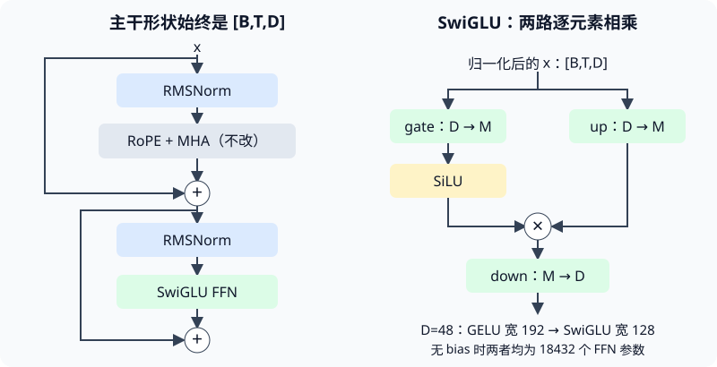

图中“×”是逐坐标相乘，不是矩阵乘法。FFN 内部临时变宽，输出投影再回到 D；它没有偷偷改变下一个 Block 的输入宽度。模型最后的 `ln_f` 也要跟随归一化选择，不能只改每个 Block 的两处 Norm，漏掉输出头之前的一处。

## P13.2 LayerNorm 与 RMSNorm 究竟除以什么

先取某个 token 的向量 $x=[x_1,\ldots,x_D]$。为看清区别，暂时令可学习缩放 $\gamma$ 全为 1，偏移 $\beta$ 全为 0。

LayerNorm 先减均值，再除以标准差：

$$\mu=\frac{1}{D}\sum_i x_i,\qquad v=\frac{1}{D}\sum_i(x_i-\mu)^2$$
$$\operatorname{LN}(x)_i=\frac{x_i-\mu}{\sqrt{v+\epsilon}}\gamma_i+\beta_i$$

这里方差除以 D，不是统计学无偏估计的 D−1。PyTorch LayerNorm 对应 `correction=0`。它在训练和推理时都使用当前输入的统计量，没有 BatchNorm 那种运行均值表。[来源 3]

RMS 是 root mean square，中文是“均方根”：先平方、求平均，再开平方。RMSNorm **不减均值**：

$$r^2=\frac{1}{D}\sum_i x_i^2,\qquad
\operatorname{RMSNorm}(x)_i=\frac{x_i}{\sqrt{r^2+\epsilon}}\gamma_i$$

本章实现只有 D 个可学习的 $\gamma$，没有 $\beta$。它把向量的整体尺度调到较稳定的范围，却不强制把中心搬到 0。RMSNorm 原论文研究的正是省去重新居中后的归一化方式；论文中的实验结果不能直接成为我们这份 CPU 实现的速度保证。[来源 1]

一个很有用的恒等式是 $r^2=v+\mu^2$。例如 `[1,3]` 的均值是 2，方差是 1，均方是 5，因此 $5=1+2^2$。RMSNorm 不是“LN 换个名字”：只要均值不是 0，两个分母一般不同，LN 的分子也还减了均值。

### 表 P13-1：两行向量，逐项手算

为了使分母容易核对，这张教学表故意用 **ε=0.5**，不是模型训练默认的 `1e-5`。每一行独立归一化，γ=1，β=0。

| 输入 x | 均值 μ | 方差 v | 均方 r² | LN 分母 | RMS 分母 | LN 输出 | RMSNorm 输出 |
| --- | --- | --- | --- | --- | --- | --- | --- |
| [1,3] | 2 | 1 | 5 | √1.5 | √5.5 | [-0.816497,0.816497] | [0.426401,1.279204] |
| [3,5] | 4 | 1 | 17 | √1.5 | √17.5 | [-0.816497,0.816497] | [0.717137,1.195229] |

第二行等于第一行的每个坐标都加 2。LN 把这次整体平移消掉，RMSNorm 则保留差异。以第一行 RMS 输出为例，`1/√5.5≈0.426401`，`3/√5.5≈1.279204`，输出的均值明显不是 0。

如果学到 γ=[2,0.5]，还要把两个输出坐标分别乘 2 和 0.5；γ 不是整条向量共用一个数。LN 在 γ 不同或 β 非零时，其最终输出也不必保持均值 0，不能把“标准化后的中间量”与“可学习仿射变换后的输出”混为一谈。

`norm_walkthrough()` 产生表中的原始张量；测试独立使用两种平方根公式核对，不是拿同一个实现与自己比较。

## P13.3 ε 是数值约定，不是可省略的装饰

若 x 全为 0，直接除以 RMS 会出现 0/0。加上正数 ε 后，分母至少是 √ε，输出仍为 0，反向也可保持有限。但 ε 很小时，零点附近导数可能很大；“有限”不等于“绝不会梯度爆炸”。

位置也很重要：

$$\sqrt{\operatorname{mean}(x^2)+\epsilon}\ \ne\ \sqrt{\operatorname{mean}(x^2)}+\epsilon$$

右边不是本章实现。表 P13-1 的较大 ε 能让这类错误很容易暴露，生产配置的小 ε 反而可能让粗糙测试漏掉它。`norm_eps` 必须是有限正数；0、负数、NaN、无穷和布尔值都被拒绝。

再看“缩放不变”这句话：当忽略 ε 且乘数 a>0 时，RMS(ax)=a·RMS(x)，因此归一化可抵消这种正的整体缩放。保留 ε 后只能在 ε 相对均方很小时近似成立；a<0 还会反转符号。不要把论文里的理想化推导写成任意输入、任意精度下的逐位相等保证。

### 低精度为什么先升到 float32

float16 能表示 40000 左右的数，但它的平方已经远超 float16 范围。错误地先在 float16 中平方，之后再转换 float32，已经救不回无穷了。源码先转换，再做平方、均值和倒平方根：

```python
work = x.float() if x.dtype in (torch.float16, torch.bfloat16) else x
inv_rms = torch.rsqrt(work.square().mean(dim=-1, keepdim=True) + self.eps)
return (work * inv_rms * self.weight.to(work.dtype)).to(x.dtype)
```

这是源码原句。float32 输入保持 float32；float64 输入保留 float64，而不是为了“统一精度”反而降成 float32。最后返回输入 dtype，方便后续残差计算。γ 的转换仍在自动求导图里，并没有切断梯度。

我们的 `eps=1e-5` 是明确写入实验的选择，不依赖库的默认值。PyTorch 2.14 的 RMSNorm 在 `eps=None` 时按计算类型选择机器 epsilon；比较第三方实现时，应把 ε、统计计算 dtype 和最终输出 dtype 一并核对。[来源 4] 此实现没有宣称能处理任意大的 float32 数，也没有替你实现 AMP 或 fused kernel。半精度测试只验证这个局部数值策略，整模型消融仍在 CPU float32 下运行。

## P13.4 从 GELU FFN 到“内容乘以门”

旧 FFN 是两次线性投影，中间加 GELU：先 D→H，再 H→D。默认 H=4D。它在同一个 token 的特征间重组信息，不是沿时间轴做卷积。

SwiGLU 在同一个输入上走两条 D→M 支路。一条产生内容 `up(x)`，另一条经过 SiLU 后调节内容 `gate(x)`，最后通过 `down` 回到 D：

$$g=xW_g,\quad u=xW_u,\quad z=\operatorname{SiLU}(g)\odot u,\quad y=zW_d$$
$$\operatorname{SiLU}(t)=t\sigma(t)=\frac{t}{1+e^{-t}}$$

这里公式采用行向量右乘矩阵的记法，PyTorch `nn.Linear` 则储存转置方向的权重。`gate.weight` 与 `up.weight` 的形状是 `[M,D]`，`down.weight` 是 `[D,M]`。源码只有一行核心计算：

```python
return self.down(F.silu(self.gate(x)) * self.up(x))
```

SiLU 是 Swish 在参数 β=1 时的形式。GLU 变体论文将这类两路相乘的结构用于 Transformer FFN；SwiGLU 对门支路使用 Swish，而不是把 FFN 中的 GELU 单独换成 SiLU 就结束。[来源 2、5]

把 gate 类比成音量旋钮有助于记忆，但类比不能过头：**SiLU 的输出不是概率，不限于 [0,1]，可以为负，也可以大于 1**。SwiGLU 没有在若干专家中做 top-k 选择，也不是后续 MoE 的路由器。两条支路都计算，每个中间坐标都相乘。

### 表 P13-2：真正走完两路投影

令输入 x=[1,2]，选以下 PyTorch 权重，没有 bias，down 是单位矩阵：

```text
gate.weight = [[1,-1], [0,1]]
up.weight   = [[1, 1], [2,1]]
down.weight = [[1, 0], [0,1]]
```

于是 gate 的第一坐标是 1×1+2×(−1)=−1，第二坐标是 1×0+2×1=2；up 的两坐标分别是 3 和 4。

| 中间坐标 | gate 投影 g | sigmoid(g) | SiLU(g)=g×sigmoid(g) | up 内容 u | 相乘结果 z |
| --- | --- | --- | --- | --- | --- |
| 0 | -1 | 0.268941 | -0.268941 | 3 | -0.806824 |
| 1 | 2 | 0.880797 | 1.761594 | 4 | 7.046377 |

down 是单位矩阵，所以输出恰好是 `[-0.806824,7.046377]`。如果误用 sigmoid 而不是 SiLU，第一项会变成正数；如果误把两路相加，也不会得到表中的结果。`gate_walkthrough()` 打印每一层，测试把最终结果独立写成 `-3/(1+e)` 和 `8/(1+exp(-2))` 核对。

## P13.5 为什么不能把两种 FFN 都设置为 4D 宽

先全部关闭 bias，GELU FFN 有两个矩阵，参数数是：

$$N_{\text{GELU}}=D H+H D=2DH$$

SwiGLU 有三个矩阵，参数数是：

$$N_{\text{SwiGLU}}=D M+D M+M D=3DM$$

如果 H=M=4D，后者的矩阵参数多 50%。然后拿训练 loss 比较并宣布“门控优于 GELU”，就把增加参数的影响混进来了。令两者相等，可得 M=2H/3；当 H=4D 时，M≈8D/3。这种收窄门控 FFN 的比较思路也出现在 GLU 变体论文中。[来源 2]

### 表 P13-3：D=48 的每层 FFN 账本

| FFN | 中间宽度 | 矩阵参数计算 | 无 bias 参数 |
| --- | --- | --- | --- |
| GELU 基线 | H=192 | 2×48×192 | 18432 |
| SwiGLU，错误地保持同宽 | M=192 | 3×48×192 | 27648 |
| SwiGLU，匹配预算 | M=128 | 3×48×128 | 18432 |

这里第二行不是“非法模型”，而是不适合用来隔离门控结构效果的同预算对照。M 不一定能整除，硬件对齐也可能要求它是某个数的倍数。`matched_swiglu_width` 选最接近参数预算的合法正整数宽度，平局选较小值；如设置 `multiple_of`，要重新报告真实误差。

有 bias 时也别忘了数：GELU 多 H+D，SwiGLU 多 2M+D。上述宽度对应 18672 与 18736，不再严格相等，相差 64。源码的计数函数包含这两种情况，测试再用真实 `numel()` 交叉检查。参数数相同也不等于峰值激活内存、执行时间或训练质量相同：门控要保留额外支路中间量，kernel 和硬件的实现也不同。

## P13.6 S2 不被悄悄改写，S3 有明确配置

`ModernConfig` 扩展 S2 的 `RopeConfig`；词表、主干宽度、头数、层数、容量、RoPE base 和 rotary_dim 都继承。新增的开关是归一化类型、FFN 类型、ε、内部宽度与 bias 策略。

| 项目 | 原始 S2 | S3 默认 |
| --- | --- | --- |
| 注意力与位置 | MHA + RoPE | 完全保留 |
| Norm | LayerNorm，γ 与 β | RMSNorm，只有 γ |
| FFN | GELU，H=4D，有 bias | SwiGLU，预算匹配 M，无 bias |
| 残差顺序 | Pre-Norm | 完全保留 |
| cache 路径 | S2 的 cached_forward | 调用同一函数 |

同时改变 Norm、FFN 和 bias 才得到这份默认 S3，所以 **“默认 S2 对默认 S3”不能称为单变量消融**。默认 S3 也不是把一个已训练 S2 checkpoint 无损升级后的模型；结构不同的参数需要合适训练。

为守住旧行为，测试还构建一个兼容设置：`norm_kind='layernorm'`、`ffn_kind='gelu'`、`norm_bias=True`、`ffn_bias=True`、ε=1e-5、H=4D。它在相同 seed 下与 S2 的每个 state tensor、每个输出 logit 精确相同。S2 自己的默认配置和代码没有因本章而变成 RMSNorm。

## P13.7 单变量消融，先控制什么再比较什么

先建立一个**公开说明的无 bias 对照 A**：LayerNorm 保留 γ，去掉 β；FFN 的两个线性层也去掉 bias。这是实验准备，不是归一化或门控胜出的证据。随后只比较相邻两行：

| 实验 | Norm | FFN | FFN 宽度 | 相对上一行的研究变量 |
| --- | --- | --- | --- | --- |
| A | LayerNorm，无 β | GELU，无 bias | 192 | 无 bias 控制组 |
| B | RMSNorm | GELU，无 bias | 192 | 归一化方式 |
| C | RMSNorm | SwiGLU，无 bias | 128 | 同预算 FFN 结构 |

A→B 的 ε、γ、FFN、注意力等都固定，比较的是居中与均方归一化机制。B→C 固定所有非 FFN 部件；FFN 结构与它所需的预算匹配宽度一起作为处理项。**这不是“只改一个激活函数”**，不能把结论归因于 SiLU 单独的效果。

`make_ablation_models()` 除了设置同一 seed，还真的调用 `copy_unchanged`：A→B 复制所有非 Norm state tensor，并复制对应 γ；B→C 复制全部非 FFN state tensor。它检查 key、shape 和数值一致，不通过参数共享来冒充复制。因此训练 A 不会顺便更新 B。新 FFN 形状不同，不能要求它与旧 FFN 逐项同值；用相同初始化规则与 seed 生成，并明确它是被研究的组件。

仅写两次 `manual_seed(42)` 不够：如果第一个模型多初始化一层，第二个模型后续参数的随机数消耗顺序就可能不同。**复制并检查不变部分**才是这里可执行的控制条件。

### 整模型账本：为什么三行都是 61008

设置 V=57、D=48、L=2、H=4，embedding 与输出 head 不共享权重。每个 Block 两个 Norm，加最后一个 Norm，共 5 个。

| 部分 | 参数计算 | 参数数 |
| --- | --- | --- |
| token embedding + 输出 head | 2×57×48 | 5472 |
| 两层 MHA 投影 | 2×4×48² | 18432 |
| 两层 FFN，按表匹配 | 2×18432 | 36864 |
| 5 个仅有 γ 的 Norm | 5×48 | 240 |
| 合计 | 5472+18432+36864+240 | 61008 |

原 S2 默认是 61728 个参数。对照 A 去掉两层 FFN 的 2×(192+48)=480 个 bias，再去掉 Norm 的 5×48=240 个 β，合计少 720，得到 61008。RoPE 没有可学习位置表，不能把 S0 的那张位置表又算进来。

## P13.8 实际跑一次，但不要把 smoke 当榜单

在仓库根目录安装固定依赖后执行：

```bash
python -m pip install -r requirements.txt
OMP_NUM_THREADS=1 python code/14_modern_block.py
OMP_NUM_THREADS=1 python -m unittest discover -s tests -p 'test_modern_block.py' -v
```

没有 PyTorch 时，CLI 会简短提示安装方式并以退出码 2 结束。张量测试使用仓库共享的稳定版 torch 2.14.x 检查；未安装或版本不匹配会明确 skip，**skip 不是通过**。不需要下载模型或数据。

固定实验条件：CPU、PyTorch 2.14.1+cpu、float32、单线程、seed=42，B=2、T=12、8 次更新。数据用单独的 generator，seed=43，先生成长度 T+1 的 ID，再取相邻输入/目标。三行模型使用同一份 batch、同一输入顺序和步数，每次都创建全新的 AdamW，lr=0.001、betas=(0.9,0.999)、eps=1e-8、weight_decay=0，无 dropout。

### 表 P13-4：这一次实跑的训练闭环结果

| 配置 | 每层 FFN 参数 | 整模型参数 | 更新前 loss | 8 次更新后 loss | 所有参数梯度有限 |
| --- | --- | --- | --- | --- | --- |
| A：LN + GELU | 18432 | 61008 | 4.429393 | 2.889954 | True |
| B：RMSNorm + GELU | 18432 | 61008 | 4.441514 | 2.896931 | True |
| C：RMSNorm + SwiGLU | 18432 | 61008 | 4.403015 | 3.212187 | True |

这几行表明：配置有实数结果、梯度能传到全部参数、优化器确实更新、参数预算确实匹配。它们**不能证明任何一种结构在语言任务上更优**。这里只有一个 seed、一份反复训练的合成 batch，没有验证集、自然语言语料或质量指标；C 的训练 loss 更高也不证明 SwiGLU 一般更差。本章不计时，因此也不从这些结果推断速度。

若真要研究质量，应沿用 P09 的训练/验证分离，固定数据与 token 预算，在多个 seed 下记录验证 loss 的分布，并把超参数搜索预算也控制住。不要把这里的八步示例包装成复现原论文实验。

## P13.9 换了组件，旧的 cache 正确性仍要重测

归一化和 FFN 只处理当前 token，不改变 P11 的因果缓存理由。但每层缓存的 K/V 已经受到之前层的 Norm 与 FFN 影响。若完整前向使用 RMSNorm，而缓存路径偷偷硬编码了 LayerNorm，两条路径会计算不同的模型。

S3 直接复用 S2 的 `cached_forward`。这个函数访问当前 Block 的 `ln1`、`ln2` 和 `mlp`，因此自然调用被替换后的模块；没有另写一份旧 FFN 藏在 decode 分支里。测试把同一串 token 分成 `[12]`、12 次单 token、`[3,5,4]` 和 `[11,1]`，拼接每块 logits，与同权重的完整前向逐项比较。B>1、float32 和 float64 都覆盖。

在表 P13-4 更新后的模型上，用长度 5 的块重放同一输入，本机实测三行 float32 最大 logit 误差均小于 1e-6；末位可随硬件与算子实现变化，不作逐位快照。测试容差为 atol=3e-6、rtol=1e-5。缓存等价比较的是**同一个模型的两种计算路线**，不是要求 A、B、C 三个不同模型的输出彼此相等。

缓存仍然是每请求私有、eval-only，不接受权重更新后的旧 cache。配置、Norm 的 ε 或 GELU 近似模式变化也需要重置。手工改 Tensor 的 `.data` 会绕过版本追踪，仍不在支持范围；不要把这个教学缓存当成可以任意热替换参数的服务系统。

## P13.10 让测试真的能抓错

正常通过只能说明当前样例没发现问题。这里还在内存里编译几个错误版本，确认独立参考测试会失败；生产源码不会被改动。

| 故意制造的错误 | 会被什么抓住 |
| --- | --- |
| RMS 分母误用居中后的方差 | 非零均值输入和独立均方参考 |
| ε 加在平方根外 | ε=0.5 的精确手算表 |
| SwiGLU 使用 sigmoid 而不是 SiLU | gate=-1、2 的符号与幅值 |
| 门与内容相加而非相乘 | 两路投影的最终输出参考 |
| 漏换最后的 ln_f，或忽略配置中的 ε | 三种配置下逐个检查 ln1/ln2/ln_f 的类型与 ε=1e-6 |
| 消融学习率由 0.001 改成 0.002 | 表 P13-4 的八步 loss 快照，绝对容差 2e-5 |
| 预算宽度平局时误选较大值 | D=2、H=4、有 bias 的等距例子及独立穷举参考 |

FFN 中间宽度，以及表 P13-4 的每层 FFN 参数和整模型参数，也由实际运行结果核对。γ 初值全为 1 时，省略对应复制可能不改变结果，不能把这种等价变异声称为已发现错误；另用非全 1 的 γ 验证复制助手的值与非共享存储约定。

还有 double 精度自动微分数值检查、全零与半精度大输入的有限反向、真实参数计数、显式复制后的数值一致性、S2 兼容模式及缓存对齐。测试一旦失败，应先定位公式、dtype、配置或共享状态，而不是扩大容差直到它变绿。

## P13.11 自测与参考答案

1. `[1,3]` 整体加 2 后，为什么 LN 表中不变，而 RMSNorm 变了？
2. 为什么“先 float16 平方，再转 float32”还会出错？
3. SwiGLU 的门输出为 1.76 是否违反概率范围？
4. D=48，GELU 的 H=192。无 bias 的 SwiGLU 应取多宽才能匹配矩阵参数？
5. 同一个 seed 是否足以证明消融只有一个变量变化？
6. 为什么表 P13-4 不能用来排“哪种 Block 最好”？
7. A→B 为什么把 LayerNorm 的 β 也关闭？
8. 改完 Norm 后只看生成出的一个 token 一样，能证明缓存等价吗？

参考答案：

1. LN 在两个输入上都减去各自均值，得到同样的 `[-1,1]`；RMSNorm 不居中，均方从 5 变 17，分子也改变。
2. 溢出在平方那一步已经发生，随后升精度只能保留无穷；必须先转换再平方。
3. 不违反。SiLU 门不是概率，可以大于 1、为负；sigmoid 本身才在 0 与 1 之间。
4. M=128，因为 2×48×192=3×48×128=18432。开启 bias 后要把 bias 额外计算，不能直接声称总参数严格相等。
5. 不够。初始化时随机数消耗顺序可能变化，必须复制并验证不变部分，同时控制数据、优化器、步数和其他设置。
6. 单 seed、重复 batch、无验证集，只能演示训练与数值闭环；没有足够证据做泛化质量或速度结论。
7. 避免把“多一组可训练偏移参数”也夹在归一化机制对比里。关闭 bias 是对照准备，不宣称它单独带来收益。
8. 不能。argmax 相同可掩盖很大的 logit 差异，应比较每个位置、每个词表项，并覆盖分块与参数变更边界。

## P13.12 本章带走什么

RMSNorm 的关键是**均方缩放，不居中**；SwiGLU 的关键是**两路投影，其中一路过 SiLU，再逐元素相乘**。数值稳定需要明确 ε 和计算精度；公平比较需要明确参数、bias、数据、初始化和优化器，不是换掉两个类名就算完成。

下一单元 [P14](#p14-grouped-kv) 保持 S3 的 Norm 与 FFN，再改变 KV 头的共享方式。这样每次升级都有明确的变化范围，不让“现代大模型积木”变成无法追踪的名词堆叠。

## P13.13 延伸：SiTU-GLU，给两个因子都装上软上限 {#p13.13-situ-glu}

先看动机。P13.4 的 SwiGLU 是 `Swish(W_g x) ⊙ W_u x`。两个因子都没有上界。两个大坐标碰在一起，乘积就是一个离群值，低精度下可能溢出。原始 GLU 的 sigmoid 门有界，但丢掉了 Swish 在正半轴近似线性的形状。

Kimi K3 报告（S29 §2.3.2，Eq.12）用软上限 `softcap(x, β) = β tanh(x/β)` 同时限制两个因子：

`SiTU-GLU(x) = [β₁ tanh(W_g x / β₁) ⊙ Sigmoid(W_g x)] ⊙ [β₂ tanh(W_u x / β₂)]`。

K3 取 `β₁ = 4`、`β₂ = 25`。所以 `|f| ≤ β₁β₂ = 100`。tanh 在原点附近近似线性，所以小输入时它和 SwiGLU 几乎一样。S29 的 Table 1 显示，K2 用 SwiGLU，K3 换成 SiTU-GLU。

[`../code/14b_attnres_situ.py`](../code/14b_attnres_situ.py) 的标量对照（g = u = x）：

| x | SwiGLU | SiTU-GLU |
|---|---|---|
| 0.1 | 0.0052 | 0.0052 |
| 1 | 0.7311 | 0.7158 |
| 10 | 99.9955 | 37.4846 |
| 100 | 10000.0000 | 99.9329 |

测试在 ±10⁴ 的输入上检查上界 100。它还检查原点附近两者相差小于 10⁻⁴。一个变异去掉 up 分支的上限，输出立刻超过 100。本书没有训练对比，不声称 SiTU-GLU 提高了质量。

## 来源与实现核对

1. [Root Mean Square Layer Normalization，Zhang 与 Sennrich，2019](https://arxiv.org/abs/1910.07467)：RMSNorm 的原始定义与研究；本章手算、dtype 约定和 CPU 测试为独立教学例子。
2. [GLU Variants Improve Transformer，Shazeer，2020](https://arxiv.org/abs/2002.05202)：GLU 变体及匹配预算时缩小中间宽度；本章不复现其 T5 训练结论。
3. [PyTorch 2.14 LayerNorm](https://docs.pytorch.org/docs/2.14/generated/torch.nn.LayerNorm.html)：方差口径、γ/β、ε 和 bias 参数。
4. [PyTorch 2.14 RMSNorm](https://docs.pytorch.org/docs/2.14/generated/torch.nn.RMSNorm.html)：公式与 epsilon 计算类型；本代码始终显式指定 ε。
5. [PyTorch 2.14 SiLU](https://docs.pytorch.org/docs/2.14/generated/torch.nn.SiLU.html)：SiLU 的逐元素定义。

6. [Kimi K3 技术报告，arXiv:2607.24653](https://arxiv.org/abs/2607.24653)（S29）：§2.3.2 Eq.12、β₁=4、β₂=25 与 Table 1 的激活函数一行；核验 2026-10-26。

来源核对日期：2026-10-19。实际实验由固定依赖环境运行；其它设备或库版本的最后几位可能不同，应先核对配置与测试，而不是把表中的舍入值当作所有环境的逐位承诺。


---

# 架构进阶（P14）：MHA、MQA、GQA 与 MLA {#p14-grouped-kv}

上一章把归一化和 FFN 换成现代 Block，但每个 query 头仍有自己的一份 K/V。现在进入 S4：**保留 S3 的 RoPE、RMSNorm、SwiGLU，只把注意力改成可以共享 K/V 的 GQA**。另做一个独立的小矩阵实验，解释 MLA 为什么不是另一种“少几个头”。

配套 [code/15_grouped_kv.py](../code/15_grouped_kv.py)。不下载模型，不跑 GPU，不实现 DeepSeek 生产 kernel；普通 CPU 就能检查形状、缓存字节数和数值关系。

## P14.1 从四个读者、四套索引说起

把 query 头想成四个读者：每个人带着自己的问题，去查历史 token 的索引 K，再按照匹配程度读取内容 V。

- **MHA**：四个读者各有一套 K/V。
- **MQA**：四个读者共用一套 K/V，但仍然各提各的问题。
- **GQA**：分成两组，每组两个读者，共用这一组的 K/V。
- **MLA**：不是简单合并索引套数，而是保存一段较短的内容潜变量，再通过各头不同的映射参与运算；还要保存单独的位置键。

类比到此为止：K/V 和潜变量不是人能直接阅读的摘要，也不是可无损压缩任何资料的 ZIP 文件。它们是模型训练得到的向量。减少表示自由度可能影响质量，必须靠训练和评估判断。

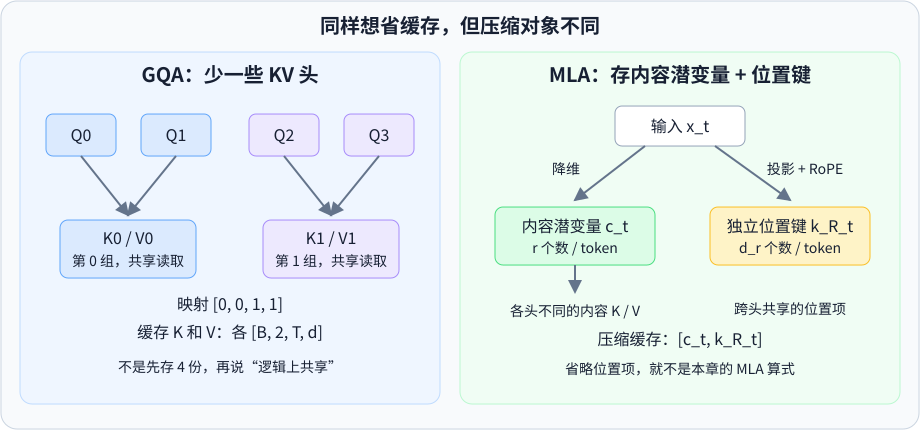

## P14.2 先区分两个头数

继续用 B 表示 batch，T 表示序列长度，D 表示主干宽度。本章新增两个量：

- Hq：query 头数。
- Hkv：key/value 头数。本实现 K 和 V 的头数相同。
- d：每头宽度，本章令 d=D/Hq，Q、K、V 每头宽度相同。

这三个名字的边界可以放进同一张表：

| 名称 | KV 头数 | Hq=4 时的例子 | 每个 KV 头服务多少个 query 头 |
| --- | --- | --- | --- |
| MHA | Hkv=Hq | Hkv=4 | 1 |
| GQA 的中间情况 | 1<Hkv<Hq | Hkv=2 | 2 |
| MQA | Hkv=1 | Hkv=1 | 4 |

从广义参数化看，MHA 和 MQA 是 GQA 的两个边界。实际说“采用 GQA”时，人们常指表格的中间情况。MQA 中的“单”指只有一个 KV 头，**不是整个模型只剩一个注意力头**。

本实现要求 `Hq % Hkv == 0`，使每组大小相同。例如 4 个 query 头分成 3 个等大的组就不合法。这是本教学实现的分组约定，不是说所有想象得到的不等分共享都数学上不可能。

## P14.3 分组映射不能凭感觉写

Hq=4、Hkv=2 时，每组有 g=Hq/Hkv=2 个 query 头。编号从 0 开始：

| query 头 h | 使用的 KV 头 `h // g` |
| --- | --- |
| 0 | 0 |
| 1 | 0 |
| 2 | 1 |
| 3 | 1 |

因此映射是 `[0,0,1,1]`，不是 `[0,1,0,1]`。两种排列都能得到合法张量形状，但对应不同的权重组织方式，不能混用。

不用随机数也能抓住这个错误。设只有一个历史位置，KV 头 0 的 V 是 `[10,11]`，KV 头 1 的 V 是 `[20,21]`。只有一个可见 key 时，Softmax 权重必为 1。四个头的输出就必须依次为：

```text
头 0：[10,11]
头 1：[10,11]
头 2：[20,21]
头 3：[20,21]
```

脚本的 `mapping_walkthrough()` 正是这个算例。测试还写了“每个 batch、每个 query 头、每个位置分别算”的慢参考，不与快速路径共享映射函数。否则两个实现一起写错，full/cache 对齐也可能照样通过。

## P14.4 真正要变小的是投影和缓存

PyTorch 的 `Linear(in_features, out_features)` 把输入最后一维映射到输出最后一维；它保存的 weight 形状是 `[out_features,in_features]`。这一点不要与纸面上右乘矩阵的写法弄反。

```python
D = config.d_model
kv_width = config.num_kv_heads * self.head_dim
self.W_q = nn.Linear(D, D, bias=False)
self.W_k = nn.Linear(D, kv_width, bias=False)
self.W_v = nn.Linear(D, kv_width, bias=False)
self.W_o = nn.Linear(D, D, bias=False)
```

逐行看：

1. Q 仍然输出 Hq×d=D 个数，query 头没有减少。
2. K 和 V 各只输出 Hkv×d 个数，不是先算出全部 MHA 头再丢弃。
3. 每个 query 头依然产生一个 d 维输出，所以拼接后仍是 D 维，W_o 不变。

当已有 P 个缓存位置、本次输入 C 个 token 时：

| 张量 | 形状 | Hq=4、Hkv=2 时的头数 |
| --- | --- | --- |
| 当前 Q | [B,Hq,C,d] | 4 |
| 当前 K、V | 各 [B,Hkv,C,d] | 2 |
| 拼接后的缓存 K、V | 各 [B,Hkv,P+C,d] | 2 |
| 注意力计算临时使用的 K、V | 各 [B,Hq,P+C,d] | 4 |
| scores、weights | 各 [B,Hq,C,P+C] | 4 |
| 拼接后的本块输出 | [B,C,D] | 头轴已拼回 D |

本章为了易读，注意力乘法前临时扩展 K/V：

```python
repeats = Hq // Hkv
keys = k.repeat_interleave(repeats, dim=1)
values = v.repeat_interleave(repeats, dim=1)
scores = q @ keys.transpose(-2, -1) / math.sqrt(d)
```

`repeat_interleave(2, dim=1)` 沿头轴连续重复每个 KV 头，得到刚才的 `[0,0,1,1]`。`repeat(1,2,1,1)` 则会把整组头再排一遍，得到 `[0,1,0,1]`，不是同一映射。

**缓存保存的必须还是原始 k、v，而不是临时的 keys、values。** 本实现确实会为临时重复张量和完整 scores 分配内存，因此“缓存较小”不等于“本代码峰值内存按相同比例缩小”，更不等于“运行一定更快”。优化 kernel 可以避免某些显式复制，但本章没有实现或测速这种 kernel。

## P14.5 S4 怎样接在 S3 后面

`GroupedConfig` 继承上一章的 `ModernConfig`，只新增 `num_kv_heads`。`GroupedGPT` 保留词嵌入、Block 的归一化/FFN、最终归一化和输出层，替换各层 `.attn`。新模型仍返回 `(logits, loss)`，训练代码不需要另造一种损失。

在 Hkv=Hq 的边界，投影形状和算法都退回 MHA。测试把 S3 的同一份 state_dict 装入这个边界模型，逐项检查参数、logits、K/V 完全一致。**不同 Hkv 的随机模型不能用来宣称质量相同；这里证明的是 MHA 边界，以及各模型自身 full/cache 的一致性。**

GQA 的缓存不能直接交给 P12 的 MHA 缓存函数。P12 校验的是 Hq 个 KV 头，S4 必须校验 Hkv。源码专门定义 `GroupedCache` 和自己的 `cached_forward`，保留三个规则：

1. 新 Q/K 的 RoPE 位置是 `P,...,P+C-1`。只旋转新 K；旧缓存里的 K 已经转过，V 不转。
2. 矩形 mask 仍是 `key_position <= query_position`。例如 P=3、C=2 时，两行可见性分别是 `[1,1,1,1,0]`、`[1,1,1,1,1]`。
3. 各层缓存保存 `[B,Hkv,P+C,d]`；前一份缓存不被原地改写，新请求用 `None` 开始。

下面是缓存路径的核心，不是另一份模型：

```python
q, k, v = block.attn.project(block.ln1(x), offset=offset)
if cache is not None:
    k = torch.cat((cache.layers[i][0], k), dim=2)
    v = torch.cat((cache.layers[i][1], v), dim=2)
x = x + block.attn.attend(q, k, v, offset=offset)
x = x + block.mlp(block.ln2(x))
layers.append((k, v))
```

`project` 用两种头数做 reshape；`attend` 才临时扩展 KV；最后一行不保存扩展后的副本。缓存同时记录模型身份和参数/位置设置签名。修改权重、RoPE 设置、归一化 epsilon 或头数后，必须重建缓存。不要通过 `.data` 偷改参数，也不要编辑缓存张量；这样的绕过不在检测保证内。缓存推理要求 eval，不支持 padding、变长 batch 或 autocast；训练走正常 full forward。

## P14.6 先算内存账，再测实际张量

本章 K、V 每头同宽，且不量化。L 层、batch B、长度 T、每个数 s 字节时：

$$
\text{KV 字节数}=2\times L\times B\times T\times H_{kv}\times d\times s
$$

开头的 2 表示 K、V 两份。固定 Hq 和 d，缓存相对 MHA 的比例是 Hkv/Hq，不是其平方。query 不在这个缓存里。

脚本取 D=48、Hq=4、d=12、L=2、B=2、T=12，float32 的 s=4：

| 结构 | Hkv | 两层 W_k/W_v 参数总数 | 实际 KV 缓存字节 | 相对 MHA |
| --- | --- | --- | --- | --- |
| MHA | 4 | 9216 | 18432 | 1 |
| GQA | 2 | 4608 | 9216 | 1/2 |
| MQA | 1 | 2304 | 4608 | 1/4 |

例如中间一行的参数数目是 `2×L×D×Hkv×d=2×2×48×2×12=4608`。它只数 W_k/W_v，不是整模型参数。缓存则是 `2×2×2×12×2×12×4=9216` 字节。两者恰好在这个例子相差 2 倍，没有普遍意义。

源码用 `numel() * element_size()` 实测每层 K/V；测试还检查底层存储大小，避免只在 shape 上做一个漂亮的切片，底下仍占着大张量。统计不包含模型权重、临时注意力矩阵、分配器和 Python 对象开销。float64 改为每数 8 字节，缓存字节数翻倍；这也是测试的一部分。

## P14.7 从头训练，不等于转换旧 checkpoint

有两条不同路线：

- **从头训练 GQA**：直接创建 Hkv 较小的 W_k/W_v，所有参数按新结构学习。本章模型支持正常反向传播；脚本不训练、不报告语言质量。
- **把已训练的 MHA 改成 GQA**：旧 W_k/W_v 的形状不同，需要明确的转换策略，再评估是否保留能力。改一个配置值或用不严格加载跳过权重，不是完成转换。

GQA 原论文的做法是把同组 KV 头的投影取平均作为初始化，再继续预训练（uptraining）；论文中的训练预算和质量结果是其特定实验，不是对任意 checkpoint 的保证。[原论文 v3，§2](https://arxiv.org/html/2305.13245v3#S2)

举一个足够小的权重例子：四个头，每头输出宽度 d=1，输入宽度为 2：

```text
旧 weight 的四行：[0,1]、[2,3]、[4,5]、[6,7]
组 0 平均：([0,1]+[2,3])/2 = [1,2]
组 1 平均：([4,5]+[6,7])/2 = [5,6]
```

`mean_pool_kv_weight()` 实现的就是这一层初始化算术，没有执行继续训练。平均后不能声称输出相同：只有一个可见 token，原来四个头的 V 为 `[1,3,5,7]`，两两平均并共享后输出变成 `[2,2,6,6]`。Softmax 此时全为 1，差异仍然存在。

只有组内原本就满足特定相同权重等条件，或者在 Hkv=Hq 不压缩的边界，才可能保持对应函数。**普通 MHA → GQA 的均值转换不是无损等价变换。**

## P14.8 MLA：共享低维内容，不是共享完整 KV 头

MLA 是 Multi-head Latent Attention，首先由 DeepSeek-V2 提出。其关键设计是：用同一个较短的潜变量共同表示内容 K 和 V，并把 RoPE 位置键单独保存；各头的内容上投影可以不同。本章的权重吸收与解耦位置解释以原始 [DeepSeek-V2 报告 v5，§2.1.2–2.1.3](https://arxiv.org/html/2405.04434v5#S2.SS1.SSS2) 为依据。DeepSeek-V3 延续这一结构，可对照 [V3 报告 v2，§2.1.1](https://arxiv.org/html/2412.19437v2#S2.SS1.SSS1)。

为了与 PyTorch 批量张量的方向一致，下面都用**行向量右乘矩阵**。这与论文常用的列向量写法互为转置，不是换了算法。设单个 token 输入为 x_t，潜变量宽度 r，内容 key 宽度 d_c，value 宽度 d_v：

$$
c_t=x_t W_{down},\qquad k^C_{t,h}=c_t U^K_h,\qquad v_{t,h}=c_t U^V_h
$$

| 对象 | 形状 | 作用 |
| --- | --- | --- |
| x_t | [D] | 本层输入 |
| W_down | [D,r] | 降到潜变量 |
| c_t | [r] | 内容 K/V 共同使用 |
| U^K_h | [r,d_c] | 第 h 头的内容 key 映射 |
| U^V_h | [r,d_v] | 第 h 头的 value 映射 |

GQA 中，同组 query 使用**相同完整 K/V**。这里不同头的 U 可以不同，所以同一个 c_t 可以产生不同头的 K/V；共享的是潜在表示，不是说这些头的 K/V 必须相等。

**教学简化要单独记住**：完整 MLA 还包含 query 的低秩降维/升维分支，用来减少训练激活内存，但不进一步缩小历史 KV 缓存。本实验省略该分支，直接给定两头的内容 query 数值，把其一半作为旋转前的位置 query；也不包含完整输出投影 W_O、量化或并行实现。它验证的是 KV 侧吸收与解耦位置的矩阵关系，不是完整 MLA 模型。[V2 v5，§2.1.2，式 12–13](https://arxiv.org/html/2405.04434v5#S2.SS1.SSS2)

“先降维、再升维”也不是任意矩阵的免费无损压缩。`W_down @ U` 的秩最多是 r。比如目标矩阵 `diag(3,2,1)` 的秩为 3，用秩 2 的 `diag(3,2,0)` 代替，最后一个方向被丢掉，Frobenius 误差为 1。源码会打印这个反例。模型必须在这种表示约束下学习；本章不把已有 MHA 权重直接变成等价 MLA。

## P14.9 为什么能不存展开的内容 K/V

先暂时拿掉位置项。当前 query 的内容部分是 q^C_h，某个历史位置的 key 是 `c_t @ U^K_h`。利用矩阵乘法的结合律：

$$
q^C_h(k^C_{t,h})^\top
= q^C_h(U^K_h)^\top c_t^\top
$$

因此可以先算一个 r 维的新 query：`q_absorbed = q_content @ U_k.T`，再与缓存的 c_t 打分。**这一步只移动括号，没有宣称任意低秩近似不损失信息。**

value 也有类似关系。若注意力权重为 a_t：

$$
\sum_t a_t(c_t U^V_h)=\left(\sum_t a_t c_t\right)U^V_h
$$

先对潜变量加权求和，再做一次上投影即可。每个头的 a_t 仍可不同，因此不会强迫所有头输出相同。

原始论文把这种推理重排描述为：内容 key 的上投影可以吸收到 query 投影，value 的上投影可以吸收到输出投影。这里为了让每一步可见，只演示把 value 上投影移到加权求和之后，不把它继续融合进 W_O。[V2 v5，§2.1.2](https://arxiv.org/html/2405.04434v5#S2.SS1.SSS2)

小矩阵实验分别计算：

1. 先显式展开各头的内容 K/V，再做注意力。
2. 不把展开的内容 K/V 当作缓存，只使用潜变量计算打分和加权结果。

对同一组低秩参数，这两种括号位置的结果应当只差浮点舍入，但两条路径相等仍不足以证明算对：它们可能一起忘记位置项，或一起用了错误的缩放分母。测试因此另写一个不调用演示函数内部步骤的标量循环参考：独立列出输入和权重，用 sin/cos 手算位置 0、1、2 的旋转，拼成 4 维 Q/K，直接点积除以 2，再对可见前缀做 Softmax 和 value 加权。两条实现各自对齐这个参考，并逐项核对旋转后位置键。

本函数为核对而同时保留两条路径的张量，**它本身并不是一段峰值内存优化实现**。

## P14.10 RoPE 位置项为什么单独算

不能把位置从内存账本里删掉。若把每个历史位置的内容 K 全部旋转，不同位置带来不同旋转矩阵；一般不能再把它们吸收成一个与历史位置无关的固定 query 投影。原始论文 §2.1.3 明确指出位置旋转夹在相应投影之间，矩阵通常不可交换，因此破坏这种固定权重吸收；随后引入独立位置 query 和共享位置 key。[V2 v5，§2.1.3](https://arxiv.org/html/2405.04434v5#S2.SS1.SSS3)

本章演示的解耦方案把打分拆成两项：

$$
\text{score}_{h,i,t}
=\frac{q^C_{i,h}(k^C_{t,h})^\top
+q^R_{i,h}(k^R_t)^\top}{\sqrt{d_c+d_r}}
$$

- 内容项：K 从 c_t 得到，不对这一部分施加 RoPE，才能使用上面的矩阵结合律。
- 位置项：单独投影并旋转得到 q^R 和 k^R。这里 k^R_t 跨头共享，但 q^R_{i,h} 可以随头不同。
- 因果 mask：依然只能看 t≤i，压缩不取消因果约束。
- 缩放：本例拼接后的 Q/K 总宽度是 d_c+d_r，所以除以它的平方根，不是潜变量宽度 r 的平方根。

推理要缓存的是 **c_t 加 k^R_t**，不是只缓存 c_t。理想紧凑 payload 为 `L×B×T×(r+d_r)×s`，这里不再另外乘 2，因为一个 c_t 同时服务内容 K 和 V。若采用别的表示、复制方式或量化，还要重算账本。

独立实验固定 H=2、T=3、r=2、d_c=d_v=d_r=2，float64，每数 8 字节：

| 表示 | 每 token 保存的数 | 三个 token 的字节数 |
| --- | --- | --- |
| 展开内容 K/V，仍共享位置键 | H×(d_c+d_v)+d_r=10 | 240 |
| 潜变量 + 位置键 | r+d_r=4 | 96 |
| 只算潜变量，漏掉位置键 | r=2 | 48，但这个账本不完整 |

展开对照已经把位置键跨头共享，没有故意为每个头多复制一份来夸大收益。省下的比例由具体维度决定；**MLA 不保证在所有配置下都比 MQA 更省，也不等于“GQA 再少一个头”**。

官方推理源码的吸收路径同样把内容缓存与位置缓存分开；本章只借此核验设计含义，不复刻其并行、量化或 kernel。[DeepSeek-V3 官方 inference/model.py](https://github.com/deepseek-ai/DeepSeek-V3/blob/main/inference/model.py)

## P14.11 运行、读输出、检查失败

在仓库根目录：

```bash
python -m pip install -r requirements.txt
OMP_NUM_THREADS=1 python code/15_grouped_kv.py
python -m unittest discover -s tests -p test_grouped_kv.py -v
```

本批在 Python 3.12.14、PyTorch 2.14.1+cpu、单 CPU 线程、seed=42 下运行。模型表格使用 float32，独立 MLA 矩阵使用 float64；不训练、不下载权重。关键输出：

```text
Hq=4 Hkv=2 mapping: (0, 0, 1, 1)
one-key head outputs: [[10.0, 11.0], [10.0, 11.0], [20.0, 21.0], [20.0, 21.0]]
Hkv=4: KV parameters=9216, cache=18432 bytes, formula=18432, shape=(2, 4, 12, 12), max_error=3.58e-07
Hkv=2: KV parameters=4608, cache=9216 bytes, formula=9216, shape=(2, 2, 12, 12), max_error=3.58e-07
Hkv=1: KV parameters=2304, cache=4608 bytes, formula=4608, shape=(2, 1, 12, 12), max_error=4.77e-07
mean-pooled example: [[1.0, 2.0], [5.0, 6.0]] (initialization, not equivalence)
MLA matrix scores error=1.11e-16, output error=4.44e-16
MLA toy payload compact=96 bytes vs expanded=240 bytes; both include RoPE keys
Rank example: 3 -> 2, Frobenius error=1.0
```

末位浮点误差可随平台变化。模型按 `[3,4,1,4]` 分块，把每块 logits 拼回完整序列，与同一模型的 full forward 比较；误差阈值是 `atol=3e-6, rtol=1e-5`。不同 Hkv 的行不是相互比 logits，也不是质量或吞吐排行榜。

测试覆盖四类问题：

- **算对了什么**：独立逐头参考、手算映射、MHA/MQA 边界、部分 RoPE、同权重全量/单 token/多种分块对齐、有限梯度。
- **真的存少了吗**：K/V 投影宽度、缓存头数、tensor 字节与底层存储字节，而不是只检查打印的公式。
- **哪些输入会被拒绝**：非法头数、空序列、错误 dtype、越界 token、跨模型缓存、长度溢出、坏缓存形状、权重/位置设置改变。
- **错误实现能被抓住吗**：GQA 检查错误的重复映射、RoPE offset、矩形 mask 和扩展后缓存。MLA 再故意把两条路径的缩放一起改成 √r、一起删除位置打分项，或让位置 key 不旋转；每个变体虽然仍能通过内部两路径对齐，却必须被独立参考判为 assertion failure，且运行错误数为 0。这样不会把坏导入或异常崩溃误报为“抓住数值错误”。源码文件不会被这些 mutation 测试改写。

本章共 23 项测试。没有安装兼容的 torch 2.14.x 时，数值类按共享测试门控明确跳过；缺依赖的 CLI 给出安装提示。**skip 不是通过，不能靠只有 CLI 检查成功来宣称 GQA 数值实现已验证。**

## P14.12 自测题与参考答案

1. Hq=8、Hkv=2 时，query 头 5 使用哪一个 KV 头？还能输出 8 个头吗？
2. Hq=4、Hkv=3 为什么被本实现拒绝？MQA 的 query 头数是不是 1？
3. P=3、C=2、Hq=4、Hkv=2、B=1、d=12 时，Q、紧凑 K 缓存和 scores 分别是什么形状？
4. 表格的 GQA 缓存如果从 float32 换成 float64，是多少字节？为什么不是 4 倍？
5. MHA 四个头的单位置 V 为 `[1,3,5,7]`，两两平均后还能声称输出不变吗？
6. MLA 的代数验证误差接近零，是否证明把任意 MHA checkpoint 压成秩 2 都无损？
7. MLA 小实验为什么是 96 字节，而不是 48？打分除以 √2 还是 √4？
8. full/cache 完全相等，能否单凭这个结果证明 `[0,0,1,1]` 的映射写对了？

参考答案：

1. 每组 4 个 query 头，`5//4=1`。仍有 8 个 query 及对应输出头。
2. 4 不能被 3 整除，无法按当前约定等分。MQA 只有 1 个 KV 头，query 头数仍可为 4。
3. Q `[1,4,2,12]`；K 缓存 `[1,2,5,12]`；scores `[1,4,2,5]`。第二行新 query 能看五个 key，第一行只能看前四个。
4. 18432 字节。单个数从 4 字节到 8 字节，只有 2 倍；张量元素数未变。
5. 不能，变成 `[2,2,6,6]`。平均是初始化策略，不是一般的函数等价证明。
6. 否。它只证明同一组已因式分解参数的矩阵结合律；`diag(3,2,1)` 的秩 2 反例仍有误差 1。
7. 每 token 除了 2 个潜变量数，还存 2 个位置键数，共 `3×4×8=96` 字节；内容 key 2 维加位置 2 维，缩放分母是 √4=2。
8. 不能，两个路径可能共享同一个映射错误。还要用手算或独立逐头参考验证。

到这里，S4 仍是一条普通 decoder-only 主线，只更换了 KV 共享方式。下一单元 [P15](#p15-attention-systems) 研究 kernel、缓存管理和服务调度时，要把“模型表示减少了什么”与“系统怎样高效执行”分开记账。

## P14.13 延伸：VHA，用“虚拟头”让 GQA 缓存接近 MHA 质量

GQA 省缓存的代价，是多个 query 头只能读同一份 K/V。2026-10-13 提交的 [VHA 论文（arXiv 2610.17959）](https://arxiv.org/abs/2610.17959) 换了个思路：**缓存仍按 GQA 只存少数 KV 头，但训练时让每个真实 query 头对每个 KV 组各派生一个“虚拟头”，再在头之间做一次低秩混合。**推理前，这两步混合都能吸收到普通权重里，部署形态还是一个 GQA。

两个可训练的小矩阵（下式按论文记号）：

- **Premix**：真实 query 头 i 面对 KV 组 g 时，多乘一个 `W_g^premix`，初始化为 `I + αε`（论文取 α=0.1，ε 为标准正态）。吸收后 `W̃_Q^(i,g) = W_Q^(i) W_g^premix`，只是 query 投影变多，缓存不变。
- **Postmix**：把所有虚拟头输出 Y 按头混合，`Y' = (I + B Aᵀ) Y`，秩 r 取**物理 query 头数**的一半（论文 r = H_q′/2；1.7B 模型里虚拟头有 16 个，r=4），不是虚拟头数的一半，B 初始化为 0，所以训练开始时 Postmix 就是恒等映射。吸收到输出投影：`W_O' = ((I + A Bᵀ) ⊗ I_d) W_O`。注意吸收后是 `A Bᵀ`，转置来自“先混头再乘 W_O”等于“对 W_O 的行块做转置混合”。

[`../code/15b_vha.py`](../code/15b_vha.py) 用 float64 在 CPU 上做三件事，均为断言而非打印：训练形式（显式 Premix/Postmix）与吸收后的 GQA-2 形式最大误差小于 1e-5；B=0 时 Postmix 精确等于恒等；并打印 MHA 与 GQA-2 每层每 token（BF16）的 KV 缓存字节数（d=4 时分别为 128 与 32 字节）。`tests/test_vha.py` 另外检查两个故意写错的吸收：把 `A Bᵀ` 写成 `B Aᵀ`、或忘记把 Premix 并进 W_Q，都必须让输出明显偏离。

论文报告的结果（均为原文表格，本书未复现）：1.7B 规模下，相对基线的平均分差 GQA 16-2-2 为 −1.00、8-2-2 为 −1.71，VHA 为 +0.41，每层每 token（BF16）KV 缓存由 4 KB 降到 1 KB（Table 2）；1.7B、序列长 4096 时训练/prefill FLOPs 降低 7.9%（Table 5）；30B-A3B MoE 上 VHA 50.36、MLA 49.66、GQA 47.76（Table 3）。消融中给混合加 SiLU 反而变差，Postmix 秩 r=4/32/128 的分数 54.50/54.24/54.15 相差很小。

边界：本节代码只验证吸收恒等式和缓存账，不训练模型、不复现论文分数，虚拟头与 KV 组的排列方式是本书按论文公式做的教学重建。

## 资料与实现边界

- [GQA 原论文 v3](https://arxiv.org/html/2305.13245v3)：核验 MHA/MQA/GQA 边界及分组均值初始化、继续预训练的区别。
- [DeepSeek-V2 原始报告 v5，§2.1.2](https://arxiv.org/html/2405.04434v5#S2.SS1.SSS2) 与 [§2.1.3](https://arxiv.org/html/2405.04434v5#S2.SS1.SSS3)：权重吸收、query 低秩分支、RoPE 不可交换性及解耦位置缓存的原始依据；固定版本核验日 2026-10-19。
- [DeepSeek-V3 技术报告 v2，§2.1.1](https://arxiv.org/html/2412.19437v2#S2.SS1.SSS1)：核验 MLA 的联合内容压缩、解耦位置项与缩放维度。
- [DeepSeek-V3 官方推理源码](https://github.com/deepseek-ai/DeepSeek-V3/blob/main/inference/model.py)：核验内容/位置缓存分离的实现入口；动态链接核验日 2026-10-19。

- [VHA 论文 arXiv 2610.17959](https://arxiv.org/abs/2610.17959)（提交日 2026-10-13；核验日 2026-10-25）：Premix/Postmix 初始化、吸收公式与 Table 2/3/5 数字。

本章实现 GQA 的完整 tiny-model 前向和紧凑缓存；MLA 仅实现独立矩阵教学实验，未实现完整训练模型、checkpoint 转换流程、分布式部署或生产性能复现。


---

# 系统进阶（P15）：FlashAttention、PagedAttention 与服务调度 {#p15-attention-systems}

[上一章](#p14-grouped-kv)的 S4 已经有 RoPE、RMSNorm、SwiGLU 和 GQA。这一章**不再修改模型架构**，而是把镜头移到执行模型的系统：同一条注意力公式，怎样计算、怎样存储、怎样同时服务不同请求？

配套 [code/16_attention_systems.py](../code/16_attention_systems.py) 是独立的 CPU 教学实验。必修部分只用 Python 标准库，不下载模型，不安装 vLLM，也不需要 PyTorch。它包含分块在线 Softmax、分页 KV 所有权模拟、请求时间线算术；**不是 CUDA 实现，不是 FlashAttention 或 vLLM 性能复现**。S4 主线仍保留在原文件中。

## P15.1 一间餐厅里的三个不同问题

想象餐厅同时接到很多订单：

- 厨师怎样在操作台上处理食材，减少来回搬运？这是**计算 kernel** 层。
- 每份订单的食材放在哪些储物格里，哪些可以共享，什么时候释放？这是**KV 内存管理**层。
- 哪个订单先做，做完一部分后能否让新订单加入？这是**请求调度**层。

这三个问题会相互影响，但不能混成一种“新注意力架构”：

| 层次 | 代表机制 | 主要回答 | 不等于什么 |
| --- | --- | --- | --- |
| 计算与 IO | FlashAttention | 怎样分块计算并减少显存读写 | 不是只看部分 token 的稀疏注意力 |
| KV 存储与访问 | PagedAttention + 块管理器 | 怎样通过块表读取不连续 KV，分配和共享缓存 | 不只是把一个大数组切几段，也不是换成 GQA |
| 请求调度 | continuous batching | 哪些请求参加下一轮计算 | 不会消除同一请求的自回归依赖 |
| 跨请求复用 | prefix caching | 哪段已算出的共同前缀 KV 可以复用 | 不是查到相似句子就能复用答案 |

PagedAttention 有配合分页布局读取 KV 的注意力计算方式；块管理器负责分配、引用计数等生命周期。为了看清职责，本章把它们放在内存这一层讲，但不能把真实 PagedAttention 简化成“只有一个 Python 字典”。[PagedAttention 原论文 v1，§4](https://arxiv.org/html/2309.06180v1#S4)

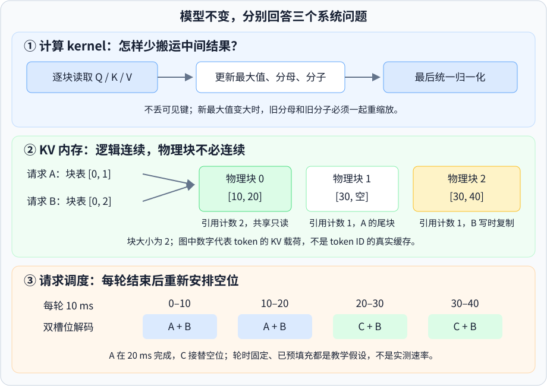

类比的边界：GPU 不是逐单做菜的厨师，KV 不是文本食材。并行度、带宽、数据类型、模型和调度策略都会影响结果；下面的餐厅比喻不能推出某种方法一定更快。

## P15.2 算术不变，搬运量可以改变

普通注意力的熟悉写法是：

```text
S = Q Kᵀ / √d
P = softmax(S + mask)
O = P V
```

如果 Q、K 都有 N 个位置，S 和 P 各有 N×N 个数。以单个 batch、单个头、每数 2 字节举例：

- N=4096：一张矩阵有 16,777,216 个数，占 33,554,432 字节，也就是 32 MiB。
- N=8192：一张矩阵占 128 MiB；长度翻倍，面积变成 4 倍。
- 如果实现同时保存 S 和 P，这两张矩阵的容量还要相加；实际峰值取决于实现，不能只靠这个公式断言。

这里 MiB=2²⁰ 字节，不是十进制 MB。多 batch、多头会继续乘上相应维度。

GPU 有容量较大的设备显存（原论文讨论的 GPU 使用 HBM，其他 GPU 也可能使用 GDDR）和容量较小、访问更近的片上存储。把完整 S 写回显存、再读回来做 Softmax、再写 P，会产生额外 IO。**FlashAttention 的核心是按片上存储条件分块组织计算，用在线 Softmax 累积输出，避免把完整 N×N 中间矩阵写到 HBM。** 它没有因此跳过普通稠密注意力的所有合法 QK 配对；标准稠密情形的算术复杂度仍为 O(N²d)，不是 O(Nd)。[FlashAttention 原论文（arXiv 2205.14135v2），§3](https://arxiv.org/pdf/2205.14135v2)

这还涉及 GPU 内核融合、线程组织、反向传播重计算等。本章只实现其中容易手算的**前向归一化递推**。Python 列表复制、解释器开销、输入 mask 都与真实 GPU kernel 不同，不能用本脚本的运行时间或进程内存证明 FlashAttention 的收益。

## P15.3 先把形状缩到一个头

暂时去掉 batch 和多头轴，只看一个头，允许 Q/K 长度不同，也允许 V 的宽度不同：

| 名称 | 形状 | 含义 |
| --- | --- | --- |
| Q | [Nq,d] | 当前要计算的 query |
| K | [Nk,d] | 可读取的全部 key |
| V | [Nk,dv] | 对应 value |
| allowed | [Nq,Nk] | 布尔 mask；True 表示允许读取 |
| O | [Nq,dv] | 每个 query 的加权输出 |

本例默认 query block 为 2 行，key block 为 3 行。Nq=5、Nk=7 时，query 分成 `[2,2,1]`，key 分成 `[3,3,1]`。最后一块不满也必须处理，不能直接用整数除法把它丢掉。

为方便观察，脚本可接收完整布尔 mask；这张教学 mask 本身仍可能占 O(Nq×Nk) 空间。生产 kernel 可以由位置索引直接形成因果约束。本实验没有宣称整个 Python 程序只占线性内存。

对于已有 3 个历史位置、当前有 2 个新 query、总共 5 个 key 的例子：

```text
query 的绝对位置：3、4
key 的绝对位置：  0、1、2、3、4
allowed 第 0 行：  1、1、1、1、0
allowed 第 1 行：  1、1、1、1、1
```

`causal_mask(2, 5, offset=3)` 正是这个矩形 mask。不要把新 query 的局部编号 0、1 当成绝对位置，否则第一行会误删历史上下文。

## P15.4 在线 Softmax：只记三本账

只看某一行 query。对已经处理过的合法分数 s_j，记录：

```text
m   = 已处理分数的最大值
ell = Σ exp(s_j - m)
acc = Σ exp(s_j - m) × v_j
```

m 和 ell 是标量；acc 是 dv 维向量。最后输出 `acc / ell`。注意 acc 还没有归一化，不是当前已经算好的概率均值。

现在读到下一块，合法分数为 s_new。新的最大值可能变大：

```text
next_m = max(m, max(s_new))
alpha  = exp(m - next_m)
p_new  = exp(s_new - next_m)

next_ell = alpha × ell + Σ p_new
next_acc = alpha × acc + Σ p_new × v_new
```

为什么必须乘 alpha？旧账用的是 exp(s−m)，新账用的是 exp(s−next_m)。利用指数运算：

```text
exp(s - next_m) = exp(s - m) × exp(m - next_m)
```

所以旧分母和旧分子必须一起换到新尺度。只缩放其中一个，或者把每块 Softmax 后的输出直接相加，都不对。

初始状态设 `m=-∞, ell=0, acc=0`。第一次读到合法分数时，代码直接令 alpha=0，不去做不必要的无穷运算。

## P15.5 手算：分成两块，仍然得到 6

设 d=dv=1，Q=`[1]`，K=`[0, ln 2, ln 4]`，V=`[2,4,8]`。缩放分母 √d=1，三个分数正好就是 K。没有 mask。

先做完整计算：三个指数之比为 1:2:4，因此：

```text
权重 = [1/7, 2/7, 4/7]
输出 = (1×2 + 2×4 + 4×8) / 7 = 42/7 = 6
```

现在把 key 分成前两个和最后一个，块长 `[2,1]`。

第一块：

```text
m = ln 2
p = [1/2, 1]
ell = 1/2 + 1 = 1.5
acc = (1/2)×2 + 1×4 = 5
```

第二块的分数 ln 4 更大：

```text
next_m = ln 4
alpha = exp(ln 2 - ln 4) = 1/2
p_new = [1]
next_ell = (1/2)×1.5 + 1 = 1.75
next_acc = (1/2)×5 + 1×8 = 10.5
输出 = 10.5/1.75 = 6
```

如果错把两个块各自的均值再平均，会得到 `(5/1.5 + 8)/2 = 17/3`，约 5.6667，不是 6。块的概率质量不同，不能给每块相同权重。

## P15.6 逐行看实现，不要只记公式

`blocked_attention()` 的核心如下；完整输入校验和循环在配套脚本中：

```python
next_m = max(m, max(scores))
alpha = 0.0 if ell == 0.0 else math.exp(m - next_m)
weights = [math.exp(s - next_m) for s in scores]
ell = alpha * ell + math.fsum(weights)
acc = [alpha * acc[c] + math.fsum(w * v[j][c] for w, j in zip(weights, visible))
       for c in range(len(acc))]
m = next_m
```

1. scores 只包含当前块中允许读取的 key。
2. next_m 取旧块、新块的共同最大值，不是只记新块的最大值。
3. alpha 把旧的 ell、acc 转换到同一个尺度。
4. weights 仍是未归一化的指数权重，不是单块概率。
5. 每个 value 通道 c 有自己的分子，但共享分母 ell。
6. 所有 key 块结束后才做 `acc/ell`。

脚本按 query 块组织外循环，再逐行遍历 key 块。它故意使用可读的标量循环，没有 GPU 的矩阵 tile、片上共享存储布局或 warp 调度；“有两个块长参数”不等于写出了 FlashAttention kernel。

### 全 mask 是一个单独的边界

若某个块没有合法 key，直接跳过，不计算 `max([])`。若整行都没有合法 key，本教学 API 明确返回全零向量。

这是 API 的安全约定，**不是说空集合上的 Softmax 有正常的概率分布**。直接把全行填成 −∞ 再算 `exp(s-max(s))`，可能遇到 `−∞−(−∞)` 而产生 NaN。测试特意覆盖：

- 第一块全被遮住，后面才出现合法 key。
- 后面的合法分数比前面大，需要重新缩放。
- 整行全被遮住，最终返回零。

分数 10000、10001、10002 也不需要直接算 exp(10002)。减去最大值后，最大指数是 exp(0)=1。输入 Q/K/V 要求有限，点积本身若已经溢出也会拒绝；稳定 Softmax 不能挽救此前已经算成无穷的点积。

## P15.7 “精确注意力”不是“逐 bit 相同”

这里的精确，是指没有用稀疏采样、低秩近似等方法改变这条注意力公式所包含的合法配对。换一种加法顺序、分块顺序或累积精度，浮点末位仍可能不同。

必修实验用 Python float，通常对应双精度浮点；随机例子固定 seed=15。5 个 query、7 个 key、d=3、dv=2 时，本次 full/block 最大差值为 `1.11e-16`，检查阈值为 `1e-12`。这是这组小输入的数值检查，不是任意长度、任意 dtype 都具有相同误差的证明。

只有 full/block 相等还不够：两条路径可能一起忘记 √d。测试另外使用标准库 Decimal 的 **65 位精度独立参考**，逐 query 直接算点积、指数和归一化，不调用生产实现的输入辅助函数、Softmax 或 block 更新。手算的 6 又提供了更容易人工核验的锚点。

这与 GQA 的区别也很重要：GQA 改变 KV 头的组织方式；在线 Softmax 只是计算同一组 Q/K/V 的方式。不能用这章的数值等价实验证明任意 MHA 改 GQA 都不损失质量。

## P15.8 KV 为什么要分页

生成过程中，每个请求的 KV 逐渐增长，但通常事先不知道最终会生成多长。

如果按最大长度为每个请求预留一整片空间，可能空着很多暂时甚至永远用不到的位置；要求请求拥有一整段连续空间，也会限制分配与共享的灵活性。

分页的基本做法是：把 KV 划为固定 token 数的物理块，请求只保留“逻辑第几块放在哪个物理块”的块表。逻辑 token 顺序不变，物理位置不必连续。它降低的是存储管理中的浪费，**不是删除某些历史 token 的信息路径**。

设块大小为 b，某 token 的逻辑位置为 t：

```text
逻辑块号 = t // b
块内偏移 = t % b
物理块号 = block_table[逻辑块号]
```

例如 b=2，块表是 `[1,2,0]`。逻辑位置 4 在逻辑块 2、偏移 0，对应物理块 0。读取时必须按 `[1,2,0]`，不能为了“排序整齐”改成 `[0,1,2]`。

生产 PagedAttention 根据这种映射读取 KV 并计算注意力。本脚本的 `read()` 则为了方便检查，先重建普通 Python K/V 列表，再调用普通 CPU 注意力。这个复制路径**不具有生产分页 kernel 的内存优势**。

## P15.9 先有共享，再谈写时复制

`PagedKVCache` 保存四类状态：

| 状态 | 含义 |
| --- | --- |
| `_blocks` | 物理块号 → 这个块已写入的 KV 载荷 |
| `_tables` | 请求名 → 有序的物理块号列表 |
| `_lengths` | 每个请求当前的逻辑 token 数 |
| `_refs` | 每个物理块被多少个活跃请求引用 |

它模拟单层、单 KV 头；每个 token 的 K 和 V 都是真实的数值向量，但这里不是模型训练得到的表示。为了手算，设 b=2，用 10、20、30 这些数字代表载荷。

A 有三个 token：

```text
A 的块表：[0,1]
物理块 0：[10,20]，引用计数 1
物理块 1：[30,空]，引用计数 1
```

现在 `fork("A", "B")`，让 B 从完全相同的历史继续生成：

```text
A 的块表：[0,1]
B 的块表：[0,1]
物理块 0、1 的引用计数都变为 2
```

此时只是增加块表引用，没有复制 payload。B 接下来要写入 40，尾块 1 却仍被 A 使用。直接写入可能污染另一条分支，所以执行 **copy-on-write，写时复制**：

1. 先分配新的物理块 2，把旧尾块中的 30 复制进去。
2. 旧物理块 1 的引用计数从 2 减到 1。
3. B 的块表改为 `[0,2]`，物理块 2 的引用计数为 1。
4. 把 40 写到物理块 2，得到 `[30,40]`。

A 仍然是 `[10,20,30]`，B 是 `[10,20,30,40]`；完整前缀块 0 继续共享。这一机制与原论文的分叉采样场景一致。[PagedAttention v1，§4.4](https://arxiv.org/html/2309.06180v1#S4.SS4)

### 满块边界不要复制错

如果 A 原本正好只有 `[10,20]`，共享的是一个已满块。B 追加 30 时，直接分配**下一个逻辑块**即可，不必复制已满的前缀块。COW 针对的是要写入的共享未满尾块，不是每次生成都复制全部历史。

若尾块的引用计数已经是 1，也能直接写入，不必复制。请求释放时只减少它所引用块的计数；降到 0 的物理块才回到空闲池。脚本的空闲块可以再次分配，但旧数据必须清掉。

## P15.10 用槽位记账，不伪造显存数字

上面的分叉实例可以独立数出来：

| 时点 | 所有请求逻辑 token 合计 | 实际物理载荷数 | 已分配槽位 | 空槽位 |
| --- | --- | --- | --- | --- |
| A 有三个 token | 3 | 3 | 4 | 1 |
| B 刚 fork，还未追加 | 6 | 3 | 4 | 1 |
| B COW 后追加 40 | 7 | 5 | 6 | 1 |

最后一行不是物理存了 7 个 token，因为 `[10,20]` 仍共享；也不是只存 4 个，因为尾部的 30 已各有一份。

若每个物理载荷只有一个 K 标量和一个 V 标量，且真正使用 float32 数组，则“5 个已写载荷”的理想 payload 是 `5×2×4=40` 字节，“6 个已分配槽位”的理想容量是 48 字节。**本脚本使用 Python 对象，不实际只占这些字节。** 块表、引用计数、对象开销、分配器、临时工作区和模型权重都不在这个理想账本里。

对没有共享的一个长度为 T 的请求，分配槽位是 `ceil(T/b)×b`，尾块空槽位范围为 0 到 b−1。例如 b=4、T=9，需要 3 块，共 12 槽位，空 3 个。分页不是“所有浪费严格等于零”；块越大、越小也有不同管理和访问开销。

池容量不足时，`append()` 会在改变块表和引用计数前报告 `MemoryError`。测试检查失败后 A/B 数据和所有权完全不变。这里没有实现 GPU 抢占、交换到 CPU 或重计算恢复；不能把异常提示当成完整服务系统的容错方案。

## P15.11 Prefix caching：复用的是同一段计算历史

假设两个请求都以完全相同的系统提示开头，后面的提问不同。已经算好的共同前缀 KV 有机会直接复用，减少第二个请求的重复 prefill 工作；它不是为每一个后续 decode token 免掉注意力计算。[vLLM 0.6.4 APC 文档快照](https://docs.vllm.ai/en/v0.6.4/automatic_prefix_caching/apc.html)

但“出现同一个 token”远远不够。KV 依赖它之前的上下文，还依赖模型权重、位置处理和适配器等计算设置。可复用的应是**兼容计算环境下相同的 token 前缀**，不是语义相似句子，也不是任意两段文字中碰巧相同的后缀。

本脚本故意分开两个 API：

- `fork(source, target)`：已经知道整段历史完全相同，可以共享未满尾块，未来写入时 COW。
- `share_prefix(source, target, tokens)`：由调用者先确认前缀兼容，只接收完整块边界。例如 b=2，来源长度 5，可以共享前 4 个 token；要求共享前 3 个会报错。

完整块边界是这个教学 API 的简化契约，不是所有缓存系统只能这样设计。真实 APC 还需要前缀标识、查找、失效规则、淘汰策略以及正确的请求隔离；固定版本 vLLM 文档说明了块级缓存查找的设计。[vLLM 0.6.4 实现说明](https://docs.vllm.ai/en/v0.6.4/automatic_prefix_caching/details.html)

脚本没有实现这些查找和安全机制，也不会检查两个文本是否相同。它还没有“请求结束后仍保留的前缀缓存”引用：所有活跃请求释放后，物理块就释放了。因此不能把这个块表模拟当成可部署的 APC 服务。

这里引用 0.6.4 是为了固定机制说明的文档快照，**不是说它是当前最新版或建议安装的版本**。本章不需要安装任何版本的 vLLM。

## P15.12 Continuous batching：不要让空位等整桌结束

普通静态 batch 可能要等同一批里最长的请求完成，才接下一批。Continuous batching 在每轮计算边界移除已结束请求，再把符合资源条件的新请求加进来。

做一个完全明确的玩具：

- 有两个 decode 槽位，每轮固定 10 ms。
- A、B 在 t=0 已经可以 decode，分别还需要 2、4 个输出 token。
- C 在 t=10 可以 decode，还需要 2 个输出 token。
- **所有 prompt 已在别处完成 prefill；这里只模拟 decode 槽位。**
- 每个活跃请求每轮产出一个 token，时间戳记在本轮结束时。

| 时间段（ms） | 静态 batch | 连续 batch |
| --- | --- | --- |
| 0–10 | A、B | A、B |
| 10–20 | A、B；A 随后完成 | A、B；A 随后完成 |
| 20–30 | 空位、B | C、B |
| 30–40 | 空位、B；B 随后完成 | C、B；两者随后完成 |
| 40–50 | C、空位 | 已结束 |
| 50–60 | C、空位 | 已结束 |

C 在 t=10 到达时，两槽仍被占用，所以连续 batch 也不是立刻开始。它到 t=20 才进入，两个输出时间为 30、40 ms；静态 batch 则是 50、60 ms。

两种方法都完成 8 个输出 token。按这个人造观察窗口，静态是 `8/0.06≈133.333` tokens/s，连续是 `8/0.04=200` tokens/s。**这些是固定轮时假设推出来的数字，不是 GPU 实测，也不是“连续 batch 一定快 1.5 倍”的结论。**

真实 batch 大小会影响轮时，KV 不够也可能不能接入新请求。更多并发可以提高总吞吐，但单请求等待或 token 间隔可能变长。必须把每轮执行时间和排队一起看。

## P15.13 Prefill、decode 与排队会互相影响

Prefill 一次处理已知 prompt 的很多位置，decode 沿着输出依赖一步一步走。把一个很长的新 prompt 放进服务计算，可能延后其他请求的下一次 decode。

调度器可以选择分块 prefill、限制每轮 token 预算、为不同请求设置优先级等。这些策略会在首 token 等待、后续 token 间隔和总吞吐间取舍，不能只报一个“速度”。

注意三件事不是同一个概念：

1. FlashAttention 分块：在一次注意力计算内部安排数据和归一化。
2. Chunked prefill：把一个请求的 prompt 计算拆成多个调度单元。
3. Prefill/decode 分离部署：把两个阶段放到不同的执行资源。

这里的在线 Softmax 代码只涉及第 1 种算法思想；小调度器没有实现第 2、3 种。后续架构章节再讲 encoder/decoder 时，也不能把它们与服务端 P/D 分离混称。

## P15.14 TTFT、TPOT、吞吐：用时间戳而不是印象

本章固定采用**客户端可观察时间**：请求到达时间为 a，输出 token 接收时间依次为 t₁…tₙ。不同工具可能采用不同统计口径，比较前先写清楚。

```text
TTFT = t₁ - a                         首 token 等待
TPOT = (tₙ - t₁) / (n - 1)，n>1       后续每 token 平均间隔
E2E  = tₙ - a                         整个请求耗时
输出吞吐 = 观察窗口内输出 token 数 / 窗口秒数
```

TTFT 可以包含排队、prefill、采样与网络等延迟，不等于纯 prefill kernel 时间。TPOT 这里排除了第一 token 的等待。只有一个输出 token 时，没有后续间隔，所以脚本返回 `None`，不是除以零，也不是假装 TPOT=0。

再做一组**与上一节不同的人造时间线**：

| 请求 | 到达时刻（ms） | 输出 token 时刻（ms） | TTFT | TPOT | E2E |
| --- | --- | --- | --- | --- | --- |
| A | 0 | 100、140、190 | 100 ms | (190−100)/2=45 ms | 190 ms |
| B | 50 | 150、210 | 100 ms | (210−150)/1=60 ms | 160 ms |

观察窗口明确取 0–210 ms，两个请求一共产出 5 个 token，因此输出吞吐为 `5/0.210≈23.809524 tokens/s`。不能用 A 的 TPOT 倒数代表两请求总吞吐，也不能把两请求 E2E 相加当成并行服务的总墙钟时间。

“平均 TPOT”也要说清楚权重：

- 先算每请求 TPOT，再等权平均：`(45+60)/2=52.5 ms`。
- 把所有后续 token 间隔放一起平均：`(90+60)/3=50 ms`。

两者都可有定义，但不能用同一个标签不加说明。真实服务还应报告分位数、并发、错误率和输出长度；两条请求不足以说明线上长尾表现。

## P15.15 运行与输出：哪些确实测过

在仓库根目录直接运行：

```bash
python code/16_attention_systems.py
python -m unittest discover -s tests -p test_attention_systems.py -v
```

核心只需要 Python 标准库。已经安装本仓库依赖时，测试会额外用 CPU SDPA 做一个独立交叉检查；兼容性按仓库共享规则要求稳定版 torch 2.14.x。不满足条件只跳过这一项，**不会跳过在线 Softmax、分页和时间线的必修测试**。

本批在 Python 3.12.14 上运行，随机部分 seed=15。环境中的 PyTorch 是 2.14.1+cpu，没有可用 CUDA。关键输出为：

```text
Online hand example: output=6.000000000000, expected=6; blocks=[2,1]
Uneven blocks Q=5,K=7,d=3,dv=2: max_error=1.11e-16; tolerance=1e-12
All-masked safety: [[0.0]]
Before COW: A=(0, 1), B=(0, 1), refs={0: 2, 1: 2}
After COW: A=(0, 1), B=(0, 2), refs={0: 2, 1: 1, 2: 1}
Output throughput: 23.809524 tokens/s (invented timeline, not measured)
GPU SDPA: not requested, not run. This CPU script is not a performance benchmark.
```

本章当前 26 项测试：在兼容 torch 环境中 26 项通过；无 torch 环境中 25 项通过、1 项明确 skip。无 torch 的正常 CLI 仍能完整运行，显式请求 GPU 选修时会解释跳过原因。**被跳过的 GPU 或 SDPA 检查不算数值通过。**

除了正例，测试还在内存中构造 12 个错误版本：忘记重缩放、两条路径一起丢缩放分母、忽略 mask、丢最后一块、不做 COW、COW 后不减引用计数、共享时不加计数、按物理块号排序、TPOT 除以 n、丢掉旧块最大值、TTFT/E2E 不减到达时间。每个契约先在正确实现上通过，再要求错误版本被断言拒绝。对于丢旧最大值的版本，合法有限输入（分数1000再到0）会触发 OverflowError；测试明确将这种稳定性违约转成断言失败，不能把它隐瞒成“没有数值异常”。坏导入、语法错误或其他无关异常仍会让变异测试失败。源文件不会被这些 mutation 改写。

分页测试还有 240 步固定种子的随机 create/append/fork/prefix/release，对照一个独立的普通序列模型，并逐步检查引用计数和空闲池。它检验的是这个单线程模拟器，不是生产系统并发安全。

## P15.16 GPU 选修：先确认后端，不先晒跑分

**本批 GPU kernel 未运行，未测 GPU 显存、时延或吞吐。** CPU SDPA 检查通过不代表执行了 CUDA FlashAttention。

如果你已经有兼容的 GPU、驱动与官方 CUDA 版 PyTorch，可以单独尝试：

```bash
python code/16_attention_systems.py --gpu-sdpa
```

不要为这一章把现有 CPU 环境强行替换掉；GPU 环境的安装要按官方硬件/驱动要求单独配置。脚本会打印实际 PyTorch、CUDA、设备、dtype 和形状，并在缺少依赖或 CUDA 时明确 `SKIP`。本批实际运行这个开关得到：

```text
SKIP GPU SDPA: torch=2.14.1+cpu, CUDA unavailable; GPU kernel not run.
```

选修 smoke 的 Q/K/V 各为 `[1,1,8,16]`、float16；三者数据本身共 768 字节，但运行时上下文、工作区和 profiler 远不止这点，不能把 768 字节写成显存需求。它不下载模型，不承诺耗时或 GPU 总显存上限。

其核心调用明确限定后端：

```python
with sdpa_kernel(backends=[SDPBackend.FLASH_ATTENTION]):
    actual = torch.nn.functional.scaled_dot_product_attention(
        q, k, v, dropout_p=0.0, is_causal=True)
```

这里 Q/K 等长，才使用简单的 `is_causal=True`；带缓存偏移的矩形 mask 不应不加分析地照抄。函数的 dropout 参数明确设为 0，不依赖外部模型的 eval 状态。脚本记录 profiler 中实际出现的 attention/flash 事件，再与本章 CPU 数值参考比较；“调用了 SDPA”本身不能证明走了期望后端。[PyTorch 固定源码 v2.5.1：SDPA 后端选择接口](https://github.com/pytorch/pytorch/blob/v2.5.1/torch/nn/attention/__init__.py)

此固定源码链接用于接口背景，不是安装建议。本批另检查了实际 torch 2.14.1 的 `sdpa_kernel` 和 `SDPBackend.FLASH_ATTENTION` 可导入，但无 GPU，因此没有验证其 GPU 支持条件。后端不支持或运行失败时会报告 skip/失败原因，不会悄悄退回数学后端然后宣称 GPU Flash 成功。

要做真正的性能对比，还需要另外安排可复现基准：

1. 固定模型 revision、tokenizer、dtype、采样策略，记录权重与 KV 是否量化。
2. 固定 prompt/输出 token 长度分布、请求到达方式、并发以及前缀命中率；冷缓存与热缓存分开。
3. 先预热，再重复多轮；GPU kernel 计时使用同步或正确的 CUDA event，避免只测到提交任务的时间。
4. 同时报客户端 TTFT、TPOT、E2E、输出吞吐与失败请求；不能拿输入 token 吞吐冒充输出吞吐。
5. 显存分别记录模型基线、KV payload、峰值 allocated/reserved 和工作区；重置峰值统计的时机要相同。
6. 改一个因素再比，并核验 profiler 实际后端；保存硬件、软件版本和命令。微型 attention smoke 不能替代端到端服务基准。

这是选修实验的记录清单，**不是本批已经跑出的服务性能报告**。

## P15.17 自测题与参考答案

1. FlashAttention 为什么不等于把稠密 attention 改成 O(Nd)？与 GQA 分别改了什么？
2. N 从 4096 变为 8192，单头一张 2 字节 score 矩阵从多少 MiB 变成多少？
3. 手算例子第二块到来时，alpha、ell、acc、最终输出各是多少？若平均两块各自均值，会得到多少？
4. 第一块全 mask，后块才出现合法 key，该怎样初始化？若整行全 mask，本 API 输出什么？
5. b=4、长度 9 的无共享请求分配几个块、几个空槽？块表 `[9,2,7]` 中位置 7 对应哪里？
6. b=2 时 A/B 共享 `[10,20,30]`，B 追加 40 后，逻辑总长度与物理载荷数分别是多少？为什么只复制尾块？
7. 前缀文本“看起来意思一样”，能直接共享 KV 吗？这个模拟器会自动核验文本兼容性吗？
8. 连续 batch 的例子里 C 在 10 ms 就绪，为什么第一 token 是 30 ms，而不是 20 ms？这个 20 ms 等待能否叫真实端到端 TTFT？
9. 到达 0、输出时刻 `[100,140,190]` 的 TTFT、TPOT、E2E 各是多少？只输出一个 token 时 TPOT 是什么？
10. full/block 一致，且 CPU SDPA 通过，能否说明实现了生产 FlashAttention，并证明线上请求更快？

参考答案：

1. 它保留全部合法 QK 配对，标准稠密算术量仍为 O(N²d)，重点是计算组织与 IO。GQA 改变 KV 头共享方式，属于模型表示的改变。
2. 32 MiB → 128 MiB，增长 4 倍；这只是单张矩阵，不是完整模型峰值。
3. alpha=0.5，ell=1.75，acc=10.5，输出=6。错误的块均值平均是 17/3，约 5.6667。
4. 空块跳过，保持 ell=0；首个合法块用 alpha=0。整行无合法 key 返回全零，这是明确约定，不是正常概率分布。
5. 3 块、12 槽位、3 个空槽。位置 7 的逻辑块号 `7//4=1`、偏移 `7%4=3`，物理块号为 2。
6. 逻辑总长度 3+4=7，物理载荷数 2+1+2=5。满的前缀块继续共享；只要写入仍共享的未满尾块，才需要 COW。
7. 不能；要相同 token 前缀和兼容的模型/位置等计算环境。模拟器不检查文本或模型身份，调用者必须先保证前提。
8. 10–20 ms 两槽仍被 A/B 占用，C 到 20 ms 才开始一轮，30 ms 才产出。这里未包括 prompt prefill、网络等，不是端到端 TTFT。
9. 100 ms、45 ms、190 ms。只有一个 token 时没有后续间隔，TPOT 返回 None。
10. 不能。还要独立数值参考、GPU 后端证据，以及同硬件、同工作负载的性能测量。本章只完成教学 CPU 实验。

接下来，[P16](#p16-sparse-linear)才讨论窗口、稀疏与线性机制怎样改变可见信息路径或状态表示。先分清这条线，才能避免把“换一种高效执行方式”与“改了模型所能看到什么”混为一谈。

## 资料与实现边界

核验日：2026-10-19。以下只用论文或官方资料：

- [FlashAttention 原论文（arXiv 2205.14135v2）](https://arxiv.org/pdf/2205.14135v2)：IO-aware tiling、在线归一化与精确注意力的边界；本章未实现其 GPU 前反向 kernel。
- [PagedAttention 原论文 v1](https://arxiv.org/html/2309.06180v1)：块表、非连续 KV、共享和写时复制、请求调度；本章只模拟单线程所有权和逻辑读取。
- [vLLM 0.6.4 APC 介绍](https://docs.vllm.ai/en/v0.6.4/automatic_prefix_caching/apc.html)与[实现说明](https://docs.vllm.ai/en/v0.6.4/automatic_prefix_caching/details.html)：固定文档快照，不是当前版本推荐；本章没有安装、运行或测速 vLLM。
- [PyTorch v2.5.1 官方后端选择源码](https://github.com/pytorch/pytorch/blob/v2.5.1/torch/nn/attention/__init__.py)：固定接口背景；实际 CPU 测试环境为 torch 2.14.1+cpu，GPU 选修未运行。

本章不改 S4、不训练模型、不实现 CUDA 或生产调度器，不把人造时间线写成实验吞吐，不承诺任何 GPU 加速比。


---

# 架构进阶（P16）：滑动窗口、稀疏、混合与线性注意力 {#p16-sparse-linear}

[P15](#p15-attention-systems) 把“怎样执行同一个注意力算式”与服务端内存管理分开。本章换一个问题：**如果不让每个 query 逐一读取全部历史，我们改掉了哪些信息路径？**

配套 [code/17_sparse_linear_attention.py](../code/17_sparse_linear_attention.py)，只做 CPU 小实验，不训练、不下载权重。它独立于 S4，不默认替换 Baby-GPT 的注意力，也不拿短脚本的运行时间当生产性能结论。

## P16.1 查原始卡片，还是查累计账本

把历史 token 想成一排资料卡片，当前 query 是来查资料的人：

- **全量因果注意力**：允许翻所有已经出现的卡片，再按问题决定权重。
- **滑动窗口注意力（SWA）**：只允许翻最近几张卡片。
- **全局加局部**：最近几张之外，额外保留某些可访问的位置。
- **线性注意力**：本章这一种把卡片逐张加入固定形状的累计账本，再用 query 读取账本。

类比的边界很重要：窗口内仍会学习不同权重，不是简单平均；“账本”是数值状态，不是能保证保留所有事实的人类摘要。少读卡片和压成账本也不是同一种操作。

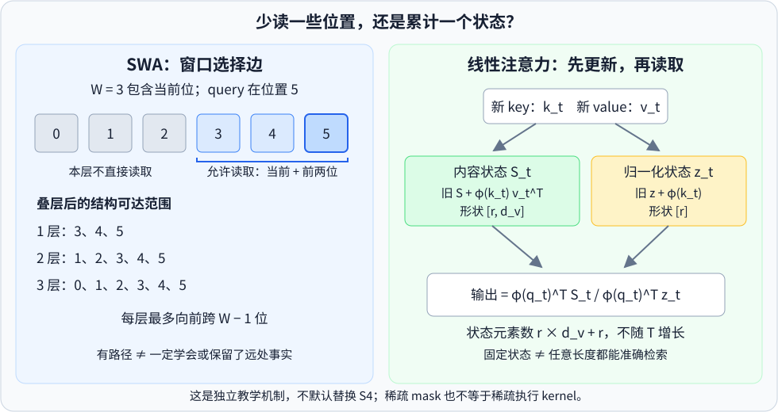

## P16.2 先约定 W 到底数什么

本书采用一个贯穿代码、图和手算的约定：**窗口 W 包含当前位置自己**。位置从 0 开始，query i 可以看 key j，当且仅当：

$$
\max(0,i-W+1)\le j\le i
$$

例如 W=3，是“当前位 + 前面至多两位”，不是“前三位 + 当前位”。T=6 的 mask 如下，1 表示允许读取：

| query i \ key j | 0 | 1 | 2 | 3 | 4 | 5 | 可见位置 |
| --- | --- | --- | --- | --- | --- | --- | --- |
| 0 | 1 | 0 | 0 | 0 | 0 | 0 | 0 |
| 1 | 1 | 1 | 0 | 0 | 0 | 0 | 0、1 |
| 2 | 1 | 1 | 1 | 0 | 0 | 0 | 0、1、2 |
| 3 | 0 | 1 | 1 | 1 | 0 | 0 | 1、2、3 |
| 4 | 0 | 0 | 1 | 1 | 1 | 0 | 2、3、4 |
| 5 | 0 | 0 | 0 | 1 | 1 | 1 | 3、4、5 |

因此 W=1 退化为只看自己；W≥T 退化为普通因果 mask，仍然不能看未来。

窗口是论文和库之间常见的差一位陷阱。[Mistral 7B v1，§2](https://arxiv.org/html/2310.06825v1#S2) 用 SWA 解释层间信息传播，但其正文的 i−W 到 i 与图示的窗口槽数表述不能直接当作本章函数契约。复现具体库时，应检查实际不等式，不能只复制名为 window_size 的数字。本章不声称复刻该模型。

代码中的矩形版本还允许已有 P 个历史位置、本次处理 C 个新位置：

```python
query_pos = torch.arange(offset, offset + length)[:, None]
key_pos = torch.arange(offset + length)[None, :]
mask = (key_pos <= query_pos) & (key_pos > query_pos - window)
```

这里 `offset=P`、`length=C`。第一行生成 [C,1] 的绝对 query 位置，第二行生成 [1,P+C] 的 key 位置，广播后得到 [C,P+C]。P=4、C=2、W=3 时，正好是手算表的最后两行，不能用一个从 0 开始的 C×C 三角形代替。

## P16.3 一层看不见，不等于多层完全没有路径

设每层都用 W=3，且没有别的跨位置连接。输出位置 5 在第一层读取上一层位置 3、4、5；第二层读取这些位置携带的信息，就可能间接收到输入位置 1、2 的内容。

| 层数 L | 输出位置 5 能到达的输入位置 |
| --- | --- |
| 0 | 5 |
| 1 | 3、4、5 |
| 2 | 1、2、3、4、5 |
| 3 | 0、1、2、3、4、5 |

按本章约定，每层最多向前跨 W−1 个位置，所以 L 层的结构可达区间是：

$$
[\max(0,i-L(W-1)),\ i]
$$

区间长度最多是 `1+L×(W−1)`。逐位置 FFN、归一化和残差不增加新的跨位置边。代码 `receptive_positions()` 逐层合并可达集合，测试再用上面的闭式表达核验。

**结构上存在一条路径，不等于信息一定被学会、保留或准确检索。** 远处原始 K/V 已经不在当前层的窗口中；传来的只是中间隐藏表示。也不能把理论可达长度当成实测的长上下文能力。

## P16.4 稀疏、全局加局部、混合层分别是什么

“稀疏”首先描述哪些 query-key 边存在。滑动窗口是其中一种；也可以按块选取位置，或者根据内容动态选择。它们未必使用相同的索引、缓存或 kernel。

“全局加局部”是在**同一层的 mask 中**增加某些边。Longformer 原论文介绍了局部窗口与任务相关全局位置的组合；其中用于双向编码的图样不能原样搬到自回归 decoder。[Longformer v2，§3.1](https://arxiv.org/html/2004.05150v2#S3.SS1)

本章定义一个更简单的因果教学图样，设全局位置集合为 G：

$$
M_{ij}=(j\le i)\ \land\ [(j>i-W)\ \lor\ (j\in G)\ \lor\ (i\in G)]
$$

- 普通 query 可以读局部窗口，以及已经出现的全局 key。
- 全局 query 可以读全部过去和自己，但仍然不能读未来。
- W=3、G={0} 时，query 5 的可见位置为 `{0,3,4,5}`。
- 若 4 也是全局位置，query 4 可读 `{0,1,2,3,4}`；query 0 仍只能读自己。

因此位置 0 不能在因果模型里“先收集整段未来，再广播给大家”。源码最后的 `& causal` 不能被删除。本函数只演示图样，不实现 Longformer 的独立全局投影或完整模型。

“混合层”则是**不同层使用不同机制**：例如三层 SWA 后接一层全量注意力，或者把线性层与普通注意力层交替。它不同于在同一层给窗口加几列全局 key。若某些层仍读取全量历史，这些层的 KV 缓存仍会随 T 增长，不能把整个模型都按窗口大小计费。

## P16.5 稀疏选择不等于 MLA 压缩

[P14](#p14-grouped-kv) 的 MLA 主要问：“每个历史位置用什么表示保存？”稀疏选择问：“当前 query 读取哪些位置？”

- MLA 的较短潜变量可以仍然为每个历史位置各存一份，且注意力仍读全部位置。
- SWA 可以只保留较少位置，却为每个位置保存普通 K/V。
- 二者可以组合，但必须分别计算选中位置数、每位置 payload、索引和临时工作区，不能把同一份节省算两遍。

动态稀疏也不自动等于小缓存：如果未来 query 可能再次选到任何旧位置，就可能还需要保留历史表示或额外检索结构。只把大矩阵中的一些权重设为 0，并不能证明存储已经减少。

## P16.6 线性注意力先改相似度，再移动括号

普通 Softmax 注意力的未归一化权重是 `exp(q·k/√d)`。本章换成正特征的内积：

$$
\phi(x)=\operatorname{ELU}(x)+1
=\begin{cases}x+1,&x\ge0\\e^x,&x<0\end{cases},\qquad
w_{tj}=\phi(q_t)^\top\phi(k_j)
$$

这是一个新的核函数，**不与原来的 Softmax 注意力精确等价**。它的“线性”指固定特征宽度时，计算量可对序列长度 T 呈线性关系，不是说整层没有非线性。采用该特征映射及下面的因果归一化表达，依据的是 [Linear Transformer 原论文，ICML 2020，§3.2–3.4、式 7–12](https://proceedings.mlr.press/v119/katharopoulos20a/katharopoulos20a.pdf)。

先写所有可见历史的加权平均：

$$
y_t=\frac{\sum_{j=0}^{t}\bigl(\phi(q_t)^\top\phi(k_j)\bigr)v_j}
{\sum_{j=0}^{t}\phi(q_t)^\top\phi(k_j)}
$$

正权重除以总和后加起来为 1。分母不能省略，否则重复历史会改变输出尺度，且不再是这个算式。

本章省略头轴，只保留一个头；多头可在 B 之外再增加 H 轴。设特征宽度为 r、value 宽度为 d_v。本例 φ 不改变维度，所以 r=d，但别把这个特例当成所有核映射的定义。

| 张量 | 形状 | 含义 |
| --- | --- | --- |
| q、k | [B,T,r] | 每个位置的查询、键 |
| v | [B,T,d_v] | 每个位置的内容 |
| φ(q)、φ(k) | [B,T,r] | 正特征 |
| 显式权重矩阵 | [B,T,T] | 只作为小规模对照 |
| S_t | [B,r,d_v] | 历史 key 特征与 value 的外积和 |
| z_t | [B,r] | 历史 key 特征之和 |
| y | [B,T,d_v] | 所有位置的输出 |

## P16.7 把整段历史变成递推状态

用列向量写单位置公式，初始 S 和 z 都是 0：

$$
S_t=S_{t-1}+\phi(k_t)v_t^\top,\qquad
z_t=z_{t-1}+\phi(k_t),\qquad
y_t=\frac{\phi(q_t)^\top S_t}{\phi(q_t)^\top z_t}
$$

外积把 r 个 key 特征与 d_v 个 value 分量两两相乘，产生 r×d_v 个数。先把当前 k、v 加入状态，再读取，才能包含 j=t。这里的矩阵结合律对**选定的核**精确成立；它不能把已经改掉的核变回 Softmax。

手算 B=1、r=2、d_v=1：

| t | q_t | k_t | v_t | 更新后的 S_t | 更新后的 z_t | 输出 |
| --- | --- | --- | --- | --- | --- | --- |
| 0 | [0,0] | [0,0] | 2 | [2,2]ᵀ | [1,1] | 4/2=2 |
| 1 | [0,1] | [1,0] | 4 | [10,6]ᵀ | [3,2] | 22/7 |

第二行：φ(q)=[1,2]、φ(k)=[2,1]；新外积是 `[8,4]ᵀ`，加上旧状态得到 `[10,6]ᵀ`。分子 `1×10+2×6=22`，分母 `1×3+2×2=7`。也可以直接对两条历史算权重 3、4，得到 `(3×2+4×4)/(3+4)=22/7`。

对应源码的循环核心：

```python
qt, kt = positive_features(q[:, t]), positive_features(k[:, t])
state = state + kt[:, :, None] * v[:, t, None, :]
normalizer = normalizer + kt
numerator = (qt[:, :, None] * state).sum(dim=1)
denominator = (qt * normalizer).sum(dim=1, keepdim=True)
outputs.append(_normalized(numerator, denominator))
```

新增的 `None` 轴把 `[B,r]` 与 `[B,d_v]` 变成可广播的 `[B,r,1]` 和 `[B,1,d_v]`。读取时沿 r 求和，得到 `[B,d_v]`；分母保留 `[B,1]`，才能对各个 value 分量正确广播。

`linear_parallel()` 则显式算整个核矩阵、把上三角置零、逐行归一化。它用于检查公式，仍然占 O(T²) 临时空间，**不是线性复杂度的并行 scan 实现**。两个函数的数学输出应一致；浮点求和顺序不同，允许小误差。

## P16.8 固定状态大小，能否一直记住第一条？

我们不训练模型，直接设计一个可手算的干扰实验。每个长度 T 都使用同样的查询和规则：

- q=[4,−4]；第一条目标 key 也是 [4,−4]，目标 value=1。
- 其余 T−1 条都是 key=[−4,4]、value=0 的干扰项。
- 比较最后一行输出，正确目标是 1；预先定义成功为绝对误差 ≤0.1。
- 三条路径使用完全相同的 Q/K/V、顺序、float64 和单头。没有训练差异、不同量化或不等的输入长度。

这里查询直接给定，是一个检索算式测试，不是完整“读文字后回答”的语言模型；末尾也没有额外插入一条会改变记账的查询 token。

| T | 全量 Softmax | W=4 的局部 Softmax | 本章线性核 | 线性 S+z 的 payload |
| --- | --- | --- | --- | --- |
| 1 | 1.000000 | 1.000000 | 1.000000 | 32 字节 |
| 8 | 1.000000 | 0.000000 | 0.951219 | 32 字节 |
| 64 | 1.000000 | 0.000000 | 0.684206 | 32 字节 |
| 256 | 1.000000 | 0.000000 | 0.348654 | 32 字节 |

不是只看打印结果。线性核给目标的权重为 `a=25+exp(−8)`，每条干扰项的权重为 `b=10×exp(−4)`，因此最后输出恰好是：

$$
y_{T-1}=\frac{a}{a+(T-1)b}
$$

Softmax 的目标与干扰打分差是 `64/√2`，所以对应输出为 `1/[1+(T−1)exp(−64/√2)]`，这些长度下打印成 1。W=4 的单层路径在 T>4 时彻底读不到位置 0，因此输出为 0。三者并没有被要求使用相同核或相同存储量，那正是实验改变的因素。

状态只含 S 的 2×1 个数和 z 的 2 个数，float64 每数 8 字节，共 `(2×1+2)×8=32`。这不包含输入、输出、模型参数、Python 对象或 autograd 保存的中间状态。测试核对最终张量的实际存储，不把整个脚本说成“常数内存”。

**能得出的结论**：此固定宽度、未训练的 ELU+1 核在这组输入上，随着非零干扰权重累积，T=64 已不满足预设检索误差标准；状态大小不随 T 变，并不保证检索质量不变。

**不能得出的结论**：所有线性注意力、所有递推模型都必然在同样长度失败；失败全部由浮点容量耗尽造成；或者 Softmax 对任意长度、任意数据都能完美检索。这个实验具体展示的是核区分度与干扰累积，不是固定维度状态的普适不可能性证明。它也没有评估多层训练后的 SWA 信息传递能力。

## P16.9 复杂度是账本，不是速度承诺

下面只数单层、单头的注意力主体，忽略投影、FFN 和常数；batch 可另外乘 B。全量 Q/K 宽度 d、value 宽度 d_v；全局位置数量为 g。

| 机制 | 整段处理的理论主体成本 | 逐 token 推理保存的历史表示 |
| --- | --- | --- |
| 全量注意力 | O(T²(d+d_v)) | O(T(d+d_v)) |
| 真正按窗口执行的 SWA | O(TW(d+d_v)) | 可用至多 W 位置的 K/V |
| 局部 + 固定数量全局位置 | O(T(W+g)(d+d_v)) | 局部与全局位置的 K/V；全局 query 另需审查 |
| 本章的线性递推 | O(Trd_v+Tr) | S、z，共 r×d_v+r 个数 |

第三行需特别注意：如果未来有一个全局 query 要直接读取全部旧 key，就不能提前只留窗口与若干全局 key。本章只画 mask，没有实现这种缓存生命周期；不能拿稀疏边数代替完整的存储证明。g 若随 T 增长，也不能再把它视为固定常数。

本章的窗口函数只是产生 bool mask，`masked_softmax_attention()` 仍先计算完整 QKᵀ。它证明可见性，不兑现表格里的稀疏执行成本；`linear_parallel()` 同样只是 O(T²) 对照。递推函数保留全部输出，训练时普通 autograd 还会保存历史计算图，所以固定的推理状态不等于固定的训练峰值内存。

实际选择要同时看质量、长距离检索、状态/缓存、吞吐和延迟。[P15](#p15-attention-systems) 的 FlashAttention 优化计算和访存；FLA 是另一个实现库，名称相似不代表算法相同。这里只提供 [FLA 官方仓库](https://github.com/fla-org/flash-linear-attention) 作为实现阅读入口，不安装、不调用，也不把库中的其他架构或速度声明算作本章实验结果。

## P16.10 运行与数值边界

在仓库根目录：

```bash
python -m pip install -r requirements.txt
OMP_NUM_THREADS=1 python code/17_sparse_linear_attention.py
python -m unittest discover -s tests -p test_sparse_linear_attention.py -v
```

本批实际使用 Python 3.12.14、PyTorch 2.14.1+cpu、单线程、seed=16、float64。随机 B=2、T=7、r=3、d_v=2 对照得到最大误差 `3.33e-16`，S/z 形状分别为 `[2,3,2]`、`[2,3]`；检索结果见上表。不同平台的末位浮点误差可不同，不是质量分数。

教学接口主动收窄范围：

- CPU float32/float64；不接受 half、bfloat16、整数、混合 dtype、GPU 或 autocast。张量必须非空且有限。
- 单次 query 长度和总 key 长度均为 1–512；这是小实验的保护上限，不是理论上下文限制。窗口可以大于 T，但必须为正整数；布尔值不当成整数参数。
- Softmax 对照拒绝全遮罩行，避免把“没有可读内容”的未定义归一化悄悄当成正常输出。若扩展 padding，需要另行规定这些行如何输出。
- φ 的负半轴直接算 `exp(x)`，避免先得到接近 −1 的 ELU 再加 1 所造成的抵消。极端负数仍可能下溢为 0；分母非正或非有限时明确报错，不偷偷加 epsilon 改掉参考公式。
- 太大的输入也可能让分数、状态或除法溢出；遇到非有限值拒绝继续。这里的检查有 CPU 开销，不是生产优化。
- 每次递推从零状态开始，不支持跨请求复用、chunk 状态输入、位置编码或 padding。先把这些语义补齐并测试，才可以谈替换真实层。

## P16.11 为什么要有独立参考和故意写错的版本

“并行=递推”还不够：两者可能一起漏掉分母。本章的测试逐 batch、逐 query、逐历史位置用 Python 标量和 `math.exp` 重新算权重，不调用主实现的 φ、mask、矩阵乘法或状态递推。两个路径分别对齐它，而不是只互相对齐。

21 项测试包含：手算 mask、矩形 offset、W=1/W≥T、层间感受野、全局位置不泄漏未来、手算 S/z、float32/64、T=1/512、非法长度/类型、全遮罩行、下溢/溢出、有限梯度与梯度对齐、改写未来不影响过去、输入不被改写、请求间不残留状态、检索闭式公式及固定状态存储。

另在内存中生成五种错误版本：窗口边界多放进一位；全局位置越过因果限制；线性矩阵漏掉三角 mask；两条路径一起漏掉归一化；递推把当前 value 错换成前一位。每个都必须被相应断言抓住，而不是靠导入失败或异常崩溃假装“检出了错误”。这些测试不改写源码。

无兼容 torch 2.14.x 时，1 项缺依赖 CLI/导入契约测试仍可运行，其余 20 项按共享门控明确跳过。**skip 不是通过**；安装依赖后才能声称数值行为已经验证。

## P16.12 自测题与参考答案

1. W=3、query=5 时，位置 2 是否可见？W=1 是否只看前一位？
2. W=3、两层、输出位置 5，最早可达哪个输入位置？这是否保证能回答那个位置的事实？
3. 因果全局位置 0 能否先汇总位置 5，再把它传回位置 2？
4. “三层窗口 + 一层全量”能否把所有层的历史缓存都限制为 W？
5. B=2、r=3、d_v=2、float64，S+z 的 payload 是多少字节？T 翻倍会怎样？
6. 手算例第二个位置的输出为什么是 22/7，而不是 22？
7. 检索表里线性输出随 T 降低，是否证明所有固定状态架构都没法长距离检索？
8. 窗口 mask 很稀疏，为什么本章 Softmax 对照仍可能分配 T×T 分数？MLA 是否自动改变这个 mask？

参考答案：

1. 不可见，可见的是 3、4、5。W=1 只看当前位，不是前一位。
2. 最早位置 1，因为 `5−2×(3−1)=1`。只证明路径存在，不保证学习和保存了事实。
3. 不能。每条边都必须满足 key 位置不晚于 query；全局标记不能打破因果性。
4. 不能，全量层仍可能需要全部历史 K/V。各层分别记账。
5. `2×(3×2+3)×8=144` 字节。固定 B、r、d_v 时，最终 S/z 不因 T 翻倍而增大；输入、输出和训练计算图不能据此忽略。
6. 正特征权重还要除以总权重 7。省略分母会改变函数，不再是这个归一化注意力。
7. 不能。这里只展示指定 ELU+1 核、固定输入幅度、未训练单头的干扰累积；不代表所有特征映射、状态更新或训练模型。
8. 它先做完整 QKᵀ，再遮罩，并没有稀疏 kernel。MLA 压缩每位置的表示，不自动决定读取哪些位置。

下一章 [P17](#p17-ced) 再用这些信息路径概念理解因果编码器—解码器。不要把“局部窗口”“低维 KV”“固定状态”或“编码/解码”几个词互相替代。

## P16.13 延伸：MSA，按块挑选远处的 K/V

P16.4 的固定窗口和全局位置是“事先定好看哪里”。2026-06-11 提交的 [MSA（arXiv 2606.13392）](https://arxiv.org/abs/2606.13392) 改为**每个 query 动态挑块**：把历史切成长度 B_k=128 的块，用块内最大分数（max-pool）代表整块，每个 GQA 组共享一次 top-k（k=16）选择，并且当前所在的局部块总是保留。论文里打分来自一个单独训练的轻量 indexer：用 KL 损失向“组内平均注意力分布”蒸馏，教师分布和 indexer 输入都做 stop-grad，并先有一段 indexer warmup。论文在 109B 模型（64 个 query 头、4 个 KV 头）上报告 1M 上下文时注意力 FLOPs 降低 28.4×，H800 上 prefill 14.2×、decode 7.6× 加速。这些数字本书没有复现。

[`../code/17b_msa_block_topk.py`](../code/17b_msa_block_topk.py) 只做选择规则本身，并且故意用精确的 `q·k` 代替学到的 indexer，所以测到的只是“按块挑”带来的损失：

- `block_scores`：一个 query 的逐 token 分数按块取最大值，最后不满一块的部分用 −∞ 填充。
- `select_blocks`：组内各头的块分数取平均，每组选 top-(k−1) 个远处块，再加上局部块。
- `token_recall`：每个头精确前 16 个 key 中，有多少落在被选中的块里。T=4096、B_k=128 的随机例子里，k=1/4/16 时召回分别为 0.008/0.250/0.836，读取的 key 数分别少 32×/8×/2×。

测试手算了 max-pool 与不完整末块，检查局部块必选、组内共享、预算覆盖全部块时召回为 1，并给出一个变异：把 max-pool 换成 mean-pool 会漏掉只有一个尖峰的块。脚本最后打印 1M token、B_k=128、k=16 时只读 1/512 的 key——这是选择预算的上限比，不是论文 28.4× 的 FLOPs 账，两者口径不同，不能直接比较。

## P16.14 生产级混合：KDA、Mamba-2 与局部/全局交替 {#p16.14-production-hybrid}

P16.7 的递推状态大小固定。代价是它会“记混”。生产模型的做法不是全换成线性层。它们保留少量全局注意力层，专门做任意两个 token 的内容匹配。下面三家公开资料，各自给出一种配比。

**Kimi K3（S29 §2.1）。** 每个 block 是 3 层 KDA 加 1 层 Gated MLA，比例 3:1。主干末尾再加一层 Gated MLA，保证最后一层是全局注意力。Table 1 给出总层数 93。Table 1 直接列出 69 层 KDA + 24 层 MLA，与 23×(3+1)+1 的图样一致。

KDA 的递推是 S29 的 Eq.1：

`S_t = (I − β_t k_t k_tᵀ) Diag(α_t) S_{t−1} + β_t k_t v_tᵀ`，`o_t = S_tᵀ q_t`。

先看动机。`Diag(α_t)` 是逐通道的遗忘门，每个 key 通道忘得快慢不同。`(I − β_t k_t k_tᵀ)` 是 delta rule：写入新值前，先擦掉状态里沿 `k_t` 方向的旧值。delta rule 的来源是 [Schlag 等，ICML 2021](https://proceedings.mlr.press/v139/schlag21a.html) 与 [Gated DeltaNet，ICLR 2025](https://openreview.net/forum?id=r8H7xhYPwz)。逐通道门来自 [Kimi Linear，arXiv:2510.26692](https://arxiv.org/abs/2510.26692)。

训练时不能一步一步地递推。S29 的 Eq.4 把序列切块，块间传状态，块内并行。块内要用累计衰减 `Γ` 去乘 Q，用 `1/Γ` 去乘 K。`Γ` 是 (0,1) 中很多数的乘积，所以 `1/Γ` 可能溢出。

K3 的改法是 Eq.5：`g = g_min · Sigmoid(e^{A_h} z)`，`α = exp(g)`，`g_min = −5`。于是每步 `α > e^{−5} ≈ 6.7×10⁻³`。一个 16 token 的 tile 里，累计 log 衰减落在 (−80, 0)。倒数小于 `e^{80}`，仍在 BF16 范围内（BF16 最大值约 `e^{88.7}`）。Kimi Linear 原来用 `g = −e^{A} Softplus(z)`，没有下界。

[`../code/17c_kda_hybrid.py`](../code/17c_kda_hybrid.py) 做了三件事：

- `kda_recurrent`：逐步执行 Eq.1。
- `kda_chunked`：按块传状态，块内用逐步转移矩阵的乘积。它与逐步递推的差在 1e−12 以内。它不是 Eq.4 的 UT 变换写法，那部分本书没有实现。
- `max_log_reciprocal`：z=8 的 16 个 token，Softplus 映射给出 `log(1/Γ) = 128`，超过 BF16 的 88.7。下界映射给出 80，没有超过。

测试还手算了一步更新。β=1 且 α=1 时，用同一个单位 key 读回，得到刚写入的 v。把衰减全改成 1，块式结果就和参考对不上，这是一个故意的变异。

**位置从哪里来。** K3 的全部 MLA 层都不用位置编码（NoPE，S29 §2.1.2）。位置与远近信息由 KDA 层提供。报告说，这样扩展上下文时，不需要重调 RoPE 底数或使用 YaRN。见 [P12.13](#p12.13-nope)。

**Nemotron 3.5 Lightning（S31）。** 官方预训练文档给出 52 层：23 层 Mamba-2、6 层注意力、23 层 MoE。每个 MoE 层有 128 个路由专家，选 top-6，另加 1 个共享专家（NVIDIA 官方文档给出，厂商口径；本书未独立核验）。注意力层用 GQA，32 个头、2 个 KV 组。同一页说明，文档里的训练配方不是发布版 Base 的实际训练过程，两者只在训练配方上不同，层结构相同。Mamba-2 的原始来源是 [Dao 与 Gu，arXiv:2405.21060](https://arxiv.org/abs/2405.21060)。这里注意力只有 6 层，状态模型承担了大部分序列混合。

**Muse Spark Open（S33）。** 它没有线性层，而是局部与全局注意力交替。HF 配置默认 `sliding_window=2048`，128 个 query 头配 16 个 KV 头（GQA，见 [P14](#p14-grouped-kv)）。每层是局部还是全局，由 `layer_types` 决定。文档只说它“未提供时自动生成”，没写出默认图样。本书没有读源码核对，这一点未验证。

三者的共同点是：便宜的层占多数，少量全局层负责精确检索。比例与具体部件各不相同，不能互相套用。

## 资料与实现边界

- [Mistral 7B，arXiv:2310.06825v1，§2](https://arxiv.org/html/2310.06825v1#S2)：窗口及叠层传播的原始模型说明；本章另行固定 W 包含当前位的契约，不复制论文性能数字。
- [Longformer，arXiv:2004.05150v2，§3.1](https://arxiv.org/html/2004.05150v2#S3.SS1)：局部与全局图样的原始来源；本章是显式因果约束的简化 mask，不复现完整 Longformer。
- [Transformers are RNNs，ICML 2020 定稿，PMLR 119:5156–5165](https://proceedings.mlr.press/v119/katharopoulos20a.html)：正特征核、因果归一化和递推的原始依据，不把其他新架构混入该公式。
- [FLA 官方实现入口](https://github.com/fla-org/flash-linear-attention)：动态仓库链接，仅作选读；不是本章固定算法或性能证据。

- [MSA，arXiv:2606.13392](https://arxiv.org/abs/2606.13392)（提交 2026-06-11，核验 2026-10-25）：块大小、top-k、局部块、indexer KL 训练与 1M 上下文效率数字，见 P16.13。

- [Kimi K3 技术报告，arXiv:2607.24653](https://arxiv.org/abs/2607.24653)（S29，核验 2026-10-26）：§2.1 的 3:1 混合与末层 MLA、Eq.1/Eq.4/Eq.5、§2.1.2 NoPE、Table 1 的 93 层，见 P16.14。原始方法另引 Kimi Linear（arXiv:2510.26692）、Gated DeltaNet 与 Schlag 等。
- [Nemotron 3.5 Lightning 预训练文档](https://docs.nvidia.com/nemotron/latest/nemotron/lightning35/pretrain.html)（S31，核验 2026-10-26）：52 层构成与 MoE 128 选 6 加 1 共享。
- [Muse Spark Open，Transformers 文档](https://huggingface.co/docs/transformers/model_doc/muse_spark)（S33，核验 2026-10-26）：`sliding_window`、头数与 `layer_types` 字段。

上述原始来源与官方入口核验于 2026-10-19（MSA 除外）。CPU 实验只验证数学表达、边界和一个可重现的检索反例；没有实现生产稀疏 kernel、完整训练模型或 GPU 性能比较。


---

# 架构进阶（P17）：CED 的两条 KV 路径 {#p17-ced}

前两章分别问：怎样安排计算、内存和请求，怎样改变 token 之间的信息路径？本章把镜头移到另一条边：**上半部分网络所读取的历史 K/V，一定要由上半部分自己逐层生成吗？**

这是 DeepSeek-V4.1-Flash 的 Causal Encoder-Decoder（CED，因果编码器—解码器）要解决的问题之一。长任务中，模型常常读入很长的工具结果，只生成较短的回复。如果每次读新输入都要完成全部层的逐 token 计算，prefill 就很昂贵。CED 改变 global KV 的来源，让多数输入 token 可以不经过完整 decoder 计算，同时保留 decoder 的局部处理能力。

本章配套 [code/18_ced_architecture.py](../code/18_ced_architecture.py) 和独立测试 `tests/test_ced_architecture.py`。它们是 **CPU、float64、固定小矩阵的数据流实验**，不是官方模型的缩小权重版，也不是训练或性能 benchmark。完成后，你应当能指出 global / local KV 各从哪里来，解释 replay 为什么有误差，并检查缓存位置有没有接错。

## P17.1 先把三个“编码—解码”分开

第 7 章中的经典 seq2seq 有两条序列：例如先编码中文句子，再自回归生成英文句子。经典 Transformer 的源句 encoder 可以双向看源句，目标句 decoder 则只能看已经生成的目标词。

本章的 CED 不是把同一张图换个名字：

| 容易混淆的说法 | 实际在划分什么 | 本章是否讨论 |
| --- | --- | --- |
| 经典 seq2seq encoder / decoder | 源序列和目标序列的建模角色 | 只作对照 |
| CED causal encoder / decoder | 同一自回归序列中，下半层与上半层，以及 global KV 的来源 | 本章重点 |
| 服务端 prefill / decode 分离 | 请求的两个执行阶段放在哪些设备、怎样调度和传输缓存 | 属于 P15 的服务层 |

tokenizer 的 encode / decode 又是第四件事：文本与 token ID 的转换，既不是这里的网络层，也不是生成阶段。

**网络的 decoder 不等于推理的 decode 阶段。** 在 CED 中，生成一个新 token 的表示，仍然要经过 causal encoder 和 decoder。反过来，prefill 也不是绝对不运行 decoder，稍后会看到需要处理一段后缀。

## P17.2 哪些是已经核验的官方事实

本节只谈 **DeepSeek-V4.1-Flash**，不把结论泛化成所有叫“V4.1”的模型。2026-10-19 核验了技术报告 v1，以及官方 Hugging Face 仓库的固定 revision：

```text
314113f8a7dadb388215396ba5fbee2c610a04d6
```

[技术报告 §2.1–2.2](https://arxiv.org/html/2609.19969v1#S2.SS1) 与 [固定版官方模型卡](https://huggingface.co/deepseek-ai/DeepSeek-V4.1-Flash/resolve/314113f8a7dadb388215396ba5fbee2c610a04d6/README.md) 相互印证：语言主干为 40 层，分成 20 层 causal encoder 和 20 层 decoder；decoder global KV 来自 encoder 最终表示，而非各 decoder 层自己的表示。官方报告的激活参数口径是 **prefill 每 token 8B、decode 每 token 16B**。这是官方架构数据，**不是本书测得的速度、内存或质量结果，也不是模型总参数量**。

实际配置也必须看，不能从模型名反推：

- [固定版 config.json](https://huggingface.co/deepseek-ai/DeepSeek-V4.1-Flash/resolve/314113f8a7dadb388215396ba5fbee2c610a04d6/config.json) 的 text_config 中，num_hidden_layers=40，sliding_window=128。
- [固定版 inference/config.json](https://huggingface.co/deepseek-ai/DeepSeek-V4.1-Flash/resolve/314113f8a7dadb388215396ba5fbee2c610a04d6/inference/config.json) 使用 n_layers=40、window_size=128；kv_source_layers 为 [2,8,14,20]，索引从 0 开始。
- 主干前两层只有 SWA；随后 18 个 encoder 层的压缩比是 2，20 个 decoder 层的压缩比是 1。配置数组末尾还包含额外预测层，不能把数组长度直接当成主干层数。[报告 §4.2.1](https://arxiv.org/html/2609.19969v1#S4.SS2.SSS1)

再向源码走一步：[固定版 inference/model.py](https://huggingface.co/deepseek-ai/DeepSeek-V4.1-Flash/resolve/314113f8a7dadb388215396ba5fbee2c610a04d6/inference/model.py) 中，Attention._compress_kv 由指定 source 层产生 global latent，其他层读共享缓存；decoder 边界的第 20 号层是 source，之后的 decoder 层复用它。每层的 _window_kv 仍从本层 attention 输入生成局部状态。真实路径还包括归一化、位置旋转、量化和 residual-stream mixing，不能将它们抹去后声称与生产张量逐项相同。

这里也发现一个重要边界：参考代码的 Transformer.forward 遍历全部主干层，并不是报告部署系统的“跳过多数 decoder prompt 计算”调度器。[inference README](https://huggingface.co/deepseek-ai/DeepSeek-V4.1-Flash/resolve/314113f8a7dadb388215396ba5fbee2c610a04d6/inference/README.md) 明确定位为可读参考实现；其 generation 是普通自回归采样，内置小模型 self-test 的权重未初始化，只查形状与 kernel 连接。本书没有运行官方权重或用该 self-test 证明数值正确性。

## P17.3 普通 decoder-only 的依赖链

设位置 i 的输入向量是 x_i，第 l 层的输入表示是 h_i^(l)。先忽略归一化与多头，普通 self-attention 的 K/V 通常来自本层输入：

$$
K^{(l)}=H^{(l)}W_K^{(l)},\qquad V^{(l)}=H^{(l)}W_V^{(l)}.
$$

因此，如果想得到很高一层的历史 K/V，通常要先算完历史 token 在下面各层的表示。KV cache 可以避免“已经算过又重算”，但没有缓存的新输入仍要经过这条层间链。

这不是说全量 prefill 必须按 token 一个一个串行执行。因果 mask 允许同一层的多个位置并行计算；**沿层的依赖**和**沿时间的可见性**是两个不同问题。CED 改变的是前者中的 KV 来源，而不是放弃后者的因果约束。

## P17.4 CED 改了哪条边

把下半部分的最终输出记为 E，形状 [B,N,D]。B 是 batch，N 是输入长度，D 是每个 token 的表示宽度。上半部分 decoder 的某层输入仍记为 H^(l)。

为了先看清路径，本章教学模型使用分开的 K、V：

$$
K_g^{(l)}=E W_{Kg}^{(l)},\qquad V_g^{(l)}=E W_{Vg}^{(l)}.
$$

下标 g 是 global。**右边是 E，不是 H^(l)。** 查询 Q 则仍由当前 decoder 层提出。可以把它理解成：多个深层处理步骤各自提问，但查阅的历史资料可以先由下面的网络准备好。

生产模型的报告用 KV latent C 和压缩权重 Z 表达投影，不是本章这两块独立矩阵；CSA2 还会跨层复用，因此并非每个 decoder 层都独占一份 global cache。先分开写 K/V 是为了看清来源，不是对官方 checkpoint 的逐张量复刻。

与此同时，局部路径仍保留原来的依赖：

$$
K_{local}^{(l)}=H^{(l)}W_{Kl}^{(l)},\qquad
V_{local}^{(l)}=H^{(l)}W_{Vl}^{(l)}.
$$

local 的意思是滑动窗口，不是“来自另一台本地机器”。这两套 KV 不能互换：global 可以承接较远的历史，local 保留本层对最近上下文的加工。

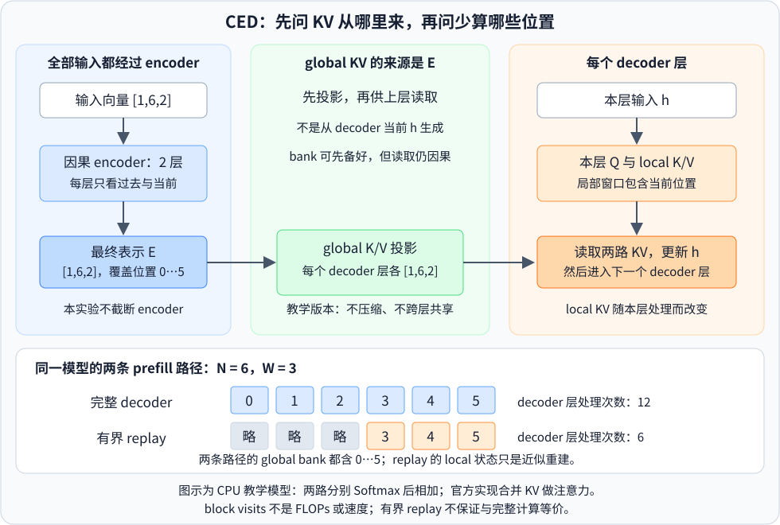

### 因果 encoder 为什么不会偷看未来

“encoder”这个词本身不保证双向或单向，mask 才决定可见性。这里的 encoder 是因果的：E_j 只依赖 x_0 到 x_j。

decoder 在位置 i 又只读取位置 j≤i 的 global 条目。两条规则串起来，任何可读条目 E_j 都不可能包含 x_(i+1) 之后的信息。局部路径同样必须满足 j≤i。因此允许提前算出整段 E 和 global bank，**不代表每个 query 都可以读 bank 的所有行**。

这里的 global 指覆盖历史的范围，不保证生产系统每次读取所有历史条目。真实模型还会做稀疏选择；本章为了隔离数据来源，用稠密的因果 global attention，省去索引器。

## P17.5 为何还要 replay

如果 global KV 已经准备好了，为什么不把整个 decoder 都跳过？因为生成开始时还需要各 decoder 层的 **local KV**。高层 local KV 依赖低层处理后的表示，不能直接拿 encoder 的 global KV 充当替身。

replay（重放）就是重新运行一段历史的计算，用它恢复当前需要的状态。它不是把历史文字再生成一遍，也不是修改用户输入。

设局部窗口 W 包含当前 token，每层最多再读取 W−1 个旧位置。单层看起来只需要一小段，但多层会把影响向前传播：第二层的某个局部 value 已经混合了第一层更早的信息。因此“最后 W 行还在”不等于“能从这 W 个原始输入精确重建所有深层状态”。

[报告 §3.2.2](https://arxiv.org/html/2609.19969v1#S3.SS2.SSS2) 的 Bounded Replay 只重放一段固定长度后缀，并把局部注意力截断在段内。若段起点为 s、当前 query 为 i，局部可见范围变成：

$$
\max(s,i-W+1)\le j\le i.
$$

这会丢掉 replay 边界之前的局部依赖。**报告明确说这不是全量计算的数学等价重建。** 官方对响应质量影响的判断来自其模型与评估，本书的小矩阵误差不能验证或否定那项质量结论。

还要分清两个用途：

- Encoder replay：持久缓存命中 global、却缺少 encoder SWA 状态时，重放缓存前缀的末尾，再处理新后缀；不覆盖已命中的 global cache。近似状态可能使新后缀的结果依赖缓存命中边界。
- Decoder replay：global KV 已由 encoder 准备好，再把 prompt 末尾的一段 encoder 输出送进 decoder，准备之后生成所需的 local 状态。

**本实验只模拟第二种。** 我们完整计算 encoder，因而 full 与 bounded 两条路径中的 encoder 和 global KV 完全相同；生产 encoder replay 不享有这个简化保证。代码不模拟 SSD、主机内存、驱逐、缓存命中策略或分布式服务。

## P17.6 CED、CSA2 与量化各管什么

不要把这些名字合成一个“省显存技巧”：

| 机制 | 主要改变的问题 | 不能据此推出 |
| --- | --- | --- |
| CED | decoder global KV 从哪里生成，哪些 prompt 位置要经过完整 decoder | 所有 decoder prompt 工作都消失 |
| SWA Bounded Replay | 缺失局部状态时重算多长的后缀，接受什么近似 | 与全量前向完全等价 |
| CSA2 | 哪些层共享 global KV、哪些层重做或复用稀疏索引 | 所有层的 Q 和 local KV 都相同 |
| KV 量化 | 每个缓存数值怎样表示、占多少字节 | 数据流完全不变就一定无误差 |
| P/D 服务分离 | 计算阶段怎样分配到设备与队列 | 模型已经采用 CED |

[报告 §2.3](https://arxiv.org/html/2609.19969v1#S2.SS3) 与固定版模型卡把 CSA2 分成 Full、Reindex、Reuse 三种模式：Full 产生 global KV 并选择索引；Reindex 复用 global KV、重新选择索引；Reuse 连选择结果一起复用。它们仍保留本层 query 与 SWA 状态。这里的 Full 是 **CSA2 模式名**，不能理解成“取消因果约束的全注意力”。

所以，CED 解释“资料从下半网络准备”，CSA2 进一步解释“哪些层共用资料和选取结果”。两者可以协同，但不应把所有缓存节省都归功于 CED。相关头数 / latent 概念见 [P14](#p14-grouped-kv)，局部与稀疏路径见 [P16](#p16-sparse-linear)。

## P17.7 先把教学模型的边界写在前面

ToyCED 输入不是 token ID，而是已经准备好的二维向量。默认两层 encoder、两层 decoder，窗口 W=3；所有权重都显式初始化并固定，全部在 CPU 上用 float64 运算。

本模型故意只保留：

1. 因果的局部 encoder。
2. 每个 decoder 层从同一个最终 E 投影 global K/V。
3. decoder 本层输入产生 local K/V。
4. 完整前向、增量缓存和近似后缀 replay 三条路径。

它省略 tokenizer、词嵌入训练、输出词表和 loss，也省略生产的 MoE、压缩 latent / Z、CSA2 共享与 Top-K、层级索引器、RoPE / YaRN、RMSNorm、FFN、mHC、Engram、量化、视觉输入、DSpark 与 GPU kernel。因此输出是二维 hidden states，**不是语言模型 logits，不能用来评估语言质量**。

还有两项特意不同的数学约定：

- 为了让新手逐项手算，本模型分别计算 global 和 local 的 Softmax，然后把两路结果加到残差上。官方参考 Attention.forward 则合并局部与 global KV，送入同一次 sparse_attn，不能拿我们的“两个平均值相加”解释生产 attention 的归一化。
- 本模型给初始向量加上 `[0.01×position, −0.01×position]`，只为让位置错误可见。它不是 RoPE，也不提供长上下文外推能力。

因此这是“保留关键依赖边”的实验，不是通过换小维度就自动忠实复现完整模型。

## P17.8 手算：三行输入如何走完两条路径

先使用更简单的配置：encoder 一层、decoder 一层、W=2，位置项关闭；所有 Q、K 投影为零，所有 V 投影为单位矩阵。分数都是 0，Softmax 就是可见位置的平均权重。第二个坐标始终为 0，只写第一个坐标：

```text
输入 x = [1, 2, 3]
```

encoder 只看自身及前一个位置，再加回残差：

| 位置 | encoder 可见输入 | 均值 | 加上本位置输入后的 E |
| --- | --- | --- | --- |
| 0 | [1] | 1 | 2 |
| 1 | [1,2] | 3/2 | 7/2 |
| 2 | [2,3] | 5/2 | 11/2 |

于是 E=[2,7/2,11/2]。decoder 的 global V 直接来自这三行 E，local V 来自本层输入；第一层的输入恰好也是 E，但多层时不能继续混为一谈。

位置 2 的完整 decoder 输出为：

$$
\underbrace{\frac{11}{2}}_{\text{残差}}
+\underbrace{\frac{2+7/2+11/2}{3}}_{\text{global 平均值 }11/3}
+\underbrace{\frac{7/2+11/2}{2}}_{\text{local 平均值 }9/2}
=\frac{41}{3}.
$$

完整的输出是 `[6,9,41/3]`。

现在只 replay 末尾 W=2 个位置，即位置 1、2。**global bank 仍有全部三行 E**，只是 decoder 的局部计算从位置 1 重新开始。

- replay 位置 1 的 global 均值仍为 (2+7/2)/2=11/4；local 却只能看到自己，为 7/2。输出是 7/2+11/4+7/2=39/4=9.75，而完整结果是 9。
- replay 位置 2 恰好已经拥有完整的单层局部窗口，所以这一行仍是 41/3。

这说明两件事：有界 replay 已经在第一行产生差异；**最后一行偶然相同，也不能证明多层情况下等价**。下一层可以读取已经改变的前一行，差异便继续传播。默认两层实验会实际展示最后一个位置也不同。

## P17.9 对照源码：不要只看图上写了 encoder

最重要的实现不长：

```python
# global_from_encoder()：在运行 decoder 前准备好各层 global bank
kv = join_kv(encoder @ layer.global_k, encoder @ layer.global_v,
             offset, None if old is None else old[i])
```

这里的 encoder 就是两层 causal encoder 的最终输出，不是把 decoder 的输出换个变量名。每层 global bank 都在 decoder 开始前生成，不依赖 decoder 本身。

相反，decoder 的局部路径是：

```python
kv = join_kv(h @ layer.k, h @ layer.v, offset,
             None if old is None else old[i])
q = h @ layer.q
h = h + attention(q, global_kv[i], offset) + attention(q, kv, offset, window)
```

h 每经过一层就改变。于是第二层 local V 会跟着第一层的处理改变，而提前准备的 global V 不会。

测试对此做了“干预”，不只检查变量名：把第一层 decoder 的 local V 投影放大三倍，重新计算。结果应当是：encoder-derived global banks 保持不变，第二层 decoder 的 local cache 和最终输出改变。如果 global bank 也被改变了，说明路径很可能接回了 decoder 自己。

## P17.10 形状和绝对位置必须一起记

默认例子 B=1、N=6、D=2、W=3。这里 D 始终是向量宽度；后文用 L_e、L_d 表示 encoder、decoder 的层数。

| 对象 | 完整 prefill 后的形状 / 位置 | 来源 |
| --- | --- | --- |
| 输入、encoder 输出 | [1,6,2] | 输入二维向量与 encoder 计算 |
| 每个 decoder 层的 global K、V | 各 [1,6,2]，绝对位置 0…5 | encoder 最终输出 |
| 每个 encoder / decoder 层的 local K、V | 各 [1,2,2]，绝对位置 4、5 | 各自层的输入 |
| full 输出 | [1,6,2]，位置 0…5 | 完整 decoder |
| bounded 输出 | [1,3,2]，位置 3…5 | 只运行最后 3 行 decoder |
| 下一次位置 | next_position=6 | 已处理 6 个位置 |

为什么 local cache 留 W−1=2 行而不是 W=3 行？因为下一次会先加入当前新行。处理位置 6 时，局部可见位置正好是 `[4,5,6]`。这只是本实验的存储约定；生产实现可以用大小为 W 的环形缓冲区。

代码用 KV.start 记录第一行的绝对位置，不能把缓存的行号 0 当成原序列的位置 0。增量输入 C 行时，位置项要从 offset 开始；注意力的比较也是 `key_position <= query_position`，而不是按本次小块的行号比较。

当 W=1 时，不需要保留旧 local 行。切片要专门处理长度 0：Python 中 `-0` 等于 `0`，`tensor[:, -0:]` 会意外保留全部历史。tail_kv 使用 `size-n` 作为起点，测试覆盖了这个边界。

缓存是调用者持有的快照，新请求传 None。增量调用不原地覆盖之前的快照，可以从同一个前缀分叉实验。它还记录模型身份和配置 / buffer 版本；常规原地改权重、换配置或换模型后会拒绝旧缓存。不要编辑缓存张量，也不要用 `.data` 或底层共享存储写入绕过版本跟踪；这里不承诺检测这些破坏。

bounded 路径会把 approximate 标记保留到后续 decode。它记录“来自截断 replay 的状态”，不是错误大小；某些窗口或输入上误差恰好为零，也不能把来源标记擅自改成精确。

## P17.11 算清少走的路径，别把路径数叫速度

定义：B 为 batch，N 为 prompt 长度，L_e / L_d 分别为 encoder / decoder 层数，R=min(N,W) 为 replay 长度。

本实验把“一个 token 的表示经过一个层”记作一次 **token-layer visit**。完整和有界路径分别是：

$$
C_{full}=BN(L_e+L_d),\qquad
C_{bounded}=B(NL_e+RL_d).
$$

令 B=1、L_e=L_d=L/2 且 N≥W，则 C_bounded=NL/2+WL/2，对应报告 §2.2 的 O(NL/2+n_win·L/2) 路径计数写法；短输入仍应使用 R=min(N,W)。

这里的 full 基线是同一个 CED 教学模型的完整执行，不是另一个普通 decoder-only 模型，更不是两个训练模型的质量对比。这是本模型实际循环累计的层处理次数，不是仅打印一条假想公式。被省掉的是 `B(N−R)L_d` 次 decoder token-layer visit。

但不能把所有工作都塞进这个计数：两条路径仍为全部 N 个 encoder 输出做 global K/V 投影。本教学模型每个 decoder 层各有一对投影，故两边都要 `BNL_d` 对投影。**官方 CSA2 有跨层复用，不能把本实验这个投影数量直接套到真实模型。**

默认 B=1、N=6、L_e=L_d=2、W=3：

| 计数项目 | 完整路径 | 有界路径 |
| --- | --- | --- |
| encoder token-layer visits | 12 | 12 |
| decoder token-layer visits | 12 | 6 |
| 合计 block visits | 24 | 18 |
| global K+V 投影对 | 12 | 12 |

24 变成 18，**不等于运行时间变成 3/4**。不同路径的每次 attention 涉及的 key 数不同，投影和内存操作也有成本；本脚本甚至显式构造稠密分数矩阵，再用 mask 遮住局部不可见位置，根本不是稀疏 GPU kernel。

当 N≤W 时，R=N，有界路径不会省掉 decoder 的任何位置。只有输入显著长于窗口时，计数差异才突出。即使如此，也不能由这个固定小矩阵实验推出官方吞吐、TTFT、TPOT、显存节省或语言质量。

## P17.12 运行与验证

在仓库根目录安装依赖后运行：

```bash
python -m pip install -r requirements.txt
OMP_NUM_THREADS=1 python code/18_ced_architecture.py
OMP_NUM_THREADS=1 python -m unittest discover -s tests -p 'test_ced_architecture.py' -v
```

若使用仓库的虚拟环境，把 python 换成 `.venv/bin/python`。没有 PyTorch 时，CLI 给出安装提示并以非零状态退出；测试按仓库稳定 torch 版本门槛跳过数值部分，**跳过不是通过**。

本章在 CPU / torch 2.14.1 / float64 下验证，核心输出为：

```text
手算 encoder: [2.0, 3.5, 5.5]
手算 full decoder: [6.0, 9.0, 13.666666666666666]
手算 bounded 后缀: [9.75, 13.666666666666666]
完整 / 有界 replay 的 block visits: 24 18
两条路径各自 global K+V 投影对计数: 12
有界 replay 的输出范围: 3 到 5
最后位置 full / replay 最大差: 0.014462788
```

末行是两组教学 hidden states 的最大绝对差，不是困惑度、回答错误率或可接受质量阈值；不同平台的末位浮点数可略有变化。

### 为什么 full/cache 对齐还不够

如果完整路径和缓存路径共用一个错误 mask，两条路径可能同时看未来，对齐测试仍然会通过。因此测试同时覆盖：

1. **独立标量 oracle**：用 Python 循环做二维乘法、逐位置 Softmax 和残差，不调用脚本的 attention、projection 或 cache helper；检查 full 和 bounded 两条路径。
2. **手算结果**：直接断言 `[2,7/2,11/2]`、`[6,9,41/3]` 与 `[39/4,41/3]`。
3. **未来隔离**：对每一个 prefix cut 改写之后的输入，前缀 encoder / global / 输出都不应变化；replay 也不能提前读 global bank 的未来行。
4. **缓存等价**：每一种两块切分和逐 token 增量都与独立 full oracle 对齐，包含 offset、W=1、短 prompt、快照分叉和新请求。
5. **近似差异**：多层 replay 的末位置以及后续 decode 确实可与完整路径不同；不把“不等价”误写成 bug。
6. **错误变体**：故意把 global 来源接成当前 decoder h、取消局部窗口、放开未来、重置增量位置、把 replay 全局 query 位置重置为 0。必须被实际数值断言抓住，不能把变体运行崩溃当成“成功检测”。

完整数值比较使用 rtol=atol=1e−12。这只适用于本章小规模 float64 实验；生产低精度算子不应照搬这个阈值。

## P17.13 小练习与本章结论

1. 将 W 从 3 改成 8，输入仍为 6 行。为什么 bounded 输出长度变回 6、block visits 也不再减少？
2. 不看图，只检查 global_from_encoder 与 decode 的参数。哪一条调用证明第二层 decoder 的 global KV 不依赖第一层 decoder？
3. 手算例子里最后一行相同，为什么不能删除“近似”警告？试着把 decoder_layers 改成 2，追踪第一层位置 1 的误差会流向哪里。
4. 如果把本实验换成真正的 CSA2，你需要新增哪些缓存、source 映射和索引有效性测试？为什么不能只把类名改成 CSA2？

### 参考答案

1. R=min(6,8)=6，整个输入都在 replay 范围内；两层 encoder 与两层 decoder 共计 6×4=24 次 block visits，和完整路径相同。
2. forward 先调用 global_from_encoder(encoder, ...)，再调用 decode(encoder, ..., global_kv, ...)；所有 decoder 层的 global bank 在第一层 decoder 运行之前就已经生成。测试放大第一层 decoder 的 local V 后，global bank 也确实不变。
3. 延续手算配置，只把 decoder 改为两层。第二层位置 2 的 global 平均仍为 11/3，残差仍为 41/3。完整 local 均值为 (9+41/3)/2=34/3，结果是 **86/3**。replay local 均值为 (39/4+41/3)/2=281/24，结果是 **697/24**，比完整结果大 **3/8**。第二层读到了第一层已改变的位置 1，单层末位的巧合就消失了。self-test 和独立测试都断言这组数。
4. 至少要分别跟踪 main KV、indexer K、Top-K 选择及各自 source，处理共享层的写入与读取时机，并重新验证索引与压缩条目的因果可见性。压缩块没有收齐时不能提前公开含有未来输入的摘要；修改名字不提供这些保证。

记住这条主线即可：**CED 改变 decoder global KV 的来源；局部 SWA 仍有自己的逐层状态，所以需要 replay；有界 replay 是明确接受误差的取舍，不是免费的等价省算。** 本章已经用实际张量和反例验证这三件事，但没有复现官方训练、权重、服务系统或性能。


---

# 架构进阶（P18）：MoE 的专家、路由与负载 {#p18-moe}

想象一间维修店：前台看过问题，把工单交给几位师傅；有些检查则每张工单都要做。店里可以有很多师傅，但一张工单未必请所有人动手。这是理解 **Mixture of Experts（MoE，混合专家）** 的起点。

不过，“专家”不是预先命名的数学老师、程序员或翻译官。它通常只是一组可训练的 FFN 权重；路由器根据当前 token 的隐藏向量选它。某个专家是否出现了可解释的分工，需要实验，不能由名字保证。多个 token 也可以同时选择同一专家，所以“前台把一个问题交给一个人”的类比很快就不够用了。

在 [P14 的 S4](#p14-grouped-kv) 中，我们已经有 RoPE、RMSNorm、SwiGLU、GQA 和 compact KV cache。本章回到主线，构造 **S5：只把 S4 的 FFN 换成教学 MoE**。P15–P17 的系统、稀疏注意力和 CED 独立实验没有偷偷混进来。

配套 [code/19_moe.py](../code/19_moe.py)，测试为 `tests/test_moe.py`。CPU 即可运行，不下载模型，不训练出专业分工，也不复现完整 DeepSeek。

## P18.1 先找准：换的是哪一块

回想 Pre-Norm Block 的两条残差支路：

$$
u=x+\operatorname{Attention}(\operatorname{Norm}_1(x)),\qquad
h=u+\operatorname{FFN}(\operatorname{Norm}_2(u)).
$$

S5 不改变第一条支路，只把第二式的 FFN 换成 MoE：

$$
h=u+\operatorname{MoE}(\operatorname{Norm}_2(u)).
$$

因此，MoE 本身不再加一次输入残差。注意力负责读取其他位置，MoE 在本层逐 token 加工已经得到的表示。换 FFN 不意味着换掉因果 mask，也不意味着取消 GQA 的 K/V 缓存。

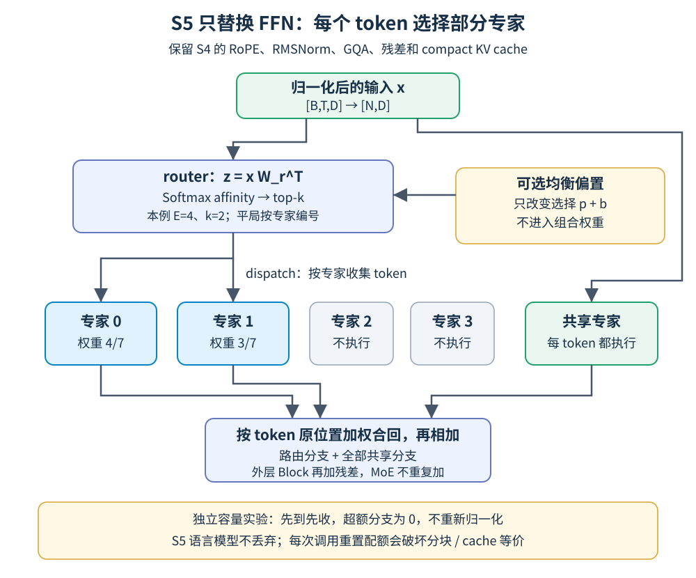

图中的 E 是可选的路由专家数量，k 是每 token 选择的数量，S 是始终参与的共享专家数量。**E 和 k 不能混写。** k=2、E=4 时，模型保存四个路由专家，单个 token 只调用其中两个。

## P18.2 路由器先打分，再选择，再加权

设一个 token 的输入是行向量 x，宽度为 D。教学路由器是一层不带 bias 的 Linear：

$$
z=xW_r^T,\qquad W_r\in\mathbb{R}^{E\times D},\qquad
p_e=\frac{\exp(z_e)}{\sum_j\exp(z_j)}.
$$

z 是分数，p 是本章选用的 Softmax affinity，意思是 token 对专家的相对偏好。它不是词表上的下一个 token 概率，维度 E 也不是词表大小 V。

接着取 p 最大的 k 个专家，记为集合 K。本章再把**所选专家**的权重归一化：

$$
w_e=\frac{p_e}{\sum_{j\in K}p_j}\quad(e\in K),\qquad
\operatorname{MoE}(x)=\sum_{e\in K}w_e F_e(x)+\sum_{s=1}^{S}F_s^{shared}(x).
$$

没有被选中的路由专家不计算 F_e(x)，也不参与这次加权和。共享专家全部执行，输出直接相加，不与路由专家一起归一化，也不除以 S。

这是本书明确选择的一套教学约定，不是“所有 MoE 的唯一公式”。尤其要区分原始 Softmax、所选权重归一化、Sigmoid affinity、输出缩放等细节。即便都叫 top-2，公式不同也会产生不同输出。

### 三张工单，手算一次

不必先学习路由器的训练。假设它已经给出下面的 p，专家编号从 0 开始，k=2。相同分数时，本章固定选编号较小者在前，以便复现。

| token | p0 | p1 | p2 | p3 | 选择顺序 | 组合权重 |
| --- | --- | --- | --- | --- | --- | --- |
| A | 0.4 | 0.3 | 0.2 | 0.1 | 0、1 | 4/7、3/7 |
| B | 0.1 | 0.2 | 0.3 | 0.4 | 3、2 | 4/7、3/7 |
| C | 0.4 | 0.4 | 0.1 | 0.1 | 0、1 | 1/2、1/2 |

A 选择的原始概率和为 0.7，所以不是“0.4 倍专家 0 加 0.3 倍专家 1”，而是 4/7 与 3/7。C 的平局不随机打破。

请求负载是 `[2,2,1,1]`，总和 6=N×k。它数的是 **token—专家分配次数**，不是不同 token 的数量，也不包括共享专家。一个 token 选择两个专家，会计两次；每个共享专家另外处理全部 N=3 个 token。

### 再把输出算成一个具体数字

为了单独检查组合规则，暂时不用 SwiGLU，把三个专家换成简单倍率：F0(x)=x，F1(x)=10x，F2(x)=100x。令 affinity 比例为 1:2:4，top-2 选专家 2 和 1，归一化权重为 2/3 和 1/3：

$$
y_{routed}=\tfrac23\times100x+\tfrac13\times10x=70x.
$$

再加两个共享分支 3x 和 5x，得到 78x，而不是 74x。这个倍率实验只用来验算组合，不把线性倍率当成真正的专家能力；正式模块和另一组独立梯度测试都使用 SwiGLU。

## P18.3 张量账本：先摊平，最后放回

设输入 X 的形状为 [B,T,D]，N=B×T。MoE 的路由和专家计算不需要先混合不同 token，因此把前两维暂时摊平即可。

| 张量 | 形状 | 含义 |
| --- | --- | --- |
| flat | [N,D] | 当前调用的全部 token 向量 |
| router.weight | [E,D] | 为所有路由专家打分 |
| logits、probs | [N,E] | 每 token 对每个路由专家的分数、affinity |
| indices | [N,k] | 被选中的专家编号 |
| weights | [N,k] | 丢弃前的组合权重 |
| kept | [N,k] | 容量实验中是否接受该分配 |
| requested、accepted | [E] | 容量处理前后各专家的分配次数 |
| output | [N,D] → [B,T,D] | 专家结果按原 token 位置合回 |

**dispatch** 是按专家收集 token；**combine** 是把结果送回 token 原位置并加权。它们不能只做 reshape：同一个 token 可能出现在多个专家的小批次中，结果要相加，而不是覆盖。

例如上面的 A、B、C：专家 0 收 A、C；专家 1 收 A、C；专家 2 收 B；专家 3 收 B。专家 0 的两个输出再分别回到 A、C 的位置。并没有把 A 的结果交给 C。

## P18.4 专家多了，参数和计算怎样算

沿用 P13 的无 bias SwiGLU，中间宽度为 d_f 的一个专家有三张矩阵：gate、up、down。参数量为 3D d_f。路由器有 DE 个参数。

设路由专家宽度为 d_r，共享专家宽度为 d_s，则**仅 MoE 模块**：

$$
P_{total}=E(3Dd_r)+S(3Dd_s)+DE,
$$

$$
P_{active/token}=k(3Dd_r)+S(3Dd_s)+DE.
$$

这里的 active 是不丢弃时，每 token 参与运算的权重预算。路由器需要给全部 E 个专家打分，所以不能只算 k 个 router 行；共享专家也不能漏算。两式都不包含 attention、norm、embedding 和输出 head，更不是整模型内存公式。

手算 D=4、E=4、k=2、d_r=2、S=1、d_s=2：

- 一个路由专家：3×4×2=24。
- 共享专家：24；路由器：4×4=16。
- 总参数：4×24+24+16=136。
- 每 token 激活参数预算：2×24+24+16=88。

**136/88 不是速度比。** 权重仍需保存或调度；路由、收集、合回、访问内存都需要工作。训练时还有梯度、优化器状态和中间激活。对一批 token，不同 token 的选择取并集后，可能所有专家都被用到。

### 细粒度专家：把宽专家换成更多窄专家

考虑 D=4、没有共享专家的两个方案：

| 方案 | E | k | 专家宽度 | 全部专家参数，不含 router | 每 token 专家参数，不含 router | 含 router 总参数 |
| --- | --- | --- | --- | --- | --- | --- |
| 较粗 | 2 | 1 | 8 | 192 | 96 | 200 |
| 较细 | 4 | 2 | 4 | 192 | 96 | 208 |

专家总预算与每 token 专家预算都相同，但细粒度方案能选择更多组合，同时 router 更大，dispatch 次数也增加。本章通过 expert_width、num_experts 和 top_k 表达这组设计，不提供把一个已训练宽专家无损切成窄专家的转换器。**预算相同不等于函数相同，也不保证质量更好。**

共享专家则是另一维选择：每个 token 都会经过它们，可以学习跨 token 的共同处理，但“学到共同知识”仍是训练假设。若添加共享专家却不相应调整 k 或宽度，激活预算会增加，不能再声称公平对比。

## P18.5 负载失衡：总共六张分配，不等于每人一样忙

如果全部 token 只选择少数专家，会有两个问题：一些专家很少接到任务、很少得到直接的任务梯度；部署到多设备时，忙设备可能拖住其他设备。

负载直方图可以帮助发现问题，却不证明模型质量。自然语言不要求每个小 batch 都完美均匀；过强地追求均匀，也可能干扰有用的选择。本章区分两类调节办法。

### 办法一：辅助均衡损失，通过梯度影响路由器

本章将整个 [B,T] 摊平，定义：

$$
f_e=\frac{n_e}{Nk},\qquad
\bar p_e=\frac1N\sum_{t=1}^{N}p_{t,e},\qquad
L_{aux}=E\sum_e f_e\bar p_e.
$$

n_e 使用丢弃前的 requested 计数；f 的总和为 1。计数来自离散选择，本实现不对它求梯度，梯度通过平均 affinity 流向 router。训练时再乘一个小系数 alpha：

$$
L=L_{CE}+\alpha\cdot\operatorname{mean}_{layers}(L_{aux}).
$$

S5 默认 alpha=0.01，且只有提供 targets 才返回训练损失。均衡辅助项不是标签预测的交叉熵；对验证损失或困惑度做比较时，应单独计算 CE，不把 CE+辅助项直接拿去算 perplexity。

在 A、B、C 的例子里，f=[1/3,1/3,1/6,1/6]，平均 p=[0.3,0.3,0.2,0.2]，所以未乘系数的 L_aux=16/15≈1.066667。

不要把“辅助损失等于 1”读成“硬路由已均衡”。例如四个专家的 p 都等于 1/4，在我们的固定平局规则下，所有 token 都选 0、1，计数仍失衡，但上述辅助项恰好也是 1。应同时查看计数、概率和训练效果。

### 办法二：偏置式均衡，改变选择而不篡改组合权重

为每个专家保存一个不通过梯度学习的 balancing bias b_e。**只在选择时**使用 p_e+b_e；组合时仍按未加 bias 的原始 p 归一化。

以 1:2:4 的 affinity 为例，若给专家 1 加 0.5，它可以排到专家 2 前面，但同样选中 1、2 时，权重仍为 1/3、2/3。不是把加过 0.5 的分数再当成输出权重。

一步训练结束后，本章演示以下显式更新：超出平均请求负载的专家减小 bias，低于平均的增加 bias，相等则不变。例子 `[4,0,2,2]` 的平均为 2，更新步长 0.1 时，bias 增量为 `[-0.1,+0.1,0,0]`。

代码将这件事放在 `update_balance_bias`，不放进 forward。否则同样的输入多调用一次，下一次结果就可能改变，缓存也可能悄悄过期。多 batch 或多设备时需要先按既定统计窗口聚合计数，本章没有实现分布式聚合或生产训练调度。

本实现用 balance_mode 选择 `none`、`aux` 或 `bias`，使两种教学机制可以单独观察。偏置模式不自动叠加辅助项；这项简化不代表真实模型不能组合两者。

## P18.6 容量与丢弃：丢的是专家支路，不是删除句子

某些 MoE 实现为每个专家一次接收的 token 数量设上限，便于控制缓冲区大小。超过容量时，系统可能丢弃、改派或采用不丢弃的可变长度实现，必须看具体规则。

本章的**独立容量实验**用固定整数 capacity，表示每个专家在本次调用最多接受多少次分配。顺序按 flat 的 token 索引从小到大；容量用完后，该专家分支贡献变成 0：

- 不删除原 token，不改序列长度。
- 不改派到其他专家。
- 不把存活分支重新归一化。
- 共享专家不受此容量限制；Block 的残差也仍在。

A、B、C 例子设置 capacity=1 后，requested 仍是 `[2,2,1,1]`，accepted 变成 `[1,1,1,1]`。C 的两个路由分支都被拒绝，共享分支仍能输出。

再看部分丢弃：第一行 p=[0.5,0.1,0.4]，第二行 p=[0.4,0.3,0.3]，k=2、capacity=1。第一行占用了专家 0 和 2；第二行本来选 0、1，但只剩专家 1 被接受，所以其路由权重总和是 **3/7，而不是 1**。这是本实验的语义，不代表它是最佳训练策略。

### 为什么 S5 语言模型明确禁止这个选项

“每次调用重新计算容量”会让同一串 token 的结果依赖分块方式：整段 prefill 可能让后面的 token 丢弃，而逐 token decode 每次都拿到新容量。batch 中另一条序列还可能抢占同一专家的配额。若容量根据 batch token 总数推导，改变未来长度甚至可能改变已有位置的结果。

因此，`TeachingMoE` 可独立演示容量，`MoEGPT` 的完整前向与缓存前向都要求 **dropless，即 capacity=None**。运行中偷偷改成整数也会报错，而不是给出两种语义不一致的 logits。这不是“缓存功能不够强就不测”，而是先把正确性契约说清楚。

## P18.7 梯度去哪儿：选择离散，权重仍可微

在一次前向里，top-k 的专家编号是离散的。本实现不会对“编号从 1 跳到 2”求导。但在选中的分支内部，SwiGLU、归一化权重和输入仍参与 autograd。

需要分开看：

1. 被接受的专家收到来自相应 token 的任务梯度；本次完全没执行的专家，其参数 `.grad` 可以是 None，不代表程序故障。
2. top-k 组合权重通常让任务损失影响 router，但本章的 **top-1 加所选权重归一化**有特殊性：唯一权重恒为 1，所以该任务路径的 router 梯度为 0。
3. 辅助损失通过全部 affinity 影响 router，不能把“空专家没有直接任务梯度”误说成“对应 router 行永远没有梯度”。

在 78x 的手算测试里，x=[1,0]、router 第一列为 [0,log2,log4]、第二列为 0。令损失为输出各维之和，router 第一列梯度为 `[0,-20,+20]`：权重变化会在 10x 与 100x 间重新分配。输入第一维梯度为 78+20log2，第二维为 78。测试把这些字面算式与 autograd 对齐，没有拿生产 dispatch 函数自己验证自己。

“今天没收到梯度”不等于“永远不会变化”：其他 batch 可能路由到它，优化器的历史动量、权重衰减和梯度清理方式也会影响实际更新。我们的空专家测试只断言本次反向的直接梯度。

## P18.8 顺着代码走一次

关键实现没有写成一个与主线无关的玩具。`MoEGPT` 继承 `GroupedGPT`，保留 attention、norm、残差、embedding 和 head，只替换每个 Block 的 mlp。

```python
for block in self.blocks:
    block.mlp = TeachingMoE(
        config.d_model, config.num_experts, config.top_k,
        config.expert_width, config.shared_experts,
        config.shared_width, config.balance_mode)
```

专家调用处可以按六步读：

```python
flat = x.reshape(-1, self.d_model)
info = route(self.router(flat), self.top_k, bias, self.capacity)
output = flat * 0
for expert_id, expert in enumerate(self.experts):
    token_ids, slots = ((info.indices == expert_id) & info.kept).nonzero(as_tuple=True)
    if token_ids.numel() == 0:
        continue
    values = expert(flat.index_select(0, token_ids))
    values = values * info.weights[token_ids, slots, None].to(values.dtype)
    output = output.index_add(0, token_ids, values)
for expert in self.shared:
    output = output + expert(flat)
return output.reshape_as(x)
```

1. 摊平 token，但保留 D。
2. 计算 router，再得到选择、权重和容量 mask。这里 bias 只在偏置模式提供。
3. 按 expert_id 找出属于它的 token 和在 top-k 列表中的位置 slots。
4. 只收集并计算这些 token，空专家直接跳过。
5. 查出对应权重乘到专家输出上，`index_add` 按 token 索引相加，避免覆盖其他专家的贡献。
6. 运行所有共享专家，恢复原形状。残差在外层 Block 中添加。

route 里不用默认 topk 的偶然平局顺序，而使用稳定降序排序，保证同分时专家编号较小的在前。没有非零均衡偏置时，直接按 logits 排序：Softmax 单调，而直接排序可避免极小概率下溢成相同的 0，制造假的平局。组合权重则直接对**所选原始 logits**做 Softmax：代数上等于先取原始 p 再归一化，但若 bias 选中极小概率专家，可避免原始 p 下溢后出现 0/0。

这仍然是强调可读性的 CPU 实现：Python 循环、有限性检查、逐专家收集都不是生产 fused kernel。不要拿它的运行时间推断大型 MoE 的性能。

### 缓存也必须认识路由配置

S5 继续调用 S4 的 compact GQA cache，形状仍为 [B,Hkv,T,d]。但高层的历史 K/V 依赖低层 MoE 的输出，所以改变低层路由也会让缓存失效。

已有签名追踪权重、位置参数、norm epsilon 等；S5 另外追踪实际模块上的 top_k、capacity、balance_mode，以及 balancing bias 等 buffer 的身份、原地修改版本、dtype 和 device。bias 虽然不是 Parameter，也必须纳入。

以下情况都需要清空 cache：更新权重、更改 router 设置、执行 bias 更新、替换 bias buffer、切换 dtype/device。不同模型不能共用缓存。和 S1–S4 一样，故意通过 `.data` 绕过版本跟踪或手动改 cache 张量都不受支持；签名不是防篡改哈希。

`last_info` 只是最近一次调用的诊断，不是累计请求状态。逐 token decode 后看到的计数，只描述最后一次输入的那几个 token。不要把它当成整段请求直方图。

## P18.9 在 CPU 上跑通，并知道测试证明了什么

使用仓库固定依赖，在仓库根目录运行：

```bash
python -m pip install -r requirements.txt
OMP_NUM_THREADS=1 python code/19_moe.py
OMP_NUM_THREADS=1 python -m unittest discover -s tests -p 'test_moe.py' -v
```

2026-10-19，CPU、PyTorch 2.14.1+cpu、seed=180 的实际输出包括：

```text
capacity=None; selected=[[0, 1], [3, 2], [0, 1]]
requested=[2, 2, 1, 1]; accepted=[2, 2, 1, 1]; aux=1.066667
capacity=1; selected=[[0, 1], [3, 2], [0, 1]]
requested=[2, 2, 1, 1]; accepted=[1, 1, 1, 1]; aux=1.066667
module budget: {'expert': 24, 'router': 16, 'shared': 24, 'total': 136, 'active': 88}
finite training loss/gradients: True
layer 0 requested load: [4, 6, 11, 3]
layer 1 requested load: [8, 6, 5, 5]
full/cache maximum absolute error: 1.79e-07
compact KV payload bytes: 1536; no GPU timing measured
```

后一组直方图来自未训练的两层 S5，B=2、T=6、k=2，所以每层计数和为 24。不能把随机初始化下的分工当成学到的专家能力。脚本用合成 token 做一次梯度 smoke，循环左移标签也只是用于验证反向，并非本书推荐的语料构造或验证集评估方法。

KV 的 1536 字节可以独立复算：2（K/V）×2 层×2 batch×6 token×2 KV 头×4 头宽×4 字节。MoE 没有把 Hkv 改成 E；专家参数内存与 KV payload 是两本不同的账。

测试覆盖的不只是 full/cache 相同：

- 固定路由权重、平局规则、负载、辅助损失和参数预算手算。
- 独立逐标量 SwiGLU 与路由参考，对比输出、输入梯度和全部参数梯度。
- 空 token、空专家、所有 token 集中到一个专家、top-1 和 top-E 边界。
- 容量为零、完全丢弃、部分丢弃，以及共享分支仍保留。
- 稀疏 dispatch 确实不调用空专家；梯度 None 与零的区别。
- 多种 chunk 划分、单 token decode、未来 token 改动不影响前缀、batch 独立和请求重置。
- bias、top-k、权重、dtype、位置参数改变后，旧 cache 被拒绝。
- 故意改成均匀权重、全专家执行、把 bias 混进组合、共享输出取平均、丢弃后重归一化、后到先收等错误时，独立判据确实失败。

CPU 数值对齐不是 GPU 速度测试，也不是质量评测。浮点末位可能随环境变化，判定依据是测试容差，而非逐字复制日志。没有 PyTorch 时，CLI 给出安装提示并退出码 2，数值测试明确跳过；**跳过不是通过**。

## P18.10 多设备时，还要付“把工单送过去”的成本

当专家分布在不同设备上，dispatch 不再只是本机索引：需要把 token 向量送到相应专家所在的设备，算完后把输出送回。常见 expert parallel 会用到 all-to-all 一类通信，但具体分组、复制和合并方案各不相同。

一个粗略账本是：N 个 token，每个发往 k 个远端专家，每份 D 维、每元素 q 字节，那么一次向外发送的向量 payload 约为 NkDq；返回还要再算一趟。它不是网络实测：同节点合并、专家共置、本地命中、元数据、padding、反向通信和通信计算重叠都会改变真实开销。

因此，决定时延的至少包括：

- 每个专家的实际 token 数，最忙的设备是否成为瓶颈。
- 矩阵乘法能否形成足够大的批次。
- 网络带宽、延迟、路由限制与通信重叠。
- 模型权重能否驻留，加载或搬运要花多久。
- 服务目标是 prefill 吞吐、单请求 decode 延迟，还是并发服务。

“激活参数较少，所以普通电脑一定更快”是不成立的。小 batch 下，大量小矩阵乘法和调度可能更慢。性能要回到 P15 的相同请求长度、并发、硬件与 TTFT/TPOT 等指标上测；本章没有 GPU 或多卡实验。

## P18.11 和官方资料对照：学机制，不冒充复现

本章于 2026-10-19 核验以下固定论文版本，并沿用大纲来源编号：

- **S19：** [DeepSeekMoE，arXiv 2401.06066v1，§3.1–3.3](https://arxiv.org/html/2401.06066v1#S3)。它讨论细粒度专家、共享专家隔离与负载均衡。共享专家始终执行，细分专家时要同时调整激活数量，不能只比较专家数。该版本公式（9）–（11）的 Softmax gating 不应被自动改写为本章的 selected renormalization。
- **S09：** [DeepSeek-V3 官方仓库](https://github.com/deepseek-ai/DeepSeek-V3) 所链接的 [技术报告 arXiv 2412.19437v2，§2.1.2](https://arxiv.org/html/2412.19437v2#S2.SS1.SSS2)。V3 使用 Sigmoid affinity、所选 affinity 归一化、只影响选择的均衡偏置，并保留很小的序列级辅助项；报告明确说明训练和推理不丢弃 token。因此 “auxiliary-loss-free” 不能解释成全模型绝对没有任何辅助损失，也不能把本章容量丢弃示例说成 V3 的做法。

本书 S5 使用 Softmax affinity、单进程逐专家 dispatch、可分开观察的 batch 辅助项或偏置模式。没有复现 V3 的 Sigmoid 路由、节点限制、分布式均衡、FP8、通信 kernel、训练数据或官方权重。引用生产系统的设计动机，不意味着继承其性能和质量结论。

## P18.12 自测：先写答案，再运行断言

1. A 的 p=[0.4,0.3,0.2,0.1]、k=2，输出权重是 0.4、0.3 吗？三行 A、B、C 一共发生多少次路由分配？
2. D=4、E=4、k=2、路由和共享宽度都为 2、一个共享专家时，MoE 总参数与每 token 激活预算各多少？是整模型参数吗？
3. 把 E=2、k=1、宽度 8 换成 E=4、k=2、宽度 4，专家参数预算保持什么？包含 router 后还严格相等吗？
4. A、B、C 的请求计数为何是 [2,2,1,1]？capacity=1 后计数和 C 的路由贡献怎样变？
5. 部分丢弃例子第二行只保留专家 1，权重应为 1 还是 3/7？共享分支受不受影响？
6. 所有 token 的四个 affinity 都是 1/4，top-2 的硬负载会均匀吗？L_aux=1 能证明均衡吗？
7. top-1 且所选权重归一化时，单靠任务损失能在本实现中更新 router 吗？辅助项呢？
8. bias 更新采用负载 [4,0,2,2]、步长 0.1 时，增量是多少？已建的 KV cache 能否继续用？
9. 缓存和完整前向都用同一个错误的“所有专家平均”函数，二者一致能证明 MoE 正确吗？
10. 本次 CPU 日志中的 KV payload 1536 字节怎样算？为什么它不等于专家权重占用？

### 参考答案与对应测试

1. 权重为 4/7、3/7；三行共 3×2=6 次。见 `test_hand_route_weights_counts_aux_and_ties`。
2. 总参数 136，激活预算 88，只覆盖 MoE 模块。见 `test_parameter_active_budget_and_fine_grained_example`。
3. 专家总参数都是 192，每 token 专家参数都是 96；含 router 总参数分别为 200、208。见同一预算测试。
4. A、C 都选 0、1，B 选 3、2；accepted=[1,1,1,1]，C 的路由贡献为零，共享和残差不因此删除。见 `test_capacity_fixed_order_no_renormalization_shared_survives`。
5. 3/7，不重新归一化；共享分支不受容量限制。该测试同时检查部分丢弃与 capacity=0。
6. 不会。固定平局规则使每个 token 都选 0、1；损失仍可为 1。见手算路由测试中五 token 的 [5,5,0,0] 断言。
7. 不能通过这条任务路径，唯一组合权重恒为 1，router 梯度为零；辅助项在测试的集中路由案例中提供非零梯度。见 `test_sparse_execution_empty_experts_and_top1_router_gradient`。
8. [-0.1,+0.1,0,0]；更新 buffer 后必须重置缓存。见偏置方向测试与 `test_runtime_and_buffer_mutations_invalidate_cache`。
9. 不能。测试还用独立标量输出/梯度参考、78x 手算和故意注入的错误验证判据。见 `test_mutations_fail_independent_oracle_not_only_cache_agreement`。
10. 2×2×2×6×2×4×4=1536；这是当前请求的 K/V 张量，形状依赖层数、KV 头与长度，而不是专家矩阵。见 `test_full_cache_alignment_each_mode_and_extreme_k`。

到这里，S0→S5 已经把“多保存一些参数”和“每 token 真正调用哪些参数”分开。接下来进入训练流水线：即使路由与缓存都正确，数据边界、去重、切分和预算没有处理好，也训练不出可靠的模型。

## P18.13 延伸：Stable LatentMoE 与 Quantile Balancing {#p18.13-latent-moe-qb}

**先看动机。** 专家越多、每 token 选得越多，可组合的专长就越多。但普通 MoE 里，每个被选中的专家都收到完整的 d 维向量。选 16 个，就要搬 16 份 d 维数据。[LatentMoE，arXiv:2601.18089](https://arxiv.org/abs/2601.18089) 把路由专家放到更窄的 latent 宽度 ℓ 上计算，共享专家仍走完整宽度。

Kimi K3 报告（S29 §2.3，Eq.11）写成：

`u = Σ_{i∈T_k(x)} p_i E_i(W↓ x)`，`y = Σ_j E_j^shared(x) + W↑ RMSNorm(u)`。

S29 Table 1 的数字：隐藏宽度 7,168，latent 宽度 3584（0.5×），896 个路由专家，每 token 激活 16 个，2 个共享专家。896/16 = 56，就是报告说的稀疏度 56。RMSNorm 放在 W↑ 之前，是 K3 相对原始 LatentMoE 的改动（§2.3.1）。

**负载均衡为什么要换。** 专家接近 10³ 个时，S29 说原来的定步长偏置更新不再好用。那条规则是 `b_j ← b_j + γ sign(ℓ̄ − ℓ_j)`，来自 DeepSeek-V3（[arXiv:2412.19437](https://arxiv.org/abs/2412.19437)）。γ 小就追得慢，γ 大就来回震荡。

QB 的思路是：直接算出“让专家 j 正好接到 q 个 token”的偏置。设一批 m 个 token、n 个专家、每个选 k 个，目标负载 `q = mk/n`（Eq.14）：

1. 用 top-(k+1) 路由。第 k+1 名的偏置分数记作截断线 `α_i`。
2. 对专家 j，看所有 token 的余量 `s_{i,j} − α_i`。取第 q+1 大的余量，它的相反数就是新偏置 `b̂_j`。这等价于 `−quantile_{1−k/n}`。
3. 所有偏置减去均值。整体平移不改变 top-k 的选择。
4. 新偏置只用于下一步。一批数据从不用它自己算出的偏置路由。

偏置只影响“选谁”，不进入混合权重 `p_{i,j}`（Eq.13）。所以它不改变路由器的梯度。

**CPU 玩具。** S29 的 Figure 5 用 m=8、n=4、k=1，负载从 (4,3,1,0) 变成 (2,2,2,2)，q=2。报告没有给出图中的分数矩阵。[`../code/19b_latent_moe_qb.py`](../code/19b_latent_moe_qb.py) 用了两个本书自造的 8×4 矩阵，起始负载都是 (4,3,1,0)：

- `SCORES_BALANCES`：用带种子的随机搜索找到。一步 QB 后负载为 (2,2,2,2)。
- `SCORES_STALLS`：手写的。一步后为 (3,3,1,1)，在同一批上重复五次仍是 (3,3,1,1)。

第二个例子很重要。S29 附录 C 把 QB 推导成一个分配问题对偶的坐标下降。一步更新不保证这一批立刻完全均衡。训练中数据每步都在变，这只是一个偏置估计。本书没有测大规模训练中的负载曲线。

测试检查：两个矩阵的起始负载；第一个一步均衡；第二个不均衡；偏置均值为 0；整体平移不改变路由；混合权重与偏置无关。


---

# 预训练（P19）：从三首诗到可恢复的数据流水线 {#p19-pretraining}

P09 让我们看清了一次学习：取文本、错开一格、预测、评分、更新。可是，把三首诗换成许多文件之后，最容易出错的地方往往不在 Transformer 公式里，而在“这份题从哪里来”“哪些题重复了”“断电后从哪一题继续”。

本章把这条链拆开。**读完后，你应能追踪每一个被评分的 token，解释两个独立的文档边界，并验证恢复训练不是重新开了一局。** 前置是 P09 的交叉熵与训练循环、Baby-GPT 的输入输出，以及 P13 的 RMSNorm/SwiGLU；不需要 GPU，也不需要下载大模型。

完整实验在 [code/20_pretraining_pipeline.py](../code/20_pretraining_pipeline.py)。前半段只用 Python 标准库，后半段用 CPU 训练一个 2,040 参数的小模型。语料是本章生成的极短字符串，不是抓取网页、用户聊天记录或私有文件。本章的目标是检查数据与状态的正确性，**不是训练出会写诗的模型，更不是复现工业规模预训练**。

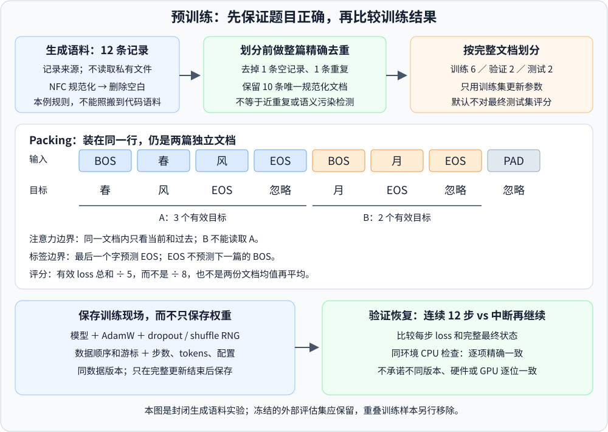

## P19.1 在算力之前，先问数据的来历

把训练数据想成练习册：页数多，不代表题目有用；同一道题印一万遍，也不是一万道新题。但这个类比也有限，语言模型从 token 分布中拟合条件概率，并不会像教师那样主动判断题目是否可靠。

“质量”至少包括几件不同的事：

- **可读与正确**：乱码、截断、重复页眉、错误答案会改变训练信号。
- **与用途相关**：百科、代码、对话、数学题有不同分布。某领域 loss 低，不等于别的领域好。
- **覆盖与代表性**：过滤规则可能把少数语言、方言或特殊文体一起删掉。
- **来源可追踪**：能知道一条记录来自哪个版本、经过什么处理、为什么被保留。
- **使用范围明确**：能访问、能下载、公开展示，不自动等于可以任意训练、再分发或商用。

许可、隐私与技术清洗是不同的检查。删除邮箱地址不等于完成隐私处理；有许可也不等于其中所有个人信息都适合进入训练集。真实项目需要按来源核对适用的授权、用途、保留和删除要求，记录审核结果；不要把未经允许的私人文件上传到演示平台。本章不提供自动许可判断或自动隐私合规保证。

本实验只生成“春风”“月明山水”“光”这样的玩具字符串。每条 `Document` 都记录 `uid`、`text`、`source`、`provenance`。`generated-for-this-book` 明确表示**这份语料是在本章内生成的**，不是某个外部数据集的许可证，也不是对任意网页加上此标签就获得授权。程序拒绝其他来源标签，只是限定演示的输入范围；它没有能力验证别人填写的标签是否真实。

## P19.2 先清洗和去重，再划分我们自己的小语料

先看一份完整的清洗账本，而不是只看最后剩下几条：

| 阶段 | 本实验做什么 | 数量与例子 |
| --- | --- | --- |
| 原始记录 | 10 条生成字符串，加一条重复变体、一条空白 | 12 条 |
| 规范化 | Unicode NFC；删除所有空白字符 | `" 春\n风 "` 变为 `"春风"` |
| 空文档过滤 | 规范化后为空就移除 | 移除 `blank` |
| 全局精确去重 | 比较规范化后的整篇文本，保留输入顺序中的第一份 | `duplicate` 与 `d00` 相同，移除前者 |
| 文档级划分 | 固定 seed=19 打乱唯一文档，再按 6/2/2 分配 | 训练 6、验证 2、测试 2 |

这里的“全局”，只指**这一份尚未划分的封闭生成语料**。去重函数在划分之前运行，使同一个规范化文档不能因为换了 ID，就同时出现在练习册和考试卷。随机划分重叠窗口则做不到这一点：窗口不同，来源可能仍是同一篇。

代码顺序很短：

```python
kept, report = clean_deduplicate(raw_documents)
splits = split_documents(kept, seed=19)
rows = {name: pack_documents(docs) for name, docs in splits.items()}
```

为什么还要保存 `report`？否则我们看到“10 条”时，不知道是删掉了两条垃圾、丢了一个文件，还是悄悄改变了清洗规则。`data_version` 则对流水线版本、固定词表、特殊 ID、原始记录及来源、划分结果和 packing 结果的规范 JSON 取 SHA-256。它用来发现配置或数据改变，不证明内容正确，也不是隐私匿名化方法。

### 精确去重不等于近重复检测

`"春风"` 与 `"春风月"` 仍是两条记录；改一个字、换行以外的格式差异、翻译、释义、共享大段模板，都可能留在数据里。本章不实现 MinHash、相似段落聚类或语义去重，也不声称已经消除训练污染。实际项目可以先在更大语料上定义近重复关系，再把同一重复簇放到同一划分，检查阈值误删和漏检。

本章的“删掉所有空白”只适合这份极小中文玩具数据。照搬到英文，会把 `a book` 变成 `abook`；照搬到 Python，会破坏缩进。清洗规则必须随数据类型定义和版本化，不能把“删得更干净”当作普适目标。

### 冻结的外部测试集，处理方向相反

假设一个外部考试集已经固定，里面有文档 E；后来收集的训练候选集里也出现了 E。**不要**把两者合在一起执行“第一份胜出”，再重新随机划分。若训练副本排在前面，原本必须保留的考试题可能被移走，还可能进入训练。

正确的边界是：保留冻结的评估集及其版本，对训练候选执行重叠检查，移除或隔离训练中的冲突，并记录规则。近重复、来源重叠和时间泄漏仍需另查。本章的 `split_documents` 是“自己建立一个封闭玩具数据划分”的函数，**不是通用 benchmark 去污染工具**。

验证集用于选择超参数或观察训练；测试集留到方案冻结后的最终评估。默认演示只查看验证集，输出 `test_evaluated=false`。即使测试文本没有参与梯度更新，反复用测试分数选模型，也会逐渐把测试集变成验证集。

## P19.3 Token 不是字符数，处理数量也不是有效监督数量

P09 为复用三首诗的字符词表，提前知道了保留诗歌的字符。本章换成一份**提前写死、并非从任何划分拟合的** 14 字教学字表：

```text
春 风 月 明 山 水 花 开 日 光 云 雨 星 河
```

再加四个特殊 ID：`PAD=0`、`BOS=1`、`EOS=2`、`UNK=3`。因此词表大小是 18，`春=4`、`风=5`、`月=6`。本例逐字编码，未知字映射到 UNK；真实 tokenizer 可以把多个字符变成一个 token，也可以把一个字符拆成多个 token。这里不训练 tokenizer，更不声称这 18 项能覆盖自然语言。

每篇文档写成 `BOS + 正文 + EOS`。长度为 n 的正文产生 n+2 个真实输入位置，却只有 n+1 个有效预测目标：BOS 预测第一个字，最后一个字预测 EOS；EOS 本身没有后续同文档目标。

实测数据账本如下。目标数包含 EOS，不包含 BOS、PAD 或被忽略的位置；物理槽位是实际计算的固定长度输入格子。

| 划分 | 文档 ID | 文档数 | 长度 12 的块数 | 有效目标 token | 物理输入槽位 |
| --- | --- | ---: | ---: | ---: | ---: |
| train | d09、d05、d06、d02、d03、d07 | 6 | 3 | 21 | 36 |
| validation | d04、d01 | 2 | 1 | 7 | 12 |
| test | d08、d00 | 2 | 1 | 7 | 12 |

训练集一遍有 15 个正文字符、12 个 BOS/EOS 输入，共 27 个非 PAD 输入；固定计算 36 个槽位，其中只有 21 个位置产生监督。把这几个数都叫“训练了 36 tokens”会掩盖边界开销。报告预算时应写清：是原始文本 tokens、非 padding 输入 tokens，还是有效 loss targets，以及是否包含重复遍历。

这些文档极短且来自同一小字表，即便精确文本不重叠，也会共享字符和短语。它们只是检验划分机制，不能支撑泛化能力结论。

## P19.4 Packing：装进一箱，不等于连成一篇

如果每篇两三个字都占一个长度 12 的张量，大部分格子会是 PAD。**Packing** 把多个短文档装到同一行，减少空格。关键问题是：第二篇是否应该读取第一篇？第一篇的结尾是否应该预测第二篇的开头？

本章选择严格的**文档独立目标**：两者都不允许。其他训练配方可能有意采用连续串流上下文，但那是另一种条件分布，不能把普通三角 causal mask 称为文档隔离。

我们采用最直白的装箱策略：按已有顺序放入整篇文档；放不下就开新块；最后补 PAD。**不把一篇文档切成多个块，不丢掉尾巴。** 文档连同 BOS/EOS 超过块长时，代码明确报错，要求先定义分块策略。若以后支持长文档切分，还需决定上下文重叠、目标是否重复计数、是否重置位置、EOS 仅在真正结尾还是每块都插入；不能悄悄截断后说“都读过了”。

### 一行八格，逐格追踪

取文档 A=`春风`、B=`月`，暂用块长 8。`-100` 是本实验的 IGNORE，不是一个词表 ID，也不应拿去查 embedding。

| 格子 i | 输入 x / ID | 文档内位置 | 同文档可见输入格子 j | 已错位的目标 y | 计入 loss？ |
| --- | --- | ---: | --- | --- | --- |
| 0 | BOS / 1 | 0 | 0 | 春 / 4 | 是 |
| 1 | 春 / 4 | 1 | 0、1 | 风 / 5 | 是 |
| 2 | 风 / 5 | 2 | 0、1、2 | EOS / 2 | 是 |
| 3 | EOS / 2 | 3 | 0、1、2、3 | -100 | 否 |
| 4 | BOS / 1 | 0 | 4 | 月 / 6 | 是 |
| 5 | 月 / 6 | 1 | 4、5 | EOS / 2 | 是 |
| 6 | EOS / 2 | 2 | 4、5、6 | -100 | 否 |
| 7 | PAD / 0 | 占位为 0 | 无 | -100 | 否 |

行长 T=8，模型输入是 `[B,T]`，输出 logits 是 `[B,T,V]`，这里 B=1、V=18。位置 ID 在每篇 BOS 重置为 0；整箱中的“第 4 格”不是文档 B 的第 4 个位置。

本章的布尔 attention mask 中，`True` 表示**允许**，不是“挡住”：

```text
允许(i,j) = i、j 属于同一个非 PAD 文档，并且 j <= i
```

不同 API 对布尔 mask 的约定可能相反，接入框架前必须核对。本模型使用自己的显式 attention 函数，不把这个矩阵不加检查地送给任意接口。

### 两条边界互不替代

1. **Attention 边界防偷读上下文。** 只用普通 causal mask，B 的 BOS 仍能看到 A 的全部输入。即使 A 的 EOS 标签已设为 -100，B 的表示仍会受 A 影响。
2. **Label 边界防错出题。** 即使 attention 已完全隔离，把整行统一做 `y=x[1:]`，A 的 EOS 仍会被要求预测 B 的 BOS。这个目标不是 A 文档的一部分。

程序先在每篇内部生成 `tokens[1:] + [IGNORE]`，再拼装，因此只错位一次。EOS 作为上一字的正确答案参与 loss；EOS 作为输入时的输出忽略。PAD 既不能作为被读取的 key，也不作为有效 query 或 loss target。

PAD 查询整行都不可见，直接对全是负无穷的分数做 softmax 会产生不定义的结果。本实现先识别全禁用行，使用安全的临时零分数，再把禁止位置权重乘为零，使其 attention 输出精确为零；最终 PAD logits 也置零。这不是让 PAD 读取任意文档来“凑一个可见项”。

测试还做了更直观的核对：关闭 dropout 后，把 A、B 一起 packing 得到的真实位置 logits，应与分别单独处理的结果接近；只改 A 的字，B 的输出应完全不变。把 mask 故意换成普通下三角后，后一条检查确实会失败。

## P19.5 Loss：每道有效小题一票，不是每箱一票

下面给五个有效目标指定一组**人为设计、未训练得来**的正确答案概率。忽略位置没有 loss，不是“loss 等于零后也算进分母”。

| 格子 | 正确答案 | 指定 p(正确答案) | 单 token loss = -ln(p) |
| --- | --- | ---: | ---: |
| 0 | 春 | 1/2 | 0.693147181 |
| 1 | 风 | 1/4 | 1.386294361 |
| 2 | EOS | 1/2 | 0.693147181 |
| 3 | 忽略 | 不评分 | 不计入分母 |
| 4 | 月 | 1/8 | 2.079441542 |
| 5 | EOS | 1/4 | 1.386294361 |
| 6、7 | 忽略 | 不评分 | 不计入分母 |

总 loss 是 `9 × ln(2) = 6.238324625`，有效目标数是 5，平均是 **1.247664925**。不是除以 8，也不是只除以正文字符数 3。

脚本没有把概率直接塞给 `cross_entropy`。它构造完整 18 类 logits：其他 17 类分数为 0，目标类分数设为 `ln(17p/(1-p))`，softmax 后的目标概率才恰好为 p。标准库的 `scalar_loss` 用稳定 log-sum-exp 独立计算，tensor 测试再与 `torch.nn.functional.cross_entropy(..., reduction="sum")` 比较，并核对忽略位置梯度为零。

为什么不能平均文档均值？A 有 3 个目标，均值为 `4ln(2)/3 ≈ 0.924196241`；B 有 2 个，均值为 `5ln(2)/2 ≈ 1.732867951`。正确合并方式是：

```text
(3 × A均值 + 2 × B均值) / (3 + 2) = 1.247664925
```

简单平均两份均值会得到约 **1.328532096**，给短文档额外权重。评估多个长度不同的 batch 时也是一样：累计 loss 总和与有效 token 总数，最后只除一次。

```python
total_loss, total_targets = 0.0, 0
for batch in validation_batches:
    loss_sum, count = tensor_loss(logits, labels)
    total_loss += float(loss_sum)
    total_targets += count
mean_loss = total_loss / total_targets if total_targets else None
```

这是说明聚合方式的片段，完整 `evaluate()` 会在循环中做前向，使用 `eval()` 与 `no_grad()`，最后恢复原训练模式。测试用 2 个目标和 5 个目标的两块检查加权方式，故意平均块均值会给出不同结果。

### 全部标签都忽略时，不能只想到除零

`tensor_loss` 返回可求导的零与 `count=0`；统计均值返回 `None`，表示**没有可评分样本**，不是模型获得了完美的零损失。训练器直接跳过这种行，不执行 backward、optimizer.step、学习率推进或 token 计数。

为什么连 `optimizer.step()` 也要跳过？AdamW 有动量状态和权重衰减，零梯度不保证参数不变。测试先做两步真实更新，再喂全 PAD 行，验证整个状态不变；故意仍然执行 AdamW step 的坏版本确实改变权重。

还要分清“框架替我们移位”和“已经手工移位”。本章的 `tensor_loss` 接受已对齐的 next-token labels，**不再移位**。Transformers 某些 causal-LM 接口则接收与输入同排的 labels，在模型内部移位；其 v4.51.3 的 language-modeling collator 在 `mlm=False` 时采用输入同排、padding 忽略的约定。换框架时必须核对具体模型，不能把这两种契约叠加使用。[官方 Data Collator 文档](https://huggingface.co/docs/transformers/v4.51.3/en/main_classes/data_collator)

## P19.6 混合比例：同样“各一半”，可能不是同一回事

如果 1 篇长百科有 1,000 个目标，1 篇短问答只有 10 个，按文档各抽一半，长期得到的 token 比例不会是各一半。数据混合至少要说明：按文档、按原始 bytes、按非 PAD token，还是按有效监督 token 计量。

本章不实现领域采样调度器，只记录两个人工来源标签：`generated/nature` 与 `generated/reversal`。训练划分中，前者贡献 15 个有效目标，后者贡献 6 个；一遍的 token 比例是 **5/7 与 2/7**。这不是经过搜索得到的最佳配方，只是当前语料和划分的账本。每个 epoch 将三个 packed rows 打乱后各用一次，因此完整一遍保留这个比例；只训练半遍时，实际累计比例可能不同。

真实配方可以增加稀缺领域的采样频率，但重复少量样本不会凭空制造新知识，还会改变过拟合、记忆和评估风险。应同时记录目标混合比例、实际消费量、重复次数、每来源验证结果；不要只有一个综合 loss，掩盖某个来源退步。

本训练器每步用当前块的有效目标平均 loss。块中目标数为 6、7 或 8，所以每步样本量略有不同。它**没有**梯度累积，也没有声称“多个不等长块的梯度均值再平均”等价于一次全局 token 平均。若加入梯度累积，应明确总有效目标分母；汇总训练日志也应按 `loss × count` 累计。日志跨越了不同参数状态，仍不等于用最终模型重跑整个训练集得到的评估 loss。

## P19.7 学习率、精度与预算：三个不同的旋钮

### 学习率改变更新幅度，不改变题目来源

`learning_rate()` 使用固定总步数 12：前两步 warmup，随后线性降到峰值的 10%。前几步和最后一步的值如下：

| 更新步号（从 1 开始） | 1 | 2 | 3 | 4 | 12 |
| --- | ---: | ---: | ---: | ---: | ---: |
| 学习率 | 0.0015 | 0.0030 | 0.0030 | 0.0027 | 0.0003 |

这里的 warmup 只是一个可核对的实验设置，不是“所有模型都必须两步预热”。峰值、步数、batch token 数、优化器与初始化共同影响训练。恢复到第 5 步之后，不能把学习率又从第 1 步开始，也不能不记录就把总预算从 12 改成 120；本程序会拒绝不同 horizon 的 checkpoint。

### 混合精度不等于“所有张量都改成半精度”

本实验用 **CPU float32**，没有 AMP，也没有 GradScaler。混合精度训练通常让适合的算子使用较低精度，部分归约或敏感操作保持较高精度；收益取决于设备、算子与形状，不保证每个小任务更快。

FP16 的较小梯度可能下溢；loss scaling 在反向前放大 loss，更新前还原梯度。BF16 与 FP16 的数值范围不同，也不是只换名称就能复用所有设置。应检查有限 loss/梯度、与 float32 参考的偏差，并使用适合该设备和模型的 autocast/scaler 流程，而不是盲目调用 `model.half()`。若用了 GradScaler，其状态也属于恢复训练的一部分。[PyTorch 2.14 AMP 文档](https://docs.pytorch.org/docs/2.14/amp.html)

GPU 混合精度、吞吐、显存与多卡恢复均为**未运行的扩展方向**，本章没有速度或显存节省实测。想扩展时先固定 GPU 型号、驱动、PyTorch/CUDA 版本、dtype、有效 batch tokens、预热和计时边界，再分别测正确性与性能；不能拿本章 CPU 的确定性结果替代 GPU 验证。

## P19.8 Checkpoint：不是一张权重照片，而是训练现场

模型参数回答“目前学到哪了”，但不足以回答“下一步会发生什么”。想象暂停视频：只保存当前画面，无法知道播放器下一帧的位置、播放速度或随机播放列表。

本章的 checkpoint 保存以下内容：

| 状态 | 为什么要保存 | 漏掉之后可能怎样 |
| --- | --- | --- |
| model | 全部参数和 buffer | 学到的内容丢失 |
| optimizer | AdamW 一阶/二阶矩、更新步及参数组设置 | 同样梯度也得到不同更新 |
| torch_rng | CPU dropout 随机数生成器的当前状态 | 下一个 dropout 掩码不同 |
| shuffle_rng | 本地 Python 随机数生成器当前状态 | 下个 epoch 的顺序不同 |
| order、cursor、epoch | 当前行顺序、下一行游标、已走到哪一遍 | 重复或跳过样本 |
| step、tokens、history | 已完成更新数、有效目标消费量及记录 | 学习率、预算或日志接不上 |
| config、data_version、torch_version、schema | 同一模型设置、数据流水线和文件契约 | 用错词表、块长、语料或版本 |

种子只是“随机播放从哪里开始”，RNG 状态才是“已经播放到哪里”。重新调用 `manual_seed(7)` 不等于继续中断前的随机序列。本代码将 dropout RNG 和 shuffle RNG 分开保存，避免其他调用者使用随机数影响本实验。

学习率不是另一个 scheduler 对象，而是由保存的 `step` 和固定 `config` 推导，因此这里没有额外 scheduler state；若改用有内部状态的 scheduler，就应把它加入 checkpoint。PyTorch 官方恢复示例也强调，继续训练不能只保存模型，还要保存优化器等训练状态。[保存与恢复教程](https://docs.pytorch.org/tutorials/beginner/saving_loading_models.html)

### 我们精确承诺的恢复边界

1. 单进程、单 CPU、float32、固定软件环境和确定性计算。
2. 只在一个 optimizer step **完成之后**保存；不处理中途 backward 的梯度。
3. 没有 DataLoader worker 预取、分布式 rank、CUDA RNG、AMP 或梯度累积。
4. 恢复时先创建同配置模型与优化器，再加载全部状态，从下一条 packed row 继续。
5. 完整连续训练与“训练一段 → 写临时文件 → 新建训练器 → 从磁盘加载 → 继续”比较**全部状态和每步 loss**，不仅比较最终权重接近。

代码对 `state_dict()` 做深拷贝，防止“快照”仍引用活参数，后续更新把快照一起改掉。文件先写同目录临时路径再替换目标，这是单文件保存的基本防半写措施，不是经过故障注入证明的断电持久性方案。

演示只读取自己刚写出的 checkpoint，使用 `weights_only=True` 和 CPU 映射；这不代表可以放心加载未知来源文件。[PyTorch 2.14 的加载警告](https://docs.pytorch.org/docs/2.14/generated/torch.load.html)

即使随机种子相同，PyTorch 也不保证不同发布版本、平台或 CPU/GPU 之间逐位相同。因此本章的 `exact_resume=true` 是**当前环境里的同轨迹恢复检查**，不是跨硬件通用保证；代码还会拒绝与记录不同的完整 torch 版本字符串。[PyTorch 2.14 可复现性说明](https://docs.pytorch.org/docs/2.14/notes/randomness.html)

## P19.9 在 CPU 上跑出证据，而不是只看一条下降曲线

在仓库根目录运行；有 PyTorch 的命令使用按 README 安装依赖的 Python 环境：

```bash
# 只看清洗、划分、packing、手算表，无需 torch
python code/20_pretraining_pipeline.py --data-only

# 12 步连续运行，对照在第 3 步后写盘再恢复
python code/20_pretraining_pipeline.py --steps 12 --interrupt 3

# 第 5 步已经经历一次重新洗牌，而且位于 epoch 中间
python code/20_pretraining_pipeline.py --steps 12 --interrupt 5

python -m unittest discover -s tests -p test_pretraining_pipeline.py -v
```

没有 torch 或不是本仓库支持的稳定 2.14.x 时，标准库部分仍可运行；训练 CLI 返回清晰提示和退出码 2。测试的 tensor 部分明确跳过，**skip 不算训练验证通过**。

2026-10-19 在 Python 3.12.14、torch 2.14.1+cpu、单线程、float32、seed=7 下的本书实测：

| 记录 | 结果 | 能说明什么 |
| --- | --- | --- |
| 数据版本 | `1b1a8d64d76a38761d8166a145550efdab89a852874994c19be8333947c75705` | 本次完整生成/处理契约的指纹 |
| 训练器 | 单头 attention、宽度 12、dropout=0.2、2,040 参数 | 小型检查模型，不是生产模型 |
| 优化器 | AdamW，betas=(0.9,0.999)，eps=1e-8，weight_decay=0.01 | 恢复测试确实包含有状态优化器 |
| 数据消费 | 12 次更新、84 个有效目标 | 21 个目标重复 4 遍，不是 84 个不同知识点 |
| 恢复一致性 | 第 3 步及第 5 步中断后，完整状态与连续运行逐项相等 | 包含参数、优化器、RNG、游标和 loss 轨迹 |
| 验证均值 | 3.702012198 → 3.486805235，均为 7 个目标 | 仅这份玩具划分上的变化 |
| 最终测试集 | 默认未评分 | 不用测试分数指导本演示 |
| 回归测试 | 16 项通过；无 torch 环境为 7 通过、9 跳过 | 标准库与 tensor 边界分别验证 |

模型复用 P13 / S3 的 RMSNorm 与 SwiGLU，但为了让文档边界可逐格检查，另写了单头显式 attention 与文档内学习式位置 embedding。**它不是把 S3 的 cache 模型无缝升级成另一条主线**，也没有实现 RoPE、KV cache 或高效变长 attention kernel。此处关注数据契约，后续接入框架时再验证接口对应。

### 让坏版本真正跑一下

`tests/test_pretraining_pipeline.py` 不只检查函数是否返回某个标志。每组先验证正确路径，再让有缺陷的计算产生可观察的差异：

| 真实错误变体 | 如何检测 |
| --- | --- |
| 将文档 mask 换成普通 causal 下三角 | 改 A 的内容后 B 的 logits 变化；独立标量 attention oracle 不符 |
| 整箱直接移位标签 | A 的 EOS 开始预测 B 的 BOS；目标数与 loss 改变 |
| 令 labels 等于当前输入 | 不会预测未来的“抄写器”获得假低 loss |
| 平均不等长块的均值 | 2 与 5 个目标的独立标量总和不符 |
| 忽略全 PAD，但仍调用 AdamW step | 已建立的优化器状态推动参数继续变化 |
| 恢复权重，却遗漏 optimizer | 后续 loss 轨迹与最终参数不同 |
| 忽略 dropout RNG、shuffle RNG 或 cursor 中任一项 | 各自单独导致后续 loss 与最终参数不同 |

最后一组在第 5 步暂停：已经发生过一次 epoch 洗牌，且 cursor 位于中间。如果在第一次洗牌之前测试“漏掉 shuffle RNG”，新建训练器的 RNG 可能恰好等于保存状态，错误版本和正确版本会暂时等价。**反例必须真的触发它声称检测的错误，不能只让测试名字看起来严格。**

## P19.10 Scaling laws：有条件的拟合，不是“参数越多就会觉醒”

当数据和训练流程可信，才有意义问“同样算力该放在更多参数还是更多 token 上”。Chinchilla 原始研究围绕固定训练计算预算，比较模型规模与训练 token 数，并在其研究范围内得到二者应共同增长的计算最优结论；它报告了 70B 参数、使用更多训练数据的模型与更大基线的比较。这是论文作者的实验结果，不是本章复现。[Chinchilla，arXiv v1](https://arxiv.org/abs/2203.15556v1)

一种常见的理解方式是把训练结束时的预测 loss 拟合成：

$$L(N,D) \approx E + A/N^{\alpha} + B/D^{\beta}.$$

N 是参数量，D 是训练 token 数；E、A、B、α、β 是在具体实验设置下估计的量。该论文在所讨论的数据充足设置中使用平滑训练 loss 作为测试 loss 的估计；本章反复使用同一小语料，不满足这个前提，不能拿训练 loss 充当独立验证 loss。增加 N 或 D 时，可下降的部分逐渐变小，所以同一预算下需要分配。对某些稠密模型训练的粗略计算账本，还会使用 `C ≈ 6ND`；它忽略或近似了若干开销，不是任意结构、序列长度或硬件下的精确 FLOPs。

使用这些关系前，应检查：架构与优化方法是否接近、数据分布与质量是否稳定、训练范围是否支持外推、重复数据如何计数、评估指标是什么、预算是否只算训练。MoE 的总参数与激活参数不同，长上下文 attention 的成本也不同；模型未来要服务多少次推理，又可能改变整个生命周期的最优选择。不要把某个经验 token/parameter 比例当成所有项目的固定常数。

再看“涌现”。可以观察到某个任务指标在一段规模范围突然上升，但这不自动证明所有任务共享一条能力阈值。以一个人为评分例子来说，连续改善的准确率若被报告成“超过 80% 才记 1 分”，显示出的曲线会突然跳变；跳变的一部分来自计分方式。这个例子不否认真实能力变化，只说明需要检查连续指标、误差范围、任务定义与复现，不能只凭一张台阶图宣布普适定律。

本章只有 2,040 参数、十条唯一生成字符串与 12 步训练。它既不能估计可信的 scaling-law 指数，也不能验证通用能力涌现。它能做的更基础：保证算进 loss 的题是我们想出的题，确保恢复没有偷偷换一套训练过程。

## P19.11 小结与练习

把本章压成五个问题：数据允许怎么用？重复在什么时候处理？每格能读谁、要预测谁？loss 分母是谁？暂停后究竟恢复了什么？这五个问题，比一条漂亮的训练曲线更值得先检查。

1. 把手算表中 B 改成 `月明`：会多几个输入位置、几个有效目标？块长 8 还能装下吗？
2. 只把 A 的 EOS 标签设为 -100，却保留整箱普通 causal mask，修好了哪条边界，又漏了哪条？
3. 两个 batch 分别有 2 与 8 个有效目标，均值 loss 为 1 与 3，正确合并均值是多少？为什么不是 2？
4. 保存于第一遍洗牌前，能证明 shuffle RNG 恢复正确吗？设计一个必须经历下一次洗牌的测试。
5. 若把短文档采样概率提高一倍，原始文档数、有效 token 比例和独立信息量会不会都提高一倍？

### 参考答案

1. B 的三个输入位置变成四个，增加一个输入与一个有效目标。两篇共 8 个真实输入，刚好装满；目标为 3+3=6 个。`test_exercise_answers_and_mixture_accounting` 检查真实槽位、无 PAD 与目标计数。
2. 只修了跨文档目标，没有修跨文档上下文。B 的 BOS 仍能读取 A；修改 A 后 B 的 logits 会改变。对应 `test_packed_model_equals_documents_alone_and_isolates_both_directions` 中的 causal-only 前向反例。
3. `(2×1 + 8×3)/10 = 2.6`。`test_exercise_answers_and_mixture_accounting` 构造两类 logits，使两组单 token loss 分别为 1 与 3，再用标量交叉熵核对，不只比较写死的算式。
4. 不能。在当前三块训练数据上，第 1–3 步走完第一遍，第 4 步重新洗牌。选择第 5 步后保存，让 shuffle RNG 已前进且 cursor=2。先确认正常恢复到第 12 步与连续运行完全相同，再仅把恢复后的 shuffle RNG 换成新建训练器的初始状态，继续到下一次洗牌并比较 loss 轨迹及最终参数。现有 `test_resume_omission_mutants_change_actual_losses_and_final_weights` 正是这个实验；正确路径精确相等，遗漏路径不相等。
5. 都不能这样推断。假设短、长文档分别有 2 与 8 个有效目标，初始抽样概率各 1/2，短文档的期望 token 份额是 `2/(2+8)=1/5`。把短文档的采样权重翻倍后，归一化的文档概率变为 2/3 与 1/3，短文档的 token 份额是 `(2×2)/(2×2+1×8)=1/3`，不是 2/5。原始文档数量没变，重复抽样也没增加独立信息；改变的是被消费的频率和分布。`test_exercise_answers_and_mixture_accounting` 核对这两个份额，`test_pack_count_conservation_and_explicit_long_document_rejection` 核对实际来源 token 账本。

下一章 [P20：训练框架](#p20-frameworks) 把这些明确的契约对应到 Transformers、训练器与多卡状态，而不是让框架替我们决定数据是否正确。

### 原始与官方资料

- [Training Compute-Optimal Large Language Models，arXiv:2203.15556v1](https://arxiv.org/abs/2203.15556v1)：固定预算下参数量与训练 token 的研究，尤其 §3 的拟合和实验条件。
- [PyTorch 2.14：Reproducibility](https://docs.pytorch.org/docs/2.14/notes/randomness.html)：随机源、确定性与跨环境限制。
- [PyTorch 2.14：Automatic Mixed Precision](https://docs.pytorch.org/docs/2.14/amp.html)：autocast、gradient scaling 与数值范围。
- [PyTorch 保存与加载教程](https://docs.pytorch.org/tutorials/beginner/saving_loading_models.html)：本章核验时为 2.14 教程，动态入口；模型与优化器状态的区别。
- [Transformers v4.51.3：Data Collator](https://huggingface.co/docs/transformers/v4.51.3/en/main_classes/data_collator)：固定版本的标签与 padding 契约。本章没有安装或调用 Transformers。

来源核验日：2026-10-19。原始论文结论、官方接口说明与本书 CPU 实测是三种证据，不应相互冒充。


---

# 训练进阶（P20）：从手写循环到训练框架 {#p20-frameworks}

在 [P19：预训练数据与训练流程](#p19-pretraining) 中，我们已经能说明一批文本怎样变成输入、标签和一次参数更新。现在换一个问题：**当这些工作交给框架，哪些东西只是换了名字，哪些东西真的改变了？**

初学者常有两种相反的困惑。一种是“我会写 backward，为什么还需要 Trainer？”另一种是“示例能启动，就证明训练正确了吧？”本章既不要求你重写工业训练系统，也不把配置文件当咒语。我们先把一个 2,704 参数的小模型接上真正的 Transformers，再用手写计算检查它，最后才谈多卡。

配套 [code/21_training_frameworks.py](../code/21_training_frameworks.py) 有两条互不冒充的路线：

- **必修机制实验：**只用 Python 标准库，逐 rank 计算 DDP 与 ZeRO 的持久模型状态字节数。
- **可安装的 CPU 框架实验：**用固定版本 Transformers + Accelerate，运行随机初始化小 GPT-2 的前向、3 次真实 Trainer 更新、独立 loss / 更新对照，以及本地保存和重新加载。

第二条不会下载任何预训练权重或 tokenizer；不是 GPT-2 语言能力复现。DeepSpeed、Megatron 和多 GPU 训练**没有在本章运行**，不能把内存算术结果当成它们的显存或速度实测。完成后，你应当能读懂一个训练入口，并指出它的标签、优化器、并行方式和检查点到底由谁负责。

## P20.1 框架没有取消训练循环

先回想最朴素的一步：取 batch，前向得到 logits，算 loss，反向得到梯度，再让 optimizer 更新参数。训练框架主要把这个流程及周边工作组织起来：搬运设备、分发数据、累积梯度、记录日志、保存状态、恢复进度。

**训练目标仍由标签和 loss 决定，不由框架名字决定。** 如果标签错移两次，换成 Trainer 不会让目标自动正确。如果验证集泄漏，换成多卡只会更快地完成一次有问题的实验。

本章用下表做翻译，而不是背 API 清单：

| 手写代码中的职责 | Transformers 中的主要对象 | 不应误以为它会代办 |
| --- | --- | --- |
| 模型的结构参数 | config，例如 GPT2Config | 自动提供训练好的权重 |
| 神经网络和前向运算 | model，例如 GPT2LMHeadModel | 自动理解任何 tokenizer 的词表 |
| 文本转 ID、特殊 token、补齐 | tokenizer | 自动决定任务该监督哪些位置 |
| 一条条样本 | dataset | 自动保证无泄漏、无重复、来源合法 |
| 合并样本为 batch | data collator | 永远使用正确的 padding 和 label mask |
| 学习率、步数、保存策略等 | TrainingArguments | 替你选择合理的实验预算 |
| 训练、评估、保存的控制流程 | Trainer | 证明模型学到了泛化能力 |

[Transformers 4.51.3 的 Trainer 文档](https://huggingface.co/docs/transformers/v4.51.3/en/trainer) 把它定位为训练与评估循环，并说明它通过 Accelerate 处理设备和分布式能力。可以把 Trainer 看成“把你已经理解的步骤可靠串起来的调度者”，不要把它当成替代理解的黑盒。

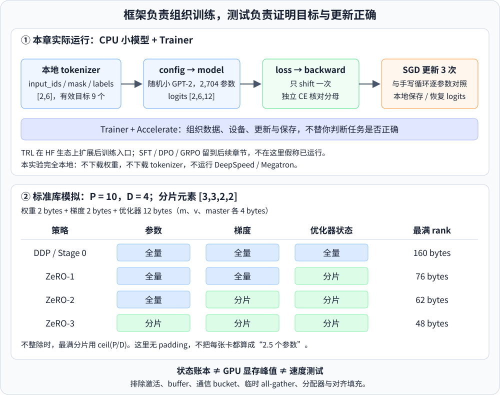

这里还有一条重要边界：本书之前的 miniGPT 是用来逐层解释机制的代码主线；本章换用 GPT2LMHeadModel，是学习成熟 API 的独立实验。两者没有自动共享权重。即使都叫 Transformer，也不能把旧 checkpoint 直接塞进新模型，然后宣称转换成功。

## P20.2 config、model、tokenizer：三样东西不能混成一样

### config 是结构说明，不是模型的记忆

本章的关键配置很小：

```python
config = GPT2Config(
    vocab_size=12, n_positions=16, n_ctx=16,
    n_embd=16, n_layer=1, n_head=2, n_inner=32,
    resid_pdrop=0.0, embd_pdrop=0.0, attn_pdrop=0.0,
    bos_token_id=2, eos_token_id=3, pad_token_id=0,
    use_cache=False, attn_implementation="eager",
)
model = GPT2LMHeadModel(config)
```

vocab_size 是输出分类的类别数；n_embd 是每个 token 的表示宽度；n_layer 是 Transformer block 数；n_head 是注意力头数。16 维分成 2 个头，每头 8 维。n_inner=32 是 FFN 的中间宽度。位置表容纳 16 个位置，本实验输入最长只有 6。

**从 config 构造 model 得到随机权重，不是下载一个缩小的预训练 GPT-2。** config 说明“神经网络长什么样”，训练后的参数才承载学到的信息。这一区别在 [GPT2Config 的固定版说明](https://huggingface.co/docs/transformers/v4.51.3/en/model_doc/gpt2#transformers.GPT2Config) 中也很明确。

本模型仍是 GPT-2 风格的绝对位置 embedding 和相应 block，不是把 P12 的 RoPE、P13 的 RMSNorm / SwiGLU 自动装进去。我们关掉 dropout，是为了让本章的数值对照尽量只考察训练接口，不是在建议真实训练永远不用 dropout。

### tokenizer 是 ID 契约，不只是切字工具

为了完全离线，脚本用 Tokenizers 的 WordLevel 构造一个 12 项词表。它只按空白分隔，输入必须像“我 爱 学习 。”这样显式隔开。这是本地测试夹具，**不是 GPT-2 的 byte-level BPE，也不是一个合格的通用中文 tokenizer**。

```text
ID:       0       1       2       3     4  5   6    7    8     9    10  11
token:  [PAD]   [UNK]   [BOS]   [EOS]   我 爱 学习  模型 预测 下一个 词  。
```

模板在句首加 BOS，在句尾加 EOS。两个样本补齐后为：

```text
input_ids[0] = [2, 4, 5, 6, 11, 3]
input_ids[1] = [2, 7, 8, 10, 3, 0]
attention_mask[0] = [1, 1, 1, 1, 1, 1]
attention_mask[1] = [1, 1, 1, 1, 1, 0]
```

因此 input_ids 的形状为 [B,T]=[2,6]。模型输出 logits 的形状是 [B,T,V]=[2,6,12]：每个输入位置各给出一个“下一个 token”的 12 类预测。tokenizer 的词表大小、特殊 token ID、模型 embedding 行号必须一致；把两个相同大小但 ID 排列不同的词表互换，形状检查仍可能通过，语义却已经错了。

unknown 词会变成 ID 1。测试要求“陌生词”得到 [2,1,3]，也要求保存后加载的词表和固定句子 ID 不变。这比只检查“tokenizer.json 文件存在”更有意义。

## P20.3 框架已经 shift 了，就不要再 shift 一遍

GPT2LMHeadModel 接受 labels 后会在内部完成 causal language modeling 的错位：位置 t 的 logits 对应位置 t+1 的标签。我们的 labels 和 input_ids 保持相同形状，只把不该监督的位置设为 -100：

```text
labels[0] = [-100, 4, 5, 6, 11, 3]
labels[1] = [-100, 7, 8, 10, 3, -100]
```

- PAD 不是真实文本，所以第二行末尾不进入 loss。
- EOS 是真实的结束目标，仍然进入 loss；不能因为它“特殊”就一并忽略。
- 第一列没有前一个输入位置来预测它。本例显式将它设为 -100，下面会解释一个与版本有关的原因。
- attention_mask 控制注意力可见性；labels=-100 控制监督位置。二者职责不同，一个不能代替另一个。

独立参考计算不调用模型返回的 loss，也不调用框架的交叉熵函数，而是自己写：

$$
\mathcal L=\frac{1}{N}\sum_{(b,t)\in\mathcal V}
\left[\log\sum_v\exp(z_{b,t,v})-z_{b,t,y_{b,t+1}}\right],
$$

其中有效集合 $\mathcal V$ 只包含下一位置标签不是 -100 的预测位置，N 是这些位置的数量。本例第一行 5 个目标、第二行 4 个目标，所以 N=9，不是输入张量的 12 个格子。

代码先取 logits[:, :-1] 与 labels[:, 1:]，筛掉忽略项，再用 logsumexp 减去目标 logit。测试还用 Python 标量循环、稳定的指数求和独立算一次，避免两个实现都复制同一个索引错误。

### 一个真实发现的版本细节

固定版本 4.51.3 的 Trainer 在某条 loss 路径中会统计**未 shift 的 labels 中非 -100 的数量**，作为 num_items_in_batch 传给模型。若保留两行首位 BOS 标签，这个数是 11，而真正参与 next-token loss 的目标只有 9，梯度会被错误缩小为本例正确值的 9/11。

这不是说所有版本、所有模型都有同一个问题，而是本章用的组合需要明确约定。这里把首位本就不会被预测的标签也设为 -100，让框架计数和实际目标对齐。对应实现可核对 [4.51.3 Trainer 的 get_batch_samples 与 compute_loss 源码](https://github.com/huggingface/transformers/blob/v4.51.3/src/transformers/trainer.py)。测试故意恢复首位 BOS，要求独立更新对照报错，而不是只接受一个仍然下降的 loss。

**因此，loss 在下降不够，程序退出码是 0 也不够。先对齐目标、分母和梯度，再谈训练结果。** 改到其他版本、加入 packing、梯度累积或多卡时，要重新检查有效 token 计数，不能把本例补丁无条件推广。

## P20.4 真正运行一次 Trainer，并保留可解释的对照

本章把 TrainingArguments 的变量尽量减少：CPU、float32、固定种子 20、每批 2 条样本、3 次更新、学习率 0.02、SGD、常数学习率、无 weight decay、无梯度裁剪、不向外部日志服务上报、不向 Hub 推送。

为什么不直接用 AdamW？不是说 SGD 更适合大模型，而是本实验要先回答“Trainer 是否执行了同一个更新”。SGD 的式子很简单：

$$
\theta_{k+1}=\theta_k-0.02\nabla_\theta\mathcal L_k.
$$

我们从相同的初始权重复制两份模型：

1. 第一份进入真正的 Trainer，执行 train()。
2. 第二份进入手写循环，用上一节的独立 loss、backward 和 torch.optim.SGD 更新。
3. 每份都执行 3 步；两个样本每步都在同一个完整 batch 中，所以打乱行顺序不改变目标，只可能有很小的浮点舍入差。
4. 逐参数比较结果，同时检查 global_step、参数是否真的变化、loss 是否有限并下降。

独立对照参数使用 atol=2e-6、rtol=2e-5；不是把所有训练轨迹都要求逐位相同。本地保存后以**同一个 eager attention 后端**恢复的 logits 则要求零误差。在开发时，恢复入口曾自动选择 SDPA，造成约 6e-8 的微小差异；解决方法是固定同一个后端，而不是不问原因就放宽容差。

2026-10-19，在本章下述固定组合、Linux CPU 环境得到的一次结果为：

| 检查项 | 实际结果 |
| --- | --- |
| 模型可训练参数 | 2,704 |
| logits 形状 / 有效目标数 | [2,6,12] / 9 |
| Trainer 更新步数 | 3 |
| 更新前 / 后 loss | 2.51291084 / 2.34189987 |
| 模型 loss 与独立参考差 | 0 |
| Trainer 与手写 SGD 参数最大差 | 约 3.73e-9 |
| 参数最大变化量 | 约 0.0195597 |
| 本地恢复后 logits 最大差 | 0 |

这些数字是测试夹具的数值证据，不是语言质量、吞吐量或大模型收敛结论。Trainer 会额外打印 train_runtime 和 samples_per_second，它们受进程启动、机器负载等影响，本章不拿它们作 benchmark。两句话被重复训练后 loss 下降，也不证明模型具备中文能力。

### 如何运行

只运行标准库账本，不需要安装 PyTorch：

```bash
python code/21_training_frameworks.py
python -m unittest discover -s tests -p 'test_training_frameworks.py' -v
```

第二条会执行标准库测试；若可选包缺失或版本不在本章验证组合中，HF 测试会明确显示 skipped。**跳过不等于 HF 通过。** 脚本默认也明确打印 HF smoke: NOT RUN，必须加 --hf 才会真正训练。

需要框架实验时，另建环境，避免为了本章升级全书原有依赖。例如在支持该 CPU wheel 的 Linux / Python 3.12 环境中：

```bash
python3.12 -m venv /tmp/zero2llm-frameworks
/tmp/zero2llm-frameworks/bin/python -m pip install \
  --index-url https://download.pytorch.org/whl/cpu torch==2.14.1
/tmp/zero2llm-frameworks/bin/python -m pip install -r requirements-frameworks.txt
/tmp/zero2llm-frameworks/bin/python code/21_training_frameworks.py --hf
/tmp/zero2llm-frameworks/bin/python -m unittest discover \
  -s tests -p 'test_training_frameworks.py' -v
```

官方 CPU wheel 的平台列表见 [PyTorch 官方索引](https://download.pytorch.org/whl/cpu/torch/)。若平台没有匹配 wheel，不要从不明镜像拼装包；可以先完成标准库部分，再选择官方支持的环境。

本章锁定 torch 2.14.1（本次 wheel 带 +cpu）、transformers 4.51.3、accelerate 1.6.0、tokenizers 0.21.4、huggingface-hub 0.30.2、safetensors 0.5.3。它是**已验证的教学组合，不是最新版推荐，也不代表任意跨版本组合都兼容**。requirements-frameworks.txt 锁定附加框架包，PyTorch 单独从官方 CPU 源安装，避免意外引入 CUDA 大包。正式归档环境还应保存完整 pip freeze、Python 版本和平台信息，因为只锁直接依赖不等于锁了全部传递依赖。

本次验证为节省重复安装空间，使用独立 /tmp/zero2llm-p20-venv，并只读复用原环境的 Torch / Tokenizers 路径；新增包写入独立环境，核对原环境版本未变。上面的干净环境命令是读者的安装路线，不要求复刻这个路径优化。

缺少可选包或版本不符时，--hf 输出 SKIP 并返回退出码 2；它不会临时联网补下载。满足版本但出现真正的运行错误时，程序正常报错，而不是吞掉异常并说“兼容性跳过”。

## P20.5 DDP：先让每张卡各做一份完整工作

rank 是分布式进程的编号；world size 是进程总数。常见 GPU 训练把一个 rank 对应一张 GPU，但这不是这些词的定义。

最容易理解的数据并行是 DDP：各 rank 持有同一模型副本，读取不同数据，反向传播时同步梯度，再按一致规则更新。它提高了可以共同处理的数据量，**没有自动把模型参数、梯度和普通优化器状态都分成几份**。DDP 也不会替你切分输入数据，数据采样器必须配合。相关职责见 [PyTorch 2.14 固定版 DDP API](https://docs.pytorch.org/docs/2.14/generated/torch.nn.parallel.DistributedDataParallel.html)；这里引用其机制说明，不声称本次运行了 PyTorch 2.14 的多卡测试。

假设每个 rank 一次处理 b 条，累积 A 次后更新，数据并行组有 D 个 rank，理想情况下每次更新包含 b×A×D 条样本。若长度不一，有效监督 token 数不一定按样本数平均；还要检查各 rank 的 loss 归一化与梯度汇总口径。P19 中关于有效 token 和梯度累积的约定，并不会因为加了 DDP 就消失。

一个反直觉的结论是：单卡放不下的模型，简单复制到 4 张卡上仍可能每张都放不下。要减少每卡状态冗余，需要看下一节的分片。

## P20.6 ZeRO：分三步去掉重复的状态

训练时，模型参数不是唯一的大对象。以一种常见的低精度权重 + Adam 混合精度组织为例，每个参数元素可能对应：

- 低精度参数：2 bytes。
- 梯度：本例假设 2 bytes。
- Adam 的一阶矩 m：4 bytes。
- Adam 的二阶矩 v：4 bytes。
- FP32 master weight：4 bytes，归入优化器侧状态。

本例共 16 bytes/参数元素。**这不是所有 Adam、BF16 或 PyTorch 训练的固定规律。** 有的路径保留 FP32 梯度，有的没有单独 master copy；本章真实 CPU smoke 用的是 float32 + SGD，也不能套用这份 Adam 账本。

设参数元素数为 P，参数 / 梯度 / 优化器侧每元素字节分别为 b_p、b_g、b_o。这里 b_o=2×moment_bytes+master_bytes，默认 12。经典 ZeRO 的分级思路是：Stage 1 切优化器状态，Stage 2 再切梯度，Stage 3 再切参数。出处是 [ZeRO 原始论文 v3](https://arxiv.org/abs/1910.02054v3) 以及 [DeepSpeed v0.16.5 的 ZeRO 官方说明源码](https://github.com/deepspeedai/DeepSpeed/blob/v0.16.5/docs/code-docs/source/zero3.rst)。

| 方式 | 参数 | 梯度 | 优化器侧状态 |
| --- | --- | --- | --- |
| DDP / 本账本 Stage 0 | 每个 rank 完整保留 | 完整保留 | 完整保留 |
| ZeRO-1 | 完整保留 | 完整保留 | 分片 |
| ZeRO-2 | 完整保留 | 分片 | 分片 |
| ZeRO-3 | 分片 | 分片 | 分片 |

对于恰好整除的理想情况，每 rank 的持久状态近似为：

$$
\begin{aligned}
M_0 &= P(b_p+b_g+b_o),\\
M_1 &= P(b_p+b_g)+\frac{P}{D}b_o,\\
M_2 &= Pb_p+\frac{P}{D}(b_g+b_o),\\
M_3 &= \frac{P}{D}(b_p+b_g+b_o).
\end{aligned}
$$

Stage 3 并不是每个 rank 永远只看自己的一小片参数。执行某层计算时仍需按实现聚合所需权重，并在合适时机释放或重新切分。节省常驻冗余往往要付出通信、调度和临时空间成本。CPU/NVMe offload 又是把状态放到别的位置，不是与 Stage 1/2/3 同义的第四个数字。

### 十个参数，四个 rank，亲手算一遍

P=10、D=4 不能整除。我们的教学分配不加 padding，前两个 rank 各负责 3 个元素，后两个各负责 2 个，记作 [3,3,2,2]。这只是平衡所有权模型，不模拟 DeepSpeed 内部的 bucket / 对齐布局。

以 rank 0 为例：

- Stage 0：10×2 + 10×2 + 10×12 = 160 bytes。
- Stage 1：10×2 + 10×2 + 3×12 = 76 bytes。
- Stage 2：10×2 + 3×2 + 3×12 = 62 bytes。
- Stage 3：3×2 + 3×2 + 3×12 = 48 bytes。

全部 rank 的结果是：

| 方式 | rank 0 | rank 1 | rank 2 | rank 3 | 所有 rank 合计 |
| --- | ---: | ---: | ---: | ---: | ---: |
| Stage 0 | 160 | 160 | 160 | 160 | 640 |
| Stage 1 | 76 | 76 | 64 | 64 | 280 |
| Stage 2 | 62 | 62 | 48 | 48 | 220 |
| Stage 3 | 48 | 48 | 32 | 32 | 160 |

单位全部是 bytes。最大的 rank 分片应使用 ceil(P/D)=3，而不是 floor(P/D)=2。若用浮点 2.5 个参数来估算最满的 rank，会低估；若每个 rank 都实际分配 3 个槽位，则又是含 padding 的另一种账本，集群合计不能仍写 10 个槽位。

脚本用 divmod 得到商和余数，逐 rank 返回真实元素数，保证总和严格等于 P；D>P 时允许部分 rank 拥有 0 个分片元素，不能凭空多出参数。测试覆盖这些非整除和空分片边界，也检查 D=1 时四种策略完全相同。

### 账本不是显存峰值

这里明确排除：激活、模型 buffer、attention 临时张量、通信 bucket、all-gather 临时完整权重、梯度累积实现的额外副本、内存分配器保留空间、分片 padding、CPU/NVMe offload。真实峰值可能远高于持久状态的总和。

bytes、GB 和 GiB 也要区分：1 GB=10^9 bytes，1 GiB=2^30 bytes。10^9 bytes 大约是 0.9313 GiB，而不是 1 GiB。本章 byte_units 同时返回两种单位；不要把 GPU 标称容量与程序输出混用后得出“刚好能放下”的结论。

现在做一个修改练习：把 gradient_bytes 从 2 改成 4，同时把 master_bytes 改成 0。P=10、D=4 时，Stage 2 的每 rank 结果应为 [56,56,44,44] bytes。这个练习强迫我们把“梯度什么 dtype”和“优化器状态什么 dtype”分开，而不是机械背诵“每参数 16 字节”。

## P20.7 TP、PP、EP：切的不是同一条轴

ZeRO 主要回答“数据并行组中谁保存哪些训练状态”。其他并行术语回答的问题不一样：

**Tensor parallel，张量并行（TP）：**把一层里的张量运算分给多个设备。例如线性层 Y=XW，可以按 W 的输出列拆成 W_1、W_2，两个设备算出部分输出；后续运算按布局拼接或归约。拆行的方式则需要合并部分和。它不是让两个 rank 各读不同样本，而是合作完成同一层的计算。通信经常落在层内，互联条件很重要。[Megatron-LM 原始论文](https://arxiv.org/abs/1909.08053)

**Pipeline parallel，流水线并行（PP）：**把不同层放到不同设备。例如 4 层网络，设备 A 负责第 1–2 层，设备 B 负责第 3–4 层。样本的激活先从 A 传给 B，反向梯度再反方向流回。把大 batch 切为 microbatch 可以让不同阶段交错工作，但启动、收尾或阶段不均衡会产生空闲时间，称为 pipeline bubble。不是把层拆开就能永远满载。[Megatron 的大规模训练论文](https://arxiv.org/abs/2104.04473)

**Expert parallel，专家并行（EP）：**把 MoE 专家分散到不同设备，路由后把 token 发给相应专家，再把输出送回。它和 P18 的“一个 token 只激活少数专家”有关，但不是同一概念：稀疏激活描述模型计算，EP 描述专家放在哪。路由不均衡会让某些设备忙、某些设备闲；跨设备 token 交换也有成本。[Megatron-Core core_v0.12.0 的 MoE 与并行说明](https://github.com/NVIDIA/Megatron-LM/tree/core_v0.12.0)

这些策略可以组合，但**不能把所有并行度数字无脑相乘**。简单的纯 dense DP×TP×PP 布局常可按独立进程组规划；加入 EP、context parallel 或不同专家组后，要按框架实际 rank 分组规则检查哪些维度独立、哪些共享。不清楚自己的 data-parallel group 大小时，前一节的 D 也就可能填错。

## P20.8 Transformers、TRL、DeepSpeed、Megatron 应该怎么选

它们不是四个功能完全相同、只需挑“最强”的品牌。

- **Transformers：**常用模型结构、配置、tokenizer 和 Trainer 接口。本章首先用它把模型训练跑通，并建立正确性对照。
- **TRL：**在 Hugging Face 生态上提供后训练相关的训练器和数据处理入口。它与 Transformers 集成，不是另一个 tokenizer，也不是取代 PyTorch 的张量计算库。
- **DeepSpeed：**面向训练执行和内存等系统问题；ZeRO 是其重要机制，但“用了 DeepSpeed”和“用了某个固定 ZeRO stage”不是一句话。
- **Megatron-LM / Megatron-Core：**面向大模型训练组织与并行模块，特别要读懂 TP、PP、EP 和相应 checkpoint 约定。大规模环境的优势不能从本章 CPU 小模型直接推出。

[TRL 0.17.0 官方总览](https://huggingface.co/docs/trl/v0.17.0/en/index) 列出 SFT、DPO、GRPO、奖励模型等入口；[同版 SFTTrainer 说明](https://huggingface.co/docs/trl/v0.17.0/en/sft_trainer) 展示它与模型、数据和训练配置的连接。本章只建立定位，不安装 TRL，也不把 SFTTrainer 的名字等同于“自动正确的对话微调”。assistant-only 标签、LoRA、DPO 的偏好对和 GRPO 的奖励分组分别留给 P21、P22，那里会单独锁版本和检查目标。

一个实用顺序是：先用单进程证明数据、loss 和保存加载正确；确实需要更多吞吐再试数据并行；确认状态占用是瓶颈再考虑分片；当单层或网络规模、通信条件要求进一步切分时，再研究 TP / PP / EP。这个顺序不是性能定律，而是降低排错变量的工程方法。

## P20.9 保存模型，不一定等于能继续训练

本章产生两类本地输出，概念上不能混用。

**推理导出 export：**model.save_pretrained 保存 config 与 model.safetensors；tokenizer.save_pretrained 保存词表、特殊 token 和处理配置；experiment.json 保存版本、种子、设备、精度和 attention 后端。再次从本地目录加载，检查固定输入的 ID、logits 和 loss 一致。这个检查已经运行。

**训练检查点 trainer/checkpoint-3：**本例显式设置 save_only_model=False，另检查 optimizer.pt、scheduler.pt、trainer_state.json、rng_state.pth 和 training_args.bin 等文件存在，且 global_step=3。实际保存逻辑可查 [4.51.3 Trainer 源码](https://github.com/huggingface/transformers/blob/v4.51.3/src/transformers/trainer.py)。不要根据概览页的一句默认行为推测所有版本和选项下都保存了什么。

虽然这些训练状态文件已经产生，本章**没有运行断点续训等价实验**，所以结果中明确记录 resume_tested=false。真正验证恢复，应该比较“连续训练 K+M 步”和“训练 K 步、保存、重启、再训练 M 步”的最终状态，并检查数据采样位置、随机数、优化器、scheduler、梯度累积边界等。只有模型权重相同还不够。

若想保留本章输出，给一个新的或空目录：

```bash
python code/21_training_frameworks.py --hf --output-dir /tmp/p20-checkpoint-demo
```

目录非空时脚本拒绝覆盖；默认不传目录则使用临时目录并清理。只加载本次自己产生的训练状态文件，不要随意反序列化来源不明的 optimizer 或 Python 对象。safetensors 也不能替代对模型来源、配置和代码的审核。

分布式训练还要问：“这是一整份模型，还是某个 rank 的分片？”并行拓扑改变后是否需要转换？词表是否一并保存？模型实现的版本是否相同？例如 Megatron 的固定版说明区分与 TP/PP 布局绑定的旧格式及其他分布式格式，不能默认不同框架的 checkpoint 可以直接交换。

## P20.10 多 GPU 选修：先写实验单，不在 CPU 假演示

本章没有安装 DeepSpeed / Megatron，也没有可报告的多 GPU 运行、通信量实测、显存峰值或加速比。下面只是实验设计与配置阅读题，不是已经通过的运行命令。

一个最小 ZeRO-2 配置片段可以先读成：

```json
{
  "train_micro_batch_size_per_gpu": 1,
  "gradient_accumulation_steps": 1,
  "zero_optimization": {"stage": 2},
  "bf16": {"enabled": false},
  "fp16": {"enabled": false}
}
```

它只说明每 rank 的 microbatch、累积次数、状态分片级别与未启用混合精度，**不是完整训练程序**。启动器模板形如：

```text
DeepSpeed：deepspeed --num_gpus=2 YOUR_GPU_TRAIN.py --deepspeed YOUR_DS_CONFIG.json
Megatron：torchrun --nproc_per_node=2 YOUR_MEGATRON_ENTRY.py [与该入口一致的模型和数据参数]
```

大写项是待填写的占位符，不是本仓库文件。YOUR_GPU_TRAIN.py 必须自己解析配置、正确接入 DeepSpeed 或 HF Trainer；不能把本章强制 use_cpu=True 的 --hf 脚本塞进去冒充多卡训练。Megatron 入口、数据预处理和 flags 应来自选定 revision 的官方示例；仅把 --tensor-model-parallel-size=2 写在任意脚本后面没有意义。可从 [固定版官方仓库](https://github.com/NVIDIA/Megatron-LM/tree/core_v0.12.0) 的 examples 与训练参数说明开始。

Megatron 还有一个可供选修的具体入口：[core_v0.12.0 的 run_simple_mcore_train_loop.py](https://github.com/NVIDIA/Megatron-LM/blob/core_v0.12.0/examples/run_simple_mcore_train_loop.py)。本章已读取该版本源码，确认它使用 MockGPTDataset、本地空 tokenizer、2 层模型、TP=2、PP=1，并运行 5 次更新。选好官方兼容依赖、进入该版本仓库后，待验证命令为：

```bash
CUDA_VISIBLE_DEVICES=0,1 torchrun --standalone --nproc_per_node=2 \
  examples/run_simple_mcore_train_loop.py
```

这条命令**未在本书环境执行**。需恰好暴露两张可用 CUDA GPU，因为该入口用可见 GPU 数初始化 world size，源码又把 TP 固定为 2；还会编译数据 helper，并在当前目录写 ckpt。应使用新的实验目录并先检查源码，不能直接覆盖已有检查点。它是理解 Megatron-Core 接线的入口，不是通用生产训练配方，也不自动证明保存了可恢复的优化器状态。

动手前把下列内容保存成自己的实验单：

1. 代码 tag / commit、PyTorch / CUDA / 驱动 / NCCL / DeepSpeed 或 Megatron 版本；与本章 CPU 依赖分开管理。
2. 至少两张兼容 GPU 的型号、每卡显存、互联、CPU / RAM，跨机器时记录网络；是否真的支持计划使用的 BF16 / FP16 路径。
3. 完整展开后的启动命令和配置，不只保存一张截断的终端截图；写明 DP / TP / PP / EP 的 rank 分组。
4. 固定模型、tokenizer、数据、序列长度、有效 token 数、batch 与优化器；先用最小模型检查目标与梯度，再逐步扩张。
5. 对比 DDP 与 ZeRO-2 时尽量只改变状态分片，分别记录持久状态估计、实测峰值分配 / 保留显存、通信和速度。
6. warm-up、设备同步、重复次数、均值和波动；保存 checkpoint 后真正重启恢复一次。

这份实验单的价值不在于把配置写得很长，而在于让别人知道结果能比较什么、不能比较什么。在条件未具备时停在“未测”，比把理论账本包装成实测更专业。

## P20.11 练习、排错与验收

### 练习

1. “我把 config.json 改成两倍 hidden size，原权重就变强了。”这句话有什么问题？
2. 两条长度分别为 6、5 的含 BOS/EOS 序列，右侧补齐到 6。首列与 PAD 忽略时，监督位置数是多少？若恢复首列 BOS，本例版本的 Trainer 计数和实际 next-token 目标数有什么不同？
3. P=7、D=3，默认每元素 2+2+12 bytes。Stage 3 每个 rank 的所有权、状态字节和合计是多少？
4. 为本章代码故意制造一个错误，说明哪条测试应该发现它。只让 loss 下降，能否作为验收？

### 参考答案

1. config 改的是张量结构，不会替你训练或生成匹配权重，甚至会直接导致 shape 不兼容。结构说明与已学习参数是两个不同对象。
2. 监督目标为 5+4=9。删去首列忽略后，模型内部 shift 的目标数仍是 9，但本例 Trainer 的外部计数变成 11，因为它统计未 shift 的非忽略标签。此时会把本例梯度缩小为正确值的 9/11。
3. 所有权为 [3,2,2]，持久状态为 [48,32,32] bytes，合计 112 bytes。不能用 112/3 作为每个 rank 都安全的容量上界。
4. tests/test_training_frameworks.py 实际执行八种语义变异：丢掉分片余数、提前切分梯度、提前切分参数、漏算 master weight、错移 CE 标签、恢复首位 BOS 计数、取消 optimizer.step、损坏恢复后的权重。前四种被独立手算账本发现；错移标签被独立 CE 参考识别；后三种被真实 Trainer 更新、非零变化和恢复 logits 断言识别。程序能运行或 loss 下降，都不能代替这些检查。

常见排错顺序：

- 出现 index out of range：先查 token ID、词表大小和位置上限，不要先加 GPU。
- loss 下降但更新对照不符：查 shift、-100、有效 token 分母、梯度累积、裁剪、dropout、优化器和 scheduler。
- 保存加载只差几个末位：先查 dtype、attention 后端和评估模式，再判断合理容差；不把所有小误差都叫“随机性”。
- 只装基础依赖时显示 skipped：这是清楚报告未运行，不是脚本损坏；需要框架覆盖时在隔离环境装固定组合。
- ZeRO 账本很小但真实训练仍 OOM：检查激活、临时聚合、通信 buffer 和实际 dtype；账本从未承诺峰值。

本章验收是三句话：**我能把框架对象翻译回手写循环；我能独立核对一次真实参数更新；我能说明内存账本哪些状态算了、哪些没有。** 能做到这些，再读后训练配置时，你就不必靠“这份 YAML 看起来很专业”来判断正确性。

## 资料与版本边界

核验日期：2026-10-19。以下优先固定官方版本或原始论文；资料中的大规模结果不算作本书复现。

- [Transformers 4.51.3 Trainer](https://huggingface.co/docs/transformers/v4.51.3/en/trainer)、[GPT-2 API](https://huggingface.co/docs/transformers/v4.51.3/en/model_doc/gpt2)、[对应 Trainer 源码](https://github.com/huggingface/transformers/blob/v4.51.3/src/transformers/trainer.py)：对象职责、标签计数与保存逻辑。本章实际运行此版本。
- [Transformers 4.51.3 PyPI 元数据](https://pypi.org/pypi/transformers/4.51.3/json)、[Accelerate 1.6.0 PyPI 元数据](https://pypi.org/pypi/accelerate/1.6.0/json)：附加依赖选择；实际锁定项见 requirements-frameworks.txt。
- [TRL 0.17.0 总览](https://huggingface.co/docs/trl/v0.17.0/en/index) 与 [SFTTrainer](https://huggingface.co/docs/trl/v0.17.0/en/sft_trainer)：仅核验框架关系和后训练入口，未安装或运行 TRL。
- [PyTorch 2.14 DDP 文档](https://docs.pytorch.org/docs/2.14/generated/torch.nn.parallel.DistributedDataParallel.html)：固定机制参考；不代表本书跑过该版本多卡。
- [ZeRO 论文 v3](https://arxiv.org/abs/1910.02054v3)；[DeepSpeed v0.16.5 ZeRO 文档源码](https://github.com/deepspeedai/DeepSpeed/blob/v0.16.5/docs/code-docs/source/zero3.rst)：已读取该 tag 的官方原始文件，作为分片机制参考；未安装 DeepSpeed。
- [Megatron-LM 原始论文](https://arxiv.org/abs/1909.08053)、[流水线与大规模训练论文](https://arxiv.org/abs/2104.04473)、[Megatron-Core core_v0.12.0 仓库](https://github.com/NVIDIA/Megatron-LM/tree/core_v0.12.0)：并行与 checkpoint 参考，未运行其 GPU 示例。


---

# 指令微调（P21）：对话数据、SFT 与 LoRA {#p21-sft}

在 [P19：预训练数据流水线](#p19-pretraining) 中，我们问“下一段文字是什么”；在 [P20：训练框架](#p20-frameworks) 中，我们把同一个目标交给框架。现在的问题变成：**给定一段对话，模型应该学习续写哪一部分？又允许修改哪些参数？**

这其实是两道题。SFT（Supervised Fine-Tuning，有监督微调）规定从示范答案中学习什么；全量更新或 LoRA 决定怎样调整参数。SFT 不等于 LoRA，LoRA 也不只用于 SFT。换了训练方法，错误的标签依旧是错误的标签。

读完本章，你应能给一段多轮对话逐 token 标出 loss，手算一个 LoRA 层，并用测试证明基础权重没有被偷偷更新。前置是 P02 的 tokenizer、P09 的交叉熵与梯度，以及 P19–P20 的数据和框架契约。不需要 GPU，也不下载模型。

配套 [code/22_sft_lora.py](../code/22_sft_lora.py) 分为标准库手算和真实 PyTorch CPU 更新两部分。**实验用随机初始化的微型 Transformer 学习 SFT 形式的目标，再冻结它继续训练 LoRA；不是对一个已有通用预训练模型做能力适配。** 这里的四条合成对话足以验证机械过程，不足以评价指令遵循、泛化或安全性。没有运行 HF SFTTrainer、PEFT、QLoRA 或任何大模型训练。

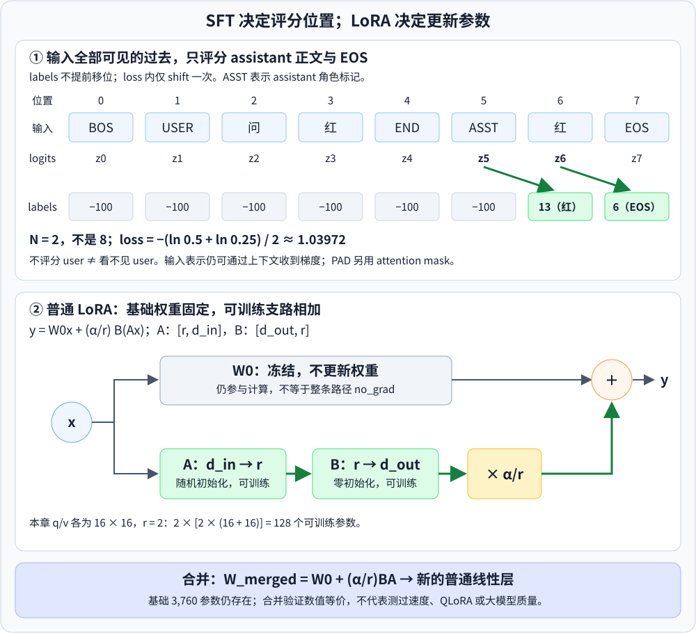

## P21.1 同一本练习册，两种学习目标

预训练和指令微调都可以使用 next-token 交叉熵。它们并不是“一个预测词、另一个不用预测词”，而是数据分布、上下文形式和被评分的位置不同。

想象一张带标准答案的练习卡：上方是规则，中间是问题，下方是示范回答。我们希望学生读规则、看问题，再学习如何回答，而不是主要练习复述题目。这个类比解释了 assistant-only loss，但不能推出模型像人一样理解规则，更不能把“正确格式”当成“可靠知识”。

本章选择的目标是：

- system 和 user 内容仍然作为模型的输入。
- 每轮 assistant 的回答正文，以及其真实结束标记，作为预测目标。
- role header、system/user 的结束标记和 padding 不评分。
- 同一条多轮对话中的**所有** assistant 轮都评分，不只最后一轮。

这是一个明确的教学策略，不是 SFT 唯一合法的定义。有的任务训练整段文本，有的只训练最后一个回答，有的分别加权不同片段。关键是把选择写进数据与测试，不能仅凭类名里出现“SFT”就断言得到了 assistant-only loss。

[TRL 0.18.2 的 SFTTrainer 源码](https://github.com/huggingface/trl/blob/v0.18.2/trl/trainer/sft_trainer.py) 展示了成熟训练入口如何处理数据和训练配置。这里引用它作为框架定位，不调用其中 API；更不把其他版本的参数名当成这个版本已经验证过的接口。

版本阅读说明：P20 的 TRL 0.17.0 用于介绍训练框架与职责；本章固定 0.18.2，只查看 SFTTrainer 的数据处理和训练入口；P22 则固定 0.16.1，逐项拆解该版本 GRPO 的具体公式与配置。选择不同标签是为了分别固定这些来源快照，**不是推荐把三版混装，也不是声称三章使用同一套 TRL 环境**。这里没有执行 TRL，因此不作跨版本 API 兼容承诺；尤其不能把 P22 的样本标准差、稳定项、归约和 KL 估计约定推广到 0.18.2。实际运行的是本章独立 PyTorch 脚本；若要迁移到框架，需另选一个统一版本，重新核对模板、mask、配置与实际训练结果。

## P21.2 对话模板：角色不是另一个输入通道

输入常以消息列表保存：

```python
messages = [
    {"role": "user", "content": "问红"},
    {"role": "assistant", "content": "红"},
]
```

但本章的 decoder-only 模型最终收到的仍是一串 token ID，而不是一个会自动理解 role 字段的聊天对象。模板决定怎样把消息列表变成序列。

本章写死一个透明的教学模板，版本名为 `p21-char-chat-v1`：

```text
<bos>
<system>系统正文<end>        # 可选，只能在最前面
<user>问题正文<end>
<assistant>答案正文<eos>
<user>下一轮问题<end>
<assistant>下一轮答案<eos>
```

上面的换行和注释只是便于阅读，**不会成为实验输入**。在这份模板中，`<end>` 结束 system/user 消息，`<eos>` 结束 assistant 回答；多轮训练时 EOS 后面可以继续出现下一轮 user。这个命名是本章约定，不是所有模型的共同协议。实际模型可能区分“消息结束”“当前轮结束”“整个序列结束”，必须查看它自己的 tokenizer 和模板。

词表恰好有 17 项：

| ID | 0 | 1 | 2 | 3 | 4 | 5 | 6 | 7 |
| --- | --- | --- | --- | --- | --- | --- | --- | --- |
| token | PAD | BOS | SYSTEM | USER | ASSISTANT | END | EOS | UNK |

剩余九个字依次是：`只=8，答=9，颜=10，色=11，问=12，红=13，蓝=14，绿=15，黄=16`。特殊标记由模板直接插入 ID；正文逐字编码，未知字变为 UNK。

因此，用户在正文输入字符串 `<assistant>`，不会凭这个拼写变成 role ID 4；每个未知字符只是 UNK。测试会确认内容中不能凭特殊标记的外观插入新角色。**这只是一条序列化性质，不是提示注入防护或模型安全保证。** 模型仍可能受普通语言内容影响。

真实 BPE/tokenizer 的词表远大于本例，不能把这个 17 项字符表套到已有 checkpoint 上。新加 special token 时，也要处理模型 embedding / 输出层的大小及其训练状态，而不是只修改字符串。

### 训练与推理，必须用同一套标点

训练输入包含示范回答；推理时没有答案，模板停在 assistant header 后：

```text
训练：<bos><user>问红<end><assistant>红<eos>
推理：<bos><user>问红<end><assistant>
```

`generation_prompt` 与 `encode_chat` 共用消息编码逻辑。测试不只看第一轮，还逐轮确认：推理 prompt 必须与训练序列到该轮回答起点为止的前缀完全相同。不能训练时用一种 role 标记、推理时随手换另一种，也不能多加一遍 BOS/EOS。

[Transformers 4.51.3 的模板文档](https://huggingface.co/docs/transformers/v4.51.3/en/chat_templating) 说明了模板与生成提示的关系，并提醒避免在模板已经加入特殊 token 后重复加入。本章只借助这些接口概念，不把手写模板称为 `apply_chat_template` 的实际运行结果。P20 已经验证过的 HF tokenizer 也没有被本章暗中改写。

## P21.3 八个位置，只有两个评分点

先完整写出“问红 → 红”的数据。这里的位置从 0 开始，`-100` 是本章 loss 的忽略值，不是词表中的一个 token。

| 位置 | 0 | 1 | 2 | 3 | 4 | 5 | 6 | 7 |
| --- | --- | --- | --- | --- | --- | --- | --- | --- |
| input token | BOS | USER | 问 | 红 | END | ASSISTANT | 红 | EOS |
| input ID | 1 | 3 | 12 | 13 | 5 | 4 | 13 | 6 |
| labels | -100 | -100 | -100 | -100 | -100 | -100 | 13 | 6 |
| 是否为目标 | 否 | 否 | 否 | 否 | 否 | 否 | 是 | 是 |

**labels 与 input_ids 保持同样的位置。不要在构造 labels 时提前移动答案。** 移动发生在计算 loss 的函数里，并且只发生一次：

```python
targets = labels[:, 1:]
predictions = logits[:, :-1]
```

所以位置 5 的 logits 预测位置 6 的“红”，位置 6 的 logits 预测位置 7 的 EOS。我们**不是**用“红”位置的 logits 预测同一个“红”；那样会让模型看到答案再复述答案。最后一个输入位置的 logits 没有下一个真实标签，本例不使用它。

写成数学式，令 m 表示一个目标位置是否应评分：

$$
\mathcal L=-\frac{1}{N}\sum_{b=1}^{B}\sum_{t=0}^{T-2}
 m_{b,t+1}\log p_\theta(x_{b,t+1}\mid x_{b,\le t}),
\qquad N=\sum_{b,t}m_{b,t+1}.
$$

这个 N 是有效目标数，不是 batch 大小，也不是 `B×T`。本例 N=2。假设模型给正确“红”的概率是 0.5，给正确 EOS 的概率是 0.25：

$$
\mathcal L=-\frac{\ln 0.5+\ln 0.25}{2}
=\frac{0.69314718+1.38629436}{2}
\approx1.03972077.
$$

这是自然对数下的平均负对数似然。除以八个输入格子，会错误得到四分之一大小的 loss 与梯度；只要分母错误固定，loss 依然可能下降，因此“曲线看起来正常”不能代替索引检查。

### “不评分 user”不等于“看不见 user”

这里有三个职责不同的 mask：

1. **causal mask**：位置 t 不能看到未来，防止预测时偷看答案。
2. **attention padding mask**：有效 query 不读取补齐用的 PAD key。
3. **label mask**：指定哪些 next-token 目标进入 loss。

system/user 的 attention mask 仍为 1，它们是有效上下文；labels 设为 -100 只意味着“不要求模型预测这些 token”。代码测试会发现：这些忽略目标对应的 logits 没有直接 loss 梯度，但 user 字符的 embedding 仍可能通过注意力影响 assistant 预测，因此收到梯度。

所以“忽略用户 loss”与“冻结用户表示”不是一回事。也不要把系统提示全部藏起来，却以为自己实现了 assistant-only loss。

## P21.4 多轮、结束、补齐与截断：四个常见陷阱

### 每一轮的答案都要能追溯

增加 system 和第二轮后，完整序列长 21：

```text
<bos><system>只答颜色<end>
<user>问红<end><assistant>红<eos>
<user>问蓝<end><assistant>蓝<eos>
```

有效标签位于 12、13、19、20，分别是“红、EOS、蓝、EOS”。对应评分 logits 位于 11、12、18、19。第一轮 assistant 正文的表示也会成为下一轮的上下文；这是 teacher forcing，不是模型先生成了第一轮答案再继续训练。

`ChatRow.assistant_spans` 用左闭右开区间保存 `[12,14)` 与 `[19,21)`，包含答案和 EOS，但不包含 assistant role header。它便于人工检查；测试还使用手写的完整标签序列对照，避免实现与测试都照抄同一个错误 span。

### EOS 是一个需要学习的目标

如果把所有 special token 都排除，EOS 也会消失，模型就缺少这份数据里的结束监督。这里即使 assistant 正文为空，也保留一个 EOS 目标，明确表示“立即结束”。是否允许空回答是数据质量决策，不是 mask 自动决定的事情。

PAD 则没有真实语义，补齐时 input_ids 加 PAD，attention_mask 加 0，labels 加 -100。**本例 PAD=0、EOS=6，二者不同。** 对某些把 pad_token_id 设为 eos_token_id 的真实配置，更不能简单按“ID 等于 EOS”把所有标签删掉；应按实际 padding 位置屏蔽，保留真实回答里的结束目标。

### 本章宁可丢完整轮，也不造半个答案

盲目 `ids[:max_length]` 可能在 assistant header、答案中间或 EOS 前截断。有时还会把只含问题、不含答案的样本交给 loss。另一种坏补丁是截断后强加 EOS：原本应继续的回答被错误教成“到这里结束”。

本章采用保守、可测试的策略：保留 BOS、可选 system，以及从开头开始能装下的**完整 user/assistant 对**，只在轮与轮之间截断。第一轮都放不下就明确报错，不返回一个零目标样本，不跳过长轮后拼上后面的轮，也不创造 EOS。

去掉 system 的两轮例子长度为 15；第一轮长度为 8：

- max_length=15：两轮都保留，4 个目标。
- max_length=8 到 14：只保留第一轮，2 个目标，`dropped_turns=1`。
- max_length=1 到 7：没有完整轮，拒绝这条样本。

这是本实验的契约，不是生产最佳策略。它会偏向较早的轮次，也可能丢掉有价值的长回答。实际项目可设计保留最近上下文、切分会话或拒绝过长样本等规则，但必须重新检查角色、目标、上下文完整性和分布变化，记录丢弃比例。改变规则就是改变数据版本。

### 零个目标不能“平均一下”

如果 shift 之后所有标签都是 -100，N=0。不能产生 NaN 再让 optimizer 继续，也不能悄悄说“loss=0，训练很好”。`masked_causal_loss` 在这种情况下抛出清晰异常；测试把一整个 batch 的标签设为忽略值，验证参数未变、没有 backward，也没有 optimizer 更新。

我们的 encoder 通常会更早拒绝没有完整监督轮的样本；loss 层仍保留这道检查，防止别的数据入口绕过前置约束。

## P21.5 全量更新与 LoRA：改整张表，还是加一条窄支路

对一个线性层，采用列向量记法：

$$
y=W_0x,\qquad W_0\in\mathbb R^{d_{out}\times d_{in}}.
$$

全量更新允许直接调整 W0 中的全部元素。普通 LoRA 冻结它，增加两个小矩阵：

$$
A\in\mathbb R^{r\times d_{in}},\quad
B\in\mathbb R^{d_{out}\times r},\quad
\Delta W=\frac{\alpha}{r}BA,\quad
y=W_0x+\frac{\alpha}{r}B(Ax).
$$

可以把它想成给固定机器加一条可调节的小支路，而不是重新铸造所有零件。但“支路很窄”不保证任何任务都适合，也不表示原模型本身是低秩的。受约束的是**这次更新**：`rank(BA)≤r`，还可能低于 r。

这里是 [LoRA 原论文 v2](https://arxiv.org/abs/2106.09685v2) 的普通低秩更新及 alpha/r 缩放形式，不包含 DoRA、rsLoRA 或其他变体。PyTorch 的 Linear 接受行式 batch，所以实现写成先 `F.linear(x,A)` 再 `F.linear(...,B)`；不要因为记法切换就把 BA 的乘法顺序颠倒。

### 先数参数，再谈节省

不计 bias 等额外可训练项时：

$$
P_{full}=d_{out}d_{in},\qquad P_{LoRA}=r(d_{in}+d_{out}).
$$

例如 `d_in=d_out=4096，r=8`：原矩阵有 16,777,216 个参数，A/B 合计 65,536 个，是原矩阵的 1/256，约 0.390625%。这只是这一层的**新增可训练参数比例**；冻结的 16,777,216 个原参数仍需保存和参与前向。

当矩阵很小或 r 很大时，LoRA 甚至可能比原矩阵参数更多。例如 2×3 的层，r=2 时有 2×(3+2)=10 个适配参数，超过原来的 6 个。低秩不是免费的效果保证。

本章小模型只给 q_proj 和 v_proj 接上 LoRA。每个原矩阵为 16×16，r=2，A/B 合计 64 个；两个投影合计 **128 个可训练参数**。其余 3,760 个基础参数全部冻结，包括 embedding、位置表、norm、FFN 和输出层。加入 adapter 后模型实际总参数为 3,888，不是变成只有 128 个参数。

少算基础权重的梯度和优化器状态，通常能降低相应训练状态开销；但基础权重、激活、中间结果及部分反向计算仍存在。可训练参数减少 99%，不能据此声称峰值显存或训练时间也减少 99%。本章不做 GPU 显存和速度测试。

## P21.6 一个可以手算到底的 LoRA 层

取输入 x、基础矩阵 W0 和适配矩阵如下，r=1、alpha=2，因此缩放系数为 2：

$$
x=\begin{bmatrix}2\\-1\\0.5\end{bmatrix},\quad
W_0=\begin{bmatrix}1&2&3\\4&5&6\end{bmatrix},\quad
A=\begin{bmatrix}1&0&2\end{bmatrix},\quad
B=\begin{bmatrix}3\\-1\end{bmatrix}.
$$

逐步相乘：

$$
W_0x=\begin{bmatrix}1.5\\6\end{bmatrix},\quad
Ax=3,\quad
2B(Ax)=\begin{bmatrix}18\\-6\end{bmatrix},\quad
y=\begin{bmatrix}19.5\\0\end{bmatrix}.
$$

只写一句“输出等于基础输出加 adapter 输出”很容易让两个实现一起错。测试直接以这组手算数值为参考，另用 r=2、alpha=6 的独立矩阵检查“漏除 rank”错误，同时检查 A/B 一共 5 个可训练参数、W0 的 6 个参数被冻结。

### 冻结参数不等于关闭整条计算图

`requires_grad_(False)` 让基础参数不接收梯度更新；它不等于把经过基础层的全部运算包进 `no_grad()`。有些早先层的 adapter 仍需要通过后面的冻结层回传梯度。把整条主路断开，可能切断正确的学习路径。

令这个手算例子的标量目标为 `L=y₁+y₂`，链式法则给出：

$$
\frac{\partial L}{\partial B}=\begin{bmatrix}6\\6\end{bmatrix},\quad
\frac{\partial L}{\partial A}=\begin{bmatrix}8&-4&2\end{bmatrix},\quad
\frac{\partial L}{\partial x}=\begin{bmatrix}9\\7\\17\end{bmatrix}.
$$

这些数值由测试独立写死，用来检查 autograd，而不是仅比较两个使用同一段代码的模型。W0 的梯度为 None，因为它被显式冻结。输入 x 仍有梯度，说明“权重固定”和“信息不能穿过”是两件事。

### 为什么初始 B 为零，不代表学习卡死

代码使用随机初始化 A、零初始化 B，保证刚插入 adapter 时 `BA=0`，不改变原模型预测。具体采用 Kaiming-uniform 初始化 A；它是本实现的选择，不声称逐项复现原论文的高斯初始化。固定版 [PEFT 0.15.0 LoRA 配置说明](https://huggingface.co/docs/peft/v0.15.0/package_reference/lora) 也区分初始化、rank、alpha 与 target modules；本章没有调用 PEFT。

在第一步，如果 B=0，则对 A 的梯度为 0，但对 B 的梯度通常不为 0。B 更新之后，下一步 A 也能获得梯度。测试确实执行这两次 backward，验证这一变化。若 A、B 都初始化为零，两个方向都可能没有初始学习信号；不要因为“初始更新应为零”就把两个矩阵都清零。

## P21.7 真正训练一次，明确哪些结果不能比较

CPU 实验生成四条记录，问题分别问“红、蓝、绿、黄”，答案是相应颜色字；红色记录再附加“问蓝 → 蓝”的第二轮。每条都有 system“只答颜色”。因此共四条对话、五个 assistant 回答，每个回答含一个颜色和一个 EOS，一共 **10 个有效目标**。

它们没有来自网络、用户文件或私人聊天。也没有设置真正的验证/测试集：同样十个目标反复参与更新，报告的是训练 loss，不是 held-out 性能。

### 模型与步骤

`TinyChatLM` 是独立的 1 层、1 头、宽度 16 的 causal Transformer：字符 embedding + 可学习绝对位置、LayerNorm、q/k/v/o 投影、两层 GELU FFN、输出层。最大位置长度 64，无 dropout，不共享输入/输出权重，一共 3,760 参数。它不是在 S5 主线上偷偷替换组件，也不读取之前章节的 checkpoint。

训练过程分两阶段：

```python
# 第一阶段：整个随机小模型学习这四条合成示范。
_updates(model, batch, steps=24, lr=0.15)

# 第二阶段：冻结刚得到的基础模型，给 q/v 加普通 LoRA。
model.zero_grad(set_to_none=True)
model.requires_grad_(False)
model.q_proj = LoRALinear(model.q_proj, rank=2, alpha=4)
model.v_proj = LoRALinear(model.v_proj, rank=2, alpha=4)
_updates(model, batch, steps=24, lr=0.5)
```

`_updates` 只把 `requires_grad=True` 的参数交给 SGD，并按“清梯度 → 前向 → assistant-only loss → backward → step”的顺序更新。固定 seed=21，CPU float32，单线程；无 momentum、weight decay、梯度累积或外部日志服务。SGD 是为了让过程容易检查，不是推荐真实 SFT 一律用这些超参数。

**这不是全量微调与 LoRA 的公平效果对比。** LoRA 从第一阶段的终点继续训练同一任务，学习率也不同。我们只检验：完整训练循环能更新参数、低秩支路能单独更新、基础权重不变，以及合并前后的计算一致。想比较质量，需要相同起点、独立评估数据、明确预算和调参规则。

### 本次实测

2026-10-19，Python 3.12 / PyTorch 2.14.1+cpu 的一次结果如下。数值为教学夹具记录，不是吞吐 benchmark；其他平台可能有末位浮点差异。

| 检查项 | 结果 |
| --- | --- |
| input_ids / logits 形状 | [4,21] / [4,21,17] |
| 有效监督目标数 | 10 |
| 全量参数 / 新增 LoRA 可训练参数 | 3,760 / 128 |
| 第一阶段 loss，24 次更新 | 2.83717895 → 0.61146003 |
| 第一阶段参数最大变化 | 约 0.76645482 |
| Torch loss 与独立标准库参考差 | 约 5.62e-8 |
| 第二阶段 loss，24 次更新 | 0.61146003 → 0.61064279 |
| LoRA 参数最大变化 | 约 0.03599648 |
| 冻结基础参数 / 梯度 | 逐元素未变 / 全部为 None |
| 合并前后 logits 最大差 | 约 7.15e-7 |

训练 loss 的下降证明这个目标在这批数据上被优化，不证明模型会回答新问题。脚本显式输出 `heldout_quality_evaluated=false` 与 `hf_peft_qlora_run=false`，避免把未测项目混进“通过”的结果。

### 运行方式

只查看模板、标签和手算，不需要 PyTorch：

```bash
python code/22_sft_lora.py
python -m unittest discover -s tests -p 'test_sft_lora.py' -v
```

测试在缺少 PyTorch 时会明确跳过真实训练相关部分。**skipped 不算训练验证成功。** 默认脚本打印 `training: NOT RUN`；它不会因为输出了 loss 手算数字，就假装跑过训练。

已经安装全书基础依赖后，执行真实 CPU 更新：

```bash
.venv/bin/python code/22_sft_lora.py --train
.venv/bin/python -m unittest discover -s tests -p 'test_sft_lora.py' -v
```

本章不新增 requirements，也不需要安装 transformers、trl、peft 或 bitsandbytes。若没有 PyTorch 却指定 `--train`，标准库演示仍可输出，但训练明确提示 SKIP 并以退出码 2 结束。已经满足依赖后的实际训练错误会正常报错，不被吞成“可选功能跳过”。

## P21.8 合并：把两条线变回一条线

普通、无量化、无 LoRA dropout 的线性层，可以构造：

$$
W_{merged}=W_0+\frac{\alpha}{r}BA.
$$

于是 `W_merged x` 与原先两条支路之和在实数算术中相等。上一节手算例子的合并权重为：

$$
W_{merged}=\begin{bmatrix}7&2&15\\2&5&2\end{bmatrix}.
$$

代码的 `merged()` 返回一个**新的普通 Linear**，保留原来的 bias，不改原 adapter 或基础层。调用两次也各自从同一个原始 W0 出发，不会把 BA 重复加两遍。合并后的模型不再额外执行 adapter 支路；若既改了原权重又保留支路，更新就会被算两次。

测试分别检查手算矩阵和整个模型的 logits。float64 小整数例子得到精确对齐；float32 整模因乘法顺序不同，按 `atol=2e-6、rtol=2e-5` 检查。这里验证的是数值等价，不是实测推理加速。

实际保存 adapter 时，还需要记录基础 checkpoint 的精确版本、目标层名、rank/alpha、tokenizer/template、额外训练的 embedding 或其他模块。只有 A/B 文件并不等于一个独立完整模型。**本章没有实现 adapter 保存/重载或跨框架转换**，不声称这条部署链已经通过测试。

## P21.9 QLoRA：冻结的底座换成低比特存储

QLoRA 的 Q 指 quantization。它不是“把 A/B 变成 4 bit 再训练”，也不是“训练中直接对 4 bit 整数权重做普通梯度下降”。[QLoRA 原论文 v1](https://arxiv.org/abs/2305.14314v1) 的关键思路是冻结量化后的基础模型，通过相应计算路径，把梯度传到可训练的低秩 adapter；论文还讨论 NF4、量化常数的再次量化和 paged optimizers。

需要区分三件事：基础权重的存储格式、运算时使用的计算精度、adapter / 梯度 / 优化器状态的精度。它们不必相同。基础参数“4 bit”也不表示整个训练进程只占 `参数数×0.5` 字节；量化元数据、激活、临时反量化结果及优化器状态仍要计算。

本章只运行普通 float32 LoRA，没有 bitsandbytes、NF4 kernel、量化训练或 GPU 内存测量。普通 LoRA 的合并等式，也不能直接推出“量化、反量化、合并、再量化”全过程零误差。

P24 将进一步讲 scale、zero-point、group、量化误差，以及推理格式和框架选择。**这是后续阅读边界，不是本章已经完成的功能。** 不要为了这个章节临时安装 GPU 依赖，更不要把本文几十毫秒级的小矩阵算术换算成真实大模型所需显存。

## P21.10 数据质量与评估：训练正确还只是第一关

一份有用的 SFT 数据，应能说明问题来自哪里、回答为什么可信、允许怎样使用，以及它与验证集有没有重叠。沿用 P19 的来源记录、去重、固定划分和隐私边界；不要把私人聊天直接当成现成的训练集。

对话任务还有一些额外检查：

- 同一问题是否出现互相矛盾的示范？模型可能学到混合分布，而不是自动挑对的那条。
- 系统规则与答案是否一致？“只答颜色”后面接长篇解释，会改变学习目标。
- 真实部署会遇到的多轮结构、长度和角色，训练里是否覆盖？
- 长样本被过滤了多少？丢掉长回答是否恰好丢掉某一类任务？
- 训练推理的模板、EOS、tokenizer 和截断策略是否完全对齐？
- 评估是否按独立问题或来源划分，而不是把同一对话的改写随机分到两边？

验证时除了 held-out assistant loss，还要根据任务检查答案正确性、格式、是否遵守约束、停止行为，以及不应回答时的适当处理。teacher forcing loss 使用真实历史答案，而真实生成会受自己之前错误的影响，因此二者不能互相代替。需要明确失败案例，不只挑最漂亮的一条演示。

LoRA 不是数据审校器，也不能保证不遗忘既有能力。SFT 通过模仿示范调整分布，不会自动把“看起来专业”的错误答案变真。下一章 P22 会把“示范该怎么答”进一步区分为“比较哪个回答更好”和“按奖励优化”，不能把这几种目标混叫成同一件事。

## P21.11 自测与已验证参考答案

下面所有数值和边界都在 `tests/test_sft_lora.py` 中有对应检查。先独立回答，再看参考答案。

### 题 1：标签与错位

“问红 → 红”的八个输入位置，哪些 labels 保留？哪些 logits 被评分？若两个正确目标概率分别为 0.5、0.25，平均 loss 是多少？

**参考答案：** labels 仅位置 6=13、7=6，其余为 -100；logits 位置 5、6 被评分；N=2，loss≈1.03972077。不能把 labels 提前左移，也不能除以八。对应 `test_hand_example_literal_ids`、`test_scalar_loss_hand_answer_and_large_offsets` 与独立 log-probability 测试。

### 题 2：多轮与 EOS

加入 system“只答颜色”和第二轮“问蓝 → 蓝”，目标位置与 span 是什么？空 assistant 正文是否必然有零个目标？

**参考答案：** 目标位置为 12、13、19、20；span 为 `[12,14)`、`[19,21)`，总计四个。空正文仍有一个 EOS 目标。对应 `test_multi_turn_system_and_both_assistant_eos` 和 `test_empty_answer_still_supervises_stop`。

### 题 3：截断到 14

没有 system 的两轮对话长 15；max_length=14、15、7 各怎样处理？为什么不在长度 14 的位置强加 EOS？

**参考答案：** 14 只保留完整第一轮，得到 8 个输入、2 个目标；15 保留两轮、4 个目标；7 报错。强加 EOS 会把被截掉的未完答案改成结束示范。对应 `test_truncation_exact_fit_and_all_boundaries`，测试逐一遍历边界，不只抽查 14。

### 题 4：LoRA 的参数账

4096×4096 的层用 r=8，A/B 有多少参数？本章两个 16×16 投影用 r=2 又有多少？是否可以说本章模型只剩 128 个参数？

**参考答案：** 前者 65,536，相对原矩阵 16,777,216 是 1/256；后者每层 64，共 128。不能说模型只有 128 个参数，它还保存 3,760 个被冻结的基础参数，总计 3,888。对应参数算术测试和真实训练报告测试。

### 题 5：矩阵与合并

使用 P21.6 的 W0、A、B、x，算出输出与合并权重；若忘记 alpha/r，结果还能一样吗？

**参考答案：** 输出 `[19.5,0]`，合并权重 `[[7,2,15],[2,5,2]]`。忘记系数 2 会得到错误输出 `[10.5,3]`。矩阵 oracle 直接检查手算答案；实际删掉缩放的变异代码会被拒绝，不只是口头说“应该测”。

### 题 6：梯度到哪里

仍用该例子，令 L=y₁+y₂，求 A、B、x 的梯度。为什么冻结 W0 后 x 仍可能有梯度？

**参考答案：** A 梯度 `[8,-4,2]`，B 梯度 `[6,6]`，x 梯度 `[9,7,17]`；固定 W0 不等于切断对输入的导数。`test_lora_gradients_match_manual_chain_rule` 逐项核对。另一个测试验证 user 内容虽然不被当成标签，仍可通过上下文影响 loss。

### 题 7：两个“零”是否一样

B 初始为零时，A 第一轮梯度为零，是 bug 吗？所有 labels 都忽略时，loss 返回零再更新是否合适？

**参考答案：** 前者不一定是 bug：B 先获得梯度，更新后 A 也能获得梯度。后者不合适：有效目标数为零，平均 loss 未定义；本代码在更新前报错，并验证参数完全不变。对应两步初始化梯度测试和 all-ignored 测试。

### 题 8：什么叫“验证过”

默认 CLI 打印了手算 loss，能说 SFT 训练通过了吗？LoRA 的训练 loss 更低，能说 LoRA 比全量微调更好吗？

**参考答案：** 都不能。默认命令明确输出 NOT RUN，缺 Torch 的 `--train` 以退出码 2 结束；测试用无 site-packages 的独立进程实际核对。LoRA 是从全量阶段终点继续训练同一批数据，不是同起点对比；报告明确没有 held-out 质量评估。

### 本章的反例不是注释

测试在内存中真正修改并运行 12 种语义错误：监督 user、漏掉 assistant EOS、误监督 role header、截断等号边界错误、错移 logits、错误 loss 分母、丢掉 LoRA 缩放、缩放漏除 rank、合并漏缩放、基础层未冻结、B 初始非零、移除 causal mask。每种都要求独立参考或明确的边界契约拒绝它，且不修改仓库文件。测试因此不是只证明“两个一起写错的实现彼此相同”。

本次有 PyTorch 环境中 28 个测试通过；无 PyTorch 路线执行 13 个标准库测试，另外 15 个明确跳过。未来修改后应重新运行，不应把这些数字当成永远有效的标签。

## 本章小结与来源边界

SFT 的第一步不是选显卡，而是确定“谁的哪几个 token 在被学习”。模板决定输入，causal shift 决定预测对齐，label mask 决定评分位置；三者必须一起检查。LoRA 另管一件事：冻结基础权重，用低秩 A/B 表示允许学习的更新。参数更少不代表模型更小到只剩 adapter，也不代表数据更可靠。

来源按 **2026-10-19** 核验，固定版本而非追随 latest：

- [Transformers 4.51.3 chat templates](https://huggingface.co/docs/transformers/v4.51.3/en/chat_templating)：模板、生成前缀、特殊 token 重复的注意事项。
- [TRL 0.18.2 SFTTrainer 源码](https://github.com/huggingface/trl/blob/v0.18.2/trl/trainer/sft_trainer.py)：框架职责参照，未在本章运行。
- [LoRA，arXiv:2106.09685v2，2021-10-16](https://arxiv.org/abs/2106.09685v2)：冻结基础层、低秩更新与合并思想。手算矩阵、数据、代码和测试是本章独立教学实例。
- [PEFT 0.15.0 LoRA 配置参考](https://huggingface.co/docs/peft/v0.15.0/package_reference/lora)：参数与初始化概念参照，未运行 PEFT。
- [QLoRA，arXiv:2305.14314v1，2023-05-23](https://arxiv.org/abs/2305.14314v1)：量化基础模型与低秩适配，本文仅作机制说明，不把论文硬件或质量数字当成本实验结果。

下一步进入 P22：从示范答案转向偏好对与奖励，先区分目标，再看更新方法。


---

# 训练进阶（P22）：RLHF、DPO 与 GRPO {#p22-preference}

[P21：SFT、LoRA 与对话数据](#p21-sft) 教模型“照着好答案写”。但有时我们只有两份答案的比较，或者只能在答案写完后判断对错。怎样把这种反馈变成参数更新？

想象一位学徒练习做菜。SFT 是跟着师傅的菜谱做；偏好数据是品尝者说“这盘比那盘好”；奖励是为一盘菜打分。**比较、打分、学习如何做菜，是三件不同的事。** 品尝者也可能偏爱摆盘，评分器也可能漏查食材。分数上涨不等于真的做得更好。这是本章最重要的边界。

本章不从几十个训练参数开始。先补齐对数概率和期望，再手算一批 DPO、一个 GRPO 组，最后让 CPU 真正改变六个参数。配套 [code/23_preference_optimization.py](../code/23_preference_optimization.py) 有两层：

- 标准库路径：DPO 数值、组内优势、精确离散 KL，不需要安装 PyTorch。
- PyTorch 路径：两道合成题、每题三个固定答案的策略，实际运行 SFT，以及从同一 SFT 起点分出的 DPO / GRPO 两条更新路线；另有语言模型式变长 token 概率与 mask 测试。

**六参数策略不是 Transformer，不生成任意文本，不学习算术规则；TRL 配置只讲解，未运行。** 本章既不复现 InstructGPT、DeepSeekMath 或 R1，也不提供大模型训练速度、显存或质量结论。

## P22.1 先把几个名字放回各自的位置

| 名称 | 它主要回答的问题 | 本章的边界 |
| --- | --- | --- |
| SFT | 给定示范，应该提高哪些 token 的概率？ | 常见后训练起点，不是所有 RL 路线的必需前置 |
| 人类偏好数据 | 同一问题的两个答案，哪个更好？ | 可能有分歧、噪声与评价偏差 |
| 奖励模型 | 用模型预测一个答案的评分 | 拟合人的判断，不是真理检测器 |
| PPO 式 RLHF | 用人类反馈训练的奖励信号，怎样更新生成策略？ | 一条常见 RLHF 流程，不代表所有 RLHF |
| DPO | 怎样直接用偏好对优化策略？ | 标准离线形式不需要单独训练奖励模型，也不需要在线 rollout |
| GRPO | 同题采样多份答案，怎样用组内比较更新策略？ | 奖励可来自模型或可验证规则；并不天然等于“人类反馈” |

“策略”在这里就是生成答案的概率分布，记为 π。θ 是可训练参数，x 是问题，y 是答案。对语言模型，选择下一个 token 是一次动作；本章 CPU 玩具则把选择一整份预置答案当作一次动作。两者都能解释概率更新，但不能混淆动作空间。

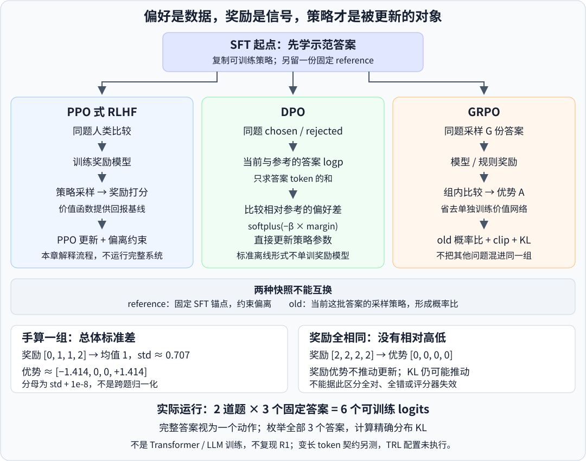

图中的三条路线是对照，不是要求读者先做 PPO，再做 DPO，最后做 GRPO。代码中 DPO 与 GRPO 都从同一份 SFT 参数复制，便于看清各自的作用。

## P22.2 补课：log probability、期望与 KL

### 概率相乘，对数相加

假设在已有问题和前文条件下，两个答案 token 的概率依次是 0.5、0.25。那么这条答案的条件概率是：

$$
\pi(y\mid x)=0.5\times0.25=0.125.
$$

使用自然对数 ln，有：

$$
\log\pi(y\mid x)=\log0.5+\log0.25\approx-2.07944.
$$

这里的第二个概率已经以第一个 token 为条件，**不是假设 token 彼此独立**。对数把很长的概率连乘变成相加，数值上更方便。概率在 0 到 1 之间，对数概率通常为负；从 −3 提高到 −2，是概率增加，不是下降。

在 P09 的交叉熵里，我们最小化负对数概率；在 DPO 中，我们比较两个答案的对数概率。注意区分：

- 完整答案的 log probability：对有效答案 token 求和，包括真正生成的 EOS。
- 每 token 平均 log probability：再除以答案长度，是另一种量。
- 原始 logits：尚未归一化的分数，不能直接当 log probability。

例如两个 token 都为 −1，序列和是 −2，均值是 −1。偷偷把和换成均值，不是“只优化实现”，而是改变目标和长度效应。

### 期望是按概率加权，不是总取最好的一项

三个答案的概率为 [0.5, 0.3, 0.2]，奖励为 [1, 0, 0]。期望奖励为：

$$
\mathbb E_{y\sim\pi}[r(y)]
=\sum_y\pi(y)r(y)=0.5.
$$

符号 y∼π 表示按策略抽样。多抽几次再取奖励均值，可以估计这个期望，但有限样本有波动。贪心只选最大概率答案，不是在进行同一种抽样。本章 `sample_rollouts` 用固定种子的有放回抽样，temperature=1，不做 top-k / top-p 截断。

### KL 比较两份完整分布

参考策略 π_ref 像一张固定的起点照片。我们希望提高奖励，又不无节制地偏离它。一种约束量是：

$$
D_{\mathrm{KL}}(\pi_\theta\Vert\pi_{\mathrm{ref}})
=\sum_y\pi_\theta(y)
\left[\log\pi_\theta(y)-\log\pi_{\mathrm{ref}}(y)\right].
$$

两份分布相同时 KL=0；一般不对称，不能调换左右。代码在有限 logits 上用 log-softmax，枚举所有动作计算。手算 p=[0.6,0.3,0.1]、q=[0.2,0.5,0.3]，得到约 0.396058 nats。它不是“只看 chosen 的概率变化”，也不是两个 logits 的欧氏距离。

对真正的自回归模型，在一个固定前缀上枚举词表，得到的是**该前缀下的条件下一 token KL**。对旧策略采到的若干前缀取平均，并不自动成为完整答案分布的精确 KL。本章后面打印的“精确答案 KL”之所以成立，是因为玩具策略只有三个完整答案，能够全部枚举。

## P22.3 经典流程：SFT → 奖励模型 → PPO 式 RLHF

[InstructGPT 论文，2022-03-04](https://arxiv.org/abs/2203.02155v1) 展示了示范微调、答案比较、强化学习三个阶段。这里解释数据怎样流动，不运行这套完整系统。

1. 收集示范答案，做 SFT。这样策略已经具备基本的回答方式。
2. 对同一个问题生成多个答案，请标注者比较，得到 chosen / rejected。
3. 训练奖励模型 r_φ(x,y)，让 chosen 的评分倾向于更高。
4. 用当前策略回答新的一批问题，奖励模型为这些 rollout 打分。
5. 使用 PPO 等策略优化方法更新生成模型，同时控制它与参考策略的偏离。

奖励模型可以用成对损失：

$$
\mathcal L_{\mathrm{RM}}
=-\log\sigma\big(r_\phi(x,y_w)-r_\phi(x,y_l)\big),
\qquad \sigma(z)=\frac{1}{1+e^{-z}}.
$$

w 表示较受偏好的答案，l 表示较不受偏好的答案。只比较差值，所以对同一问题把两个评分都加 100，并不改变偏好概率。评分没有天然的“满分 100”含义。

常见 PPO 式语言模型训练还会用价值函数 V 来估计未来回报，并计算“比预期好多少”的优势 A。**奖励模型负责评价输出；价值函数负责估计回报基线。** 它们可能都是神经网络，却不是同一个职责。

PPO 的 clipped surrogate 抑制一批旧样本上的过大更新。它比较当前策略与生成这批样本的旧策略，不是把所有参数硬裁剪到一个范围。[PPO 原论文 v2，2017-08-28](https://arxiv.org/abs/1707.06347v2) 给出了这一目标。我们在 GRPO 小节继续拆开其中的概率比与 clip。

特别记住两份快照：

- π_ref：本章固定为 SFT 起点，用于衡量偏离，整个偏好优化期间不更新。
- π_old：生成当前这批 rollout 时的策略快照，同一批的多次更新期间不变；换批采样时可以刷新。

把 old 和 ref 互换，会改变概率比或惩罚项；每一步都把 old 改成正在训练的策略，也会让概率比失去“相对于采样时”的含义。成熟训练系统的生命周期更复杂，本章先把这两种职责分开。

## P22.4 DPO：直接学习“相对起点，更偏向哪份答案”

一条偏好样本必须是同一问题的三元组 (x,y_w,y_l)。不能把“1+1=?” 的好答案和“2+1=?” 的坏答案随意凑成一对，也不能让两侧使用不同的 chat template。

标准 DPO 的每对损失为：

$$
\begin{aligned}
\Delta_\theta &= \log\pi_\theta(y_w\mid x)-\log\pi_\theta(y_l\mid x),\\
\Delta_{\mathrm{ref}} &= \log\pi_{\mathrm{ref}}(y_w\mid x)-\log\pi_{\mathrm{ref}}(y_l\mid x),\\
z &= \beta(\Delta_\theta-\Delta_{\mathrm{ref}}),\\
\mathcal L_{\mathrm{DPO}} &= -\log\sigma(z)=\operatorname{softplus}(-z).
\end{aligned}
$$

来源是 [DPO 论文 v3，式 (7)，2024-07-29](https://arxiv.org/html/2305.18290v3#S4)。直觉是：不只问策略是否喜欢 chosen，而是问它**相对于原来，更偏向 chosen 了吗？** 参考策略可能本来就偏爱某个答案，减掉参考差值可以把这一点纳入目标。

DPO 的推导把 KL 正则化奖励最大化与特定偏好模型联系起来，再将奖励重新参数化。标准离线 DPO 不单独拟合 reward model，也不必在每个优化步在线生成答案。它仍然依赖偏好数据、参考策略和假设，**不能因此说“DPO 就是全部强化学习”，更不能说任何 DPO 数据都等价于任意 RL 问题**。

### 手算一个两对答案的 batch

取 β=0.5。表中只列 chosen / rejected 的概率，其余概率质量属于其他答案。

| 样本 | 当前 chosen / rejected | 参考 chosen / rejected | 相对 margin | z | loss |
| --- | --- | --- | --- | --- | --- |
| A | 0.6 / 0.2 | 0.4 / 0.4 | ln 3 ≈ 1.098612 | 0.549306 | 0.455746 |
| B | 0.2 / 0.5 | 0.1 / 0.5 | ln 2 ≈ 0.693147 | 0.346574 | 0.534800 |

batch 对两对样本取平均，结果约 0.495273。B 的 chosen 概率仍小于 rejected，但相对参考已经改善，所以 z 仍为正。如果当前策略和参考完全相同，每对 loss 都是 ln 2≈0.693147，而不是零。

对应的核心代码只有几行：

```python
margin = (chosen - rejected) - (
    ref_chosen.detach() - ref_rejected.detach()
)
loss = torch.nn.functional.softplus(-beta * margin).mean()
```

四个输入都是 [B] 的**答案 log probability**，不是 token ID，也不是 reward。detach 切断参考分支的梯度；参考参数本身也不应交给 optimizer。softplus 的稳定实现避免先算巨大的 exp 再溢出。

单对 loss 对 chosen log probability 的导数是 −βσ(−z)，对 rejected 则为 +βσ(−z)。梯度下降倾向于增加相对 margin。共享神经网络参数会同时影响其他答案，不保证每条 chosen 的绝对概率在每一步都上涨。

### β 不是“越大越听话”的旋钮

在 DPO 的推导中，β 与对参考策略的约束强度有关。落实到这条损失，β 同时影响 sigmoid 的输入与梯度尺度；例如起点 z=0 时，梯度大小与 β 成正比。因此不能只凭“β 大”就断言实际训练每步更小，或者最终一定更好。应固定数据、学习率等条件，比较偏好评估、KL 和其他能力变化。

原始 DPO 用答案 token log probability 的和。改成长度平均、删掉 reference、把乘 β 写成除 β，都是不同目标或错误实现，不能仍声称与这条公式相同。

## P22.5 从变长 token 到一对概率：形状不能代替对齐

语言模型 logits 为 [B,T,V]，input_ids 和 attention_mask 为 [B,T]。本章的 `completion_log_probs` 做三步：

```python
next_logps = logits[:, :-1].log_softmax(dim=-1)
targets = input_ids[:, 1:]
selected = next_logps.gather(-1, targets.unsqueeze(-1)).squeeze(-1)
```

这就是一次 causal shift：输入位置 t 预测 token t+1。然后根据每行实际的 prompt 长度和 padding mask，只保留答案目标：

```python
mask = attention_mask[:, 1:].bool() & (positions >= starts)
sequence_logps = (selected * mask).sum(dim=-1)
```

positions 是原序列中目标的位置 1…T−1，starts 是该行答案开始的位置。**最后一个 prompt token 的 logits 要参与预测第一个答案 token**，不能把“输入来自 prompt”误解成“这行 logits 一定不算 loss”。

例如 T=5，第一行 prompt 长 2、真实总长 4，第二行 prompt 长 1、真实总长 5。shift 后的答案 mask 为：

```text
第一行：[False, True, True, False]   两个答案目标，末尾 PAD 不算
第二行：[True,  True, True, True ]   四个答案目标
```

EOS 如果确实属于答案，应当计入；PAD 不计入。这个 helper 只支持右 padding、有至少一个 prompt token 和一个答案 token 的输入，遇到左 padding、中间断开的 mask、空答案或非法 ID 就报错。它不负责 tokenizer 拼接边界，调用方还要保证 chosen / rejected 共用同一 prompt 和一致的结束规则。

测试不仅比较 loss，还逐元素检查梯度：无效位置应为零，有效位置应等于“目标指示值减去该 token 的概率”。修改被排除位置的 logits，不应改变结果。这样才能发现“维度正确但监督错位”的错误。

## P22.6 GRPO：同一道题，先比较一组答案

[DeepSeekMath v3，第 4.1 节，2024-04-27](https://arxiv.org/html/2402.03300v3#S4.SS1) 引入 GRPO：对同一个问题采样一组答案，用组内奖励建立相对基线，不必另外训练 PPO 式价值网络。本章讲 **outcome reward**：每份完整答案得到一个分数，同一答案的有效 token 共用一个优势值；不是逐步过程奖励。

设一个问题采样 G 份答案，奖励为 r₁…r_G。本章明确选择总体标准差，即分母为 G：

$$
\bar r=\frac1G\sum_i r_i,\qquad
s=\sqrt{\frac1G\sum_i(r_i-\bar r)^2},\qquad
A_i=\frac{r_i-\bar r}{s+\delta},\quad\delta=10^{-8}.
$$

δ 放在平方根**外面**。这里的选择用于手算和可重复的教学实现，不意味着所有 GRPO 实现都采用同一个标准差、epsilon 或归一化方式。

### 手算一组 [0,1,1,2]

平均奖励为 1，方差为 (1+0+0+1)/4=0.5，标准差约 0.707107。忽略很小的 δ 后，优势约为：

```text
奖励：  0          1       1       2
优势： -1.414214   0       0      +1.414214
```

相对本组平均更好的是最后一份答案；第一份较差。这里没有给另一道更难的题“借用平均值”。代码按 prompt_id 分组，即使样本交错排列也不会混组。每组要求至少两份答案。

如果一组奖励为 [2,2,2,2]，减去平均后全为 0，分母为 δ，优势正好全为 0，不会产生 NaN。它可能表示全部答对、全部答错，或者评分器太粗糙；**仅凭零优势无法知道是哪一种**。这组没有奖励比较带来的策略梯度，但若策略已经偏离 reference，非零 KL 惩罚仍可能产生梯度。

### 概率比、clip 和最小化符号

对第 i 份答案的第 t 个有效 token，记当前与采样旧策略的概率比为：

$$
\rho_{i,t}
=\exp\left(\log\pi_\theta(y_{i,t}\mid x,y_{i,<t})
-\log\pi_{\mathrm{old}}(y_{i,t}\mid x,y_{i,<t})\right).
$$

本章使用 clip ε=0.2，并把“最大化收益”写成优化器常用的“最小化负收益”：

$$
\mathcal L=
\frac1N\sum_{i=1}^{N}\frac1{L_i}
\sum_{t=1}^{L_i}
\left[-\min\left(\rho_{i,t}A_i,
\operatorname{clip}(\rho_{i,t},0.8,1.2)A_i\right)
+\beta K_{i,t}\right].
$$

N 是这批答案总数，L_i 是第 i 份答案的有效长度，K 是该前缀的 KL 项。本章各题采样数相同，因此对答案均权也使题目均权。不同组大小时还需明确是否要对题目再次加权。

两个检查符号的例子：

- A=+1、ρ=1.4：收益取 min(1.4,1.2)=1.2，不再鼓励这项收益无限上涨。
- A=−1、ρ=0.6：收益取 min(−0.6,−0.8)=−0.8，不能错误地取 max。

clip 的作用依赖优势符号和更新方向，并不是所有范围外的概率比都“没有梯度”；它也不保证实际 KL 永远小于一个固定值。更新后的概率仍需检查。

### 本章的 KL 和长度归约，刻意写清楚

`grpo_loss` 输入 logits/reference=[N,L,V]，targets/old_logps/mask=[N,L]，advantages=[N]。old、reference、advantages 都停止梯度；当前 logits 保留梯度。mask 中每行至少一个 True。有限的 log probability 不保证 exp 后仍然有限；如果概率比、逐 token loss 或归约超出 dtype 的有限范围，代码明确报错，不用 clip 掩盖溢出，也不让 0×∞ 静默变成 NaN。

本章词表很小，K 使用枚举整个词表的精确条件 KL，而不是采样估计。原论文使用的一个逐 token KL 估计写成：

$$
k=\frac{\pi_{\mathrm{ref}}(a\mid s)}{\pi_\theta(a\mid s)}
-\log\frac{\pi_{\mathrm{ref}}(a\mid s)}{\pi_\theta(a\mid s)}-1.
$$

若动作 a 真按当前 π_θ 抽样，且支持集条件满足，它的期望等于相应 KL；单个样本不是精确分布 KL。若样本来自固定 old，已经更新后的 current 与 old 不同，也不能不加说明地把旧样本均值称为精确 KL。本章不拿这个估计量冒充精确监测值，亦不把替换成精确 K 的教学目标说成原论文代码逐行复现。

长度归约先做“每个答案内 token 平均”，再对答案平均。若答案长度分别为 2 和 4，每份答案总权重都是 1/2；若改成六个 token 统一平均，两份答案的总权重则为 1/3 和 2/3。两者都能写成 loss，但不是同一个目标。测试刻意使用不同长度，以免相同长度掩盖错误。

## P22.7 真正跑一次：参数、概率和 KL 都由更新得到

从仓库根目录运行：

```bash
# 标准库手算，不导入 torch
python code/23_preference_optimization.py

# 安装仓库基线依赖后，实际 CPU 更新
python code/23_preference_optimization.py --torch

# 独立数值与梯度测试
python -m unittest discover -s tests -p test_preference_optimization.py -v
```

缺少 PyTorch 时默认手算正常退出；显式请求 `--torch` 会打印 `SKIP` 并以状态码 2 退出，不能把“没有运行”当成训练成功。可用 `python -S` 模拟不加载第三方包；测试中 PyTorch 项会明确跳过，标准库项仍执行。

### 一个非常小，但真实更新的策略

问题只有 “1+1=?” 和 “2+1=?”；答案动作都为 [“2”, “我猜是 0”, “3”]。每题各有三个可训练 logits，共六个 float64 参数。从全零开始，先用正确答案做 4 次 SFT SGD 更新，学习率 0.4。

之后复制两份策略：

- DPO：chosen 为各题正确答案，rejected 都是“我猜是 0”，β=0.5，学习率 0.4，更新 6 次。
- GRPO：每题从 SFT 策略有放回采样 8 个动作，精确匹配正确答案得 1，否则得 0；保存 old 概率，同一批更新 3 次，学习率 0.2，β=0.04，clip ε=0.2。

GRPO 的一次动作代表一整份答案，所以优化张量的 L=1；“我猜是 0”虽然字符更多，也不是多个策略动作。语言模型变长 token 的实现契约在前面和测试中单独验证。不要把这两层混写成“已经训练了一个生成式小 LLM”。

2026-10-19，在 CPU、PyTorch 2.14.1+cpu、seed=22、单线程下实测：

| 指标 | SFT 起点 | DPO 后 | GRPO 后 |
| --- | --- | --- | --- |
| 两题平均的精确期望奖励 | 0.506496 | 0.608010 | 0.560679 |
| 对 SFT 的精确答案 KL，题 0 | 0 | 0.024651 | 0.006216 |
| 对 SFT 的精确答案 KL，题 1 | 0 | 0.024651 | 0.006595 |
| DPO 固定偏好对 loss | 0.693147 | 0.562092 | 不作跨目标对照 |

例如题 0 的三个 logits 从 [0.479421,−0.239710,−0.239710] 变为 DPO 的 [0.761335,−0.521624,−0.239710]；这些数字来自 backward 和 SGD，而不是为了展示方向手写的“更新后概率”。reference 保持原值，并与偏好更新前独立 clone 的快照逐值比较；不能仅与可能同步改变的另一份对象比较。示例用 `fork_rng` 与 `finally` 在正常返回和异常退出时恢复调用者的 CPU 随机数状态、线程数，不触碰 CUDA 随机数发生器。

这不是 DPO 优于 GRPO 的实验：优化步数、目标、样本和学习率都不同，数据只有两道训练题。精确期望奖励也不是独立测试集准确率。两题各用一行独立参数，没有任何跨题泛化能力。我们只证明目标、梯度、数据对齐、采样和参数更新构成了可检验闭环。

### reward 对齐不能只靠 zip

一次采样保存 sample_id、prompt_id、action_id 和 completion；奖励保存对应 sample_id、prompt_id 和 value。`aligned_rewards` 在转 tensor 前检查条数、ID、顺序、题号、动作与文本一致性、有限奖励。

“2” 对题 0 正确，对题 1 错误。把奖励列表交换顺序，虽然形状完全相同，仍会把错误行为加强。代码遇到这种错配会报错，而不是悄悄 zip 截断或继续训练。实际数据流水线也应保留能追溯到样本的标识，不要在排序、截断、异步打分后丢失对应关系。

## P22.8 接到 TRL：固定版本配置阅读，明确未运行

本节核对的是 **TRL 0.16.1** 的 [DPOConfig 源码](https://github.com/huggingface/trl/blob/v0.16.1/trl/trainer/dpo_config.py) 与 [GRPOConfig 源码](https://github.com/huggingface/trl/blob/v0.16.1/trl/trainer/grpo_config.py)，核验日期为 2026-10-19。这是固定版本接口导读，不是对当前最新版的描述，也不是与本仓库依赖组合的兼容性证明。

**为什么相邻章节引用的 TRL 版本不一样？** [P20](#p20-frameworks) 用 [0.17.0 官方总览](https://huggingface.co/docs/trl/v0.17.0/en/index) 建立框架与训练入口的地图；[P21](#p21-sft) 用 [0.18.2 SFTTrainer 源码](https://github.com/huggingface/trl/blob/v0.18.2/trl/trainer/sft_trainer.py) 说明 SFT 训练器的职责。本章则选择 **0.16.1 作为固定的历史 GRPO 实现切片**，逐项核对奖励标准化、KL 估计和 loss 归约，再与手写教学变体对照。选择这个较早标签是为了固定具体的比较对象，不是推荐退回旧环境。

这三个版本号属于三处资料引用，**不是同一套训练环境，不是一条逐章升级或降级的安装路线，也没有经过跨版本兼容性验证**。下面对 0.16.1 行为的结论只适用于所链接的源码；本章没有比较另外两版的相同函数，因此不推断它们的 GRPO 行为一定相同或一定不同。三个章节均未运行 TRL，P20 的真实框架实验是另行锁定的 Transformers / Accelerate 实验。

下面只是一份**未执行的配置示意**，不包含模型下载、Trainer 构造或 train 调用：

```python
# NOT RUN：仅供阅读，需在单独环境核对完整依赖。
from transformers import GPT2Config
from trl import DPOConfig, GRPOConfig

# 若开展框架实验，可从这个结构创建随机本地模型；不是预训练权重。
tiny_architecture = GPT2Config(
    vocab_size=12, n_positions=32, n_ctx=32,
    n_embd=16, n_layer=1, n_head=2, n_inner=32,
    resid_pdrop=0.0, embd_pdrop=0.0, attn_pdrop=0.0,
    bos_token_id=2, eos_token_id=3, pad_token_id=0,
)

dpo_config = DPOConfig(
    output_dir="p22-dpo-local", use_cpu=True,
    per_device_train_batch_size=2, max_steps=2,
    max_prompt_length=8, max_completion_length=8, max_length=16,
    beta=0.1, loss_type="sigmoid",
    fp16=False, bf16=False, gradient_checkpointing=False,
    report_to=[], save_strategy="no",
)
grpo_config = GRPOConfig(
    output_dir="p22-grpo-local", use_cpu=True,
    per_device_train_batch_size=4, num_generations=4,
    max_steps=2, max_prompt_length=8, max_completion_length=8,
    temperature=1.0, top_p=1.0, top_k=None,
    beta=0.04, epsilon=0.2, num_iterations=2,
    use_vllm=False, fp16=False, bf16=False,
    gradient_checkpointing=False, report_to=[], save_strategy="no",
)
```

先读懂这些设置，再谈运行：

- 12 项词表、16 维、1 层、2 个头把模型结构限制在小规模；tokenizer 的 ID 必须一致。输入最多 8+8 个 token，不超出 32 个位置。
- DPO 数据需要同题 prompt / chosen / rejected；`loss_type="sigmoid"` 指向本章讨论的标准形式，不能随意换成另一个 loss 名称再声称目标未变。
- GRPO 的每题生成数是 4。该固定版本要求总 batch size 可被它整除；这里单进程 batch=4，符合算术约束，不意味着已经验证训练能启动。
- GRPO 需要与样本对应的奖励函数或奖励模型，还需要模板、padding、EOS、生成截断和 reward 解析测试。一个随机模型可能所有输出都得零分，配置合法不等于学习有效。
- `use_cpu=True`、关闭半精度和 vLLM、`report_to=[]` 只表达运行意图。没有安装并运行完整框架，就没有 CPU 兼容性、性能或训练结果。

尤其不能预期 TRL 与教学脚本逐数相同。[该版本 GRPOTrainer 源码](https://github.com/huggingface/trl/blob/v0.16.1/trl/trainer/grpo_trainer.py) 的具体实现使用组内 `std` 默认修正，即样本标准差，分母为 G−1；奖励标准化稳定项为 10⁻⁴；loss 按全 batch 的有效 token 数归约，并使用采样 KL 估计。本章则采用总体标准差、10⁻⁸、每答案均权、精确条件 KL。**名字相同不保证变体相同，源代码与版本才是复现账本的一部分。**

未来要运行 TRL，应新建独立环境锁定整套依赖，不要为这段未运行配置改变 P20 已验证的环境。至少保存：完整版本、随机种子、数据和模板、采样参数、每组奖励、mask、旧策略保存时点、有效长度、KL 的方向与估计方式、参数更新证据。只有真正跑完，才能把 NOT RUN 改成 EXECUTED。

## P22.9 奖励投机：学会拿分，不等于学会任务

把奖励设计为“输出中含数字 2 就得分”，那么“答案不是 2，其实是 999”也能拿分；如果奖励只检查格式，模型可能输出漂亮的格式和错误的内容。把答案写长当作奖励，则可能得到冗长重复。这里的问题不一定出在优化器，往往出在目标与真正需求之间的缝隙。

本章精确匹配答案规避了上述“包含即可”的漏洞，却也有局限：“二”与“2”可能表达同一个数，严格字符串匹配却不同。更复杂的数学、代码、事实问题还涉及等价表达、执行隔离、超时、测试覆盖和标注争议，不能用两题匹配器替代。

做评估时至少分开记录：

1. 训练奖励及其各组成部分，而不只看总分。
2. 未用于训练与挑参数的题目上的正确率或盲评偏好率。
3. 不同任务、长度、语言、难度上的退化情况。
4. 答案长度、重复、格式通过率、无效输出率及采样设置。
5. KL、奖励方差、零方差组比例、clip 比例，并说明各自统计口径。
6. 多个种子的变化和评价者不确定性；对奖励模型，还需关注它是否在训练分布之外被利用。

比较方法时固定题集、token 预算与采样预算。某方法尝试 64 次后选出最好答案，不能直接与另一个方法只答一次的正确率并列作公平结论。小样本奖励变好值得继续检查，不是宣告“已对齐”或“会推理”。

## P22.10 自测与可执行验证

配套 `tests/test_preference_optimization.py` 将题目中的关键契约变成测试。不是让实现调用自己再比较，而是使用独立的标量公式、闭式导数和有限差分：

| 自测题 | 应当得到的结论 | 自动检查 |
| --- | --- | --- |
| 当前策略等于参考，DPO loss 是多少？ | 每对 ln 2，不是 0 | 标准库手算与 PyTorch 梯度 |
| B 样本 chosen 仍低于 rejected，为什么 z>0？ | 与参考相比的相对概率已经改善 | 两对独立概率比公式 |
| 对数概率求和能换成平均吗？ | 不能冒称仍是原始序列 DPO | 变长 mask、shift、求和突变 |
| [0,1,1,2] 用总体标准差怎么算？ | 约 [−√2,0,0,√2]；epsilon 略缩放 | 交错 prompt 分组与标准差突变 |
| 所有奖励一样时一定没有任何更新吗？ | 奖励优势为零；非零 KL 仍可更新 | β=0 与 β>0 的梯度对照 |
| 为何负优势 clip 要取 min 而非 max？ | 最大化目标必须保留较保守收益 | 正负优势、多 ratio 分段标量 oracle |
| 长 2 与长 4 的答案权重是多少？ | 本章各 1/2，不是按 token 数加权 | 不同长度 loss 与有限差分 |
| 同一文本在不同题目的奖励能否交换？ | 不能；sample/prompt/reward 一起对齐 | 错序、漏项、错题号与重复 ID 拒绝 |
| KL 为何不只看采到的动作？ | 精确分布 KL 需要所有动作及概率权重 | 独立 KL 值、方向与闭式梯度 |
| 参数真的按这些目标更新了吗？ | SFT、DPO、GRPO 的最终 logits 可独立复算 | 标量 SGD 与完整 GRPO 有限差分复算 |

测试另外检查示例调用前后的 CPU 随机数状态与线程数，并注入一次中途异常验证恢复路径；将 reference 和原 SFT 对象同时改动的反例，必须被独立快照检查识别。

测试还将错误真正注入可执行源码：翻转 DPO 符号、反转 β、删参考、混组、错标准差、漏对齐、错误 shift / mask / 长度平均、反转或丢掉 KL 权重、让 old 每步跟随 current、错误 clip、全 token 归约等。测试必须抓住这些行为改变，不能只检查源码里有没有某个词。

在上面的基线环境实测，21 个测试通过；不加载第三方包时，7 个标准库测试通过、14 个 PyTorch 测试明确跳过。测试通过说明这份微型实现满足所声明的契约，不说明 RLHF 安全性、真实人类偏好或大模型能力已被验证。

本章可以带走的一句话是：**偏好、奖励、策略、参考和评估是不同角色，先把每个数字属于谁说清楚，再让优化器动手。** 下一章会把这一框架接到推理预算、MTP 和投机解码，并继续区分训练目标与推理时计算。

## P22.11 延伸：on-policy 蒸馏与多教师合并（MOPD） {#p22.11-mopd}

**先看动机。** 普通蒸馏是 off-policy 的：老师先写好答案，学生照着做 SFT。学生自己生成时，一旦走到老师没写过的前缀，就没人教了。On-policy 蒸馏反过来：让学生自己采样，再请老师给学生写下的**每一个 token** 打分。这个思路的公开讲解见 [Thinking Machines Lab，On-Policy Distillation（2025）](https://thinkingmachines.ai/blog/on-policy-distillation/)，K3 报告的 §4.1.3 引用了它。

**Kimi K3（S29 §4.1）。** 先做 SFT。再按三个领域（通用任务、通用 agent、编程 agent）各训一个 RL 专家。每个领域又分 low、high、max 三档推理强度，共 9 个专家。最后用 MOPD 把它们合进一个模型。领域 d、强度 e 的样本，由对应的那位老师打分。逐 token 奖励是 Eq.15：

`r(y_t) = clip( sg( log π_teacher^{(d,e)}(y_t | x, y_<t) / π_θ(y_t | e, x, y_<t) ), −R_max, R_max )`。

`sg` 是 stop-gradient：这个比值只当作奖励数字，不让梯度穿过它。clip 限制极端的优势信号，让 RL 更稳。报告还说，他们试过更细的 top-k 蒸馏目标，在他们的设置下没有看到明显优势。

**Nemotron 3.5 Super（S30）。** 官方文档列出 6 类专科老师：agent、推理、视觉工具使用、视频推理与跟踪、视觉推理、对齐（RLHF）。MOPD 分两个阶段，每个 prompt 交给拥有该领域的老师。其余 prompt 交给一个冻结的 self-anchor。文档说明，RLVR 第 120 步是 MOPD 第一阶段的学生。self-anchor 是这个学生起始 checkpoint 的冻结副本，用作没有专科老师认领的 prompt 的老师。

[`../code/23b_mopd_reward.py`](../code/23b_mopd_reward.py) 在一个 4 词表上手算：

| token | 老师 | 学生 | 原始 log 比 | clip(R=1) |
|---|---|---|---|---|
| 0 | 0.70 | 0.25 | +1.0296 | +1.0000 |
| 1 | 0.20 | 0.25 | −0.2231 | −0.2231 |
| 2 | 0.05 | 0.25 | −1.6094 | −1.0000 |
| 3 | 0.05 | 0.25 | −1.6094 | −1.0000 |

不 clip 时，按学生分布求期望，正好等于 `−KL(学生 ‖ 老师)` = −0.603100。所以这是一个逐 token 的反向 KL 信号。测试还检查：学生与老师一致时奖励为 0，所以起点处的 self-anchor 给出零奖励；没认领的领域会路由到 self-anchor；把比值写反，符号就翻转。本书没有跑任何蒸馏训练。

P22.11 资料（核验 2026-10-26）：S29 [Kimi K3 技术报告，arXiv:2607.24653](https://arxiv.org/abs/2607.24653) §4.1.1–4.1.3；S30 [Nemotron 3.5 Super 官方训练文档](https://docs.nvidia.com/nemotron/latest/nemotron/super35/README.html)（厂商文档）。K3 §4.1.3 同时引用 [MiMo-V2-Flash，arXiv:2601.02780](https://arxiv.org/abs/2601.02780) 与 [DeepSeek-V4，arXiv:2606.19348](https://arxiv.org/abs/2606.19348) 的多教师蒸馏做法，本书未逐条核对这两篇的细节。


---

# 训练与应用（P23）：推理模型、MTP 与投机解码 {#p23-mtp}

做一道算术题，可以把草稿写得更长，可以换一种解题方法，也可以让同桌先写几个候选步骤、再由你检查。这三件事听起来都像“多想一点”，其实改变的是不同东西。

本章先把它们拆开，再接上 [S5 的教学 MoE](#p18-moe)：**训练时怎样给未来 token 增加监督，生成时怎样验证草稿，评估时怎样把计算预算与正确率分开记录。** 我们不训练一个 R1，不下载大模型，也不把会输出很长文字的小模型称为“推理模型”。

配套 [code/24_reasoning_mtp.py](../code/24_reasoning_mtp.py)，测试为 `tests/test_reasoning_mtp.py`。CPU 主线包含可核验算术、可关闭的 S6 教学 MTP 旁路、贪心 draft/verify。**随机投机采样没有实现，不声称其分布保持。**

## P23.1 四个问题，别挤进同一个名词

| 问题 | 改变什么 | 本章对应内容 |
| --- | --- | --- |
| 怎样让模型学会更有效地解题？ | 数据、奖励、优化目标与训练流程 | R1 式后训练路线 |
| 同一个隐藏位置还能接受哪些监督？ | 训练标签与预测模块 | MTP 辅助目标 |
| 已经训练好的目标模型，能否少做几次串行调用？ | 生成算法与执行安排 | 投机解码 |
| 测试时多给计算，答案是否更好？ | 单题计算预算与评估方式 | 预算—正确率曲线 |

MTP 是 **Multi-Token Prediction，多 token 预测**；speculative decoding 是**投机解码**。前者可以为后者提供草稿，但不是同义词。没有 MTP 的小模型也能做 drafter；有 MTP 辅助损失的模型也可以只用普通自回归生成。

同桌类比也有限：计算机的“检查”不是凭感觉觉得通顺，而是执行明确的接受规则。我们要保持的是**目标模型原来的生成规则**，不是“只要答案差不多就行”。目标模型本身可能算错题，投机解码不会自动纠正它的知识或算术能力。

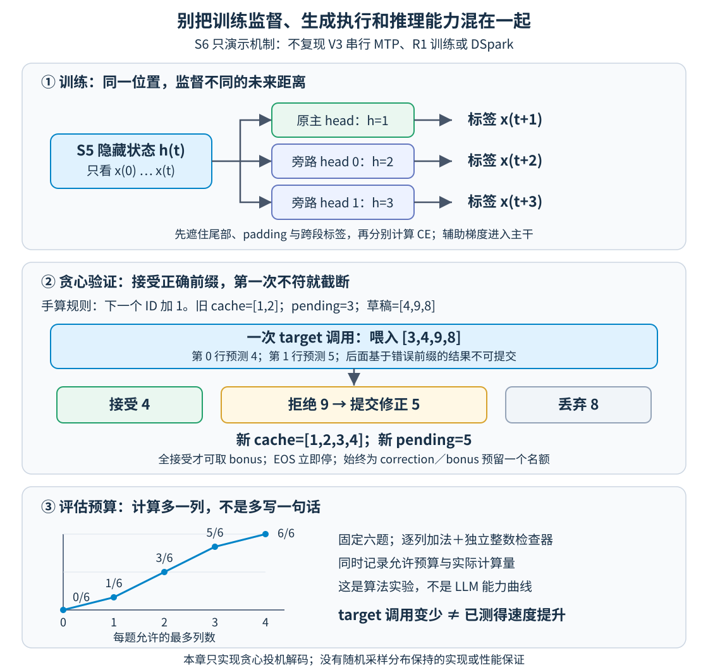

## P23.2 R1 式训练：不是给答案加一个“思考”标题

先回忆前两章：SFT 用示例告诉模型哪些输出应提高概率；偏好或强化学习使用另一个评价信号调整策略。它们可以组成多阶段流程，不能仅凭最终文本的样式识别训练方法。

这里固定讨论 **DeepSeek-R1 技术报告 v1**，不把后续所有同名更新混在一起：

- **R1-Zero** 从基础模型直接进行 RL，不先做冷启动 SFT。这是一条特定实验路线，不等于“模型从零知识学会推理”。
- **R1** 先用少量较可读的长解答做冷启动 SFT，再做面向推理任务的 RL。
- 随后从训练后的模型收集候选解答、筛选数据，并混入非推理数据做新一轮 SFT；再进行覆盖更多场景的 RL。
- 报告中的小模型蒸馏使用教师生成并筛选的数据进行 SFT，不应写成“小模型完整重跑了教师的 RL 流程”。[DeepSeek-R1 v1，§2.2–2.4](https://arxiv.org/html/2501.12948v1)

这里的 **cold start（冷启动）** 是给后续 RL 提供一个起点；**rejection sampling（拒绝采样筛选）** 在该训练阶段用于保留合格的数据样本。它不是下文为了保持目标生成规则而进行的“草稿接受／拒绝”，两者的目的、输出和正确性要求不同。

把训练路线翻译成读者可以检查的问题：

1. 起点是什么模型，已经会什么？
2. 监督数据来自哪里，筛选是否可信，验证集有没有混进去？
3. 奖励衡量答案正确、格式合规，还是人的偏好？这些不能相互替代。
4. 最后评估的是未见题目的正确率，还是只看输出变长、训练奖励变高？

给每道题奖励“写得长”，可能学到重复；给格式奖励，可能学到包装错误答案。即便正确率提高，也需要固定题集、预算和采样方式后才能比较。**“R1 式”是一条需要证据的训练路线，不是“多说几句话”的产品开关。**

## P23.3 先用可验证算术理解计算预算

为了让“多花了多少计算”不被语言风格干扰，本章暂时不用语言模型，改用一个故意可中断的竖式加法器。它每处理一个十进制数位，消耗一个预算单位。没算到的高位先留为零；只有全部输入位处理完，才把最后的进位写入答案。

这不是拟人化的思维过程，也不是 R1 复现。它是一台我们能逐步检查的算法，用来建立**输入相同、预算可控、检查器独立**的实验习惯。

### 手算 48 + 37

| 步骤 | 当前列 | 输入进位 | 当前合计 | 写下 | 传给下一列 |
| --- | --- | --- | --- | --- | --- |
| 1 | 个位：8 + 7 | 0 | 15 | 5 | 1 |
| 2 | 十位：4 + 3 | 1 | 8 | 8 | 0 |

预算 1 时只算出低位，临时答案是 5；预算 2 时答案是 85。不能把两步中的进位忘掉，也不能在预算 1 时偷偷读取真实答案补上十位。

代码中 `column_add` 只执行逐列计算；外层 `arithmetic_curve` 用 Python 整数加法 `a + b` 判断最终答案。求解器没有拿检查器的答案来选择输出。比如 999+1，预算 2 的临时答案仍是 0；预算 3 完成三列后，把最后进位加上，得到 1000。

固定六道题：2+3、12+23、48+37、105+207、999+1、1234+8765。每个预算都跑完全相同的题，结果如下：

| 每题允许的最多列数 | 正确题数 | 正确率 | 每题实际平均处理列数 |
| --- | --- | --- | --- |
| 0 | 0/6 | 0% | 0 |
| 1 | 1/6 | 16.7% | 1 |
| 2 | 3/6 | 50.0% | 11/6，约 1.833 |
| 3 | 5/6 | 83.3% | 14/6，约 2.333 |
| 4 | 6/6 | 100% | 15/6，即 2.5 |

“允许 4 列”不等于每题真的用了 4 列：2+3 只需一列。脚本同时打印预算与实际使用量。这个人为选择的六题数据集和正确的竖式算法自然形成阶梯，**不能据此推出真实语言模型的正确率会随 token 预算单调上升**。

把方法迁移到模型评估，还要固定模型版本、题集、提示、采样参数和检查器，并分别报告：

- 单个答案的质量与实际生成 token 数；超时、截断答案也计入分母。
- 同题多次采样的总成本。一次答对与十次中选出一次答对不是同一个指标。
- 是否有选择器或可验证检查器，以及选择本身的计算成本。
- 若修改预算后答案更啰嗦但没更正确，明确记录“没有测到质量收益”。

本节只运行确定性算法，没有训练／验证泄漏的模型实验，也没有未披露的教师模型调用。

## P23.4 MTP：在同一位置多问几个未来问题

普通 next-token prediction 在位置 t 的隐藏向量 h_t 上，预测下一个 token x_{t+1}。S6 的教学旁路另外增加独立线性 head，用**同一个 h_t** 预测 x_{t+2}、x_{t+3}……。

设有 D 个额外 head，总共 D+1 个预测距离，记为 horizon h：

$$
z_t^{(1)}=W_1h_t,\qquad
z_t^{(h)}=W_hh_t\quad(h=2,\ldots,D+1).
$$

主 head 是 S5 原来的 head，不是再复制一个。h_t 只能看见当前位置及之前的 token；为了预测更远处，我们没有把真实未来 token 偷塞进 h_t。

### 五个 token，把标签写出来

输入为 `[1,2,3,4,5]`，D=2。这里的整数是 token ID，不是它们的数值大小。

| 隐藏位置的输入 token | 1 | 2 | 3 | 4 | 5 |
| --- | --- | --- | --- | --- | --- |
| 主 head：h=1 | 2 | 3 | 4 | 5 | 忽略 |
| 旁路 head 0：h=2 | 3 | 4 | 5 | 忽略 | 忽略 |
| 旁路 head 1：h=3 | 4 | 5 | 忽略 | 忽略 | 忽略 |

最后几格不是“答案是 0”，而是窗口里已经没有对应标签。实现使用 `-100` 表示**不计损失**。不要 `roll` 后忘记遮住尾部，否则最后一个位置会被要求预测窗口开头，制造不存在的循环文本。

张量账本如下：

| 项目 | 形状 |
| --- | --- |
| token ID、每个 horizon 的 labels | [B,T] |
| 归一化后的隐藏状态 | [B,T,D_model] |
| 每个 head 的权重 | [V,D_model] |
| 每个 horizon 的 logits | [B,T,V] |
| 每个 horizon 的 CE | 标量 |

这里 D 表示“额外预测 head 数”，D_model 表示隐藏宽度，V 表示词表大小。代码特意用 `depth` 与 `config.d_model` 区分，避免把两个 D 混写。

### 这是教学并行旁路，不是完整 V3 MTP

DeepSeek-V3 的版本化报告描述的是**串行** MTP 模块：结合前一深度的表示和对应 token embedding，经过额外 Transformer，并共享 embedding／输出 head。训练辅助目标与推理时如何利用它是两个层面。[DeepSeek-V3 v2，§2.2](https://arxiv.org/html/2412.19437v2)

S6 没有实现那条串行结构，也没有复现其权重共享、训练规模或生产性能。我们选独立线性 head，是为了用最小改动看清标签对齐和梯度。多个 head 从同一前缀预测未来边际结果，也不等于它们已经正确建模了“先生成第一个草稿，再条件于它生成第二个”的联合链条。

## P23.5 损失：先算哪些格，再决定怎么平均

对 horizon h 的有效位置集合 M_h，本章定义：

$$
L_h=-\frac{1}{|M_h|}\sum_{(b,t)\in M_h}
\log\operatorname{softmax}(z_{b,t}^{(h)})[x_{b,t+h}].
$$

若 M_h 为空，令 L_h=0，并保留可反向传播的零值。否则“对空集合取均值”可能得到 NaN。因为不同 horizon 的有效标签数不同，分母不能固定写成 B×T。

S6 的明确约定是先对每个 horizon 的有效标签取均值，再对 D 个额外 head 的损失取平均：

$$
L=L_1+\frac{\lambda}{D}\sum_{h=2}^{D+1}L_h+L_{MoE}\quad(D>0).
$$

D=0 时省略中间项；L_MoE 是 S5 已有且已乘系数的负载辅助项，不要重复乘或悄悄删除。一个 horizon 没有标签时，其 CE 为零，但**整项训练损失未必为零**，因为 MoE 辅助项可能仍存在。把所有 horizon 的有效位置放一起再平均也是另一种可定义的目标，但不是本章这一个。

### 两个有效位置，手算交叉熵与梯度

假设三分类概率在第一个有效位置为 `[1/6,2/6,3/6]`，标签是类别 2；另一个有效位置为 `[3/6,2/6,1/6]`，标签是类别 1。两者中间有一个忽略位置：

$$
L=\frac{-\log(3/6)-\log(2/6)}{2}
=\frac{\log 2+\log 3}{2}.
$$

对第一个位置的 logits，梯度是 `(概率 − one_hot)/2`，即 `[1/12,1/6,-1/4]`。第二个有效位置为 `[1/4,-1/3,1/12]`；忽略位置的三个梯度全为 0。测试既检查这个数值，也检查梯度，不只判断 loss 是否“看起来正常”。

### 三种 mask 不要混用

`future_labels` 接受三个可选输入，形状都是 [B,T]：

- `valid`：这个 token 是否真实存在，而不是 padding。跨度 t 到 t+h 中的**每个位置**都必须有效。
- `segments`：文档段编号。跨度中所有位置必须属于同一段，不能跨边界预测；即使编号后来又重复，也不能跳过中间另一段。
- `supervise`：哪些目标位置应计入损失，例如只监督 assistant token。检查的是 t+h，**不是 t**。最后一个 prompt token 预测第一个 assistant token 正是合法监督。

重要边界：这些是**标签 mask，不是 attention mask**。S5 的主干仍是普通因果注意力；给两篇文档编号不会自动禁止后一篇读取前一篇。需要隔离上下文时，本示例用不同样本行，不声称实现了 packed block-diagonal attention。教学 MoE 的负载辅助项也没有改成只统计有效标签，所以应使用无 padding 的等长小样本，或单独定义并验证完整的 padding 处理。

## P23.6 S6 怎样接在 S5 旁边

`MTPGPT` 继承 S5，只注册额外 head，不修改 `code/19_moe.py`。有三条清楚分开的调用路径：

1. `model(tokens, targets)`：完全沿用 S5 的普通 forward，targets 仍按 S5 的约定由调用者对齐；不会执行旁路 head。
2. `model.forward_mtp(tokens, ..., weight=0.2)`：接收**尚未右移的完整序列**，自己为每个 horizon 创建 labels，并返回 `MTPResult`。
3. `s5.cached_forward(model, chunk, cache)`：沿用 S5/S4 的 compact GQA cache，只走主模型；生成时不反向传播。

不要把第二种调用与第一种目标格式混用。`forward_mtp` 返回每个 horizon 的 logits、labels、CE，以及合计 loss 和单列的 MoE 辅助项，方便看清训练信号从哪里来。

沿源码阅读 `mtp_logits`：

- `tok_emb(idx)` 把 [B,T] 转成 [B,T,D_model]。
- 依次经过 S5 原来的 blocks，继续保留因果注意力和 MoE。
- `ln_f(hidden)` 得到各个 head 共用的表示。
- 原 head 生成 horizon 1 的 logits，额外线性层分别生成 horizon 2、3……。

所有额外 head 都连接主干，没有 `detach`。因此辅助损失也会训练 embedding 和 Transformer；它不是冻结教师的蒸馏。若想研究“冻结主干”的另一种训练法，必须另开消融，不能只改解释文字。

`depth=0` 不添加参数、不额外消耗随机初始化数；同种子下，S5 与 S6 的 state_dict、参数数量、普通 logits、普通 loss 和缓存数值完全相同。不同模型实例的 cache 仍有不同 owner，不能互换。`depth=2` 时增加的参数正好是 `2 × V × D_model`，不是完整模型参数翻倍。

`weight=0` 只是关闭辅助损失的系数，**不删除已经创建的 head，也不省掉显式 `forward_mtp` 里的 head 计算**。若要结构上关闭旁路，构造 `depth=0`；若只做普通推理，调用普通 forward／cache 路径即可。重新训练后的主干权重变了，不能再要求它与训练前的 S5 输出相同。

本章验证 CPU float32 演示与 float64 数值对照；没有验证 autocast、混合精度、大批量 ragged 请求、GPU kernel 或多机缓存。不要将本例的数值容差直接搬去低精度服务。

## P23.7 贪心 draft/verify：只信目标模型的那一票

**贪心生成**每步选择目标 logits 最大的 token；本实现用 PyTorch `argmax`，平局时选编号最小者。草稿可以不完美，但已提交的结果必须遵守这个规则。

设已有前缀为 P，草稿提出 `[B,X,Y]`。目标模型在一个带因果 mask 的块里计算出：

- P 后应该是 B：接受 B。
- P+B 后应该是 C，而不是 X：拒绝 X，提交 C。
- 丢弃 X 之后的全部草稿，以及以错误 X 为条件计算的后续结果。

本轮实际输出 `[B,C]`。不是把 X 单独改为 C 后继续相信 Y，因为 Y 的验证前缀已经错了。

如果草稿 `[B,C,D]` 全部与目标贪心选择一致，目标在 P+B+C+D 后还给出了下一个位置的 logits。可再提交一个**额外 token（bonus token）**。本轮最多得到“草稿长度 + 1”个 token，而不是最后一个草稿输出两遍。

为什么这保持贪心序列？用归纳法即可：假设当前已提交前缀与基线相同；接受的每个 token 都等于目标在这个正确前缀上的 argmax。第一次不匹配时，改用同一位置的目标 argmax 并停止本轮。全接受时的 bonus 也在正确前缀上计算。因此下一轮仍从相同的已提交前缀开始。

这是数学算法的不变量。实际浮点矩阵运算的分块顺序可能产生微小误差；近乎并列的 logits 可能因此改变 argmax。测试使用固定种子、小张量、float64 对照，同时比较 logits 与 K/V，而不是宣称任意硬件精度都能逐位相同。

## P23.8 KV cache 最容易错的地方：最后一个 token 还没喂进去

生成一个 token 和把它送进模型，是两件事。为避免每轮为了 correction／bonus 额外调用一次目标模型，本实现维护如下不变量：

- `tokens`：已经提交给用户的 prompt 与生成序列。
- `cache`：缓存 `tokens[:, :-1]`，即还没包含最后一个已生成 token。
- `pending`：`tokens[:, -1:]`，下轮才喂入目标模型。

先对完整 prompt 做一次 prefill，取末行 logits 的 argmax，输出第一个 token。此时 cache 恰好装着 prompt，第一个新 token 成为 pending。

### 带具体位置的拒绝例子

使用一个便于手算的目标规则：“下一个 ID 等于当前 ID 加 1”。prompt 是 `[1,2]`，prefill 先生成 3：

| 状态 | 内容 |
| --- | --- |
| tokens | `[1,2,3]` |
| cache | `[1,2]` |
| pending | `[3]` |
| 本轮草稿 | `[4,9,8]` |

目标调用一次，新增输入是 **`[3,4,9,8]`**，而不是重复输入 prompt。以位置编号从 0 开始：

- `verify[0]` 是“看到 3 后”的 logits，预测 4，用来验证草稿第 0 项。
- `verify[1]` 是“看到 4 后”的 logits，预测 5，用来验证草稿第 1 项；9 错了。
- 后面的行使用了错误草稿前缀，不能继续提交。

接受 4，修正为 5 后，tokens 成为 `[1,2,3,4,5]`。cache 应裁成 `[1,2,3,4]`，pending 是 `[5]`。不能留下 9 的 K/V，也不能提前把 5 当作已经存在的 cache 位置。

源码中若旧 cache 长度为 P，本轮一共提交 s 个新 token，则新 cache 长度为 `P+s`。因为本次调用喂入了旧 pending，但留下新 pending 未喂入。`trim_cache` 对每层 K/V 的时间维度取前缀并复制，保留 owner 与权重版本，不修改原 cache。

### EOS 与预算必须一起守住

- prompt 最后已经是 EOS，或者 `max_new_tokens=0`：返回原序列，不做 target 调用、不创建 cache。
- prefill 生成 EOS：立即结束，EOS 留作最后的 pending。
- 接受的草稿中出现 EOS：在它那里结束，不提交后缀或 bonus。
- 草稿出现 EOS 但目标不同意：它只是一个被拒绝的提案，不能让请求提前结束。
- correction 或 bonus 是 EOS：提交它，然后结束。
- 每轮最多提议 `min(draft_tokens, remaining-1)` 个 token，预留一个 correction／bonus 位置。只剩一个输出名额时，不征求草稿，普通前向一步。

因此最后一轮不会越过 `max_new_tokens`。本例保守要求 `prompt 长度 + 生成预算 <= max_seq_len`，不实现滑动截断；若模型权重或影响缓存的设置改变，必须重新开始请求。

每轮验证还必须至少提交一个 token。若拒绝分支因程序错误忘了提交 correction，代码立即抛出 `RuntimeError`，而不是在同一前缀上无限循环。**空草稿本身是合法的**：它仍从目标 logits 提交一个 token，所以不能仅因草稿长度为 0 就报“没有进展”。

## P23.9 为什么不能把贪心验收拿去冒充随机采样

贪心只需要知道最大项是谁；随机采样必须保持**整个概率分布**。若目标为 p、草稿为 q，在同一条件前缀和同一采样变换下，经典投机采样对从 q 抽出的 token x 使用：

$$
\alpha(x)=\min(1,p(x)/q(x)).
$$

拒绝时不能随意重抽，也不能直接选目标最大项，而应从归一化的正差分布抽取：

$$
r(x)=\frac{\max(0,p(x)-q(x))}
{\sum_y\max(0,p(y)-q(y))}.
$$

这套接受与校正规则的依据见 [Fast Inference from Transformers via Speculative Decoding v2，§2.3 与附录 A](https://arxiv.org/html/2211.17192v2)。若 q(x)=0，正常从 q 采样不会得到该 x；p=q 时拒绝概率为零，不应去归一化一个全零残差。涉及 temperature 或截断采样时，要使用相应处理后的分布，不能混用原始 logits 和修改后的概率。

手算一个两词表例子：p=[0.6,0.4]，q=[0.2,0.8]。A 的接受概率是 1，B 的接受概率是 0.5；被直接接受的质量分别是 0.2、0.4，尚有 0.4 的拒绝质量。正差 p−q 只在 A 上为正，所以这 0.4 全补给 A，最后恰好得到 [0.6,0.4]。

**本章只对这个概率恒等式做精确分数验算，没有随机投机采样器。** 代码中的 `greedy_decode` 不接受 temperature、top-p 或随机 generator，也没有概率校正实现。不要删除这条边界，再把“贪心序列相同”写成“随机采样分布保持”。

## P23.10 运行结果：少几次 target 调用，不等于真的快了

在仓库根目录运行：

```bash
OMP_NUM_THREADS=1 python code/24_reasoning_mtp.py
OMP_NUM_THREADS=1 python -m unittest discover -s tests -p test_reasoning_mtp.py -v
```

已验证环境为 CPU、PyTorch `2.14.1+cpu`、单线程、种子 230。脚本不下载数据／权重。缺少 PyTorch 时，CLI 给出安装 `requirements.txt` 的提示并以状态 2 退出；测试按仓库的兼容版本闸门友好跳过，**跳过不是通过**。

固定 demo 使用词表 11、隐藏宽度 16、1 层教学 MoE、2 个额外 head、长度为 2 的 prompt，生成 10 个 token。模型只随机初始化并做一次反向检查，没有训练质量结论。本次输出包括：

```text
greedy tokens equal: True
generated IDs: [[5, 6, 3, 1, 9, 2, 5, 6, 3, 1]]
target calls: ordinary=10, draft/verify=6
target input tokens: ordinary=11, draft/verify=18
drafter full-prefix calls=4; input tokens=24
accepted/proposed=4/11; rejected rounds=4; bonuses=0
```

计数在实际 `forward` 调用处累加，包含 prefill，不是用“输出长度÷草稿长度”推算。`target_tokens` 也计入后来丢弃的草稿输入。`draft_requests` 是请求草稿的次数，不能假定它等于任意草稿器内部的 forward 次数；本例 `MTPDraft` 自己另外记录了真实完整前缀 forward 和输入量。

看起来 10 次 target 调用变成 6 次，但 target 处理的位置由 11 增至 18，drafter 又完整计算了 24 个前缀 token。这里的 MTPDraft 为了易读，每次都重算完整前缀，也复用了目标主干，**不是低成本的生产草稿器，不应宣布加速**。本章没有测墙钟延迟、TTFT、TPOT 或 GPU 吞吐。

定义本章的草稿接受比例为 `accepted / proposed`：分母包括因前面出错而被整体丢弃的后续提案。这是清楚可复算的保留比例，不是所有论文相同名称的统计口径。还应看每轮提交多少 token、草稿耗时、目标 chunk 成本以及缓存搬运；只报一个高接受率不够。

独立测试另有一个“完美草稿”的标量目标：生成 10 个 token，target 调用从 10 次变成 4 次，处理位置都为 11，且有两个 bonus。它证明计数与流程按规则工作，不证明神经模型能够免费拿到完美草稿。

## P23.11 蒸馏与跨版本比较：到这里划边界

**蒸馏**可以把大模型生成的优质示例用于训练小模型；也有使用教师概率的其他方案。必须说明具体知识如何传递，不能只凭“小模型效果像大模型”推断训练方法。数据蒸馏、冻结主干的草稿模块训练、MTP 共享主干辅助学习，是三种不同设置。

本章只解释这个区别，没有实现蒸馏流水线、教师服务、数据筛选系统或新扩展项目。S6 的辅助梯度进入主干，不能将其命名为 R1 蒸馏复现。

截至 2026-10-19，本章只依据官方版本化报告作如下跨版本提醒：**DeepSeek-V4.1-Flash 的 DSpark 不能直接贴上 V3 MTP 的标签。** 官方报告 §2.4.3 描述了半自回归草稿和基于置信度安排验证的方案；它在预训练后专门训练，起初冻结 backbone，后训练中其目标也不向 backbone 反传。不要从“都是投机解码”推断两者采用同一训练目标或参数共享设计。[DeepSeek-V4.1-Flash v1](https://arxiv.org/html/2609.19969v1)

我们没有运行 DSpark、R1 或 V3 官方权重，没有复现其质量或速度。读到新版本时应重新核对明确对象与版本，而不是沿用旧名词填满组件表。

## P23.12 自测：每个问题都有一个可运行的检查

先独立作答，再对照以下结果；对应测试名可以在 `tests/test_reasoning_mtp.py` 中搜索。

1. 输入 `[1,2,3,4,5]`，horizon=3 的标签是什么？是 `[4,5,-100,-100,-100]`，不能把 1、2 循环补到尾部。检查 `test_hand_labels_and_no_circular_roll`。
2. 源位置属于 prompt、目标位置属于 assistant，应不应该监督？应检查目标位置；若跨度穿过 padding 或文档边界则仍应忽略。检查 `test_label_masks_match_scalar_oracle_including_intermediate_boundaries`。
3. 有效概率为 1/2 与 1/3，中间一个位置忽略，CE 分母是什么？是 2，loss 为 `(log 2 + log 3)/2`；忽略位置梯度为零。检查 `test_masked_ce_scalar_and_analytic_gradients`。
4. `depth=0` 与 `weight=0` 是否都删除了旁路参数？只有前者从构造上不创建额外参数；普通 forward 即使存在旁路也不调用它。检查 `test_disabled_is_exact_s5_parameters_rng_logits_losses_and_cache` 与 `test_enabled_sideheads_do_not_change_ordinary_s5_path`。
5. 草稿第二项错误，能不能保留第三项，只替换第二项？不能；错误前缀之后的验证结果要丢弃。检查 `test_every_rejection_position_and_subsequent_cache_positions`。
6. `[1,2,3]` 中 3 为 pending，接受 4 后修正为 5，cache 是什么？是 `[1,2,3,4]`，5 仍未喂入。检查同一拒绝测试及 `test_real_s5_full_context_oracle_and_cache_logits`。
7. 只剩一个输出名额，能否再提交三个草稿与一个 bonus？不能；草稿长度降为 0，只生成一个 token。EOS 也不能越过。检查 `test_short_empty_drafts_and_budget_boundaries` 与 `test_eos_prompt_first_accepted_corrected_rejected_and_bonus`。
8. 预算 2 的 999+1 是什么临时答案？是 0；预算 3 完成后才得到 1000。预算曲线为什么不是语言模型能力曲线？它来自已写好的竖式算法与固定六题。检查 `test_arithmetic_curve_and_carry_by_independent_integer_oracle`。
9. p=[0.6,0.4]、q=[0.2,0.8] 时，拒绝的概率质量如何补回？0.4 全补到 A；这是数学例子，不是随机采样实现。检查 `test_hand_sampling_correction_is_math_only_not_a_sampler_claim`。
10. 草稿第一个位置应该用哪个 head？是主 head，后面才是旁路 head 0、1。固定种子下前缀 `[1,2,5]` 的三个提案为 `[6,0,9]`，limit=1、2、3 分别取前一、二、三项；不能跳过主 head。检查 `test_fixed_seed_draft_head_to_position_scalar_oracle`，并用 `test_cli_pins_documented_outputs_and_actual_cost_counters` 固定正文演示的输出与成本计数。

测试不只让两个共享代码的函数互相证明。它使用 Python 标量标签 oracle、显式 log-sum-exp、解析 logits 梯度与权重有限差分、独立 token-history 目标、真实 S5 完整前缀 logits／逐层 K/V 对照，以及不调用 `mtp_logits` 的逐 head 标量投影 oracle；还实际执行十二种错误变体，确认错位标签、错误分母、错误接受、缓存偏一、漏停 EOS、越过预算、跳过主 head、漏掉 correction 等会被拦住。最后一种由 `test_deleted_correction_mutant_fails_fast_without_timeout` 验证精确的 `RuntimeError`，不是把测试超时算作成功。

读完本章，应能清楚说出：**推理能力要靠任务评估，MTP 是训练监督，投机解码是保留目标生成规则的执行方法，测试时计算是需要付账的预算。** 把它们分别定义、分别验证，比把所有改进都叫“多想一步”更重要。

## P23.13 延伸：块草稿、置信截断与 ECHO 递归草稿头

P23.7 的验收规则不关心草稿从哪来：只要每轮都由目标模型贪心验收，输出就等于普通贪心。2026 年几篇工作都在“草稿怎么更便宜、更准”上做文章。配套 [`../code/24b_spec_drafts.py`](../code/24b_spec_drafts.py) 把三种思路缩成 CPU 玩具，**全部复用本章未修改的 `greedy_decode` 验收**，并断言输出与普通贪心逐 token 相同。

**块草稿（DFlash）**。[DFlash（arXiv 2602.06036，2026-02-05 提交）](https://arxiv.org/abs/2602.06036)用一个轻量块扩散草稿模型一次并行写出整块草稿（论文设置块长 16、5 层草稿网络），并把目标模型的隐藏特征注入草稿层的 K/V。论文报告在 Qwen3-8B 上最高约 6.1× 无损加速，约为 EAGLE-3 的 2.5 倍。本书的 `BlockDraft` 只保留“一次调用给出整块”这个接口：用 S6 的多个 MTP 头在同一前缀上并行给出 3 个候选，不是扩散模型，也不做特征注入。

**置信截断（DSpark）**。[DSpark（arXiv 2607.05147，2026-07-06 提交）](https://arxiv.org/abs/2607.05147)给每个草稿位置预测一个置信度 `c_k = σ(w·[h_k; W1[x_{k−1}]])`，训练目标是 `c* = 1 − ½‖p_d − p_t‖₁`，再由调度器（论文 Algorithm 1，贪心）决定每个请求送多长的草稿去验证；草稿头里的 Markov 部分是低秩 `B = W1W2`（r=256），γ 是草稿块长，生产部署块长 γ=5（最多一次 5 个草稿 token），位置损失权重 `w_k = exp(−(k−1)/γ)` 也用同一个 γ。论文报告相对 MTP-1 单用户速度 V4-Flash 提升 60–85%、V4-Pro 提升 57–78%。`c*` 恰好等于 `Σ_v min(p_d, p_t)`，也就是随机投机采样的接受率：代码用 20 万次 Monte Carlo 抽样验证两者相差小于 0.01，并在测试中把 ½ 删掉作为变异，必须被抓住。`BlockDraft(tau=…)` 用草稿自身最大概率代替学到的置信头，在第一个低于阈值的位置截断；阈值设成 1.01 时草稿全被截掉，输出仍不变，只是退化成普通逐 token 解码。

**ECHO 递归草稿头**。[ECHO（arXiv 2610.24766，2026-10-17 提交）](https://arxiv.org/abs/2610.24766)沿**预测距离（horizon）**递归：`h_t = T^L(F(h_{t−1}, e(x_t)))`。T^L 不是新加的模块，而是**主干自己的最后一层（第 L 层）解码层**，输出头也与主干共享；F 是轻量融合层（两路各做 RMSNorm、拼接、线性投影）。第 k 个 horizon 只调用一次 T^L：把第 k−1 个 horizon 的隐藏状态与**再往后一个 token** 的嵌入融合，预测再远一个位置。论文明确把它与“反复精炼同一位置”的 looped transformer 区分开。训练时用动态深度采样（DDS）：每个优化步按 π=(0.6, 0.3, 0.1) 抽一个 horizon 数 D∈{1,2,3}（期望 1.5），只训练前 D 个 horizon，于是第 k 个 horizon 被训练的频率是 `f_k = P(D ≥ k)`，即 (1, 0.4, 0.1)（论文式 4）。论文对比表中 ECHO-1.5(3) 为 36.34、固定深度 3 的 ECHO-3 为 36.36（平均深度只有一半），主干为 10B-A1B、600B token 预训练。本书的 `ECHOHead` 直接复用 S6 目标模型的最后一个 block 作为 T^L，并复用嵌入、`ln_f` 与输出头。写成下标：位置 t 的第 k 个 horizon `h^(k)_t = T^L(F(h^(k−1)_t, e(x_{t+k})))`，监督标签是 `x_{t+k+1}`（代码里 `idx[:, k+1:]`），`h^(0)` 就是目标模型自己的最后一层状态。每个优化步按 π 抽 D，对 horizon 1..D 的交叉熵取平均。起草时，第 j 个草稿把上一 horizon 的状态与最新 token（先是 pending，再是刚起草的 token）融合。**冻结目标模型、只训练融合层 F 是本书的简化**：论文里 F 与共享的主干（包括 T^L 和输出头）在预训练中联合优化，草稿能力本身就会塑造主干。训练后，在留出数据上 horizon 1/2/3 的贪心准确率都是 1.000（规律太简单，见下方边界）。测试改动下标 t+2 处的 token：`h^(1)_t` 必须不变、`h^(2)_t` 必须改变；把实现换成“在同一位置反复套 T 的 looped 版本”会被这条测试抓住，把标签错用成 `x_{t+2}` 的变异也会被抓住。

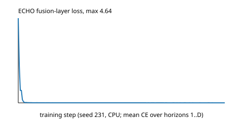

平均接受长度可以直接从各位置条件接受率算出：`E[τ] = 1 + Σ_d Π_{i≤d} a_i`，1 是每轮必有的修正或 bonus token。a=(0.8, 0.6, 0.4) 时为 2.472，测试用 5 万次模拟核对，并把“乘积”误写成“直接相加”作为变异。

边界：三个类都是教学重建，不是论文代码（ECHO 仓库未声明许可证，本书未复制其代码）；目标规律 `x_{t+1} = (3x_t+1) mod 11` 极易学习，所以接受率接近 100%，不代表真实模型。ECHO 论文自述的局限同样适用：预训练只重复一次、微调只用单一种子；DDS 每步只抽一个 D，各步的损失构成不同，所以图中曲线本身就会抖；曲线也只是单次运行。不声称任何加速。

## P23.14 延伸：推理强度预算与 LK loss {#p23.14-budget-lk}

**预算控制（S29 §4.1.2）。** 想要“同一题少想一点”，K3 在 RL 中给每道题 x 估一个初始预算 `b0(x)`，来自冷启动模型。轨迹的 token 数 `T(y)` 超过 `τ · b0(x)` 时，任务奖励直接改成 −1。通用任务只数思考 token；agent 任务数全部输出，包括工具调用参数。训练先用较大的 τ 得到 max 档，再把 τ 退火变小，得到 high 和 low 档。

[`../code/24c_budget_lk.py`](../code/24c_budget_lk.py) 用 4 条自造轨迹，`b0 = 1000`：

| (任务奖励, token) | τ=3 | τ=2 | τ=1 |
|---|---|---|---|
| (1, 900) | 1 | 1 | 1 |
| (1, 1500) | 1 | 1 | −1 |
| (0, 700) | 0 | 0 | 0 |
| (1, 2600) | 1 | −1 | −1 |

测试检查：恰好等于阈值不罚；τ 变小后，被罚的轨迹不会恢复。

**MTP 变成草稿模型（S29 §4.1.4）。** K3 预训练时带一个 MTP 层。后训练时冻结目标模型，把这个 MTP 层微调成 EAGLE-3 式草稿（[EAGLE-3，arXiv:2503.01840](https://arxiv.org/abs/2503.01840)）。训练时草稿展开 7 步。输入融合第 1、第 4 和最后一个 AttnRes block 的特征（见 [6.9](#p07-attnres)）。融合矩阵 `W_E3` 初始化为 `[0 0 I]`，所以起点就是 MTP 层预训练时见过的高层特征。

**LK loss。** P23.13 已用 Monte Carlo 验证：随机投机采样的逐 token 接受率是 `Σ_x min(p(x), q(x))`。K3 直接优化它的负对数（Eq.16），来自 [LK losses，arXiv:2602.23881](https://arxiv.org/abs/2602.23881)：

`L_LK = −log Σ_x min(p(x), q(x))`，p、q 都在温度 1 下取，不加交叉熵项。

动机是：草稿容量有限时，KL 更小不保证接受率更高。脚本给出一个自造反例，目标 p = (0.6, 0.3, 0.1)：

| 草稿 | KL(p‖q) | 接受率 | LK |
|---|---|---|---|
| A = (0.45, 0.40, 0.15) | 0.0458 | 0.850 | 0.1625 |
| B = (0.65, 0.349, 0.001) | 0.3671 | 0.901 | 0.1043 |

A 的 KL 更小，B 的接受率更高。原因是 KL 重罚“目标有、草稿几乎没有”的 token，而接受率只看重叠的面积。测试还核对接受率等于 1 减总变差距离，并把 min 换成 max 作为变异。

**Nemotron 3.5 Super（S30）** 的做法不同：一个递归共享的 MTP 头，从 Nemotron 3 Super Base 两个头中的第一个初始化。官方文档的 Table 8 引用值是，草稿长度 7 时平均接受长度 4.287 → 4.718（greedy）、3.787 → 4.612（sampled）。这些是厂商报告的数字，本书没有复现。

## 资料版本与复现边界

核验日期：2026-10-19。以下固定论文版本用于机制与训练路线；链接不是本书已运行相应大模型的证明。

- [DeepSeek-R1，arXiv:2501.12948v1](https://arxiv.org/html/2501.12948v1)：§2.2–2.4，Zero／冷启动／RL／数据筛选／SFT／蒸馏的区别。
- [DeepSeek-V3 Technical Report，arXiv:2412.19437v2](https://arxiv.org/html/2412.19437v2)：§2.2，串行 MTP 模块、训练辅助目标与推理用途。本章独立线性 head 不是该模块的复刻。
- [Fast Inference from Transformers via Speculative Decoding，arXiv:2211.17192v2](https://arxiv.org/html/2211.17192v2)：§2 与附录 A，草稿验证和随机采样校正的原始依据。本章实现仅为贪心。
- [DeepSeek-V4.1-Flash，arXiv:2609.19969v1](https://arxiv.org/html/2609.19969v1)：§2.4.3，仅用于核对 DSpark 与 V3 MTP 的差异；不把不同版本的训练方案拼接成一个实现。
- [DFlash，arXiv:2602.06036](https://arxiv.org/abs/2602.06036)（提交 2026-02-05，核验 2026-10-25）：块草稿、特征注入与加速倍数，见 P23.13。
- [DSpark，arXiv:2607.05147](https://arxiv.org/abs/2607.05147)（提交 2026-07-06，核验 2026-10-25）：置信头、`c*` 目标、Algorithm 1 调度与速度数字。
- [ECHO，arXiv:2610.24766](https://arxiv.org/abs/2610.24766)（提交 2026-10-17，核验 2026-10-25）：式 1 递归（共享最后一层）、式 4 的 f_k、DDS 分布与 Limitations。
- S29：[Kimi K3 技术报告，arXiv:2607.24653](https://arxiv.org/abs/2607.24653)（核验 2026-10-26）：§4.1.2 预算控制，§4.1.4 EAGLE-3 草稿与式 16，见 P23.14。
- [EAGLE-3，arXiv:2503.01840](https://arxiv.org/abs/2503.01840) 与 [LK losses，arXiv:2602.23881](https://arxiv.org/abs/2602.23881)：K3 引用的原文，见 P23.14。
- S30：[Nemotron 3.5 Super 官方训练文档](https://docs.nvidia.com/nemotron/latest/nemotron/super35/README.html)（核验 2026-10-26）：共享 MTP 头与 Table 8 引用值，厂商报告。


---

# 训练与应用（P24）：量化与推理框架实战 {#p24-quantization}

你想把一张大照片带到手机里，可以降低每个像素的精度，也可以换一个更会安排工作的相册程序。前者改变存储的数值，后者改变怎样读取、计算和展示。**量化与推理框架也是两层问题：装得下，不等于算得快；接口能返回文字，不等于模型质量没有变化。**

照片类比到这里就该停了。模型里的一点误差会经过矩阵乘法、注意力和多步生成继续传播，不能只凭“肉眼看起来差不多”判断。我们先用可手算的整数格子，再用真实的本地引擎把文件加载、量化、生成和流式响应串起来。

配套 [code/25_quantized_serving.py](../code/25_quantized_serving.py)，测试为 `tests/test_quantized_serving.py`。默认实验只用 Python 标准库、CPU、小数组，不下载权重。可选实战使用锁定的 llama.cpp 和**本地生成的未训练微型模型**。其他框架是版本化选型导读，不是本书已经跑过的 GPU 成绩。

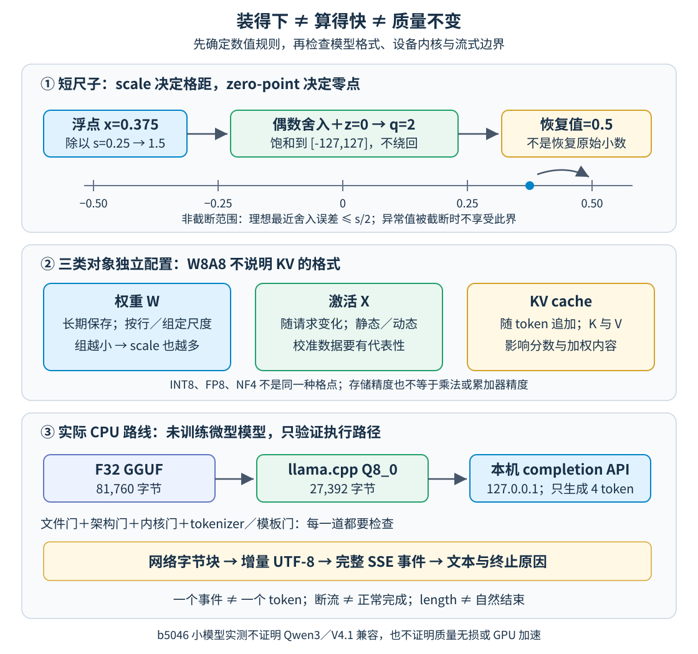

## P24.1 先问：到底把什么变小了

回忆一次生成：权重 W 长期保存在模型里，输入经过各层产生激活 X；已经见过的 token 还留下 K/V，供后续查询。三者的生命周期不同。

| 对象 | 常见形状示例 | 什么时候产生 | 量化之后还要检查什么 |
| --- | --- | --- | --- |
| 线性层权重 W | [输出通道,输入通道] | 训练完成后相对固定 | 每层／每组 scale、权重格式、矩阵乘内核 |
| 激活 X | [B,T,D] | 每次请求、每层计算 | 数据分布会变；静态校准还是动态 scale |
| KV cache | 每层各一份 [B,H_kv,T,D_head] | prefill 写入，decode 继续追加 | K/V 的尺度、cache dtype、注意力内核与长序列误差 |

W8A16 表示权重 8 位、激活通常为 16 位；W8A8 表示两者都为 8 位。**仅凭 W8A8 看不出 KV cache 的格式**，也看不出是 INT8 还是 FP8、累加器的位宽、哪几层保持高精度。要继续读配置。

INT8 是带符号整数，通常有 -128 到 127 这 256 个码；FP8 是另一种带指数的小浮点数。它们都占一个字节，不代表格点相同。NF4 又是另一种低位宽表示。[QLoRA v1](https://arxiv.org/abs/2305.14314v1) 是在冻结的量化基座上训练 LoRA 的方法，不是“任何 4 位文件都能拿去训练”，也不是本章的 INT8 推理程序。

权重压小不会自动把 KV 压小。标准 GQA 的缓存主体字节数仍可按 [P14](#p14-grouped-kv) 计算：

$$
M_{KV}=2L B H_{kv} T D_{head}\,b_{KV}.
$$

这里 2 是 K 和 V，b_KV 是每元素的字节数。把 2 字节换成 1 字节，只是**数据主体**约减半；scale、分页、对齐、临时缓冲和其他层仍需要空间。MLA、跨层共享等结构不能直接套同一个账本。

## P24.2 一把短尺子：scale 与 zero-point

先固定本章的规则，避免“不同程序都叫 INT8，结果却不一样”。对一个浮点值 x：

$$
q=\operatorname{clip}\bigl(\operatorname{round}_{even}(x/s)+z,\ q_{min},\ q_{max}\bigr),
\qquad
\hat x=s(q-z).
$$

- **scale，s**：相邻两个格点间隔多远，必须有限且大于 0。
- **zero-point，z**：真实数值 0 对应哪个整数码，必须是范围内的整数。
- **round_even**：四舍六入；恰好一半时选偶数，也叫 ties-to-even。Python `round` 使用这个规则。
- **clip**：超出码范围时截到端点，不是让整数绕回另一端。
- **反量化**得到的是近似值 x̂，不是找回被丢掉的原始小数。

本章先 `round(x/s)`，再加 z。不能随意改成 `round(x/s+z)`：当 z 是奇数，恰好半格时的“偶数”对象变了。别把两套规则在保存与读取时混用。其他引擎可以采用不同舍入或 scale 约定，必须看相应格式与内核。

### 手算表一：对称 INT8

为了让正负范围对称，我们使用 -127 到 127，**故意不用 -128**。取 s=0.25、z=0：

| x | x/s | 舍入后 | 饱和后的 q | x̂ |
| --- | --- | --- | --- | --- |
| -40 | -160 | -160 | -127 | -31.75 |
| -0.625 | -2.5 | -2 | -2 | -0.5 |
| -0.375 | -1.5 | -2 | -2 | -0.5 |
| -0.125 | -0.5 | 0 | 0 | 0 |
| 0.125 | 0.5 | 0 | 0 | 0 |
| 0.375 | 1.5 | 2 | 2 | 0.5 |
| 0.625 | 2.5 | 2 | 2 | 0.5 |
| 40 | 160 | 160 | 127 | 31.75 |

在不发生端点截断的范围内，理想实数运算的最近舍入误差不超过 s/2；被截断的 40 可不受这个保证。实际浮点计算还会有自身的舍入误差，不能要求所有端点逐位完全相等。

代码的核心对应三步：

```python
scaled = x / params.scale
bounded = min(params.qmax - params.zero_point,
              max(params.qmin - params.zero_point, scaled))
q = round(bounded) + params.zero_point
```

为什么先截断再转整数？如果 calibration 的 scale 极小，一个有限的大 x 除以 s 仍可能溢出为无穷。先按整数阈值饱和，就不需要执行 `round(inf)`。阈值本身是整数，因此这与“先舍入、后截断”的数学规则一致。不要先强转 int8 再 clip：已经绕回的值救不回来。

### 手算表二：仿射量化，把零点挪一挪

数据位于 [-1,2] 时，不一定需要给负数留一半格子。仿射版本用完整的 [-128,127]：

$$
s=(2-(-1))/255=1/85,
\qquad z=-128-\operatorname{round}(-1/s)=-43.
$$

| x | round(x/s) | q=round(x/s)-43 | x̂=(q+43)/85 |
| --- | --- | --- | --- |
| -1 | -85 | -128 | -1 |
| 0 | 0 | -43 | 0 |
| 1 | 85 | 42 | 1 |
| 2 | 170 | 127 | 2 |

负数码 -43 在这里表示真实的零，不能把它当作 -43 的浮点权重。后面的整数矩阵乘也必须减去各自的 zero-point。

## P24.3 校准：尺子的刻度从哪里来

`fit_params` 的教学策略很简单：

1. 对称版本取 a=max|x|，s=a/127，z=0。
2. 仿射版本取 lo=min(0,min(x))、hi=max(0,max(x))，s=(hi-lo)/255，再求 z 并限制在合法码范围。
3. **全零**输入单独设 s=1，避免 0/0；量化与反量化后仍全为零。
4. 全为正的常量，例如 `[3,3]`，仿射范围是 [0,3]，不是 [3,3]；全为负数同理。包含零解决了非零常量的退化问题。
5. 空数组、NaN、无穷、布尔值、无效 group size 都报错。极小的非零范围若使 scale 下溢为 0，也明确报错，不把数据静默抹成零。

代码把仿射 scale 写成 `hi/255 - lo/255`，避免先计算 `hi-lo` 时溢出。浮点中两种写法可能有末位差异；这里检验有限性和量化规则，不声称任意极端数据都会恰好占满两个端点。

**校准（calibration）** 是用有代表性的数据决定范围、scale 或其他量化参数。仅对固定权重做 min/max 不需要语料；但激活、KV 以及一些感知激活的权重量化方法，需要让代表性输入真正经过模型。不能只收集“Hello”一次的统计就声称覆盖中文、代码和长上下文。

- **静态量化**：先用校准集定尺度，推理复用。统计开销可移到离线，但分布漂移可能造成截断。
- **动态量化**：运行时按 token、行或其他粒度计算尺度。较能跟随输入，但要付出统计与转换成本。
- **裁剪型校准**：故意不让极少数异常值决定整把尺子，换取多数值更细的刻度。截掉哪些值、代价多大，应当记录，不是“优化后免费变准”。

校准集与最后报告质量的测试集应分开。量化参数如果也在最终测试集上挑选，就把调参收益掺进了评估结果。

### 一个分布漂移反例

用 `[-1,0,1]` 做对称校准，s=1/127。真正输入变成 `[-3,-0.5,0,0.5,3]`：

| 评估 x | q | 反量化 x̂ | 绝对误差 |
| --- | --- | --- | --- |
| -3 | -127 | -1 | 2 |
| -0.5 | -64 | -64/127，约 -0.503937 | 1/254 |
| 0 | 0 | 0 | 0 |
| 0.5 | 64 | 64/127，约 0.503937 | 1/254 |
| 3 | 127 | 1 | 2 |

MSE 是所有元素误差平方的平均值，结果约为 **1.6000062**。中间的舍入误差很小，端点的截断才是主要损失。别用“INT8 应该很准”替代检查输入范围。

## P24.4 group：别让一个异常值统治整个矩阵

设一行权重是：

```text
[0.1, -0.1, 0.2, -0.2, 12, -12, 0.4, -0.4]
```

整行共用 s=12/127 时，小数只能挤在较粗的格子里。若按连续小组各自定 scale，前四项就不必服从 12 的范围。

| 这行每组元素数 | scale 数 | 最大绝对误差 | MSE | 理想打包字节数 |
| --- | --- | --- | --- | --- |
| 8 | 1 | 约 0.02204724 | 约 0.0001594953 | 8+4=12 |
| 4 | 2 | 约 0.02204724 | 约 0.0001216752 | 8+8=16 |
| 2 | 4 | 0 | 0 | 8+16=24 |

本表的存储假设是每个码 1 字节、每组一个 FP32 scale 4 字节，对称 z=0 不另存。实际 Python 列表并不是这样紧凑打包的；这些数字不是程序进程的内存。GGUF 的布局也另有规定。

为什么 group=2 恰好零误差？我们故意选择了每组 `[a,-a]` 的权重，两个端点都可表示。**这不是“一般情况下组越小就无损”的证明**。在本例中最大误差从 group=8 到 4 没变，MSE 却下降了，说明只看一个误差指标也不够。

实现的张量账本：

| 项目 | 形状／数量 |
| --- | --- |
| 原权重 | [R,C] |
| 每行独立分组 | ceil(C/G) 组 |
| 所有 scale | R×ceil(C/G) 个 |
| 量化码 | 仍有 R×C 个 |
| 反量化权重 | 仍是 [R,C] |

例如两行、每行 3 项、G=2，分组长度应为 `[2,1,2,1]`。不能把上一行的尾项和下一行的首项凑一组，也不能丢掉最后一项。理想存储量为 6+4×4=**22 字节**。缩小组会增加 scale 和访存开销，质量收益与内核效率都要测。

## P24.5 整数乘法：乘的是码，累加器不能也是 8 位

忽略 bias，一个点积近似为：

$$
\sum_i x_iw_i\ \approx\ s_xs_w\sum_i(q_{x,i}-z_x)(q_{w,i}-z_w).
$$

对称 z=0 时看起来很简洁；仿射版本若漏减 z，会得到系统性错误。

手算：激活 scale=0.5、z=-3、码 `[-2,1]`，恢复为 `[0.5,2]`；权重 scale=0.25、z=7、码 `[9,3]`，恢复为 `[0.5,-1]`。

| 项 | 激活去零点 | 权重去零点 | 整数乘积 |
| --- | --- | --- | --- |
| 第 1 项 | -2-(-3)=1 | 9-7=2 | 2 |
| 第 2 项 | 1-(-3)=4 | 3-7=-4 | -16 |
| 合计 | | | -14 |

乘回 0.5×0.25，得到 -1.75，与 `0.5×0.5+2×(-1)` 一致。

`quantized_dot` 使用 Python 任意精度整数累计，**不等于在真实硬件上提供了无限位宽**。生产内核常用更宽的整数累加器；仍应根据长度、码范围和实现检查溢出。仅 256 项 `127×127` 就累计为 4,129,024，远超 int8。

权重量化还可能采用“存低精度，计算前转回较高精度”的路径。能省权重读带宽，不代表每个乘法都在 INT8 中执行。转换开销、batch、prefill/decode 和硬件支持会改变最终速度。我们的 Python 循环只验证数学，不是 SIMD/CUDA 内核基准。

## P24.6 KV 量化：误差不只落在一个矩阵上

对一个已经可见的前缀，注意力是：

$$
y=\operatorname{softmax}(qK^\top/\sqrt{d})V.
$$

- K 的误差先改变分数，再经过 softmax 改变各位置的权重。
- V 的误差改变被加权求和的内容。
- 两者都会影响输出；多层、多步生成还可能放大或抵消误差。

脚本用 q=`[0.8,-0.3]`，三个 K 行 `[0.12,-0.7]`、`[1.3,0.04]`、`[-0.31,0.9]`，V 行 `[0.2,2]`、`[1.2,-0.4]`、`[-0.7,0.05]`。每个 K/V 行独立对称量化后再反量化，得到：

| 输出分量 | 原始缓存 | 量化恢复的缓存 |
| --- | --- | --- |
| 第 1 维 | 0.5608533946 | 0.5623972551 |
| 第 2 维 | 0.4222089296 | 0.4242680323 |

最大绝对差约 0.00205910，MSE 约 0.00000331170。测试另用独立标量 softmax 与加权求和核对基线，而不是调用同一个 attention 函数两次宣布正确。

这只是单 query、单头、小前缀的机制实验；**没有实现量化 cache 的追加、分页或实际整数 attention 内核**。真实框架还要说明：K/V 是否分别有 scale，按张量、通道还是 token 定尺度，已有 cache 会不会重算尺度，以及被量化的值怎样交给后端。不能把本表误差外推到十万 token。

例如锁定的 [vLLM 0.8.4 KV 文档](https://docs.vllm.ai/en/v0.8.4/features/quantization/quantized_kvcache.html) 说明了 FP8 KV 与尺度的关系，也明确该版本的空间收益不能直接当成延迟收益。本书没有运行这条 GPU 路线。

## P24.7 GGUF 是包装格式，不是一种固定量化算法

GGUF 可以把模型元数据、tokenizer 信息、张量名、形状、类型和张量数据装进文件。**扩展名是 `.gguf`，并不能推出里面全部都是 4 位权重**：它可以包含 F32/F16，也可以包含多种块量化张量。

本章锁定 llama.cpp b5046，源码提交 `74d4f5b041ad837153b0e90fc864b8290e01d8d5`。其 [GGUF writer](https://github.com/ggml-org/llama.cpp/blob/74d4f5b041ad837153b0e90fc864b8290e01d8d5/gguf-py/gguf/gguf_writer.py) 与 [元数据定义](https://github.com/ggml-org/llama.cpp/blob/74d4f5b041ad837153b0e90fc864b8290e01d8d5/gguf-py/gguf/constants.py) 是我们微型文件的格式依据。

以这个版本的 Q8_0 为例，[块结构定义](https://github.com/ggml-org/llama.cpp/blob/74d4f5b041ad837153b0e90fc864b8290e01d8d5/ggml/src/ggml-common.h) 中每 32 个 int8 码还有一个 2 字节 scale，因此张量块主体是 34 字节，不是只有 32 字节。它与上文“每组 FP32 scale”的教学格式不同；[参考量化函数](https://github.com/ggml-org/llama.cpp/blob/74d4f5b041ad837153b0e90fc864b8290e01d8d5/ggml/src/ggml-quants.c) 的舍入实现也不同。**我们没有把 Python 码数组直接冒充 Q8_0。**

模型能否运行至少有四道门：

1. **架构门**：引擎是否认识模型的层、注意力结构和必要算子？
2. **文件门**：转换器是否正确保存配置、tensor layout、词表与特殊 token？
3. **内核门**：该后端是否支持这份文件的量化类型、维度和设备？
4. **语义门**：tokenizer、chat template、RoPE、EOS 等是否与训练时约定匹配？

通过前三道门，也可能因为模板错了而输出很差。换文件名、重命名架构字段、强行套另一个 tokenizer 都不是合法的兼容性修复。

## P24.8 四类工具，按工作负载选，不按热度选

下表是**固定历史版本**的定位与检查路线，核验日为 **2026-10-19**，不是“这些旧版本是当前生产推荐”，也不保证后续模型被它们支持。

| 工具与锁定版本 | 本章关注的用途 | 需要逐项核对的兼容性 | 本书实际验证 |
| --- | --- | --- | --- |
| llama.cpp b5046 | 小模型本地 CPU 路线；GGUF；CLI 与服务接口 | 架构、GGUF 张量类型、CPU 指令／系统依赖、词表与模板 | 微型 Llama F32/Q8_0、CPU CLI、completion SSE |
| vLLM 0.8.4 | 面向批处理与并发服务；GPU 作为本章选修路线 | supported models、量化后端与硬件矩阵、cache dtype、其他功能组合 | 未安装／未运行 GPU |
| SGLang 0.4.5 | 服务调度、前缀复用与结构化生成等工作负载 | 模型实现、离线 checkpoint 配置、在线量化类型、后端与硬件 | 未安装／未运行 GPU |
| TensorRT-LLM 0.18.0 | NVIDIA GPU 上的专用推理栈 | GPU／CUDA／TensorRT 版本、模型转换、量化 recipe 与执行路径 | 未安装／未运行 GPU |

vLLM 的 CPU 等后端要查各自安装与支持页，不能把本表的 GPU 选修路线误读为“框架只能在 GPU 上跑”。同样，支持一种架构，不自动意味着支持它的每一种量化、LoRA、投机解码和多模态组合。

两个具体的版本陷阱比长长的框架名单更值得记住：

- [vLLM 0.8.4 GGUF 页](https://docs.vllm.ai/en/v0.8.4/features/quantization/gguf.html) 把该路线标为实验性、未充分优化，并有限定条件；还提醒优先使用原模型 tokenizer。不能因为 llama.cpp 能读一个 GGUF，就宣布 vLLM 上一样快、一样稳。
- [SGLang 0.4.5 量化页](https://github.com/sgl-project/sglang/blob/57f99608f4fdea03e0450f51a6fcabe726409f25/docs/backend/quantization.md) 区分离线量化权重与在线量化。加载已量化模型时通常由配置识别格式，不应为了“保险”盲目再叠加在线量化参数。该页列为未来工作的选项不能当成当时已经支持。

[TensorRT-LLM 0.18.0 精度页](https://github.com/NVIDIA/TensorRT-LLM/blob/3c0462002cbefde475d46acb5d5edefec92dfb6a/docs/source/reference/precision.md) 则按 recipe 区分 weight-only、权重与激活、KV 等路径。它部分公式把“量化乘数”叫 scale，本章用的是“格点间距、量化时作除数”。**同名变量未必有相同定义，必要时取倒数，不能直接复制数字。**

## P24.9 真正跑通一次：不下载外部模型的 llama.cpp 路线

先明确实验对象：1 层、隐藏宽度 32、4 个注意力头、FFN 宽度 64、上下文 128；词表 259 项，包括 unk/BOS/EOS 和 256 个字节回退 token。总计 **18,624 个参数**，随机种子 24，未训练，输出不具备语言质量。

`write_tiny_gguf` 直接写入这一固定结构的 F32 GGUF。它不是通用 HF 转换器，不转换本书 S6，也不是一份下载来的 Llama 权重。真实 checkpoint 的转换还要使用与架构匹配的官方转换器。

### 先准备隔离的引擎

我们实际使用的是官方 [b5046 发布资产](https://github.com/ggml-org/llama.cpp/releases/tag/b5046) 中 `llama-b5046-bin-ubuntu-x64.zip`，28,537,350 字节，SHA-256 为：

```text
10195e6ccc8ef5908e6d5842f9ca34389a22338b0d6ab618cfa0f909b461a28e
```

这是 Linux x86_64 路线。可在新的临时目录复现下载与校验，不改已有 Python 环境：

```bash
mkdir -p /tmp/p24-engine
curl -fL --max-time 120 \
  https://github.com/ggml-org/llama.cpp/releases/download/b5046/llama-b5046-bin-ubuntu-x64.zip \
  -o /tmp/p24-engine/llama-b5046.zip
printf '%s  %s\n' \
  10195e6ccc8ef5908e6d5842f9ca34389a22338b0d6ab618cfa0f909b461a28e \
  /tmp/p24-engine/llama-b5046.zip | sha256sum -c -
unzip /tmp/p24-engine/llama-b5046.zip -d /tmp/p24-engine
```

下载和解压须成功、校验须匹配才继续。可执行文件位于解压后的 `build/bin`。官方二进制如果不适合你的系统，不要忽略 loader 错误，更不要绕过系统安全提示；改用适合系统的官方构建方案，并重新记录版本与结果。macOS、Windows 或自行编译的同版本，本章未实测。

从仓库根目录运行：

```bash
python code/25_quantized_serving.py \
  --llama-bin /tmp/p24-engine/build/bin \
  --work-dir /tmp/p24-smoke
```

这个 opt-in 命令**不帮你下载或安装任何软件**。它检查 `llama-cli --version`，创建微型 GGUF，并依次执行：

```bash
llama-quantize tiny-f32.gguf tiny-q8_0.gguf Q8_0
llama-cli -m tiny-q8_0.gguf -p Hi -n 4 -c 128 -t 1 \
  -ngl 0 --seed 24 --temp 0 --no-display-prompt
llama-server -m tiny-q8_0.gguf -c 128 -t 1 -ngl 0 \
  --host 127.0.0.1 --port <临时空闲端口> --alias p24-tiny
```

上面的文件名与端口是阅读用简写；脚本保存的 `smoke-report.json` 记录实际绝对路径和端口。`-ngl 0` 不把模型层卸载到 GPU；`-t 1` 固定一个计算线程。共享库搜索路径只给这些子进程，不修改现有环境配置。server 只监听 loopback，并在成功或失败后关闭，不开放到公网。

### 本书实际看到了什么

| 检查 | 本次结果 |
| --- | --- |
| 引擎版本 | 5046，提交前缀 74d4f5b0 |
| 原始微型文件 | F32，81,760 字节 |
| 量化微型文件 | Q8_0，27,392 字节；一维 norm 张量保留 F32 |
| CPU CLI | 成功加载并生成 4 个 token |
| 本地 health | HTTP 200，status=ok |
| 流式与非流式 completion | HTTP 200；内容一致 |
| usage | prompt 3、completion 4、total 7 |
| 停止原因 | length，达到预算，不是自然 EOS |
| 质量、速度对比、GPU 显存 | **未测** |

未训练模型实际输出是四个 U+0011 控制字符，不是四句通顺回答。脚本用 JSON 转义显示，不把原始控制字符当聊天内容直接打印。能生成只证明文件、算子与服务路径接通。

[已运行记录](../code/fixtures/p24_llama_smoke.json) 保存源码提交、发布资产校验、模型校验和命令；[真实 SSE 捕获](../code/fixtures/p24_llama_completion.sse) 供离线解析回归。这里的文件变小是可验证事实，**不是 3 倍运行加速，也不是模型能力无损**。

b5046 的微型 Llama 成功，**不证明 Qwen3 或 DeepSeek-V4.1-Flash 可运行**。这些模型必须另查相应版本的架构、转换器和内核支持。相邻案例章提供配置阅读，不共享这份兼容性结论。

## P24.10 API 与流式输出：网络块不是 token

引擎在本机运行时，客户端仍要遵守请求协议。这里选择 `/v1/completions`，使用纯文本 prompt，不用 chat template，因为微型模型没有受训对话模板。

```json
{
  "model": "p24-tiny",
  "prompt": "Hi",
  "max_tokens": 4,
  "temperature": 0,
  "seed": 24,
  "stream": true
}
```

路径和字段来自锁定版本的 [llama.cpp server 文档](https://github.com/ggml-org/llama.cpp/blob/74d4f5b041ad837153b0e90fc864b8290e01d8d5/examples/server/README.md)。OpenAI-compatible 说明的是一部分接口形状，不表示所有端点、参数、错误码或 chat/tool 行为完全相同；[vLLM 0.8.4 服务页](https://docs.vllm.ai/en/v0.8.4/serving/openai_compatible_server.html) 也应按具体支持范围阅读。

SSE（Server-Sent Events）用空行分隔事件，事件的 `data:` 字段里常放 JSON。一次网络读取可能只有半个中文字符，也可能包含三个事件；一个 content delta 可能包含多个 token，也可能为空。

```text
data: {"choices":[{"text":"春","finish_reason":null}]}

data: {"choices":[{"text":"风","finish_reason":"length"}]}

data: [DONE]

```

本章的 `sse_data` 先用增量 UTF-8 解码器把字节接起来，再按 LF/CRLF 行与空行组装事件。`collect_completion` 才解析 JSON、提取文本并处理结束信号。测试把中文和 emoji 的每一个字节切开，也枚举所有单次切分位置。

| 边界 | 本章处理 |
| --- | --- |
| 空 role delta、content=null | 不追加文字，不算一个 token |
| usage-only 事件，choices=[] | 允许，不追加文字 |
| finish_reason=length | 明确是截断预算；不能改称回答完整 |
| 只有 EOF，没有 `[DONE]` 或 finish_reason | 报不完整，不伪装成功 |
| `[DONE]` 之后又出现数据 | 报协议异常 |
| 非法 UTF-8、破损 JSON、error 对象 | 报错，不展示为模型回答 |
| 工具调用、多 choice、自动重连 | 本章未实现，拒绝或不承诺支持 |

这个解析器是小而明确的 SSE 子集，不是通用事件总线。它没有自动重发请求，因为断线前可能已经生成或计费，盲目重试会重复执行；它也没有生产级缓冲大小限制、超时策略和背压处理。用在外部服务前必须补上这些约束。

请求发送前还要做上下文预算检查：**经过 tokenizer、BOS 和 chat template 后的 prompt token 数 + 最大新 token 数，不超过实际服务的上下文容量**。例如 7+3=10 恰好允许，8+3>10 拒绝。不要按汉字数、UTF-8 字节数或原始 messages 长度算。

对空输入、超长输入、客户端取消、服务过载、HTTP 非 2xx 和无响应，要有明确的产品处理。当前实战验证了健康检查、正常 streaming/nonstreaming 及预算截断；**没有声称验证并发、真实断网或生产取消机制**。数值和模拟协议边界覆盖不代替线上故障测试。

## P24.11 怎样做一次公平的框架比较

先分清两个问题：

1. 同一引擎里，量化前后的质量与资源怎样变？需要共同基座、相同数据和清楚的量化差异。
2. 相同模型条件下，不同引擎怎样变？需要同一权重来源、tokenizer、模板、量化方案、KV 精度和生成规则。

如果一个引擎用 Q4、另一个用 BF16，那是在比较两套部署方案，不能把差异全归给调度器。若某格式只有一边支持，就标记为“无可比配置”，不要偷偷换模型。

真正的首 token 延迟 TTFT 是从定义好的请求起点到第一个输出 token；TPOT 是后续输出 token 的平均间隔。假设记录了真实的逐 token 时间 t₁…t_N：

$$
\mathrm{TTFT}=t_1-t_{start},\qquad
\mathrm{TPOT}=\frac{t_N-t_1}{N-1}\quad(N>1).
$$

开始于 10.0 秒，token 到达于 10.2、10.3、10.6 秒，TTFT≈0.2 秒，TPOT≈0.2 秒。N=0 时两者缺失，N=1 时 TPOT 缺失，不写 0 假装更快。`token_latencies` 用这个手算表测试。

**只有 SSE content 事件时间时，应称首内容事件延迟／事件间隔，不冒充逐 token 延迟。** 角色或 usage 事件也不是第一输出 token。本章真实 smoke 只检查协议与结果，没有记录逐 token 时钟，因此不报告 TTFT/TPOT 实测数字。

GPU 选修建议每次只改变一项，并填写：

| 必填项目 | 应记录的内容 |
| --- | --- |
| 模型 | 仓库、revision、权重哈希、tokenizer／模板 revision |
| 数值 | W/A/KV dtype、量化 recipe、group、校准集与 scale 来源 |
| 设备与软件 | CPU/GPU 型号、显存、驱动、框架／依赖版本、并行度 |
| 工作负载 | 固定题集、输入/输出长度分布、并发数、batch、采样与停止规则 |
| 时间口径 | 是否包含网络／排队／prefill；warm-up；重复次数；分位数 |
| 内存口径 | 权重、KV、workspace、峰值；区分已分配与保留的显存 |
| 质量 | 固定答案检查器或验证集损失；截断、超时、失败仍保留在分母 |

在没有兼容 GPU、足够内存、合法可用权重或锁定环境时，跳过 GPU 路线并注明未测即可。没有必要为本章下载大模型，也不应该拿发布方 benchmark 填进“本书复现”一栏。

## P24.12 运行、找错与自测

从仓库根目录：

```bash
python code/25_quantized_serving.py
python -m unittest discover -s tests -p 'test_quantized_serving.py' -v
```

默认测试验证独立有理数格点 oracle、手算表、组尾与行边界、整数累加、校准漂移、独立 attention、UTF-8/SSE 和文件生成。它还真正改写并执行七种错误实现：漏减零点、把舍入改成截断、整数点积漏减零点、丢组尾、上下文比较差一位、漏检查 `[DONE]`、每个网络块单独解码 UTF-8。另外八项实际变异覆盖对称/仿射全零 scale、全负校准不含零、最大误差符号、未完成 SSE 事件、丢弃多行 data 换行，以及 tool_calls/error 的拒绝逻辑；加上附录批次的非对齐 GGUF 格式 fixture 回归，合计十六项。异常分支采用完整事件与精确错误原因，避免被后续“不完整”检查偶然拦截。正确基线先通过，错误变体再被同一行为断言抓住。

提供已准备好的引擎后，可选真实测试：

```bash
P24_LLAMA_BIN=/tmp/p24-engine/build/bin \
  python -m unittest discover -s tests -p 'test_quantized_serving.py' -v
```

默认 36 个测试中，35 个运行、1 个真实引擎测试跳过；本次提供 b5046 后，36 个全部实际通过。跳过不等于已运行。

### 自测题

1. s=0.25、z=0 时，0.125、0.375、40 的码与恢复值分别是多少？为什么最后一个误差不受 s/2 限制？
2. s=0.25、z=3 时，0.125 的码是多少？若把加 z 移进 `round` 会怎样？
3. 两行各 3 项、G=2，有多少组？按“int8 码+FP32 scale”需要多少字节？
4. 用 [-1,1] 校准后，评估值 3 能恢复成 3 吗？把校准集改成评估集为什么可能污染质量报告？
5. W4A16 是否表示 KV 也是 4 位？Q8_0 的 32 个码为何不只占 32 字节？
6. 三个输出 token 的时间为 10.2、10.3、10.6，请求开始为 10.0，TTFT 与 TPOT 是多少？如果只知道有三个 SSE 块，能否这样算？
7. 服务只返回部分文字后连接结束，没有终止事件，应显示“完成”吗？`finish_reason=length` 又说明什么？

### 参考答案

1. 码为 0、2、127；恢复为 0、0.5、31.75。40 超过可表示范围，发生饱和截断。
2. 码为 `round(0.5)+3=3`；改成 `round(3.5)` 得 4，改变了半格的偶数舍入对象。
3. 每行两组，共四组；6 个码+4×4 字节 scale，共 22 字节。组不能跨行。
4. 只能恢复到 1。最终评估应使用未参与量化参数选择的数据，否则把调参集效果当泛化效果。
5. 不表示，KV 单独配置。这里 Q8_0 每 32 个码还有一个 2 字节 scale；其他元数据另算。
6. TTFT≈0.2 秒，TPOT≈0.2 秒。SSE 块不一定一块一个 token，缺少逐 token 观测时不能这样命名。
7. 不应；这是不完整响应。length 表示生成因预算被截断，不证明内容已经自然写完。

你现在得到的不是一个“装上就万能”的工具名单，而是一条可检查的链：**数值规则 → 格式与架构 → 设备内核 → 服务边界 → 同条件评估**。后面读真实模型配置时，继续沿这条链检查，不要让模型名替代证据。

## P24.13 混合位宽 GGUF：哪些张量多给几个 bit

P24.7 说过 GGUF 只是容器，同一个文件里不同张量可以用不同量化类型。Meta 的 [Muse Glimmer 30B 量化文档](https://dev.meta.ai/docs/muse-glimmer/quantization)（技术报告 2026-10-19 发布；文档核验日 2026-10-25）给了一个公开的真实案例。以下数字均为 Meta 官方文档，本书未在本机运行 30B 模型：

- **K-Quant-17GB（固定方案，下载 16.8 GB）**：主体 `Q4_K`，group 32；`attn_v` 与 `ffn_down` 两类投影提升到 `Q6_K`，group 128；输出头 `Q5_K`，group 128。
- **K-Quant-Dynamic（下载 19.7 GB）**：在 `Q4_K`/`Q5_K`/`Q6_K` 之间按单元搜索精度，全部 group 32，质量更高、占用更多。
- **显存账**：K-Quant-17GB 加视觉投影器、131,072 token 完整上下文实测 19.0 GiB（文本模型 15.6、视觉投影器 1.3、KV cache 与计算缓冲 2.1 GiB），DFlash 草稿模型约再加 1.5 GiB。KV 小，是因为它用 2 个 KV 头的 GQA（见 [P14](#p14-grouped-kv)），且每 4 层里有 3 层是滑动窗口注意力。硬件粗账：30B 参数 × 2 字节 ≈ 60 GB 的 bf16 权重，约 4 bit 后文本模型低于 20 GB。

为什么偏偏是 `attn_v` 和 `ffn_down`？这里只做一个**不依赖 Glimmer 权重**的玩具：[`../code/25b_mixed_bit.py`](../code/25b_mixed_bit.py) 构造三个 64×256 的张量，其中一个有少数放大 12 倍的列、一个是重尾 Student-t 分布，然后用本书的对称分组格式（每组一个 2 字节 scale，**不是** llama.cpp 的 `Q4_K`/`Q6_K` 超块布局）量化：

- 重尾张量上，4 bit 时 group 32/128 的相对误差为 0.156/0.255，6 bit 时为 0.041/0.071：位宽多 2 bit 比把 group 缩小 4 倍更有效，但两者都有代价。
- 全部 4 bit/g32 总误差 0.167、27,648 字节；只把单独误差最大的那个张量换成 6 bit/g128，总误差降到 0.113，字节只多 12%（30,976）；全部 6 bit/g128 为 0.067、37,632 字节。

测试手算一组 4 bit 的往返结果和字节数，检查“混合方案的误差与字节都落在两个统一方案之间”，并给出一个变异：scale 用组内平均绝对值而不是最大值，会让异常值被截断、误差至少翻倍。真实模型里哪些张量敏感要靠困惑度或任务评估来定，不能照搬玩具结论。

## P24.14 量化感知训练（QAT）：MiniMax-M3.1-Flash 的公开范围

前面所有方法都是**训练后量化**：权重训练完再找 scale。QAT 则在训练中就让前向经过量化，让模型适应舍入误差。MiniMax 在 [M3.1-Flash 官方模型卡](https://huggingface.co/MiniMaxAI/MiniMax-M3.1-Flash)（核验日 2026-10-25）中说明，相对 M3 的三项改动之一是 QAT：**routed MoE 专家和注意力路径在训练中被量化**，用于降低显存占用、提升服务效率。模型卡给出约 428B 总参数、每 token 激活 23B、最长 1M 上下文；另外两项改动是把前三层全注意力也换成稀疏注意力、从而全模型使用 MSA（见 [P16](#p16-sparse-linear) 的 P16.13）和改用 DSpark 草稿头（见 [P23](#p23-mtp)）。**QAT 用的位宽、数据格式、训练阶段与步数，模型卡均未公开**，本书不作推测，也不提供 QAT 代码。

## P24.15 FP4 块缩放：MXFP4、NVFP4 与“训练和 rollout 用同一种量化” {#p24.15-fp4-block}

**先看动机。** 4 bit 只有 16 个码。P24.4 已经说过，一个异常值会撑大整组的 scale。FP4 块格式的办法是：每一小块共享一个 scale，块越小，异常值影响的范围越小。

**格式本身。** 元素都是 FP4 E2M1：1 位符号、2 位指数、1 位尾数，绝对值只有 0、0.5、1、1.5、2、3、4、6 八种。

- **MXFP4**：每 32 个元素共享一个 E8M0 scale，即纯 2 的幂。规范原文是 [OCP Microscaling Formats (MX) v1.0](https://www.opencompute.org/documents/ocp-microscaling-formats-mx-v1-0-spec-final-pdf) §5.2 Table 1。[MX 格式论文，arXiv:2310.10537](https://arxiv.org/abs/2310.10537) 的 Table 1 与之一致。论文 Algorithm 1 的取法是 `X = 2^(⌊log2 max|V|⌋ − emax_elem)`，E2M1 的 `emax_elem = 2`，超出范围的元素截到 ±6。
- **NVFP4**：每 16 个元素共享一个 FP8 E4M3 scale，另有一个整张量的 FP32 scale。来源是 [NVIDIA Transformer Engine NVFP4 文档](https://docs.nvidia.com/deeplearning/transformer-engine/features/low_precision_training/nvfp4/nvfp4.html)：`x = x_e2m1 · s_block · s_global`，`s_global = amax / (448 · 6)`。E4M3 scale 不必是 2 的幂，所以更贴近块的真实最大值。

只算块 scale，MXFP4 是 4 + 8/32 = 4.25 bit/元素，NVFP4 是 4 + 8/16 = 4.5 bit/元素。

[`../code/25c_fp4_block.py`](../code/25c_fp4_block.py) 用 1024 个高斯值加 4 个 ±40 的离群值（种子 0，自造数据）：

| 方案 | 相对 MSE |
|---|---|
| 每张量一个 scale | 0.0982 |
| MXFP4，块 32 | 0.0497 |
| NVFP4 式，块 16 | 0.0069 |

这只验证舍入算术，不代表任何模型的精度。测试检查：E2M1 网格值往返不变且在 6 饱和；E4M3 舍入；MX scale 是 2 的幂；块方案误差低于每张量方案。还有一个变异：把块设成整张量，结果退回每张量方案。

**PTQ、QAT、QAD。** PTQ 是训练完再量化（P24.3）。QAT 在训练中就让前向经过量化（P24.14）。QAD（Quantization-Aware Distillation）也让前向经过量化，但用原精度模型做老师来蒸馏。

- **Kimi K3（S29 §4.1.4）。** MoE 专家权重用 MXFP4，激活用 MXFP8。注意力投影、latent MoE 投影、共享专家和路由器保持更高精度。QAT 覆盖整个后训练，包括 SFT 和 RL。RL 中 rollout 与训练使用同一种量化，报告说这样就消除了训练与推理不一致。这一点的意义是：策略梯度假设样本来自正在训练的那个策略；若 rollout 用的是另一套数值，样本就有一部分是 off-policy 的。
- **Nemotron 3.5 Super（S30）。** 发布的 NVFP4 checkpoint 先用预设的 aggressive PTQ 配方（4.82 bit/元素），再做 200 步基于 SFT 的 QAD。官方文档称，35 个基准上相对 BF16 的准确率恢复中位数为 99.52%。它在 Blackwell 上以 W4A4 部署，在其他 GPU 上以 W4A16 部署。这些都是厂商报告的数字，本书没有复现。

**三种量化对象别混。** K3 量化的是专家**权重**（加 MXFP8 激活）。Nemotron 的 W4A4 同时量化权重与**激活**。P26 讨论的 V4.1-Flash FP4 量化的是 **KV cache**（S12，报告 §2.4.4）。三者误差进入模型的位置不同，P24.6 已经说明 KV 量化的误差会落在每一步注意力上。

P24.15 资料（核验 2026-10-26）：[OCP MX v1.0 规范](https://www.opencompute.org/documents/ocp-microscaling-formats-mx-v1-0-spec-final-pdf) §5.2；[MX 论文，arXiv:2310.10537](https://arxiv.org/abs/2310.10537)；[Transformer Engine NVFP4 文档](https://docs.nvidia.com/deeplearning/transformer-engine/features/low_precision_training/nvfp4/nvfp4.html)（厂商文档）；QAT 原文 [Jacob et al., arXiv:1712.05877](https://arxiv.org/abs/1712.05877)；S29 [Kimi K3，arXiv:2607.24653](https://arxiv.org/abs/2607.24653) §4.1.4；S30 [Nemotron 3.5 Super 官方训练文档](https://docs.nvidia.com/nemotron/latest/nemotron/super35/README.html) §4.1（厂商报告）。


---

# 模型案例（P25）：Qwen3，读配置而不是背参数表 {#p25-qwen3}

拿到一张汽车宣传单，你能知道它叫“小型车”，却不能因此确定轮胎尺寸、座位数和油箱容量。模型名里的 `0.6B`、`30B`、`A3B` 也像宣传单上的分类：有用，但不能代替配置、实现与版本。

本章做一次完整的“拆说明书”练习：**选定两个真实 checkpoint，读出它们的组件，算清参数和缓存，再用很小的随机模型验证机制。** 目标不是背诵“Qwen3 都用了什么”，而是能够指出：我说的是哪个仓库、哪次提交、哪个字段，哪些结论还需要看实现。

配套 [code/26_qwen3_case.py](../code/26_qwen3_case.py)，测试为 `tests/test_qwen3_case.py`。默认命令只用 Python 标准库、读取本地小文件；`--torch` 才运行 PyTorch/Jinja2 的额外探针。**本章没有下载或运行任何 Qwen 预训练权重，也没有实现完整 Qwen tokenizer、checkpoint 加载器或生产推理服务。**

先修：[Tokenizer](#a.1-三种切法整词字符与字节)、[RoPE](#p12-rope)、[RMSNorm / SwiGLU](#p13-modern-block)、[GQA](#p14-grouped-kv)、[MoE](#p18-moe)，以及前面关于后训练、推理预算和部署的区分。

## P25.1 先把研究对象钉住

核对日期为 **2026-10-19**。本章研究的是 2025 年首发路线的两个混合 thinking / non-thinking 文本 checkpoint，**不是**名字中带 `Instruct-2507`、`Thinking-2507` 的后续版本，也不是 Qwen3-Next、视觉模型或整个 Qwen3 家族。

| 对象 | 官方仓库 | 本章锁定的完整 revision |
| --- | --- | --- |
| Dense | `Qwen/Qwen3-0.6B` | `c1899de289a04d12100db370d81485cdf75e47ca` |
| MoE | `Qwen/Qwen3-30B-A3B` | `ad44e777bcd18fa416d9da3bd8f70d33ebb85d39` |

官方不可变入口：[0.6B 配置](https://huggingface.co/Qwen/Qwen3-0.6B/blob/c1899de289a04d12100db370d81485cdf75e47ca/config.json)、[30B-A3B 配置](https://huggingface.co/Qwen/Qwen3-30B-A3B/blob/ad44e777bcd18fa416d9da3bd8f70d33ebb85d39/config.json)。`main` 是会移动的分支名；完整 revision 才能让几年后的读者看到同一组字节。

仅有配置还不够。例如，`rms_norm_eps` 说明数值稳定项，却不直接告诉你 Q、K 是否另做归一化。我们还核对 Hugging Face Transformers **v4.51.3** 的实现，锁到 commit `5f4ecf2d9f867a1255131d2461d75793c0cf1db2`：[dense 实现](https://github.com/huggingface/transformers/blob/5f4ecf2d9f867a1255131d2461d75793c0cf1db2/src/transformers/models/qwen3/modeling_qwen3.py)、[MoE 实现](https://github.com/huggingface/transformers/blob/5f4ecf2d9f867a1255131d2461d75793c0cf1db2/src/transformers/models/qwen3_moe/modeling_qwen3_moe.py)。这里选择的是可追溯的实现快照，不宣称它是当前最新版，也不要求安装它。

本地 `code/data/qwen3/` 只保存各 checkpoint 的 `config.json`、`tokenizer_config.json`、`generation_config.json` 和原始 Apache-2.0 `LICENSE`，合计 44,317 字节，另有来源清单。每份文件的完整 URL、字节数、SHA-256 都在 `manifest.json` 中。`load_checkpoint` 先核对 revision 和哈希再读取；损坏时直接报错，**不会偷偷改取最新配置**。

这形成三个证据层次：

1. 官方配置回答“这个 checkpoint 声明了什么”。
2. 固定实现回答“这些字段怎样变成运算”。
3. 本章测试回答“我们的小型教学探针实际验证了什么”。

第三层通过，不能替代官方模型质量、训练过程或部署性能的复现。

## P25.2 两列配置，先找不同，再找共同点

下表直接对应上述两个不可变配置，不从模型名猜测数值。

| 字段／含义 | 0.6B dense | 30B-A3B MoE |
| --- | ---: | ---: |
| `model_type` | `qwen3` | `qwen3_moe` |
| 层数 L | 28 | 48 |
| 隐藏宽度 D | 1024 | 2048 |
| Q 头数 Hq | 16 | 32 |
| KV 头数 Hkv | 8 | 4 |
| `head_dim`，每头宽度 d | 128 | 128 |
| `vocab_size`，embedding 行数 V | 151936 | 151936 |
| dense FFN `intermediate_size` | 3072 | 6144，当前全 MoE 层不使用它 |
| 单专家 `moe_intermediate_size` | 不适用 | 768 |
| 专家总数／每 token 选中数 | 不适用 | 128 / 8 |
| `tie_word_embeddings` | true | false |
| `rope_theta` | 1000000 | 1000000 |
| `rope_scaling` | null | null |
| `rms_norm_eps` | 0.000001 | 0.000001 |
| `max_position_embeddings` | 40960 | 40960 |
| `use_sliding_window` | false | false |

读表时先做三个检查：

- **不是每个字段都代表当前启用的模块。** MoE 的 `intermediate_size=6144` 留给 dense MLP 路径；本快照所有层都选择专家路径。把 6144 的 dense FFN 再加一份，会把不存在的参数算进去。
- `torch_dtype=bfloat16` 是配置声明，不意味着所有运行时张量都只能是 BF16。我们的数值探针主动使用 CPU float64。
- `max_window_layers` 的存在不等于滑动窗口已经开启。两个对象均关闭 `use_sliding_window`，不能给它们贴上“局部注意力模型”的标签。

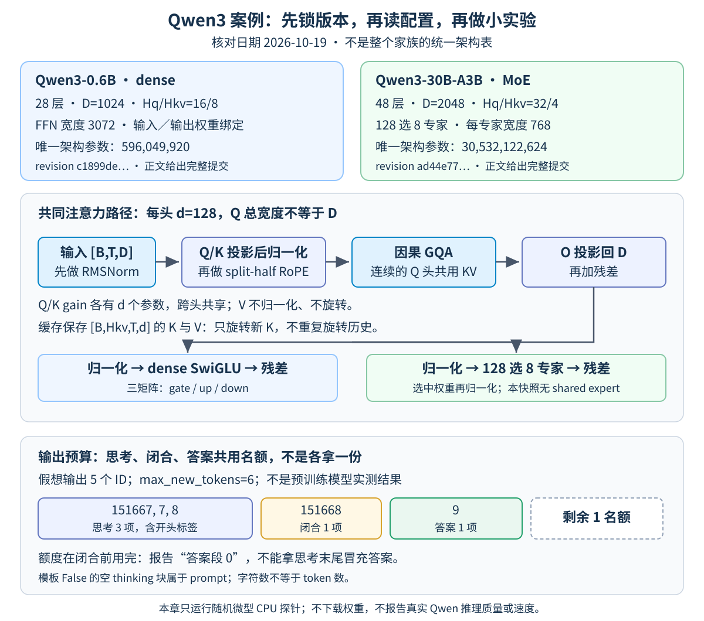

## P25.3 一个最容易算错的维度：D 不一定等于 Hq × d

以前的小型教学模型常把 `head_dim` 写成 `D // Hq`。本章两个 checkpoint **显式指定 d=128**，所以：

- dense：D=1024，但 Q 投影宽度为 16×128=2048；
- MoE：D=2048，但 Q 投影宽度为 32×128=4096。

这不是表格矛盾，而是 Q 投影可以改变宽度。输入一个 `[B,T,D]` 张量，线性层先投影，再分头；注意力完成后，O 投影把拼接的头映回 D，才能与 residual 相加。

以 dense 为例，按 PyTorch 的 `[输出维度, 输入维度]` 写权重形状：

```text
输入 hidden                  [B,T,1024]
q_proj.weight               [2048,1024]  → Q [B,16,T,128]
k_proj.weight / v_proj      [1024,1024]  → K/V [B,8,T,128]
注意力各头输出               [B,16,T,128]
拼接                         [B,T,2048]
o_proj.weight               [1024,2048]  → 输出 [B,T,1024]
```

因此不能只把 [S4](#p14-grouped-kv) 的模型尺寸改成 1024，就称它为“Qwen3-0.6B 实现”。S4 的旧假设是 `D=Hq*d`；本章的微型探针另写显式 head dimension，并且仍不提供官方 checkpoint 兼容性承诺。

Q/K 的头数关系遵循 GQA：dense 每组 2 个 Q 头共用 1 个 KV 头，MoE 每组 8 个 Q 头共用 1 个 KV 头。分组按连续顺序，例子 Hq=4、Hkv=2 的对应关系是 `[0,0,1,1]`，不是轮流的 `[0,1,0,1]`。

## P25.4 走一遍 block：QK-norm 不是又一个 LayerNorm

在本章选定的实现里，一个 block 的主顺序为：

```text
x → RMSNorm → Attention → 加回 x
  → RMSNorm → dense SwiGLU 或稀疏 MoE → 加回上一步结果
```

注意力内部还有一层细节：Q、K 在投影并按头切开后，分别做 **QK-norm**，随后才应用 RoPE；V 不做这两项变换。

RMSNorm 对最后一维计算：

$$
\operatorname{RMSNorm}(z)_j
= g_j\frac{z_j}{\sqrt{\frac{1}{d}\sum_{i=1}^{d}z_i^2+\epsilon}}.
$$

对 block 输入，最后一维是 D；对单个 Q/K 头，最后一维是 d。这里不减均值，也没有 LayerNorm 的偏置向量。Q 和 K 各有一个长度 d 的可学习 gain，它们在同类头之间共享，**不是每个头各拥有一份 Hq×d 或 Hkv×d 的 gain**。这会直接影响参数统计。

本章探针保留 float64 精度来做标量对照；固定官方实现的 RMSNorm 有转到 float32 求统计量再转回的逻辑。即使数学结构一样，两种数值路径也不能宣称逐位等价，更不代表 BF16 GPU kernel 的误差行为已经复现。

RoPE 也有布局约定。本快照使用 **split-half** 配对：d=4 时，维度 0 与 2 配一对，1 与 3 配一对。若记角度为 θ，第一对是：

$$
(z_0,z_2) \mapsto
(z_0\cos\theta-z_2\sin\theta,\ z_2\cos\theta+z_0\sin\theta).
$$

另一种实现可能把相邻维度 0/1、2/3 配对。它们都能表达旋转位置机制，但权重布局、旋转方式和 checkpoint 转换必须一致；不能把一种公式塞进另一种布局，再仅凭“都叫 RoPE”认定兼容。

缓存时保存已经做过位置旋转的 K 和原始投影 V。追加 chunk 的位置从旧缓存长度开始，旧 K 不能再旋转一次；这些正是后面的独立数值测试检查的地方。

## P25.5 SwiGLU 与专家：激活少，不代表存储少

Dense FFN 与每个 MoE 专家都使用三矩阵的 SwiGLU 结构：

$$
\operatorname{FFN}(x)=W_{down}
\big[\operatorname{SiLU}(W_{gate}x)\odot(W_{up}x)\big].
$$

宽度为 M 时，三个无偏置矩阵一共 `3*D*M` 个参数。**gate_proj 是 SwiGLU 的门，不是 MoE 的路由器。** MoE 另有一个从 D 到专家数 E 的 `mlp.gate`，它决定调用哪些完整专家。

对本章的 30B-A3B，固定配置是：E=128、k=8、每个专家 M=768，`decoder_sparse_step=1`、`mlp_only_layers=[]`。因此 48 层均使用 MoE；固定实现中没有额外的 shared expert 分支。不要把 [S5 教学 MoE](#p18-moe) 默认的共享专家设置照搬进来。

单个 token 的路由流程是：

1. 计算 128 个 router logits。
2. 对全部 logits 做 softmax，选取最大的 8 项。
3. 因为 `norm_topk_prob=true`，把这 8 项重新归一化到和为 1。
4. 只计算选中专家，把结果按重新归一化的权重相加。

手算一个更小的例子：4 个专家的 logits 为 `[2,1,-1,0]`，取前 2 个，则选择专家 0、1；混合权重等于 `[exp(2),exp(1)]` 再归一化，约为 `[0.731059,0.268941]`。不能直接拿全体 softmax 的前两项相加，因为它们的和小于 1。

我们的实现采用“选中 logits 再 softmax”，在正常有限数值下与上述归一化等价；相等 logits 用较小专家 ID 优先，只是为了教学可复现，**不是官方 `topk` 对 ties 的契约**。没有实现路由辅助训练损失、专家容量丢弃或跨 GPU 分发，也不把这种实现称为官方性能复刻。

## P25.6 参数到底有多少：先声明口径，再按矩阵加总

`parameter_inventory` 只生成名字与形状，不分配真正的大矩阵。参数数目由各维乘积得到，再按组件求和。

对这两个对象，一层的注意力投影参数为：

$$
P_{attn}=2D(H_qd)+2D(H_{kv}d).
$$

前一项对应 Q 与 O，后一项对应 K 与 V。再加 Q/K norm 的 `2d`、两个 block RMSNorm 的 `2D`。最终输出前的 RMSNorm 另加 D。

Dense 每层再加 `3DM`。MoE 每层再加 router 的 `DE` 与全部专家的 `E*3DM`。embedding 为 `VD`；输出 head 也是 `VD`，但只有未绑定时才新增一份独立参数。

| 组件 | 0.6B dense | 30B-A3B MoE |
| --- | ---: | ---: |
| 输入 embedding | 155,582,464 | 311,164,928 |
| 独立输出 head | 0，和输入绑定 | 311,164,928 |
| 全层注意力投影 | 176,160,768 | 905,969,664 |
| 全层 Q/K norm | 7,168 | 12,288 |
| 全层 block RMSNorm | 57,344 | 196,608 |
| dense FFN | 264,241,152 | 0 |
| 全层 router | 0 | 12,582,912 |
| 全部专家 FFN | 0 | 28,991,029,248 |
| 最终 RMSNorm | 1,024 | 2,048 |
| **唯一架构参数总数** | **596,049,920** | **30,532,122,624** |
| 排除输入 embedding／独立输出 head | 440,467,456 | 29,909,792,768 |

“唯一架构参数”指按上述实现结构、绑定关系去重后的参数元素数，**不是实际权重文件的字节数、序列化键的机械求和、显存实测或优化器状态大小**。本章不读取权重文件，因此也没有核验某个存储格式是否重复保存了绑定矩阵。

还需要单独定义“激活参数”。本章采用可复算的 **active-matrix convention**：完整计入 embedding／输出矩阵、注意力、norm、router；每个 MoE 层只计 k 个完整专家矩阵。按此定义，30B-A3B 为：

$$
30,532,122,624 - 28,991,029,248
+ \frac{8}{128}\times28,991,029,248
= 3,353,032,704.
$$

这与[该版本模型卡](https://huggingface.co/Qwen/Qwen3-30B-A3B/blob/ad44e777bcd18fa416d9da3bd8f70d33ebb85d39/README.md)描述的约 30.5B 总参数、3.3B 激活参数处在相应量级，但我们明确保留自己的完整计算口径，不把近似标签当作严格恒等式。

为何强调“完整矩阵”？输入 embedding 实际查表只访问选中 token 的行；计算次数、内存读取、算术 FLOPs 不等于这一参数计数。一个 batch 中不同 token 还可能走不同专家，选中专家的并集超过 k。**A3B 不等于只需装下 3B 权重，更不意味着它一定比某个 dense 3B 更快。**

## P25.7 KV cache：这次真的按 Hkv 计算

不量化、各层都保存 K/V 时，逻辑 payload 为：

$$
\text{bytes}=2\times L\times B\times T\times H_{kv}\times d\times s,
$$

其中 2 对应 K 与 V，s 是每个元素的字节数。假设 B=1、T=4096、BF16 的 s=2：

- 0.6B：469,762,048 字节，即 **448 MiB**；
- 30B-A3B：402,653,184 字节，即 **384 MiB**。

这是一个很好的反直觉检查：**总参数更多，不代表每条序列的 KV cache 一定更大。** MoE 对象有更多层，但 KV 头数更少。缓存量主要取决于上述维度，不直接由专家总参数推出来。

如果误把 Hq 代替 Hkv，dense 会多算 2 倍，MoE 会多算 8 倍。本章注意力在运算时临时展开 KV 头，返回的缓存仍是 `[B,Hkv,T,d]`；这不是 FlashAttention，不声称避免了注意力矩阵或临时展开的内存。

数字只覆盖张量逻辑内容，不包括权重、临时工作区、allocator、页面碎片、通信缓冲、padding、量化 scale 或多请求调度。不要据此直接宣布“某张显卡一定装得下”。

## P25.8 Tokenizer 与模板：模型看到的不是裸问题

本地保存的是 `tokenizer_config.json`，其中含有正式的 Jinja chat template 与 added-token 元数据。**它不是完整 BPE tokenizer**：没有 `vocab.json`、`merges.txt` 或 `tokenizer.json`，所以本章不把中文字符串真正编码成官方 token 序列，也不做 Qwen encode/decode 的 round-trip 宣称。

同样不要把 `vocab_size=151936` 当作“中文字符有 151936 个”，或从几个 added token 推断整套 BPE 词表规模。

`render_prompt` 真正执行保存的官方模板，但把练习范围限制为一个 user 文本消息。对问题 `1+1?`、`add_generation_prompt=True`：

```text
enable_thinking=True 的结尾：
<|im_start|>user
1+1?<|im_end|>
<|im_start|>assistant

False 比 True 多加的后缀（空行有意义）：
<think>

</think>

```

注意 True 的模板**没有预先写入 `<think>`**。False 则把一个空 thinking 块作为 assistant 的前缀放进 prompt；这部分已属于输入，不是后来生成的输出 token。为了显示清楚，上面排版有说明行；精确换行由模板 golden 测试比对。

两份快照的 added-token 元数据都给出 `<think>` 为 ID 151667、`</think>` 为 151668；它们的 `special` 标记是 false。带尖括号的保留文本，不一定就被 tokenizer 标成“special”；`skip_special_tokens` 不能代替明确的 reasoning 解析。

另一个容易混淆的字段是 BOS：模型配置含 `bos_token_id=151643`，但 tokenizer 配置的 `bos_token` 为 null、`add_bos_token=false`。不能看见前者就手工往每段对话前重复加 BOS。具体输入应遵循所选 tokenizer 与模板的处理规则。[固定 tokenizer 配置](https://huggingface.co/Qwen/Qwen3-0.6B/blob/c1899de289a04d12100db370d81485cdf75e47ca/tokenizer_config.json)

完整模板还包含历史 assistant、工具调用等分支；本章只测试单轮文本路径，不假装单轮测试已经覆盖所有工具／多轮语义。

## P25.9 Thinking、non-thinking、预算是三件事 {#p25.9-thinking-budget}

对这两个 checkpoint，模型卡描述了硬开关 `enable_thinking`，以及在启用 thinking 时使用 `/think`、`/no_think` 的软提示机制。**软提示是给模型的文本，不是模板解析器里的另一个布尔开关。** 测试会确认：在 user 文本里加 `/no_think`，模板仍保留这段文本，不自动追加 False 的空块。[0.6B 固定模型卡](https://huggingface.co/Qwen/Qwen3-0.6B/blob/c1899de289a04d12100db370d81485cdf75e47ca/README.md)

至于“想多久”，又是预算问题。`max_new_tokens` 限制整个新生成序列，包括思考、闭合标记、最终答案等；它不是“答案最多多少 token”，也不会自动给答案另留一份额度。`completion_budget` 只是对已经得到的 ID 记账，不会迫使模型结束思考，更不是推理预算控制器。

手算一个假想输出，不把它当作真实模型生成：

```text
生成 ID：[151667, 7, 8, 151668, 9]
总额度：6
思考段：3 个 ID（本口径包括开头 <think>）
闭合：  1 个 ID（</think>）
答案段：1 个 ID
合计：  5 个 ID，剩余 1
```

若额度只有 3，已拿到 `[151667,7,8]`，还没有 `</think>`：应报告“思考未闭合、答案段长度 0”，不能把末尾 8 擅自当作最终答案。此练习把第一个闭合标记作为分界，假设输入是单个正常完成序列；不是任意嵌套标签、工具输出或流式协议的通用解析器。non-thinking 模式则把后续生成序列全记为答案段，包括末尾 EOS 等控制 ID，并不声称所有 ID 都是可显示文本。

这里必须区分教学约定与官方解析：上述固定 revision 的官方模型卡采用最后一个闭合位置（反向查找 151668）；同 revision 的 chat template 对 reasoning 取第一个 `</think>` 之前，对 content 取最后一个之后。教学练习把这个第一个闭合称为首闭合，方便在一条序列里记账。多个闭合标记时这些口径会不同，本练习仅为记账选择第一个，不宣称它是官方统一口径，并保留最后闭合的官方示例口径。[固定模型卡](https://huggingface.co/Qwen/Qwen3-0.6B/blob/c1899de289a04d12100db370d81485cdf75e47ca/README.md)；[固定模板](https://huggingface.co/Qwen/Qwen3-0.6B/blob/c1899de289a04d12100db370d81485cdf75e47ca/tokenizer_config.json)。

此外还有上下文预算：`prompt token 数 + max_new_tokens` 不能超过选用的运行限额。模板中的角色边界、空 thinking 块、历史消息也属于 prompt；字符数不能代替 token 数。`context_budget(12,8,20)` 正好用完 20，`context_budget(12,9,20)` 必须拒绝。

最后，**配置长度不等于能力保证**。两个 config 的 `max_position_embeddings` 都是 40960；对应模型卡描述的原生上下文是 32768。30B-A3B 的卡另外说明借助 YaRN 达到 131072，并解释 40960 默认值的预算安排。本地快照的 `rope_scaling=null`，本章没有启用或验证 YaRN，更不能从 40960 的字段宣布 131072 已经可用。[30B-A3B 长文本说明](https://huggingface.co/Qwen/Qwen3-30B-A3B/blob/ad44e777bcd18fa416d9da3bd8f70d33ebb85d39/README.md#processing-long-texts)

本章保存的 generation config 声明采样、temperature=0.6、top-p=0.95、top-k=20。官方卡对 non-thinking 推荐的是另一组采样设置；模板开关本身不会自动重写所有生成参数。不要把上一章用于严格对照的教学贪心解码直接包装成这里的推荐生产配置。

## P25.10 运行：不下载权重，也能得到有意义的证据

在仓库根目录运行：

```bash
# 标准库：校验本地快照、输出每个组件的来源与预算。
python code/26_qwen3_case.py

# 仓库基线 PyTorch/Jinja2：执行随机小模型和模板路径。
OMP_NUM_THREADS=1 python code/26_qwen3_case.py --torch

# 分开报告标准库、模板与数值测试；跳过不是通过。
OMP_NUM_THREADS=1 python -m unittest discover -s tests -p test_qwen3_case.py -v
```

默认输出为每项组件附上带完整 revision 的 source URL，并打印本章精确参数和缓存数字。程序无网络请求；测试还封锁网络与可选依赖，确认标准库路径仍可完成。

`--torch` 使用 CPU、PyTorch `2.14.1+cpu`、Jinja2 `3.1.6`、种子 250、单线程、float64。缺少 PyTorch 或 Jinja2 时给出安装 `requirements.txt` 的提示并以状态 2 退出；不是“只打印配置就算可选实验通过”。本章没有额外安装 Transformers，也不修改仓库的依赖锁定。

微型配置为 D=8、Hq=4、Hkv=2、d=4、2 层、词表 17，仍然保留 `Hq*d != D` 的关键结构。dense 的 FFN 宽度 12；MoE 是 4 个宽度 6 的专家、每 token 选 2 个，没有共享专家。它们只随机初始化，没有训练。

本次实际输出的稳定字段为：

```text
tiny dense: params=1536; shape=(1, 5, 17); cache_bytes=1280
tiny moe:   params=2312; shape=(1, 5, 17); cache_bytes=1280
pretrained inference: NOT RUN; no weights or BPE vocabulary loaded
```

脚本还报告完整输入与 `[2,3]` 分块输入之间的最大 logits 误差；`max_cache_error` 的具体值以本次运行日志为准，检查阈值为 `1e-10`。CPU 架构、BLAS kernel 与矩阵分块可能改变浮点末位，因此不把某台机器上的误差数值或恰好为零当作跨平台保证。1280 字节按 float64 的每元素 8 字节计算，不要拿它与上一节 BF16 的结果混比。

这个 probe 支持等长、无 padding 的 eval 批次，并保护缓存 owner、参数版本、形状、dtype 和上下文边界。缓存应由调用者视为只读；手工修改 tensor 内容或用 `.data` 绕过 PyTorch 版本跟踪不属于支持的流程。它没有训练目标、量化、fused attention、分布式路由或预训练 state 加载，不能作为真实服务的替代品。

## P25.11 为什么这次不是让两个错误实现互相作证

测试分成四层：

1. **来源与算术。** 固定仓库、完整 revision、关键哈希；用独立手写乘法表达式检查真实参数总数，用明确字节数检查两份真实 KV 预算。修改快照或 revision 必须失败。另把 `hidden_size` 的 1024 改为 1025：字节数不变、JSON 仍合法，也必须得到精确的文件完整性错误，才能证明不是只有长度检查在起作用。
2. **实际结构。** 用 `named_parameters()` 比对微型模型所有名字、形状、绑定去重后的总数；不是只比较两个计数公式。
3. **独立数值。** Python 标量 oracle 从每个权重元素出发，自己做线性层、RMSNorm、split-half RoPE、因果注意力、SwiGLU 和专家混合，不调用生产 helper 或 tensor matmul。它同时对照 dense/MoE 的最终 logits 与每层真实 K/V。测试把所有 Q/K、input/post-attention 和最终 norm gain 用独立种子 251 均匀抽到 `[0.5,1.5)`，每个模块都不同；否则全为 1 的初始化会掩盖用错同宽度 norm 的错误。这只改变测试样本，不改变生产代码的初始化。
4. **行为与反例。** 比较任意分块与完整前缀，改未来 token 后确认过去输出保持因果独立。dense 使用零误差检查；MoE 仅允许绝对误差 `1e-12`、相对误差 0，因为未来路由可以改变某专家的 minibatch 形状，进而使 CPU 矩阵乘法末位出现舍入差异，并非放宽注意力掩码规则。还检查 sparse dispatch 真正只调用选中的专家，以及坏缓存、预算边界和 non-thinking 下控制 ID 也计入答案段的约定。

还实际执行 **16 个偏离本练习契约的变体**，并要求独立断言能抓住它们：重复计算绑定 head、用 D/Hq 代替显式 d、漏掉 QK norm 参数、漏计闭合 token、把未闭合思考误作答案、错排 GQA 头、丢失缓存 offset、错用相邻 RoPE 配对、跳过 Q norm、取消选中权重归一化、计算全部专家、再次旋转旧 K、K 错用 Q 的 norm gain、交换 input/post-attention norm、最终输出错用层内 norm、在多个闭合标签下改用最后一个作为分界（偏离本练习的首个闭合约定，并非官方做法错误）。三种 norm 错接是形状仍合法的真实源码替换，独立标量参考和可选官方参考都在 dense／MoE 两条路径上拒绝它们。不是在注释里列出错误后就算“做过负例”。

此外，利用已有的独立环境，实际运行了可选官方参照测试 `test_random_tiny_official_dense_and_moe_shapes_logits_and_cache`：Transformers 4.51.3、PyTorch 2.14.1+cpu、CPU float32、种子 89、eager attention，分别构造官方随机 tiny dense／MoE 模型，严格加载同一套微型随机参数。同样先用种子 251 将所有 norm gain 独立抽到 `[0.5,1.5)`，再把这整套权重加载到官方模型。两者参数数目匹配，logits 与逐层 K/V 在 `atol=rtol=3e-6` 下通过；不以全一 gain 或某次误差恰好为零作为等价证据。测试不调用 `from_pretrained`，没有下载模型或 tokenizer；缺少这组独立环境时明确跳过，不能算通过。本次共发现 28 项测试：仓库基线环境 26 项通过、2 项官方参考测试明确跳过；无 PyTorch/Jinja2 的标准库环境 14 项通过、14 项明确跳过；独立官方环境 28 项全部通过。

这个交叉检查只验证小型结构和数值路径，不表示已经加载或运行上述真实 checkpoint。

这些检查能证明这份教学代码在已覆盖条件下符合我们明确写出的数学规则，**不能证明真实 checkpoint 的输出质量、GPU 性能、长上下文可靠性或 reasoning 能力**。

## P25.12 可选真实推理：明确标记为未运行

如果读者有足够内存、磁盘和下载条件，可以另外使用 0.6B 做真实推理，但这不是本章必修，也不是 `--torch` 的含义。本书本次没有运行以下路线：

1. 建立独立环境，核对所选 Transformers 版本及依赖；这里的解释快照是 v4.51.3，不据此要求替换仓库基线环境。
2. tokenizer 与模型都传入同一个 `Qwen/Qwen3-0.6B` 和完整 revision `c1899de289a04d12100db370d81485cdf75e47ca`，不能只锁模型、不锁 tokenizer。
3. 按该版本的正式 `apply_chat_template` 生成输入，并用真实 tokenizer 测量 prompt 长度。选择 thinking 开关后，还要单独核对采样设置与总输出预算。
4. 记录设备、软件版本、精度、实际生成长度、是否截断、原始输出与解析结果；不要把“能加载”写成质量复现。

不要为了跟着本章先下载 30B-A3B 权重。读取几 KB 的配置与运行几十 GB 的权重，是完全不同的资源承诺。

## P25.13 自测：每道题都有可运行的答案

先手算，再在 `tests/test_qwen3_case.py` 中找到同名测试。

1. **0.6B 的 Q 投影输出为什么不是 1024？** 因为显式 d=128、Hq=16，输出为 2048；O 再映回 1024。见 `test_exercise_explicit_head_width_and_qk_norm_weights`。
2. **Q norm 是否有 16×128 个 gain？** 没有，本快照只有 128 个，按最后一维归一化、跨头共享。对应同一形状测试及 `test_exercise_qk_norm_and_split_half_rotation_hand_reference`。
3. **0.6B 的输入／输出 embedding 是否应该计算两遍？** 不应，绑定后唯一架构参数为 596,049,920。见 `test_exact_real_parameter_totals_independent_hand_arithmetic`。
4. **30B-A3B 应该再加宽度 6144 的 dense FFN 吗？** 不应，这份配置所有层都选择专家路径。把稀疏步长改成 2、层数改成 4，并排除零基第 1 层后，只有第 3 层是 MoE。见 `test_mixed_sparse_layer_selection_no_unused_dense_mlp_count`。
5. **四个专家 logits 为 `[2,1,-1,0]`、top-k=2，实际调用谁？** 仅专家 0、1，权重重新归一化约为 0.731059、0.268941。见 `test_sparse_moe_dispatch_and_selected_probability_hand_oracle`。
6. **BF16、单条 4096-token 序列，两个真实配置的缓存谁大？** dense 为 448 MiB，MoE 为 384 MiB；都不含权重和临时内存。见 `test_exercise_cache_bytes_and_head_ratio`。
7. **`enable_thinking=False` 和在文本里写 `/no_think` 相同吗？** 不同。前者改变模板后缀；后者是保留给模型解释的软提示。见 `test_exercise_official_template_not_naive_concatenation`。
8. **额度为 3、没有闭合思考标签时，是否已经有答案？** 不能这样认定；本练习记答案长度 0。闭合标记也占总输出额度。见 `test_exercise_budget_counts_closure_and_missing_answer`。
9. **把五个 token 分成 1、2、2 三块，缓存长度该是什么？** 依次为 1、3、5；最终 logits 要与独立完整前缀一致，微型 float64 K/V 共 1280 字节。见 `test_arbitrary_chunks_match_independent_full_prefix_and_cache_bytes`。
10. **微型参数表只是公式吗？** 不是，还核对了实际模块的每个参数名字、形状和唯一总数：dense 1536，MoE 2312。见 `test_exercise_tiny_actual_named_shapes_and_unique_counts`。

读完本章，应能把“Qwen3 用了 GQA 和 MoE”改写为更有信息量的句子：**这份完整 revision 的 dense／MoE checkpoint，按这些配置和实现证据使用了这些组件；我们只在这个小型、可复算的范围内验证过它们。** 这也是阅读下一个模型案例时应保留的习惯。

## P25.14 读配置对照：Kimi K3、Nemotron 3.5、Muse Spark Open {#p25.14-config-compare}

本节只列官方配置或报告中能逐条找到的数字。空格表示本书没在对应来源里找到，不是“没有”。S31 列的数字都由 NVIDIA 官方文档给出，属于厂商口径，本书未独立核验。

| 字段 | Kimi K3（S29） | Nemotron 3.5 Lightning（S31） | Muse Spark Open（S33） |
|---|---|---|---|
| 总参数 / 激活参数 | 2.78T / 104.2B（Table 1） | 30B-A3B（Base 名称） | 816B / 42B |
| 层数 | 93（Table 1） | 52 | 62 |
| 序列混合 | KDA:Gated MLA = 3:1，末层 MLA（§2.1） | 23 Mamba-2 + 6 注意力 | 局部 `sliding_window=2048` 与全局，按 `layer_types` |
| 位置编码 | MLA 层全为 NoPE（§2.1.2） |  | `layer_rope_theta`，默认倒数每第 4 层 NoPE |
| 注意力头 | 96（Table 1） | 32 Q / 2 KV 组（GQA） | 128 Q / 16 KV，`head_dim=64` |
| 隐藏宽度 | 7,168 | 2688（主干沿用 Nano 3 Base；取自 Super 3 Base 的 MTP 头由 4096 剪枝到 2688，厂商口径） | 8192 |
| MoE | 896 选 16，2 共享，latent 3584（Table 1） | 23 层，128 选 6，1 共享 | 256 选 8，`moe_hidden_size=4096` |
| FFN 激活 | SiTU-GLU（Table 1） |  | `hidden_act=silu` |
| 词表 | 160K（Table 1） |  | 202048 |

读表时注意三件事。第一，Muse 的 `moe_hidden_size=4096` 是 MoE 块先把 8192 维压到的宽度，专家全程在这个宽度计算（S33 字段说明）。这与 K3 的 latent 宽度是同一类思路，见 [P18.13](#p18.13-latent-moe-qb)。第二，Nemotron 的 52 层把 MoE 当作单独的层来计数，K3 和 Muse 不是这样计数的。层数不能直接横比。第三，K3 的约 2.5× 扩展效率提升（S29 §2）是厂商报告的说法，本书没有复现。

来源：S29 [arXiv:2607.24653](https://arxiv.org/abs/2607.24653) Table 1、§2.1、§2.3；S31 [Lightning 预训练文档](https://docs.nvidia.com/nemotron/latest/nemotron/lightning35/pretrain.html)；S33 [Muse Spark Open 文档](https://huggingface.co/docs/transformers/model_doc/muse_spark)。均核验于 2026-10-26。


---

# 模型案例（P26）：DeepSeek 的跨版本证据地图 {#p26-deepseek}

[]{#第9章走向未来从经典-transformer-到-gpt-4deepseek}

[]{#第9章-走向未来-从经典-Transformer-到-GPT-4-DeepSeek}

> 本章不是“在普通电脑上复现 DeepSeek”，而是练习更重要的能力：面对一个真实模型，分清**主干架构、训练方法、推理系统和证据来源**。先读 [P14 的 MLA](#p14-grouped-kv)、[P17 的 CED](#p17-ced)、[P18 的 MoE](#p18-moe) 与 [P23 的 MTP](#p23-mtp)。本章 CPU 实验只用 Python 标准库，不下载权重、不运行远程代码、不需要 GPU。

## P26.1 先锁定对象，再讨论“DeepSeek 用了什么”

“DeepSeek 使用 MoE”“R1 使用强化学习”“V4.1 使用 MTP”看起来像同一种句子，实际在说不同层面的事情。前一句可能描述计算图，中间一句描述权重怎样训练，后一句甚至可能把配置字段误读成训练事实。

我们把一次可靠阅读分成四问：

1. **哪个对象？** 精确到仓库、模型名和不可变 revision，而不只是品牌或系列。
2. **哪类证据？** 配置给出尺寸；源码给出数据流；论文给出训练流程与实验；模型卡概括发布范围。它们不能相互代替。
3. **本书做了什么？** 提取字段、运行小矩阵、验证坐标，还是跑了真实权重？只有实际运行的部分才能叫本书实验结果。
4. **哪里仍未知？** 缺字段不等于功能不存在，参考实现也不等于线上部署实现。

本章核查日期为 **2026-10-19**。以下是官方模型 API 当日返回、随后实际读取配置的固定提交，不是 `main` 别名；后来发布的新模型不自动继承本章结论。

| 本章代号 | 官方仓库 | 固定 revision |
| --- | --- | --- |
| V3 | deepseek-ai/DeepSeek-V3 | e815299b0bcbac849fa540c768ef21845365c9eb |
| R1 | deepseek-ai/DeepSeek-R1 | 56d4cbbb4d29f4355bab4b9a39ccb717a14ad5ad |
| 学生 | deepseek-ai/DeepSeek-R1-Distill-Qwen-1.5B | ad9f0ae0864d7fbcd1cd905e3c6c5b069cc8b562 |
| V4.1-Flash | deepseek-ai/DeepSeek-V4.1-Flash | 314113f8a7dadb388215396ba5fbee2c610a04d6 |

对应报告分别固定为 [V3：2412.19437v2][V3-paper]、[原始 R1：2501.12948v1][R1-paper]、[V4.1-Flash：2609.19969v1][V41-paper]。这里没有把 R1 后续变体、其他 V4 型号或 API 产品自动算作同一个模型。

[本章脚本](../code/27_deepseek_case.py) 配套五份原始 JSON 配置快照和一份[来源清单](../code/data/deepseek/manifest.json)。清单记录完整 URL、revision、日期和 SHA-256。运行时先检查配置字节，再生成矩阵，全程离线。**哈希只证明当前文件与记录的快照一致，不证明论文正确，更不证明程序刚刚联网复核过。** 论文行是有出处的人工核对记录，程序不会假装自己从 JSON 推导出了训练历史。

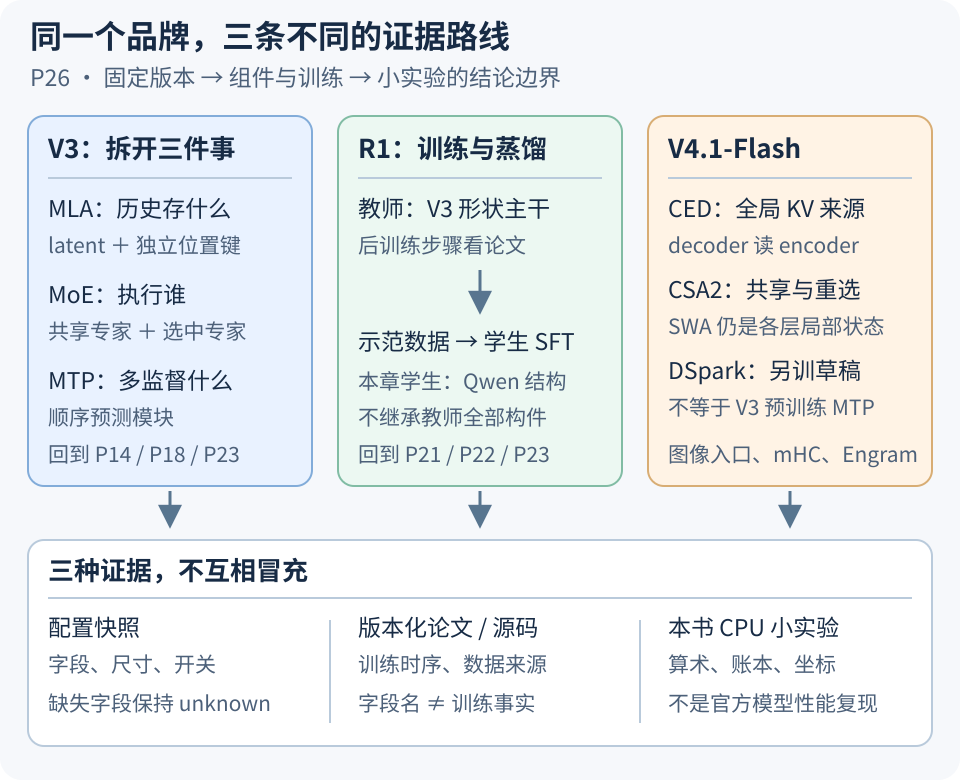

## P26.2 V3：一份参数表里有三种不同问题

### MLA 关心“历史状态存什么”

[V3 报告 §2.1.1][V3-paper] 的 MLA 将内容 K、V 共同关联到低维 latent，另保留解耦的位置键。[固定配置][V3-config] 对应 `kv_lora_rank=512`、`qk_rope_head_dim=64`、`num_attention_heads=128`。这三个量分别是潜变量宽度、位置分支宽度和查询头数，不能把 512 当成头数，也不能因为 `num_key_value_heads=128` 就断定实现缓存了 128 份完整 K、V。

对于这个配置，按“每 token、每层、缓存内容 latent 加共享位置键”的逻辑口径，元素数为：

$$
512+64=576.
$$

若假设都用两字节存储，payload 是 1,152 字节。但这是**特定缓存表示的元素账**，不是整个请求的显存：层数、batch、token 数、分配器、量化 scale、工作区与权重尚未计入；具体后端也可能采用不同布局。先说清“谁的哪一块缓存”，再谈节省多少。[P14](#p14-grouped-kv) 解释为什么线性上投影可以吸收到查询或输出侧，本章稍后用三行数据复核它。

### DeepSeekMoE 关心“这次执行哪些 FFN”

[]{#杀手锏-4混合专家架构moedeepseek-的低成本核武器}

[V3 配置][V3-config] 明确：主干 61 层，前 3 层 FFN 为 dense；其后 MoE 每层 256 个路由专家，选择 8 个，并有 1 个共享专家。**不是每一层都有 256 个专家。** 报告中的 671B 总参数与每 token 37B 激活参数是官方模型口径，不是把 `8/256` 直接乘总参数就能得到的数字，也不是本书测得的运行成本。[V3 报告 §4.2][V3-paper]

共享专家像每次都要经过的公共工序，路由专家是当前 token 选择的几条额外支路；它们不是预先贴好“数学专家”“历史专家”的知识库。路由分工由训练形成。

V3 的路由还有一个容易混淆的区别：**纠偏 bias 参与选择专家，选中后的混合权重仍来自原始 affinity。** 配置的 `scoring_func=sigmoid`、`norm_topk_prob=true`、`routed_scaling_factor=2.5` 要分开解释；“auxiliary-loss-free”也不能扩写成“整个训练完全没有任何辅助损失”，报告还保留 sequence-wise 项。[V3 报告 §2.1.2][V3-paper]

本章只做选择与权重的手算，不实现实际的分组/节点受限路由、负载更新、通信、专家网络或辅助目标。完整教学路由和负载实验见 [P18](#p18-moe)。尤其不要将 V3 的 sigmoid 公式照搬到 V4.1-Flash：后者固定配置写的是 `sqrtsoftplus`、384 个路由专家、选择 6 个。[V4.1 固定配置][V41-config]

### MTP 关心“训练时多监督哪个未来位置”

V3 的 MTP 是**顺序模块**，不是在同一 hidden state 上并排挂几个互不相干的线性分类头。后一个预测深度接收前一个深度表示和相应 token 的 embedding；embedding 与输出头共享。报告把额外预测深度设为 1，与固定配置 `num_nextn_predict_layers=1` 对应。[V3 报告 §2.2、§4.2][V3-paper]

因此，主任务预测下一词，额外深度再监督更远一个词。训练时可以提供移位后的真实 token，部署时却不能偷看尚未生成的答案。若用作草稿，仍要由目标模型按投机解码规则验证。**MTP 训练、多 token 草稿、最终接受几个 token，是三个不同问题。** [P23](#p23-mtp) 的独立线性未来头用于学习标签对齐，不冒充 V3 的顺序 MTP。

## P26.3 R1：改变训练路线，不等于发明另一种 Attention

[R1 固定配置][R1-config] 的 `model_type` 仍是 `deepseek_v3`，61 层与 `kv_lora_rank=512` 等字段也能直接读取。但仅靠这些字段，既不能证明模型经过 RL，也不能证明它擅长推理。要回答训练问题，必须读 [R1 原始报告 §2.2–2.4][R1-paper]。

| 对象 | 这份报告描述的训练路线 | 不能偷换成什么 |
| --- | --- | --- |
| R1-Zero | 从基础模型开始 RL，不先做冷启动 SFT | 不能据此说所有 R1 都不需要 SFT |
| R1 | 冷启动 SFT → 推理导向 RL → 拒绝采样与新数据 SFT → 综合任务 RL | 不是简单“在 prompt 里加一步步思考” |
| R1 蒸馏学生 | 用 R1 整理出的示范数据微调 Qwen/Llama 学生；该报告学生阶段只做 SFT | 不是把教师 MoE 权重逐层缩小，也不是报告证明学生做了同样 RL |

这里的蒸馏首先指**通过教师产出的训练样本传递行为**，不必等同于逐 token 匹配教师所有 logits 的 KL 蒸馏。是否使用 logits、怎样过滤样本、是否再做 RL，都要逐条找证据，不能由“distill”这个词补全。

最小反例就是本章锁定的 [R1-Distill-Qwen-1.5B 配置][Student-config]：`model_type=qwen2`，12 个查询头、2 个 KV 头，28 层。它沿用学生的架构形状，**不能因为名字里有 DeepSeek 就贴上 MLA、256 专家或 CED 的标签**。报告说明该学生基座为 Qwen2.5-Math-1.5B；这和教师属于哪一族是两条不同的谱系。[R1 报告 §2.4][R1-paper]

还有一个适合自己核对的陷阱：学生配置同时包含 `sliding_window=4096` 和 `use_sliding_window=false`。只抽取前一个数字就宣传“用了 4K SWA”是错误读法。配置中的数值、开关、模型代码路径需要一起看。

本章没有微调学生，也没有比较教师与学生分数。想实际理解训练信号，接着看 [P21 的 SFT](#p21-sft)、[P22 的偏好优化](#p22-preference) 和 [P23 的推理/投机解码边界](#p23-mtp)。

## P26.4 V4.1-Flash：必须把 CED、CSA2 和 SWA 分开

### CED：global KV 从哪里来

[V4.1-Flash 报告 §2.1–2.2][V41-paper] 与[固定模型卡][V41-card]描述 40 层语言主干：20 层 causal encoder，再接 20 层 decoder。这里 encoder 仍受因果约束，不是把未来文本全部读完的 BERT 式双向编码器。

decoder 的 **global KV 从最终 encoder 表示投影**，不必等待每个 decoder 层自己的历史表示；但各层 **SWA KV 仍来自本层输入**。一个是全局历史的来源，一个是局部路径的深度，不能把“共享 global KV”误说成“所有层只剩同一份状态”。[固定参考源码 `Attention`][V41-model]也保留这两个入口。

这解释了 CED 为什么能为某些 prefill 路径省去大量 decoder prompt 计算，却没有证明普通逐层参考代码已经实现生产调度。官方参考 `Transformer.forward` 仍遍历主干；报告中的 bounded replay 与部署组织是另一个层面的设计。[P17](#p17-ced) 已用独立数值 oracle 演示：有界 replay 是近似路径，多层叠加后不保证与完整历史严格相等。

### CSA2：global KV 和索引分别由谁生产

根据[报告 §2.3][V41-paper]与[固定 inference 配置][V41-inference-config]，三种模式要画两条来源线，而不是画一条“共享注意力”箭头：

| 模式 | main KV / indexer K | 当前 query 的 Top-K 索引 | 本层 main Q 与 SWA KV |
| --- | --- | --- | --- |
| Full | 本层生产 | 本层计算 | 本层计算 |
| Reindex | 复用前面 Full 层的 bank | 用本层 indexer Q 重新选择 | 本层计算 |
| Reuse | 复用同一 bank | 复用对此 bank 最近产生的选择 | 本层计算 |

Full 是 **CSA2 路径名**，不是“不加因果 mask 的 dense attention”。Reindex 是重新选择条目，不是重新算整份 KV。Reuse 也不意味着输出相同，因为本层 query 与局部路径仍会改变。[报告 §2.3.1][V41-paper]

固定配置使用从 0 开始的层号：

- `n_layers=40`，`window_size=128`。
- global KV source 为 `[2,8,14,20]`。
- index source 为 `[2,8,14,20,24,28,32,36]`。
- 前 2 层只有 SWA；第 2–19 层压缩比为 2；第 20–39 层为 1。
- 压缩比数组总长 **43**，尾部 3 项对应额外预测模块，不能因此宣布“主干有 43 层”。

这些值在[外层 `text_config`][V41-config]与[参考 inference 配置][V41-inference-config]中以不同字段名出现；测试逐项对齐它们。本章解析器只遍历前 `n_layers` 项，得到 **2 SWA、4 Full、4 Reindex、30 Reuse**。这是从配置解析的层来源账本，不是执行了 CSA2 attention。

### KV 压缩至少有四本不同的账

请分别记录：每条缓存有多宽、多少 token 合成一条、多少层复用一份、每个数占多少 bit。SWA 的短期状态、indexer K、量化 scale、压缩中间状态和分配器开销还要另算。

[V4.1 报告 §2.4.4][V41-paper]与[固定参考 `_compress_kv`][V41-model]描述 main KV 的 FP4 路径，源码按 16 通道一组使用 E4M3 scale；不能把根配置的权重量化信息直接当作 KV 格式。**权重是 FP8/FP4、KV 是 FP4、文件体积减半、HBM 实占减半，是四种不同主张。** 本章不实现 FP4 编解码，也不从只算数据位宽的账本推断实际服务内存。

## P26.5 同名预测字段，为何不是同一种训练

这是整章最值得保留的一张冲突消解表：

| 证据 | 能直接说什么 | 不能直接说什么 |
| --- | --- | --- |
| V3 配置 `num_nextn_predict_layers=1` | 配置记录一个额外预测层 | 单靠此值还不能证明训练流程 |
| V3 报告 §2.2、§4.2 | 顺序 MTP 与 backbone 联合预训练 | 不能说所有未来版本都照搬 |
| V4.1 配置 `num_nextn_predict_layers=3`；参考字段 `n_mtp_layers=3` | 发布实现存在三个额外预测模块的配置 | 不能推出 backbone 预训练使用 V3 MTP |
| V4.1 报告 §2.1、§2.4.3 | backbone 预训练省略 MTP；其后专门训练 DSpark | 不能把字段名当作反驳训练报告的证据 |

这里没有真正的矛盾：**字段名是软件接口，论文陈述的是训练时序。** DSpark 专门训练阶段冻结 backbone；后训练阶段随 backbone 继续训练，但 DSpark 目标的梯度不反传进 backbone。该报告还区分了半自回归草稿与按置信度安排验证的策略。[V4.1 报告 §2.4.3][V41-paper]

固定配置给出 `dspark_block_size=5`、目标层 `[37,38,39]`；这是模块接口，不是“每次一定接受五个词”的保证。[固定 inference 配置][V41-inference-config] 以及[官方 inference README][V41-inference-readme]还提醒我们：参考实现包含 DSpark forward 路径，但 generation 本身仍是普通自回归采样。**存在一个 forward 函数，不等于生成脚本启用了完整投机调度器。**

## P26.6 多模态入口，以及三张进一步阅读的路标

### 视觉 token 怎样接进文本主干

这次讨论的 V4.1-Flash 有图像入口，但不要把这个能力倒灌给本章早先锁定的 V3 或 R1。官方描述的路线是：图像 → DeepSeek-ViT → 局部特征重排 → MLP projector → 与文本 embedding 一起进入语言主干。[固定模型卡][V41-card]

[固定配置][V41-config]给出视觉宽度 1,024、downsample ratio 3、语言宽度 5,120。于是一个 3×3 邻域原来有九个 1,024 维位置，重排后成为一个 **9,216 维向量**，再由 projector 对齐到语言宽度。重排减少位置数，但在投影前并没有丢掉原有九块的通道数。

尤其要看[参考 `Aligner.forward`][V41-vision]：先把 H×W×C 改成通道在前，向**右侧和底部补零**使边长能被 3 整除，再执行不重叠的 `unfold`。一个新 token 内部的顺序是“通道 → 邻域行 → 邻域列”，不是“邻域位置 → 通道”。最后才经过两层 MLP（中间 GELU）。本章只复现前面的坐标重排，不运行 ViT、projector、视觉位置编码或图像理解。

### mHC、Engram、DSpark 各解决什么

| 阅读路标 | 先问的问题 | 本章核对范围 |
| --- | --- | --- |
| Single-Pass mHC | 多条 residual stream 怎样混合？哪些依赖妨碍融合？ | 报告 §2.4.1；输入混合系数错开一 block 使用，配置 `hc_mult=4` |
| Engram | 哪些信息通过条件查表记忆，而不只靠每次 dense 计算？ | 报告 §2.4.2；tokenizer 压缩、哈希和门控；参考配置层号 `[1,14]` |
| DSpark | 怎样产生草稿，决定验证长度，又保持目标模型负责最终输出？ | 报告 §2.4.3；读训练时序，再区分 forward 与部署调度 |

阅读入口为同一份[版本化报告的 §2.4.1–2.4.3][V41-paper]与[固定源码][V41-model]。不要把三者当作 MLA 的三个别名：一个改 residual stream，一个提供参数化的条件记忆，一个服务于草稿生成。Engram 的内部查表也不能直接称为“联网搜索”或“用户文档 RAG”。

本章只检查 `hc_mult`、`engram_layer_ids`、DSpark 接口字段并建立阅读路线，**未实现这些完整模块，未训练它们，也未验证各自官方收益**。遇到报告之外的新说法，应在矩阵中先记为 unknown，而不是靠熟悉的缩写把空白补满。

## P26.7 自动生成“组件—章节—证据”矩阵

运行 `--matrix-only` 会得到 19 行带出处的完整矩阵，其中 11 行从配置提取，8 行是有版本/位置的人工文献或源码核对。正文压缩展示其中几条，完整字段和来源以脚本输出为准：

| 组件 | 回到本书哪里 | 本章读取的证据 | 输出边界 |
| --- | --- | --- | --- |
| V3 MLA | P11 / P14 | [配置][V3-config]：512、64、128 | 尺寸不是语言质量 |
| V3 MoE | P18 | [配置][V3-config]：dense 前缀 3、256 选 8、共享 1 | 不含真实路由通信 |
| V3 MTP | P23 | [配置][V3-config] + [报告 §2.2][V3-paper] | 层数与训练流程分开记录 |
| R1 后训练 | P21 / P22 / P23 | [报告 §2.3–2.4][R1-paper] | 不由配置字段推测 RL |
| 蒸馏学生 | P14 / P25 | [配置][Student-config]：qwen2、12/2 头 | 不继承教师 MLA 标签 |
| CED / CSA2 / SWA | P16 / P17 | [配置][V41-inference-config] + [报告 §2.2–2.3][V41-paper] | 解析来源，不执行生产 attention |
| DSpark | P23 | [配置][V41-inference-config] + [报告 §2.4.3][V41-paper] | 不推出 backbone MTP=true |
| 视觉重排 | P26 | [Aligner 源码][V41-vision] | 坐标与补零，不是视觉能力测试 |
| FP4 KV | P24 / P26 | [报告 §2.4.4][V41-paper] | payload 账本，不是总 HBM |

`extract_fields` 遇到缺失字段输出 `null`、记录 missing 路径并标记 `unknown`；它不会用零或 false 顶替。真正存在的 `false` 则保留为 false。程序也不会因为一个配置缺少 `n_routed_experts` 就自动断言“模型完全没有条件计算”。

来源清单与程序是一起维护的教学数据，不是防篡改审计系统：同时修改清单和文件可以产生新的自洽哈希。所以测试还锁住本章声明的 revision 和关键配置值；更新版本时应重新查看原始证据，而不是只改 expected 让测试变绿。

## P26.8 四个可以手算的小实验

### 实验 A：MLA 的两条计算路径

将内容 latent 写成行向量，设三行数据、一个教学头：

$$
C=\begin{bmatrix}1&2\\-1&1\\2&0\end{bmatrix},\quad
W_K=\begin{bmatrix}1&2\\-1&1\end{bmatrix},\quad
W_V=\begin{bmatrix}2&0\\1&3\end{bmatrix}.
$$

内容 query 为 `[2,-1]`，位置 query 为 `[1,2]`，三行已经旋转过的位置 key 为 `[[0,1],[1,0],[2,-1]]`。内容与位置宽度各为 2，所以此例分母为 √4=2。

路径一展开 `K=CW_K`、`V=CW_V` 再注意力；路径二把 query 改为 `qW_Kᵀ`，先对 C 做加权平均，最后乘 `W_V`。两个路径的 logits 都应为 `[-2,-1,0]`，输出约 `[2.776358,1.274369]`。

这里检查的是线性代数恒等式与位置分支没有丢失；它省略 V3 的多头、query 低秩投影、归一化、真实 RoPE 生成和训练权重。**小实验正确不等于完整 MLA 内核正确。** 测试除比较两路，还直接用 `exp(-2)、exp(-1)、1` 对手工展开后的值 `[4,6]、[-1,3]、[4,0]` 求加权平均，避免两条路径共享同一个错位后一起通过。

### 实验 B：选择 bias 不该污染混合权重

假设三个专家的 sigmoid 后分数为 `[3/4,1/2,1/4]`，选择 bias 为 `[-1,0,1]`，选两个专家。选择用的分数是 `[-1/4,1/2,5/4]`，所以选中专家 **2、1**。

但混合权重来自原始分数，因此是 `(1/4)/(3/4)=1/3` 与 `(1/2)/(3/4)=2/3`。让专家输出分别为 `[2,0]、[0,4]、[6,2]`，共享输出为 `[1,-1]`，教学 scale 暂取 1：

$$
y=[1,-1]+\tfrac13[6,2]+\tfrac23[0,4]=[3,7/3].
$$

只要选择顺序不变，改变 bias 的大小不应改变这组权重。若把 bias 加进归一化，数值就变了。固定 V3 配置的 routing scale 是 2.5，脚本参数也可取 2.5；上述输出随之变成 `[6,22/3]`，共享分支不跟着缩放。本实验不把这三位专家宣传成真实训练后的专家。

### 实验 C：CSA2 来源账本，不是压缩算法

用官方层调度，但把序列改成 10 tokens、每条 main latent 仅 4 个数、每数假想 4 bits。为便于手算，暂时不计 scale、indexer、SWA、未满压缩组的状态和字节对齐。

- 18 个 encoder global 层的压缩比为 2，每层对应 5 条已完成的 main 记录。
- 20 个 decoder global 层的压缩比为 1，每层对应 10 条。
- 假想“不共享”时共 `18×5+20×10=290` 条。
- 按固定 source 共享时只有三份 ratio=2 bank 和一份 ratio=1 bank，共 `3×5+10=25` 条。

| 教学口径 | bank 数 | 完整记录数 | 仅 main 数据 payload |
| --- | --- | --- | --- |
| 假想逐层独立 | 38 | 290 | 580 bytes |
| 按配置 source 共享 | 4 | 25 | 50 bytes |

这不是官方“890 bytes/token”等指标的复现，也不是同模型两个真实实现的显存比较。脚本没有生成任何压缩向量、学习 compressor 权重、计算 sparse indexer 或调用 GPU kernel。50 与 580 只回答这里明示的四维小账本问题。

因果性还有一个边界：ratio=2 时，原始位置 0 到来后还没有完整组；位置 1 到来后才有第一组。`completed_entries(q,r)=(q+1)//r`，不能向上取整让第一组在位置 0 就可见。组的代表位置或 RoPE 位置，与组内所有 token 是否已经到齐，是两个不同问题。测试枚举各组末位置作为独立 oracle。

### 实验 D：九个视觉位置如何变一个

用 `grid[y][x][c]=100y+10x+c` 构造 6×6×2 特征。按 3×3 重排后是 4 个 token，每个 18 维，72 个数仍然是 72 个数。第一行应为：

```text
[0,10,20,100,110,120,200,210,220,
 1,11,21,101,111,121,201,211,221]
```

如果把通道放到最内层，会得到另一个看起来同样是 `[4,18]` 的张量，却无法与 projector 的输入通道对齐。**形状对，不等于坐标对。** 测试用“由输出 feature 编号反推输入坐标”的独立公式检查每个元素，而不是只检查 shape。

4×5×2 的输入会补成 6×6×2，再输出 4×18；原来 40 个数都应保留，另有 32 个填充零。它不是把 3×3 邻域求平均，不能用平均池化来替换这一步。

## P26.9 运行、可验证结果和失败边界

在仓库根目录运行，不需要安装 PyTorch：

```bash
python code/27_deepseek_case.py
python code/27_deepseek_case.py --matrix-only
python code/27_deepseek_case.py --json
python -m unittest discover -s tests -p 'test_deepseek_case.py' -v
```

默认输出完整证据矩阵和四个实验；`--json` 输出可被程序读取的同一份报告，`--matrix-only` 只打印矩阵。三个模式互斥；从其他工作目录运行也会按脚本位置找到快照。程序不联网、不下载权重，也不执行配置中的 `auto_map`。

本章实际运行的标准库 CPU 结果：

| 检查 | 结果 | 结论上限 |
| --- | --- | --- |
| MLA 展开/吸收输出最大差 | 约 2.22×10⁻¹⁶ | 双精度小矩阵等价；末位允许平台差异 |
| 路由选中与输出 | `[2,1]`；`[3,2.333333333333333]` | 选择偏置与混合权重分离 |
| source 共享 main 账本 | 25 条、50 bytes | 明示假设下的整数账 |
| 视觉重排 | `[6,6,2] → [4,18]` | 元素与坐标检查 |
| 专项测试 | 17 项通过，无依赖跳过 | 只覆盖本章代码与快照契约 |

专项测试包含六个**实际执行的数值错误变体**：漏转置、漏位置分支、bias 污染权重、按每层重复存 bank、提前暴露未完成组、调换视觉通道顺序。它们都能返回数值，由数值/坐标断言抓住；没有把语法错误或程序崩溃伪装成“成功检测”。另执行 SWA 来源与 Markdown 竖线转义两项契约变异；它们分别由精确拒绝原因和输出断言检出。此外还测试坏哈希、浮动 revision、路径越界、缺字段、非法 source 调度、补零、空序列账本和配置别名一致性。

我们没有运行官方权重、训练、GPU 内核、质量 benchmark 或服务吞吐。本书输出不会将官方分数拷贝成“本书实测”。即使官方参考自测能跑通，也只说明它承诺的内容：其 README 明说自测使用未初始化权重，检查形状与 kernel 连接，**不验证真实数值质量**。[官方 inference README][V41-inference-readme]

## P26.10 旧版第 9 章的直觉桥梁：保留有用内容，修正大而化之的结论

[]{#架构选择为什么开放式生成常用-decoder-only}
[]{#三种架构各自擅长什么}
[]{#表-9-1三大-transformer-派系历史战役复盘表}

### 三种架构不是“淘汰赛”

| 结构 | 主要信息流 | 适合用来理解的任务 |
| --- | --- | --- |
| Encoder-only | 允许输入位置双向交互，再读出表示 | 分类、检索、抽取；BERT 是典型阅读入口 |
| Encoder-decoder | 编码输入，decoder 读取编码结果并因果生成 | 翻译、摘要；T5 提供 text-to-text 例子 |
| Decoder-only | 每步只看前文，继续预测下一 token | 开放式续写；本书 Baby-GPT 使用此路线 |

[BERT 原论文 v2](https://arxiv.org/abs/1810.04805v2)与 [T5 原论文 v4](https://arxiv.org/abs/1910.10683v4)给出前两种代表。选择某种结构并不证明另外两种被淘汰。尤其 V4.1-Flash 的 causal encoder，与表中双向 encoder 不是同一个因果设定；不能看到 encoder-decoder 两个单词，就把它与原版翻译 Transformer 的信息流完全等同。

[]{#现代大模型的五种关键改进原理与直觉}

### 五个基础构件仍然有用，但不是每个模型的固定套餐

[]{#杀手锏-1旋转位置编码rope复数平面上的几何旋转}

**RoPE 的手算直觉。** 对二维向量旋转：

$$
R(\theta)\begin{bmatrix}x\\y\end{bmatrix}
=\begin{bmatrix}\cos\theta&-\sin\theta\\\sin\theta&\cos\theta\end{bmatrix}
\begin{bmatrix}x\\y\end{bmatrix}.
$$

座位 m 的 query 旋转 mθ，座位 n 的 key 旋转 nθ；点积可整理成净旋转 `(n−m)θ`，所以相对位置进入分数。例如 `[1,0]` 旋转 π/2 得到 `[0,1]`，但其长度仍为 1。这个几何关系不自动保证任意长上下文都可靠，完整数值与 YaRN 边界见 [P12](#p12-rope)。

[]{#杀手锏-2rmsnorm先不管平均数只控制振幅}

**RMSNorm 先控制尺度，不减均值。** 实际公式要保留 epsilon：

$$
\operatorname{RMSNorm}(x)=\frac{x}{\sqrt{\operatorname{mean}(x^2)+\epsilon}}\odot\gamma.
$$

例如 `[3,4]` 的均方根为 √12.5；令 γ 为 1、忽略小 epsilon，归一化后约 `[0.849,1.131]`，均值不为零。它与 LayerNorm 不是同一个操作，也不能保证固定“快 10%–50%”；速度依赖实现和硬件。[P13](#p13-modern-block) 有带 epsilon 的实现与反例。

[]{#杀手锏-3swiglu-激活函数带有开关的神经元}

**SwiGLU 的两条支路。** 一路准备内容，另一路用 SiLU 调节它：

$$
\operatorname{SwiGLU}(x)=
\bigl(\operatorname{SiLU}(xW_g)\odot xW_u\bigr)W_d.
$$

中间的 ⊙ 是逐元素乘法，不是点积。若某个 gate 输入恰为 0，SiLU(0)=0，该通道的内容支路就被关掉。门控不等于 MoE 路由：前者通常调节 dense 中间通道，后者决定哪些专家支路参与。具体参数量与隐藏宽度要一起算，见 [P13](#p13-modern-block)。

**MoE 的公共工序与选修工序。** 本章 P26.2 和实验 B 保留了“共享专家每次参加、路由专家只选一部分”的直觉，并补上权重归一化手算。不要把总参数、激活参数、显存驻留参数当作同一个数，也不要给专家预先贴知识领域标签。

[]{#杀手锏-5kv-cache-机制消除重复运算的打字机}

**KV Cache 消除重复计算，不消除历史。** 对固定因果模型和未修改的前缀，旧 K、V 不必每个生成步骤重新计算。朴素逐次重算长度 t 的 dense attention，单步约 t²，累积到 N 约 N³；缓存后每次新 query 对历史约 t，累积约 N²。这里仅计算 attention 位置对，不包含投影、FFN、prefill、batch 或内存带宽。缓存既不把全局注意力变成常数，也不能跨权重修改后继续当成有效状态；具体契约见 P11 与 [P15](#p15-attention-systems)。

[]{#顶级大模型架构进化对照表}
[]{#表-9-2从经典-transformer-到-deepseek-的参数与架构进化演变}

### 用可追溯对照代替“从旧到新全都更强”的大表

| 精确对象 | 本章有证据的重点 | 不应外推 |
| --- | --- | --- |
| 固定 V3 | MLA、DeepSeekMoE、顺序 MTP | 不是所有 DeepSeek 的统一模板 |
| 原始 R1 与固定教师配置 | V3 形状主干与特定后训练流程 | 训练路线不能只由 config 推断 |
| 固定 R1-Distill-Qwen-1.5B | Qwen 学生架构、12/2 查询/KV 头 | 学生不继承教师所有构件 |
| 固定 V4.1-Flash | CED、CSA2、局部 SWA、独立训练 DSpark、图像入口 | 不能只按编号认为是“V3 加几层” |

来源分别在本章版本表、组件矩阵和原始配置链接中。旧式“最大上下文”一列也需要拆开：V3 本章固定配置 `max_position_embeddings=163840`，模型卡/报告描述的上下文能力另有口径，**配置允许的索引边界不是已验证质量范围，更不等于某个 API 当前限制**。[V3 配置][V3-config] [V3 模型卡][V3-card]

[]{#尺度定律scaling-law与神奇的涌现现象}

### 尺度与“涌现”：先问测量方法

扩大参数、数据与计算预算，经常是研究训练损失如何变化的一条路线，但性能也取决于数据质量、优化、架构与评测。某项离散任务从“全错”到“答对”，可能显得突然；不能据此断言内部能力也在同一刻跳变，更不能由一张平滑下降曲线推导人类式心智。

对本书读者更实用的问题是：改变了哪个变量？有没有固定训练数据与评测？损失、准确率、延迟、内存是否各自测量？[P19](#p19-pretraining) 和本章的证据矩阵，就是避免把“规模更大”当作万能解释的起点。

## P26.11 小练习与参考答案

1. 删掉 V3 快照中的 `kv_lora_rank` 后直接运行，会先遇到 unknown，还是校验错误？为什么这两种机制都需要？
2. 为什么 V4.1 的 43 项压缩数组只得到 40 行主干调度？第 25 层的 KV 与索引分别来自哪里？
3. ratio=2 时，query 位置 0、1、2 各能看见几个完整压缩组？把向下取整改成向上取整错在哪里？
4. 保持实验 B 的专家排序不变，只把 bias 改成 `[-4,0,2]`。输出应不应该变？若把 routing scale 改成 2.5 呢？
5. 4×5×2 视觉特征以 r=3 重排后形状是多少？增加的零有几个？只检查 shape 为什么不够？
6. 看到 `n_mtp_layers=3`，能否在矩阵里添加 `backbone_mtp=true`？看到学生 `sliding_window=4096`，能否宣布它启用了 SWA？

**参考答案（前五项的数值/契约和第六项的证据边界均有专项测试）：**

1. 先触发 SHA-256 不匹配；它保护离线快照。测试直接把缺字段字典送给 extractor 时才得到 unknown，保护解析语义。两者分别回答“文件是否是那份”和“字段是否已知”。
2. `n_layers=40` 是主干边界，尾部三项另属额外模块。第 25 层是 Reuse：KV 来自 20，最近索引来自 24，本层 SWA 仍是 25。
3. 分别为 0、1、1；向上取整让尚未收齐的组提前进入历史，违反因果可见性。
4. 不变，仍为 `[3,7/3]`；scale=2.5 时为 `[6,22/3]`。纠偏只改选择，scale 只乘路由混合项。
5. 输出 4×18，补 32 个零；交换通道与局部坐标的顺序不会改变 shape，却会改变每个维度的意义。
6. 都不能。训练时序要读报告，而窗口开关在该学生配置中为 false。既不应把缺证据写成 false，也不应把出现一个数字写成 true。

[]{#本章小结-1}

本章完成的不是“复现一个品牌”，而是搭起一条可检查的链：**固定对象 → 找到证据 → 说明边界 → 做小实验 → 用独立 oracle 与错误变体检查**。V3、R1、蒸馏学生和 V4.1-Flash 可以放在同一张地图上，但不能被拼接成一个现实中不存在的超级架构。

## P26.12 原始资料与版本

- [V3 技术报告 2412.19437v2][V3-paper]：§2.1 MLA/MoE，§2.2 顺序 MTP，§4.2 参数设置；[固定配置][V3-config]与[固定模型卡][V3-card]。
- [R1 原始报告 2501.12948v1][R1-paper]：§2.2 R1-Zero，§2.3 四阶段后训练，§2.4 蒸馏；[固定教师配置][R1-config]、[固定学生配置][Student-config]。
- [V4.1-Flash 报告 2609.19969v1][V41-paper]：§2.1–2.4 架构与训练时序、§3.2.2 SWA bounded replay；[固定模型卡][V41-card]。
- V4.1-Flash 同一 revision 下的 [config.json][V41-config]、[inference/config.json][V41-inference-config]、[model.py][V41-model]、[vision.py][V41-vision]、[inference README][V41-inference-readme]。阅读源码，不导入官方模型、不运行未知权重路径。

[V3-paper]: https://arxiv.org/html/2412.19437v2
[R1-paper]: https://arxiv.org/html/2501.12948v1
[V41-paper]: https://arxiv.org/html/2609.19969v1
[V3-config]: https://huggingface.co/deepseek-ai/DeepSeek-V3/resolve/e815299b0bcbac849fa540c768ef21845365c9eb/config.json
[V3-card]: https://huggingface.co/deepseek-ai/DeepSeek-V3/blob/e815299b0bcbac849fa540c768ef21845365c9eb/README.md
[R1-config]: https://huggingface.co/deepseek-ai/DeepSeek-R1/resolve/56d4cbbb4d29f4355bab4b9a39ccb717a14ad5ad/config.json
[Student-config]: https://huggingface.co/deepseek-ai/DeepSeek-R1-Distill-Qwen-1.5B/resolve/ad9f0ae0864d7fbcd1cd905e3c6c5b069cc8b562/config.json
[V41-config]: https://huggingface.co/deepseek-ai/DeepSeek-V4.1-Flash/resolve/314113f8a7dadb388215396ba5fbee2c610a04d6/config.json
[V41-card]: https://huggingface.co/deepseek-ai/DeepSeek-V4.1-Flash/blob/314113f8a7dadb388215396ba5fbee2c610a04d6/README.md
[V41-inference-config]: https://huggingface.co/deepseek-ai/DeepSeek-V4.1-Flash/resolve/314113f8a7dadb388215396ba5fbee2c610a04d6/inference/config.json
[V41-model]: https://huggingface.co/deepseek-ai/DeepSeek-V4.1-Flash/blob/314113f8a7dadb388215396ba5fbee2c610a04d6/inference/model.py
[V41-vision]: https://huggingface.co/deepseek-ai/DeepSeek-V4.1-Flash/blob/314113f8a7dadb388215396ba5fbee2c610a04d6/inference/vision.py
[V41-inference-readme]: https://huggingface.co/deepseek-ai/DeepSeek-V4.1-Flash/blob/314113f8a7dadb388215396ba5fbee2c610a04d6/inference/README.md


---

# 综合实验（P27）：给自己的 miniGPT 做体检 {#p27-healthcheck}

换了轮胎的自行车，能在院子里骑一圈，不代表刹车、转向、载重都没有问题。同样，模型能输出一句话，也不代表位置没有错、未来没有泄漏、第二个请求没有混进第一个请求的缓存。

前面我们逐件学习了 KV cache、RoPE、RMSNorm、SwiGLU、GQA、MoE 和可选 MTP。本章不再发明一种新架构，而是把已有零件放到同一张检查单上：**哪个东西应该保持相同，哪个允许改变，出现差异后应该先查哪里？**

配套 [code/28_minigpt_healthcheck.py](../code/28_minigpt_healthcheck.py)，测试为 `tests/test_minigpt_healthcheck.py`。它直接导入前面章节的模型和缓存函数，不复制第七份 Transformer，也不改动历史基线 [Baby-GPT](../code/07_baby_gpt.py)。默认一条命令覆盖 S0–S5；`--mtp` 打开 S6 旁路。

阅读前建议完成 [第 8 章 Baby-GPT](#任务边界与运行)、[P11 KV cache](#p11.1-重算发生在哪里)、[RoPE](#p12-rope)、[现代 Block](#p13-modern-block)、[GQA](#p14-grouped-kv)、[MoE](#p18-moe)。MTP 部分可结合 [P23](#p23-mtp) 选读。如果忘了某个名词，先看 [附录](#p28-reference)，不用把所有框架重新安装一遍。

> 体检类比的边界：软件检查不是医学诊断。“通过”只表示列出的输入、性质和运行环境没有发现问题，不是证明所有输入都正确。反例可以推翻一个断言；几个成功例子不能证明无限多个情况。

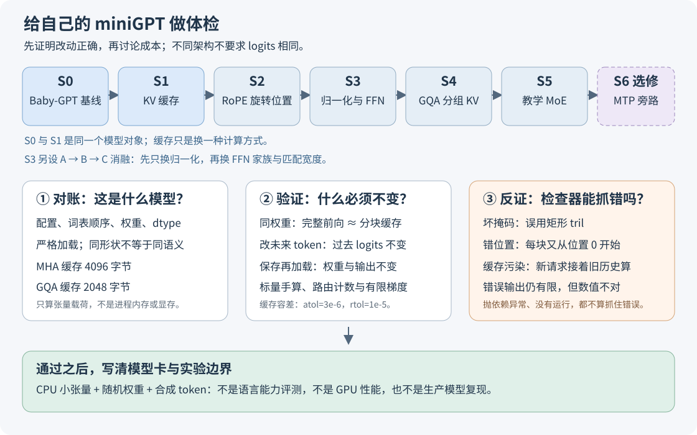

本批三张结果图由 `scripts/plot_p27_healthcheck.py` 读取仓库内金标报告 `docs/gold/p27_healthcheck_mtp.json`（`OMP_NUM_THREADS=1 python code/28_minigpt_healthcheck.py --mtp --json` 在 CPU float32、种子 270/271 下写出）生成，不使用手填基准值。复现：

```bash
OMP_NUM_THREADS=1 python code/28_minigpt_healthcheck.py --mtp --json > docs/gold/p27_healthcheck_mtp.json
python scripts/plot_p27_healthcheck.py docs/gold/p27_healthcheck_mtp.json --out-dir assets/diagrams/p27
```

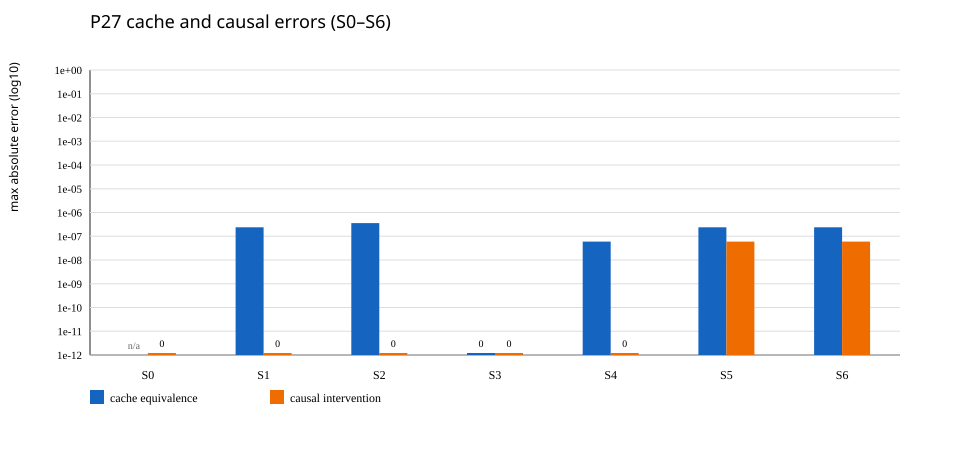

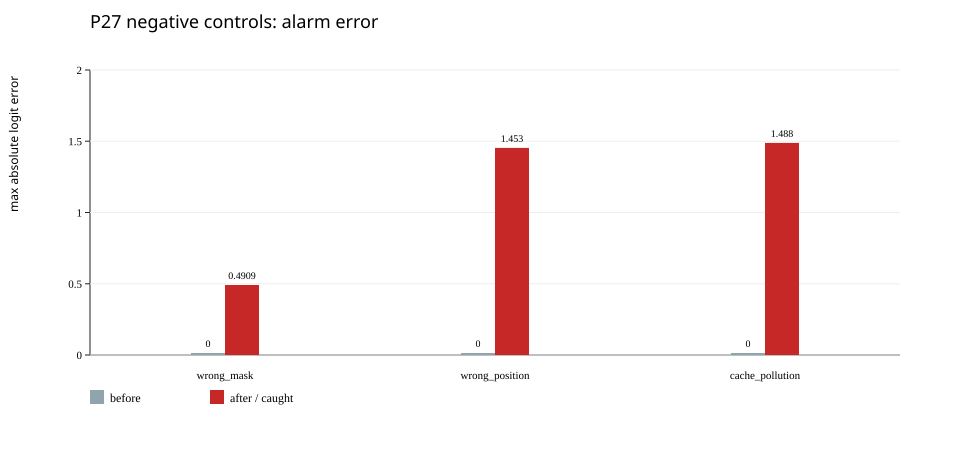

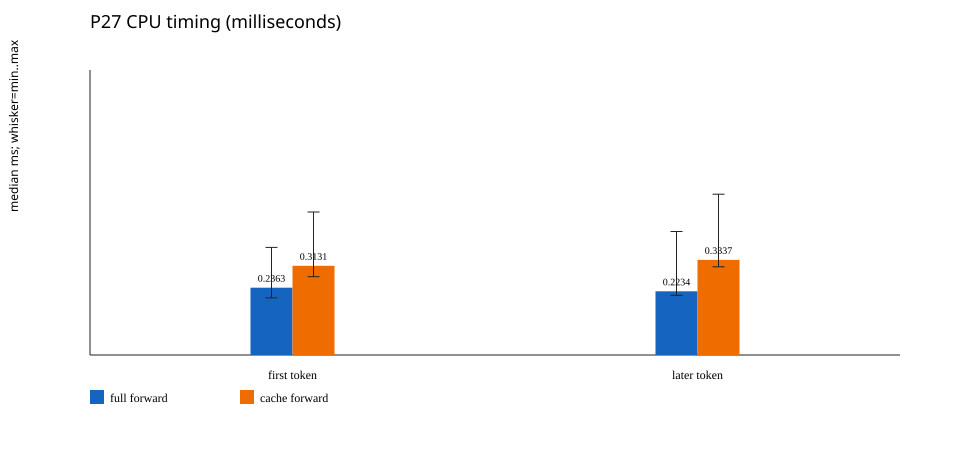


## P27.1 先分清三种“相同”

做实验最容易犯的错误，不是写错一个公式，而是比较了不应该相同的东西。

| 比较对象 | 期待什么 | 为什么 |
| --- | --- | --- |
| 同模型、同权重、同 token，完整前向与缓存前向 | logits 在规定容差内相同 | 缓存只是复用以前算过的 K/V |
| 同配置、同词表、保存前与重新加载后 | 权重完全相同；本实验输出完全相同 | 序列化不应该悄悄改变模型 |
| 把 LayerNorm 换成 RMSNorm | 输出通常不同 | 计算本来就变了，应检查公式与受控差异 |
| 把 MHA 的 KV 头减半 | 缓存载荷下降；输出不必相同 | 参数结构与信息共享方式变了 |
| 固定随机种子，重新创建两种架构 | 不能直接要求所有对应权重相同 | 新增模块会消耗随机数，初始化顺序可能改变 |
| 更长输出与更短输出 | 不一定更正确 | 计算预算、语言长度和答案质量是不同指标 |

**数值等价**是在相同数学任务上比较两种计算路径；**消融实验**是只改变一个明确因素，观察变化；**模型质量评测**则需要有意义的数据、任务与独立检查器。三者不能互相代替。

本章输出的 loss 是随机模型在两行合成 token 上的交叉熵或含 MoE 辅助项的训练目标。它能帮助发现 NaN、错形状和断开的梯度，不能用来宣布 S4 比 S3 更聪明。甚至 S5 的总 loss 和 S4 也不完全是同一种量：S5 默认还加了负载辅助项。

## P27.2 S0–S6：升级路线不是权重转换说明书

阶段表示“这一章增加了什么”，不表示所有阶段都能直接读同一个 checkpoint。

| 阶段 | 真正调用的旧实验 | 本次主要变化 | 体检重点 |
| --- | --- | --- | --- |
| S0 | `07_baby_gpt.py` | 绝对位置、LayerNorm、GELU、MHA 基线 | 前后向、因果性、保存加载 |
| S1 | `12_kv_cache.py` | 给同一个 S0 对象增加缓存计算路径 | 完整／分块 logits；请求边界 |
| S2 | `13_rope.py` | 用 RoPE 替代绝对位置表 | 旋转手算；缓存偏移；因果性 |
| S3 | `14_modern_block.py` | 现代归一化与 FFN | 公式、有限梯度、分两步消融 |
| S4 | `15_grouped_kv.py` | 分组 KV 头 | 头映射；实际缓存载荷 |
| S5 | `19_moe.py` | 将稠密 FFN 换成教学 MoE | 路由计数；梯度；缓存等价 |
| S6，可选 | `24_reasoning_mtp.py` | 加独立未来预测 head | 标签对齐；辅助梯度；贪心验证 |

S1 不是“另一份初始化恰好相同的 S0”：脚本把**同一个模型对象**分别交给普通前向和缓存前向。这样排除了“看起来比较缓存，实际比较两组权重”的错误。

S2–S5 是分别建立的教学阶段，不宣称已经转换、继承或训练好上一阶段的权重。S3 默认还涉及 bias 策略，所以不能把 S2 与默认 S3 的所有差异都归因于 RMSNorm；真正的单变量控制组在 P27.7 单独建立。

S6 先用独立种子 271 初始化，再显式复制种子 270 的 S5 所有已有状态，保留新建的两个旁路 head。这样，删掉复制步骤时主干权重确实不同，不会被相同种子的巧合掩盖。因此没有训练更新之前，S5 与 S6 的**普通主 head 输出**相同；S6 的辅助目标不同。MTP 并不自动修改普通生成算法，也不是生产 DeepSeek 的顺序 MTP 或 DSpark 实现。[DeepSeek-V3 报告 v2，MTP](https://arxiv.org/abs/2412.19437v2)

## P27.3 一条命令，从输入到报告

### 运行入口与失败含义

在仓库根目录、已安装 `requirements.txt` 的 Python 环境中运行：

```bash
OMP_NUM_THREADS=1 python code/28_minigpt_healthcheck.py
```

加上可选 MTP 检查：

```bash
OMP_NUM_THREADS=1 python code/28_minigpt_healthcheck.py --mtp
```

需要保存可比较的机器可读报告时：

```bash
OMP_NUM_THREADS=1 python code/28_minigpt_healthcheck.py --mtp --json > healthcheck.json
python -m unittest discover -s tests -p 'test_minigpt_healthcheck.py' -v
```

`--json` 只改变输出格式，不跳过任何检查；每个缓存阶段的 `chunk_checks` 记录实际运行的四种分块及各自误差、字节数，汇总误差取其中最大值。默认路径不下载模型、不访问外部服务、不使用 GPU。脚本把 CPU 线程设为 1，主线随机种子为 270，使用 float32；S6 独立初始化使用 271，随后复制 S5 主干。版本、设备、线程、种子、形状和容差写进报告，不只打印一个绿色 PASS。

缺少 PyTorch 时，CLI 给出安装提示并以状态码 2 退出，明确写 `NOT RUN, not passed`；作为模块导入时仍抛出真实依赖错误。测试可以因没有受支持 Torch 而跳过数值路径，但**跳过不等于通过**。其他导入错误、错误实现崩溃或输出 NaN 不能被包装成“负例成功”。

### 固定输入，先别谈中文质量

本次使用词表大小 V=17 的合成整数 ID，不使用三首诗的字符词表，也没有把整数大小当成语义。每行是一条独立合成文档，不做 padding、跨文档 packing 或聊天模板。

| 行 | 输入 x，8 个 token | 标签 y，8 个 token |
| --- | --- | --- |
| 0 | 1, 2, 3, 2, 6, 7, 4, 8 | 2, 3, 2, 6, 7, 4, 8, 9 |
| 1 | 4, 0, 2, 1, 4, 3, 8, 6 | 0, 2, 1, 4, 3, 8, 6, 5 |

代码先写出 9 个 token 的流，再取 `stream[:, :-1]` 和 `stream[:, 1:]`。最后一个标签来自第九个 token，**不是把窗口开头卷回来**。这能验证 next-token 的位置关系，但不能证明真实训练集的去重、许可与切分已经做好。

统一小配置为 B=2、T=8、D=16、Hq=4、每头 d=4、层数 L=2、上下文上限 16。GQA 使用 Hkv=2；MoE 每层 4 个路由专家、top-k=2、专家宽度 7，另有 1 个宽度 5 的共享专家。

### 脚本到底做了什么

顺着 `run_healthcheck` 阅读，比一次看完所有模型源代码容易：

1. `make_stages` 导入旧课例并建立小模型；S0/S1 共用对象，S6 保持 S5 主干权重。
2. `fixture` 产生同一组 x/y；`finite_backward` 检查目标有限、主干与主 head 有梯度，并至少有非零梯度。不执行 optimizer 更新。
3. `causal_error` 只改未来输入，检查所有过去位置的 logits。
4. `checkpoint_error` 写入内存文件、严格读回，并逐个核对状态张量和输出。
5. 有缓存的阶段分别运行 `[3,1,4]`、八次 `[1]`、`[8]` 和 `[7,1]` 四种分块，检查缓存长度与载荷；再检查请求重置与容量溢出。
6. `component_oracles` 用独立手算答案检查旋转、归一化、门控、分组和路由；`compatibility_checks` 验证不兼容加载真的被拒绝。
7. 运行真实控制组、三类坏行为；选修 MTP 再做标签、梯度与贪心对照。
8. 用同一个 S0 权重和固定 token 重放，记录普通／缓存 CPU 前向的计时分布。

这里的 backward 是**梯度 smoke**，不是训练完成。参数没有更新，checkpoint 也不包含 optimizer 或 RNG 状态。想验证中断后能否继续同一条训练轨迹，需要回到训练流水线章节，保存更完整的恢复状态。

正常实现从不触发某道防线，不代表防线已经被测试。这里另外包装真实计算，逐一制造下列坏行为；正常体检必须拒绝，删掉对应检查的源码变异则会放过它，其他检查保持原样。

| 注入的坏行为 | 应报警的位置 |
| --- | --- |
| 处理了 8 个 token，返回的缓存却声称长度为 9 | 缓存长度与已消耗前缀比较 |
| 长度 16 后再输入 1 个，静默丢掉最老 K/V | 容量溢出必须被拒绝 |
| 新请求传入 `None`，实现却沿用旧的 3-token 历史 | 新请求输出与独立完整前向比较 |
| 路由 logits 不变，但负载账本从 32 写成 33 | MoE 请求总数核对 |
| loss 加上 NaN 常量，梯度仍然有限非零 | 反向之前检查 loss 有限 |

最后一行尤其容易误判：常量加法不改变对参数的导数，因此“梯度有限”不能代替“目标有限”。

## P27.4 一张张量账本，先抓形状再抓数值

| 张量或量 | S0/S1 | S2/S3 | S4/S5/S6 |
| --- | --- | --- | --- |
| 输入 ID | [2,8] | [2,8] | [2,8] |
| 完整 logits | [2,8,17] | [2,8,17] | [2,8,17] |
| 单层缓存 K 或 V | [2,4,8,4] | [2,4,8,4] | [2,2,8,4] |
| 绝对位置表 | 有 | 无 | 无 |
| 两层 K+V 的 float32 载荷 | S0 不建缓存；S1 为 4096 字节 | 4096 字节 | 2048 字节 |

缓存公式是：

$$
\text{bytes}=2\times L\times B\times H_{kv}\times T\times d\times s.
$$

第一个 2 是 K 和 V 两份，s 是每元素字节数。MHA 时 Hkv=Hq=4；因此 `2×2×2×4×8×4×4=4096`。GQA 把 Hkv 改为 2，结果为 2048。这是从实际缓存张量 `numel×element_size` 求和后，再与独立整数账本对照的值。 测试还把同样形状的模型改为 float64，逐个确认缓存张量每元素 8 字节：MHA 为 8192 字节，GQA 为 4096 字节。若把元素大小写死为 4，这个独立 dtype 对照会失败。

这里**不是测出来的进程内存，更不是显存峰值**。模型权重、注意力分数、临时复制、Python 对象、分配器缓存都没计入。S4 计算注意力时还会临时展开共享 K/V；存储的缓存必须保留 Hkv 头，不能把展开后的 Hq 份偷偷存回去。

Hq=4、Hkv=2 时，查询头的映射是 `[0,0,1,1]`。给两个 KV 头分别填入 `[10,11]` 和 `[20,21]`，只放一个可见 key，四个查询头输出应为：

| 查询头 | 使用的 KV 头 | 结果 |
| --- | --- | --- |
| 0 | 0 | [10,11] |
| 1 | 0 | [10,11] |
| 2 | 1 | [20,21] |
| 3 | 1 | [20,21] |

只有一个 key 时权重必为 1，因而此例不用依赖另一份 softmax 实现，就能抓住错误的 `[0,1,0,1]` 映射。GQA 原论文还讨论了从 MHA checkpoint 初始化并继续训练的路线；“可以 uptraining”不能缩写成“直接改配置，函数完全不变”。[GQA v1](https://arxiv.org/abs/2305.13245v1)

## P27.5 两个不变量：缓存等价与未来不可见

### 不变量 A：换计算顺序，不换模型含义

对同一组权重 θ 和输入 x，完整计算得到 `model(x)`。分块计算则先喂 3 个 token，再喂 1 个，最后喂 4 个，把各段 logits 按时间拼接。要求每个位置都对齐，不只比较最后一个生成 token。

$$
\left|z_{cache}-z_{full}\right|\leq atol+rtol\left|z_{full}\right|.
$$

本章 float32 使用 `atol=3e-6`、`rtol=1e-5`，同时记录最大绝对误差。不同批形、矩阵乘法路径与累加顺序会带来末位浮点差异，所以不能把所有缓存比较写成逐 bit 相等；也不能随意把容差放宽到“看起来差不多”。

为什么跑四种分块？单 token decode 擅长暴露位置偏移错误，多 token chunk 擅长暴露矩形 mask 错误，整段前向则给出没有历史缓存的边界。如果只测 `T=1` 或只测一次完整 prefill，某些错误永远不触发。 测试另外只破坏第一块或中间块的输出，保留正确 K/V 和最后一块，确认完整比较会报警；把检查器改成只看最后一块的真实源码变异则会漏过，因此该错误不能再被正常输出样本掩盖。

对照对象也必须锁住：若把完整前向换成“缓存路径一次喂完”，两边可能共享同一个错误。测试让缓存路径的每块 logits 都加 0.25，四种分块都应被真正的完整前向抓住；缓存路径与自己比较却会漏掉。另一个测试只把第一块乘 1.5，包括整段 `[8]` 在内也都应报警。这里没有改 K/V，错误只在返回的 logits，不能依靠后续缓存崩溃碰巧抓住它。

下面是 [`code/28_minigpt_healthcheck.py`](../code/28_minigpt_healthcheck.py) 中 `cache_equivalence` 的前 14 行（第 120–133 行），原样摘录，由 `scripts/sync_code_excerpts.py` 从源码生成并由测试锁定：

<!-- code-excerpt: code/28_minigpt_healthcheck.py L120-L133 -->
```python
@torch.no_grad()
def cache_equivalence(stage, tokens, sizes=(3, 1, 4)):
    if stage.cached_forward is None:
        raise ValueError('stage has no cache path')
    if any(type(size) is not int or size <= 0 for size in sizes) or sum(sizes) != tokens.shape[1]:
        raise ValueError('positive chunks must cover tokens exactly')
    expected = stage.model(tokens)[0]
    cache, pieces, start = None, [], 0
    for size in sizes:
        output, cache = stage.cached_forward(stage.model, tokens[:, start:start + size], cache)
        pieces.append(output)
        start += size
        if cache.length != start:
            raise AssertionError('cache length differs from consumed prefix')
```

逐行读：

- 第 120 行 `@torch.no_grad()`：体检只做前向，不建计算图，避免缓存张量意外挂上梯度。
- 第 122–125 行：先拒绝没有缓存路径的阶段，再要求分块全为正整数且**恰好覆盖**整段输入；少喂或多喂一个 token 都不允许进入比较。
- 第 126 行：参照答案来自同一个 `stage.model` 的完整前向，而不是缓存路径自己再跑一遍——这正是上文“对照对象必须锁住”的落点。
- 第 127 行：缓存从 `None` 开始，`pieces` 收集每块 logits，`start` 记录已消费的前缀长度。
- 第 128–131 行：每次只把 `tokens[:, start:start + size]` 这一块和上一轮的 `cache` 交给 `cached_forward`，拿回本块 logits 与新缓存。
- 第 132–133 行：每块之后立刻核对 `cache.length` 与已消费长度相等；位置记账一旦偏移，在第一块就报警，不等到最后比 logits。

紧接着的第 134 行用 `check_close(torch.cat(pieces, 1), expected)` 比较**所有**位置，之后再用独立整数公式核对 KV 字节数。

必须先 `eval()`。当前小模型没有 dropout，但固定推理模式是接口契约；不能依靠“这次碰巧没有随机层”。缓存也不能在权重更新、dtype 改变后继续使用。

### 不变量 B：改变未来，不改过去

先用切点 3 举例：把输入前三个位置保留，后五个位置全部换成别的合法 ID，再比较前三个位置的全部 logits。因果 decoder 的过去输出不应依赖未来输入。实际 CLI 会遍历 1–7 的全部切点，JSON 的 `causal_checks` 逐项记录误差，`causal_error` 是其中的最大值；不能只抽查切点 3。

对应源码是 `causal_error`（第 110–117 行）：

<!-- code-excerpt: code/28_minigpt_healthcheck.py L110-L117 -->
```python
@torch.no_grad()
def causal_error(model, tokens, cut=3):
    """Intervene only on FUTURE inputs, then inspect all earlier logits."""
    if not 0 < cut < tokens.shape[1]:
        raise ValueError('cut must split prefix and nonempty future')
    changed = tokens.clone()
    changed[:, cut:] = (changed[:, cut:] + 5) % model.config.vocab_size
    return check_close(model(changed)[0][:, :cut], model(tokens)[0][:, :cut])
```

- 第 113–114 行：切点必须把序列分成非空的过去与非空的未来，否则这次干预什么也没检验。
- 第 115–116 行：复制输入，只改 `cut` 之后的 token（加 5 后对词表取模，保证仍是合法 ID）。
- 第 117 行：两次完整前向，只比较前 `cut` 个位置的 logits；`check_close` 同时拒绝形状不符与非有限值。

这里检查的是**干预**，不是“注意力图看起来是三角形”：如果程序画出一个正确的 mask，却没有真的把它用进计算，干预测试仍会失败。

为什么遍历所有切点？测试只让最后一层的位置 5 偷看位置 6。切点 3 看不见这次泄漏，切点 6 才会暴露它；CLI 必须在进入缓存比较之前就因未来依赖报警。

数值测试进一步遍历每一个切点，并用 float64 检查。稠密阶段要求过去输出精确不变；MoE 给出极小的 `1e-12` 绝对容差、相对容差 0，因为不同未来路由可能改变专家 GEMM 的行分组和末位累加。这个容差不是允许跨 token 交流：正常路由只依赖当前 token 的隐藏状态，不应把未来 token 的内容带回过去。

因果性通过也不能说明 padding mask、跨文档隔离、左右 padding 或 ragged batch 都正确。这些没有在本次输入里出现，必须另外设计样本。

## P27.6 Checkpoint：箱子装得下，不代表零件匹配

`state_dict` 是命名张量集合，能告诉我们“这一块矩阵有多大”。它不一定告诉我们 RoPE base、token ID 的含义、推理模板或一个数值参数的语义。

例如，17×16 的 embedding 矩阵可以原样加载，但如果词表把 ID 0 和 ID 1 的意义交换，整个模型已经变了。又如 RoPE base 从 10000 改成 20000，参数矩阵形状完全相同，位置计算却不同。`strict=True` 能抓住缺键、多键与形状错误，不能单独解决这些问题。

本章使用一个小型、保守的本地格式：

| 保存内容 | 防什么错误 |
| --- | --- |
| 格式版本与架构 family | 把别的文件或阶段当成这个模型 |
| 完整 dataclass 配置 | 漏记 RoPE base、头数、epsilon、专家参数 |
| 按 ID 顺序排列的合成词表 | 相同词表大小，不同 token 含义 |
| MTP depth | 忘了额外 head 的数量 |
| float32／float64 dtype | 悄悄转换精度 |
| 严格 state_dict | 缺失、多余或错形状张量 |

加载端必须明确传入**期望的阶段、配置、词表与 depth**，先比较语义元数据，再逐键检查目标 dtype，最后严格加载张量。仅检查浮点张量不够：整数、布尔或复数张量也可能被加载接口悄悄转换成浮点权重；参数与 buffer 都必须匹配对应目标张量的 dtype。文件不能任意指定一个 Python 模块让加载器导入。该格式只服务本书工厂建立的教学模型，不支持给模块随手 monkey-patch 后的任意运行时结构。

| 尝试 | 本章结果 | 理由 |
| --- | --- | --- |
| S0 存，S1 读；配置、词表相同 | 允许，并逐张量核对 | 实际是同一种 BabyGPT 架构 |
| 任意阶段同配置、同词表、同 depth 往返 | 允许 | 对应模型按原规则重建 |
| S0 文件当成 S2 | 拒绝 | 绝对位置与 RoPE 不同 |
| 只改 RoPE base，矩阵形状不变 | 拒绝 | 配置语义不同 |
| 只把词表顺序倒过来 | 拒绝 | ID 的含义不同 |
| GQA 的 Hkv 从 2 改为 1 | 拒绝 | KV 投影与缓存形状改变 |
| S4 文件直接读成 S5 | 拒绝 | 稠密 FFN 与专家结构不同 |
| S6 depth=2 文件按 depth=0 读取 | 拒绝 | 辅助 head 集合不同 |

S3 特殊设置可以在数学上退化成之前的结构，S6 depth=0 也可以与 S5 主干相同；本章加载器仍采取保守阶段边界，**没有声称所有理论上可转换的情况都已实现转换器**。需要转换时，应另写显式映射，记录丢弃、初始化和需要重新训练的部分，再独立验证。

保存文件不包含请求缓存。缓存是特定模型对象、权重版本和 token 历史的临时产物；即使新模型加载了相同权重，也不应把旧对象的缓存直接交给它。正确顺序是加载模型、`eval()`、对当前请求重新 prefill。

加载顺序的核心是 `load_checkpoint` 第 182–199 行：

<!-- code-excerpt: code/28_minigpt_healthcheck.py L182-L199 -->
```python
    checkpoint = torch.load(source, map_location='cpu', weights_only=True)
    if not isinstance(checkpoint, dict) or set(checkpoint) != {'metadata', 'state_dict'}:
        raise ValueError('checkpoint envelope mismatch')
    meta = checkpoint['metadata']
    if not isinstance(meta, dict) or meta.get('dtype') not in ('torch.float32', 'torch.float64'):
        raise ValueError('unsupported checkpoint dtype/metadata')
    model.to(dtype={'torch.float32': torch.float32, 'torch.float64': torch.float64}[meta['dtype']])
    if meta != _metadata(stage, model, vocabulary):
        raise ValueError('checkpoint architecture/config/vocabulary/depth mismatch')
    state = checkpoint['state_dict']
    if not isinstance(state, dict) or any(not isinstance(t, torch.Tensor) for t in state.values()):
        raise ValueError('checkpoint state must contain tensors')
    expected_state = model.state_dict()
    # load_state_dict can silently cast integer/bool/complex tensors. Validate
    # each named target's exact dtype, including any non-floating buffers, first.
    if any(key in expected_state and tensor.dtype != expected_state[key].dtype
           for key, tensor in state.items()):
        raise ValueError('checkpoint tensor dtype mismatch')
```

- 第 182 行：`map_location='cpu'` 加 `weights_only=True`，只允许张量与基础容器被反序列化。
- 第 183–184 行：信封必须**恰好**是 `metadata` 与 `state_dict` 两个键，多一个也拒绝。
- 第 186–188 行：dtype 只接受 float32/float64，并先把目标模型转成该 dtype，后面才能逐键比较。
- 第 189–190 行：元数据（阶段、完整配置、词表、depth、dtype）与调用方**期望**重建的结果整体比较；RoPE base 或词表顺序不同就在这里被拒，根本不会走到张量加载。
- 第 191–193 行：`state_dict` 必须是全为张量的字典。
- 第 194–199 行：逐个命名张量比较 dtype，包括非浮点 buffer，堵住 `load_state_dict` 悄悄转型的口子。

随后第 200–203 行拒绝非有限值，再 `load_state_dict(state, strict=True)` 并返回 `eval()` 模式的模型。

保存端拒绝本实验不支持的 bf16 与含 NaN 的状态，加载端拒绝 envelope 多出的键。相应测试先检查正常路径，再观察坏数据确实被拒绝；移除对应守卫的源码变异会让坏文件被写出或被接受。

逐张量核对也不能被“本次输出相同”替代：S0 的 mask 是 16×16，本次 T=8 只用左上角。测试改变 `[15,15]`，本次 logits 仍完全相同，但 checkpoint 的状态已经不忠实，往返检查必须报警。兼容性测试还区分拒绝原因：一个文件若先因不支持的 dtype 被拒绝，不能把这次异常算作“架构语义不兼容已验证”。

只加载自己生成或明确可信的文件。测试使用没有自定义还原方法、没有执行副作用的普通字典子类，确认限制型反序列化会拒绝未允许的对象，而不是用危险载荷演示风险。代码使用 CPU 映射与 `weights_only=True`，这是收窄反序列化行为，不是“网上任何文件都安全”的承诺。[PyTorch 2.14 的 torch.load 文档](https://docs.pytorch.org/docs/2.14/generated/torch.load.html)

## P27.7 单变量报告：一项改动，不是只写一句话

如果 A 使用 LayerNorm+GELU+bias，B 使用 RMSNorm+SwiGLU+无 bias，loss 变了，我们不能知道是哪项起作用。公平比较要把“没改的东西”真正固定下来，不只在论文标题里写 ablation。

本章复用 P13 的三个控制组，所有组都关闭 norm/FFN bias：

| 控制组 | 归一化 | FFN | 中间宽度 | 每层 FFN 参数 | 总参数 |
| --- | --- | --- | --- | --- | --- |
| A | LayerNorm | GELU | 64 | 2048 | 6768 |
| B | RMSNorm | GELU | 64 | 2048 | 6768 |
| C | RMSNorm | SwiGLU | 43 | 2064 | 6800 |

A→B 只换归一化，复制并核对所有非 norm 状态。B→C 只换 FFN 家族与预算匹配宽度，复制并核对所有非 FFN 状态。脚本分别确认 14 个和 15 个不该改变的张量完全相同；输入、标签、dtype、设备和检查路径也相同。

为什么 C 不是正好 2048？无 bias 时，GELU 两个矩阵的参数为 `2Dm`，SwiGLU 三个矩阵的参数为 `3Dn`。D=16、m=64 时，理想 n 为 42 又 2/3；宽度必须是整数，选择 43 后为 `3×16×43=2064`，每层多 16 个，两层总共多 32 个。

所以这个实验应叫**FFN 家族加近似匹配宽度的消融**，不能叫“仅改变激活函数，其他完全不变”。RMSNorm 不做减均值，而 SwiGLU 多了一条门控乘积；它们的原始定义分别见 [RMSNorm v1](https://arxiv.org/abs/1910.07467v1) 与 [GLU Variants v1](https://arxiv.org/abs/2002.05202v1)。

### 再用两个手算检查，防止“大家一起错”

完整前向与缓存前向可能共用同一个错误的 RMSNorm，因此二者相等还不够。脚本还用不会调用被测公式的字面答案：

- RMSNorm：x=[1,3]，epsilon=0.5，gamma=[1,1]。均方为 5，所以结果为 `[1/√5.5, 3/√5.5]`。
- SwiGLU：沿用 P13 的 gate=[-1,2]、up=[3,4]、down=单位矩阵。结果为 `[-3/(1+e), 8/(1+exp(-2))]`，约 `[-0.806824,7.046377]`。
- RoPE：把 `[3,4]` 旋转 π/2，应得到 `[-4,3]`，长度仍为 5。这里 θ=1 的二维特例足以发现旋转符号写反；不是完整的长上下文能力测试。[RoFormer v1](https://arxiv.org/abs/2104.09864v1)

报告还列每组随机初始 loss 和缓存误差，但本章不更新这些模型，不把三个数排成质量排行榜。下一步若做训练消融，需固定训练预算、独立验证集、多个随机种子与优化器条件，再报告均值、波动和负结果。参数接近并不意味着 FLOPs、吞吐或训练难度相同。

## P27.8 故意弄坏它：检查器必须真的会报警

一个永远回答“没问题”的体检程序没有价值。本章的三个负例都运行真实模型计算，得到**有限而错误的 logits**，再由正常的数值比较发现问题。没有直接打印预设 `caught=True` 来替代执行。

### 负例一：矩形 mask 不能直接 tril

缓存里已有 P=3 个位置，新来 C=2 个查询。完整 key 长度为 5，查询的绝对位置是 3 和 4。

| 查询 | key 0 | key 1 | key 2 | key 3 | key 4 |
| --- | --- | --- | --- | --- | --- |
| 位置 3，正确 | 看见 | 看见 | 看见 | 看见 | 遮住 |
| 位置 4，正确 | 看见 | 看见 | 看见 | 看见 | 看见 |
| 第 0 行，错误 tril | 看见 | 遮住 | 遮住 | 遮住 | 遮住 |
| 第 1 行，错误 tril | 看见 | 看见 | 遮住 | 遮住 | 遮住 |

正确判断是 `key_position <= query_position`，不是把局部查询行号当成绝对位置。这个错误没有泄漏未来，却丢掉了本来可见的过去，因此**只测因果性抓不到它**，必须与同权重完整前向比较。

用未归一化权重 `[1,2,3,4,5]` 和 value `[10,20,30,40,50]` 手算：正确两行输出为 30 和 110/3；错误 tril 为 10 和 50/3。一个 mask 的局部行号偏移，就把计算换了问题。

CLI 在内存里从 S1 的真实函数源码生成变异版本，只替换这一行 mask，不修改磁盘上的旧课例。源码锚点如果找不到或出现多次，直接失败，不能悄悄跳过。

变异器 `mutate_function` 的函数体只有 7 行（第 308–314 行）：

<!-- code-excerpt: code/28_minigpt_healthcheck.py L308-L314 -->
```python
    raw = inspect.unwrap(function)
    source = textwrap.dedent(inspect.getsource(raw))
    if source.count(old) != 1:
        raise AssertionError('mutation anchor must occur exactly once')
    namespace = dict(raw.__globals__)
    exec(compile(source.replace(old, new, 1), '<p27-behavior-mutant>', 'exec'), namespace)
    return namespace[raw.__name__]
```

- 第 308–309 行：取被装饰前的原函数，读出它的真实源码。
- 第 310–311 行：替换锚点必须恰好出现一次；源码改了导致锚点消失，是硬失败而不是“负例通过”。
- 第 312–314 行：在原函数全局命名空间的副本里编译变异版本并返回，磁盘上的课例文件不变。

### 负例二：每个块都从位置 0 开始

第一块 `[1,2,3]` 使用位置 0、1、2。第二块的第一个 token 应使用位置 3，而不是又回到位置 0。

S1 负例把 `arange(offset, offset+T)` 改成 `arange(T)`，只破坏绝对位置，不同时破坏 mask。第一块仍然正常，因此只测 prefill 看不出问题；第二块对照会失败。S2 的 RoPE 也必须使用连续位置，且旧 K 不应被再次旋转，相关数学与缓存契约仍由 P12 的原测试覆盖。

定位时要问：是新 Q/K 的位置错了，还是旧 K 被二次旋转？是模型要求的绝对位置偏移，还是已经采用另一个明确设计的位置方案？不能只看到 cache error 就笼统怪罪精度。

### 负例三：第二个用户接上了第一个用户的历史

请求 A 的前三个 token 已经产生缓存。请求 B 应从空缓存开始，负例却把 A 的缓存传给 B 的完整输入。

这一次模型对象相同、权重没变、batch 形状也相同，所以 owner 与版本检查可能全部通过。程序确实在计算一个合法的更长序列，只是**不是用户想要的那个请求**。

正确答案是 B 单独的完整前向；污染答案是“A 前缀+B”中 B 那些位置的输出。两者不同。缓存对象无法凭空猜到调用者的请求意图，服务层必须为每个独立请求明确传入 `None` 或自己的独立状态。

本次负例没有伪造签名，也没有禁用缓存防护。它展示防护的边界：校验对象与权重，不等于自动识别请求历史。真实系统还要考虑租户隔离、前缀缓存授权、并发取消和缓存回收，本章没有实现这些服务功能。

### 本机实际结果怎么读

前两个负例的判定循环在 `negative_controls` 第 329–338 行：

<!-- code-excerpt: code/28_minigpt_healthcheck.py L329-L338 -->
```python
    for name, forward in variants.items():
        first, cache = forward(base, tokens[:, :3], None)
        rest, _ = forward(base, tokens[:, 3:], cache)
        actual = torch.cat((first, rest), 1)
        if not torch.isfinite(actual).all():
            raise AssertionError('negative must return finite logits, not crash/NaN')
        delta = float((actual - expected).abs().max())
        if torch.allclose(actual, expected, atol=ATOL, rtol=RTOL):
            raise AssertionError(f'{name} survived the equivalence oracle')
        rows.append({'name': name, 'caught': True, 'max_logit_error': delta})
```

- 第 330–332 行：变异版本先喂 3 个 token、再带着自己的缓存喂剩下 5 个，拼成完整 logits。
- 第 333–334 行：输出必须有限；崩溃或 NaN 不算“抓住”，而是直接失败。
- 第 335 行：记录与完整前向的最大绝对差，即下表的数。
- 第 336–337 行：若变异结果仍落在容差内，说明检查器没能区分好坏，直接报错。
- 第 338 行：只有通过上面两道检查，才写入 `caught: True`。


2026-10-20，Python 3.12.14、PyTorch 2.14.1+cpu、单线程、seed=270，按上述固定输入运行：

| 负例 | 最大绝对 logit 差异，约 | 判定 |
| --- | --- | --- |
| wrong_mask | 0.490929 | 同权重缓存等价检查抓住 |
| wrong_position | 1.453250 | 同权重缓存等价检查抓住 |
| cache_pollution | 1.488388 | 新请求完整前向对照抓住 |

这些数是本次 CPU 浮点实测，不保证跨平台最后几位相同；“显著超出容差且仍为有限输出”才是测试契约。测试还反向验证：如果变异器根本没改源码，负例检查必须失败；如果缺依赖而抛异常，也必须继续报错，不能算成功捕获数学错误。 数值反例必须产生有限的错误输出；dtype、owner、反序列化与梯度守卫则检查具体拒绝原因，并独立观察删掉守卫后被放过的坏状态。这两类证据不混算。

此外，测试对真实模型取消因果 mask，对旋转符号、RMS 统计、门控、GQA 映射、checkpoint 元数据检查、消融权重与 MTP 标签做实际行为变异。作用是验证这些 oracle 真能区分好坏，不是增加几个永远为真的断言。

## P27.9 MoE 与选修 MTP：不能只看一行 loss

### MoE 的负载账本

两行、每行 8 个 token，共 N=16；每个 token 选择 2 个路由专家，因此每层请求分配数总和必须为 `N×k=32`，不是 16。共享专家总是运行，不记在这 32 次路由分配里。

本次 S5 两层的请求负载为 `[7,8,8,9]` 与 `[4,9,9,10]`。每层都加起来为 32，但并不完全均衡。这个数字说明路由确实在工作，不表示专家已经学会了分工，更不表示单机 MoE 更快。[DeepSeekMoE v1](https://arxiv.org/abs/2401.06066v1)

独立手算例子使用三行路由概率 `[.4,.3,.2,.1]`、`[.1,.2,.3,.4]`、`[.4,.4,.1,.1]`。top-2 的选择应为 `[0,1]`、`[3,2]`、`[0,1]`，对应权重 `[4/7,3/7]`、`[4/7,3/7]`、`[1/2,1/2]`；负载为 `[2,2,1,1]`。平局按较小专家 ID 先选，答案可直接逐行核对。

测试再把 router 权重全部置零，强制所有 token 选择专家 0、1，负载应为 `[16,16,0,0]`。未被选中的专家梯度可以是 `None`，这不是自动判错的理由；但主干、主 head 与实际参与计算的路径不能整体断掉。有限梯度检查要理解稀疏计算，不能对所有参数一刀切要求非空。

主线 MoE 不按每个 chunk 的容量丢弃 token。若一次完整前向和分三块前向采用不同的丢弃结果，即使 attention cache 完全正确，最终 logits 也可能不同。容量策略是额外的计算语义，不是随手加一个性能开关。

### 打开 S6 后，多检查三件事

八个输入位置、两个额外 head，对应 horizon=1、2、3。每行有效标签数分别为 7、6、5，两行合计 14、12、10。尾部没有未来标签的格子用 `-100` 忽略，而不是预测 token 0。

脚本用 Python 逐行、逐位置索引写出独立标签答案，再按 `logsumexp(logits)-正确类别logit` 手工汇总有效位置损失，与 MTP 的各 head CE 比较。合成目标为主 CE，加 0.2 倍额外 head 平均 CE，再加已经缩放过的 MoE 辅助项。之后检查旁路 head 收到有限非零梯度。测试通过真实 backward hook 分别制造全零／NaN 梯度，或仅 detach 主 head、旁路 head 的权重，验证有限 loss 不会掩盖断开的学习路径；同时保留其他正常路径，避免把无关崩溃当成守卫有效。

最后拿前两个 token 作 prompt，生成 7 个新 token：一边用最简单的**完整前缀重新计算**循环做 greedy，另一边用 S6 的 drafter 与缓存验证。二者生成的整个 token 序列必须相同，不能只比较长度或最后一位。

本机这组随机权重下，草稿提出 7 个 token，接受 3 个；目标模型调用 4 次、处理 12 个输入 token；drafter 调用 3 次、全前缀累计处理 15 个 token。这些是实际计数，不是耗时收益。减少目标调用的同时可能处理了更多被拒绝 token，还增加草稿成本。

本章只检验**贪心**规则保持，不实现随机投机采样的接受率校正，也没有证明语言答案正确。即使目标模型生成完全错误的句子，忠实保持它的 greedy 结果仍可能通过算法检查。

## P27.10 成本与性能：记账可以，外推不行

### 固定参数与缓存报告

本次小模型的稳定整数结果如下。它们是所选配置的参数计数，不是某个模型系列的宣传参数。

| 阶段 | 参数总数 | T=8 时缓存字节 |
| --- | --- | --- |
| S0 | 7264 | 不建缓存 |
| S1 | 7264 | 4096 |
| S2 | 7008 | 4096 |
| S3 | 6800 | 4096 |
| S4 | 6288 | 2048 |
| S5 | 5456 | 2048 |
| S6，depth=2 | 6000 | 2048 |

S5 比 S4 参数少，是因为这里故意选择了很窄的专家，并非“MoE 总参数一定更少”。S6 多出的 `2×17×16=544` 来自两个线性 head；普通主干 KV 不变。激活参数、参数总数、缓存字节、算子次数和运行时内存不是同一种指标。

本机各阶段缓存／完整前向误差远低于 `3e-6` 的绝对容差；实际通过条件仍联合使用上文的 `atol=3e-6`、`rtol=1e-5`，保存加载输出误差为 0。重新运行应看自己的报告与容差，不要把这组末位数值当成所有机器必须逐字匹配的截图。

### 同权重 CPU 时间小实验

计时只比较 S0 普通前向与 S1 缓存路径，使用同一模型、同一固定 token。参数如下：

- B=2、总 T=8，prompt 长度 3，之后重放 5 个固定 token。
- CPU 单线程，float32；预热 2 轮，正式重复 5 轮，交替先跑普通或缓存路径。
- 使用同步 CPU 的 `perf_counter`；没有 GPU 异步工作，不需要 CUDA synchronize。
- 分别记录 prompt forward 与后续每 token forward 的 min／median／max，单位毫秒。
- 不含 tokenizer、采样、网络、排队或 UI；不是服务端真实 TTFT／TPOT。

一次实测的普通／缓存 prompt 中位数约为 0.326／0.456 ms，后续每 token 前向中位数约为 0.357／0.509 ms。**这里缓存更慢**，并不推翻它减少重复计算的原理：短序列、小矩阵下，Python 检查、拼接缓存和函数开销可能占主导。这个样本不构成一般性能结论，报告里的范围比一个百分比更诚实。

CPU 模拟无法推出 GPU kernel、显存峰值、多请求吞吐或长上下文收益。若选做 GPU 基准，另建记录，至少写清设备型号、驱动／框架版本、dtype、模型与 tokenizer revision、B/T、输出长度、并发、实际后端、预热、同步位置、重复次数与波动。不要用本章的“无 GPU”结果填那张表的已测栏。

## P27.11 当体检失败，按症状缩小范围

| 现象 | 先查哪里 | 不要立刻做什么 |
| --- | --- | --- |
| 完整前向本身含 NaN | 输入范围、mask 全遮住、除零、dtype、loss | 先把容差放大 |
| 完整前向正常，第二块开始错 | position offset、矩形 mask、旧 K 是否重复旋转 | 重训模型碰运气 |
| 只在第二次请求出现差异 | `cache=None`、请求归属、权重版本 | 把缓存永久放模型全局变量 |
| 过去 logits 随未来 token 变化 | causal mask 是否真正参与计算；跨 token 路由操作 | 用一张热力图证明没有泄漏 |
| checkpoint 形状都对，输出却变了 | 词表顺序、RoPE base、norm epsilon、dtype、实际代码版本 | 关掉 strict 强行加载 |
| MoE 部分专家无梯度 | 是否真的被选中；统计负载；shared 路径 | 要求空专家凭空产生梯度 |
| 草稿验证输出不同 | 首个拒绝处、丢弃后缀、cache trim、pending token | 把相似文本当成正确等价 |
| 更少 KV 字节却更慢 | 临时展开、检查与 cat 成本、规模、计时边界 | 宣称压缩机制无用或一定加速 |

建议每次只缩小一个维度：先 B=1、T=1，再 T=2；先一层，再多层；先 dense，再 MoE；先 float64 手算，再回到实际 dtype。把首个出错位置保存下来，比抄十屏日志更有用。

修复之后，先运行能重现问题的最小测试，再跑整条 smoke 与全套回归。不要删除那个失败样本来让报表变绿。若错误来自上游版本变化，也要记录差异和新版本，不把旧结论原样挪过来。

## P27.12 给这个小模型写一张诚实的模型卡

模型卡不是只列参数和漂亮示例。它应让没参与实验的人知道“这是什么、用来做什么、凭什么相信、不能用于什么”。本次可以这样填写：

| 字段 | 本实验的实际内容 |
| --- | --- |
| 名称与用途 | zero2llm P27 miniGPT 体检；学习计算正确性、状态边界与报告方法 |
| 架构与版本 | S0–S5 与可选 S6；源代码与仓库固定 commit / Release 版本一起保存 |
| 数据与 tokenizer | 两行公开写出的合成整数序列，17 个合成 ID；无自然语言 tokenizer |
| 权重与训练 | seed=270 随机初始化；梯度 smoke，不做 optimizer 更新；无预训练权重 |
| 运行环境 | CPU、float32、单线程；报告中记录 Python/Torch/平台版本 |
| 已检查 | 前后向有限性、未来干预、同权重缓存、checkpoint 往返与不兼容拒绝、手算与真实负例 |
| 可选检查 | S6 标签、辅助梯度、全前缀 greedy 与 draft/verify 一致 |
| 成本证据 | 参数、KV 逻辑载荷；固定小输入的 CPU 前向 min／median／max |
| 未测 | 语言质量、真实长文、生产 serving、GPU、分布式、真实模型 checkpoint 兼容 |
| 预期局限 | 不支持本次范围外的 padding/ragged 输入；不能据此证明模型安全、可靠或有通用能力 |
| 使用边界 | 教学与回归测试；不用于医疗、法律、金融等实际决策，不当作部署验收证明 |

如果以后换成真实训练数据，应补充来源、许可、过滤、去重、切分、隐私处理与评测污染检查；如果训练了权重，应补训练预算、优化器、数据版本、已知失败和可重现实验。不要把本章不存在的内容填成“已完成”。

## P27.13 自测：能解释失败，比记住 PASS 更重要

这里只保留本章新增的综合判断；矩形 mask 的手算见 [P11 KV cache](#p11.1-重算发生在哪里)，MoE 的 N×k 负载记账见 [P18](#p18-moe)，独立手算 oracle 见上文 P27.7。

1. S0 和 S1 为什么必须用同一组权重？固定随机种子是否足够？
2. GQA 把本次缓存从 4096 字节降到 2048 字节，是否证明进程内存或 GPU 显存下降一半？
3. 两个 checkpoint 张量形状都相同，举两个仍可能不兼容的原因。
4. S3 的 C 组每层 FFN 比 A/B 多多少参数？这还能叫“只换激活函数”吗？
5. 同一个模型对象、同一组权重、相同 batch，为何仍可能发生请求缓存污染？
6. S6 horizon=3、两行各 8 个输入，为什么只有 10 个有效标签？贪心一致能证明随机采样分布一致吗？
7. 测试因缺 Torch 跳过、负例因导入失败退出、负例输出有限但偏离 oracle，哪一种才是本章想看到的负例证据？

### 参考答案

1. 缓存改变计算安排，不应同时改变模型；同一对象最直接。不同架构消耗随机数的顺序不同，仅种子相同不足以保证对应张量相同。
2. 不能。只核算 KV 张量载荷，不含权重、临时张量、分配器等。
3. 词表 ID 顺序、RoPE base、norm epsilon、执行语义等都可能不同。
4. 多 16 个。改了 FFN 家族和匹配宽度，不是 activation-only 对照。
5. 缓存的内容属于具体 token 历史。owner 相同不代表请求相同；新请求必须明确重置。
6. 每行只有前 5 个位置有第三个未来 token，故 5×2=10；不能推导随机采样分布保持。
7. 只有最后一种。前两种应标未运行或失败，不能装成数学正确性证据。

## 本章小结 {#p27-summary}

miniGPT 的升级不是把开关越来越多地塞进第一份源码，而是让每个变化都有明确的**输入、状态、参照、反例与边界**。

同权重才谈缓存等价；改架构就做受控比较；相同形状不等于相同语义；负例必须真的算错而被抓住；性能数字必须连同测量条件；最后把所有尚未证明的东西写进模型卡。做到这些，才有资格把“能跑”推进为“知道为什么这次结果可信”。

### 固定来源与核验范围

本章来源核验日为 **2026-10-20**。下面只用原始论文的固定版本和官方版本化 API 文档说明机制；本章 CPU 数字来自本仓库实际执行，不借用论文性能数字。

- [Attention Is All You Need v7](https://arxiv.org/abs/1706.03762v7)：因果 attention、基础模块；不是本章数值误差的外部证明。
- [RoFormer v1](https://arxiv.org/abs/2104.09864v1)：旋转位置的原始定义。
- [RMSNorm v1](https://arxiv.org/abs/1910.07467v1)、[GLU Variants v1](https://arxiv.org/abs/2002.05202v1)：归一化和门控 FFN。
- [GQA v1](https://arxiv.org/abs/2305.13245v1)：分组 KV 与训练转换语境。
- [DeepSeekMoE v1](https://arxiv.org/abs/2401.06066v1)、[DeepSeek-V3 v2](https://arxiv.org/abs/2412.19437v2)：专家与 MTP 的来源；本书仍是简化教学实现。
- [PyTorch 2.14：torch.load](https://docs.pytorch.org/docs/2.14/generated/torch.load.html)：加载选项与信任边界。


---

# 附录：术语、数学与证据更新（P28） {#p28-reference}

[]{#附录-数学公式速查卡与深度学习黑话翻译词典}
[]{#附录数学公式速查卡与深度学习黑话翻译词典}

> 这不是要背完的最后一章，而是读书时随手翻的工具箱。先修只有前言：遇到公式查附录 A，遇到术语查附录 B，不知道下一步读什么查附录 C，准备运行实验查附录 D，看到新模型新闻查附录 E，自测查附录 F，来源查附录 G。公式手算、自测与固定配置证据由仓库测试核对；本页不宣布任何未运行硬件的性能。

## 附录 A：大模型核心数学公式速查卡 {#附录-a大模型核心数学公式速查卡}

### 表 A-1：数学知识点与大模型机制对应速查表 {#表-a-1数学知识点与大模型机制对应速查表}

| 概念 | 公式 | 用在哪里与必要条件 |
|---|---|---|
| 向量 | $x=(x_1,\ldots,x_d)$ | embedding 的一行；坐标不是天然有名字的语义属性 |
| 长度 | $\|x\|_2=\sqrt{\sum_i x_i^2}$ | 衡量数值大小，不能单凭长度判断模型理解程度 |
| 点积 | $x\cdot y=\sum_i x_i y_i$ | 注意力打分；两向量最后一维相同 |
| 余弦 | $\cos\theta=(x\cdot y)/(\|x\|_2\|y\|_2)$ | 比较方向；零向量时分母为零，需要约定或拒绝 |
| 稳定 softmax | $p_i=e^{z_i-m}/\sum_j e^{z_j-m},\ m=\max_j z_j$ | 减共同最大值不改变概率，避免大正数指数溢出；全 mask 行另行处理 |
| 交叉熵 | $L=-\log p_y$ | 对正确目标的自然对数损失，单位 nat；有效目标数决定平均分母 |
| 均值/方差 | $\mu=d^{-1}\sum_i x_i,\quad v=d^{-1}\sum_i(x_i-\mu)^2$ | LayerNorm 的总体方差，不用 $d-1$ |
| LayerNorm | $y_i=\gamma_i(x_i-\mu)/\sqrt{v+\epsilon}+\beta_i$ | 归一化后还有可学习仿射；有 epsilon 时方差不严格等于 1 |
| RMSNorm | $y_i=\gamma_i x_i/\sqrt{d^{-1}\sum_j x_j^2+\epsilon}$ | 不减均值；不能用 LayerNorm 的输出当参考 |
| 方差相加 | $\mathrm{Var}(X+Y)=\mathrm{Var}(X)+\mathrm{Var}(Y)$ | 独立或协方差为零时成立；一般还要加 $2\mathrm{Cov}(X,Y)$ |
| 缩放注意力 | $\mathrm{softmax}(QK^T/\sqrt{d_k}+M)V$ | 行是 query，列是 key；禁看位置的加性 mask 为负无穷 |
| 周期 | $\sin(\omega t),\quad T=2\pi/\lvert\omega\rvert$ | 正弦位置编码的频率；频率非零才有这个有限周期 |
| 和角 | $\cos(a+b)=\cos a\cos b-\sin a\sin b$ | 说明相对位移的三角关系，不自动保证长度外推质量 |
| 平面旋转 | $R_\theta=\begin{pmatrix}\cos\theta&-\sin\theta\\\sin\theta&\cos\theta\end{pmatrix}$ | RoPE 在成对维度旋转；相邻配对与 split-half 约定不能混用 |
| 链式法则 | $\partial L/\partial w=(\partial L/\partial z)(\partial z/\partial w)$ | 反向传播沿计算图传递导数 |
| SGD | $w_{t+1}=w_t-\eta\nabla L(w_t)$ | 参数更新，和梯度清零是不同动作 |

这些公式在正文中都有推导，旋转约定详见 [P12 RoPE](#p12-rope)，归一化和门控详见 [P13](#p13-modern-block)。注意力原式见 [Vaswani 等 1706.03762v7 §3.2][attention]；本表的简单算术是教学推导，不是某个真实模型的测评。

### A.2 一张形状卡：先写轴，再乘矩阵

令 batch $B=2$、长度 $T=3$、query 头数 $H_q=4$、KV 头数 $H_{kv}=2$、每头维度 $d=8$。本例另设模型宽度 $D=32=H_q d$；这是这个小 GQA 玩具的选择，不是所有真实配置的恒等式：

| 对象 | 形状 | 元素数 |
|---|---|---:|
| Q | `[2,4,3,8]` | 192 |
| 未展开的 K 或 V | `[2,2,3,8]` | 96 |
| 逻辑注意力分数 | `[2,4,3,3]` | 72 |
| 拼回模型宽度的输出 | `[2,3,32]` | 192 |

Q 的第 0、1 头共享 KV 第 0 头；Q 第 2、3 头共享 KV 第 1 头。对单层未展开 K+V，float32 payload 是 $2\times96\times4=768$ 字节，不是分数矩阵的大小。这里不包含 allocator、索引、量化 scale 或工作区，详见 [P14](#p14-grouped-kv)。换轴后元素数可能不变，所以“shape 对了”不是全部正确性证明。

### A.3 三个可以手算的校验点

**向量。** $a=(3,4)$、$b=(4,0)$：长度分别 5 和 4，点积 12，余弦 $12/20=0.6$。

**概率。** logits 为 $[\log1,\log2,\log3]$，softmax 是 $[1/6,1/3,1/2]$。目标是第三类时，交叉熵 $-\log(1/2)=\log2\approx0.693147$。三个 logits 都加 1000 后结果不变，直接算 $e^{1000}$ 却会溢出。这正是“数学等价”和“浮点算法可靠”要分开检查的地方。

**梯度。** 只有一个权重，$z=wx$、$L=(z-y)^2/2$。取 $w=1,x=2,y=0$，则 $z=2,L=2$，$\partial L/\partial w=(z-y)x=4$。学习率 0.1 的一步 SGD 得到 $w'=0.6$，新损失 0.72。这个例子只说明这一小步下降，不保证任意学习率或非凸网络每步都下降。

### A.4 别把三种平均混在一起

两个文档分别有 1 和 3 个有效目标，文档平均 loss 为 2 和 4：

- 文档等权平均是 $(2+4)/2=3$；
- token 等权平均是 $(1\times2+3\times4)/4=3.5$；
- 训练中每步各自求平均再更新，并不等于把四个 token 合成一大步。
- 同一道理也适用于 ECHO 的动态深度采样（[P23.13](#p23-mtp)，π=(0.6, 0.3, 0.1)）：每步抽 D 后对 horizon 1..D 的损失取平均，所以第 d 个 horizon 的实际期望损失权重是 $\mathbb{E}[\mathbf{1}\{D\ge d\}/D]=47/60,\ 11/60,\ 1/30$（约 0.783、0.183、0.033）；而 (1, 0.4, 0.1) 是 $P(D\ge d)$，即各 horizon 被**训练的频率**，不是损失权重。

报告必须写明分母。padding、prompt-only SFT 位置以及文档跨界 label 都可能被忽略，但 attention mask 和 loss mask 仍是两件事，见 [P19](#p19-pretraining)。

## 附录 B：深度学习常见“黑话”大白话翻译词典 {#附录-b深度学习常见黑话大白话翻译词典}

### 表 B-1：AI 行业黑话通俗翻译词典 {#表-b-1ai-行业黑话通俗翻译词典}

| 中文 | 英文 | 简明含义与容易混淆的地方 |
|---|---|---|
| 张量 | Tensor | 带 shape/dtype/device 的多维数组；轴的含义由程序规定 |
| 词元 | Token | tokenizer 产生的单位，可是一段字节、字符或片段，不保证一个汉字一个 token |
| 嵌入 | Embedding | ID 查表后的向量；不是把 ID 大小当作语义距离 |
| 损失 | Loss | 给定目标函数下的数值；更小不自动代表更有帮助或更安全 |
| 梯度 | Gradient | 每个参数的局部变化方向；不是参数本身 |
| 反向传播 | Backpropagation | 按链式法则计算导数；不等于优化器已更新参数 |
| 超参数 | Hyperparameter | 学习率、层数等外部设定；也可通过搜索选择 |
| 过拟合 | Overfitting | 对训练集适应过度而泛化不佳；必须先检查划分、标签分布与评估协议 |
| 欠拟合 | Underfitting | 模型/训练过程还未充分拟合目标规律；并非只看一个 loss 数字判断 |
| 自回归 | Autoregressive | 用已知前缀预测后继；训练并行计算不代表可以偷看未来 |
| 参数量 | Parameter count | 按声明的去重/绑定规则数权重元素；不是智商、文件大小或激活 FLOPs |
| 激活参数 | Activated parameters | 一次计算实际使用的参数口径，MoE 尤其要说明是否包含 embedding |
| 对齐 | Alignment | 使行为更符合目标与偏好的训练/评估过程；不保证自动解决事实性与安全问题 |
| 预训练 | Pretraining | 在大量数据上学习基础预测能力；后训练通常从已有权重出发 |
| 监督微调 | SFT | 在示例输入与目标上继续优化；哪些 token 计 loss 必须明确 |
| 低秩适配 | LoRA | 用低秩增量训练部分权重变化；不是自动量化，也不是免除前向计算 |
| 偏好优化 | Preference optimization | 用相对偏好信息优化；DPO、奖励模型、GRPO 不是同一算法 |
| 预填充/解码 | Prefill / Decode | 处理已有 prompt / 逐步产生新 token；不要与 CED 架构中的两段网络混同 |
| 缓存 | KV cache | 保存历史 K/V；所有者、权重、位置、dtype 必须匹配，不能混入另一请求 |
| 贪心/采样 | Greedy / Sampling | 选最大概率 / 按分布抽样；greedy 等价不证明随机采样分布等价 |
| 精度/量化 | Precision / Quantization | 数值表示与映射规则；权重、激活、KV 可分别使用不同格式 |
| checkpoint | Checkpoint | 保存的模型/训练状态；精确恢复还可能需要优化器、随机数与数据位置 |
| 消融 | Ablation | 尽量只改一个变量的对照；换模型宽度又换数据不能归因给某个模块 |
| 基准测试 | Benchmark | 固定任务、输入、计时与评分协议的比较；一次 smoke 不是 benchmark |
| 首 token 延迟 | TTFT | 从请求到达至首 token 的时间，单位必须给出 |
| 后续 token 间隔 | TPOT | 首 token 后的平均间隔；一个 token 时没有此平均，不能硬除以零 |

## 附录 C：后记与初学者进阶书单推荐 {#附录-c后记与初学者进阶书单推荐}

你已经从向量和概率走到了可测试的小模型。下一步不必追求一次读完最多论文：选一个现象，写下预测，做一个能推翻自己预测的实验，再解释差异。

### 进阶推荐阅读清单 {#进阶推荐阅读清单}

1. [Attention Is All You Need，1706.03762v7][attention]：先读 §3 的形状与公式，再看 §5 的训练设定。论文里的质量数字属于作者报告，不是本书重新测得。
2. [3Blue1Brown 的 attention 原作者讲解][visual]：用于建立直觉，再回到正文手算和源码检验。视频讲解不是模型配置的权威来源。
3. [Andrej Karpathy 的 nanoGPT 仓库][nanogpt]：读模型与训练循环的边界。该项目会更新；本书没有执行它的全套训练，也不把其 README 中的硬件用时作为本书测量。查看时记录 commit，勿把浮动链接当精确复现实验版本。
4. 需要更具体的问题时，回到 [P25](#p25-qwen3) 与 [P26](#p26-deepseek) 的固定配置与论文节号，不从一个模型名推断它的所有版本。

读论文时可以画四栏：**问题、假设、方法、证据**。例如“减少 KV 内存”是问题，“共享哪些层/哪些头”是方法，“同长度同 dtype 的字节数”是一个证据；“因此所有机器生成更快”仍是未经测试的外推。

## 附录 D：运行与硬件：先做小实验，再决定是否扩展 {#p28.d-运行与硬件先做小实验再决定是否扩展}

本书的必需路线是小规模 CPU 教学，不要求购买 GPU。安装命令以仓库 README 与固定 requirements 为准；按平台选安装包时查 [PyTorch 官方安装页][install]。这个动态页面核对日期为 **2026-10-20**，不是永远不变的安装承诺。

### D.1 KV cache 载荷速查

对未量化的 K/V 张量，按实际保存的头数计算：

$$\mathrm{bytes}=2\times L\times B\times H_{kv}\times T\times d_{\mathrm{head}}\times s.$$

用 P27 教学配置 $L=2,B=2,H_{kv}=2,T=8,d_{\mathrm{head}}=4,s=4$（float32）代入：$2\times2\times2\times2\times8\times4\times4=2048$ bytes。把 GQA 的 $H_{kv}=2$ 改成 MHA 的 $H_{kv}=4$，同一账本得到 4096 bytes。这只核算缓存张量 payload，可与 `numel × element_size` 核对，不代替进程内存峰值。

| 你要做的事 | 先运行什么 | 不能据此声称什么 |
|---|---|---|
| 学数学与证据提取 | 标准库手算、P24/P26 默认 CLI | 不能说 Torch 模型前向已运行 |
| 检验模型模块 | CPU Torch、小 batch/短序列、固定 dtype | 不能推断 GPU 吞吐或 BF16 质量 |
| 对照第三方框架 | 独立依赖环境与明确选修入口 | 安装成功不等于训练/恢复/多卡通过 |
| 测 GPU 性能 | 单独设计记录设备/版本/预热/同步/重复次数的实验 | 本书未运行的 GPU 格子必须写“未运行” |

最粗的权重 payload 是“参数数 × 每参数字节”。100 万个 float32 参数约 4,000,000 字节，即 3.814697 MiB；不是 4 MiB，更不是训练峰值内存。梯度、优化器状态、激活、缓存、临时工作区与框架分配器还要另算。P20 的 16 字节 Adam 账本是一种假设，不适用于所有优化器或分片方式。

出现 OOM 时，先减 batch/序列/层宽，记下变化，不要一开始就把精度、注意力实现和数据一起改掉。若结果不同，先固定 dtype、train/eval、随机数与输入，再检查 mask/位置。PyTorch 2.14 的[复现说明][repro]明确区分随机源控制与跨版本/平台一致性；设 seed 不保证所有硬件逐位相同。本书给 tiny float64 MoE 1e-12 的特定因果容差，不意味着任何模型都能直接复用这个阈值。

**不要为了跑通教程关闭浏览器 sandbox 或忽略证书警告。** 正常构建受限时，说明实际错误、使用有源码匹配检查的备用制品路线，并请有条件的环境补验；“未验证”比伪造 PASS 更有用。

## 附录 E：看到一条新模型新闻，怎样不被标题带着走 {#p28.e-看到一条新模型新闻怎样不被标题带着走}

### E.0 证据变化率速查

比较两个固定版本的同一字段时，先把绝对差和相对差分开：

$$\Delta=x_{\mathrm{new}}-x_{\mathrm{old}},\qquad r=\Delta/x_{\mathrm{old}}.$$

例如旧配置最大长度为 40960，新版本为 32768，则 $\Delta=-8192$，$r=-8192/40960=-0.20$，即减少 20%。这个结果只描述已锁定字段；硬件速度或模型质量需要另外的测量记录。

### E.1 四种状态，四种不同承诺

| 状态 | 允许写什么 | 不允许偷换成什么 |
|---|---|---|
| 已核实 | 固定官方配置/源码确实包含某字段或机制 | 该机制在所有版本都有、或必然带来某种质量 |
| 作者报告 | 论文/模型卡在指定设定下报告某结果 | 本书已重复得到该结果 |
| 本书复现 | 本书实际运行并记录输入、环境、误差/指标 | 更大模型、更长上下文或另一硬件也相同 |
| 待核实 | 目前证据不足、来源不可用或版本不明 | “大概如此”写成确定事实 |

一个组件可以同时有多项不同状态。例如配置字段已核实，而“该模型在我的 GPU 上快一倍”仍待核实。状态附在**具体主张**上，不是给整个品牌盖一个“可信”章。

### E.2 完整演示：审查“Qwen3 的每头维度就是 hidden_size / heads”

这是一个待检验的说法，不把标题当作事实。我们采用 [P25](#p25-qwen3) 已固定的 Qwen3-0.6B 对象，不趁机引入另一个未批准的新模型。

**第一步，找官方对象。** 官方 repo 是 `Qwen/Qwen3-0.6B`，固定 revision `c1899de289a04d12100db370d81485cdf75e47ca`。使用[此 revision 的 config.json][qwen-config]，不只给 `main` 链接。

**第二步，锁定原始字节。** 仓库 `code/data/qwen3/manifest.json` 保存获取日期、URL、长度和 SHA-256。本配置为 **726 字节**，SHA-256 为 `660db3b73d788119c04535e48cf9be5f55bc3100841a718637ae695b442f27dd`。哈希证明当前文件与已记录字节相同，不证明来源自己没有错误。

**第三步，做差异审查。** 文件写的是 hidden_size=1024、num_attention_heads=16、head_dim=128。1024/16=64，与显式 128 不同；投影宽度是 $16\times128=2048$，不能擅自改成 1024。新 revision 即使文件长度不变也可能改字段，必须同时检查 hash 和语义 diff，不能只看文件大小。

**第四步，小实验验证。** 在仓库根目录运行：

```bash
python code/26_qwen3_case.py
python -m unittest discover -s tests -p 'test_reference_appendix.py' -v
```

第一条仅读取固定小文件并打印账本；第二条用标准库重新核对原始字节、上述三个字段、形状/概率/梯度卡和本节自测。若另运行 P25 `--torch` 或官方参考测试，记录它们的独立依赖和实际结果。没有下载真实权重，所以不能把此处称作“复现 Qwen3 的问答能力”。

**第五步，提交可复审的 PR。** 把具体主张改成：“这个固定配置使用显式 head_dim=128；tiny 数值对照范围见 P25。”附来源版本、原始 hash、字段 diff、运行命令、失败负例与未运行范围。新结论先在独立分支审核，不直接改 main。若发现旧结论错了，应在变更记录写明为什么错，而不是悄悄替换文件后留住旧测试数字。

这个示例已完成“已核实配置＋本书标准库算术”的闭环；它没有生成一个新模型的性能结论。

### E.3 失效链接不是删除证据的理由

链接打不开时，先记录日期与错误，判断是临时网络问题、页面迁移还是 revision 删除。优先找同一官方仓库的固定文件或同一论文版本；保留原URL、替代URL和变更原因。只能找到二手转载时把状态降为待核实，不用转载给原主张重新背书。外链 HTTP 200 也只说明能打开，不说明内容支持当前句子。

维护记录至少包含：日期、对象/revision、主张、证据路径、验证命令、环境、通过/失败/跳过、限制、对应 PR。既往正常浏览器检查属于既往 head，不能复制到新 head。源代码、README、章节状态、HTML/EPUB 与验证报告应同批更新；旧的来源与验证记录作为历史保留。

## 附录 F：自测、校验与最后一步 {#p28.f-自测校验与最后一步}

### F.0 平均值与一步更新速查

文档平均与 token 平均使用不同分母：$\bar L_{\mathrm{doc}}=(2+4)/2=3$，而 $\bar L_{\mathrm{token}}=(1\times2+3\times4)/4=3.5$。单参数例子 $z=wx$、$L=(z-y)^2/2$ 取 $w=1,x=2,y=0$，则 $z=2$，梯度 $(z-y)\cdot x$ 等于 4；学习率 $0.1$ 后 $w'=1-0.1\times4=0.6$，新损失 $L'=(0.6\times2)^2/2=0.72$。这两个分母和更新顺序是核对训练日志的最小账本。

1. A.2 的两头 KV 若换为四头，单层 float32 K+V payload 变为多少？它证明生成速度减半吗？
2. A.3 的三个 logits 都加 1000，第三类交叉熵是否仍为约 0.693147？为什么不能直接指数？
3. 两文档有效目标数为 1、3，平均 loss 为 2、4，token 平均和文档平均分别是多少？
4. A.3 单权重若学习率改为 1，更新后权重与 loss 是多少？
5. 一个配置写 head_dim=128，而 hidden_size/heads=64，哪个值应进入这份实现的投影形状？文件等长是否能证明未篡改？
6. 新闻说“模型快两倍”，你只跑了标准库参数账本。用哪种状态描述这条速度主张？最少还缺什么？

**答案。** 1）1536 字节，只是 payload 翻倍，不能推出速度。2）相同；减最大值后指数安全，直接指数可能溢出。3）3.5 与 3。4）$w'=-3$、$L'=18$，大步长使本例更差。5）该固定实现使用显式 128，需核对代码；等长不等于等字节，仍需 hash。6）对本书而言待核实；若官方论文确有该结果，可另标作者报告，必须给硬件、软件、输入长度/batch、比较基线与计时方法，不能写本书复现。

仓库根目录的 `python -m unittest discover -s tests -v` 检查示例与契约，`python scripts/check_book.py` 检查已生成制品的资源/链接，`npm run check:layout` 检查正常浏览器视口布局。公式正确、链接存在、图片可读与代码通过互不替代。具体通过与跳过数以当批验证记录为准，不在这里保留会迅速过时的全书总数。

学习的终点不是背熟每个缩写，而是能说清：**我改了什么，为什么这样改，哪些证据支持它，还有什么没有验证。**

## 附录 G：本页原始来源与版本 {#p28.g-本页原始来源与版本}

来源校验把长度和摘要同时锁定。对固定配置字节串计算 SHA-256，并记录 `(bytes, sha256, revision)`。本地 `code/data/qwen3/dense/config.json` 是 726 bytes，摘要为 `660db3b73d788119c04535e48cf9be5f55bc3100841a718637ae695b442f27dd`。把最后一个字节从 125 改为 124（异或 1），长度仍为 726 bytes，但摘要变为 `e338758cad0bc78e2ac6b2e298c0e621b78a6d2e80bac7df11df3a828bf8b73e`；同长度、不同内容必须同时查 hash。

- [Attention Is All You Need，arXiv:1706.03762v7][attention]，§3.2 attention 定义；历史书单保留，非新性能复现。
- [PyTorch 2.14 reproducibility][repro]，固定文档版本；[官方安装选择器][install]为动态页，核对日期2026-10-20。
- [Qwen3-0.6B 固定官方 config][qwen-config]，revision/hash 如 E.2；相关官方实现版本见 P25。
- [3Blue1Brown 原作者 attention 页面][visual]与 [nanoGPT 原作者仓库][nanogpt]：阅读入口，核对日期2026-10-20，不当作本书实验版本。

[attention]: https://arxiv.org/abs/1706.03762v7
[repro]: https://docs.pytorch.org/docs/2.14/notes/randomness.html
[install]: https://pytorch.org/get-started/locally/
[qwen-config]: https://huggingface.co/Qwen/Qwen3-0.6B/resolve/c1899de289a04d12100db370d81485cdf75e47ca/config.json
[visual]: https://www.3blue1brown.com/lessons/attention/
[nanogpt]: https://github.com/karpathy/nanoGPT


---

