% 写给初学者的 Transformer：从零开始的大模型极简数学与代码之旅
% Zero2Transformer 教程
% 2026-10-18

# 前言与阅读指南：先看懂一小步，再搭起一个模型

你在聊天窗口输入一句话，模型便接着写出一句话。屏幕上发生的事很简单，背后却同时牵涉文本编码、矩阵计算、训练目标和推理程序。本书不要求你一次吃透这些内容，而是把它们拆成能画出来、算出来、运行出来的小步骤。

读完基础部分，你应该能够回答：文本怎样变成数字？注意力怎样混合信息？模型怎样学习预测下一个 token？为什么训练时可以并行处理序列，生成时却通常要一步一步进行？之后，我们再从同一个小模型出发，逐步认识缓存、现代网络组件和推理系统。

> [!NOTE]
> **本书的承诺与边界**：我们解释可公开核实的机制，并用小实验检验它们。我们不承诺通过几百行代码复现商业模型的能力，也不根据某个产品的名字猜测它的内部架构。三首诗上的低训练损失，只能说明小模型学会了这个训练任务，不能证明它会可靠地回答任意问题。

## 0.1 四层地图：不要把不同问题搅在一起

把学习大模型比作学习做面包。先知道原料怎样混合，再亲手烤一小块，然后才研究工厂生产线。下面四层分别回答不同的问题：

| 层次 | 要回答的问题 | 本书怎样检验 |
| --- | --- | --- |
| 基础机制 | token、向量、注意力是什么？ | 手算小例子，核对数字与形状 |
| 模型实现 | 组件怎样连成可训练的模型？ | CPU 小模型、单元测试、训练日志 |
| 系统工程 | 为什么相同模型的速度和显存不同？ | 固定设备与负载，分开测正确性和性能 |
| 前沿案例 | 新模型究竟改了哪里？ | 对照官方论文、配置和版本，不只看名称 |

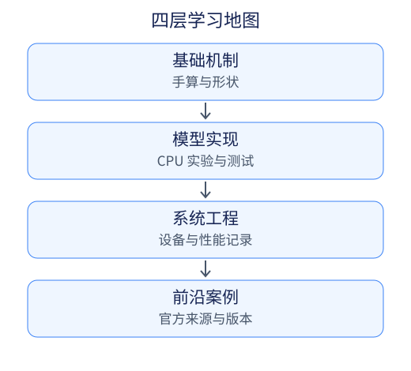

生活类比是一张路标，不是证明。例如，“图书馆检索”帮助理解 Q、K、V 的分工，但模型并没有真的翻阅书架；“专家”帮助理解 MoE 路由，但每个专家并不天然对应一个人类职业。每到关键处，我们都会回到公式、代码或可验证的输出。

## 0.2 需要准备什么？

先会读 Python 的变量、列表、循环和函数即可。向量是“一列数字”，矩阵可以先看成“多行数字排成的表”。张量则是有更多轴的数组：一批句子里的每个 token 都有一个向量，就需要“句子编号、位置编号、向量分量”三条轴。

例如，两句话，每句三个 token，每个向量四个数，形状可以记成 `(2, 3, 4)`。这不是 24 维空间里的一个神秘对象，而是 2×3 个长度为 4 的向量。在后面看到 `B、T、D` 时，分别对照“批大小、序列长度、向量宽度”，先把每条轴写清楚。

数学也分步补齐：词向量章使用加减、点积和平方根；注意力章引入矩阵乘法与 Softmax；位置编码章使用三角函数；训练章再讲损失和梯度。你可以先按数字算一遍，再理解一般公式。不需要先修完一套高等数学，但理解训练和优化仍需要逐步建立导数与概率的基本概念。

## 0.3 两条实验路线：没有 GPU 也能开始

**必修：CPU 与小数据。** 本批次的向量和字节级 BPE 实验只用 Python 标准库，不下载模型、不访问外部 API。后面的基础 PyTorch 实验也以小模型为主。

从仓库根目录运行：

```bash
python3 --version
python3 code/01_vector_similarity.py
python3 code/08_byte_bpe.py
python3 -m unittest discover -s tests -v
```

第一条确认你使用的是哪个 Python；接下来两条运行例子；最后一条运行回归测试。本批在 Python 3.12 上验证。找不到文件时先确认终端当前目录是仓库根目录，而不是 `chapters/`。

> [!TIP]
> **选修：Hugging Face 对照实验。** 只想理解算法，可以跳过。想比较真实分词库时，新建虚拟环境，再安装 `requirements-tokenizer.txt` 中固定的 `tokenizers==0.21.4`，运行 `code/09_hf_tokenizer.py`。它仍只用 CPU 和本地合成语料，不下载语言模型。安装依赖需要网络，安装完成后的实验不需要网络。

```bash
python3 -m venv .venv
.venv/bin/python -m pip install -r requirements-tokenizer.txt
.venv/bin/python code/09_hf_tokenizer.py
```

以上是 macOS/Linux 写法；Windows 可用 `.venv\Scripts\python.exe` 替代 `.venv/bin/python`。后续需要 PyTorch 时，再按 README 安装主依赖，不必为前两项实验提前安装全部工具。

> [!NOTE]
> **GPU / 多卡选修边界**：后续的 kernel 性能、框架服务和分布式训练实验会单独说明硬件与版本条件。没有相应设备可以读数据流图、运行 CPU 参考实现；跳过 GPU 实验不等于已经验证其性能。本书不会要求初学者购买硬件或下载数百 GB 权重才能读懂机制。

## 0.4 怎样记录一次可信的实验

“我跑过了”和“别人可以复现”之间，还差一份记录。用下面这个最小模板即可：

| 字段 | 例子或写法 |
| --- | --- |
| 代码版本 | 本次 Git commit；若有未提交修改，写明 |
| 环境 | Python 版本、依赖版本、操作系统、CPU/GPU |
| 输入 | 文本全文或数据集版本；训练集与验证集分开 |
| 随机性 | 种子；若算法没有随机步骤则写“确定性” |
| 命令 | 从哪个目录运行、完整参数 |
| 结果 | 实际输出、测试通过或失败、错误信息 |
| 结论边界 | 证明了什么，以及没有证明什么 |

本批 BPE 的合并规则由语料、合并次数和并列时的排序决定，不含随机步骤。后面的神经网络会有初始化与采样随机性；固定种子能减少变化，却不保证所有硬件、版本都逐位相同。测试数值结果时还要说明容差。

性能要另外记：同一模型、相同输入输出长度、相同 batch 和设备，才适合比较；首 token 延迟和后续 token 速度也不能混成一个数字。本书后续会专章展开，此时先记住：**结果正确，不代表速度快；速度快，也不代表结果正确。**

## 0.5 当前阅读顺序与尚未完成的扩展

本书正在按审核通过的扩展大纲分批更新。当前批次完成的是 P00 阅读指南、P01 词嵌入、P02 Tokenizer；这些 P 编号是扩展计划的编号，不会立即替换旧版全部章号。

为了保留已有链接，Tokenizer 暂放在“第 1A 章”，紧跟第 1 章；旧第 2～10 章仍可阅读，但尚未全部按新大纲改写。当前 HTML/EPUB 会按这个顺序包含新单元，不是已完成全部 29 个单元的新书。

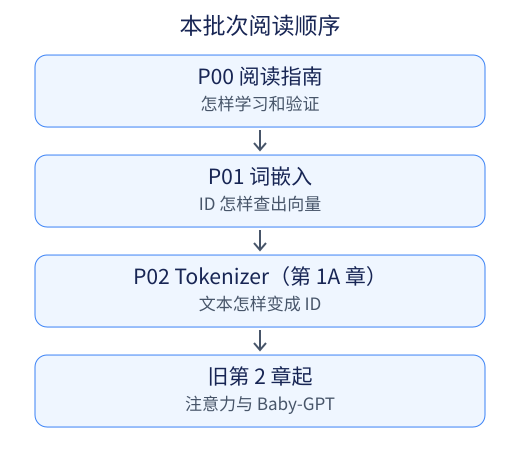

读词嵌入时，我们先假设“每个词已有编号”；紧接着 Tokenizer 章会打开这个假设，解释为什么一个词不一定是一个 token。后续实现路线是 Baby-GPT 基线 → KV cache → RoPE → RMSNorm / SwiGLU → GQA → MoE。现在它们仍是逐批落地的计划，不能把路线图当作已实现功能清单。

## 0.6 开始前的三个自测

1. 一个数组形状是 `(2, 3, 4)`，共有多少个数？为什么不能直接说它代表 24 个 token？
2. 某实验在三首诗上训练损失很低，能否说明模型理解任何中文？
3. 同一个脚本在两台电脑上速度不同，首先需要记录哪些条件？

参考答案：共有 24 个数，但 token 数通常是前两轴相乘得到的 6；训练集表现不能代替未见数据评估；至少记录设备、依赖版本、输入规模和测量方法。带着这些边界意识，下一步从一个最简单的问题开始：**编号不是意义，向量又能帮我们做什么？**

资料说明：Transformer 基础来源为 [Attention Is All You Need](https://arxiv.org/abs/1706.03762v7)。软件接口以本批固定版本和实际实验为准，核验日期为 2026-10-18。


---

# 第1章：从编号到空间向量——词嵌入与几何直觉

假设你要给水果做一个小型检索器：输入“苹果”，希望它找到口感相近的水果。计算机能比较数字，却不能直接拿两个汉字相减。我们需要一种数字表示，但“有数字”不等于“有意义”。

本章目标是区分三件事：**token ID 是编号，one-hot 是编号的另一种写法，embedding 是查表得到的可训练向量**。我们先暂时把“苹果”当成一个 token；下一章再解释真实分词器为什么可能把一个词拆成多个 token。

## 1.1 编号像书架号，不是相似度

给“苹果、梨子、飞机”分别分配 ID 0、1、2，本身没有错。错误是直接把编号当成语义坐标：ID 2 不代表“飞机比苹果大两倍”，编号差 1 也不代表它们比别的词更亲近。给词表重新排个顺序，编号就会改变。

可以把 ID 想成图书馆书架上的索引。它告诉程序去哪里取资料，不告诉程序两本书内容有多像。现代模型仍然使用整数 ID，只是不会直接把 ID 的大小当成词义。

另一种表示是 one-hot：词表有三个条目，就用长度为三的向量表示：

| token | ID | one-hot |
| --- | --- | --- |
| 苹果 | 0 | `[1, 0, 0]` |
| 梨子 | 1 | `[0, 1, 0]` |
| 飞机 | 2 | `[0, 0, 1]` |

不同 one-hot 的点积为 0，同一个 one-hot 与自身的点积为 1。这很好地表达了“是不是同一个编号”，却还没有表达“苹果与梨子更像”。问题不在于 one-hot 永远没用，而在于**它单独提供的是身份，不是学到的相似性**。

## 1.2 Embedding：把编号换成一行数字

准备一张表 $E$，有 $V$ 行、$D$ 列。$V$ 是词表大小，$D$ 是向量宽度。第 $i$ 个 token 的向量就是第 $i$ 行：

$$\mathrm{embedding}(i)=E_i$$

一个教学例子：

```python
embedding_table = [[0.2, -0.1], [0.3, 0.4], [-0.5, 0.8]]
token_ids = [0, 2, 0]
vectors = [embedding_table[i] for i in token_ids]
# [[0.2, -0.1], [-0.5, 0.8], [0.2, -0.1]]
```

第一行定义三行两列的表。第二行是三个位置的编号。第三行逐个编号查表，所以相同编号 0 在两个位置会取到同一行。这里还没有利用上下文，“苹果水果”和“苹果电脑”的差别不会因为查了一次表就自动出现；后面的注意力层才会让表示随上下文变化。

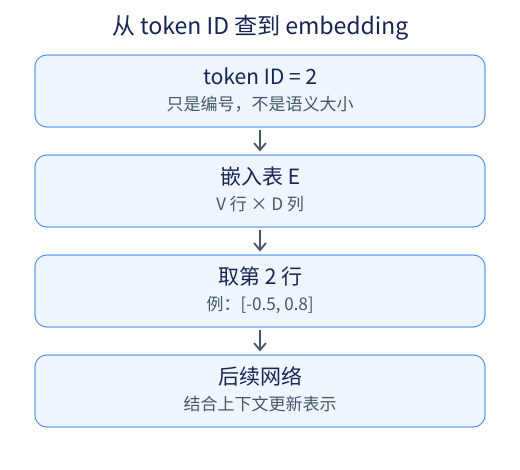

用 one-hot 行向量乘 $E$，也会选中同一行。实际程序通常直接按 ID 查表，避免创建一个很长、几乎全为 0 的数组。稠密 embedding 的存储也不是“免费”的：整张表依然有 $V\times D$ 个数。

**这张表是谁写的？** 在神经网络里，它通常和其他权重一样初始化，然后通过训练损失的梯度更新。当前预测错了，训练过程就调整相关参数；反复见到数据后，向量可能编码有用的语言规律。维度并不天然叫“甜度”“性别”或“情绪”，也不能保证某一维单独对应一个人类概念。

## 1.3 用水果坐标建立直觉，但不把类比当模型

为了看懂几何，我们暂时手工指定三个维度：甜度、脆度、价格。这不是训练得到的 embedding，只是一张便于计算的玩具表。

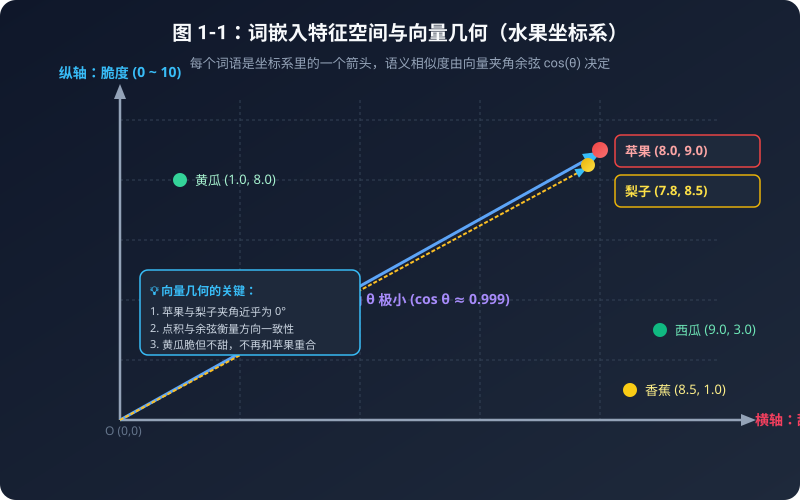

| 水果 | 甜度 | 脆度 | 价格 | 与苹果的欧氏距离 | 与苹果的余弦相似度 |
| --- | ---: | ---: | ---: | ---: | ---: |
| 苹果 | 8.0 | 9.0 | 5.0 | 0.0000 | 1.0000 |
| 梨子 | 7.8 | 8.5 | 4.8 | 0.5745 | 0.9999 |
| 西瓜 | 9.0 | 3.0 | 1.5 | 7.0178 | 0.8504 |
| 黄瓜 | 1.0 | 8.0 | 2.0 | 7.6811 | 0.8310 |
| 香蕉 | 8.5 | 1.0 | 3.5 | 8.1548 | 0.7838 |

这些数说明：在我们选定的特征和尺度下，苹果与梨子的方向很接近。它们不是“模型认为梨子有 99.99% 概率是苹果”，也不是水果之间真实语义关系的测量。

> [!WARNING]
> **坐标选择会改变结果。** 价格单位从“元”改成“分”，第三维就放大 100 倍，距离和夹角都可能变化。真实 embedding 的几何性质也受模型、数据和训练目标影响。生活类比用来理解计算，不能反过来替模型解释每个坐标。

## 1.4 点积、长度、距离和余弦到底差在哪里？

对于 $a=(3,4)$、$b=(6,8)$：

- 点积：$a\cdot b=3\times6+4\times8=50$。
- 长度：$\|a\|=\sqrt{3^2+4^2}=5$，$\|b\|=10$。
- 欧氏距离：$\|a-b\|=\sqrt{(-3)^2+(-4)^2}=5$。
- 余弦相似度：$\cos\theta=(a\cdot b)/(\|a\|\|b\|)=50/(5\times10)=1$。

它们方向完全相同，但长度不同，所以距离不是 0。点积是 50，也没有被限制在 -1 到 1 之间。**只有把两个向量都归一化成单位长度后，点积才等于余弦相似度。**

一般地：

$$a\cdot b=\sum_{j=1}^{D}a_j b_j,\qquad
\|a\|=\sqrt{\sum_{j=1}^{D}a_j^2},\qquad
\cos\theta=\frac{a\cdot b}{\|a\|\|b\|}$$

余弦为 1、0、-1，分别对应同向、正交、反向。这是几何事实，不是“同义词、无关词、反义词”的万能判定规则。反义词可能出现在相似上下文里，因此也可能具有较高的相似度。

零向量没有方向，分母也为 0，所以它与另一个向量的余弦在数学上未定义。本书代码选择抛出异常，而不是悄悄返回 0，避免把“无法计算”误读成“正交”。后面注意力通常用缩放点积打分，也不意味着它直接计算词语之间的余弦。

## 1.5 逐行实现：把几何写成 Python

完整实验位于 [code/01_vector_similarity.py](../code/01_vector_similarity.py)。核心代码如下：

```python
import math

def dot_product(vec_a, vec_b):
    if len(vec_a) != len(vec_b):
        raise ValueError("两个向量的维度必须完全相同！")
    total = 0.0
    for i in range(len(vec_a)):
        total += vec_a[i] * vec_b[i]
    return total

def vector_magnitude(vec):
    return math.sqrt(sum(value ** 2 for value in vec))

def cosine_similarity(vec_a, vec_b):
    dot = dot_product(vec_a, vec_b)
    mag_a = vector_magnitude(vec_a)
    mag_b = vector_magnitude(vec_b)
    if mag_a == 0 or mag_b == 0:
        raise ValueError("零向量的余弦相似度未定义")
    return dot / (mag_a * mag_b)
```

`len` 检查两条向量能否逐项配对；`total` 从 0 开始，循环累加各分量的乘积；模长函数先平方求和，再开方；余弦函数最后才除以两个长度的乘积。完整脚本把模长和距离的累加也展开成循环，方便初学者逐步打印观察。

从仓库根目录运行：

```bash
python3 code/01_vector_similarity.py
python3 -m unittest discover -s tests -v
```

脚本会打印上面的水果数值，并按余弦排序给出结论。测试同时覆盖 `[3,4]` 与 `[6,8]` 的尺度例子、零向量和维度不一致。如果你把一个向量放大两倍，余弦应保持不变，但点积不会保持不变。

## 1.6 向量加减能做什么，不能做什么？

“国王 − 男人 + 女人 ≈ 女王”是经常用来解释词向量的例子。为了手算，我们可以专门配一组数：

$$[9,8,7]-[1,8,5]+[1,-8,5]=[9,-8,7]$$

再把右侧定义成“女王”的向量，当然会精确相等。脚本保留这个演示，并明确说明数值是人工构造的。真实训练所得的向量有时会出现近似的关系方向，但效果依赖数据、模型和评估方法，不保证任何类比都成立。这里人为设置的“性别轴”也不是对人或社会属性的客观量化。

向量相加减是确定的数学运算，却不因此变成通用逻辑推理器。不要由一个漂亮的平行四边形跳到“语言的一切推理都能靠加减实现”。

## 1.7 自测：把三个层次分清楚

1. 把词表所有 ID 重新编号，同时以同样方式重排 embedding 表，会必然改变每个 token 取得的向量吗？
2. `[3,4]` 和 `[6,8]` 的余弦为 1，它们的点积和欧氏距离各是多少？
3. 零向量与任何向量的余弦都应该设成 0 吗？
4. 遇到词表中没有的整词，能靠 embedding 在空间里“插值”自动生成正确向量吗？

参考答案：不会，只要映射一致，仍能查到原来那行；点积 50、距离 5；不能，数学上没有定义，本书抛出 `ValueError`；不能这样保证。现实系统通常由 tokenizer 把未知整词拆成已知子词或字节等单位，然后查它们的向量。**这就是下一章要补上的环节：文本怎样变成那些 ID？**

本章核验日期：2026-10-18。查表接口可参阅 [PyTorch 2.14 的 Embedding 文档](https://docs.pytorch.org/docs/2.14/generated/torch.nn.Embedding.html)；本章必修代码不依赖 PyTorch。关于向量关系的原始研究，可读 [Distributed Representations of Words and Phrases and their Compositionality](https://arxiv.org/abs/1310.4546)。


---

# 第1A章：Tokenizer——从字符、字节到 BPE

上一章把“苹果”当成一个编号，再从 embedding 表中取出一行。现在我们打开这个暂时封住的盒子：谁决定“苹果”是一个 token，还是“苹”“果”两个 token？一串 emoji 又该怎样处理？

**Tokenizer（分词器）的工作是把文本变成 token ID 序列，并提供对应的解码方式。** Token 不一定是词，也不一定是字。它可能是子词、一个标点、带空格的片段，甚至一个字符的部分字节。训练语言模型之前，我们需要先知道预测的单位是什么。

本章属于扩展计划 P02，暂以“1A”插在词嵌入与旧第 2 章之间，保留旧章节链接。本章的两个实验都使用 CPU 和小型合成语料，不下载任何语言模型。

## 1A.1 三种切法：整词、字符与字节

想象要用积木拼一句话。整词积木大，拼起来步数少，但新词可能不在盒子里；字符积木小，组合灵活，但词表仍要考虑哪些字符；字节积木更基础，UTF-8 文本可以拆成 0～255 的字节值，不过同一句话通常需要更多块。

| 单位 | 直观好处 | 需要留意 |
| --- | --- | --- |
| 整词 | 常见词可用一个 ID 表示 | 新词、拼写变化和中文边界；词表可能很大 |
| Unicode 字符 | 实现简单，便于教学 | “字符”不等于视觉上的一个字形；未收录字符仍要处理 |
| UTF-8 字节 | 256 个基础字节覆盖合法 UTF-8 文本 | 一个汉字、emoji 可能跨多个字节，序列更长 |
| 子词 / 字节 BPE | 把频繁小片段合成较大单位 | 结果依赖训练语料、预处理、词表与合并规则 |

先用标准 Python 观察：

```python
text = "你🙂"
print(len(text))                # 2 个 Unicode 码点
print(list(text.encode("utf-8")))
# [228, 189, 160, 240, 159, 153, 130]
```

这段文本有两个码点，却有七个 UTF-8 字节。`len(text)` 也不总等于你肉眼数出的字形数：`e` 加组合重音可以显示成一个字形，却是两个码点。后面测试会特意保留这种情况。

> [!NOTE]
> **“覆盖文本”不等于“理解文本”。** 字节词表能表示没见过的文字，并不意味着模型学会了这门语言。Tokenizer 解决的是编码问题，语言能力仍取决于数据、模型和训练。

### 对照旧第 8 章：保留 Baby-GPT 的字符基线

旧第 8 章和配套的 `code/07_baby_gpt.py` 刻意采用更简单的字符级分词器：

```python
unique_chars = sorted(set(text_corpus))
vocab_size = len(unique_chars)
char2idx = {ch: i for i, ch in enumerate(unique_chars)}
idx2char = {i: ch for i, ch in enumerate(unique_chars)}
encode = lambda text: [char2idx[ch] for ch in text]
decode = lambda ids: "".join(idx2char[i] for i in ids)
```

这里的 `text_corpus` 是源码中的三首训练诗句拼接，词表恰好有 **57 个不同字符**，包括汉字和标点；57 不是汉语字符总数，也不是模型的固定常数。换训练语料，词表和编号就可能改变。每个已收录字符对应一个 token，例如“床前”编码为两个 ID，解码还原为“床前”。

它没有未知字符 token，也没有字节回退：训练诗句没有“你”，所以 `encode("你")` 会在字典查找时抛出 `KeyError`，不能编码任意中文或 emoji。相比之下，本章字节 BPE 从全部 256 个字节开始，能编码任意合法 UTF-8 文本；之后才按训练语料中学到的规则把常见字节片段合并成较长 token。能编码未见字符，不等于语言模型理解它。

**本书保留 Baby-GPT 的字符分词器作为基线，不在本章偷偷替换其训练输入。** 字符基线让初学者直接观察“一字接一字”；字节 BPE 展示开放字符覆盖与序列长度的取舍。若未来替换 tokenizer，就要同时重建词表、embedding 和输出层，并重新训练，不能让新 ID 直接查旧模型的表。

## 1A.2 BPE：把常一起出现的两块积木粘起来

BPE 是 Byte Pair Encoding 的缩写。用于文本时，其核心思想是反复找出常见的相邻符号对，为合并结果分配一个新符号。最初的符号可以是字符，也可以是字节；本章选择字节，便于让未见过的中文和 emoji 仍能往返。

先用 ASCII 字符 `banana` 看直觉，ASCII 字母的字节值正好容易读：

1. 从 `b a n a n a` 开始，统计所有相邻对。
2. `a n` 出现两次，`n a` 也出现两次。出现并列时必须规定规则，本书按 ID 对排序，所以先选 `a n`。
3. 把不重叠的 `a n` 合并成新 token，得到 `b an an a`。
4. 再统计当前序列，继续选择并合并，直到达到指定次数或没有相邻对。

单个字符串上不同并列规则可能产生不同路线，算法不是在寻找唯一正确的“英语词根”。我们的完整实验同时训练三篇短文，前四条规则实际为：

| 顺序 | 相邻 ID 对 | 新 ID | 对应字节片段 |
| --- | --- | ---: | --- |
| 1 | `(97, 110)` | 256 | `an` |
| 2 | `(98, 256)` | 257 | `ban` |
| 3 | `(256, 97)` | 258 | `ana` |
| 4 | `(257, 258)` | 259 | `banana` |

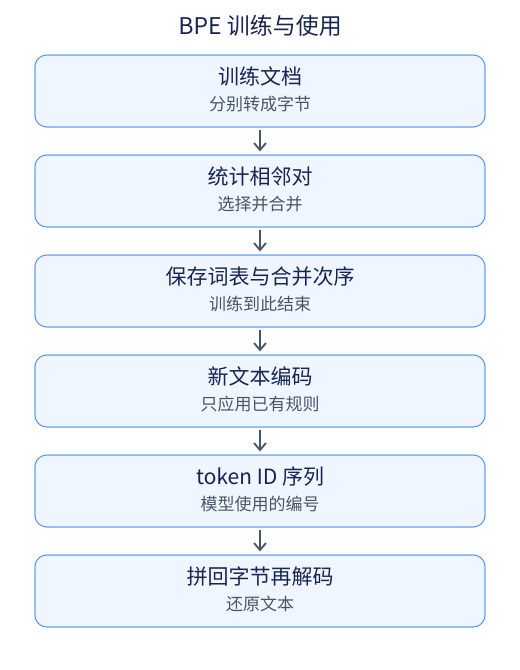

语料中的空格也有字节值。本章没有按空格预切分，所以某个 token 可以包含空格，甚至覆盖一整句训练文本。这是为了看清最小机制而做的简化，不代表所有生产分词器都这样处理边界。每篇训练文档则独立统计，绝不把前一篇的结尾和后一篇的开头粘起来。

## 1A.3 先分清 train、encode、decode

- `train`：从语料得到词表与合并规则。此后不要为了每个新问题都重新训练。
- `encode`：把新文本转成初始字节 ID，再按已学到的优先顺序合并。
- `decode`：查出各个 ID 对应的 bytes，拼接完整字节串，然后进行 UTF-8 解码。

为什么不能逐 token 解码成字符再拼接？因为一个 token 可能只有汉字的第一个字节，单独看不是合法 UTF-8。先拼 bytes，才能恢复完整字符。

同一个模型必须配套使用它训练时的 tokenizer。换了词表顺序却不调整 embedding 和输出层，就像把图书馆的索引卡全部换位：程序仍会取到一行数字，但取的不是原来的那行。增加特殊 token、改模板或改归一化规则也可能影响模型输入，不能把所有 tokenizer 当成可随意互换的插件。

## 1A.4 逐行代码：最小字节 BPE

完整实现是 [code/08_byte_bpe.py](../code/08_byte_bpe.py)，只有标准库依赖。先看基础字典：

```python
self.vocab = {i: bytes([i]) for i in range(256)}
self.merges = {}
```

`vocab[97]` 是字节 `b'a'`，不是某个语言模型里通用的“a 的 ID”。编号规则只属于这个教学实现。新合并 token 从 ID 256 开始追加；`merges` 按插入顺序记录优先级。

训练的关键几行是：

```python
counts = Counter()
for ids in sequences:
    counts.update(zip(ids, ids[1:]))
pair = min(counts, key=lambda item: (-counts[item], item))
new_id = len(self.vocab)
self.merges[pair] = new_id
self.vocab[new_id] = self.vocab[pair[0]] + self.vocab[pair[1]]
sequences = [merge_pair(ids, pair, new_id) for ids in sequences]
```

`zip(ids, ids[1:])` 把每个位置和紧跟它的位置配对；`Counter` 累加出现次数；`min` 的排序键先比较负频数，所以频数最高的优先，再用 ID 对解决并列。随后给合并结果分配 ID、拼接其 bytes，并更新每篇文档。完整代码在 `counts` 为空时停止，避免对空集合求最小值。

`merge_pair` 必须处理重叠。例如把 `aaa` 里的 `aa` 合并，结果应是 `[aa, a]`，不能同时把中间的 `a` 用两次：

```python
while i < len(ids):
    if i + 1 < len(ids) and (ids[i], ids[i + 1]) == pair:
        result.append(new_id)
        i += 2
    else:
        result.append(ids[i])
        i += 1
```

匹配成功时向前走两格，否则只走一格。频数统计可以数到重叠候选，真正替换时只合并不重叠对。

编码阶段不重新找“新文本里最常见的一对”，而是按训练好的规则顺序应用合并。解码的核心则是：

```python
raw = b''.join(self.vocab[token_id] for token_id in ids)
text = raw.decode('utf-8')
```

完整脚本会先检查 ID 是否存在。对 `decode(encode(text))`，合法 UTF-8 文本可以原样恢复；任意乱写的 ID 序列则不一定构成合法 UTF-8，例如单个字节 255。代码保留解码异常，不用替换字符掩盖错误。

## 1A.5 跑一次：短序列不等于好语言模型

在仓库根目录执行：

```bash
python3 code/08_byte_bpe.py
python3 -m unittest discover -s tests -v
```

训练语料是 `banana banana`、`banana bandana` 和 `你好，你好！`。请求最多 20 次合并，但语料提前没有相邻对可合并，因此实际词表大小为 275，即 256 个基础字节加 19 个新 token。实测输出中的计数如下：

| 文本 | Python 字符数 | UTF-8 字节数 | 教学 BPE token 数 | 往返 |
| --- | ---: | ---: | ---: | --- |
| `banana banana` | 13 | 13 | 1 | 原样恢复 |
| `你好，你好！` | 6 | 18 | 1 | 原样恢复 |
| `新词🙂 café` | 8 | 16 | 16 | 原样恢复 |
| 空字符串 | 0 | 0 | 0 | 原样恢复 |
| `e` 加组合重音 | 2 | 3 | 3 | 原样恢复 |

把整句训练文本合成一个 token，可以让训练集看起来非常短，却没有证明它对新文本也有效。第三行从未出现在训练语料中，仍然可编码和恢复，但几乎没有合并收益。这正好提醒我们：**能编码、token 少、模型理解得好，是三个不同的问题。**

测试不只检查几个好看的输出，还检查空字符串、换行空格、带修饰符的 emoji、组合字符、非法 ID、确定性并列规则、重叠合并，以及文档边界。实现优先让你能读懂，反复扫描语料会很慢，不能拿它直接训练大规模词表。

## 1A.6 对照真实库：Hugging Face Tokenizers

可选实验 [code/09_hf_tokenizer.py](../code/09_hf_tokenizer.py) 固定使用 `tokenizers==0.21.4`。核验和运行日期为 2026-10-18，官方接口来源锁定到 [v0.21.4 代码与文档目录](https://github.com/huggingface/tokenizers/tree/v0.21.4)。这不是要求你使用最新版本，而是把本章实验条件固定下来。

```bash
python3 -m venv .venv
.venv/bin/python -m pip install -r requirements-tokenizer.txt
.venv/bin/python code/09_hf_tokenizer.py
```

关键配置如下：

```python
tokenizer = Tokenizer(models.BPE())
tokenizer.pre_tokenizer = pre_tokenizers.ByteLevel(
    add_prefix_space=False, use_regex=False
)
tokenizer.decoder = decoders.ByteLevel()
trainer = trainers.BpeTrainer(
    vocab_size=276,
    initial_alphabet=pre_tokenizers.ByteLevel.alphabet(),
    show_progress=False,
)
```

`ByteLevel` 提供字节层面的表示；完整的初始字节字母表让未见过的 UTF-8 文本仍有表示；不自动补前缀空格，是为了保留原输入；禁用正则预切分，是为了更接近上面的教学设置。我们没有设置会改变大小写或 Unicode 的 normalizer，也没有添加特殊 token。

随后用同样三篇短文训练，用相同样例检验 round-trip。比较的是“是否原样恢复”和“词表与序列长度”，**不要求 token ID 相同**：真实库对字节的内部表示、初始 ID 和并列合并规则可能不同。这个实验也不是某个现成聊天模型的 tokenizer。

## 1A.7 生产环境还多了哪些步骤？

真实流水线常包含归一化、预切分、子词编码、特殊 token 插入、padding / truncation 和解码。逐项检查，比只问“用了 BPE 吗”更有用。

- **归一化**可能把大写变小写或统一 Unicode 表示。这有时有帮助，却可能让解码无法恢复原文；本章刻意不做。
- **特殊 token**可表示序列结束、角色边界或填充。它们是明确约定，不是看到字符串 `<eos>` 就一定自动成为控制符。本章教学实现把这样的字符串当普通文字。
- **Chat template**把角色与消息内容组织成模型期望的输入。通常应使用模型配套模板，不要自行把“用户：”等字样当成所有模型通用的格式。
- **截断**会丢掉内容；**填充**需要配合 mask；这两件事不等于改变原文本的 token 含义。

Token 数会影响上下文容量、部分 API 的计费和计算开销；但不能用“一个中文字就是一个 token”来估算所有模型。序列长度变化会影响后面的 attention 和 KV cache 成本，词表变大又会增加 embedding / 输出层的规模，选择词表是折中而不是越大越好。

## 1A.8 自测与下一站

1. 一个 emoji 是一个 token 吗？
2. `train` 和 `encode` 为什么不能混成一步？
3. 把一段训练文本合成一个 token，是否证明 tokenizer 在任何新文本上都更好？
4. 为什么解码时先拼 bytes，再转成字符串？
5. 只用语料里出现过的字符建立词表，与从 256 个字节起步有什么区别？

参考答案：取决于具体 tokenizer；训练生成规则，编码使用已有规则；不能，需要在代表性的未见数据上评估；单个 token 可能不是完整 UTF-8 字符；字符词表可能遇到未收录字符，而完整字节表可表示合法 UTF-8，但并不赋予模型理解能力。

现在可以把前两章连起来：**文本 → tokenizer → token ID → embedding → 后续网络**。查表得到的初始向量还不知道当前“苹果”指水果还是电脑，接下来回到注意力章节，看模型如何结合周围内容。

原始资料：[Neural Machine Translation of Rare Words with Subword Units（v5）](https://arxiv.org/abs/1508.07909v5) 解释子词 BPE 的语言建模背景；本章字节实现是教学变体，不是该论文实验的复现。库接口依据上述 Hugging Face 固定标签；本文没有以可变的 `main` 文档作为未锁定的版本承诺。


---

# 第2章：注意力机制的直觉——为什么我们需要“注意力”？

读到“苹果”时，你想到的是水果，还是手机品牌？这个问题没有脱离上下文的唯一答案。

前两章已经把文本变成了 token ID，再查表得到向量。现在还缺一件事：**让每个位置的表示，能利用这一次输入里的相关信息。** 本章先不急着背 Q、K、V 的公式，而是回答三个问题：为什么要看上下文，信息怎样传到需要它的位置，以及注意力图能告诉我们什么、不能告诉我们什么。

为方便观察，本章的图有时把一个词或短语画成一个方块。真实模型处理的是 tokenizer 输出的 token，一个汉语词不保证恰好对应一个 token。

## 2.1 同一个“苹果”，为什么不能只查一次字典？

请看两句话：

1. “秋天到了，红富士**苹果**又脆又甜。”
2. “发布会上推出了新款**苹果**手机。”

第一句里的“苹果”是一种水果；第二句里的“苹果”指向品牌。帮助我们区分它们的，不是“苹果”两个字突然换了写法，而是“红富士、脆、甜”和“发布会、手机”等上下文线索。

如果暂时把“苹果”视为一个 token，在同一组模型参数下，它每次从 embedding 表里取出的都是同一行数字。**查表只回答“你是谁”，还没有回答“你在这句话里是什么意思”。**

```
                   同一行输入 embedding
                         [苹果]
                        /      \
              看“脆、甜”        看“手机、发布会”
                  ↓                   ↓
           水果语境下的表示      品牌语境下的表示
```

这里有两个容易混淆的地方：

- **“静态”不等于参数永远不能更新。** embedding 表可以在训练时更新；这里说的是在参数固定时，相同 ID 的查表结果不随本次上下文变化。
- **“表示改变”不等于改写词表。** 模型会计算这一位置的新表示，原来的 embedding 表仍在那里。下一句话中的“苹果”再从同一行出发，走出另一个上下文相关的结果。

真实向量的各维也不天然叫“甜度”“科技感”。这些名称可以帮助想象，却不是读出了模型内部的字典。

更重要的是，语境不只解决一词多义。“小狗追着球跑，**它**停在树边”中的“它”，还涉及指代；“这部手机虽然贵，**但**很好用”中的转折，也需要组合多个位置的信息。**注意力要解决的是按当前需要读取信息，不只是给某个词挑一个词义。**

## 2.2 RNN 的传话游戏：难点在信息路径

注意力不是第一个利用上下文的办法。循环神经网络 **RNN（Recurrent Neural Network）** 就能逐步读取序列，把前面读到的信息放进“记忆箱”，也就是隐藏状态。

把第 $t$ 个输入向量叫作 $x_t$，记忆箱叫作 $h_t$，它的基本关系是：

$$h_t=f(h_{t-1},x_t)$$

不用先弄懂函数 $f$ 的内部。只要注意：**新记忆依赖旧记忆和当前输入**。

```
   小明          在          草地上        ……          它
    ↓            ↓             ↓                       ↓
  记忆箱1 ──→ 记忆箱2 ──→ 记忆箱3 ──→ …… ──→ 后面的记忆箱
```

它像接力传话：后面的人不是直接听到最初那个人的话，而是接到上一位整理过的版本。这种设计确实能表达上下文关系，并不是“RNN 不懂语境”。它的两个限制需要分开看。

### 2.2.1 远处的信息，要走过很多次状态更新

假设句首的人名在第 50 个位置才派上用场。普通 RNN 的信息必须沿隐藏状态一路传过去；反向传播时，学习信号也要穿过这些更新。经过多次变换后，重要信息可能难以保留，梯度也可能变得过小或过大，这就是常说的**梯度消失与梯度爆炸**。它们是训练困难，不是“读到第 50 个词就一定忘记”的定律。原始分析可见 [Pascanu 等人的 RNN 训练研究](https://arxiv.org/abs/1211.5063)。

LSTM 等门控循环结构通过控制信息的保留和更新来缓解困难。因此，比较时应说“长距离依赖可能更难学”，而不是把 RNN/LSTM 描述成必然失忆。

还有一个相关但不同的问题：如果整个输入最终只留下一份固定宽度的摘要，后面的任务就只能从这份摘要取信息。早期神经机器翻译的注意力方法允许解码器按需要读取不同位置的编码结果，而不只依赖单一摘要；它仍然可以和 RNN 一起使用。参见 [Bahdanau 等人的原始论文](https://arxiv.org/abs/1409.0473)。所以，**“有注意力”和“没有循环结构”不是同一回事。**

### 2.2.2 同一条序列里的状态，不能任意同时计算

算 $h_5$ 要先知道 $h_4$，算 $h_4$ 又要先知道 $h_3$。这条时间依赖使普通 RNN 难以把同一层、同一条序列的所有位置一次性展开计算。

这也不等于 RNN 完全不能使用 GPU。不同样本可以组成 batch，单步内部的矩阵运算也可以并行。真正受限的是**沿序列方向的隐藏状态依赖**，不是所有计算都只能一件件做。

下面两张图只比较信息连接的路径，不表示某个模型已经正确理解了代词。

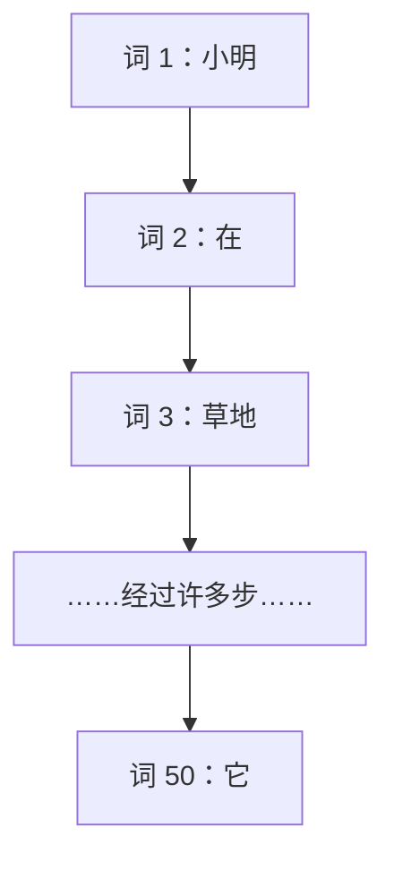

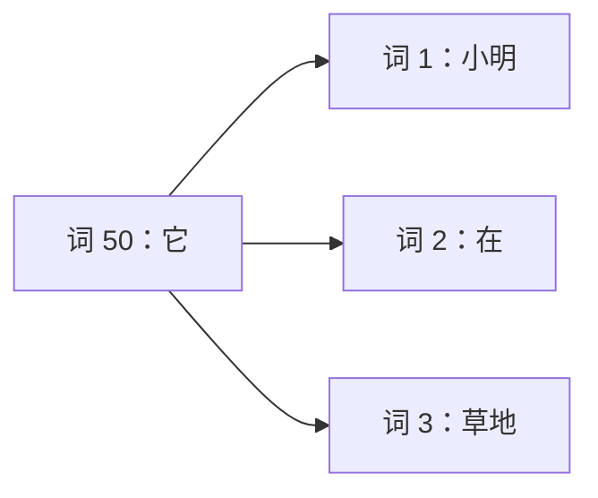

第一张把状态传递画在词语之间；第二张从当前位置指向它要查询的位置，实际被读取的信息再汇入当前位置。**“可以直接连接”描述的是计算路径，不保证这条连接的权重高，更不保证最后回答正确。**

### 表 2-1：把比较条件说完整

下表中的 $T$ 是序列长度，比较普通循环层与标准稠密自注意力层，不包括后面才会介绍的稀疏等变体。

| 比较项 | 普通 RNN / LSTM | 标准稠密自注意力 |
| --- | --- | --- |
| 同一层的位置依赖 | 当前隐藏状态依赖前一个状态 | 各位置从上一层的表示读取信息，可组织成批量矩阵运算 |
| 远距离连接路径 | 跨越许多次状态更新，最远路径随 $T$ 增长 | 对允许连接的位置，可通过一次注意力聚合直接读到 |
| 长距离学习 | 可能更困难，门控结构能缓解 | 路径更短，但仍需要合适的数据、训练与表示 |
| 并行的边界 | 样本之间、单步内部可并行；时间依赖仍在 | 已知输入的位置可并行；层与层仍依次计算 |
| 不能忽略的成本 | 顺序状态更新需要时间 | 两两打分有 $T\times T$ 个位置关系，长序列成本增长快 |

Transformer 原论文第 4 节用路径长度、可并行操作和计算复杂度讨论这些差别。这里的“一步直达”**不是总运行时间为常数**，也不是“任何长度都比 RNN 快”。[来源：Attention Is All You Need，§4](https://arxiv.org/html/1706.03762v7#S4)

## 2.3 注意力：带着问题去取信息

想象你正在整理一张人物卡片。写“这个人是谁”时会翻姓名栏，写“他在哪里”时会翻地点栏。资料没有换，但这一次要找的东西不同，读取重点也随之改变。

注意力的基本思路类似：**当前位置提出查询，对可读取的位置打分，再按权重汇总它们提供的内容。**

1. **提出查询。** 当前表示决定这次需要什么信息，不是人手写一句搜索词。
2. **比较匹配程度。** 用学到的计算规则，比较查询与各位置的检索信息。
3. **形成权重。** 标准 Softmax 注意力把分数转换成非负、总和为 1 的权重。
4. **汇总内容。** 用这些权重对各位置提供的向量做加权求和，得到当前位置的新信息。

“匹配”不必等于词典里的语义相似。例如，代词可能需要读取一个人名，动词可能需要读取主语；它们并不是同义词。权重也通常不是只留一个最大值，其余全部扔掉，而是一种连续的混合。

当查询和被查询的内容都来自**同一个序列的表示**时，就叫 **自注意力（Self-Attention）**。“自”指同一序列内部交互，不是每个词只看自己。

```
          当前层之前已有的各位置表示
          [我]   [爱]   [学]   [大模型]
            \     |      |      /
              查询、打分、加权读取
                       ↓
              [学] 在当前语境中的新信息
```

这里只画了“学”的一次读取。其他位置也各有自己的查询和权重。若输入有 $T$ 个位置、每个向量宽度是 $D$，可以先把输入想成一张 $T\times D$ 的表；自注意力为这些位置计算各自的上下文信息。**同一层读取的是这层开始时已有的表示，不必等旁边位置先算出本层的新表示**，这就是它适合矩阵并行计算的关键。

2017 年的 [Attention Is All You Need](https://arxiv.org/abs/1706.03762) 提出了以注意力为核心、去掉循环和卷积的 Transformer 架构。这个标题并不是说“只剩一张注意力表就能成为语言模型”：原模型还有位置编码、前馈网络、残差连接等部件，本书会逐个补上。

## 2.4 纸笔实验：先画候选，再分配玩具权重

本节不需要 GPU，也不运行训练模型。请拿纸画两张小图，比较下面两句完整的话：

- A：“动物没有穿过马路，因为它太累了。”
- B：“动物没有穿过马路，因为它太宽了。”

我们读完后，通常更倾向于把 A 的“它”理解为动物，把 B 的“它”理解为马路。但这个判断同时利用了句子结构和常识，不是“距离最近的名词必胜”。

### 第一步：画出候选依赖，不急着宣布答案

在纸上写出“动物”“马路”“它”，从“它”分别向两个候选画一条虚线。然后把最后的线索也写在旁边：

```
A：它 ──?──→ 动物       线索：太累了
      └─?──→ 马路

B：它 ──?──→ 动物       线索：太宽了
      └─?──→ 马路
```

先保留两个候选，再把你认为更合理的那条线加粗，并写下一句理由。这张图记录的是**人的语言判断**，还不是神经网络内部的连接测量。

接着用手遮住“太累了 / 太宽了”，只看“动物没有穿过马路，因为它”。你还知道该加粗哪条线吗？至少，刚才用于区分 A、B 的那个线索已经不存在了。这一步会在因果掩码一章再次派上用场。

### 第二步：给同一组位置分配 100 份读取权重

为了方便手算，把每句话暂时分成七个语义单元。这是纸笔实验的分组，**不是某个真实 tokenizer 的输出**。你可以先自己分配，再和下面的示例比较。

### 表 2-2：读完整句后，人为设定的玩具权重

| 被读取的单元 | A：太累了 | B：太宽了 |
| --- | ---: | ---: |
| 动物 | 60% | 10% |
| 没有 | 5% | 5% |
| 穿过 | 5% | 5% |
| 马路 | 10% | 60% |
| 因为 | 5% | 5% |
| 它 | 5% | 5% |
| 太累了 / 太宽了 | 10% | 10% |
| **合计** | **100%** | **100%** |

这张表的作用仅仅是把“读取重点可以随上下文变化”画出来。**它没有经过训练，不是真实模型的注意力，也不是代词指向某个对象的概率。** 你分出 55% 而不是 60%，并不意味着做错了；我们尚未定义任何会算出唯一权重的规则。

### 第三步：看看加权读取究竟算出了什么

给“动物”一张内容卡片 $v_{\text{动物}}=(1,0)$，给“马路”一张 $v_{\text{马路}}=(0,1)$，其余五张暂时都设为 $(0,0)$。这些也是人为指定的玩具向量，只为把运算压缩到两维。

根据表 2-2：

$$c_A=0.60(1,0)+0.10(0,1)=(0.60,0.10)$$

$$c_B=0.10(1,0)+0.60(0,1)=(0.10,0.60)$$

其余权重仍在，只是乘以零向量后没有贡献。于是，相同的内容卡片经过不同权重的混合，得到不同的结果。这就是加权读取的最小直觉。

别把两维卡片当成真实模型设计：实际内容向量不会这么整齐地分成“动物轴”和“马路轴”。这里也没有训练出指代能力，更没有证明模型会生成正确答案。

### 第四步：检查自己有没有偷看未来

> [!IMPORTANT]
> **完整句子的解释，不等于生成过程中当前位置已经知道的信息。**
> 表 2-2 是人在看完整句后手工画的示意。如果把它理解为能够读取整句的双向模型，还必须记得：它只是教学假设，不是某层某头的实际数值。
>
> 对因果语言模型，“它”位置只能读到当前位置及之前的 token。A、B 若在这里具有完全相同的 token 前缀，在相同参数、确定性前向计算下，“它”位置的表示就不能因为尚未看见的“太累了 / 太宽了”而不同。后面的词被读入后，后面位置的表示才可能利用这条新线索。

训练时即使整段目标文本已经放在内存里，也必须用掩码禁止较早位置偷看较晚位置。**一次并行计算整段，不代表每个位置都能读取整段。** 下一章会把这个约束变成可以运行的测试。

## 2.5 注意力权重大，不等于“模型因为它才这么回答”

把注意力画成热力图很有帮助：我们可以观察某一层、某一个头、某个查询位置把多大的读取系数分给哪些位置。但从这个观察直接跳到“这就是模型做决定的原因”，中间缺了证据。

先看一个只含三个数的反例。内容分别为 $v_1=0$、$v_2=1$、$v_3=2$，两组权重都非负且总和为 1：

$$0.2\times0+0.6\times1+0.2\times2=1$$

$$0.4\times0+0.2\times1+0.4\times2=1$$

第二个位置的权重从 0.6 降到了 0.2，加权结果却完全一样。这个手算反例只说明：**注意力分布和聚合结果不一定一一对应。** 它没有声称任意真实模型都能随便改权重，更没有声称注意力毫无作用。

在完整 Transformer 里，还要考虑几件事：

- **被混合的内容向量是什么。** 大权重乘以某个向量，最终作用不能只看那个系数；向量的大小、方向以及不同项之间的抵消也有关。
- **一个位置可能已包含别处的信息。** 深层的“马路”表示不再只是最初那行“马路”embedding，它可能已经混入其他位置的内容。
- **输出还会经过其他计算路径。** 其他注意力头、残差连接、前馈网络和后续层都会影响最终预测。某一张热力图并没有展示整个模型。

因此，“这个头在这里给了‘动物’较高权重”是一个局部计算事实；“模型有 60% 的概率认为‘它’是动物”，或“动物这个词对最终答案负有 60% 的因果责任”，都不是从该权重自动得到的结论。

相关研究也并非只有一句口号。[Jain 与 Wallace 的实验](https://aclanthology.org/N19-1357/)展示了所研究模型中，注意力分布与其他重要性指标不一致、不同分布却产生相近预测等现象；[Wiegreffe 与 Pinter 的后续讨论](https://aclanthology.org/D19-1002/)指出，能否把注意力当作解释，还取决于解释的定义、模型整体和检验方式。它们不应被简化成“所有注意力图都能解释模型”或“所有注意力图都没有价值”。

如果想研究一个具体预测为什么改变，需要先明确要解释的输出，再设计对照或干预，例如修改输入、控制某个内部量，并观察结果如何变化。删掉一个词也会改变句子和其他表示，所以一次删除实验本身仍不是完整的因果证明。**本章的要求更简单：可以把权重图当作线索，但不要把线索直接当成结论。**

## 2.6 聚光灯类比的四条边界

现在可以把注意力想成可移动的聚光灯，但要在旁边贴上四张提示纸。

**第一，能照到哪里由可见范围决定。** 双向自注意力可以读取整段允许的输入；因果自注意力不能读取未来；其他设计还可能只允许局部窗口。不能笼统地说“每个词永远和所有词握手”。

**第二，照得多不等于理解得对。** 匹配规则来自学习，可能学到有用依赖，也可能学到偏差。注意力给模型提供了一种组合信息的方式，不保证事实正确、推理正确或具有人类的心理注意过程。

**第三，路径短不等于费用低。** 标准稠密注意力需要处理两两关系。长度从 100 增加到 200，位置对数量就从 10,000 增加到 40,000。这里数的是关系数量，不是实测耗时；真实内存、速度还取决于向量宽度、硬件与实现。

**第四，训练可并行不等于生成整句可并行。** 训练时正确的输入 token 已知，可以在掩码约束下并行计算多个位置；普通自回归生成时，下一个 token 要先产生，才能成为再下一个位置的输入。已经给定的提示词可以整段处理，但尚未生成的回答不能当作已知输入。这两种场景不要混在一起。

## 2.7 自测：能不能把边界也讲清楚？

先自己回答，再看下面的参考答案。

1. 同一 token 在两个句子里查到了同一个 embedding，是否意味着后续表示一定相同？
2. “RNN 完全不能并行”和“自注意力的整段生成完全并行”，分别错在哪里？
3. 在纸笔实验里遮住“太累了 / 太宽了”，为什么不能继续把两列玩具权重当作因果模型在“它”位置的计算结果？
4. 表 2-2 中“动物”的 60% 是什么？它能直接当成指代概率或最终答案的贡献率吗？
5. 如果把表中的权重换一套，聚合结果必然改变吗？请用本章的三个数验证。

### 参考答案

1. 不一定。查表阶段还没利用上下文，后续层可以根据各自可见的信息计算不同的表示；如果可见 token 前缀完全相同，因果模型也不能凭空知道不同的未来。
2. 普通 RNN 受序列状态依赖限制，但 batch 和单步运算可以并行；自注意力能并行处理已知输入的位置，但普通自回归生成仍逐步产生新 token。
3. 区分两句的线索在“它”之后，因果约束不允许这个位置使用它。两列数是读完整句后的人为示意，不是合法因果前向的测量。
4. 它是教学表中分给该位置的读取权重。它既不是模型实测值，也不能直接解释成指代概率或因果贡献率。
5. 不必然。对内容 $0,1,2$，权重 $(0.2,0.6,0.2)$ 与 $(0.4,0.2,0.4)$ 都得到 1；但这不表示任意改动都保持结果不变。

## 2.8 本章小结与下一步

- **上下文表示**让同一个 token 在不同可见语境中拥有不同的表示；注意力是实现信息交互的一种方法，不是唯一方法。
- **RNN 的主要限制**是沿序列的状态依赖和较长的信息路径，不是绝对失忆或完全无法并行。
- **自注意力**让各位置带着查询读取同一序列中的内容，在可见性约束内缩短信息路径，并把已知位置的计算组织成矩阵运算。
- **玩具权重、真实注意力和因果解释**是三件不同的事。手算帮助理解运算，模型测量需要具体层和头，因果结论还需要额外检验。

接下来，电脑到底怎样打分？权重怎样变成总和为 1？又怎样把未来位置挡在外面？

下一章会把这里的“查询、匹配、内容”分别写成 **Q（Query）、K（Key）、V（Value）**，从小矩阵一步步算到 Softmax 和因果掩码。

### 原始资料与阅读提示

- [Vaswani 等，Attention Is All You Need，2017](https://arxiv.org/abs/1706.03762)：§3.2 看注意力与掩码，§4 看计算成本、并行和信息路径的比较。无需现在就看懂全文。
- [Bahdanau 等，Neural Machine Translation by Jointly Learning to Align and Translate](https://arxiv.org/abs/1409.0473)：理解“注意力早于 Transformer，也可以与循环网络共同使用”。
- [Pascanu 等，On the difficulty of training Recurrent Neural Networks](https://arxiv.org/abs/1211.5063)：选读，区分梯度消失、梯度爆炸与简单的“记不住”类比。
- [Jain 与 Wallace，Attention is not Explanation，2019](https://aclanthology.org/N19-1357/)；[Wiegreffe 与 Pinter，Attention is not not Explanation，2019](https://aclanthology.org/D19-1002/)：配对阅读，理解为什么解释性需要说明模型、定义和检验条件，而不能只看标题。


---

# 第3章：拆解注意力三剑客——Q、K、V 与安全的掩码

上一章说“按当前问题收集上下文”，这一章把它变成可以逐项核对的计算。目标不是背公式，而是回答：分数从哪里来？在哪一维归一化？未来位置为什么恰好拿不到权重？没有任何可见位置时怎么办？

## 3.1 图书馆里的查询、标签和内容

去图书馆找“力学入门”，搜索词是 Query，书的索引标签是 Key，真正借回的内容是 Value。标签负责匹配，内容负责被带走：它们承担不同工作，不必用同一种表示。

在模型里，每个位置的向量都会通过三组可训练线性变换。用行向量约定：

$$Q=XW_Q,\qquad K=XW_K,\qquad V=XW_V.$$

本章暂取 $X\in\mathbb{R}^{T\times D}$，$W_Q,W_K\in\mathbb{R}^{D\times d_k}$，$W_V\in\mathbb{R}^{D\times d_v}$。例如三个 token、每个两维，可以得到三行 Q、K、V。不是把一个词复制三份就学会了检索，而是训练调整三个矩阵，使预测损失下降。示例脚本中的手工矩阵没有经过训练。

**点积分数不是百分比。** $q_i\cdot k_j$ 可以是负数，也可以大于 1；Softmax 之后才是一组非负、和为 1 的权重。有限分数下，普通 Softmax 通常不会把低分项直接删掉。

如果令 $Q=K=X$，原始分数矩阵 $XX^\top$ 对称，但逐行 Softmax 的分母一般不同，最终权重未必对称。比如对称分数表 $[[1,0],[0,2]]$ 中，第一行第二列约为 0.2689，第二行第一列约为 0.1192。因此，独立 Q/K 投影增加表达自由度，不能以“否则注意力权重必然对称”作为理由。

## 3.2 从分数表到新表示

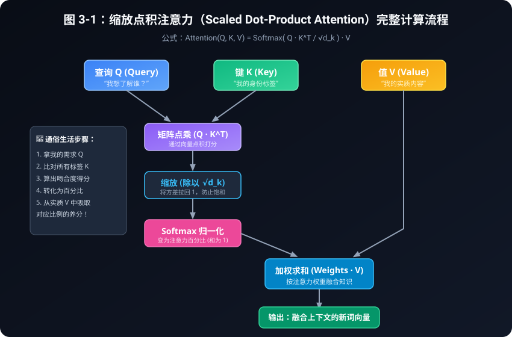

把计算链分成两张图。这里先画无掩码、每行都有可见位置的情况；后面会补空行约定。

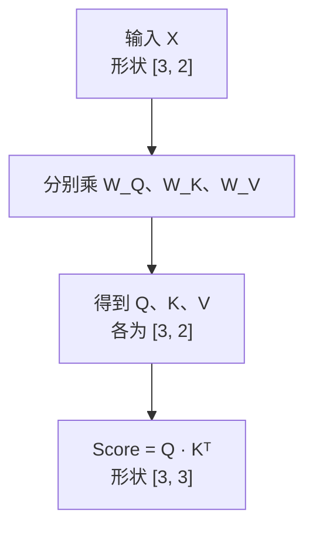

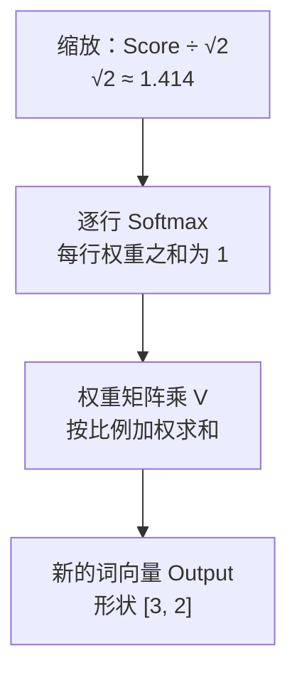
对第 $i$ 个查询，沿着所有候选键 $j$ 计算：

$$s_{ij}=\frac{q_i\cdot k_j}{\sqrt{d_k}},\qquad
a_{ij}=\frac{\exp(s_{ij})}{\sum_{r=1}^{T}\exp(s_{ir})},\qquad
o_i=\sum_{j=1}^{T}a_{ij}v_j.$$

整批写成 $O=\operatorname{softmax}(QK^\top/\sqrt{d_k})V$。Softmax 沿**键所在的最后一维**做，而不是把整张表变成一组概率。输出有 T 行、每行 $d_v$ 个数。

手算一行：设 $q=[1,0]$，两把键分别为 $[1,0]$ 和 $[0,1]$，两份内容分别为 $[2,0]$ 和 $[0,4]$。$d_k=2$，缩放分数是 $[1/\sqrt2,0]$，权重约为 $[0.6698,0.3302]$，输出约为 $[1.3395,1.3210]$。检查输出的每个维度都是对 V 对应维度做加权和；不是从两份内容里只挑一份。

**为什么除以根号维度？** 若 Q/K 各分量相互独立、均值为 0、方差为 1，则点积之和的方差是 $d_k$；除以 $\sqrt{d_k}$ 后方差为 1。这是理解尺度的简化假设，不是训练中始终满足的定律。缩放缓解分数随维度增大造成的饱和倾向，但不保证权重均匀，也不保证每个词获得“合理关注”。数值稳定和模型学得好是两个问题。

### 3.2.1 跟着“我 / 爱 / 学”完整手算一遍

上面的两份内容例子只演示一行加权。现在沿用 [code/02_manual_attention.py](../code/02_manual_attention.py)，把三个位置从输入一路算到输出。运行脚本后，可以把每张表与下面逐格核对；这些向量和矩阵都是教学设定，不是训练得到的语义特征。

输入三行是“我” $[1.0,0.5]$、“爱” $[0.8,1.2]$、“学” $[0.2,1.5]$。脚本把单个向量看作列向量，使用下面三张矩阵：

```python
W_Q = [[0.5, 0.2], [0.1, 0.8]]
W_K = [[0.4, 0.3], [0.2, 0.7]]
W_V = [[1.0, 0.1], [0.0, 0.9]]
Q = [matmul_vec(W_Q, vec) for vec in x]
K = [matmul_vec(W_K, vec) for vec in x]
V = [matmul_vec(W_V, vec) for vec in x]
```

`matmul_vec` 用矩阵的每一行与输入做点积。以“我”为例，草稿纸上写出：

$$Q_{我,0}=0.5\times1.0+0.2\times0.5=0.6,$$
$$Q_{我,1}=0.1\times1.0+0.8\times0.5=0.5.$$

同理算 K、V。列向量代码用 $W x$；若按前文把输入堆成行，必须用**该代码矩阵的转置**写成 $XW^\top$，才是同一次计算。不要一边换行列约定，一边直接照抄矩阵而不转置。

| 位置 | Q | K | V |
|---|---|---|---|
| 我 | [0.600, 0.500] | [0.550, 0.550] | [1.050, 0.450] |
| 爱 | [0.640, 1.040] | [0.680, 1.000] | [0.920, 1.080] |
| 学 | [0.400, 1.220] | [0.530, 1.090] | [0.350, 1.350] |

接下来，行代表“谁来问”，列代表“向谁取内容”。每格先点积，再除以 $\sqrt2$。例如“我”对“爱”：

$$(0.600\times0.680+0.500\times1.000)/\sqrt2
=0.908/\sqrt2\approx0.6421.$$

| 缩放分数 | 键：我 | 键：爱 | 键：学 |
|---|---:|---:|---:|
| 查询：我 | 0.4278 | 0.6421 | 0.6102 |
| 查询：爱 | 0.6534 | 1.0431 | 1.0414 |
| 查询：学 | 0.6300 | 1.0550 | 1.0902 |

脚本对每一行调用 `softmax(row)`，不是对整张表调用一次标量归一化。“我”这一行除以自己的指数总和，“爱”“学”也各算各的：

| 注意力权重 | 我 | 爱 | 学 |
|---|---:|---:|---:|
| 我 | 29.08% | 36.03% | 34.90% |
| 爱 | 25.31% | 37.38% | 37.31% |
| 学 | 24.31% | 37.18% | 38.51% |

这是对 V 的**读取权重**，不是指代概率或因果贡献率。未舍入的每行和在浮点容差内为 1；表中保留两位百分数，“我”一行显示为 100.01%，只是四舍五入，不要把表格显示值反过来当精确输入。

最后用“我”这一行的未舍入权重，分别乘三份 V，再相加：

$$o_{我}\approx
0.290776[1.05,0.45]+0.360253[0.92,1.08]+0.348971[0.35,1.35]
\approx[0.7589,0.9910].$$

脚本先创建 `new_vec = [0.0] * len(V[0])`，再依次执行“将某个 V 乘权重”和“累加到 new_vec”。这里写出的六位小数权重仍是便于手算的近似；代码用全精度权重，输出另外两行约为“爱” $[0.7402,1.0213]$、“学” $[0.7321,1.0308]$。新表示不再只来自原位置，但也不意味着这个没训练的玩具已经理解了句子。

本节**没有因果掩码**，所以“我”会读到后面的“爱”和“学”。它用于理解计算步骤；若用于下一词预测，还必须按 §3.4 加上可见性约束。

### 3.2.2 缩放究竟改变了什么？看一个可重跑的例子

[code/03_scaled_dot_product.py](../code/03_scaled_dot_product.py) 的第一个实验设置 `random.seed(42)`、$d_k=64$，用标准库高斯采样生成一个 Q 和三把 K。下面是该脚本实际输出，不是手工挑选的分数：

| 阶段 | 键 1 | 键 2 | 键 3 |
|---|---:|---:|---:|
| 原始点积（显示到两位） | -8.57 | -13.00 | -4.31 |
| 不缩放的 Softmax 权重 | 1.39% | 0.02% | 98.59% |
| 除以 $\sqrt{64}=8$ 后的分数（显示到两位） | -1.07 | -1.63 | -0.54 |
| 缩放后的 Softmax 权重 | 30.50% | 17.54% | 51.96% |

四步代码分别对应：`sum(q*k for ...)` 算原始点积，`stable_softmax(raw_scores)` 算不缩放的分布，`[s / scale for s in raw_scores]` 改变尺度，再调用一次稳定 Softmax。计算用未舍入值，因此只用表格的两位分数重算时，最后百分数会略有差别。

第三把键的原始分数虽然也是负数，却比另外两项大；指数比较的是差距，不是“正分才有权重”。缩放后分差变小，本例的分布没那么集中。它和下一节的“减去最大值”不同：**除以 8 一般改变权重，减去同一行最大值理论上不改变权重。** 这次观察支持理解尺度，不保证任意输入都获得更好的语义结果。

## 3.3 稳定 Softmax：先整体平移，再取指数

直接算 $e^{1000}$ 会超过常见浮点数的范围。对同一行减去最大值 $m$ 不改变比例：

$$\frac{e^{s_j-m}}{\sum_r e^{s_r-m}}
=\frac{e^{s_j}/e^m}{\sum_r e^{s_r}/e^m}
=\frac{e^{s_j}}{\sum_r e^{s_r}}.$$

例如 $[1000,1001,1002]$ 变成 $[-2,-1,0]$，结果约为 $[0.0900,0.2447,0.6652]$。最大指数是 1，避免了这里的指数上溢。很小项仍可能下溢为 0，这是有限精度现象，不能宣称“所有计算都精确”。

配套纯 Python 脚本的核心就是：

```python
m = max(scores)
exps = [math.exp(s - m) for s in scores]
weights = [e / sum(exps) for e in exps]
```

`code/02_manual_attention.py` 逐步打印投影、点积、权重与输出；入口先要求列表非空且每项有限，拒绝 NaN/正负无穷。这个简化函数处理普通分数，不把负无穷掩码混入它。测试在小分数上与朴素公式对照，在大分数上验证不溢出，并检查整体平移不改结果。

## 3.4 两类掩码：不能看未来，不要看补位

把多句话放入同一批时，短句常用 padding 补到相同长度。这些补位不是正文，不能成为有信息的键。自回归语言模型还要遵守 causal mask：第 i 行只能看 $j\le i$ 的位置。

以长度 4、实际只有前两个 token 的句子为例，本书把 query 补位也禁用：

| 查询行 / 键列 | 0 | 1 | 2（补位） | 3（补位） |
|---|---:|---:|---:|---:|
| 0 | 可见 | 禁止 | 禁止 | 禁止 |
| 1 | 可见 | 可见 | 禁止 | 禁止 |
| 2（补位） | 禁止 | 禁止 | 禁止 | 禁止 |
| 3（补位） | 禁止 | 禁止 | 禁止 | 禁止 |

行是“谁来问”，列是“向谁取内容”。表中的“可见”要同时满足因果约束和 padding 约束（两个布尔条件取与）。仅屏蔽 padding 键不会自动清零 padding 查询的输出；训练时还必须排除补位目标的损失，不能用注意力 mask 代替 loss mask。

我们的辅助函数在 `code/attention_core.py`，约定 **True=允许，False=禁止**：

```python
allowed = valid[:, None, :, None] & valid[:, None, None, :]
allowed = allowed & torch.ones(T, T, dtype=torch.bool).tril()
```

`valid` 是 [B,T]，两个切片分别变成 [B,1,T,1] 与 [B,1,1,T]，广播后得到 [B,1,T,T]，可供多个头共享。若单头分数是 [B,T,T]，使用 `allowed[:, 0]`；不要误把 [B,T] 直接广播成分数矩阵。代码中创建下三角时还指定与输入相同的 device。

注意不同 API 的约定不同：PyTorch 2.14 的 functional SDPA 布尔 mask 中 True 表示参与，`nn.MultiheadAttention` 的布尔禁止掩码使用相反语义。不要把同一个布尔张量不经核对就换接口。

## 3.5 全部禁止的一行：明确约定，避免 NaN

把禁止位置设成 $-\infty$，对至少有一个可见项的行做 Softmax，可使禁止项权重为 0。但若整行都是 $-\infty$，减最大值会出现 $-\infty-(-\infty)$，结果不是一个有效概率分布。

也不能简单改成 `-1e9`：它不是所有 dtype 都可表示的数，而且一整行同样的有限负数仍会得到均匀权重，反而让禁止项“复活”。

本书选一个明确的教学策略：**全禁用行返回全零权重，其加权输出为零**，不是和为 1 的概率分布。核心步骤如下：

```python
any_allowed = allowed.any(dim=-1, keepdim=True)
masked = scores.masked_fill(~allowed, -torch.inf)
safe = torch.where(any_allowed, masked, torch.zeros_like(masked))
weights = torch.softmax(safe, dim=-1).masked_fill(~allowed, 0.0)
```

先让空行的 Softmax 输入安全，再在结果中清零，避免先产生 NaN 再尝试补救。辅助函数要求原始分数有限，并检查布尔类型和广播形状。测试还对空行反向传播，检查梯度有限。这是本书实现的契约，不表示所有框架、内核和版本都采用相同处理方式。

## 3.6 训练可并行，为什么生成还要一步步来？

训练数据已经给出整条正确文本。假设序列为“我 爱 学 习”，输入位置 0 的“我”预测“爱”，位置 1 的“爱”预测“学”。一次算出所有查询行，同时用下三角阻断未来，所有已知输入位置可以并行计算；**并行不等于允许偷看标签**。

生成时，下一个 token 尚未选出来。先用现有前缀预测一个 token，将它接到前缀，再继续。这里的步骤依赖无法凭“矩阵并行”消失。后续 KV cache 会减少重复计算，却不会让未知的未来 token 提前成为已知输入。本章不提前实现缓存。

因果性可以用一个反事实小实验验证：保持前几个输入不变，任意修改最后一个 token，早于它的输出应保持不变。相反，双向无掩码注意力通常会变化。测试同时验证“全序列带因果 mask”与“逐个前缀重算最后位置”一致，避免只看上三角权重为零就认为端到端一定正确。这里没有 dropout，模型参数固定，以浮点容差比较。

## 3.7 运行、观察和自测

在 CPU 环境安装仓库锁定的 PyTorch 后运行：

```bash
python3 code/02_manual_attention.py
python3 code/03_scaled_dot_product.py
python3 -m unittest discover -s tests -v
```

脚本 03 有缩放对照、掩码、官方 SDPA 对照及 padding/因果扰动实验。固定随机种子只是让例子可重现，不构成效果评测；官方实现的输出按容差检查，不要求跨平台逐位相等。不需要 GPU、模型权重或网络推理服务。

自测：

1. 如果交换 Q 与 K，是否总能得到相同权重？不能。在本章等长自注意力中，交换后分数由 $S$ 变成 $S^\top$，逐行 Softmax 一般得到不同权重；若 $S$ 本身对称，交换前后分数完全相同，权重也相同。但该权重矩阵自身仍未必对称。这是“交换前后相等”和“矩阵关于对角线对称”两个不同问题。
2. 对一行所有有限分数加 100，权重应怎样变化？理论不变，实际受有限精度限制。
3. 对全部禁止的一行，为什么不要求权重和为 1？没有可取内容，本实现特意定义和为 0。
4. 只 mask 键，是否已忽略补位位置的训练损失？没有，还需单独处理目标。
5. 未来扰动测试失败，先看哪里？检查 mask 方向、广播轴、是否在归一化前遮挡，以及模型是否含其他跨位置泄漏路径。

下一章保持这条计算链不变，同时开多个头，逐笔记录每一步的张量形状。

## 来源与版本

- [Attention Is All You Need，v7，§3.2 与 §3.1](https://arxiv.org/html/1706.03762v7)：缩放点积、多头与解码因果约束。上面的数值小例子与边界策略为本书构造。
- [PyTorch 2.14：scaled_dot_product_attention](https://docs.pytorch.org/docs/2.14/generated/torch.nn.functional.scaled_dot_product_attention.html)：官方接口及布尔 mask 约定。
- [PyTorch 2.14：MultiheadAttention](https://docs.pytorch.org/docs/2.14/generated/torch.nn.MultiheadAttention.html)：对照不同接口的 mask 语义。动态文档核验日期：2026-10-19。


---

# 第4章：多头注意力（Multi-Head Attention）——给每个维度记一本账

> 多头不是把同一张注意力表复印几份，而是学习多套投影，分别计算权重，再把结果合起来。

上一章我们用 $Q$ 和 $K$ 打分，做 Softmax，再用权重汇总 $V$。本章把这套计算分成几个并行的“头”，重点追踪形状怎样变化、参数和计算成本怎样计数。

配套代码是 [code/04_multi_head_attention.py](../code/04_multi_head_attention.py)。本章只讨论**标准、等宽的多头自注意力**：Q、K、V 来自同一段输入，三者头数相同，每个头的 Q、K、V 宽度也相同。共享 KV 头等变体留到后续章节（大纲 S05：[GQA 原始论文](https://arxiv.org/abs/2305.13245)）。

---

## 4.1 为什么要“多头”：多张权重表，而不是预先分配的专家

假设我们在读一句话：“小林把书递给小周，因为她要准备考试。”理解它可能涉及动作的参与者、物品、指代和上下文等关系。

单头注意力并不是“只能理解语法，不能理解指代”。它也可以让一个位置同时关注多个位置，向量中的不同特征还可以承载不同信息。它的具体结构限制是：**对一个查询位置，这个头只有一组沿 key 位置归一化的权重，同一组权重用于汇总该头的所有 value 特征。**

例如，一个头在三个可见位置上的权重是 `[0.7, 0.2, 0.1]`，那么这个头的每一个输出特征，都按这三个比例对相应的 value 特征加权。多头则允许另一套投影得到另一张权重表，例如 `[0.1, 0.3, 0.6]`，再把两种汇总结果一起保留下来。

```text
同一段输入 X
   ├── 学习得到的投影 1 ── 注意力表 A1 ── 头输出 Z1
   ├── 学习得到的投影 2 ── 注意力表 A2 ── 头输出 Z2
   └── 学习得到的投影 H ── 注意力表 AH ── 头输出 ZH
                                            │
                            按特征拼接，再经过输出投影
```

“分别计算”指每个头有自己的投影和权重；它们仍共享输入、一起训练，不意味着统计上互不相关。可以把多头想成几位读者各记笔记，但程序没有安排“你只看语法，你只看情感”的岗位。训练后各头可能形成不同模式，也可能彼此相似。**类比的边界：允许分工，不保证语义专家，更不保证头越多越好。**

原始 Transformer 论文把多头描述为在不同表示子空间中分别做注意力、再拼接与投影。我们接下来把这件事落实到具体的维度和代码上。[来源：Attention Is All You Need，§3.2.2](https://arxiv.org/html/1706.03762v7#S3.SS2.SSS2)

---

## 4.2 先投影，再分头：不是把原始输入硬切成几块

先统一本章的符号。遇到形状时，先读每根轴的名字，再看轴有多长。

| 符号 | 含义 | 本章小例子 |
| :--- | :--- | :--- |
| $B$ | batch size，一批有多少条序列 | 2 |
| $T$ | sequence length，每条序列有多少个 token 位置 | 3 |
| $D$ | model dimension，每个位置的总特征宽度 | 8 |
| $H$ | head count，注意力头数 | 2 |
| $d_h$ | head dimension，每个头的特征宽度 | 4 |

本章约定：

$$D = H d_h, \qquad d_h = D / H$$

因此 $D$ 必须能被 $H$ 整除，而且二者都应是正整数。`D=8, H=2` 合法，`D=8, H=3` 就不能按本章方式均分。这里 $T$ 数的是 **token 位置**，不等于汉字数或自然语言的词数。

### 两种等价的写法

在数学上，可以为第 $h$ 个头分别写出：

$$Q_h = XW_h^Q, \qquad K_h = XW_h^K, \qquad V_h = XW_h^V$$

其中每个 $W_h^Q, W_h^K, W_h^V$ 的形状都是 $[D, d_h]$。注意左边乘的是**完整的输入 $X$**，所以每个头的投影都能利用输入的全部 $D$ 个特征，而不是只看原始输入中的某一小段。

实现时，把各头投影沿输出特征方向并排拼成一个 $[D,D]$ 矩阵，就不必写 $H$ 个 Python 循环：

$$W_Q = [W_1^Q\; W_2^Q\; \cdots\; W_H^Q]$$

一次 `W_q(x)` 得到 `[B,T,D]` 的全部查询，再把最后的 $D$ 个特征整理为 `[H,d_h]`。K/V 同理。**不同头的可学习差异来自投影参数，reshape 本身不学习任何东西。**

数学里采用行向量右乘矩阵的记法；PyTorch `nn.Linear` 则把权重存为 `[out_features,in_features]`，计算相当于 `x @ weight.T`。不要混淆这两种记法。

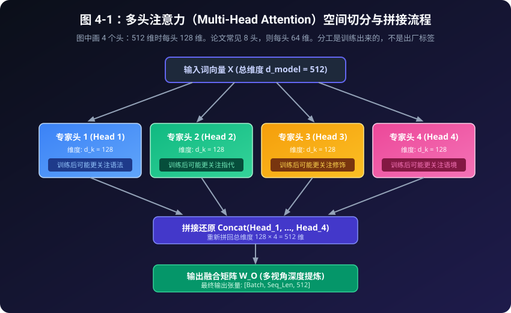

**读图提醒：**图中 $D=512$、4 个头，每头宽 128；8 个头则每头宽 64。图省略了投影细节，实际顺序是“完整输入 → 线性投影 → 分头”。图里的“专家”是类比，“可能关注语法”不是保证或预设标签。

---

## 4.3 张量账本：每一步到底换了什么

我们故意选择 $T=3$、$d_h=4$，让“序列长度”和“单头宽度”不相等。这样转错轴时，更容易从形状发现问题。

### 表 4-1：从输入到输出的完整形状账本

| 阶段 | 一般形状 | $B=2,T=3,D=8,H=2$ 时 | 这一步在做什么 |
| :--- | :--- | :--- | :--- |
| 输入 `x` | `[B, T, D]` | `[2, 3, 8]` | 两条序列，每个位置 8 维 |
| 投影后 Q/K/V，各一份 | `[B, T, D]` | `[2, 3, 8]` | 改变特征，不改变位置数 |
| 拆开特征轴 | `[B, T, H, d_h]` | `[2, 3, 2, 4]` | 把每个位置的 8 维分为 2 组 |
| 换轴后 Q/K/V，各一份 | `[B, H, T, d_h]` | `[2, 2, 3, 4]` | 让 batch 和 head 成为前导轴 |
| 仅转置 K 的最后两轴 | `[B, H, d_h, T]` | `[2, 2, 4, 3]` | 为点积对齐特征轴 |
| 分数 `scores` | `[B, H, T, T]` | `[2, 2, 3, 3]` | 行是 query 位置，列是 key 位置 |
| 掩码后的分数 | `[B, H, T, T]` | `[2, 2, 3, 3]` | 禁止某些连接，形状不变 |
| 权重 `attn_weights` | `[B, H, T, T]` | `[2, 2, 3, 3]` | 沿最后的 key 轴归一化 |
| 各头输出 `head_outputs` | `[B, H, T, d_h]` | `[2, 2, 3, 4]` | 每个头对 V 加权求和 |
| 换回位置优先 | `[B, T, H, d_h]` | `[2, 3, 2, 4]` | 把同一位置的各头放在一起 |
| 拼接 `out_concat` | `[B, T, D]` | `[2, 3, 8]` | 合并 H 与单头宽度两根轴 |
| 输出投影 `W_o` | `[B, T, D]` | `[2, 3, 8]` | 混合各头特征，得到最终结果 |

`[B,H,T,T]` 存放**位置之间的权重**，`[B,H,T,d_h]` 存放**各位置的特征**。即使 $T=d_h$，含义也不同。

### 第一步：reshape 是拆轴，transpose 是换轴

假设 `Q_full` 是投影后的 `[B, T, D]` 张量：

```python
Q_split = Q_full.reshape(B, T, H, d_h)
assert Q_split.shape == (B, T, H, d_h)

Q = Q_split.transpose(1, 2)
assert Q.shape == (B, H, T, d_h)
```

`reshape` 把一个长度为 $D$ 的特征轴拆成两个轴，元素总数必须相同；`transpose(1, 2)` 则交换第 1 和第 2 根轴，轴从 0 开始编号。这两种操作**不能互相替代**。

用整数给元素编号最容易看清。以下数字只用于追踪位置，不代表真实词向量：

```python
import torch

z = torch.arange(24).reshape(1, 3, 8)
split = z.reshape(1, 3, 2, 4)
heads = split.transpose(1, 2)

print(heads[0, 0])  # 第 0 条序列，第 0 个头
# tensor([[ 0,  1,  2,  3],
#         [ 8,  9, 10, 11],
#         [16, 17, 18, 19]])

print(heads[0, 1])  # 同一条序列，第 1 个头
# tensor([[ 4,  5,  6,  7],
#         [12, 13, 14, 15],
#         [20, 21, 22, 23]])
```

每个头都保留了三个 token 位置。如果直接做 `z.reshape(1,2,3,4)`，最终形状虽相同，第一个头拿到的却是连续的 0 到 11，混淆了位置与头的归属。**形状正确，不代表元素排布正确。**

### 第二步：为什么把 H 放到前面

对这里使用的高维张量，`torch.matmul` 把最后两根轴当作矩阵轴，其余轴用作批量维度。于是：

```text
Q:                         [B, H, T, d_h]
K.transpose(-2, -1):       [B, H, d_h, T]
                                    ↓ 消去 d_h
scores:                    [B, H, T, T]
```

我们得到每条序列、每个头各自的 $T\times T$ 打分表。不是在不同头之间做点积，也不是在两条序列之间交换信息。

```python
scores = Q @ K.transpose(-2, -1) / math.sqrt(d_h)
assert scores.shape == (B, H, T, T)
```

缩放分母是 $\sqrt{d_h}$，不是 $\sqrt{D}$，因为点积只对 $d_h$ 个特征求和。归一化沿最后的 key 轴做；有掩码时先处理掩码，规则见下一节。

加权汇总又是一次矩阵乘法：

```text
attn_weights:              [B, H, T, T]
V:                         [B, H, T, d_h]
                                    ↓ 对 key 位置加权求和
head_outputs:              [B, H, T, d_h]
```

### 第三步：拼接不是求和，也不是再做一次注意力

要把同一个位置的各头输出放在一起，先换回 `[B,T,H,d_h]`，再把后两根轴合并：

```python
head_outputs = attn_weights @ V
assert head_outputs.shape == (B, H, T, d_h)

by_token = head_outputs.transpose(1, 2)
assert by_token.shape == (B, T, H, d_h)

out_concat = by_token.contiguous().view(B, T, D)
assert out_concat.shape == (B, T, D)

output = W_o(out_concat)
assert output.shape == (B, T, D)
```

如果某个 token 的两个头分别输出 `[a,b,c,d]` 和 `[e,f,g,h]`，拼接就是 `[a,b,c,d,e,f,g,h]`，不是把两份向量相加成 4 维。之后的 $W_O$ 才是可学习的特征混合层，它仍对每个位置单独作用，不再次混合不同 token。

为什么有 `contiguous()`？换轴后的普通张量通常仍共享原存储，但布局可能不再满足 `view` 的要求，需要先整理成连续布局。也可以写 `by_token.reshape(B,T,D)`，必要时由它复制数据。形状变换不一定零开销；`contiguous()` 也不能修好转错轴的逻辑。[来源：PyTorch reshape](https://docs.pytorch.org/docs/2.14/generated/torch.reshape.html)、[transpose](https://docs.pytorch.org/docs/2.14/generated/torch.transpose.html)

---

## 4.4 多了头，掩码规则没有变

多头把分数扩展成 `[B,H,T,T]`，不会自动阻止模型看未来。

**本章配套代码的布尔 mask 统一使用 `True = 允许访问`，`False = 禁止访问`。**例如三个 token 的因果掩码是：

```text
              key 0   key 1   key 2
query 0       True    False   False
query 1       True    True    False
query 2       True    True    True
```

可以这样建立一个供所有 batch、所有头共用的 `[T,T]` 掩码：

```python
allowed = torch.ones(T, T, dtype=torch.bool, device=x.device).tril()
output, weights = mha(x, mask=allowed)
```

广播是在缺省轴上复用规则。不同序列可用 `[B,1,T,T]` 表达各自的规则，再供各头共用。不要把 `[B,T]` 的有效 token 标记直接当成注意力 mask：先明确它控制 key 列、query 行，还是二者。屏蔽 padding key 不自动保证 padding query 输出为零。

### 全被挡住的一行怎么办

对于至少有一个允许位置的行，禁止位置的分数设为负无穷，Softmax 后权重为零，允许位置的权重之和为 1。

但如果某个 query 在某个头中**一个 key 都不能看**，就没有合法的概率分布。把这一整行都设为负无穷后直接 Softmax，会遇到未定义的归一化；把它们都改成 `-1e9` 也不是解决办法，因为相同分数会变成均匀权重，反而读到了被禁止的值。

本章实现采用明确的工程约定：

1. 先找出全被屏蔽的行，让它们以安全的临时分数经过 Softmax，避免出现 `NaN`。
2. 再把这些行的**所有权重置零**，该头的加权输出因此为零。
3. 其余非空行正常归一化。

全屏蔽行的权重和是 0，不是 1。若一个 query 在**所有头**中都被全屏蔽，拼接向量为零；本例 `W_o` 无 bias，最终输出也为零。只屏蔽一个头则未必如此。若输出层有 bias，结果可能等于 bias；更不能据此推断后续带残差的整个模块为零。

最后注意一个容易踩到的 API 陷阱：本书的 allowed mask 与 PyTorch `scaled_dot_product_attention` 的布尔 mask 一样，`True` 表示参与；但 `nn.MultiheadAttention` 的布尔 `attn_mask` 和 `key_padding_mask` 使用 `True` 表示屏蔽。切换接口时要检查语义和形状，不能原样照搬。[来源：PyTorch SDPA](https://docs.pytorch.org/docs/2.14/generated/torch.nn.functional.scaled_dot_product_attention.html)、[MultiheadAttention](https://docs.pytorch.org/docs/2.14/generated/torch.nn.MultiheadAttention.html)

---

## 4.5 算清三本账：参数、运算和中间张量内存

“头数变成 8，开销是否变成 8 倍？”不能只回答“是”或“不是”。先固定比较条件：**总宽度 $D$ 不变，$H$ 个头等宽，$d_h=D/H$，Q/K/V 与输出都投影到 $D$，四个线性层都不带 bias。**单头对照也保留同样的四个投影。

### 参数账：标准无偏置 MHA 是 $4D^2$

Q、K、V 各有一个 $D\times D$ 投影，最后再加一个 $D\times D$ 的输出投影：

$$N_{\mathrm{params}} = D^2+D^2+D^2+D^2 = 4D^2$$

按头拆开数也一样：Q 投影共有 $H\cdot Dd_h=D^2$ 个参数。$D=8$ 时，四个矩阵共 256 个参数；改成 1、2、4 或 8 个头，都不改变这一数量。

这只是**注意力模块**的参数，不含 embedding、FFN、归一化等。若四个投影都加上长度为 $D$ 的 bias，还需加 $4D$。若固定的是每头宽度 $d_h$，增加头数会让 $D=Hd_h$ 一起增大，当然就不能再套用“参数不变”的结论。

### 运算账：投影成本不能漏掉

一次完整自注意力前向的主要矩阵乘法可以分成两类：

- **投影：**共有 $BT$ 个位置，每个位置做 $D$ 到 $D$ 的变换。Q/K/V 和输出投影合计是 $O(BTD^2)$。
- **头内注意力：**每个头的 $QK^\top$ 与权重乘 V，各需 $O(BT^2d_h)$；所有头加起来是 $O(BHT^2d_h)=O(BT^2D)$。

所以在上述条件下，主要计算量为：

$$O(BTD^2 + BT^2D)$$

掩码和 Softmax 还要处理 $BHT^2$ 个元素。在本章 $1\leq H\leq D$ 的等宽设置下，这不改变上述总体大 O 阶数，但会影响实际成本。大 O 隐去了常数、内存访问和执行方式，并不承诺两个实现耗时相同。

原论文在每头宽度随头数缩小的条件下，比较的是与全宽单头相近的计算成本；它不是“加头必然提速”的定理。实际耗时还依赖硬件、数据类型、矩阵尺寸、内存布局和具体计算内核。CPU 教学实现可用于验证数值，不足以证明 GPU 性能。[来源：Attention Is All You Need，§3.2.2](https://arxiv.org/html/1706.03762v7#S3.SS2.SSS2)

### 内存账：分数表仍有 $H$ 份

这里最容易漏算。Q/K/V 每份共有 $BHTd_h=BTD$ 个元素，但**分数表没有 $d_h$ 这一根轴**：它的形状是 `[B,H,T,T]`，所以需要 $BHT^2$ 个元素。

例如 $B=1,H=8,T=1024$，一份 float32 分数张量就占：

$$1\times8\times1024^2\times4\ \text{bytes}=32\ \text{MiB}$$

这里 $1\ \text{MiB}=2^{20}$ 字节。这还不含权重张量、Q/K/V、输出以及训练时保存的中间量。固定 $B,T,D$ 增加头数，显式保存分数或权重表的开销会随 $H$ 增加；把序列长度翻倍，则这部分元素数变成四倍。

这个内存账本针对**本章显式构造分数和权重的实现**。优化内核可能不把完整分数表留在显存中，所以它不是所有实现的峰值内存下界。FlashAttention 一章会展开这个区别。

还有一个以后会用到的区别：标准 MHA 的 K 和 V 总元素数是 $2BHTd_h=2BTD$，并不是 $2BHT^2$。后续 KV Cache 存的是 K/V 特征，不是所有历史注意力分数；现在先把这两类张量分清。

---

## 4.6 动手实验：先验形状，再验数值

在仓库根目录运行：

```bash
python3 code/04_multi_head_attention.py
python3 -m unittest discover -s tests -v
```

示例使用小尺寸输入打印形状和各头的权重。阅读时先把日志对照表 4-1，再看权重：同一个 query 的哪一行、哪一个头、对哪些 key 求和？不要只因为数字看起来合理，就认定实现正确。

演示里的“机器”“学习”“真”“酷”只是位置标签，输入和投影都是随机的。不同百分比不证明语义分工；固定种子便于复查，也不保证跨设备、版本逐位相同。

### 实验一：退化成一个头，必须等于直接的参考公式

将 $H$ 设成 1 后，$d_h=D$。此时分头不应改变计算含义。我们不用重新初始化另一套投影，而是读取**同一个模型的参数**，手动计算单头公式，再和模块输出比较。

下面的代码可以在仓库根目录的 Python 会话中执行：

```python
import math
import runpy
import sys
from pathlib import Path
import torch

sys.path.insert(0, str(Path("code").resolve()))
module = runpy.run_path("code/04_multi_head_attention.py")
SimpleMultiHeadAttention = module["SimpleMultiHeadAttention"]

torch.manual_seed(100)
B, T, D = 2, 3, 8
x = torch.randn(B, T, D)
mha = SimpleMultiHeadAttention(d_model=D, num_heads=1)

with torch.no_grad():
    actual, actual_weights = mha(x)
    q, k, v = mha.W_q(x), mha.W_k(x), mha.W_v(x)
    reference_weights = torch.softmax(
        q @ k.transpose(-2, -1) / math.sqrt(D), dim=-1
    )
    reference = mha.W_o(reference_weights @ v)

assert actual.shape == (B, T, D)
assert actual_weights.shape == (B, 1, T, T)
torch.testing.assert_close(actual, reference)
torch.testing.assert_close(actual_weights[:, 0], reference_weights)
print("单头退化与直接公式一致")
```

为什么还要保留 `W_o`？因为我们比较的是**完整模块**，不是只比较注意力核心。一个有输出投影、另一个没有，即使头数都是 1，也不是同一个计算。

这能发现分头、缩放、拼接等错误，但还需检查多个头、不同 $B,T,D$ 与掩码边界。

### 实验二：全屏蔽行不能偷偷变成均匀分布

继续沿用前面的导入，再创建两个头。把最后一个 query 的所有 key 都挡住：

```python
mha = SimpleMultiHeadAttention(d_model=D, num_heads=2)
allowed = torch.ones(T, T, dtype=torch.bool).tril()
allowed[-1, :] = False

with torch.no_grad():
    output, weights = mha(x, mask=allowed)

assert weights.shape == (B, 2, T, T)
assert torch.isfinite(weights).all()
assert torch.isfinite(output).all()
assert torch.count_nonzero(weights[:, :, -1, :]).item() == 0
assert torch.count_nonzero(output[:, -1, :]).item() == 0

torch.testing.assert_close(
    weights[:, :, :-1, :].sum(dim=-1),
    torch.ones(B, 2, T - 1),
)
print("非空行归一化，全屏蔽行权重与输出为零")
```

这检查的是本章的空行约定，不是说零权重是一种概率分布。真实任务仍要追查空行来源，以及 padding 位置是否应排除在损失之外。

还可以把 `H` 改成 4，检查输出形状仍为 `[B,T,D]`，权重形状则变为 `[B,4,T,T]`；再试 `H=3`，确认不合法的配置会被拒绝。固定 $D=8$ 时，`sum(p.numel() for p in mha.parameters())` 应为 256。这些检查分别针对形状、输入约束和参数账，不要混成一个“能运行就通过”的标准。

---

## 4.7 自测：遮住答案再读一遍账本

1. $B=2,T=5,D=12,H=3$ 时，分头后的 Q、分数表和拼接结果分别是什么形状？
2. 为什么 `reshape(B,H,T,d_h)` 不能直接替代“先拆成 `[B,T,H,d_h]`，再换轴”？
3. 标准 MHA 从 2 个头改成 4 个头，固定 $D$，参数量是否翻倍？显式权重表是否变大？
4. 两个随机初始化的头得到不同的权重表，能否据此宣布一个懂语法、另一个懂情感？
5. 一个 query 只在其中一个头中被全屏蔽，最终输出一定是零吗？

**参考答案：**

1. $d_h=4$；Q 是 `[2,3,5,4]`，分数是 `[2,3,5,5]`，拼接结果是 `[2,5,12]`。
2. reshape 只按元素顺序改变形状；换轴改变的是元素所属的轴位置。最终尺寸相同，元素归属仍可能不同。
3. 四个无偏置投影仍为 $4D^2$；固定 $B,T$ 时，权重表从 $2BT^2$ 增至 $4BT^2$ 个元素。
4. 不能。不同数字没有证明语义分工，更没有证明对模型决策的因果解释。
5. 不一定。其他头仍可能产生非零特征，随后被 $W_o$ 混合。

---

## 4.8 本章小结与下一步

- 多头的核心是**不同的可学习投影、分别归一化的权重、拼接后的输出投影**，不是把一张表复制多遍，也不是预先指定语义专家。
- 记住主路径：`[B,T,D] → [B,T,H,d_h] → [B,H,T,d_h] → [B,H,T,T] → [B,H,T,d_h] → [B,T,D]`。
- reshape 拆轴，transpose 换轴，concat 合并各头特征。写对形状之后，还要检查元素是否去了正确的位置。
- 本章 mask 使用 `True=允许`；非空行权重和为 1，全屏蔽行按明确约定置零。
- 固定 $D$、标准等宽、无偏置设置下，参数是 $4D^2$，主要计算是 $O(BTD^2+BT^2D)$；显式分数存储仍有 $BHT^2$ 个元素。相同计算阶数不意味着相同速度或内存。

多头本身不添加“我在第几个位置”的信息。没有位置编码、也没有依赖位置的掩码时，重排输入 token，输出只会跟着重排。因果掩码限制可见方向，但与为表示加入位置信息不同。下一章继续讨论**位置编码（Positional Encoding）**。

文档核验日：2026-10-19，来源见相关段落。文档版本不等于本书的完整兼容性测试范围；本章实验验证教学计算，不提供未测的速度或显存提升比例。


---

# 第 5 章：位置编码（Positional Encoding）——给词语发“座位号”

> 注意力擅长比较内容；要理解句子，还得知道内容出现在什么位置。

上一章把注意力拆成多个头，本章暂时不增加头数，而是补上输入里的顺序信息。学完后，你应该能手算一个位置编码，追踪它怎样与词向量相加，并分清“能算出更长的编码”和“模型能理解更长的文本”。

配套实验：[code/05_positional_encoding.py](../code/05_positional_encoding.py)。只需 CPU 和项目锁定的 PyTorch；不下载模型，不训练语言模型。先读公式和数值表，再运行代码也可以。

## 5.1 换了座位，为什么注意力还可能认不出来？

把“小猫 / 吃 / 小鱼”看成三个 token。交换首尾后变成“小鱼 / 吃 / 小猫”：内容集合相同，谁吃谁却变了。

先限定实验条件：**双向、没有位置编码或位置偏置、没有 mask、没有随机 dropout，所有位置共用同一组投影矩阵**。只靠这样的自注意力，交换输入的行，输出也只是按同样顺序交换。

这叫**置换等变性（permutation equivariance）**，不是“所有输出完全不变”。用 $P$ 表示重新排列表格行的操作：

$$\operatorname{Attention}(PX)=P\operatorname{Attention}(X).$$

跟着形状走一遍：

1. $X$ 的形状是 $[T,D]$，换序后仍是 $[T,D]$。
2. 共用投影使 $Q,K,V$ 的行也一起换序。
3. $QK^T$ 的查询行、键列同步换序；Softmax 只是在每行内重新排列同一批分数。
4. 加权时，权重列和 $V$ 的行同步换序，因此各 token 收集的内容并没改变；输出只跟着输入换行。

于是“吃”仍然面对同一个邻居集合，它不知道小猫在自己前面还是后面。若最后再对所有行求和或平均，这种不依赖顺序的汇总才是**置换不变**。

### 一次能运行的换词实验

为了不被投影参数干扰，令 $Q=K=V=X$，三行分别表示小猫、吃、小鱼：

```text
X = [[1, 0],
     [0, 1],
     [1, 1]]        形状 [3, 2]
换序 order = [2, 1, 0]
```

脚本的 `permutation_example()` 计算 $\operatorname{softmax}(XX^T/\sqrt{2})X$。“吃”的输出在换序前后都是约 `[0.5989, 0.8022]`。然后给各座位加入本章的正弦编码，只换词、保持座位号不动：

```text
不加位置，换序误差=0.000000
固定座位编码，只换词，换序误差=0.971712
```

这里的误差是“换词后的输出”与“原输出按同样顺序重排”的最大绝对差。第二行说明位置可以改变计算，**并不说明这个没有训练的玩具模型已经懂了语法**。如果连词和座位号一起搬走，那只是重新排列同一组输入，不是本实验要比较的情况。

**边界很重要：因果 mask 本身也携带顺序结构。** 固定下三角 mask 时随意换词，各位置可见的前缀会改变，上面的等式一般不再成立。不能据此说“一切没有位置编码的因果模型都完全不懂顺序”。反过来，加了位置编码也不能代替因果 mask：一个告诉模型位置，一个限制哪些内容可见。

## 5.2 座位号有三种常见表达

### 表 5-1：可学习绝对位置、固定正弦位置与相对位置

| 类型 | 告诉模型什么 | 常见实现 | 必须记住的边界 |
| :--- | :--- | :--- | :--- |
| 可学习绝对位置 | “我坐在第 $pos$ 个座位” | 一张 $[L_{max},D]$ 参数表，按位置查行，再与词向量相加 | 表有固定行数；未训练过的行也不会自动具有有用含义 |
| 固定正弦位置 | 同样是绝对位置，但座位向量由公式给定 | 不同频率的 sin/cos，生成 $[T,D]$ 后相加 | 没有可学习的位置参数；能算新位置不保证长文本效果 |
| 相对位置信息 | “你在我前面或后面几格” | 根据键位置 $j$ 与查询位置 $i$ 的差 $j-i$，影响注意力计算 | 有不同实现；距离可被分桶或截断，不一定给每个位置加一行向量 |

原版 Transformer 对固定正弦与可学习绝对位置都做过实验；论文报告二者在所测翻译设置下效果接近，不能把正弦写成唯一正确答案。[来源 1，§3.5、表 3(E)]

可学习表与词表类似，但索引不同：词向量用 token ID 查表，位置向量用位置索引查表。例如 $L_{max}=8,D=8$ 时，位置表有 $8\times8=64$ 个可训练参数。固定正弦表没有这 64 个可训练参数，但把它预先存成矩阵仍然占内存。

相对位置可以先用一句话理解：“不在乎你坐第 100 排，只在乎你在我右边两格。”例如查询在 $i=2$、键在 $j=5$ 时，按本章约定距离为 $j-i=3$；二者同时右移一格，差仍是 3。Shaw 等人的方法把相对位置表示用于注意力的键项，也可用于值项，并将超过范围的距离截断。[来源 2，§3.1–3.2] 这只是一个具体方案，不是所有相对位置方法的统一公式。

### 为什么不直接写一个整数？

当然可以把位置写成一个标量特征，不是数学上禁止。只是需要处理两个问题：

- 直接用 $pos$ 时，较大位置可能与词向量分量处于不同尺度；还要决定如何把一个数送进 $D$ 维网络。这是尺度与建模设计问题，不是“整数必然让网络爆炸”。
- 若改成 $pos/T$，相邻位置的步长随句长变化：$T=3$ 时是 $1/3$，$T=100$ 时是 $1/100$。同样的“隔一个 token”，数值差却不同。

接下来学习的正弦方案给每个位置一组有界、且不依赖当前句长 $T$ 的数字，便于观察这些取舍。

## 5.3 不同频率：把一根指针变成一组指针

本章位置从 0 开始，$D=d_{model}$。公式中的 $i$ 是**第几对维度**，不是已经乘过 2 的列号：

$$PE_{(pos,2i)}=\sin\left(\frac{pos}{10000^{2i/D}}\right),$$

$$PE_{(pos,2i+1)}=\cos\left(\frac{pos}{10000^{2i/D}}\right).$$

两式来自原版 Transformer 的 §3.5。[来源 1] 这里的角度单位是**弧度**。一个整圆是 $2\pi$ 弧度；$pos=1$、分母为 1 时走了 1 弧度，约 57 度，不是一整圈。

把 $\omega_i=10000^{-2i/D}$ 叫作角频率，就可以写成 $\sin(pos\,\omega_i)$、$\cos(pos\,\omega_i)$。同一对 sin/cos 使用同一个频率；分母越大，每前进一个位置转过的角度越小。每圈所需的位置间隔，也就是周期，为 $2\pi/\omega_i$。

令 $D=8$，逐对代入：

| 维度对 | $i$ | 分母 $10000^{2i/8}$ | 角频率 | 周期，约多少个位置 |
| :--- | :---: | :---: | :---: | :---: |
| d0、d1 | 0 | 1 | 1 | 6.28 |
| d2、d3 | 1 | 10 | 0.1 | 62.83 |
| d4、d5 | 2 | 100 | 0.01 | 628.32 |
| d6、d7 | 3 | 1000 | 0.001 | 6283.19 |

不要机械地把最慢周期写成 $10000\times2\pi$：对这个有限的 8 维例子，最后的分母是 1000。频率取决于**完整宽度 $D$**；8 维编码也不等于 512 维编码的前 8 列。

### 手表类比的用途与边界

快针在几个位置里就来回摆动，慢针在短句里几乎不动。它们合起来提供多种尺度的变化信息。

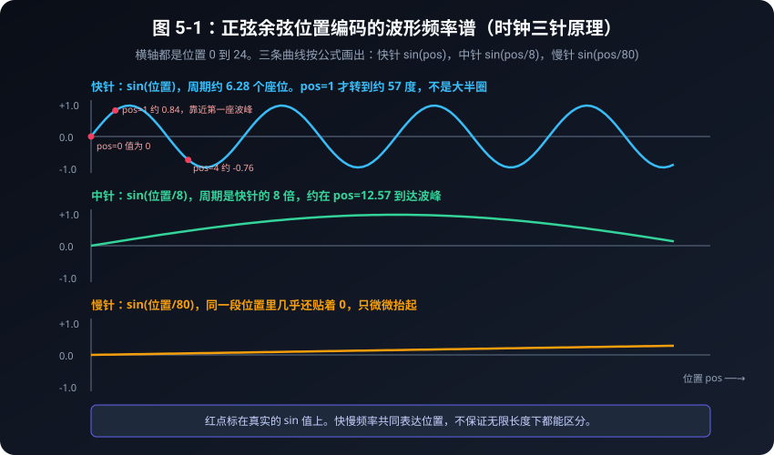

图 5-1 为了在位置 0 到 24 的同一画布上看清变化，使用 $\sin(pos)$、$\sin(pos/8)$、$\sin(pos/80)$ 三条示意曲线；**不是下方 $D=8$ 表格中的三个实际列**。图中红点表示算出的函数值。

这个类比不保证“无限多个座位都有永不重复、容易识别的指纹”。周期分量会回头，组合也可能很接近；浮点精度有限，模型还需要学习如何利用它。我们能核验的是指定长度内的具体数值与关系，而不是任意长上下文的唯一性或可辨识性。

### 表 5-2：前 8 个位置与全部 8 个维度，$D=8$（保留两位小数）

| 位置序号 $pos$ | d0 ($\sin$) | d1 ($\cos$) | d2 ($\sin$) | d3 ($\cos$) | d4 ($\sin$) | d5 ($\cos$) | d6 ($\sin$) | d7 ($\cos$) |
| :---: | :---: | :---: | :---: | :---: | :---: | :---: | :---: | :---: |
| **位置 0** | 0.00 | 1.00 | 0.00 | 1.00 | 0.00 | 1.00 | 0.00 | 1.00 |
| **位置 1** | 0.84 | 0.54 | 0.10 | 1.00 | 0.01 | 1.00 | 0.00 | 1.00 |
| **位置 2** | 0.91 | -0.42 | 0.20 | 0.98 | 0.02 | 1.00 | 0.00 | 1.00 |
| **位置 3** | 0.14 | -0.99 | 0.30 | 0.96 | 0.03 | 1.00 | 0.00 | 1.00 |
| **位置 4** | -0.76 | -0.65 | 0.39 | 0.92 | 0.04 | 1.00 | 0.00 | 1.00 |
| **位置 5** | -0.96 | 0.28 | 0.48 | 0.88 | 0.05 | 1.00 | 0.00 | 1.00 |
| **位置 6** | -0.28 | 0.96 | 0.56 | 0.83 | 0.06 | 1.00 | 0.01 | 1.00 |
| **位置 7** | 0.66 | 0.75 | 0.64 | 0.76 | 0.07 | 1.00 | 0.01 | 1.00 |

用位置 1 跟算：

- d0：$i=0$，$\sin(1/1)\approx0.84$。
- d2：$i=1$，$\sin(1/10)\approx0.10$。
- d4：$i=2$，$\sin(1/100)\approx0.01$。
- d6：$i=3$，$\sin(1/1000)\approx0.001$，保留两位小数显示为 0.00，**不是真正的零**。

同理，位置 1 的 d3 是 $\cos(0.1)\approx0.995004$，表中显示 1.00。读表时别把舍入后的重复数字当成整行重复。全表由脚本生成，测试会核对全部 64 个显示值，不只是第一行。

## 5.4 余弦相似度会回升，不是距离尺

上一节看单个分量，这一节看两个位置向量整体有多像。对偶数 $D$，每对满足 $\sin^2\theta+\cos^2\theta=1$，所以每行的平方范数为 $D/2$。当 $D=8$，每行范数都是 2。

两行的点积可以按维度对拆开：

$$\sin(p\omega_i)\sin(q\omega_i)+\cos(p\omega_i)\cos(q\omega_i)
=\cos((p-q)\omega_i).$$

因此对完整的 sin/cos 对：

$$\operatorname{cosine}(PE_p,PE_q)
=\frac{1}{D/2}\sum_{i=0}^{D/2-1}\cos((p-q)\omega_i).$$

右边是一组不同频率余弦的平均，**不是必然随距离下降的函数**。分数与距离有关，并不等于它能直接充当距离。

### 表 5-3：位置 0 与后面各位置的余弦相似度（$D=8$）

| 比较对象 | 余弦相似度 | 相似度条形图 | 如何读数 |
| :---: | :---: | :--- | :--- |
| **位置 0 与 位置 0** | **1.000** | `█████████████████████████` | 自己和自己 |
| **位置 0 与 位置 1** | **0.884** | `██████████████████████` | 相邻位置仍很像 |
| **位置 0 与 位置 2** | **0.641** | `████████████████` | 相似度下降 |
| **位置 0 与 位置 3** | **0.491** | `████████████` | 这 8 个位置里的低谷 |
| **位置 0 与 位置 4** | **0.567** | `██████████████` | 快针开始往回转 |
| **位置 0 与 位置 5** | **0.790** | `███████████████████` | 相似度继续回升 |
| **位置 0 与 位置 6** | **0.946** | `███████████████████████` | 快针将近转完一圈 |
| **位置 0 与 位置 7** | **0.879** | `█████████████████████` | 仍较高，但与位置 0 不同 |

表中数值保留三位小数，条形长度由脚本按 $\lfloor25\times\text{相似度}\rfloor$ 生成。位置 3 的相似度约 0.491，距离更远的位置 6 却约 0.946，已经给出一个明确反例。

为什么？最快的一对在 6 附近快转完一圈，较慢的几对又还比较接近起点。相似度很高不等于编码相同：d2 在位置 0 为 0，在位置 6 约为 0.565。更不能由此推出模型一定会更关注位置 6；实际注意力还包含 token 内容、学习到的投影与 mask。

**奇数宽度的边界：** 本章代码也允许 $D=5$，填完整的 d0/d1、d2/d3，再填 d4 的 sine，没有 d5 的 cosine。这个选择保留公式的每个合法列，但最后一列没有配对，所以恒定范数与上面的成对余弦平均公式不能直接套用。本章两个数值表都使用偶数宽度 8。

## 5.5 用和角公式看“相隔几格”

正弦编码按绝对位置生成，却含有便于表达相对偏移的结构。固定一个维度对、一个偏移量 $k$，令 $\alpha=p\omega_i$、$\beta=k\omega_i$：

$$\sin((p+k)\omega_i)=\sin(p\omega_i)\cos(k\omega_i)+\cos(p\omega_i)\sin(k\omega_i),$$

$$\cos((p+k)\omega_i)=\cos(p\omega_i)\cos(k\omega_i)-\sin(p\omega_i)\sin(k\omega_i).$$

当 $k$ 固定时，右边的两个系数 $\sin(k\omega_i)$、$\cos(k\omega_i)$ 不依赖 $p$。所以每一个完整维度对都可以通过**相同的线性变换**，从位置 $p$ 推到位置 $p+k$。例如最快的那一对，从位置 0 的 `[0, 1]` 走一步，得到 `[sin(1), cos(1)]`，约 `[0.841, 0.540]`。

这是“模型有机会利用相对关系”的数学依据，不是“训练一定会学会距离”的证明，也不是“加法位置编码的整个注意力分数只取决于距离”。加入内容并经过不同的 $W_Q,W_K$ 后，还会出现内容与位置的交叉项。

路线图中的 **P12：RoPE 与 YaRN** 会研究另一条路线：把位置信息用于 Q/K 的旋转，并检查相对关系与缓存位置偏移。这里先认识名字，不提前把正弦相加改写成 RoPE，更不把旋转当成长上下文效果的保证。[来源 3，§3.1–3.2]

## 5.6 为什么相加，而不是拼接？先算一遍

把“词”和“座位号”想成两张宽度相同的表。加法是对应格子相加，拼接是把两张表左右并排放置。

设 $B=1,T=2,D=4$。本例直接给出词向量 $X$，不再额外乘缩放系数：

```text
X[0] = [[ 0.2, -0.1,  0.4, 0.0],
        [ 0.5,  0.3, -0.2, 0.1]]        X: [1, 2, 4]

PE[0] = [0, 1, 0, 1]
PE[1] = [sin(1), cos(1), sin(0.01), cos(0.01)]
                                         PE: [2, 4]
```

先为 PE 加一个 batch 轴，变成 $[1,T,D]$。若 $B>1$，加法广播会把同一张位置表应用到每个样本，本身不新增训练参数。这里假设每个样本的有效序列都从位置 0 开始；左侧 padding 或已有前缀的场景，需要另外检查有效位置编号。

对位置 0，逐项算：

$$[0.2,-0.1,0.4,0.0]+[0,1,0,1]=[0.2,0.9,0.4,1.0].$$

两个位置的结果由 `addition_concat_example()` 打印为：

```text
Add 位置 0: [0.200, 0.900, 0.400, 1.000]
Add 位置 1: [1.341, 0.840, -0.190, 1.100]
Add=(1, 2, 4)；Concat=(1, 2, 8)
```

若拼接，位置 0 会是 `[0.2, -0.1, 0.4, 0.0, 0, 1, 0, 1]`。词向量与位置向量各占自己的 4 格，宽度从 4 变成 8。

| 操作 | 一般形状 | 若后续 Q 投影输出宽度仍为 $D$，且无 bias | $D=4$ 的投影参数量 |
| :--- | :--- | :--- | :---: |
| 相加 $X+PE$ | $[B,T,D]$ | $W_Q:[D,D]$ | 16 |
| 拼接 $[X;PE]$ | $[B,T,2D]$ | $W_Q:[2D,D]$ | 32 |

这里仅比较**同样保持 Q 输出宽度为 $D$ 的一张投影矩阵**，不是宣称整个模型参数、显存、运行时间都翻倍。也可以用较窄的两部分再拼成 $D$，但那已经改变了本例的维度分配。

加法的代价是什么？$[1,0]+[0,1]$ 与 $[0,1]+[1,0]$ 都是 `[1,1]`，因此只给一个和，不能一般性地恢复两个任意输入。不要用“高维向量天生正交”来保证词义与位置能无损拆开；学习到的词向量和固定 PE 并没有这种自动保证。

它仍然是一个可训练的设计选择：加法保持输入宽度，词向量与后续层共同适应这种混合。对一个线性投影，$(X+PE)W=XW+PEW$；拼接则允许使用分别作用于内容和位置的 $W_x,W_p$。二者约束不同，是否更好需要实验。原论文采用相加，并在输入词嵌入处使用 $\sqrt{D}$ 缩放；本例为便于手算，把 $X$ 直接当作待相加的输入。[来源 1，§3.4–3.5]

## 5.7 长度要分三本账

假设训练样本最长为 8 个 token，位置都从 0 开始；现在想测试 12 个 token。

1. **编码能否生成？** 正弦公式可以生成位置 8 到 11；`generate_positional_encoding(12, 8)` 返回 $[12,8]$，且前 8 行与原来的表相同。公式不依赖当前句长。
2. **实现是否允许？** 如果模型只预存了 8 行位置表、8 格 mask 或有限缓存，即使采用正弦，也可能先在实现处越界。可学习表若只有 8 行，直接查第 8 行就超出索引范围；预分配 12 行可以避免越界，却不代表新行已经训练好。
3. **任务质量是否保持？** 训练只见过 8-token 的依赖模式，12-token 输入改变了分布。能跑完前向不等于预测正确；仍需在更长长度上测 loss 或具体任务表现，并检查资源成本。

代码的 `length_example()` 只做前两项的微型检查，打印：

```text
可学习表参数=64；位置 8 越界=True
正弦扩展形状=(12, 8)；前 8 行不变=True
```

这里**没有训练，也没有长上下文质量测评**。扩展编码表、修改长度配置、改善长文本能力是不同的工作。原论文把长度外推作为选用正弦的动机；本章不把这个动机改写成无限外推保证。[来源 1，§3.5]

## 5.8 把公式写成代码

下面是生成器的核心循环；完整文件还检查维度是否合法。`torch.zeros` 创建 $[T,D]$ 的 CPU float32 矩阵，`math.sin/cos` 按弧度计算，逐格填入：

```python
pe = torch.zeros(max_seq_len, d_model, dtype=torch.float32, device='cpu')
for pos in range(max_seq_len):
    # 向上取整，奇数宽度的最后一列也要填；k 是“第几对”。
    for k in range((d_model + 1) // 2):
        div_term = math.pow(10000.0, (2 * k) / d_model)
        pe[pos, 2 * k] = math.sin(pos / div_term)
        if 2 * k + 1 < d_model:
            pe[pos, 2 * k + 1] = math.cos(pos / div_term)
```

逐行核对：

- 外层遍历位置 0 到 $T-1$，内层遍历“第几对”。`2*k` 已经是偶数列索引，不要在指数里再多乘一次 2。
- `(d_model + 1) // 2` 向上取整。$D=5$ 时需要三次循环，最后一次填 d4 的 sine；若写 `d_model // 2`，d4 会被错误地留成零。
- `if` 只决定有没有合法的 cosine 列，不应把最后一个 sine 也跳过。
- 支持空序列 $[0,D]$；拒绝负长度、非正宽度，以及浮点数或布尔值维度。这是教学函数的明确契约。

运行方式，在已安装项目依赖的 Python 环境中执行：

```bash
python code/05_positional_encoding.py
python -m unittest discover -s tests -p 'test_positions.py' -v
```

脚本固定 seed=6，打印设备与 PyTorch 版本、两张完整数值表、字符热力图、换词实验、相加与拼接、长度检查。字符梯度为 ` .:-=+*#%@`，从空格到 `@` 表示从 -1 到 +1；它将连续数值量化成 10 档，细节请看数值表。

例如同为 d6 的小正数，字符图里可能显示为 `=` 或 `+`，不必与四舍五入到两位的小数表一一对应。两种显示方式都不应替代原始数值。

回归测试只有在**已安装且版本为 PyTorch 2.14.x** 时才运行张量实验；未安装或版本不匹配会明确跳过并给出原因。跳过不是实验通过。与版本判断有关的标准库测试仍可执行。本批验证环境为 PyTorch 2.14.1+cpu，CPU；测试不需要 GPU。

## 5.9 自测：先预测，再运行

1. 无 mask、无位置的双向注意力，把三个 token 按 `[2,1,0]` 换序后，输出是完全不变，还是跟着换行？固定因果 mask 后还可以直接套同一结论吗？
2. $D=8,pos=1$ 时，d2 的分母是 10 还是 100？这个分量保留三位小数是多少？
3. 表 5-3 中，哪个更像位置 0：位置 3 还是位置 6？能否由此判断模型更关注谁？
4. 用 §5.6 的输入算位置 0 的加法结果。Add 与 Concat 分别是什么形状？输出宽度都保持为 4 的无 bias Q 投影各有多少个参数？
5. 如果 $D=5,pos=1$，最后的 d4 是什么？为什么不能直接套“每行范数为 $\sqrt{D/2}$”？
6. 8 行的可学习位置表有多少参数（$D=8$）？正弦编码能生成 12 行，是否已经证明模型能处理更长文章？

### 参考答案

1. 输出跟着换行，这是置换等变，不是每个格子不变。固定因果 mask 的可见前缀与顺序有关，不能直接套用。
2. 分母是 $10000^{2/8}=10$；$\sin(0.1)\approx\mathbf{0.100}$。不要把“第二个偶数列”误写成指数里的 $4/8$。
3. 位置 6 更像：约 **0.946 > 0.491**。这是位置向量的相似度，不是经过内容与投影之后的注意力权重。
4. **[0.200, 0.900, 0.400, 1.000]**；形状为 **[1,2,4]** 与 **[1,2,8]**；Q 投影分别有 **16** 与 **32** 个参数。
5. $\sin(1/10000^{4/5})\approx\mathbf{0.000631}$，不是零。最后的 sine 没有 cosine 配对，不能用每对平方和为 1 来计算整行范数。
6. **64** 个可训练参数。生成 12 行只说明公式能延长；实现限制与更长输入的任务质量仍需分别验证。

这些数值答案、两张表、公式的每个元素和相对位移关系，都由 `tests/test_positions.py` 核对。测试也包含“余弦先降后升”的反例，避免把漂亮的波形误读成单调距离。

## 5.10 本章小结

- 没有位置或顺序结构的双向自注意力对换序是**等变**的；因果 mask 的条件不同。
- 可学习绝对位置、固定正弦位置与相对位置信息是不同设计，不是谁把谁简单“淘汰”。
- sin/cos 的不同频率提供多尺度变化；高相似度不等于同一位置，相似度也不随距离单调下降。
- 加法保持宽度，但没有自动无损分离的保证；拼接的形状与后续参数要重新计算。
- 编码可生成、实现可运行、长文本任务有效，是三件需要分别检查的事。

下一章把注意力放入完整 Block：残差怎样提供信息路径，LayerNorm 怎样处理数值尺度，FFN 又增加了什么能力。

## 来源与版本

核验日期：2026-10-19。下列是原作者的一手论文；本章数值表和微型实验是教学计算，不是论文的翻译质量复现。

1. Vaswani et al., [Attention Is All You Need，arXiv:1706.03762v7](https://arxiv.org/html/1706.03762v7)，版本日期 2023-08-02，初稿 2017-06-12。§3.4：输入嵌入缩放；§3.5：正弦公式、相加、相对偏移动机与长度外推动机；§6.2 表 3(E)：可学习位置对照。
2. Shaw, Uszkoreit & Vaswani, [Self-Attention with Relative Position Representations，arXiv:1803.02155v2](https://arxiv.org/html/1803.02155v2)，版本日期 2018-04-12。§3.1：相对关系进入键和值；§3.2：按相对距离查表与截断。仅作类型比较，不在本章实现该模型。
3. Su et al., [RoFormer，arXiv:2104.09864v5](https://arxiv.org/html/2104.09864v5)，版本日期 2023-11-08。§3.1–3.2：用 Q/K 旋转表达位置关系。本章只给路线提示，详细实现留给大纲 P12。


---

# 第 6 章：积木组件——残差连接、层归一化与前馈神经网络

> 注意力负责交换信息，但交换之后，还需要保留原有表示、调整数值尺度，并在每个位置上加工特征。

上一章给 token 加上了位置信息。现在，我们把已经学过的多头自注意力，和本章的三个组件装成一个 **Transformer Block**。本章的目标不是记住模型名，而是能回答：“这条支路算了什么？为什么要加回输入？归一化发生在哪一步？参数花在了哪里？”

配套代码：[code/06_transformer_block.py](../code/06_transformer_block.py)。先读数值例子，再运行脚本逐项核对。本章采用普通 LayerNorm、带偏置的两层 ReLU FFN，以及没有 dropout 的多头自注意力；默认 Pre-LN，也提供 Post-LN 对照。它是教学积木，不是某个 GPT、LLaMA 或 DeepSeek checkpoint 的完整复刻。RMSNorm 与 SwiGLU 只在章末留路标，系统推导放到规划 P13。

---

## 6.1 残差连接：不是重新抄一份，而是学习“改多少”

### 传话游戏里的原稿与批注

想象一份通知依次交给许多人修改。如果每个人都只能交出自己重写的版本，原稿里已有的内容也要重新表达一次。另一种办法是：保留当前原稿，旁边写上本轮的修改量，再把两者相加。

在网络里，输入向量是 $x$，支路算出的修改量是 $F(x)$：

$$y=x+F(x)$$

这里的“残差”不是考试剩下的误差，而是相对于当前表示的**增量**。如果想得到的映射是 $H(x)$，支路可以学习 $H(x)-x$，加回 $x$ 后就得到 $H(x)$。这也是残差学习论文的基本出发点。[来源：Deep Residual Learning，§3.1–3.2](https://arxiv.org/pdf/1512.03385)

```
              输入 x ─────────────┐ (原始录音笔: 抄近道)
                 │                │
                 ▼                │
          ┌─────────────┐         │
          │ 复杂神经计算 │         │
          │    F(x)     │         │
          └─────────────┘         │
                 │                │
                 ▼                ▼
                 [   相加求和: x + F(x)   ]
```

### 先加四个数字，再谈深层网络

以下是一个位置的四个特征。每列对应同一个特征，做的是**逐元素相加**，不是拼接；相加前后都还是四维。

### 表 6-1：输入加增量

| 量 | 四个特征 |
| --- | --- |
| 输入 x | [1.0000, 2.0000, 3.0000, 4.0000] |
| 增量 F(x) | [0.5000, -0.5000, 0.0000, 1.0000] |
| x + F(x) | [1.5000, 1.5000, 3.0000, 5.0000] |
| F(x)=0 时的输出 | [1.0000, 2.0000, 3.0000, 4.0000] |

第一维从 1 变成 1.5，第二维从 2 变成 1.5，第三维保持 3。它不是只会“增强”输入：增量也可以是负数。最后一行很重要：当支路输出全零时，$y=x$。这种“不做改变”的映射叫**恒等映射**，不要求网络先学会复制每一个数。

在本章的 Block 中，两条支路的输入、输出都保持 `[B,T,D]`，所以可以直接相加。如果支路改变了宽度，就不能直接做这条恒等捷径，必须先解决尺寸对齐问题。形状相同也不等于内容相同。

学过导数的读者可以多看一行。标量情况下，$dy/dx=1+F'(x)$；向量情况下，相应的是单位矩阵 $I$ 加上支路的雅可比矩阵。还没学过也没关系：**输入有一条不用穿过支路内部运算的直接路径**，这就是后面 Pre-LN 布局要保留的结构。

**类比边界：**“录音笔原封不动传过去”只形容那条加法支路，不代表整个输出无损、所有梯度永远不衰减。比如 $F(x)=-x$ 就会把输出抵消为零，变化率也可以抵消。残差有利于优化，不是“加了就绝不会训练失败”。

---

## 6.2 LayerNorm：沿一个 token 的特征做 Z-Score 三步计算

### 成绩标准化的类比，先说清谁和谁比较

同一组数字可能整体偏大，也可能差异特别大。我们想先看各项相对于这组数字平均水平的偏离，再把偏离调到合适尺度。这有点像把一张成绩单换成“比平均水平高或低多少个标准差”。

不过，向量的维度不是语文、数学那样由人命名的科目；LayerNorm 也不是分别为每个维度收集全班成绩。在本章输入 `[B,T,D]` 中，**固定某个样本和某个 token，只沿最后的 D 个特征计算统计量**。换一个 token，就单独重新算。它不把不同句子、不同 token 的数据混到同一个均值里。

下面坚持用同一个向量 $x=[1,2,3,4]$，完整走过三个步骤。

### 第一步：算均值，找到中心

$$\mu=\frac{1}{D}\sum_{i=1}^D x_i
=\frac{1+2+3+4}{4}=2.5$$

从每一项减去 2.5，得到 $[-1.5,-0.5,0.5,1.5]$。这些偏离有正有负，求和为零，所以中心已经移动到零。

### 第二步：算方差，衡量偏离的尺度

直接把偏离相加会正负抵消，所以先逐项平方，再取平均：

$$\sigma^2=\frac{1}{D}\sum_{i=1}^D(x_i-\mu)^2
=\frac{2.25+0.25+0.25+2.25}{4}=1.25$$

这里除以 **D，而不是 D−1**。我们正在描述当前这一个向量，不是在用样本估计一个未知总体的方差。对应代码是 `x.var(dim=-1, keepdim=True, unbiased=False)`；PyTorch LayerNorm 使用相同的方差口径。[来源：PyTorch 2.14 LayerNorm](https://docs.pytorch.org/docs/2.14/generated/torch.nn.LayerNorm.html)

### 第三步：除以标准差，调整尺度

方差是“偏离的平方”的平均，开平方才回到原来的量纲。实际计算再加入 $\epsilon=10^{-5}$：

$$\hat{x}_i=\frac{x_i-\mu}{\sqrt{\sigma^2+\epsilon}},\qquad
\sqrt{1.25+0.00001}\approx1.118038$$

于是第一维为 $-1.5/1.118038\approx-1.341635$，第二维为 $-0.5/1.118038\approx-0.447212$。其余两维按同样的方法算，不需要猜。

### 表 6-2：从原数到标准化后的每一步

| 特征 i | x_i | x_i − μ | (x_i − μ)² | 标准化后 x̂_i |
| --- | --- | --- | --- | --- |
| 1 | 1.0 | -1.5 | 2.25 | -1.341635 |
| 2 | 2.0 | -0.5 | 0.25 | -0.447212 |
| 3 | 3.0 | 0.5 | 0.25 | 0.447212 |
| 4 | 4.0 | 1.5 | 2.25 | 1.341635 |

表中数字由脚本的 `layer_norm_walkthrough()` 以 float64 计算，再舍入显示。**Z-Score 三步的顺序就是：均值 → 方差 → 减均值并除以标准差。**均值、方差本身是从当前输入算出的统计量，不是训练得到的参数。

### epsilon 不只是“防止报错”的小配角

如果四个数全一样，方差就是零。不加 epsilon，会出现 $0/0$；加入正 epsilon 后，分母是正数，标准化结果就是零向量。

但 epsilon 也会改变尺度。忽略浮点舍入，标准化后有：

$$\operatorname{mean}(\hat{x})=0,\qquad
\operatorname{var}(\hat{x})=\frac{\sigma^2}{\sigma^2+\epsilon}$$

因此只有在方差明显大于 epsilon 时，输出方差才接近 1。对刚才的例子，它是 $1.25/1.25001\approx0.999992$，并非严格等于 1。下面只改变 epsilon 或输入的波动大小，保持其他条件相同。

### 表 6-3：epsilon 与小方差的影响（gamma=1，beta=0）

| 输入 | 输入方差 | epsilon | 输出方差 | 标准化后向量 |
| --- | --- | --- | --- | --- |
| [1,2,3,4] | 1.250000 | 1e-05 | 0.999992 | [-1.3416, -0.4472, 0.4472, 1.3416] |
| [1,2,3,4] | 1.250000 | 1 | 0.555556 | [-1.0000, -0.3333, 0.3333, 1.0000] |
| [1,1.002,1.004,1.006] | 0.000005 | 1e-05 | 0.333333 | [-0.7746, -0.2582, 0.2582, 0.7746] |
| [3,3,3,3] | 0.000000 | 1e-05 | 0.000000 | [0.0000, 0.0000, 0.0000, 0.0000] |

第二行故意把 epsilon 放大到 1，只是为了看清机制，不是推荐训练配置。第三行的输入几乎一样，方差只有 $0.000005$，比 epsilon 还小，输出方差就只有约三分之一。第四行说明：**常量向量不会被“变出”单位方差。**

### 三步之后，再加可学习的缩放和平移

完整 LayerNorm 还会计算：

$$y_i=\gamma_i\hat{x}_i+\beta_i$$

$\gamma$ 与 $\beta$ 各有 D 个参数，不是整个向量共用一个标量。本章初始化为每维 $\gamma_i=1$、$\beta_i=0$；训练后它们可以改变各维的尺度与偏移。举例说，若所有维度改成 $\gamma_i=2$、$\beta_i=1$，刚才的输出均值会变成 1，方差约为 $4\times0.999992=3.999968$。不能再把完整输出一律称作“零均值、单位方差”。

```
原始特征分布: 散乱无章 (均值可能=-3.5, 方差可能=42.0)
     │
     ▼  经过 (X - μ) / σ
均值约 0、方差约 1: 形状仍和原来同类
     │
     ▼  经过 γ * x + β
最佳表达形态: 模型自适应微调
```

**读图边界：**中间箭头省略了 epsilon，精确公式以上文为准；“方差约 1”有输入方差远大于 epsilon 的前提。“最佳”表示可以学习调整，不保证找到最优值。标准化也**不会自动把任意一组数变成正态分布**，不能由“中心为零”推出“服从高斯分布”。

### 对照代码：每一行对应刚才哪一步

```python
# 1. 每个位置沿最后的特征轴求均值；不混合 batch 或 token。
mean = x.mean(dim=-1, keepdim=True)
# 2. 除以 D，不是 D-1：这里描述当前向量，不估计总体方差。
variance = x.var(dim=-1, keepdim=True, unbiased=False)
# 3. 先减均值，再除以标准差；epsilon 放在平方根里面。
x_norm = (x - mean) / torch.sqrt(variance + self.eps)
# 学到的 gamma/beta 之后，输出不必继续保持零均值、近单位方差。
return self.gamma * x_norm + self.beta
```

`dim=-1` 指最后的特征轴，`keepdim=True` 把均值与方差保留成 `[B,T,1]`，以便广播回 `[B,T,D]`。这里只广播同一 token 的统计量，不是在 token 之间传播信息。

与 BatchNorm 依靠批次统计的思路不同，LayerNorm 不需要另一个样本来凑均值，batch size 为 1 也能计算。改变 batch 里的另一句话，不会改变当前 token 的 LayerNorm 结果。训练和推理都使用当前输入的统计量。[来源：Layer Normalization，§3、§3.1](https://arxiv.org/pdf/1607.06450)

**数值范围边界：**本章用正常范围的 float64 输入检查公式；这不是对任意半精度、大幅值输入都不溢出的承诺。实际工程还需考虑数据类型和归一化实现的累加精度。

---

## 6.3 Pre-LN 与 Post-LN：同样的零件，换顺序就换了函数

先只看一条支路 $F$，省略 dropout。两种顺序分别是：

$$\text{Pre-LN:}\quad y=x+F(\operatorname{LN}(x))$$

$$\text{Post-LN:}\quad y=\operatorname{LN}(x+F(x))$$

Pre 的意思是“**在 F 之前**”：支路拿到的是归一化后的输入，但捷径传来的仍然是原始 $x$。Post 的意思是“**在相加之后**”：原输入和增量先相加，整个和再经过 LN。不要把 Pre-LN 错写成 $\operatorname{LN}(x)+F(\operatorname{LN}(x))$，那样原始输入也被改掉了。

### 把同一个小函数放进两种顺序

继续使用 $x=[1,2,3,4]$，设 $F(z)=2z$，LayerNorm 仍用 epsilon=$10^{-5}$、gamma=1、beta=0。这个 $F$ 是为了隔离顺序差异而选的小函数，**不是实际注意力层**。

### 表 6-4：逐步并排计算

| 步骤 | Pre-LN | Post-LN |
| --- | --- | --- |
| 进入 F 的向量 | [-1.3416, -0.4472, 0.4472, 1.3416] | [1.0000, 2.0000, 3.0000, 4.0000] |
| F 输出的增量 | [-2.6833, -0.8944, 0.8944, 2.6833] | [2.0000, 4.0000, 6.0000, 8.0000] |
| 与原输入相加 | [-1.6833, 1.1056, 3.8944, 6.6833] | [3.0000, 6.0000, 9.0000, 12.0000] |
| 子层最终输出 | [-1.6833, 1.1056, 3.8944, 6.6833] | [-1.3416, -0.4472, 0.4472, 1.3416] |

例如 Pre-LN 的第一维是 $1+2\times(-1.341635)\approx-1.6833$。Post-LN 则先得到 `[3,6,9,12]`，重新计算这组数的均值 7.5、方差 11.25，再标准化。两边都使用相同的 $F$，结果仍不同。

Post-LN 最后一行四位小数恰好与 $\operatorname{LN}(x)$ 一样，但加入 epsilon 后，两者并不严格相等。不要从显示舍入相同推出计算恒等。

### 零支路是最容易做的结构体检

- Pre-LN：若 $F$ 对所有输入都输出零，$y=x$，直接通过。
- Post-LN：若 $F$ 输出零，$y=\operatorname{LN}(x)$，一般不等于 $x$。

所以“把支路清零，输出应等于输入”的测试有适用对象：**本章没有额外输出归一化的 Pre-LN Block**。它不是所有残差网络都必须满足的完整输出性质。

2017 年原始 Transformer 的残差加法后接 LayerNorm，即 Post-LN。Pre-LN 把归一化移进支路；Xiong 等人在指定初始化和实验设置下分析了两者梯度尺度与 warm-up 的差别。这支持“位置会影响优化”的结论，不支持“Pre-LN 永不需要 warm-up”或“Post-LN 一定训练失败”。[来源：Transformer §3.1](https://arxiv.org/html/1706.03762v7#S3.SS1)、[On Layer Normalization，图 1、表 1、§3](https://arxiv.org/pdf/2002.04745)

---

## 6.4 FFN：每个位置独立加工，但共用一套工具

注意力让不同 token 交换信息，FFN 则把**每个位置当前已有的向量**送进同一个小网络。这就像大家讨论完后各自整理笔记，但使用同一套整理规则。

“独立”指这一步不会读另一个位置的向量，不是说每个 token 都拥有一套不同的权重。它的输入已含注意力汇集的上下文，所以 FFN 也不是“完全不知道上下文”。原始 Transformer 将这种结构称作 position-wise feed-forward network。[来源：Attention Is All You Need，§3.3](https://arxiv.org/html/1706.03762v7#S3.SS3)

### 两层仿射变换，中间必须有非线性

采用行向量记法：

$$h=xW_1+b_1,\qquad a=\operatorname{ReLU}(h),\qquad
\operatorname{FFN}(x)=aW_2+b_2$$

其中 $W_1$ 的数学形状是 `[D,d_ff]`，$W_2$ 是 `[d_ff,D]`。PyTorch 把 `nn.Linear` 权重存成 `[out_features,in_features]`，所以存储形状转置过来，计算相当于 `x @ weight.T + bias`。

ReLU 的规则是 $\max(0,z)$：正数保留，负数变零。它会随着输入改变哪些通道参与后续计算，不是模型真的在做人的逻辑判断。

```
     输入词特征 (维度 d_model, 如 512)
           │
           ▼  Linear 1: 展开联想 (膨胀 4 倍!)
     隐层思考特征 (维度 4 * d_model, 如 2048)
           │
           ▼  Activation: 过滤杂念 (非线性思维跃迁)
     激活后特征 (维度 2048)
           │
           ▼  Linear 2: 降维总结 (浓缩回原状)
     输出新特征 (维度 d_model, 恢复 512)
```

图里的四倍宽是一个常见配置，不是数学定律。本章代码默认 `d_ff=4*d_model`，也允许显式指定；下面为了方便手算，选择 `D=2,d_ff=4`。扩大中间层可以提供更多可学习通道，同时也增加参数、运算和中间激活存储。**类比的边界：**“展开联想”“过滤杂念”帮助记住结构，不代表每个通道都对应可命名的思想，也不保证更宽就更好。

### 一个可以手算到底的 FFN

输入是 `[1,-2]`。第一层四个输出分别规定为：$x_1$、$x_2+1$、$x_1+x_2$、$-x_1+x_2$。因此第一层权重按 PyTorch 存储为：

```text
linear1.weight = [[ 1, 0], [0, 1], [1, 1], [-1, 1]]
linear1.bias   = [0, 1, 0, 0]
linear2.weight = [[ 1, 2, 1, -1], [0, 1, -1, 2]]
linear2.bias   = [0.5, -0.5]
```

第一层得到 `[1,-1,-1,-3]`，ReLU 后只留下 `[1,0,0,0]`。最后第一维是 $1\times1+0\times2+0\times1+0\times(-1)+0.5=1.5$；第二维是 $1\times0+0\times1+0\times(-1)+0\times2-0.5=-0.5$。

### 表 6-5：FFN 逐层追踪

| 步骤 | 结果 |
| --- | --- |
| 输入 x | [1.0, -2.0] |
| 第一层 xW₁+b₁ | [1.0, -1.0, -1.0, -3.0] |
| ReLU 后 | [1.0, 0.0, 0.0, 0.0] |
| 第二层输出 | [1.5, -0.5] |
| 去掉 ReLU 的输出（反例） | [1.5, -6.5] |

如果没有中间激活，把两层展开就得到：

$$(xW_1+b_1)W_2+b_2=x(W_1W_2)+(b_1W_2+b_2)$$

右边仍然是“一次乘矩阵，再加一个偏置”，即一个仿射变换。光堆这样的层不能得到新的非线性表达；增加 ReLU 后，通常不能再把它们合并成一个固定的仿射变换。表中的反例也显示，删掉 ReLU 会改变第二维的结果。

### 参数预算：不要漏掉偏置

本章普通、稠密、带偏置 FFN 的参数量是：

$$N_{\mathrm{FFN}}=D\,d_{ff}+d_{ff}+d_{ff}D+D
=2D\,d_{ff}+d_{ff}+D$$

其中两大项是矩阵里的数，两小项是两个偏置向量。ReLU 自身没有参数。取 `D=16,d_ff=64`，直接枚举代码中的参数：

### 表 6-6：FFN 参数账本

| 参数 | PyTorch 存储形状 | 个数 |
| --- | --- | --- |
| linear1.weight | [64, 16] | 1024 |
| linear1.bias | [64] | 64 |
| linear2.weight | [16, 64] | 1024 |
| linear2.bias | [16] | 16 |
| FFN 合计 | 两个权重和两个偏置 | 2128 |

如果使用 `d_ff=4D`，公式就是 $8D^2+5D$。参数主要按宽度的平方增长；只有两个权重矩阵的近似数才是 $8D^2$，不能把它说成包含偏置的精确总数。

序列从 5 个 token 变成 50 个 token，FFN **参数数目不变**，因为各位置共用权重，但运算次数和中间激活会增加。矩阵乘法的主要乘加次数约为 $2BTD\,d_{ff}$，这是运算量，不是实际耗时；硬件、精度与实现都会影响速度。

---

## 6.5 装成完整 Block：对齐张量，也对齐顺序

默认的 Pre-LN Block 含两条支路。用 $A$ 表示自注意力，用 $F$ 表示 FFN：

$$u=x+A(\operatorname{LN}_1(x)),\qquad
y=u+F(\operatorname{LN}_2(u))$$

注意第二次残差加回的是**注意力之后的 $u$**，不是最初的 $x$。两个 LayerNorm 也有各自的 gamma/beta，不共享参数。

```
                    输入特征 x
                        │
         ┌──────────────┴──────────────┐
         │ (残差抄近道)                  ▼
         │                        [ LayerNorm 1 ]
         │                              ▼
         │                     [ 多头自注意力机制 ]
         │                              │
         ▼                              ▼
      [ 相加求和 + (第一阶段残差) ] ◄─────┘
         │
         ├─────────────────────────────┐
         │ (残差抄近道)                  ▼
         │                        [ LayerNorm 2 ]
         │                              ▼
         │                     [ 前馈神经网络 FFN ]
         │                              │
         ▼                              ▼
      [ 相加求和 + (第二阶段残差) ] ◄─────┘
                        │
                    输出特征 x'
```

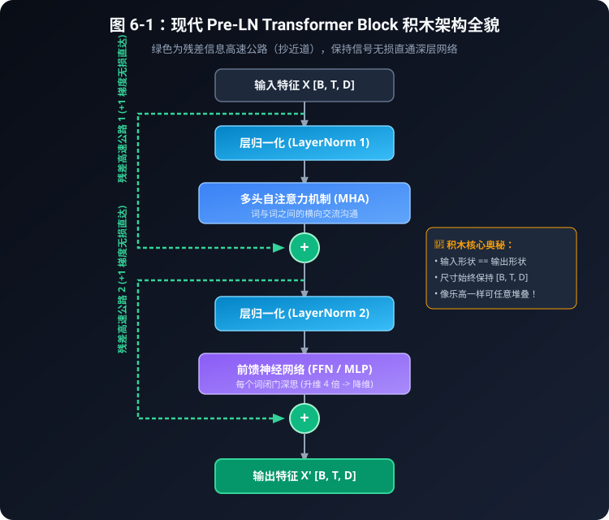

**读图提醒：**绿色路径表示加法中的恒等项；图中的“无损直达”“任意堆叠”不是总梯度或训练效果的保证。接口形状相同让多块可以连接，深度、数值范围、训练预算仍有限制。图是一个 Block，不包括完整语言模型的嵌入、位置处理、输出词表投影。Pre-LN 堆栈通常还会在所有 Block 后加最终归一化，本章这个单块没有那一步。

### 沿着形状读代码

- 输入、LayerNorm、注意力输出、第一次相加结果都是 `[B,T,D]`。
- FFN 第一层临时变成 `[B,T,d_ff]`，ReLU 不改形状。
- FFN 第二层缩回 `[B,T,D]`，才可以做第二次残差相加。

```python
# Pre-LN: 残差主干不经过 LN，LN 只在计算增量的支路上。
x = x + self._attention(self.ln1(x), mask)
x = x + self.ffn(self.ln2(x))
```

第一行右边先求值，再把新的结果赋给 `x`；第二行拿到的已经是 $u$。`_attention` 将同一个归一化后的向量作为 Q/K/V 的来源，它内部仍会做可学习投影。FFN 则只沿最后的特征维加工。

切换 `norm_first=False` 后，代码改为：

```python
# Post-LN: 先求增量并加回输入，然后归一化整个和。
x = self.ln1(x + self._attention(x, mask))
x = self.ln2(x + self.ffn(x))
```

这和 §6.3 的单支路公式一致，只是连续做了注意力、FFN 两轮。它不是仅仅把一个模块的名字改成 Post-LN。

### mask 不会因为有了 Block 就自动出现

`TransformerBlock(16,4)` 保持原调用方式，默认仍为 Pre-LN。传入 `[T,T]` 的 `mask` 时，本书约定 `1/True=可见`；在调用 PyTorch `nn.MultiheadAttention` 前转成 `mask==0`，因为该 API 的布尔 mask 使用 `True=禁止`。

不传 mask 就是双向注意力；需要因果约束时，要传入包含对角线的下三角可见矩阵。本章只演示有可见键的普通序列，不把它冒充上一批 `attention_core.py` 的完整 padding/全禁用行契约，也没有实现 encoder-decoder 的 cross-attention。三种架构的差别留到下一章。

### 表 6-7：这个教学 Block 的完整参数量

| 组件（D=16，d_ff=64） | 计数公式 | 个数 |
| --- | --- | --- |
| MHA（含 Q/K/V/O bias） | 4D² + 4D | 1088 |
| 两个 LayerNorm | 4D | 64 |
| FFN（含 b₁、b₂） | 2D·d_ff + d_ff + D | 2128 |
| 本块合计 | 以上相加 | 3280 |

上一章手写 MHA 使用无 bias 的投影，计数是 $4D^2$；这里 PyTorch MHA 启用了偏置，所以多出 $4D$。比较参数量必须先统一这些条件。本块的 3280 个参数不包括 embedding、词表输出层、位置参数或其他 Block，也不是整个语言模型的规模。

---

## 6.6 CPU 实验：不仅看形状，还检查性质

在已安装本书依赖的环境里，从仓库根目录运行：

```bash
python3 code/06_transformer_block.py
python3 -m unittest discover -s tests -p 'test_blocks.py' -v
```

本章核验环境是 CPU、PyTorch 2.14.1+cpu；测试只在安装了兼容的 2.14.x 正式版时执行张量实验，缺失或版本不符会明确跳过，不能把跳过算成数值验收通过。无需 GPU、模型权重、联网训练或付费 API。

脚本会打印本章全部七张数值表，以及以下关键行。手算部分固定输入、使用 float64；随机 Block 冒烟部分固定种子 42。

```text
Z-score: mean=2.500000, variance=1.250000, denominator=1.118038
normalized variance=0.999992
Pre-LN: shape=[2, 5, 16], forward/backward finite=True
Post-LN: shape=[2, 5, 16], forward/backward finite=True
Pre-LN zero-sublayer identity max error=0.000000
```

建议按三个实验读，而不是只看脚本有没有报错：

1. **恒等路径实验。**只把 attention 与 FFN 的参数置零，保留 LayerNorm 的 gamma=1、beta=0。Pre-LN 输出必须等于输入；Post-LN 输出则应等于连续两次归一化，一般不是恒等。这里连支路的 bias 也要清零，否则支路未必输出零。
2. **统计实验。**核对标准化前后的均值、方差，尤其注意 epsilon 主导的小方差例子。再把 gamma/beta 改为 2/1，检查“不再零均值”的结果。测试还与 PyTorch 官方 LayerNorm 对照。
3. **有限性与顺序实验。**对两种顺序各做一次因果前向和反向，检查输出、输入梯度、参数梯度都没有 NaN 或无穷；再用独立参考公式核对整个 Block，而不是仅断言输出形状。

测试也会逐字核对脚本生成的表格是否出现在正文中，防止只改代码或只改数字。有限性冒烟不等于已经训练出模型，更不是深层模型的稳定性评测。

---

## 6.7 自测：先遮住答案，再打开代码

1. 对 $x=[1,2,3,4]$，归一化的均值、方差和分母分别是什么？如果误用 D−1，方差会是多少？
2. epsilon 为正、gamma=1、beta=0 时，`[3,3,3,3]` 的 LayerNorm 输出是什么？为什么不是“方差约 1”？
3. 一个没有额外输出归一化的 Pre-LN Block，attention 和 FFN 都恒为零，输出是什么？相同设置的 Post-LN 呢？
4. `D=16,d_ff=64` 的带偏置 FFN 有多少参数？把 token 数量翻倍，参数会翻倍吗？
5. 删除 FFN 中间的 ReLU 后，两层为何可以合并？本章小例子的输出哪一维发生改变？
6. 本章 Block 不传 mask 时，能否直接当成只能看过去的自回归模型？

### 参考答案

1. 均值 2.5，方差 1.25，分母 $\sqrt{1.25001}\approx1.118038$。误用 D−1 会得到 $5/3\approx1.666667$，与本章 LayerNorm 的定义不符。
2. 零向量；减均值后每项为零，除以 $\sqrt{\epsilon}$ 仍是零。输出方差为零，不会凭空增加差异。
3. Pre-LN 输出原输入；Post-LN 为 $\operatorname{LN}_2(\operatorname{LN}_1(x))$，一般不等于原输入。若堆栈末尾另加一个归一化，不能把整个堆栈也叫恒等。
4. $1024+64+1024+16=2128$。不会翻倍，因为每个位置共用参数；计算量和激活存储会增加。
5. 用矩阵乘法结合律展开后仍是单个仿射变换。小例子的第二维由 −0.5 变成 −6.5；第一维碰巧保持 1.5，不能只看一维就判断激活无效。
6. 不能。不传 mask 默认双向；因果 mask 只是自回归模型所需条件之一，还缺语言模型输入输出层和训练、生成过程。

---

## 6.8 小结与后续路标

- 残差学习增量，让恒等映射有直接实现；它不承诺总输出或梯度永远不变。
- LayerNorm 对每个 token 的特征做“均值 → 方差 → 标准化”，epsilon 影响实际输出方差，随后 gamma/beta 还会改变尺度与中心。
- Pre-LN 与 Post-LN 的区别是计算顺序，不是标签；前者保留未归一化的残差主干，后者对相加结果归一化。
- 普通 FFN 用共享的两层仿射变换和中间非线性逐位置加工；算参数时记得偏置，算成本时区分参数与运算。

后续规划 P13 会单独讲 RMSNorm 与 SwiGLU，并在相近参数预算下做对比。本章不实现它们，也不预先承诺某个通用加速比例。先把基础 Block 的路径读准，再逐个替换组件。[路标：RMSNorm 原始论文](https://arxiv.org/abs/1910.07467)、[GLU Variants Improve Transformer](https://arxiv.org/abs/2002.05202)

接下来读第 7 章「编码器与解码器」，看相似的积木如何通过可见范围、cross-attention 和训练目标，组成不同的系统。

### 来源与核验范围

以下为论文原文与官方 API 文档；访问核验日期为 **2026-10-19**。本章表格是配套脚本的教学计算，不是原论文 benchmark 的复现。

- He 等，2015：[Deep Residual Learning for Image Recognition](https://arxiv.org/pdf/1512.03385)，§3.1–3.2：残差函数与恒等捷径。
- Ba 等，2016：[Layer Normalization](https://arxiv.org/pdf/1607.06450)，§3、§3.1：单样本统计、每维增益与偏置。
- Vaswani 等，2017：[Attention Is All You Need](https://arxiv.org/html/1706.03762v7)，§3.1、§3.3：Post-LN 与逐位置 ReLU FFN。
- Xiong 等，2020：[On Layer Normalization in the Transformer Architecture](https://arxiv.org/pdf/2002.04745)，图 1、表 1、§3：两种布局及有条件的初始化/优化分析。
- [PyTorch 2.14 LayerNorm](https://docs.pytorch.org/docs/2.14/generated/torch.nn.LayerNorm.html)：epsilon、方差口径、参数形状；[MultiheadAttention](https://docs.pytorch.org/docs/2.14/generated/torch.nn.MultiheadAttention.html)：布尔 mask 语义和参数接口。


---

# 第 7 章：编码器与解码器——从文本理解到自回归生成

前面已经有了词向量、位置编码、注意力和完整积木。现在把它们接成系统：哪些位置可以互相读信息？一张预测分数表，怎样变成逐步写出的句子？

本章的数值演示来自 [code/10_generation_loop.py](../code/10_generation_loop.py)，只依赖 Python 标准库。它用**事先写好的 logits**讲解循环和停止，不是假装已经训练出语言模型。下一章的 Baby-GPT 才把预测器换成真正的小网络。

## 7.1 不是“读者”和“作家”二选一，而是三种常见结构

经典 Transformer 论文采用 encoder-decoder：编码器先整理原文，解码器一边看已写的译文，一边查询原文表示。把编码器想成“整理资料的人”，解码器想成“拿着资料逐步写作的人”，有助于理解信息流，但模块没有人类的理解意图，也不保证内容正确。

### 表 7-1：三种结构分别能看哪里？

| 结构 | 自注意力可见范围（典型设置） | 跨序列查询 | 常见用途与边界 |
|---|---|---|---|
| encoder-only | 同一输入中允许的前后位置；仍需屏蔽 padding | 通常没有生成端 cross-attention | BERT 类表征、分类或掩码填空；不能据此断言任何编码器都只能分类 |
| decoder-only | 当前及过去的 token，禁止未来 | 通常没有独立编码器供查询 | GPT 类下一词建模；生成时每次补一个 token，训练时已知输入可并行 |
| encoder-decoder | 编码端通常双向，解码端因果 | 解码端 Q 查询编码端 K/V | 原始 Transformer 翻译；输入和输出长度可以不同 |

“decoder-only”不是把双塔中的编码器删除，却保留一条不知道该读谁的 cross-attention。常见实现也去掉这条跨塔子层。反过来，编码器没有 causal mask 不等于没有任何 mask，padding 和其他任务约束依然可能存在。

编码器可读取的完整源句子，与解码器不可偷看的未来**目标词**，是两条不同序列。翻译时源句子已经给定，读取它不是泄漏未来译文。原始结构参见 Transformer 论文 §3.1、§3.2.3；BERT 的 encoder-only 设置见其论文 §3。

## 7.2 沿着图读一遍双塔系统


下图只描述经典 encoder-decoder，不是所有聊天模型共有的完整结构。归一化与残差在简图中省略，不表示它们消失了。

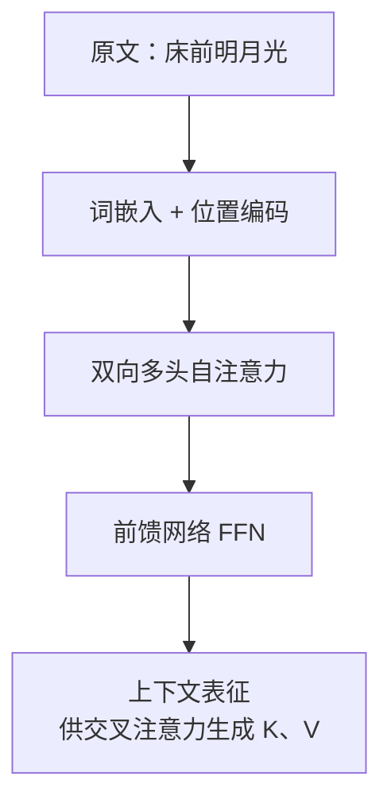

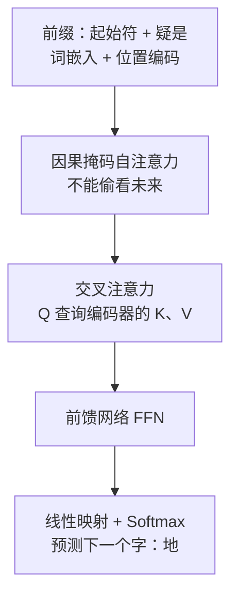
原文编码结果在本轮生成过程中可重复使用。译文前缀则每次增长。前缀中的字只是易读标签，实际序列由 tokenizer 的 token ID 组成，不保证每个字恰好一个 token。

## 7.3 闭卷考试：保留四词掩码的三步手算

假设当前位置的任务是预测**下一个**词。如果它能读取那个正确目标词的输入表示，训练就可能依赖生成时根本没有的答案。因果 mask 阻断这种路径；它不能单独解决数据泄漏、重复训练样本等其他问题，也不保证学到好模型。

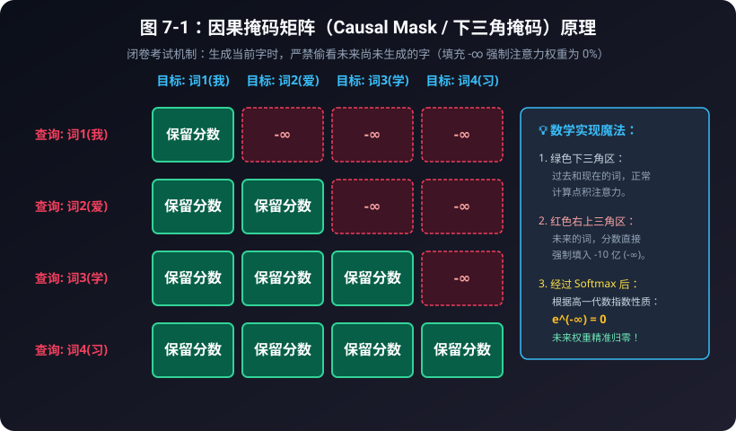

下面完整保留原来的分数表与手算链。原始分数是人为设定；脚本的 `mask_walkthrough()` 用这些数生成三张表并验证结果，不声称它们是某个模型的测量值。本例每行至少能看见自己，没有全禁用行；全禁用行的处理约定见第 3 章。

### 表 7-2：4 词序列的掩码矩阵数值演变推导表

假设输入序列为四个字：“我”、“爱”、“学”、“习”。

#### 1. 原始点积分数矩阵 (Q · K^T / √d_k)：
| 查询 (Query) \ 键 (Key) | 词1(我) | 词2(爱) | 词3(学) | 词4(习) |
| :--- | :---: | :---: | :---: | :---: |
| **词1(我)** | 2.15 | **1.80 (未来!)** | **0.95 (未来!)** | **0.40 (未来!)** |
| **词2(爱)** | 1.30 | 3.20 | **2.10 (未来!)** | **1.05 (未来!)** |
| **词3(学)** | 0.85 | 1.95 | 2.80 | **1.70 (未来!)** |
| **词4(习)** | 0.40 | 1.10 | 2.30 | 3.10 |

#### 2. 施加因果掩码后（未来位置实际填入负无穷）：
| 查询 (Query) \ 键 (Key) | 词1(我) | 词2(爱) | 词3(学) | 词4(习) |
| :--- | :---: | :---: | :---: | :---: |
| **词1(我)** | 2.15 | $-\infty$ | $-\infty$ | $-\infty$ |
| **词2(爱)** | 1.30 | 3.20 | $-\infty$ | $-\infty$ |
| **词3(学)** | 0.85 | 1.95 | 2.80 | $-\infty$ |
| **词4(习)** | 0.40 | 1.10 | 2.30 | 3.10 |

#### 3. 最终 Softmax 注意力权重矩阵（百分比）：
| 查询 (Query) \ 键 (Key) | 词1(我) | 词2(爱) | 词3(学) | 词4(习) | 每行总和 |
| :--- | :---: | :---: | :---: | :---: | :---: |
| **词1(我)** | **100.0%** | **0.0%** | **0.0%** | **0.0%** | 100.0% |
| **词2(爱)** | **13.01%** | **86.99%** | **0.0%** | **0.0%** | 100.0% |
| **词3(学)** | **9.06%** | **27.23%** | **63.71%** | **0.0%** | 100.0% |
| **词4(习)** | **4.07%** | **8.19%** | **27.20%** | **60.54%** | 100.0% |

> [!NOTE]
> **用第 2 行把手算走一遍**：
> 允许看见的分数是 1.30 和 3.20。
> $e^{1.30} \approx 3.67$，$e^{3.20} \approx 24.53$，加起来约 28.20。
> 权重分别是 $3.67/28.20 \approx 13.01\%$ 和 $86.99\%$。
> 被写成 $-\infty$ 的格子贡献 $e^{-\infty} = 0$，所以未来的字不会分到百分比。
> 第 3、4 行用的是同一套算法。上面的原始分数是为了演示而写的，不是某个训练好的模型量出来的。

对应的计算顺序不能颠倒：先确定第 i 行可见的 $j\le i$，再只对这些分数归一化，最后给未来位置补精确的 0。脚本把可见前缀送入稳定 Softmax；表中的禁止分数实际写成负无穷，不使用 `-1e9` 冒充。打印到两位的百分数可能有舍入误差，测试用未舍入值检查行和。

## 7.4 Cross-attention：查询来自目标，资料来自源句

图书馆类比里，写作者提出问题，原文资料提供标签和内容。这个类比只帮助区分信息来源：Q/K/V 都是数值向量，不是人写好的问题、书签或原文摘录，也不保证检索到的内容正确。在经典 cross-attention 中：

- Q 由解码器当前层的目标侧表示投影得到；
- K/V 由编码器输出投影得到；
- 权重沿源序列位置归一化，而不是沿译文词表归一化。

例如 batch=1，译文当前有 2 个位置、原文有 3 个位置，每头宽度 4。省略头轴后，Q=[1,2,4]，K=[1,3,4]，V=[1,3,4]；分数为 [1,2,3]，聚合结果为 [1,2,4]。输入输出长度不必相同，也不需要把它们硬凑成方阵。另取一个 $d_v=2$ 的手算例子：给第一行三份资料权重 [0.2,0.3,0.5]，三份 V 分别为 [1,0]、[0,1]、[1,1]，读到的内容便是 [0.7,0.8]，不是机械复制某一个词。

有源端 padding 时也要屏蔽对应 K/V 位置。这个“跨序列”的连接方式，不应和后续 P17 的 Causal Encoder-Decoder（CED）名称混为一谈；本章没有实现 CED，只学习传统翻译双塔与生成循环。

## 7.5 Teacher forcing：谁向右移，预测谁？

训练时可以把正确的前缀交给模型，这叫 teacher forcing；它不是在当前输出位置直接喂入当前标签。以一个完整训练序列为例：

```text
完整序列：<BOS>  我  爱  学  习  <EOS>
模型输入：<BOS>  我  爱  学  习
监督标签： 我     爱  学  习  <EOS>
```

| 计算位置 | 当前输入 token | 该位置应预测的标签 | 因果 mask 下可见的输入 |
|---|---|---|---|
| 0 | `<BOS>` | 我 | `<BOS>` |
| 1 | 我 | 爱 | `<BOS>`，我 |
| 2 | 爱 | 学 | `<BOS>`，我，爱 |
| 3 | 学 | 习 | `<BOS>`，我，爱，学 |
| 4 | 习 | `<EOS>` | `<BOS>`，我，爱，学，习 |

常说的“把目标右移一位作为 decoder 输入”，是指在目标“我 爱 学 习 EOS”前放 BOS，去掉最后的 EOS，得到输入。若从完整序列切片，代码则是：

```python
return list(tokens[:-1]), list(tokens[1:])
```

第一项是输入，第二项是向后错一位的 next-token 标签。不要把“输入右移”误写成“把标签与输入对齐不动”。BOS/EOS 是否显式存在取决于 tokenizer 与任务，这里用可读字符串代替它们的 ID。

全部输入已知，所以五个查询行可以并行计算各自的下一词损失；每行仍只能看允许的前缀。若有 padding，目标端还需 loss mask。训练时走正确前缀，推理时走自己生成的前缀，两者可能不同；一个早期错误会影响后续条件，teacher forcing 不自动保证推理质量。

## 7.6 Prefill 与 decode：不是每一轮都重新读完一切

收到提示“床前”时，可以一次处理已知提示的所有位置，这个阶段常称 **prefill**。最后一个位置的输出 logits 已可用来选出第一个新 token“明”，不需要先等一个不存在的“明”的输出。

之后把新 token 接入序列，继续预测，这通常称 **decode** 阶段。有 KV cache 的实现复用历史 K/V，只计算新增 token 所需部分；本章为了可读性，每次把完整前缀交给一个简化预测函数，**没有实现缓存，也不能用它评估推理性能**。P11 再实现缓存并做等价性检验。

“打字机特效”是界面如何流式展示文本，不能用来判断底层每步是不是一个汉字、是否有缓冲或其他生成优化。我们先学普通自回归的逻辑依赖：

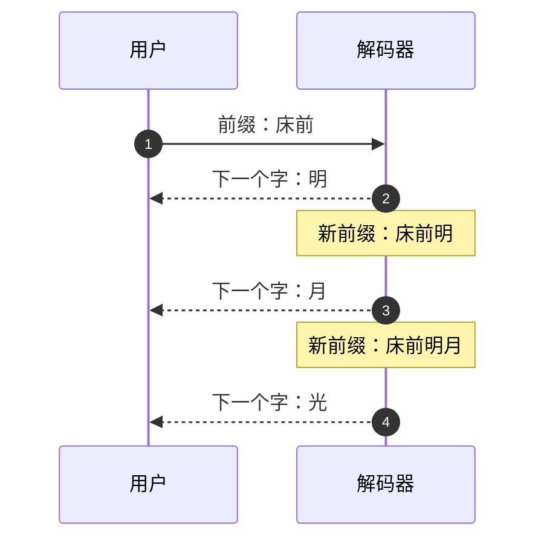
## 7.7 Greedy 与 temperature：同一组 logits，如何选 token？

Logits 是词表上未归一化的分数，不是已经生成的 token。设三名候选 A/B/C 的 logits=[2,1,0]：

$$p_i(T)=\frac{\exp(z_i/T)}{\sum_j\exp(z_j/T)},\qquad T>0.$$

脚本的 `probabilities` 先减最大值再除以温度，避免对大正数直接取指数。以下百分数由脚本计算：

| 方式 | A | B | C | 选择规则 |
|---|---:|---:|---:|---|
| greedy | 不需要算概率 | 不需要算概率 | 不需要算概率 | 直接选最大 logit，所以是 A |
| temperature=0.5 | 86.68% | 11.73% | 1.59% | 按这组分布随机抽样 |
| temperature=1.0 | 66.52% | 24.47% | 9.00% | 同上 |
| temperature=2.0 | 50.65% | 30.72% | 18.63% | 同上 |

低温使本例更集中，高温更平坦；随机抽样仍可能选择非最大项，不是“有 51% 就必选它”。若仍用 argmax 而不抽样，任意正温度都不会改变最大项的顺序。

数学公式不能直接除以 0。教学函数的 `temperature=0` **另走 greedy 分支**，同分时选词表中第一个最大项。只有最大项唯一时，$T\to0^+$ 的分布才趋向该项；并列最大项的极限仍共享权重，不等于我们的“选第一个”约定。

## 7.8 表 7-3：从真实脚本输出逐步追踪停止

为了让每个数都可核对，原先的示意概率换成脚本的固定四词输出词表：[明，月，光，`<EOS>`]。提示中的“床前”由示例直接给定。预测器按前缀长度选用写好的 logits 行，**没有学习诗歌**；固定行不需要随机种子，下面使用 greedy。显示的概率统一是温度 1 的参考分布，并非 greedy 必须先算的东西。

| 步数 | 本轮前缀 | logits（按四词顺序） | 温度1概率（同序，%） | greedy新增 | 累计新增数 / 是否停止 |
|---|---|---|---|---|---|
| 1 | 床前 | [4,1,0,-2] | [93.41,4.65,1.71,0.23] | 明 | 1 / 继续 |
| 2 | 床前明 | [0,4,1,-2] | [1.71,93.41,4.65,0.23] | 月 | 2 / 继续 |
| 3 | 床前明月 | [0,1,4,-2] | [1.71,4.65,93.41,0.23] | 光 | 3 / 继续 |
| 4 | 床前明月光 | [0,0,0,4] | [1.74,1.74,1.74,94.79] | `<EOS>` | 4 / EOS停止 |

两种上限分别运行，不要混在一条追踪里：
- `max_new_tokens=8`：第 4 步生成 EOS，立即停止，不用等到 8 步。返回列表保留 EOS，界面可另行隐藏特殊符号。
- `max_new_tokens=2`：第 2 步后就达到新增上限，返回“床前明月”，没有生成 EOS，停止原因是长度预算。
- `max_new_tokens=0`：不调用预测函数、无新增 token。若前缀本来已以 EOS 结尾，本教学函数立即按 EOS 停止。

这里的上限计**新增 token**，不把 2 个提示 token 算进去；实际框架里的 `max_length` 与 `max_new_tokens` 含义可能不同，调用时需查版本文档。长度停止可能截断一句话；模型预测 EOS 也不代表内容必然完整或正确。

把循环逐行拆开看：

```python
logits = list(logits_fn(list(tokens)))
if len(logits) != len(vocab):
    raise ValueError("one logit per vocabulary token required")
chosen = vocab[choose_token(logits, temperature, rng)]
trace.append({"step": step + 1, "prefix": list(tokens),
              "probs_at_t1": probabilities(logits), "chosen": chosen})
tokens.append(chosen)
if chosen == eos:
    return tokens, trace, "eos"
```

外层 `for step in range(max_new_tokens)` 保证有限次数；每轮取得词表分数、选择一个 token、追加前缀，再检查 EOS。源码在追加前记录 `trace`，以便显示本轮旧前缀。EOS 检查不能等到下一轮才做，否则会多调用一次模型。输出格式检查保证每个词表项恰好一个 logit。若启用抽样，固定 seed 便于复查本例，但不承诺跨框架和版本逐位一致。

## 7.9 自测、运行与下一步

```bash
python3 code/10_generation_loop.py
python3 -m unittest discover -s tests -v
```

本章无 PyTorch/GPU 依赖。回归覆盖三步 mask 数值、标签错位、温度数表、低温唯一最大项、EOS、最大新增数、零预算、固定 seed 及非法输入。

### 先回答六个问题

1. 原文 3 个位置、目标 2 个位置，cross-attention 分数该为几行几列？若三份二维 V 及权重如 §7.4，输出是多少？
2. 输入“BOS 我 爱”，标签是“BOS 我 爱”吗？
3. logits=[2,1,0]，温度 0.5 一定选 A 吗？
4. 表 7-3 在新增上限 2 时何时停止？
5. encoder-only 没有因果 mask，所以可以不处理 padding 吗？
6. 第一次生成“明”之前有没有 decode 输出“明”的表示？

### 参考答案

1. 2×3；两行目标 query，各查询三份源资料。若三份二维 V 及权重如 §7.4，输出是 [0.7,0.8]。
2. 不是。若完整样本是“BOS 我 爱 EOS”，输入是“BOS 我 爱”，标签是“我 爱 EOS”，最后一个位置预测停止符。
3. 抽样不一定，A 约 86.68%；greedy 才确定选 A。T 趋 0 的结论还要检查是否唯一最大。
4. 第 2 步，得到 4 个总 token（2 提示 + 2 新增），不是等 EOS 出现才停。
5. 不可以；允许前后文不代表补位是有用内容。
6. 不需要。prefill 的最后位置 logits 已可选出“明”；再将“明”作为下一次条件输入。我们的示例是全前缀重算，不是 KV 缓存实现。

下一单元 P09（训练基础，07a）把数据切分、交叉熵、梯度更新与评估串成训练闭环，再进入第 8 章 Baby-GPT 实践。本章的固定 logits 演示仍只是生成控制流程，不等于训练模型。

## 原始来源与版本

- [Attention Is All You Need，v7，§3.1、§3.2.3、§3.4](https://arxiv.org/html/1706.03762v7)：双塔结构、因果约束、目标右移和输出层。
- [BERT 原始论文，§3](https://arxiv.org/abs/1810.04805)：双向编码器预训练；“双向”不是任何任务都可看未来答案。
- [Transformers 4.57.1 生成参数文档](https://huggingface.co/docs/transformers/v4.57.1/en/main_classes/text_generation)：temperature、EOS 及长度参数的接口语义；本章不用这个库执行实验。
- [Transformers 4.57.1 缓存说明](https://huggingface.co/docs/transformers/v4.57.1/en/cache_explanation)：理解历史 K/V 复用的概念路标。文档核验日期：2026-10-19。


---

# 训练基础（P09）：让一次猜字变成一次学习

前面我们已经装好了注意力、残差和因果掩码。但“能算出下一个字的分数”不等于“已经学会猜字”。本章先把训练循环慢放，再到下一章《Baby-GPT》拼完整模型。

**读完你应该能回答：这一批题从哪里来，答案对齐哪一格，错多少，谁计算梯度，谁修改参数，以及凭什么说模型变好了。** 先懂 Python 切片与前几章的 `[B,T,C]` 就够了；导数只用“向哪个方向微调”的直觉。

## P09.1 练习册、答题纸与考试卷

训练像练习默写：模型交一份答题纸，损失函数评分，梯度告诉我们怎样微调，优化器实施调整。类比的边界是：模型没有老师式理解；一次更新是数值计算，不保证每道题都改对，也不保证下一次总分必然更好。

```text
原文 -> 按文档分组 -> 训练文档 -> 抽一个 batch
                         |           |
                         |       前向得到 logits
                         |           |
                         |       对齐答案算 loss
                         |           |
                         |       backward 算梯度
                         |           |
                         +------ step 改参数

独立保留文档 -----------------> 只评分，不更新
```

先分文档，再抽窗口。把同一首诗的许多重叠窗口随机分成“训练/验证”，相当于考试卷藏着练习册里几乎相同的题。窗口不相同，也不代表来源独立。

本章把三首诗中的前两首作为训练来源，把整首《春晓》留下。每个窗口只取自一首诗，不把上一首最后一字接到下一首首字。这个划分可演示评估流程，**只有一个保留文档，不是可靠的泛化基准**；共同标点、体裁与小样本噪声都会影响结果。真正做项目，还要按来源去重，留出更多文档；用于选择超参数的是验证集，最终测试集不能反复拿来调参。本章没有声称拥有独立最终测试集。

为复用下一章词表，本实验预先用三首诗的全部字符定义 57 字词表。训练不读取第三首的标签，但词表知道第三首出现哪些字：这是 **transductive（利用了保留数据的词汇信息）设置**，不是严格训练集独立构建的 tokenizer。更严格的方案要预先固定词表，或只在训练文档建词表并明确未知字符策略。即使知道字符 ID，模型也没有学到这些字符在第三首中的顺序。

## P09.2 输入与标签只错开一个位置

假设文本是“床前明月光”，取长度 `T=4`，需要先取 **5 个字符**：

| 时间格 t | 0 | 1 | 2 | 3 |
| --- | --- | --- | --- | --- |
| 输入 x | 床 | 前 | 明 | 月 |
| 目标 y | 前 | 明 | 月 | 光 |
| 这一格能看的输入 | 床 | 床前 | 床前明 | 床前明月 |

Python 切片是 `x = ids[start:start+T]`，`y = ids[start+1:start+T+1]`。右端不包含。`start+T` 必须小于文档长度，否则最后一个输入没有答案。

为什么整行输入包含“明”，预测“前”的时候不会偷看？因为前面学过的因果掩码限制每一格只能看自己和左边。标签是评分依据，不能作为当前格输入的额外通道。训练中一次并行算全部位置，生成时则只有已有前缀。

脚本的 `shifted_pair` 负责切片，`assert_shift` 用原始文档核对，不只比较 x/y 的长度。若误写 `y=x`，形状完全正确，训练目标却从“预测下一个字”变成了“抄当前字”。

### 亲手做一次作弊反例

给定输入 ID `[0,1,2]`，每一格都把当前输入 ID 的分数设成 12，其他三个类别设成 0。这个“模型”没有训练：

- 错误答案 `[0,1,2]`：平均 loss 约 **0.00001843**。
- 正确的下一字答案 `[1,2,3]`：平均 loss 约 **12.00001843**。

一个漂亮的 loss 可以来自一道错误的题。因果掩码不能修好 `y=x`，因为当前格本来就允许看见自己。

## P09.3 损失到底在罚什么：手算交叉熵

模型输出的是任意实数分数 logits，不必为正，也不要求总和为 1。softmax 将分数变成概率；交叉熵取正确答案概率的负自然对数：`loss = -ln(p_correct)`。正确答案概率越小，罚得越重。对数底数为 e，单位可称 nats。

下面只有 A/B 两类、两个待评分位置，二者正确答案都是 A。令 `ln(3)=1.098612289`：

| 位置 | logits (A,B) | softmax (A,B) | 正确答案 | 单位置 loss |
| --- | --- | --- | --- | --- |
| 0 | (ln(3), 0) | (0.75, 0.25) | A | -ln(0.75) = 0.287682072 |
| 1 | (0, ln(3)) | (0.25, 0.75) | A | -ln(0.25) = 1.386294361 |

默认平均损失为 `(0.287682072 + 1.386294361) / 2 = 0.836988217`。不是先把正确答案概率平均成 0.5 再取负对数，后者是不同的量。PyTorch 的 `cross_entropy` 已包含稳定的 log-softmax 计算，**传 logits，不要先 softmax 再传进去**。

一般 batch 有 B 行、每行 T 格、词表 V 个字：

| 对象 | 形状 / 类型 | 含义 |
| --- | --- | --- |
| x、y | `[B,T]`，整数 long | 输入 ID、正确目标 ID |
| logits | `[B,T,V]`，浮点 | 每格每个候选字的分数 |
| 用于 CE 的 logits | `[B*T,V]` | 把格子排成一个题目列表 |
| 用于 CE 的 y | `[B*T]` | 每题一个类别编号 |
| mean loss | 标量 | 本 batch 所有格子的平均损失 |

这里没有 padding、类别权重或忽略标签，每格权重相同。以后有 padding 时，分母应是有效标签数，不能把 padding 算进去。评估多份长度不同的文档时，也要按预测 token 数加权，不是把每份文档的平均 loss 再简单平均。

## P09.4 backward 不更新参数，step 才更新

先把模型缩到最小：只有两个可训练分数 `z=[ln(3),0]`，正确答案 A。此时梯度是“预测概率减真实 one-hot”：

```text
预测概率             [0.75, 0.25]
真实答案             [1.00, 0.00]
loss 对 z 的梯度     [-0.25, 0.25]
学习率 0.1 的 SGD:
新 z = 旧 z - 0.1 * 梯度 = [1.123612289, -0.025]
```

A 分数上升、B 分数下降，新 loss 为 **0.275414489**，小于原来的 0.287682072。脚本用标准库生成这些数值；测试另用微小扰动的有限差分验证梯度，不只检查输出里是否有这串数字。这个例子是直接优化 logits 的单题 SGD，真实模型要把梯度沿计算图反传到 embedding、投影矩阵等参数。

两格取 mean 时，每格梯度还要除以 2，因此上表两个位置的梯度分别是 `[-0.125,0.125]` 和 `[-0.375,0.375]`。换成 sum，梯度也会跟着变；学习率不能脱离 loss reduction 讨论。

下面是[实验源码](../code/11_training_loop.py)的 `train_step` 核心：

```python
model.train()
optimizer.zero_grad(set_to_none=True)  # backward adds; do not mix batches accidentally
logits, loss = model(x, y)
loss.backward()
optimizer.step()
```

逐行拆开：

1. `train()` 设置训练模式，不是“开始训练”的魔法按钮。
2. `zero_grad` 清掉上一轮梯度。这不是把权重清零。
3. 前向调用模型，得到分数和当前损失；autograd 记录需要求导的运算。
4. `backward()` 按链式法则算梯度并写入参数的 `.grad`，还没有修改权重。
5. `step()` 根据梯度更新权重。脚本使用 AdamW，下面的手算则用 SGD；不要把 SGD 的一步公式当成 AdamW 的精确公式。

为什么每轮清零？PyTorch 默认把新梯度加到旧梯度上。对同一个参数、不更新参数地反传同一道题两次，`[-0.25,0.25]` 会变成 `[-0.5,0.5]`。有意积累多个 micro-batch 可以节省显存，但需要设计缩放和更新时机；本实验每 batch 更新一次，不需要跨 batch 积累。

## P09.5 train、eval 与 no_grad 是三件不同的事

`eval()` 影响 Dropout、BatchNorm 等有模式差异的层，**不禁止梯度**；`no_grad()` 不记录求导图，**不自动切成 eval 模式**。评估通常两者一起使用，且不调用 optimizer。下面是独立示意代码，不是源码摘录：

```python
was_training = model.training
model.eval()
with torch.no_grad():
    logits, loss = model(x, y)
model.train(was_training)
```

实验的 `evaluate` 还通过 `try/finally` 保证恢复模式。当前 BabyGPT 没有 Dropout/BatchNorm，因此切换模式可能不改变它的数值输出；测试用一个 `Dropout(p=1)` 小对照说明模式的真实作用，而不虚构 BabyGPT 的随机层。

评估 loss 时，保留诗的前面字符作为已知前缀是允许的，这是条件概率评分；没有用其标签更新参数。不要把“不给梯度”误写为“连保留文档都不能前向读取”。不过，反复根据这个 loss 挑种子、调步数，会让它成为调参验证集，不能再声称是从未碰过的最终测试。

## P09.6 CPU 实验：同一个种子再跑一次

从仓库根目录执行。无需下载模型、无需 GPU，也不写 checkpoint：

```bash
python code/11_training_loop.py --scalar-only
python code/11_training_loop.py --steps 40 --seeds 7 7 11
python -m unittest discover -s tests -p test_training_loop.py -v
```

第一条只用标准库；第二条需要稳定版 PyTorch **2.14.x**。缺失或不兼容版本时它解释原因并退出，不自动安装；测试仍运行标量部分，只跳过张量部分。已配置仓库环境可把 `python` 换成 `.venv/bin/python`。

教学配置是 CPU 单线程、`d_model=16`、4 头、1 层、最大位置 32、B=4、T=8、AdamW 学习率 0.003、40 次更新。每次从两首训练诗随机取 4 个窗口；共消费 40×4×8=1280 个预测位置，**包含重复，不等于 1280 个独立样本**。每次运行重新初始化模型与优化器，同时固定 Python 抽样 RNG 和 PyTorch 种子，并开启确定性算法。

下面是 2026-10-19、PyTorch 2.14.1+cpu 的复核记录，显示到六位小数。seed 11 保留后值采用独立审核环境的 4.397413730…，四舍五入为 4.397414；本地复跑为 4.397413254…，相差一个 float32 ULP。测试对表值使用绝对容差 1e-6，容纳舍入和这一级 CPU 数值差异，而不容许学习率改变造成的偏移。训练/保留 loss 都用整首诗的所有下一字位置评分，和训练时长度 8 的随机窗口口径不同：

| 运行 | 首 batch loss | 训练文档 loss 前→后 | 保留文档 loss 前→后 |
| --- | --- | --- | --- |
| seed 7 | 4.280819 | 4.219313 → 3.175501 | 4.494203 → 4.843005 |
| seed 7 再跑 | 4.280819 | 4.219313 → 3.175501 | 4.494203 → 4.843005 |
| seed 11 | 4.219005 | 4.189975 → 3.263426 | 3.923873 → 4.397414 |

### 先检查标签分布，再解释 loss

这里“训练见过”严格指两首训练诗的**下一字标签集合**，即各自 `encode(doc)[1:]` 的并集，不是全部输入字符，更不是预先定义的全语料词表。留出诗有 23 个目标位置，其中 19 个目标从未作为训练答案出现；共有的 4 个目标只包括“，”和“。”各两次。计数按出现次数，不按不同字符数。

`evaluate_strata` 逐位置计算不归约的交叉熵，再按这个集合分组；训练前后都输出 count、loss_sum 和 mean loss：

| 运行 | 训练标签见过的目标数 | 见过组 loss 前→后 | 未见过的目标数 | 未见组 loss 前→后 |
| --- | --- | --- | --- | --- |
| seed 7（重复相同） | 4 / 23 | 4.266185 → 3.506729 | 19 / 23 | 4.542207 → 5.124327 |
| seed 11 | 4 / 23 | 4.072877 → 3.441714 | 19 / 23 | 3.892503 → 4.598613 |

两组不是各占一半：整体均值应是 `(4 × 见过组 loss + 19 × 未见组 loss) / 23`。测试检查这个重组合等于总体 loss（允许 float32 归约误差）。共有目标的 loss 实际下降；整体上升主要来自那 19 个从未作为训练答案的目标。在训练 softmax 分类时，这些类别没有正目标奖励，但仍出现在分母里，其分数可能被相对压低。**这次留出 loss 上升主要反映标签分布不匹配，本实验不能证明过拟合。看到留出 loss 上升，先检查留出标签是否见过。** 只有 4 个共有标点变好，也不能据此推断词汇或语言泛化变好。

过拟合指模型过度适应训练材料、在可比的新样本上表现变差；训练 loss 下降而验证 loss 上升只是需要诊断的现象，不是自动成立的结论。若要演示它，需要另设词汇覆盖可比、来源独立的留出材料，固定评估口径并跟踪训练过程，例如检查验证 loss 是否先下降后上升。本批只讨论过拟合概念，**没有演示或证实过拟合**，也不将不匹配的两组数据包装成过拟合实验。

同种子同环境重复是复现实验的检查，不是跨硬件/版本逐位相同的承诺；换种子也不是新增独立测试语料。

下一章的 S0 会在三首诗上训练并检查背诵，它是 **同语料记忆/工程基线**。本章两首训练、一首保留是另一种评估演示，不要把两个 loss 混在同一条曲线上。生成检查能发现乱码、循环、提示词接不上等直观问题，但背出训练诗并不证明新诗写作或通用语言能力。只有 loss 和生成片段一起看，再核对数据来源，才不会被“出口成章”迷惑。

## P09.7 自测：先答，再看后面的答案

1. 对 ID `[4,7,1,9,3]`，start=1、T=3，x/y 各是什么？把 y 设为 x，因果掩码能否补救？
2. 表中两道题的 mean loss 是多少？为什么不是 `-ln(0.5)`？
3. 单题 logits `[ln(3),0]`、答案 A，梯度与学习率 0.1 的 SGD 更新后 logits 是什么？若两题取 mean，梯度怎样变化？
4. 不调用 step，连续 backward 同一道题两次会怎样？在哪一行清零？
5. `eval()` 是否关闭 autograd？`no_grad()` 是否关闭 Dropout？当前 BabyGPT 切换模式为什么可能没有数值变化？
6. 把同诗重叠窗口分到训练和验证有什么问题？本实验整首保留后，为什么仍不能据此声称通用语言能力或证明过拟合？

### 参考答案与可执行测试对应

1. x=`[7,1,9]`，y=`[1,9,3]`；不能。当前格合法地能看见自己，错误任务变成复制。对应 `test_shift_and_wrong_shift_mutation` 与 `test_copy_cheat_is_not_next_token_skill`，错误标签会被拒绝，而作弊低 loss 会被实际计算出来。
2. 0.836988217。交叉熵是各题负对数的均值，不是概率均值的负对数。对应 `test_hand_calculated_cross_entropy` 与 `test_reduction_and_autograd_match_handcalc`。
3. 梯度 `[-0.25,0.25]`，更新后 `[1.123612289,-0.025]`；两题取 mean 时每题梯度除以 2。对应 `test_gradient_finite_difference_and_update` 与 `test_reduction_and_autograd_match_handcalc`。
4. 梯度累加成两倍；下一批前调用 `optimizer.zero_grad(set_to_none=True)`。对应 `test_gradient_accumulation_and_clear`；`test_train_step_rejects_zero_grad_omission_numerically` 另跑不清零的错误循环，确认其参数偏离正确参考，避免仅靠搜一行源码“证明正确”。
5. 两者都不会替代另一方；BabyGPT 无 Dropout/BatchNorm。对应 `test_eval_no_grad_and_restore_mode`：用真实 `evaluate` 前向的 pre-hook 确认 `training=False` 与 `is_grad_enabled=False`，另检查权重不变、模式恢复，并用 Dropout 对照。`test_evaluate_unequal_documents_token_weighted` 使用 1 个与 4 个目标的不等长文档，核对 token 加权 3.4，而不是文档均值 2.5。
6. 重叠来源使验证不独立。本实验只有一首保留诗、全语料词表且体裁单一；19/23 个留出目标未在训练标签中出现，4 个共有标点的 loss 反而下降。总体上升主要来自标签分布不匹配，不能证明过拟合，本批未演示过拟合。下一章 S0 更只是同语料记忆。对应 `test_split_and_leakage_mutation`：将训练文档混入保留集合会报错；`test_fixed_seed_repeat_and_heldout_report` 检查重复运行；`test_40_step_snapshots_and_label_strata` 固定种子 7/11 的 40 步结果、实际学习率、19/23 计数、共有组下降方向及两组重组合，不断言“训练必能改善整体保留 loss”。

## P09.8 来源与边界

核验日期：2026-10-19。API 依据锁定为 PyTorch 2.14 文档，运行数值使用 2.14.1+cpu：

- [CrossEntropyLoss](https://docs.pytorch.org/docs/2.14/generated/torch.nn.CrossEntropyLoss.html)：logits 输入、类别标签与 reduction。
- [Optimizer.zero_grad](https://docs.pytorch.org/docs/2.14/generated/torch.optim.Optimizer.zero_grad.html)：梯度清理与 `set_to_none`。
- [Autograd mechanics](https://docs.pytorch.org/docs/2.14/notes/autograd.html)：梯度记录、no-grad 与 eval 的区别。
- 大纲 S14 的 [Transformers 文档入口](https://huggingface.co/docs/transformers/index) 是进一步学习训练框架的导航；本实验不调用 Transformers，也不把动态文档版本冒充已验证依赖。
- 大纲 S18 [Training Compute-Optimal Large Language Models](https://arxiv.org/abs/2203.15556) 研究特定大规模设置下模型规模、数据量和计算预算的关系。它提醒我们同时报告预算和数据，但不能把论文比例套到三首诗、不能由本实验推出 scaling law，也不据此承诺增加步数就能提升泛化。


---

# 第8章：实战——手搭一个微型大语言模型（Baby-GPT）

上一单元 P09 把“数据 → 预测 → 损失 → 梯度 → 更新”走了一遍。现在不再换一套神秘组件，而是把已经学过的嵌入、注意力和 Block 接起来，留下一份后续改进都能比较的 **S0 基线**。

本章的目标是训练一个能背三首诗的微型自回归模型，不是训练通用聊天助手。先确认它算对，再看它记住了什么，最后保存与重新载入同一套参数。下一单元 P11 只改变生成的计算方法，加 KV cache；不会偷偷换模型再宣称提速。

## 8.1 任务、边界与运行

配套 [code/07_baby_gpt.py](../code/07_baby_gpt.py) 保留三首完整诗：《静夜思》《登鹳雀楼》《春晓》。每首 24 个字符（含标点），共 72 个字符；字符词表 57 项。

```bash
OMP_NUM_THREADS=1 python3 code/07_baby_gpt.py
python3 -m unittest discover -s tests -p 'test_baby_gpt.py' -v
```

需要 `requirements.txt` 中的 CPU PyTorch；本文数值来自 Python 3.12、PyTorch 2.14.1+cpu、种子 42、单线程环境。线程数、版本、设备会影响运行时间及浮点结果，不能仅凭相同 seed 承诺跨平台逐位相同。

本章把三首诗全用于训练，观察的是**训练集记忆**。P09 的整首留出实验才有训练与验证之分，而且数据仍小到不足以评价通用语言能力。本章的生成例子也不是盲测集。不要将每首诗的重叠窗口随机分组后叫作独立泛化评估。

## 8.2 先读配置与参数账

### 表 8-1：S0 的固定配置

| 字段 | 数值 | 在模型中的作用 |
| --- | --- | --- |
| `vocab_size` | 57 | 每个位置输出 57 个 logits |
| `d_model` | 48 | 残差主干的宽度 |
| `num_heads` | 4 | 每头宽度 48 / 4 = 12，不是 4 个独立语言模型 |
| `num_layers` | 2 | 两个 Pre-LN 因果 Block |
| `max_seq_len` | 128 | 可学习位置表和因果 mask 的容量 |
| FFN 中间宽度 | 192 | 4 × 48，激活使用 GELU |
| 学习率 / 更新次数 | 0.01 / 80 | 本章记忆实验，不是通用推荐参数 |
| 参数总数 | 67872 | 不包含不训练的 mask 缓冲区 |

可以自己逐项加总，而不是只相信打印结果：

| 部件 | 算式 | 参数 |
| --- | --- | --- |
| 词嵌入 | 57 × 48 | 2736 |
| 可学习位置表 | 128 × 48 | 6144 |
| 每个 Block 的 Q/K/V/O（无偏置） | 4 × 48² | 9216 |
| 每个 Block 的 FFN（有偏置） | 48 × 192 + 192 + 192 × 48 + 48 | 18672 |
| 每个 Block 的两个 LayerNorm | 2 × (48 + 48) | 192 |
| 两个 Block | 2 × (9216 + 18672 + 192) | 56160 |
| 最终 LayerNorm | 48 + 48 | 96 |
| 输出头（无偏置） | 48 × 57 | 2736 |
| 总计 | 2736 + 6144 + 56160 + 96 + 2736 | 67872 |

输出头与词嵌入是两份参数，并没有权重绑定。第 6 章用 `nn.MultiheadAttention` 的带偏置示例，所以不能照搬它的 MHA 公式。GELU 不含可训练参数；它与 ReLU 都提供非线性，但函数不同。[来源 1]

`GPTConfig` 记录架构配置，`model.config` 可以拿回来核对。更改宽度、层数、词表或位置容量会改变参数形状，不能把不兼容 checkpoint 硬塞进去。

## 8.3 一个短句的完整数据流

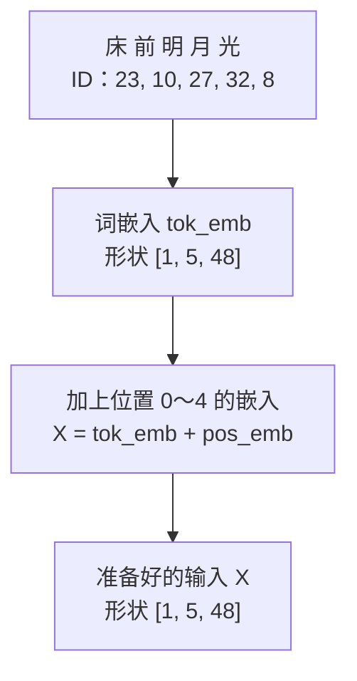

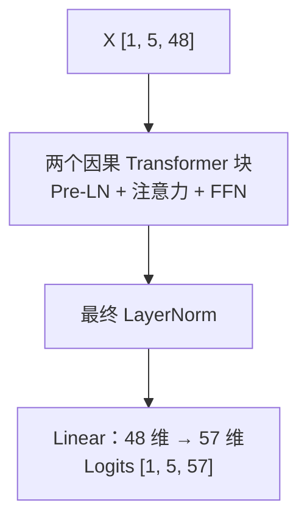

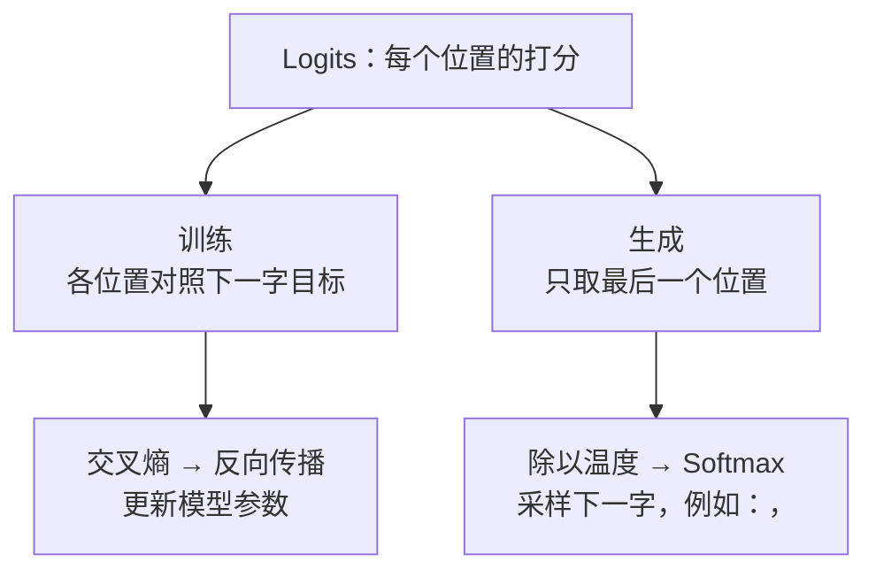

三张图沿用同一配置。最后一张的温度采样是温度大于 0 的路径；`temperature=0` 走 argmax，不做除零。

### 表 8-2：真实字符编号

| 汉字 | 数字 ID | 汉字 | 数字 ID | 汉字 | 数字 ID |
| :---: | :---: | :---: | :---: | :---: | :---: |
| **。** | 0 | **一** | 1 | **上** | 2 |
| **不** | 3 | **光** | 8 | **前** | 10 |
| **地** | 13 | **床** | 23 | **明** | 27 |
| **月** | 32 | **霜** | 52 | **，** | 56 |

编号来自 `sorted(set(text_corpus))` 的 Unicode 顺序，没有语义大小关系。“床前明月光”编码为 `[23,10,27,32,8]`；输入张量形状 `[1,5]`，不是 `[5,57]`。

```text
ids [B,T]          → tok_emb [B,T,48]
positions [T]      → pos_emb [T,48]，广播到 batch 后相加
每层 Q/K/V         → [B,4,T,12]
注意力分数/权重     → [B,4,T,T]
拼接、投影、FFN     → [B,T,48]
最终 LN 与输出头    → logits [B,T,57]
```

本模型用的是**可学习绝对位置表**，不是第 5 章的 sin/cos，也不是 RoPE。每次完整前向从位置 0 开始。它没有 cross-attention、外部文档输入或对话角色处理。

## 8.4 按模块读源码，不把组件跳过去

完整实现只在源码维护，下面摘出关键语句；标记 `# ...` 的位置表示省略，不是可独立运行的完整类。

### 词表与样本边界

```python
text_corpus = "".join(poems)
# ...
unique_chars = sorted(list(set(text_corpus)))
vocab_size = len(unique_chars)
char2idx = {ch: i for i, ch in enumerate(unique_chars)}
idx2char = {i: ch for i, ch in enumerate(unique_chars)}
```

合并 `text_corpus` **只用于建词表**；训练仍逐首取样。否则一首诗末尾会被错误地要求预测下一首开头。`encode` 没有未知字符回退，也没有 BPE，输入词表外字符会报错；`decode` 则将 ID 反查字符。两者的顺序也是 checkpoint 的一部分。

### 因果自注意力

```python
Q = self.W_q(x).view(B, T, self.num_heads, self.head_dim).transpose(1, 2)
K = self.W_k(x).view(B, T, self.num_heads, self.head_dim).transpose(1, 2)
V = self.W_v(x).view(B, T, self.num_heads, self.head_dim).transpose(1, 2)
# ...
scores = torch.matmul(Q, K.transpose(-2, -1)) / math.sqrt(self.head_dim)
```

每个 query 只能看自己和更早的 key。未来位置先在 scores 中遮挡，再做 Softmax；不能先归一化再删掉未来权重。当前 S0 没有 padding，合法非空输入每行至少能看见自己。S0 测试会改变后缀字符，检查前缀**所有 logits** 不变，而不只看最后选出来的字碰巧一样。

### Pre-LN、GELU 与最终输出

```python
x = x + self.attn(self.ln1(x))
x = x + self.mlp(self.ln2(x))
```

`BabyBlock` 先用 LN 求增量，再把增量加回主干，与第 6 章默认 Pre-LN 顺序相同。MLP 是 `Linear(48,192) → GELU → Linear(192,48)`。GELU 可写成 x 乘标准正态分布的累计概率，负半轴并非一刀切为零；不必在这里背积分，知道它不是线性层即可。[来源 1]

两个 Block 后还要经过 `ln_f` 和 `head`。`head` 输出的是实数 logits，不是已经归一化的概率。训练时直接把 logits 交给交叉熵；生成时再根据策略选择下一字。不要在交叉熵前重复 Softmax。

## 8.5 从一次 loss 到 80 次更新

每首诗取前 23 个字符作为输入，后 23 个字符作为标签。每个位置预测紧挨着的下一字；一首诗有 23 个监督目标，三首共 69 个。训练循环做：

```python
optimizer.zero_grad()
losses = []
for data in encoded_poems:
    _, loss = model(data[:-1].unsqueeze(0), data[1:].unsqueeze(0))
    losses.append(loss)
loss = torch.stack(losses).mean()
loss.backward()
optimizer.step()
```

内部交叉熵是该首所有 token 的平均，外部再对三首取平均。三首长度相等，这等于 69 个 token 的平均；如果长度不同，“每首等权”不再等于“每个 token 等权”。P09 的 reduction 例子专门区分这两种目标。

`zero_grad` 清掉上一轮的梯度，`backward` 算出本轮梯度，`step` 更新参数。当前脚本使用 AdamW，包含自适应状态，不是手算小节里的裸 SGD；学习率相同也不能预期更新完全一样。`train()` 不会替你反向传播，`eval()` 也不会替你关闭梯度。本模型没有 dropout，因此两种模式对当前层的数值本身没有随机开关；生成仍显式使用 eval 和 no_grad，以建立正确习惯。

### 表 8-3：种子 42 的 S0 训练日志

| 更新序号 | 更新前训练 loss | 解释 |
| --- | --- | --- |
| 1 | 4.1271 | 与均匀猜测 ln(57) ≈ 4.0431 同量级，但不是完全均匀分布 |
| 20 | 0.0196 | 正在记住同一批目标 |
| 40 | 0.0021 | 继续提高训练字符的概率 |
| 60 | 0.0011 | 仍是训练集结果 |
| 80 | 0.0009 | 不能据此推出验证集正确 |

表内是本次循环算完前向、尚未 `step()` 时的值；“第 80 行”不代表更新 80 次后的另一次评估。参数有 67872 个，而语料只有 72 个字符，记忆这个微型训练集不是惊人的泛化证据。固定版本的回归核对这份四位小数日志快照；其他张量比较使用声明的数值容差，不把训练墙钟时间当成通过门槛。

## 8.6 保留生成对照，也保留失败案例

### 表 8-4：每次新增 15 字，温度 0

| 提示 | 未训练 | 更新 80 次后 |
| --- | --- | --- |
| 床前 | `床前穷河前月眠欲黄头黄一日依疑，床` | `床前明月光，疑是地上霜。举头望明月` |
| 白日 | `白日穷河前月眠欲黄头黄一日依疑，床` | `白日依山尽，黄河入海流。欲穷千里目` |
| 春眠 | `春眠落头黄风白望入落欲一日依疑，床` | `春眠不觉晓，处处闻啼鸟。夜来风雨声` |

再输入不在课文开头的“明月”，这个固定实验输出：

```text
明月不觉晓，处处闻啼鸟。夜来风雨声
```

它没有接回“明月光”，而是转入另一首诗。这个反例说明本次训练不保证任意提示都能接回原文；单个反例也不能证明模型内部完全没有学到任何词关系。不要将“背诵 vs 理解”写成可由一条输出解决的哲学判定。

S0 的停止条件是新增字符数，没有训练 `<EOS>`。句号和 EOS 不是同一回事：生成句号不会自动停。温度 0 是贪心；为兼容旧 API，负温度也走贪心，新的调用建议只用 0 或正数。温度为正时按概率采样，1 是原分布，0.2 放大分数差，2 缩小分数差；都不是正确率旋钮。

S0 超过 128 个输入字符时，在生成循环中取最后 128 字并把位置重新编号为 0–127。这是一个明确的**滑窗重算策略**，不是无限上下文，也不能与沿用旧绝对位置的缓存结果直接比较。P11 的缓存演示到容量上限就报错，不伪装成同一滑窗策略。

## 8.7 保存再加载：基线必须能回来

只有 loss 日志不够。后续要比较 S0/S1，必须复用完全相同的权重、配置和词表。配套 `save_checkpoint(path, model)` 保存配置、参数与字符顺序；`load_checkpoint(path)` 在 CPU 创建对应模型并恢复权重。测试在临时目录保存后加载，对同一批输入比较所有 logits。

```python
# 在已导入本脚本的 Python 会话内；model 是你的 BabyGPT 实例。
save_checkpoint("baby_gpt.pt", model)
restored = load_checkpoint("baby_gpt.pt")
restored.eval()
```

这里只提供**推理基线恢复**，不承诺训练中途精确续跑。续训通常还需 optimizer 状态、随机数状态、数据采样位置与步数；不能将本 checkpoint 的 round-trip 测试当成全部续训条件已经实现。

只加载自己生成或可信来源的文件。实现显式使用 `torch.load(..., weights_only=True)` 并核对格式；这不是允许任意陌生文件的安全保证，不要为载入来历不明文件改成不受限反序列化。[来源 2]

## 8.8 先预测，再看答案

1. `[2,5]` 的字符 ID 输入在默认配置下，logits 是什么形状？
2. 三首 24 字诗各自 shift，监督目标一共多少个？直接拼接后会多出什么？
3. 为什么不能把表 8-3 叫验证 loss？长度不同时，平均每首 loss 等于平均每个 token 吗？
4. 默认模型参数为什么不是把 57×48 只算一次？mask 是训练参数吗？
5. 生成遇到句号会停吗？保存 checkpoint 后是否能精确恢复优化器继续训练？
6. 改掉输入后两个字符，因果模型前面位置的 logits 应该变化吗？只看 argmax 是否足够？

### 参考答案

1. `[2,5,57]`。每个 batch、每个位置都给整个词表打分。
2. 3×23=69。拼成 72 字会有 71 个目标，其中两个跨诗边界是本任务不想训练的连接。
3. 全部诗都参与了参数更新。长度不同时每首等权与 token 等权不同。
4. 输入嵌入和输出头没有绑定，各有 2736 个参数。mask 是固定 buffer，不算可训练参数；总计 67872。
5. 不会，本模型无 EOS，只按新增预算停。checkpoint 恢复配置/权重/词表，不保存全部续训状态。
6. 不应该；要逐位置比较 logits。两个分布变化后仍可能选同一个最大项，argmax 相同不能证明计算等价。

这些结论对应 `tests/test_baby_gpt.py` 的形状/loss、词表与参数、因果性、训练与 checkpoint 检查。P09 负责训练基础的梯度和数据边界；下一单元 P11 负责缓存与完整计算的数值等价，不用一次庞大测试掩盖各自的契约。

## 原始来源与实现版本

核验日：2026-10-19。S0 是本仓库教学实现，不是某个商业模型的精确复刻。

1. [PyTorch 2.14 GELU](https://docs.pytorch.org/docs/2.14/generated/torch.nn.GELU.html)：激活定义。模型结构以 [code/07_baby_gpt.py](../code/07_baby_gpt.py) 为准。
2. [PyTorch 2.14 torch.save](https://docs.pytorch.org/docs/2.14/generated/torch.save.html)、[torch.load](https://docs.pytorch.org/docs/2.14/generated/torch.load.html)：序列化、设备映射与 weights_only 边界。
3. [Transformers 4.57.1 生成参数](https://huggingface.co/docs/transformers/v4.57.1/en/main_classes/text_generation)：用于比较长度/采样接口概念；本章不依赖 Transformers 运行，不声称它的参数语义与旧 Baby-GPT 每处相同。


---

# 生成优化（P11）：KV Cache，不再重复算历史

第 8 章得到一份明确的 S0：相同字符词表、可学习绝对位置、两个 Pre-LN Block。现在实现 S1，**权重一项都不改，只缓存生成中可以复用的中间结果**。先证明 logits 对齐，再问时间和内存，不能把“生成的字看起来一样”当作正确性证明。

配套 [code/12_kv_cache.py](../code/12_kv_cache.py) 直接使用 S0 的模型模块，不另训一份近似模型。实验是 CPU、float32、无 dropout、eval 模式；不下载权重，不用 GPU。

## P11.1 重算发生在哪里

假设提示有“床前”两个字符。S0 先计算这两个位置，再选出“明”；下一轮把“床前明”三个位置全部送进模型，先前“床”“前”的计算又做一次。

在因果模型中，较早位置不能看后来追加的 token。如果权重、位置、历史 token 和确定性的前向计算都不变，较早位置在每层的表示也不会因追加后缀而变化。因此它们的 K 和 V 可以保存，下一步直接读。Q 是本次新位置要发出的查询，不必保存整个历史 Q。

```text
S0：床 前          → 全部位置前向 → 选 明
    床 前 明       → 全部位置前向 → 选 月

S1：床 前          → prefill，存各层 K/V → 选 明
          明       → 新 Q/K/V + 历史 K/V → 选 月
             月    → 新 Q/K/V + 历史 K/V → ...
```

可以把它比作保存已经整理好的借阅索引，下一次只补新条目。类比的边界是：真实缓存不是保存自然语言摘要，也不是模型长期记忆；它保存的是当前请求、当前参数与位置下的浮点张量。缓存本身不会让模型学会新的事实。

## P11.2 Prefill 与 decode，首字到底从哪来

**Prefill** 一次处理提示，建立每一层的 K/V。提示最后一个位置的 logits 已经能选出第一个新 token；不用先把这个尚未选出的 token 输入模型。

**Decode** 通常每次送入刚选出的一个 token。这个新位置产生 Q、K、V；把新 K/V 接在对应层的历史后面，Q 对全部可见 K 打分，然后更新本层缓存。下一层使用的是本层更新后的新 token 表示，而不是直接复用第一层的 K/V。

模型有两层就有两组缓存。每组分别保存 K 和 V，共四个张量。我们的接口：

```python
logits, cache = cached_forward(model, prompt_ids, cache=None)
# logits: [B, prompt_T, vocab_size]
# ... 选出 next_ids: [B,1]
new_logits, cache = cached_forward(model, next_ids, cache)
# new_logits: [B,1,vocab_size]
```

这里的片段是调用顺序，完整可运行示例在源码。`cached_forward` 不选 token，只返回当前新块的 logits；`generate_cached` 才负责选择与循环。它每次调用从空缓存开始，防止第二个请求误接在第一个请求后面。

## P11.3 逐层形状与位置偏移

设已有 P 个位置，本次新输入 C 个位置；头数 H，每头宽度 d，主干宽度 D=H×d。

| 张量 | 形状 | 本次是否新算 |
| --- | --- | --- |
| 输入 ID | [B,C] | 本次输入 |
| 新 Q/K/V | [B,H,C,d] | 是 |
| 历史 K/V | [B,H,P,d] | 否 |
| 拼接后的 K/V | [B,H,P+C,d] | 保存历史和新块 |
| 注意力 scores / weights | [B,H,C,P+C] | 是，通常不是方阵 |
| 当前块输出 | [B,C,D] | 是 |
| 当前块 logits | [B,C,57] | 是 |

默认模型 H=4、d=12。当 B=1、P=3、C=2 时，新 Q 是 `[1,4,2,12]`，K/V 总长为 5，scores 是 `[1,4,2,5]`。

新块位置必须是 **P,P+1,…,P+C−1**。不是每次 decode 都从 0 开始，否则每一个新字都会拿到错误的可学习位置向量。源码的关键语句：

```python
pos = torch.arange(offset, offset + T, device=idx.device)
x = model.tok_emb(idx) + model.pos_emb(pos)
```

这里 T 是本次新块长度，`offset` 是缓存长度。旧位置向量已经进入旧 K/V 的计算，不应给旧缓存再加一次位置向量。参数表最大 128 行，索引只能是 0–127。

## P11.4 矩形 mask：最容易写错的两行

把提示分块计算，或者一次追加两个 token，同样必须阻止本块早位置看到本块未来。P=3、C=2 时，新 query 的绝对位置是 3、4，key 的位置是 0–4。可见规则仍是 **key_position ≤ query_position**。

### 表 P11-1：三格历史加两格新输入

| 新 query 位置 | key 0 | key 1 | key 2 | key 3 | key 4 |
| --- | --- | --- | --- | --- | --- |
| 3 | True | True | True | True | False |
| 4 | True | True | True | True | True |

直接 `tril(ones(2,5))` 会得到第一行只看 key0、第二行只看 key0/1，错误地屏蔽了大部分历史。反过来完全不加 mask，又会让位置 3 偷看位置 4。C=1 时本行可以看全部历史加自己，但这个特殊情况不能代替通用实现。

```python
query_positions = torch.arange(offset, offset + T, device=x.device)[:, None]
key_positions = torch.arange(offset + T, device=x.device)[None, :]
allowed = key_positions <= query_positions
scores = q @ k.transpose(-2, -1) / math.sqrt(attn.head_dim)
weights = scores.masked_fill(~allowed, float("-inf")).softmax(dim=-1)
```

这是源码片段，`True` 表示允许；先填负无穷，再 Softmax。本实现不接受空块，也不提供 padding，因此每行至少有自己可见，不会产生全 mask 行。带 padding/变长批次是另一层接口契约，不能把这个限制忘掉后套到任意批次。

### 表 P11-2：把可见性变成可手算的输出

暂时只看一个头，让两行 scores 都是 `[ln1,ln2,ln3,ln4,ln5]`，五个标量 V 是 `[10,20,30,40,50]`。这些是独立手算输入，不是随机模型碰巧得到的分数。

| query | 允许项 exp(score) | 分母 | weights | 加权 V |
| --- | --- | --- | --- | --- |
| 位置 3 | [1,2,3,4,0] | 10 | [0.1,0.2,0.3,0.4,0] | 30.000000 |
| 位置 4 | [1,2,3,4,5] | 15 | [1/15,2/15,3/15,4/15,5/15] | 36.666667 |

第一行分子是 10+40+90+160=300，除以 10 得 30；第二行再加 250，550/15≈36.666667。错误的小矩形下三角会分别得到 10 和 50/3≈16.666667。这张表由脚本手算函数与测试核对，不用生成句子的表面效果来掩盖错误。

## P11.5 证明 S0 与 S1 等价，要比较什么

对同一个 eval 模型与同一串 ID，先完整前向取得 `[B,T,57]` 的参考 logits，再分块调用缓存路径，将新块 logits 沿时间拼起来。比较的是每个位置的每个词表项，而不是仅比较选出的 token。

检查覆盖：

- 一次完整 prefill、逐 token 输入、7-token chunked prefill，最后一块不足 7 也要正确。
- T=1 和 B>1；每层 K/V 长度应随新块增加。
- 同一请求分支：保留旧 cache，从它分别追加不同后缀，不应偷偷原地修改旧 cache。
- 两次独立请求：重新传 `None`，第二次结果不能包含第一次历史。
- 错误边界：train 模式、空输入、超过位置上限、错误 batch/层数/头维、不同模型或更新权重后的旧缓存。

float32 的运算顺序可能因为矩阵大小不同而有微小舍入差；测试使用明确的 `atol/rtol`，不是要求逐位相同，也不是放宽到“都能生成一句诗”。脚本打印最大绝对误差，超出容差时必须排查位置、mask、拼接维度或参数是否相同。

`KVCache` 的容器不可重赋字段，但其中的张量仍可被调用者修改。因此约定缓存张量只读，不承诺 Python 的 frozen dataclass 能深度冻结 Tensor。它不是持久化 checkpoint，也不要跨模型、跨参数更新复用。

## P11.6 用空间换计算：先算真实 K/V 负担

MHA 有 L 层，batch 为 B，缓存 T 个 token，H 个头，每头 d 个数，每个元素 s 字节，则：

$$M_{KV}=2LBHTds=2LBTDs$$

前面的 2 是 K 和 V 两份，不是两个 Block。默认 L=2、B=1、H=4、d=12、float32 的 s=4。

| 缓存长度 T | 计算 | K/V 逻辑字节数 |
| --- | --- | --- |
| 5 | 2×2×1×4×5×12×4 | 3840 |
| 48 | 2×2×1×4×48×12×4 | 36864 |
| 128 | 2×2×1×4×128×12×4 | 98304 |

脚本用 `numel() * element_size()` 把每层 K/V 实际相加，再与公式比较；float64 会将这些数字翻倍。此处的“内存”仅指逻辑张量载荷，不包括 Python 对象、模型权重、临时 scores、分配器保留空间和拼接复制的峰值。

S1 用 `torch.cat` 动态增长，旧新张量可能在某一瞬间同时存在。因此公式不是进程 RSS 或显存峰值。每步注意力仍需读全部历史 K/V；缓存不把任意长注意力变成与历史长度无关的常数成本。

GQA/MQA 会改变 KV 头数，量化会改变元素存储，分页会改变分配策略；都不在 S1 实现。这里用 MHA 的 H 直接计算，只把后续主题留作路线，不能用本章数字声称完成了 PagedAttention。[来源 2]

## P11.7 长度、重置与批处理的诚实边界

S0 的旧 `generate` 超长后保留最后 128 字、重置位置编号。S1 **拒绝超过容量**：只删掉最老 K/V 并不能重现这种重编号，因为保留下来的 K/V 已含旧位置与旧上下文影响。需要新的窗口语义和重算策略才能比较，不能静默丢缓存就声称等价。

`generate_cached` 采用保守规则：提示长度+请求新增预算 ≤128。最后一个选出的 token 不一定还需送回模型，但预算规则仍把它计算在内，方便调用者预先知道边界。零新增返回原输入，不做模型前向。它和 S0 一样没有 EOS，按预算停止。

批量实验只支持同长、无 padding 的 B 个请求，位置从 0 开始对齐。若要把长短不一的用户请求动态加入/退出，需要分别记录有效长度、注意力可见性与缓存所有权，本教学实现没有做到。对不同 batch 直接复用旧 cache 会报错，不会替你猜如何重排请求。

## P11.8 计时：首 token 与后续 token 分开记

```bash
OMP_NUM_THREADS=1 python3 code/12_kv_cache.py
python3 -m unittest discover -s tests -p 'test_kv_cache.py' -v
```

基准使用同一个默认 S0 的随机权重，固定 48 个输入 ID，前 16 个作提示，后 32 个逐个回放。随机权重足以检查数值等价和计算路径，不用于评价文本质量。

- 首 token 指标：提示前向产生可选择首字的 logits 的耗时；不含分词、采样、网络或排队，不是端到端服务 TTFT。
- 后续 token 指标：同一次运行中 32 次后续前向的平均耗时，再跨重复运行取统计量；不是逐 token 尾延迟分位数。
- 先预热 2 轮，再计 7 轮；交替 S0/S1 测量顺序，输出各指标 min/median/max。
- CPU 单线程用 `perf_counter`；没有异步 GPU 工作，因此本实验不涉及 CUDA 同步。将方法搬到 GPU 时需要另外处理同步。

本机测量值和版本见本批验证记录；每次运行都会重新打印，不将抖动的毫秒数写成单元测试常数。小矩阵下 Python 验证、`cat` 和分配可能抵消省下的计算，缓存不保证在这个微型 CPU 例子里更快。正确的优化报告应同时列出两条路径和计时范围，而不是只挑最漂亮的一次。

## P11.9 先预测，再看答案

1. P=3、C=2 时 scores 的最后两维是什么？第二个新 query 能看几个 key？
2. 已缓存 5 个 token，下一块 2 个 token 的位置编号是什么？可以重新从 0 开始吗？
3. 默认模型 float32、B=1、T=5 时，K/V 逻辑载荷多少字节？等于进程总内存吗？
4. 提示 prefill 结束后，第一个新 token 是否还要先输入模型才能被选出？
5. 两次独立请求使用同一个模型，第二次如何开始？能在更新权重后继续旧 cache 吗？
6. 缓存与完整前向生成相同贪心 token 就算验证通过吗？删最老缓存能重现 S0 的超长滑窗吗？

### 参考答案

1. `[2,5]`；第二行能看 5 个。矩形可见性由绝对位置比较得到。
2. 5、6。重新从 0 开始会查错位置嵌入。
3. 3840 字节。不是总内存，也不是 `cat` 时的峰值。
4. 不需要；提示最后位置的 logits 已可选首字。选出后才将它作为后续 decode 输入。
5. 传 `cache=None`；`generate_cached` 自动为每次调用创建空缓存。参数更新后旧缓存无效。实现核对参数对象身份、版本、dtype 与 device，包含 `assign=True` 替换参数的情况；不支持通过 `.data` 等方式故意绕过 PyTorch 版本跟踪。
6. 不算，需比较每个位置完整 logits；也不能，因为旧 K/V 的位置与上下文没有重新计算。

`tests/test_kv_cache.py` 对应形状/偏移、矩形 mask、全 logits 对齐、内存公式、独立请求和上限契约；还实际构造错误 offset 和错误 mask 的负面对照。后续 RoPE、GQA 或缓存布局的改动，都要继续通过这种同参数对齐，而不是跳过 S0 直接看速度。

## 原始来源与版本

核验日期：2026-10-19。本章 S1 是教学实现，既不是 HF Cache API 的完整实现，也不是 vLLM 服务实现。

1. [Transformers 4.57.1 Caching](https://huggingface.co/docs/transformers/v4.57.1/en/cache_explanation)：逐层 K/V、增量计算、cache position 与组合注意力 mask；只在推理使用缓存的边界。
2. Kwon 等，[Efficient Memory Management for Large Language Model Serving with PagedAttention](https://arxiv.org/abs/2309.06180)，§2–3：KV cache 与服务内存管理动机。分页和连续批处理留给后续，不将本地 `cat` 称为 PagedAttention。
3. [code/07_baby_gpt.py](../code/07_baby_gpt.py) 与 [code/12_kv_cache.py](../code/12_kv_cache.py)：本章形状、容量策略、计时范围及可运行数值的直接依据。
4. 大纲 S15 的 [vLLM Paged Attention 设计文档](https://docs.vllm.ai/en/latest/design/paged_attention/)（动态文档，访问核验日 2026-10-19）仅作后续服务实现导航。本章不依赖 vLLM、没有运行其内核，也未实现分页缓存；本地 S1 的行为以配套脚本为准。


---

# 第9章：走向未来——从经典 Transformer 到 GPT-4、DeepSeek

> “科学不是一座静止的神庙，而是一条永不停息奔涌向前的大河。”

---

## 9.1 架构选择：为什么开放式生成常用 Decoder-Only？

在 2017 到 2020 年间，深度学习界曾有过激烈的“流派之争”：
- **Encoder-Only 派**：以 Google 的 **BERT** 为代表，专精于理解和分类；
- **Encoder-Decoder 派**：以 Google 的 **T5** 为代表，专精于机器翻译和摘要；
- **Decoder-Only 派**：以 OpenAI 的 **GPT 系列** 为代表，坚持纯自回归生成。

到了近几年的开放式聊天模型中，GPT、LLaMA、DeepSeek 等许多代表性系统采用 **Decoder-Only（仅解码器）**。这是适合“读完前文，继续预测下一个词”的工程选择，并不表示 Encoder-Only 或 Encoder-Decoder 已经没有用途。

### 三种架构各自擅长什么？

### 表 9-1：三大 Transformer 派系历史战役复盘表

| 架构流派 | 典型代表 | 训练任务 | 为什么被淘汰 / 为什么胜出？ |
| :--- | :--- | :--- | :--- |
| **Encoder-Only** | BERT、RoBERTa | 掩码填空、表示学习 | 很适合分类、检索和抽取；它不是为逐字生成而设计的，但经过改造也可以参与生成任务。 |
| **Encoder-Decoder** | T5、BART | 输入一段文本，再生成另一段文本 | 很适合翻译、摘要等“输入到输出”的转换任务，代价是需要维护两座互相配合的模块。 |
| **Decoder-Only** | GPT、LLaMA、DeepSeek | **预测下一个词 (Next-Token)** | 训练目标和开放式续写天然一致，结构简单，适合把同一个模型扩展到聊天、代码和长文本生成。 |

---

## 9.2 现代大模型的五种关键改进：原理与直觉

从我们刚才手搓的 Baby-GPT，到今天掌控世界算力的千亿大模型，工业界在以下 5 个关键构件上进行了脱胎换骨的升级：

下面按用途把五种改进分成两张图。图中只概括它们的作用，实际收益还取决于模型、训练数据和硬件。

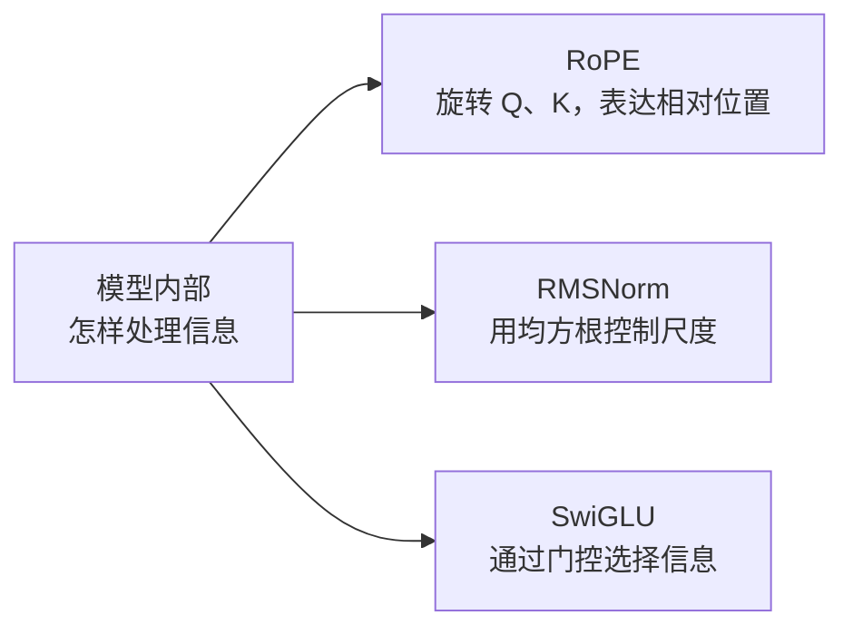

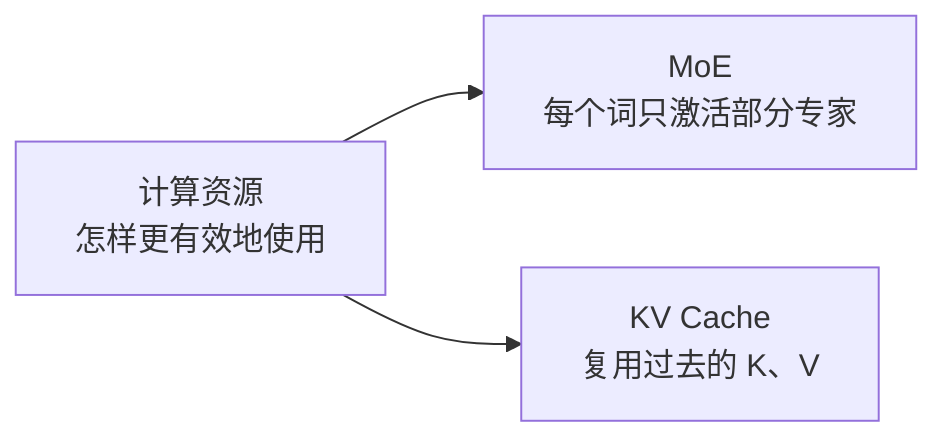

例如，Mixtral 8×7B 在 8 个专家中选择 2 个；DeepSeek-V3 在 256 个路由专家中选择 8 个，并另有共享专家。RoPE 并不自动保证任意长度的外推，KV Cache 的加速倍数也不是固定常数。

---

### 杀手锏 1：旋转位置编码（RoPE）——复数平面上的几何旋转

在第 5 章中，我们学习了绝对正弦位置编码。但在处理长达 10 万字甚至 100 万字的长文本时，原版正弦编码的外推能力有限。

研究者苏剑林等人在 2021 年的论文 RoFormer 里提出了 **RoPE（Rotary Position Embedding，旋转位置编码）**。后来的 LLaMA、DeepSeek 都广泛使用它。

> [!NOTE]
> **用旋转矩阵，而不是和差化积**：
> 把二维向量 $(x, y)$ 旋转角度 $\theta$，就是乘下面这个矩阵：
> $$\begin{pmatrix} x' \\ y' \end{pmatrix} = \begin{pmatrix} \cos\theta & -\sin\theta \\ \sin\theta & \cos\theta \end{pmatrix} \begin{pmatrix} x \\ y \end{pmatrix}$$
> 
> **RoPE 在做什么**：
> - 第 $m$ 个座位上的 Query，旋转 $m\theta$；
> - 第 $n$ 个座位上的 Key，旋转 $n\theta$；
> - 做点积时，其中一个旋转可以先转回去。净效果只剩下相对角度 $(n-m)\theta$。
> 
> 绝对座位被消掉了，剩下两个字隔了多远。

---

### 杀手锏 2：RMSNorm——先不管平均数，只控制振幅

在第 6 章中，经典的 LayerNorm 需要先算平均数 $\mu$，再算方差 $\sigma^2$。

研究人员发现：让数据中心保持零均值其实没那么重要，真正起到稳定数值作用的，是**控制向量的整体振幅大小**！
于是，**RMSNorm（均方根归一化）** 应运而生：
$$\text{RMS}(x) = \sqrt{\frac{1}{d} \sum_{i=1}^d x_i^2}$$
$$\text{RMSNorm}(x) = \frac{x}{\text{RMS}(x)} \odot \gamma$$

它直接省去了计算均值的一整套步骤，将显存访问和计算时间压缩了 10% 到 50%，成为了现代模型的标配！

---

### 杀手锏 3：SwiGLU 激活函数——带有开关的神经元

传统模型使用 ReLU（只保留正数）。现代模型普遍换用了 **SwiGLU**。
它的直觉就像在电路中加了一个**“可调节亮度的电位器开关”**：
$$\text{SwiGLU}(x) = \big(\text{Swish}(x W_{\text{门}}) \odot (x W_{\text{上}})\big) W_{\text{下}}$$
这里的 $\odot$ 是两个向量**对应位置相乘**，不是点积，最后再乘输出矩阵。一条路准备内容，另一条路当开关：开关开多大，内容就通过多少。

---

### 杀手锏 4：混合专家架构（MoE）——DeepSeek 的低成本核武器

如果一个模型拥有 6710 亿总参数（例如 [DeepSeek-V3 技术报告](https://arxiv.org/abs/2412.19437)中的模型），每次回答一个字都让全部参数跑一遍，电费和硬件成本会非常高。MoE 的想法是：每个词只路由到少数专家。

DeepSeek 和 Mixtral 采用的 **MoE（Mixture of Experts，混合专家模型）** 改变了游戏规则：

```
                    输入当前词
                        │
                        ▼
               [ 路由器 Router ]
                        │
         ┌──────────────┴──────────────┐
         ▼ 本次参加                       ▼ 本次休眠
   DeepSeek-V3：叫醒 8 个路由专家     其余约 248 个路由专家不参加
   另外还有 1 个共享专家，每次都参加
         │
         ▼
   整个模型约 6710 亿参数
   每个词激活的大约是 370 亿参数
```

两套常见数字不要混在一起：
- **Mixtral**：一共 8 个专家，每个词叫醒其中 2 个。
- **DeepSeek-V3（技术报告中的版本）**：每层有 256 个路由专家，每个词选择其中 8 个，并配合共享专家；报告给出的总参数约 6710 亿、每个词激活约 370 亿。模型版本会更新，数字应以对应技术报告为准。

专家不是出厂就贴着“数学”“历史”的标签。路由器学的是“这个词更适合交给哪几个专家”，分工是训练出来的。

---

### 杀手锏 5：KV Cache 机制——消除重复运算的打字机

在自回归生成时，如果没有 KV Cache，生成每个新词都可能重新计算整段前缀的 $Q,K,V$ 和注意力。对长度为 $t$ 的这一步，注意力本身大约要处理 $t^2$ 个位置对；把每一步累加到长度 $N$，朴素实现的总工作量会接近 $O(N^3)$。

**KV Cache 的秘密**：
过去已经生成的词，在固定的上下文和模型参数下，它们的 **Key 和 Value 不需要重复计算**。模型把之前算好的 K 和 V 存在缓存里。每次生成新词时，只计算当前词的 Query，再与缓存中的历史 K、V 做一次注意力；长度为 $t$ 的单步工作量约为 $O(t)$，生成到长度 $N$ 的总注意力工作量约为 $O(N^2)$。KV Cache 消除的是重复计算，不会把长文本注意力变成常数时间。

---

## 9.3 顶级大模型架构进化对照表

下表汇总了自 2017 年以来最具代表性的大模型架构演进轨迹：

### 表 9-2：从经典 Transformer 到 DeepSeek 的参数与架构进化演变

| 特性 / 模型 | 经典 Transformer (2017) | GPT-2 (2019) | LLaMA 3 (2024) | DeepSeek-V3 (2024) |
| :--- | :---: | :---: | :---: | :---: |
| **基础架构** | Encoder-Decoder | Decoder-Only | Decoder-Only | **Decoder-Only (MoE)** |
| **归一化位置** | Post-LN (后置) | Pre-LN (前置) | Pre-LN (前置) | **RMSNorm (无均值)** |
| **位置编码** | 绝对正弦余弦 | 可学习绝对位置 | **RoPE (旋转位置)** | **RoPE (带多级扩展)** |
| **激活函数** | ReLU | GELU | **SwiGLU** | **SwiGLU** |
| **注意力机制** | 标准 MHA | 标准 MHA | **GQA (分组查询注意力)** | **MLA (多头潜在注意力)** |
| **专家机制** | 单体 Dense | 单体 Dense | 单体 Dense | **MoE (256 专家激活 8 个)** |
| **最大上下文** | 常见实现约 512 | 1024 | 8,192；后续 3.1 可到 128K | **128,000（128K）** |

---

## 9.4 尺度定律（Scaling Law）与神奇的“涌现现象”

最后，让我们回答一个终极哲学问题：
> “大模型到底为什么会产生像人类一样的推理、翻译和解题能力？”

2020 年，OpenAI 发现了震惊学术界的 **尺度定律（Scaling Law）**：
在不少受控实验中，随着**模型参数量（Model Size）**、**训练数据量（Dataset Size）** 和 **计算算力（Compute）** 一起增加，预测误差（Loss）会近似沿幂律下降；真实训练还会受到数据质量、优化方法和评测方式影响。

有人把某些能力在变大之后才明显表现出来，叫做**涌现**。这个说法要小心用：不同任务的转折点不一样；有的“突然变好”是因为评分只有对和错，中间的进步被尺子藏住了。更稳妥的观察是：参数、数据和算力一起变大时，预测下一个词的损失沿一条比较平滑的曲线下降。下面的图只表示“规模变大以后，有些困难任务开始做得动”，不是说跨过某一天就会自动会解物理竞赛。

```
预测下一个词的损失 ▲ 越高越差
         │ \
         │  \   小模型：损失高，困难任务经常做不动
         │   \
         │    \________  规模、数据、算力一起变大，损失大体平滑下降
         └────────────────────────────────► 规模
```

有些困难任务要到模型比较大时才开始做得动。这仍然是“预测下一个词”训练出来的结果，不是模型自动获得了一套和人类相同的心智。第 8 章那个只背三首诗的小模型，就是尺度还很小的时候。

---

## 9.5 本章小结

- **Decoder-Only** 因为训练目标和开放式续写很贴合，成为近年聊天与代码模型中的主流选择；
- **RoPE、RMSNorm、SwiGLU、MoE 与 KV Cache** 是现代顶级大模型兼顾超长文本、极致速度与低成本推理的五大基石；
- **尺度定律与涌现现象**揭示了大自然最底层的数学美感：极其纯粹简单的“预测下一个词”，在海量算力与优雅架构的催化下，绽放出了璀璨的通用人工智能火花！


---

# 附录：数学公式速查卡与深度学习黑话翻译词典

---

## 附录 A：大模型核心数学公式速查卡

本书从向量、指数函数、均值与方差出发，逐步搭建起理解 Transformer 的数学工具。附录把这些公式集中整理，便于在阅读和运行代码时查阅。
下表整理了全书涉及的核心数学公式与在大模型中的对应映射：

### 表 A-1：数学知识点与大模型机制对应速查表

| 数学概念 | 数学教材公式 | 大模型应用场景 | 对应章节 |
| :--- | :--- | :--- | :---: |
| **平面与空间向量** | $\vec{a} = (x_1, x_2, \dots, x_n)$ | **词向量 (Word Embedding)**：把词语变成多维特征坐标点 | 第 1 章 |
| **向量模长（长度）** | $|\vec{a}| = \sqrt{\sum x_i^2}$ | 衡量词向量在特征空间里的强度大小 | 第 1 章 |
| **向量数量积（点乘）** | $\vec{a} \cdot \vec{b} = \sum a_i b_i$ | **注意力打分核心**：快速度量两个词的语义方向一致性 | 第 1、3 章 |
| **夹角余弦公式** | $\cos\theta = \frac{\vec{a} \cdot \vec{b}}{\|\vec{a}\| \|\vec{b}\|}$ | **余弦相似度**：度量两个词语、两篇文章的相似程度 | 第 1 章 |
| **指数函数** | $e^x \ (e \approx 2.71828)$ | **Softmax 归一化**：将任意实数映射为大于 0 的正数 | 第 3 章 |
| **概率归一化** | $P_i = \frac{e^{x_i}}{\sum e^{x_j}}$ | **注意力权重与词表预测**：把原始得分转化为和为 100% 的概率 | 第 3、8 章 |
| **均值与方差** | $\mu = \frac{1}{n}\sum x_i, \ \sigma^2 = \frac{1}{n}\sum (x_i - \mu)^2$ | **层归一化 (LayerNorm)**：将神经元特征拉到零均值和单位方差 | 第 6 章 |
| **独立随机变量方差加法** | $\text{Var}(X + Y) = \text{Var}(X) + \text{Var}(Y)$ | **缩放因子证明**：解释为什么注意力点积必须除以 $\sqrt{d_k}$ | 第 3 章 |
| **三角函数与周期** | $y = \sin(\omega t), \ T = \frac{2\pi}{\omega}$ | **正弦余弦位置编码**：通过高低频波浪给序列中的词发座位号 | 第 5 章 |
| **三角恒等变换和角公式** | $\cos(\alpha+\beta) = \cos\alpha\cos\beta - \sin\alpha\sin\beta$ | **相对位置线性外推**：解释为什么三角函数能表达相对距离 | 第 5 章 |
| **复数乘法与旋转矩阵** | $(x+iy) \cdot e^{i\theta} \leftrightarrow \begin{pmatrix}\cos\theta & -\sin\theta \\ \sin\theta & \cos\theta\end{pmatrix}$ | **RoPE 旋转位置编码**：现代 LLaMA/DeepSeek 的相对位置核心 | 第 9 章 |

---

## 附录 B：深度学习常见“黑话”大白话翻译词典

### 表 B-1：AI 行业黑话通俗翻译词典

| 深度学习黑话 | 英文原词 | 听起来像什么 | 大白话真实含义 |
| :--- | :--- | :--- | :--- |
| **张量** | Tensor | 高大上的量子物理？ | **多维数组**。0维是数字，1维是列表，2维是Excel表格，3维是带多个标签页的Excel。 |
| **词元 / Token** | Token | 代币、游戏币？ | 模型阅读的基本拼块。英文通常是半个或一个单词，中文通常是一个汉字或词组。 |
| **损失函数 / 损失值** | Loss | 赔了多少钱？ | **做错题的失分分值**。Loss 越小，说明模型预测得越准。 |
| **梯度下降** | Gradient Descent | 陡峭的悬崖？ | **盲人下山**。蒙着眼睛用脚感受哪个方向是下坡，顺着下坡方向小步移动调整参数。 |
| **过拟合** | Overfitting | 衣服太合身？ | **死记硬背**。模拟卷刷了 100 遍全考满分，一上高考考场遇到新题立刻考零分。 |
| **欠拟合** | Underfitting | 衣服太宽松？ | **根本没学会**。既没背过旧题，也看不懂新题，全靠瞎蒙。 |
| **自回归** | Autoregressive | 自动回归故乡？ | **贪吃蛇贪吃**。自己前面吐出来的字，又被吞进去作为输入，继续吐下一个字。 |
| **超参数** | Hyperparameter | 超级神秘参数？ | **模型出厂前的设定旋钮**。比如层数、头数、学习率，由人类工程师手工指定。 |
| **参数量** | Parameters Count | 智商数值？ | **模型肚子里拥有的神经元连接权重数量**。比如 7B 代表 70 亿个浮点数。 |
| **对齐** | Alignment | 排队站直？ | **后续训练立规矩**。常见做法包括人类反馈，目标是让回答更有帮助，并尽量少说有害或不诚实的话。 |

---

## 附录 C：后记与初学者进阶书单推荐

感谢你读到这里。

读到这里，你已经沿着词向量、注意力和 Transformer 积木块，走到了一个可以训练和生成文本的小模型。接下来可以反复运行实验、调整参数，把观察到的变化与公式对应起来；尚未理解的部分，也可以带着新的问题回头阅读。

人工智能的浪潮正在以惊人的速度重塑人类社会的一切。但请永远记住：
**再复杂的万亿大模型，其基石也不过是一次次纯粹的向量点积、一次次严谨的概率归一化，以及一行行充满敬畏的代码。**

### 进阶推荐阅读清单：
1. **原始论文**：《Attention Is All You Need》（Vaswani et al., 2017）——读完本书后，你可以尝试直接挑战这篇 2017 年的经典原作！
2. **经典视频**：3Blue1Brown 的神经网络系列，以及 2024 年的 *Attention in transformers, visually explained*。画面和公式对得上，适合看完本书后再看。
3. **开源项目**：Andrej Karpathy 的 `nanoGPT`——特斯拉前 AI 总监写的最简练优美的 GPT 实现。

愿你在未来的数学与科学征途上，始终保持对未知世界炽热的好奇心与探索的勇气！


---

